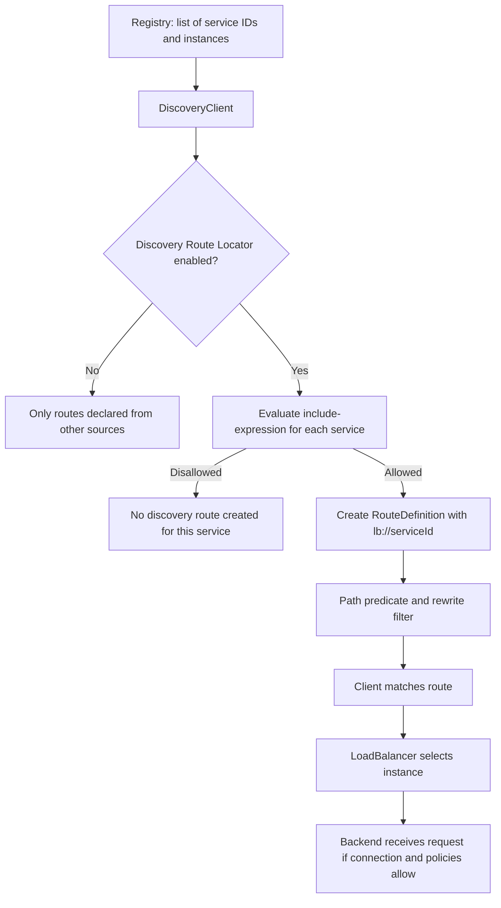

# Controlling Which Internal Services Can Be Published via Discovery in Spring Cloud Gateway

## 1. Why Is a Service Registry Not a Public API List?

In a microservices architecture, **Spring Cloud Gateway** is the shared HTTP entrypoint. Gateway uses **route predicates**, a **filter chain**, path/header transformations, and **service discovery/load balancing** to forward requests to the right service. Authentication, rate limiting, circuit breakers, retries, TLS, and request observability protect and operate the entrypoint safely.

Suppose the registry contains these services:

| Service ID in registry | Role | Should it be exposed via an Internet Gateway? |
|---|---|---|
`catalog-api` | Customer product catalog | Yes, but only approved APIs |
`orders-api` | Order lookup/creation | Yes, after enforcing authentication and authorization |
`billing-core` | Internal payment processing | Do not expose directly |
`internal-admin` | Infrastructure administration | No |
`config-server` | Serves service configurations | No |
`edge-gateway` | The Gateway itself, if also registered | Never create a routing loop back to itself |

**A service appearing in the registry does not mean it is permitted to have a public route.** The registry answers "which services currently have instances and where?"; API Gateway policy must answer a different question: "which clients may call which endpoints of that service, using which methods, hosts, and permissions?".

The goals of this lesson are:

- Understand why **DiscoveryClient Route Definition Locator** can create unintended routes.
- Choose the approach of **disabling auto-route generation and declaring an explicit allowlist** for production.
- When auto-route generation is needed, restrict the list with `include-expression` and understand the limits of that approach.
- Distinguish **no route**, **no instance found**, and **permission denied**.
- Verify the actual runtime route list, run negative tests, and apply defense in depth when the registry changes.

> **Scope:** examples use **Spring Cloud Gateway Server WebFlux 4.3+/5.x** with the `spring.cloud.gateway.server.webflux.*` namespace. Lines 4.2 and earlier generally use `spring.cloud.gateway.*`. Gateway Server Web MVC has its own web stack and namespace; do not assume WebFlux configs carry over verbatim to MVC.

## 2. The Path from a Service Name to a Public Route



**DiscoveryClient** (such as a Eureka or Consul client) provides service IDs and instance lists. **DiscoveryClient Route Definition Locator** is an *optional* component that creates route definitions from those IDs. **Spring Cloud LoadBalancer** then decides which instance receives requests for `lb://serviceId` URIs.

Three behaviors to distinguish:

1. **Registering in the registry:** the service exists in discovery; this does not yet mean clients can reach it.
2. **Creating a route in Gateway:** a URI and predicates are formed from the service ID; the route can become an access path if Gateway is exposed on the network.
3. **Calling the endpoint:** still depends on host/path/method matching, instance connectivity, TLS, Spring Security, authorization checks, and network policies.

### 2.1. Locator is disabled by default; if enabled, its filter includes all services

Per Gateway Server WebFlux 5.0/5.1 configuration:

| Property | Default value | Role |
|---|---|---|
`spring.cloud.gateway.server.webflux.discovery.locator.enabled` | `false` | Enables/disables auto-creating routes from discovery |
`spring.cloud.gateway.server.webflux.discovery.locator.include-expression` | `true` | SpEL expression deciding which services get routes |
`spring.cloud.gateway.server.webflux.discovery.locator.url-expression` | `'lb://'+serviceId` | Target URI generated for each service |
`spring.cloud.gateway.server.webflux.discovery.locator.lower-case-service-id` | `false` | Helps lowercase the service ID in generated patterns/filters |
`spring.cloud.gateway.server.webflux.discovery.locator.predicates` | Default locator config | Matching conditions for generated routes |
`spring.cloud.gateway.server.webflux.discovery.locator.filters` | Default locator config | Filters for generated routes |

**Easy-to-miss detail:** `enabled=false` is the safer starting state. When someone flips `enabled=true` **without restricting `include-expression`**, the default expression `true` allows creating discovery routes for every service seen by the locator.

### 2.2. What does an auto-generated path look like?

For service ID `catalog-api` with default locator configuration:

```text
Registry:
  catalog-api -> 10.1.0.12:8081, 10.1.0.13:8081

Auto-generated route (conceptual):
  Predicate: Path=/catalog-api/**
  URI:       lb://catalog-api
  Filter:    RewritePath strips /catalog-api before proxying

Client:
  GET /catalog-api/products/42
       |
       v
Gateway selects a catalog-api instance
       |
       v
Backend receives GET /products/42
```

The docs describe a default of `/{serviceId}/**` and a `RewritePath` filter stripping the service ID prefix. If the registry contains `internal-admin` and the locator does not filter, Gateway can also create a route like `/internal-admin/**`. **The mere existence of that route expands the attack surface**, even if the backend ultimately checks permissions.

Never treat registry service names as public API documentation; internal names can leak architecture details and change outside API governance processes.

## 3. Recommended Pattern: Disable Auto-Discovery Locator, Allow Routes Explicitly

The easiest-to-audit control model for an Internet Gateway is:

- **Discovery client remains active** to supply instances for `lb://`.
- **Discovery route locator is disabled** so services are not auto-published.
- **Public routes are explicitly declared** with ID, host, path, method, and `lb://` URI.
- Each route carries authentication, authorization, rate-limit, timeout, and retry policies suited to its sensitivity.

### 3.1. Example YAML — expose only Catalog and Orders

```yaml
# Gateway Server WebFlux 4.3+/5.x
server:
  port: 8080

spring:
  application:
    name: edge-gateway
  cloud:
    gateway:
      server:
        webflux:
          discovery:
            locator:
              enabled: false
          routes:
            - id: public-catalog
              uri: lb://catalog-api
              predicates:
                - Path=/api/catalog/**
                - Method=GET
              filters:
                - StripPrefix=1
                - AddRequestHeader=X-Edge-Route, public-catalog

            - id: public-orders
              uri: lb://orders-api
              predicates:
                - Path=/api/orders/**
                - Method=GET,POST
              filters:
                - StripPrefix=1
                - AddRequestHeader=X-Edge-Route, public-orders
```

With this example:

| Request | Expected route | Backend path | Notes |
|---|---|---|---|
`GET /api/catalog/products/42` | `public-catalog` | `/catalog/products/42` | `StripPrefix=1` strips `/api` |
`POST /api/catalog/products` | Does not match catalog route | Not proxied via that route | Because `Method=GET` |
`GET /api/orders/42` | `public-orders` | `/orders/42` | Requires authentication/authorization |
`POST /api/orders` | `public-orders` | `/orders` | Allowed only when business policy permits |
`GET /internal-admin/users` | No route published by this example | No downstream via the two routes above | Does not mean network/backend security can be skipped |
`GET /billing-core/invoices` | No route published by this example | Does not call `billing-core` via the two routes above | Not auto-generated from registry |

The routes above are **routing rules only**, without full JWT, CSRF/CORS, or user permission config yet. `X-Edge-Route` is a tracing header, **not an identity credential**; backends must never trust such a header from untrusted clients.

**Why isn't the locator needed to use `lb://`?** The locator decides whether to **auto-generate routes**; Spring Cloud LoadBalancer and `DiscoveryClient` are what let an already-declared route **select an instance**. Disabling the locator does not prevent explicit routes from using `lb://catalog-api`.

### 3.2. Dependencies: registry and load balancer

Recent Gateway Server WebFlux uses starters:

```xml
<dependency>
    <groupId>org.springframework.cloud</groupId>
    <artifactId>spring-cloud-starter-gateway-server-webflux</artifactId>
</dependency>
<dependency>
    <groupId>org.springframework.cloud</groupId>
    <artifactId>spring-cloud-starter-loadbalancer</artifactId>
</dependency>
```

If using Eureka, add the matching client:

```xml
<dependency>
    <groupId>org.springframework.cloud</groupId>
    <artifactId>spring-cloud-starter-netflix-eureka-client</artifactId>
</dependency>
```

**Import a Spring Cloud BOM** compatible with your project's Spring Boot version; do not pin individual Spring Cloud starter versions when managed by the BOM. If using Consul or another instance source, pick the matching `DiscoveryClient` **instead of** the Eureka client. The registry/server and its connection settings must actually exist.

In Gradle, the corresponding core dependencies are:

```groovy
dependencies {
    implementation 'org.springframework.cloud:spring-cloud-starter-gateway-server-webflux'
    implementation 'org.springframework.cloud:spring-cloud-starter-loadbalancer'
    // Add only if genuinely using Eureka:
    implementation 'org.springframework.cloud:spring-cloud-starter-netflix-eureka-client'
}
```

Do not add `spring-boot-starter-web` to Gateway Server WebFlux. When no instance is found, requests through `lb://` fail—typically with `503 Service Unavailable` depending on config; that is a **backend lookup failure**, distinct from **nonexistent route**.

## 4. When You Must Use the Auto Locator: Allowlist via SpEL

Sometimes a large number of service APIs and rapid lifecycles lead teams to let Discovery Locator auto-generate routes. In that case, enforce **deny-by-default**: only service IDs on an explicit allowlist may proceed.

### 4.1. Configuring an exact allowlist by service ID

Suppose the registry returns **lowercase** service IDs: `catalog-api`, `orders-api`, `billing-core`, `internal-admin`. Configuration:

```yaml
spring:
  cloud:
    gateway:
      server:
        webflux:
          discovery:
            locator:
              enabled: true
              include-expression: "serviceId == 'catalog-api' || serviceId == 'orders-api'"
```

Explanation:

1. `enabled: true` lets Discovery Locator create routes.
2. `include-expression` is **Spring Expression Language (SpEL)** evaluated for each candidate service; it permits only the two listed names.
3. `||` is SpEL OR; exact name matching prevents newly registered unapproved services from slipping in.
4. `predicates`, `filters`, and `url-expression` are omitted, so the locator's defaults apply.

| Discovered service ID | Condition result | Auto-discovery route created? |
|---|---|---|
`catalog-api` | `true` | Yes |
`orders-api` | `true` | Yes |
`billing-core` | `false` | No |
`internal-admin` | `false` | No |
`config-server` | `false` | No |
`edge-gateway` | `false` | No |

**Warning:** `include-expression` restricts the **service ID**, not a safe subset of endpoints inside that service. When permitting `catalog-api`, the default `/catalog-api/**` route can point to **any path** the catalog backend accepts, including admin paths if the backend accidentally exposes them. Treat this allowlist as **one control layer**, not a complete API authorization firewall.

### 4.2. Common pitfalls with service IDs

| Situation | Risk | How to handle |
|---|---|---|
Eureka returns `CATALOG-API` instead of `catalog-api` | Case-sensitive `==` mismatch; expected route is not generated | Check exact registry name; standardize naming conventions or use controlled expressions |
Setting `lower-case-service-id: true` | Only adjusts casing in generated predicates/filters; do not assume it transforms the entire SpEL context | Test the allowlist against the exact service IDs returned by `DiscoveryClient` |
Writing `serviceId.contains('api')` | Can let through `internal-admin-api` or unapproved new services | Use an exact ID list or an anchored, reviewed regex |
Relying on a `public-` name prefix | Service registrants might accidentally or intentionally name something `public-internal` | Govern the registry, registration permissions, and service ID approvals |
Omitting `include-expression` | Defaults to `true`, potentially creating routes for every visible service | Always configure an allowlist when the locator is enabled |
Hiding routes only with a Host predicate | Route is still created; clients may supply Host headers intentionally | Treat Host as routing logic, not a replacement for authentication/network policy |

### 4.3. Should the auto locator be used on an Internet-facing gateway?

**Not by default.** For public APIs needing stable contracts, versioned URLs, method restrictions, and endpoint-level control, **explicit routes are usually a better fit**. An allowlisted locator is useful in test environments or controlled internal networks where teams accept service-ID-based URLs.

In particular, in the default auto-discovery model, a newly approved service ID can cause a new route to appear **without a pull request updating the YAML routes list**. Therefore, maintain review processes for allowlist changes, test generated routes, and monitor for drift.

## 5. Difference Between a Service Allowlist and an Endpoint Allowlist

A service-level route can cover multiple APIs with very different permission requirements:

```text
catalog-api
  GET  /products/42                  Public
  POST /products                     Operations staff only
  GET  /internal/import-jobs         Internal only
  GET  /actuator/health              For health probes
  POST /actuator/shutdown            Should never be exposed
```

If Discovery Locator creates the default `/catalog-api/**` route, Gateway does not automatically know which APIs inside it are public. Having `catalog-api` in the allowlist **does not** make its internal endpoints safe.

| Decision level | Question to answer | Tool or control |
|---|---|---|
**Service** | Which services belong on the Gateway map? | Disable auto locator, or `include-expression` allowlist |
**Route/endpoint** | Which host, path, and methods are public? | Explicit route definitions, `Path`/`Host`/`Method` predicates |
**Client identity** | Who is calling the API? | OAuth2 Resource Server, JWT, mTLS, or matching auth mechanism |
**Authorization** | What can this identity do on which resources? | Spring Security at Gateway **and/or** backend business rules |
**Traffic control** | How much call volume is allowed? | `RequestRateLimiter`, client/tenant quotas, WAF |
**Network** | Which components can reach registry/backends? | Private subnets, firewalls, NetworkPolicy, security groups, TLS |
**Operations** | Who can view/modify runtime routes? | Secured Actuator, admin roles, audit logs |

**Defense-in-depth principle:** backends owning sensitive data **must still enforce authorization**. Never rely on a route currently not being published as your sole boundary: another Gateway config, proxy flaw, or network change could open a path.

## 6. Registry Access Permissions and Service Registration Permissions

Even when Gateway enforces an allowlist, control the **service registry** itself:

- **Do not expose service registration/deregistration APIs to the Internet** without vetted requirements and protections.
- Allow only authorized workloads or operators to register instances, change service IDs, and update metadata.
- Prevent registering **rogue instances** under an allowlisted service name. If an attacker controls one `catalog-api` instance, LoadBalancer can send traffic to an untrusted target.
- Secure connections to the registry with network policies, TLS, and authentication per system capabilities.
- Across `dev`/`staging`/`prod`, avoid sharing registries/namespaces or credentials that let production routes see test services.
- Segment **backend traffic** too; an internal service should not automatically gain a public IP or Internet path just because it registers.

**A service-name allowlist does not eliminate instance-injection risk.** Security also depends on **who can advertise an instance location for an allowed name**, and whether Gateway authenticates the target connection.

### 6.1. TLS and workload identity

Two connections are usually managed separately:

1. Client → Gateway: HTTPS/mTLS per API edge policy.
2. Gateway → backend: HTTPS/mTLS or protected internal connectivity compatible with discovery and load balancing.

A URI like `lb://catalog-api` represents a **logical name**; the `lb://` string itself does not guarantee encrypted transit or verified backend identity. Check instance schemes, HTTP client TLS config, certificate validation, and service mesh settings if applicable.

## 7. Customizing Predicates and Filters on Discovery Routes

In the auto locator, documentation describes these defaults:

```text
Path:    /{serviceId}/**
Filter:  RewritePath to strip the /{serviceId} prefix
URI:     lb://{serviceId}
```

These can be customized with `discovery.locator.predicates` and `discovery.locator.filters`. However, this is an easy place to break routes:

> **When you declare custom filters for Discovery Locator, that list replaces the default filter list.** If you still want to strip the `/{serviceId}` prefix, you must re-declare `RewritePath` or an equivalent filter. If you forget, the backend may receive `/catalog-api/products/42` instead of `/products/42` and return `404`.

In advanced setups, arguments of discovery-generated routes can use **SpEL** referencing `serviceId`. Because values pass through YAML, placeholders, and regex replacement escaping, check your exact version's docs and test actual paths before replacing all predicates/filters.

Minimal example of **customizing only Path**—you must still revisit the corresponding rewrite filter if the public API changes prefixes:

```yaml
# Structural illustration, not a complete route configuration:
spring:
  cloud:
    gateway:
      server:
        webflux:
          discovery:
            locator:
              enabled: true
              include-expression: "serviceId == 'catalog-api'"
              predicates:
                - name: Path
                  args:
                    pattern: "'/preview/' + serviceId + '/**'"
```

**Do not use this snippet directly as production config:** changing the prefix to `/preview/catalog-api/**` without updating the rewrite filter sends an unexpected path to the backend. When you need a fixed public URL like `/api/catalog/**`, **the explicit routes in Section 3 are simpler and safer**.

## 8. Version Guide: Newer vs. Older WebFlux

Exact property names are required for policies to take effect.

| Component | Gateway WebFlux 4.2 and earlier | Gateway WebFlux 4.3+/5.x |
|---|---|---|
Starter | `spring-cloud-starter-gateway` | `spring-cloud-starter-gateway-server-webflux` |
Route definitions | `spring.cloud.gateway.routes` | `spring.cloud.gateway.server.webflux.routes` |
Auto discovery routes | `spring.cloud.gateway.discovery.locator.enabled` | `spring.cloud.gateway.server.webflux.discovery.locator.enabled` |
SpEL allowlist | `spring.cloud.gateway.discovery.locator.include-expression` | `spring.cloud.gateway.server.webflux.discovery.locator.include-expression` |
Lowercase service ID | `spring.cloud.gateway.discovery.locator.lower-case-service-id` | `spring.cloud.gateway.server.webflux.discovery.locator.lower-case-service-id` |
Customize discovery routes | `spring.cloud.gateway.discovery.locator.predicates` / `filters` | `spring.cloud.gateway.server.webflux.discovery.locator.predicates` / `filters` |

**Upgrading from Gateway 4.2 to 4.3+** involves more than changing the starter: audit the **discovery locator namespace** as well. YAML containing `include-expression` under the wrong namespace may **silently be ignored**; "no startup errors" is not proof that the allowlist is active.

If running **Gateway Server Web MVC**, consult MVC-specific properties and configuration workflows. Never use `server.webflux` just because both belong to Spring Cloud.

## 9. Verifying Policy Against the Actual Runtime Route List

**Test objective:** while the registry holds `catalog-api`, `orders-api`, and `internal-admin`, Gateway **contains only approved routes**. Probing a URL once is not enough to prove no route exists: `404` can also come from a backend after a route matched.

### 9.1. Enable Gateway Actuator in read-only mode, off the public Internet

With Spring Cloud Gateway 5.x and Spring Boot Actuator, e.g.:

```yaml
management:
  endpoint:
    gateway:
      access: read-only
  endpoints:
    web:
      exposure:
        include: health,info,gateway
```

Add the `spring-boot-starter-actuator` dependency if not already present. Gateway docs recommend `access: read-only` so routes cannot be added, deleted, or refreshed through Actuator. **This is not an authentication mechanism**; management endpoints must still be protected by private networks, Spring Security, admin roles, and auditing.

Once proper access controls are in place, operators can inspect from a management network:

```bash
curl -i http://localhost:8080/actuator/gateway/routes
```

Exact JSON output varies by version/format; inspect **route IDs, URIs, predicates, and filters** rather than merely counting entries. If Gateway has explicit routes from YAML, Java DSL routes, or another dynamic source, **they still appear independently of disabling the discovery locator**.

### 9.2. Positive and negative test matrix

**Explicit route approach** from Section 3:

```bash
# Approved routes: must match if backends and policies allow.
curl -i http://localhost:8080/api/catalog/products/42
curl -i http://localhost:8080/api/orders/42

# No direct routes auto-created by locator from internal service names:
curl -i http://localhost:8080/internal-admin/users
curl -i http://localhost:8080/billing-core/invoices

# Also check potential auto-generated path for an allowed service:
curl -i http://localhost:8080/catalog-api/products/42
```

In an environment with only the Section 3 routes and no other handlers, the last three requests typically return `404` because no route matches. Never treat a single `404` as final proof; cross-check **the route list, backend access logs, and response origin**.

**Allowlisted auto-locator approach** from Section 4:

```bash
# Two auto-generated routes permitted:
curl -i http://localhost:8080/catalog-api/products/42
curl -i http://localhost:8080/orders-api/orders/42

# Must have no discovery routes for disallowed services:
curl -i http://localhost:8080/internal-admin/users
curl -i http://localhost:8080/billing-core/invoices
```

In this approach, even when `catalog-api` is permitted, you still need **negative tests on internal endpoints of that very service**, such as `/catalog-api/internal/maintenance` if the backend exposes one. Matching a route must never allow unauthorized users to execute administrative actions.

### 9.3. Mandatory test checklist when updating the registry

| Test scenario | Expected behavior |
|---|---|
Registry gains a new service `internal-tools` | No public route appears automatically unless approved |
Service ID `catalog-api` adds an instance | Route still targets only instances in the valid trust domain |
An allowlisted service is renamed | Does not accidentally match a similar name; route created only when approved |
Gateway restarts / reloads routes | Allowlist remains enforced with no leftover extra routes |
Eureka returns UPPERCASE IDs | `include-expression` and paths verified against real IDs |
Registry temporarily disconnects | Existing routes/instance cache, timeouts, and fallbacks behave per config; permissions never widen |
Caller has no token | Protected API returns 401/403 per policy, never proxied to sensitive backends |
Client sends forged Host/forwarding headers | Cannot bypass policy by spoofing `Host` or `X-Forwarded-*` |

When routes load dynamically, results can be affected by locator and service discovery caching/refreshes. **Never treat deleting a service from the registry as an instant permission revocation mechanism.** During a security incident, block at the network, Gateway policy, and backend simultaneously alongside updating the registry.

## 10. Approval Workflow for Publishing a Service on the API Gateway

A workflow usable in deployment reviews:

1. **Create a public API record:** service owner, purpose, public URL, version, methods, sensitive data, SLA.
2. **Define access permissions:** public, authenticated user, tenant-scoped, partner, admin, or internal-only. Never assume an entire service shares one privilege level.
3. **Choose routing mode:** prefer explicit declarations; use auto discovery locator only with operational justification and an allowlist.
4. **Review routing:** check `Path`/`Host`/`Method`, `StripPrefix`/`RewritePath`, `lb://` URI, service ID/casing, and discovery instance scope.
5. **Design policies:** OAuth2/JWT/mTLS, authorization, rate limiting, timeouts, retry idempotency, and circuit breakers. Decide Gateway–backend TLS.
6. **Control metadata and networking:** who can register instances, who can edit routes, restrict public ingress, never expose actuator/registry.
7. **Run positive and negative tests:** allowed endpoints succeed; internal/unauthorized endpoints are rejected; route list contains nothing outside the allowlist.
8. **Monitor and revoke:** route ID/latency/status/5xx/429, audit logs for allowlist changes, scheduled drift checks, and an emergency route-disable plan.

**Retry** or **CircuitBreaker** features can alter outcomes when a service fails; they do not decide *which services are allowed to appear*. Test those policies after routes are approved, and never use them to mask accidentally publishing the wrong backend.

## 11. Common Mistakes

| Symptom | Possible cause | Fix |
|---|---|---|
Route `/internal-admin/**` suddenly appears | Locator enabled with default `include-expression=true` | Disable locator or add an exact allowlist; inspect runtime routes |
Allowlist written, yet internal route still appears | Wrong config prefix, or route comes from YAML/Java/another dynamic locator | Check version and **all** route sources |
`catalog-api` has no auto route | Registry returns different case/name; expression fails to match | Inspect actual service ID, SpEL, and lower-case config |
Route generated, yet requests return `503` | No instances found or missing LoadBalancer | Check `spring-cloud-starter-loadbalancer`, discovery, and instance health |
Route matches, yet backend returns `404` | Discovery rewrite path lost when replacing filters | Re-declare `RewritePath` with right prefix or use explicit route |
Internal APIs of an allowlisted service are reachable | Filtered only by service ID, without restricting endpoints/authorization | Use specific routes and security policies; harden backend |
Clients can spoof headers to bypass checks | Gateway/backend trusts `X-Forwarded-*` or custom headers from Internet | Trust only verified proxies/workloads; strip/overwrite untrusted headers |
Route remains active after service shut down | Cache/refresh or another route source still holds it | Inspect runtime routes, follow refresh/redeploy procedures, block at backend/network |
Gateway calls itself via `lb://edge-gateway` | Locator creates a route for Gateway when Gateway also registers | Exclude from allowlist; prevent routing loops |
Cannot view `/actuator/gateway/routes` | Missing Actuator, access/exposure disabled, or blocked by Security | Configure read-only with admin permissions; never open publicly |
Authorization errors remain despite restricting routes | Route scope does not replace authn/authz | Audit security matchers and backend permissions |

## 12. Exercises and Answers

**Exercise 1.** Registry has `catalog-api`, `orders-api`, and `internal-admin`. Developers enable `discovery.locator.enabled=true` without setting `include-expression`. What can happen?

**Answer:** the default expression is `true`, so Gateway can create discovery routes even for `internal-admin`, such as `/internal-admin/**`. Disable the locator or configure an allowlist to prevent unintended exposure.

**Exercise 2.** You want to use `lb://catalog-api` without automatically exposing `/catalog-api/**`. What should you do?

**Answer:** set `discovery.locator.enabled=false` and declare an explicit route such as `Path=/api/catalog/**` with `uri: lb://catalog-api`. `DiscoveryClient` and LoadBalancer can still select instances for that route.

**Exercise 3.** Does `include-expression: "serviceId == 'catalog-api'"` restrict all sensitive endpoints inside `catalog-api`?

**Answer:** no. It only restricts **which service IDs get generated routes**, not child URLs within a service. Restrict route predicates/API contracts and enforce authentication and authorization at Gateway/backend.

**Exercise 4.** Why shouldn't you use `serviceId.contains('api')` as an auto-route allow policy?

**Answer:** a name like `internal-admin-api` also contains `api` and would slip through. Use an exact-match allowlist and govern service ID registration.

**Exercise 5.** Gateway returns `503` on `/api/orders/42`, while Actuator shows route `public-orders` exists. Was the route blocked by the allowlist?

**Answer:** insufficient evidence. `503` can happen because LoadBalancer finds no instances or the backend is unready. Having the route proves the route definition exists, so check discovery, instances, TLS connectivity, and error policies.

**Exercise 6.** An unfamiliar instance manages to register under the allowlisted name `catalog-api`. Is this dangerous?

**Answer:** yes. An allowlist checks the **service name**, not the trustworthiness of every instance. Protect registration permissions, registry networking, TLS/mTLS, and instance endpoint verification.

**Exercise 7.** Why does getting `404` on `/internal-admin/users` not guarantee no route is exposed?

**Answer:** `404` can also be returned by a backend after a route matched and proxied. Inspect the route list, route ID, logs, and whether the backend received the request.

**Exercise 8.** You add a new `discovery.locator.filters` entry to inject an identification header, and all auto-routed requests start getting `404` from backends. What is the common cause?

**Answer:** declaring custom filters can **replace the entire** default filter list, dropping `RewritePath` which stripped the service ID prefix. Restore an appropriate rewrite filter or switch to explicit routes.

## 13. Official Documentation References

- [Spring Cloud Gateway 5.1 – Configuration Properties](https://docs.spring.io/spring-cloud-gateway/reference/5.1/configprops.html): `discovery.locator.enabled`, `include-expression`, `lower-case-service-id`, `url-expression`, and the new WebFlux prefix.
- [Spring Cloud Gateway 5.0 – DiscoveryClient Route Definition Locator](https://docs.spring.io/spring-cloud-gateway/reference/5.0/spring-cloud-gateway-server-webflux/the-discoveryclient-route-definition-locator.html): `lb://serviceId`, default `/{serviceId}/**` routes, and `RewritePath` filter.
- [Spring Cloud Gateway 5.0 – Actuator API](https://docs.spring.io/spring-cloud-gateway/reference/5.0/spring-cloud-gateway-server-webflux/actuator-api.html): configuring `read-only` management endpoint access.
- [Spring Cloud Gateway 4.1 – DiscoveryClient Locator](https://docs.spring.io/spring-cloud-gateway/reference/4.1/spring-cloud-gateway/the-discoveryclient-route-definition-locator.html): comparing configuration on older Gateway lines.
- [Spring Cloud LoadBalancer](https://docs.spring.io/spring-cloud-commons/reference/spring-cloud-commons/loadbalancer.html): selecting service instances for `lb://` URIs.
- [Spring Security – Reactive OAuth2 Resource Server](https://docs.spring.io/spring-security/reference/reactive/oauth2/resource-server/index.html): token validation and securing Gateway WebFlux endpoints.

**Remember:** **DiscoveryClient finds services; Discovery Locator generates routes; LoadBalancer selects instances; Security decides who may call.** For public Gateways, prefer **disabling auto-route generation and declaring approved routes explicitly**. When an auto-locator is required, `include-expression` must be an explicit allowlist tested against denied cases too. Never equate "service exists in registry" with "service is approved for publication," and never treat hiding a route as your sole security control.
