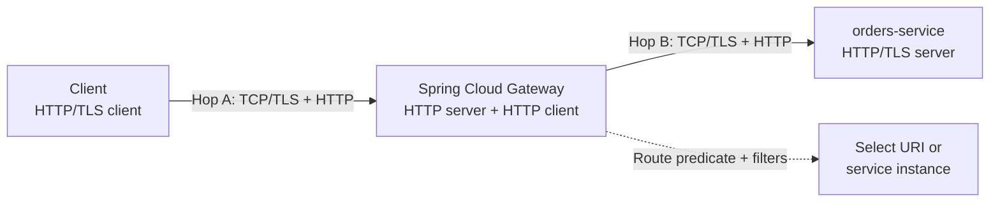

# Distinguishing client–gateway connections from gateway–service connections

## 1. Context and objectives

**Spring Cloud Gateway** serves as the entry point of a microservices system: it uses **route predicates** to select routes, **filter chains** to transform paths/headers, and integrates service discovery, authentication, rate limiting, circuit breakers, retries, TLS, and request tracing. A very common architectural mistake is treating a proxied request as **a single TCP/TLS connection** from the client to the backend.

In reality, for an API Gateway operating as a standard HTTP reverse proxy, there are **at least two independent connection hops**:

1. **Client → Gateway:** The Gateway acts as the **HTTP/TLS server**; the client acts as the **HTTP/TLS client**.
2. **Gateway → service:** The Gateway becomes the **HTTP/TLS client**; the target service acts as the **HTTP/TLS server**.

Each hop has its own network address, handshake, certificate, timeouts, connection pool, authentication method, and HTTP protocol. If there is a CDN, WAF, or ingress in front, the actual number of hops is even greater.

After this lesson in the **Connections and TLS** chapter, you will be able to:

- Accurately diagram the client → Gateway → backend hops and the **TLS termination** point.
- Explain why HTTPS from the client **does not guarantee** HTTPS from the Gateway to the service.
- Separately configure **inbound** HTTPS via Spring Boot and **outbound** HTTPS via the Gateway HTTP client.
- Distinguish **key store**, **trust store**, **SNI**, HTTP `Host`, mTLS, and `Forwarded`/`X-Forwarded-*`.
- Set connect/response/handshake timeouts for the right hop; understand downstream connection pooling.
- Practice inspecting each hop, certificates, and root causes of errors in operations.

> **Version scope:** The YAML snippets for Gateway Server WebFlux use the **Spring Cloud Gateway 5.0.x** property structure (for example `spring.cloud.gateway.server.webflux.routes` and `spring.cloud.gateway.server.webflux.httpclient.*`), combined with a compatible Spring Boot 4.0.x version. MVC examples are explicitly labeled separately. The 4.x line and some older TLS documentation pages use `spring.cloud.gateway.httpclient.*`; before deploying, compare against the **configuration properties list for your exact dependency version**. Do not mix the two namespaces without verifying the property conversion mechanism.

## 2. Two independent hops in a single request

### 2.1. Basic model



**Note on the diagram:** The arrows can represent **two different TCP connections**, rather than the Gateway stretching the client's raw socket all the way to the backend. The HTTP request/response is received, routed, and forwarded by the Gateway according to its runtime mechanism; the request ID and payload may be correlated, but the network connections do not have a mandatory one-to-one relationship.

| Characteristic | Hop A: Client → Gateway | Hop B: Gateway → service |
|---|---|---|
| Connection initiator | Client, or proxy/ingress directly in front of the Gateway | Gateway's internal HTTP client |
| Listener | Gateway HTTP server (`server.port`) | Service on the target host/port |
| Connection destination | Public or private DNS/IP of the Gateway/ingress | Host/port in route `uri`, or instance chosen by `lb://` |
| HTTP request sender | Client (or ingress) | Gateway |
| Server certificate when using TLS | Certificate of the Gateway/ingress | Certificate of the **target service** |
| Server certificate verifier | Client or ingress | Gateway HTTP client |
| mTLS client certificate (if enabled) | Client presents a certificate to the Gateway/ingress | Gateway may present **its own certificate** to the backend |
| Connection reuse/pool | Managed by client, proxy, and inbound server | Managed by the Gateway's HTTP client/connection pool |
| Timeouts to consider | Client/ingress timeout, server idle/keep-alive | Connect, TLS handshake, response, pool acquisition, read |
| IP seen by the server | Gateway sees its immediate peer | Backend typically sees the Gateway's network IP |

Example request:

```text
Client:
  GET https://api.example.test/api/orders/42

Hop A:
  client:ephemeral-port -> gateway:8443
  TLS server identity: api.example.test
  HTTP request-target: /api/orders/42

Gateway:
  route orders -> https://orders.internal.test:9443
  filter StripPrefix=1 -> /orders/42

Hop B:
  gateway:ephemeral-port -> orders.internal.test:9443
  TLS server identity: orders.internal.test
  HTTP request-target: /orders/42
```

Changing the path from `/api/orders/42` to `/orders/42` is the effect of a **GatewayFilter**, not a property of TLS. TLS protects data **per connection**; routes/filters determine the **HTTP message** that is sent.

### 2.2. Connection pools do not equal request counts

On the backend side, Gateway Server WebFlux uses a Reactor Netty-based HTTP client and can **reuse connections** from a pool. Therefore:

- A single client connection can send multiple HTTP requests over keep-alive; each request may be routed to a different backend instance after load balancing.
- A single **Gateway → backend** connection can serve multiple sequential requests (HTTP/1.1 keep-alive) or multiple streams depending on the HTTP version and configuration.
- When client A disconnects, you must not assume every outbound pooled connection is closed immediately; conversely, a new outbound connection does not necessarily require a new inbound connection.
- The backend usually sees the **Gateway/sidecar/NAT IP**, not the client's original IP directly at the socket layer.

The two hops can also run **different HTTP versions**: client ↔ ingress over HTTP/2, ingress ↔ Gateway over HTTP/1.1, and Gateway ↔ backend over HTTP/1.1. Do not conclude "end-to-end HTTP/2/gRPC" merely because the client side negotiated HTTP/2 successfully.

## 3. TLS deployment models

### 3.1. HTTPS into the Gateway, HTTP out to the backend

```text
Client -- TLS/HTTPS --> [Gateway] -- HTTP --> orders-service
                 TLS terminates at the Gateway
```

The Gateway has a valid certificate to **listen on HTTPS**, decrypts the HTTP request, and opens an **unencrypted** connection to the backend. This model may appear inside a strictly restricted internal network, but it is **not end-to-end encryption**.

### 3.2. HTTPS into the Gateway, HTTPS out to the backend (re-encryption)

```text
Client == TLS A ==> [Gateway] == TLS B ==> orders-service
          Gateway decrypts TLS A,
          then creates a new TLS B session
```

**Two independent TLS sessions:** The Gateway must have an appropriate **server certificate/private key** on the inbound side, as well as sufficient **trust material** to verify the backend's certificate. If the backend requires **mTLS**, the Gateway also needs a separate **client certificate/private key** for outbound.

### 3.3. TLS terminated at an ingress in front of the Gateway

```text
Client == HTTPS ==> [Ingress/LB] -- HTTP or HTTPS --> [Gateway] --> backend
                    TLS termination
```

Here, "client → Gateway" from a **business** perspective can contain **two network hops**: client → ingress and ingress → Gateway. If the ingress terminates TLS and forwards HTTP, the Gateway does not directly see the client's TLS handshake/certificate. Do not configure `server.ssl.*` on the Gateway and assume that is the certificate the client received at the Internet edge. Verify the exact TLS termination point and whether the internal connection is re-encrypted.

### 3.4. Connection matrix

| Client → Gateway | Gateway → backend | Meaning | Operational notes |
|---|---|---|---|
| HTTP | HTTP | Neither hop has TLS at the Gateway | Only suitable for controlled/lab environments; protect data at another layer if needed |
| HTTPS | HTTP | Encrypted on the client side but **unencrypted outbound** | Requires evaluating internal network security policies |
| HTTP | HTTPS | Gateway receives HTTP but authenticates/encrypts toward the backend | Can occur after an ingress terminates TLS; the ingress → Gateway hop still needs evaluation |
| HTTPS | HTTPS | **Two separate TLS sessions** | Requires configuring both inbound certificates and outbound trust |

**There is no automatic rule** stating "a route with `uri: https://...` forces the client to use HTTPS" or "because the client used HTTPS, upstream automatically becomes HTTPS." Both sides are configured independently.

## 4. Role of certificates and trust mechanisms

| Concept | Hop A | Hop B |
|---|---|---|
| **Server key pair** | Gateway/ingress holds the private key to prove server identity | Backend holds its own private key |
| **Server certificate** | Client verifies `api.example.test`, validity period, and CA chain | Gateway verifies `orders.internal.test`, validity period, and CA chain |
| **Trust store / CA** | On the client or ingress, to trust the Gateway's server certificate | On the Gateway HTTP client, to trust the backend's certificate |
| **mTLS client identity** | Client may present a certificate for the Gateway to authenticate | Gateway may present a different certificate for the backend to authenticate |
| **SNI** | Client sends the expected server name during TLS handshake | Gateway HTTP client sends the expected backend name |
| **HTTP Host / :authority** | Sent by the client in the HTTP message | Produced by the HTTP client/filters; may differ from SNI |

A **key store** holds the private key and certificate chain needed for a party to **present a certificate**. A **trust store** holds the CAs/certificates that a party uses to **verify a peer**. Configuring an inbound keystore **does not automatically create an outbound trust store**.

For example:

- A certificate for `api.example.test` is not guaranteed to be valid when the Gateway connects to `orders.internal.test`.
- If a backend uses an internal CA, the client/ingress does not necessarily trust that CA; the Gateway is the party that needs to trust it for hop B.
- When the Gateway passes `Host: public.example.test` with `PreserveHostHeader`, **outbound TLS SNI and hostname validation still typically rely on the connection endpoint**; do not confuse the HTTP Host with the TLS identity.
- Even if both hops use mTLS, **the client certificate from hop A is not automatically forwarded by the Gateway as the client certificate on hop B**. If you need to propagate end-user identity, use a verifiable mechanism such as OAuth2/JWT token relay, or identity propagation governed by a trust policy — do not pass a PEM certificate via a self-asserted client header.

### 4.1. TLS handshake and HTTP status happen at different layers

If the **hop A TLS handshake fails** (the client does not trust the cert, hostname mismatch, missing client cert when mTLS is required), the HTTP request may **never reach a Gateway route predicate**. In this case, the client sees a TLS error instead of a Gateway HTTP `404`/`500` response.

If the **hop B TLS handshake fails**, the Gateway has already received the request and selected a route, but its HTTP client cannot establish a secure connection to the backend; the caller typically receives a **5xx error** or a dropped connection depending on the exception handler/configuration. Do not assert an exact `502` or `504` status code across all Gateway versions.

## 5. Configuring inbound HTTPS: Gateway as server

### 5.1. Distinguishing `server.port` from route URI

For the Gateway to **listen on HTTPS** directly, use **Spring Boot server** configuration, not Gateway `httpclient` configuration. The example below uses a **PEM SSL bundle**: the private key/certificate are pre-provisioned as external secrets outside the repository.

```yaml
# application.yml of the WebFlux GATEWAY.
server:
  port: 8443
  ssl:
    bundle: gateway-inbound

spring:
  ssl:
    bundle:
      pem:
        gateway-inbound:
          keystore:
            certificate: file:/run/secrets/tls/gateway.crt
            private-key: file:/run/secrets/tls/gateway.key
  cloud:
    gateway:
      server:
        webflux:
          routes:
            - id: catalog-insecure-upstream-demo
              uri: http://127.0.0.1:8081
              predicates:
                - Path=/api/demo/**
              filters:
                - StripPrefix=2
```

Prerequisites before running:

- `gateway.crt` contains a certificate chain matching the hostname **the client will access** (demos may use `localhost`; production requires an official domain name).
- `gateway.key` is the corresponding private key, never committed to Git or logged. File read permissions should be granted only to the account running the Gateway.
- The backend `http://127.0.0.1:8081` exposes `GET /healthz`. The route above rewrites `/api/demo/healthz` to `/healthz`.
- If the Gateway runs inside a container while the backend runs **outside the container**, `127.0.0.1` in the route points to the **Gateway container itself**, not automatically to the host machine. Replace the URI with an address actually reachable from the Gateway.

When running as configured above, the client uses **HTTPS on `:8443`** while the Gateway uses **HTTP on `:8081`**. This is an intentional setup to demonstrate the **independence of the two hops**, not a production security configuration for the backend.

### 5.2. Traditional keystore configuration

Spring Boot also supports `PKCS12` or `JKS` via `server.ssl.key-store`. An **alternative** example to `server.ssl.bundle` above:

```yaml
# Choose ONE of the two inbound options: SSL bundle or keystore.
server:
  port: 8443
  ssl:
    enabled: true
    key-store: file:/run/secrets/tls/gateway.p12
    key-store-type: PKCS12
    key-store-password: THE_PASSWORD_FROM_SECURE_CONFIGURATION
```

The string `THE_PASSWORD_FROM_SECURE_CONFIGURATION` is a **placeholder**, not an actual password. In real applications, supply passwords through a secret manager, environment variable, or secure configuration system. Never copy real passwords into documentation, repositories, or consoles. **Do not combine** `server.ssl.bundle` and `server.ssl.key-store` in the same configuration assuming Boot will automatically reconcile them.

### 5.3. Inbound mTLS to authenticate clients with certificates

On hop A, if the Gateway itself terminates TLS and wants to require **clients to present a certificate**, Spring Boot provides this option:

```yaml
# Illustrates the relevant fields; appropriate trust material must also be provided.
server:
  ssl:
    client-auth: NEED
```

`NEED` requires a valid client certificate and a **trust store** for the Gateway to verify that certificate. Setting `client-auth: NEED` alone without provisioning the proper trust anchor does not complete mTLS. If an **ingress terminates TLS**, this configuration on the Gateway applies only to the Gateway's direct TLS client (which may be the ingress), **and does not automatically authenticate Internet end-users**.

## 6. Configuring outbound HTTPS: Gateway as client

### 6.1. Route URI selects the backend connection scheme

```yaml
# Route configuration snippet in a Gateway WebFlux application.
spring:
  cloud:
    gateway:
      server:
        webflux:
          routes:
            - id: orders-secure-upstream
              uri: https://orders.internal.test:9443
              predicates:
                - Path=/api/orders/**
              filters:
                - StripPrefix=1
```

This configures **hop B**: the Gateway connects to `orders.internal.test:9443` over HTTPS, and the backend receives the path `/orders/**` after `StripPrefix=1`. It **does not make the Gateway automatically listen on HTTPS** on its inbound port; to do that, you need the configuration in section 5 or TLS on an ingress.

In a lab, the hostname `orders.internal.test` is an illustrative name; the Gateway's runtime environment must be able to resolve this name to the backend IP, and the backend must serve TLS with a certificate containing a matching **Subject Alternative Name (SAN)**. If DNS does not resolve or the certificate is only valid for another name, requests can fail even though the YAML parses cleanly.

### 6.2. Trusting an internal CA in the WebFlux HTTP client

Backends using certificates issued by a **public CA already trusted by the JVM** can work with the default trust store. Backends using an **internal CA** require the Gateway HTTP client to have the appropriate trust material.

One approach in Gateway 5.0.x is an **outbound SSL bundle**. This is configuration **added to the Gateway application**, independent of the inbound bundle in section 5:

```yaml
# application.yml, used when the Gateway calls an HTTPS backend signed by an internal CA.
spring:
  ssl:
    bundle:
      pem:
        orders-outbound:
          truststore:
            certificate: file:/run/secrets/tls/orders-ca.crt
  cloud:
    gateway:
      server:
        webflux:
          httpclient:
            ssl:
              ssl-bundle: orders-outbound
```

- `orders-outbound` holds the **trusted CA/certificate** for the Gateway HTTP client, not the certificate **the Gateway uses as a TLS server**.
- The property `spring.cloud.gateway.server.webflux.httpclient.ssl.ssl-bundle` is listed in the 5.0.x **configuration properties**.
- If the bundle applies to the **shared HTTP client**, all HTTPS upstreams using that client may inherit the same trust policy. With multiple isolated CAs/backends, design appropriate trust boundaries and avoid bundling unnecessary CAs.
- Properly trusting a certificate **does not skip hostname validation**: the server certificate still needs to be valid for the connected backend hostname, unexpired, and have a valid certificate chain.

**Another** approach in the Gateway documentation is using `spring.cloud.gateway.server.webflux.httpclient.ssl.trusted-x509-certificates` to declare a list of trusted certificates. Choose **one clear trust strategy** per version; avoid mixing bundle configuration and certificate lists where it becomes unclear which trust source is active.

> **Do not use** `spring.cloud.gateway.server.webflux.httpclient.ssl.use-insecure-trust-manager: true` in production. This option disables certificate chain verification using an insecure trust manager and exposes traffic to man-in-the-middle (MITM) attacks. If you encounter `PKIX path building failed` or `unable to find valid certification path`, provision the proper CA, chain, and hostname instead of disabling checks.

### 6.3. Outbound mTLS: Gateway needs its own client key

If the backend requires **mTLS**, adding CA trust alone is not enough. The Gateway also needs a **client certificate and private key** to present to the backend. In an outbound PEM SSL bundle, you can declare both `keystore` and `truststore`:

```yaml
# Replaces the truststore-only orders-outbound definition in section 6.2.
spring:
  ssl:
    bundle:
      pem:
        orders-outbound-mtls:
          keystore:
            certificate: file:/run/secrets/tls/gateway-client.crt
            private-key: file:/run/secrets/tls/gateway-client.key
          truststore:
            certificate: file:/run/secrets/tls/orders-ca.crt
  cloud:
    gateway:
      server:
        webflux:
          httpclient:
            ssl:
              ssl-bundle: orders-outbound-mtls
```

This is the **Gateway's outbound TLS identity**, independent of the `api.example.test` certificate used for inbound. The backend must trust the CA that issued `gateway-client.crt` and enforce a policy binding the certificate identity to API permissions. Never expose the outbound private key to clients, and do not assume end-user tokens are completely replaced by mTLS.

### 6.4. Why the Host header does not replace SNI

Suppose a route has:

```yaml
uri: https://orders.internal.test:9443
filters:
  - name: SetRequestHostHeader
    args:
      host: public.example.test
```

This is a **route snippet**. The filter sets the downstream HTTP `Host` to `public.example.test`, yet the **network target remains `orders.internal.test:9443`**. TLS SNI and the certificate verified against the backend are usually determined by the **hostname of the connection endpoint**, and do not automatically change with the request Host header.

A virtual-hosted backend may require both SNI and Host to match; mismatches can produce TLS errors, `404`, or `421 Misdirected Request`. Test TLS connectivity and HTTP virtual hosting separately, and do not fix mismatches by turning off hostname verification.

## 7. Timeouts and connection pools across both hops

### 7.1. Distinguishing timeout types

| Timeout / limit type | Where does it apply? | Meaning |
|---|---|---|
| **Client timeout** | Client → Gateway | Client times out waiting for the Gateway's response |
| **Ingress idle/response timeout** | If a proxy sits in front of the Gateway | The proxy may abort the request before the Gateway finishes |
| **Outbound connect timeout** | Gateway → backend | Maximum time to establish a TCP connection to the backend host/port |
| **Outbound TLS handshake timeout** | Gateway → HTTPS backend | Maximum time to complete the TLS handshake after connecting |
| **Outbound response timeout** | Gateway HTTP client → backend | Limit on waiting for a response as configured on the Gateway |
| **Pool acquire timeout** | Gateway HTTP client | Time spent waiting to acquire a connection from the pool when at capacity |
| **Backend processing timeout** | Inside the service | The service may be slow due to DB queries, I/O, or heavy work |

Example **WebFlux 5.0.x outbound configuration**:

```yaml
spring:
  cloud:
    gateway:
      server:
        webflux:
          httpclient:
            connect-timeout: 3000
            response-timeout: 10s
            ssl:
              handshake-timeout: 5s
            pool:
              type: fixed
              max-connections: 200
              acquire-timeout: 2000
```

The numbers above are **illustrative lab values only**, not optimal defaults for every system:

- `connect-timeout` uses **milliseconds** (3000 = 3 seconds).
- Global `response-timeout` is a **Duration**, which can be written as `10s`.
- `ssl.handshake-timeout` is a **Duration** per the 5.0.x configuration table.
- With `pool.type: fixed`, `max-connections` and `acquire-timeout` govern connection allocation on **Gateway → backend**; they **do not limit the number of client-side TCP connections**.

Specific routes can set `metadata.connect-timeout` and `metadata.response-timeout` in **milliseconds**, unlike the Duration type of the global `response-timeout`. For example:

```yaml
# Inside a WebFlux route configuration.
metadata:
  connect-timeout: 1000
  response-timeout: 5000
```

Tune these values based on SLAs, latency percentiles, retry budgets, and concurrency. A request can be timed out by the client or ingress **before** the Gateway's outbound response-timeout expires.

### 7.2. Connection reuse and load balancing

When using `uri: lb://orders-service`, Spring Cloud LoadBalancer and a `ServiceInstance` source (such as service discovery) are required. The Gateway selects an instance, then **opens or reuses** a connection to that instance's IP/port.

**Key point:** the scheme for hop B depends on the route URI and the `ServiceInstance` security metadata (such as `isSecure`) per the LoadBalancer mechanism — **it is not inferred from inbound HTTPS**. A service registered in discovery as HTTP may be called over HTTP even if the client entered the Gateway via HTTPS; if re-encryption is expected, verify the actual downstream scheme, port, and certificate.

When an instance dies or DNS changes, the connection pool may still hold stale idle connections. Combine connection lifetime/idle eviction, health checks, timeouts, and bounded retries. Do not automatically retry order creation or payment operations unless idempotency is guaranteed.

## 8. Hands-on: Inbound HTTPS does not mean outbound HTTPS

### 8.1. Prepare a simple backend application

Create a Spring Boot application with the **Spring Web MVC** dependency, configure `server.port: 8081`, and add the following test controller:

```java
package com.example.demo;

import java.util.Map;
import jakarta.servlet.http.HttpServletRequest;
import org.springframework.boot.SpringApplication;
import org.springframework.boot.autoconfigure.SpringBootApplication;
import org.springframework.web.bind.annotation.GetMapping;
import org.springframework.web.bind.annotation.RestController;

@SpringBootApplication
@RestController
public class BackendApplication {

    public static void main(String[] args) {
        SpringApplication.run(BackendApplication.class, args);
    }

    @GetMapping("/healthz")
    public Map<String, String> health(HttpServletRequest request) {
        return Map.of(
            "status", "UP",
            "scheme", request.getScheme(),
            "peerIp", request.getRemoteAddr(),
            "host", request.getHeader("Host")
        );
    }
}
```

The backend needs its own configuration file:

```yaml
# application.yml of the BACKEND DEMO, not the Gateway.
server:
  port: 8081
spring:
  application:
    name: backend-demo
```

Once the backend is running, verify it directly:

```bash
curl --noproxy '*' -i http://127.0.0.1:8081/healthz
```

The expected response body contains `"scheme":"http"`. This is the **protocol on the connection arriving at the backend**. If the backend runs on the same host, `peerIp` is typically loopback; in Docker/Kubernetes, the backend may see the Gateway's pod/node/NAT IP.

### 8.2. Enable HTTPS on the Gateway and route to the HTTP backend

In a separate **Spring Cloud Gateway Server WebFlux** application, select the `spring-cloud-starter-gateway-server-webflux` dependency. Use the `server.ssl.bundle: gateway-inbound` configuration along with the route from section 5, using a certificate/key issued for the `localhost` hostname in the lab and a trust root for the client.

**You do not need to change the backend to HTTPS** for the first test. After starting the Gateway, run:

```bash
# Use a lab CA/certificate actually trusted by the client.
# Ensure the Gateway certificate has SAN=DNS:localhost.
curl --noproxy '*' --cacert /path/to/gateway-ca.crt \
  -i 'https://localhost:8443/api/demo/healthz'
```

If configured properly and both processes are running, the response may look like:

```http
HTTP/1.1 200 OK
Content-Type: application/json

{"status":"UP","scheme":"http","peerIp":"127.0.0.1","host":"127.0.0.1:8081"}
```

The `peerIp` and `host` values are **illustrative**, not guaranteed to be identical across every OS/runtime. What matters is:

- **The client succeeded over HTTPS** on `:8443`, proving hop A has TLS.
- **The backend saw `scheme=http`** when the route URI was `http://127.0.0.1:8081`, proving hop B **has no TLS**.
- The route rewrote `/api/demo/healthz` to `/healthz` via `StripPrefix`; TLS does not perform path rewriting.

**Do not use `curl -k` or `--insecure` to "prove TLS is secure."** Those flags skip client-side certificate verification, masking real SAN/CA errors. If only debugging a handshake, any test lacking verification must be explicitly marked as **not proving trust**.

### 8.3. Next step: switch the backend to HTTPS

To verify that hop B is secured, prepare a separate backend listening on `https://orders.internal.test:9443`, with a certificate containing the right SAN and signed by a CA the Gateway trusts. Then apply the HTTPS route and outbound SSL bundle from section 6.

Verify the upstream **from the Gateway's own runtime environment** first:

```bash
# This command only works when the hostname resolves to the backend,
# the backend on :9443 is listening on HTTPS, and the CA file is valid.
curl --noproxy '*' --cacert /path/to/orders-ca.crt \
  -i 'https://orders.internal.test:9443/healthz'
```

Only then call the Gateway over inbound HTTPS. If client → Gateway succeeds while Gateway → backend fails, inspect **DNS, port, CA, SAN, TLS SNI, and mTLS** on hop B — do not alter the inbound certificate when the fault lies in outbound.

### 8.4. Inspect certificates per hop with OpenSSL

```bash
# Hop A: inspect the Gateway's TLS server.
openssl s_client -connect localhost:8443 \
  -servername localhost \
  -verify_hostname localhost \
  -CAfile /path/to/gateway-ca.crt

# Hop B: inspect the backend's TLS server from the Gateway's environment.
openssl s_client -connect orders.internal.test:9443 \
  -servername orders.internal.test \
  -verify_hostname orders.internal.test \
  -CAfile /path/to/orders-ca.crt
```

Observe the certificate chain, hostname, validity dates, and final verification code. `openssl s_client` is a **direct TLS check**, and does not validate route predicates/filters in Spring Cloud Gateway. For backends requiring mTLS, the test also needs the appropriate client certificate/private key provided securely. The examples above do not supply those secrets.

## 9. Forwarded headers: the first TLS hop may have terminated before the Gateway

### 9.1. Why does the backend sometimes see the HTTP scheme?

Suppose:

```text
Browser -- HTTPS --> Ingress -- HTTP --> Gateway -- HTTP --> orders-service
```

The user sees the HTTPS padlock in the browser, yet the Gateway and backend only see HTTP on **their direct incoming connection**. The ingress may write:

```http
X-Forwarded-Proto: https
X-Forwarded-Host: api.example.test
X-Forwarded-For: 203.0.113.18
```

Or the standard header `Forwarded: for=...;proto=https;host=...`. This is **metadata describing the pre-proxy connection**, not proof that the Gateway → backend connection is encrypted. Do not mistake `X-Forwarded-Proto: https` for an active TLS handshake occurring on hop B.

### 9.2. Only trust forwarded headers from trusted proxies

HTTP headers can be spoofed by clients. If a client calls the Gateway directly and sends `X-Forwarded-Proto: https`, that **does not turn HTTP into HTTPS**. Likewise, `X-Forwarded-For` does not on its own prove the original client IP.

Gateway Server WebFlux 5.0.x documentation includes the `spring.cloud.gateway.server.webflux.trusted-proxies` property to specify a **regex identifying trusted proxies** when processing `Forwarded`/`X-Forwarded-*`. The regex must match your **actual topology**, combined with:

1. Network policies/firewalls ensuring the Gateway only accepts necessary traffic from trusted ingresses.
2. The ingress **stripping or normalizing** client-supplied forwarded headers.
3. The Gateway/backend only consuming forwarded headers under an explicit source-authentication policy.
4. Testing both requests arriving through the ingress and attempts to call the Gateway directly with forged headers.

**Security version notice:** Spring published **CVE-2026-47825** regarding forwarding `X-Forwarded-For`/`Forwarded` from untrusted proxies in certain configurations, affecting **Gateway 5.0.0–5.0.1**, fixed in **5.0.2** on this branch. When handling identity, IP allowlists, or forwarded schemes, use a **patched release** and check the security advisories for your deployment branch; do not just add a regex while ignoring dependency updates.

### 9.3. Impact on redirects, cookies, and security

A backend seeing HTTP while the client actually connects via HTTPS through an ingress may need the **public scheme** to generate correct redirects, absolute links, `Secure` cookies, or HSTS. However, mistakenly trusting client-supplied `X-Forwarded-Proto`/`Host` can cause **open redirects** or domain spoofing.

Configure trusted proxies, a canonical public base URL, and an appropriate URL-generation policy. More importantly, `X-Forwarded-Proto` **is no substitute for** Spring Security or TLS on downstream hops.

## 10. Gateway Server WebFlux vs. Web MVC: different outbound paths

| Aspect | Gateway Server WebFlux | Gateway Server Web MVC |
|---|---|---|
| Inbound HTTP server | Spring Boot WebFlux, typically Reactor Netty | Spring Boot Servlet container, e.g., Tomcat |
| Outbound HTTP client | Reactor Netty HTTP client | Spring Boot `RestClient` infrastructure |
| Inbound HTTPS | Spring Boot `server.ssl.*` / `server.ssl.bundle` | Spring Boot `server.ssl.*` / `server.ssl.bundle` |
| Outbound TLS | `spring.cloud.gateway.server.webflux.httpclient.ssl.*` | `spring.http.client.ssl.bundle` and `spring.ssl.bundle.*` |
| Outbound timeout/pool | Gateway WebFlux `httpclient.*`, Reactor Netty pool | Spring Boot `spring.http.client.*`, depends on chosen HTTP client |
| Java filters | `GatewayFilter` / `GlobalFilter` | WebMvc.fn `HandlerFilterFunction` / before/after filters |

**Separate example for Gateway Server Web MVC 5.0.x** calling an HTTPS backend signed by an internal CA:

```yaml
# Applies ONLY to Gateway Server Web MVC applications.
spring:
  http:
    client:
      ssl:
        bundle: mvc-backend-trust
      connect-timeout: 5s
      read-timeout: 30s
  ssl:
    bundle:
      pem:
        mvc-backend-trust:
          truststore:
            certificate: file:/run/secrets/tls/internal-ca.crt
  cloud:
    gateway:
      server:
        webmvc:
          routes:
            - id: orders-mvc
              uri: https://orders.internal.test:9443
              predicates:
                - Path=/api/orders/**
              filters:
                - StripPrefix=1
```

This is a **standalone example**; do not combine both WebFlux and MVC starters in the same application. Inbound TLS configuration remains the **Spring Boot server** configuration for MVC; `spring.http.client.ssl.bundle` only configures the outbound HTTP client. Timeouts, connection reuse, and SSL support depend on the underlying Boot/MVC HTTP client implementation running, so check the version-specific documentation.

## 11. Operations: identifying which hop is failing

### 11.1. Layered diagnostic table

| Symptom | Suspected hop | How to verify |
|---|---|---|
| Client reports `CERTIFICATE_VERIFY_FAILED` when calling Gateway | A | Client-side CA/trust store, Gateway domain SAN, expiry, ingress certificate |
| Browser reports TLS handshake failed, Gateway has no route logs | A or TLS at ingress | Inspect pre-HTTP handshake, SNI, and TLS termination configuration |
| Client connects to Gateway over HTTPS cleanly but receives 5xx when proxied | B or backend | Call backend directly from Gateway environment; check route URI, DNS, TLS, and timeouts |
| Gateway logs `PKIX path building failed` when calling HTTPS backend | B | Outbound CA/chain trust, certificate name, and JVM/client SSL bundle |
| Gateway outbound TCP connection refused | B | Backend port/listener, security groups, container network, service instance |
| Gateway outbound TLS handshake timeout | B | TLS negotiation, proxy/firewall, overloaded backend, TLS handshake timeout |
| Gateway response timeout after TCP/TLS succeeded | B or backend processing | Service processing time, DB queries, response-timeout, retry budget |
| Backend logs client IP as Gateway IP | Normal B behavior | The socket peer is the Gateway; if original IP is needed, use a trusted forwarded policy |
| Backend returns redirect to `http://` even though client used HTTPS | Ingress/HTTP metadata | Check forwarded proto, trusted proxies, canonical public URL |
| `lb://service` fails with no instance found | Discovery/LoadBalancer | Check service registry, instance host/port/isSecure, dependencies |
| HTTPS works for one service but fails for another | B | Compare DNS, SAN, CA, mTLS client certificates, per-route metadata |

### 11.2. Repeatable investigation sequence

1. **Map the actual path:** client → CDN/WAF → ingress → Gateway → service; note each host/port and TLS termination point.
2. **Verify hop A:** is the client actually establishing HTTPS to the Gateway or only to the ingress? Which certificate is presented? Do Host/SNI match?
3. **Verify routing:** route ID, predicates, upstream URI, filters like `StripPrefix`, and selected service instance.
4. **Verify hop B:** from the Gateway's environment, test DNS, TCP, TLS, and the backend HTTP endpoint; inspect CA, SNI/SAN.
5. **Compare timeouts:** client, ingress, Gateway outbound connect/TLS/response, backend; do not blindly increase all values.
6. **Check policies:** Spring Security/JWT/mTLS, circuit breaker, retry, and rate limiter may block or transform responses before/after the HTTP proxy.
7. **Attach a request ID:** log/trace route ID, ingress/egress timestamps, upstream status, and latency; never log tokens, private keys, or sensitive data.

### 11.3. Security and operations checklist

- [ ] Each hop has an **explicit TLS policy**, without relying on HTTPS from another hop.
- [ ] Inbound server certificates have the correct SAN/domain, with provisioning and **renewal before expiry**.
- [ ] Outbound CA trust, hostname validation, and TLS versions/ciphers match backend requirements.
- [ ] Inbound mTLS and outbound mTLS use their own dedicated certificates/keys/trust anchors.
- [ ] `use-insecure-trust-manager` is never enabled in production.
- [ ] Private keys/passwords reside in a secret store, with restricted permissions and a rotation policy.
- [ ] Proxies/ingresses sanitize forwarded headers; the Gateway trusts only explicitly configured proxies.
- [ ] Spring Cloud Gateway/Boot security patches are kept up to date.
- [ ] Connect/handshake/response timeouts, pool capacity, and retry budgets are load-tested.
- [ ] Tracing, metrics, request IDs, and alerts for certificate expiry/connection errors are active.
- [ ] Actuator/admin endpoints are not exposed to the Internet beyond operational needs.

## 12. Exercises and self-check questions

**Exercise 1 — Identify TLS:** A client calls `https://api.example.test`, and the Gateway routes to `http://orders:8080`. Which hop has TLS? Why cannot this be called end-to-end TLS?

**Exercise 2 — Re-encryption:** The Gateway holds server certificate `api.example.test` and needs to call backend `https://orders.internal.test` signed by an internal CA. What kind of trust material must be added to the Gateway, and for which hop?

**Exercise 3 — Client certificate:** A user sends an mTLS certificate to the Gateway. If the backend also requires mTLS, is the user's certificate automatically used in the second TLS handshake? What does the design require?

**Exercise 4 — Ingress:** A browser connects via HTTPS to an ingress, and the ingress connects via HTTP to the Gateway. The Gateway logs `scheme=http`. Does that contradict the browser using HTTPS?

**Exercise 5 — Host and SNI:** The Gateway routes to `https://orders.internal.test`, but a filter sets `Host: public.example.test`. Which endpoint's certificate hostname does the Gateway verify, and why is HTTP Host insufficient to prove TLS is targeting the right peer?

**Exercise 6 — Timeouts:** Outbound connect timeout is 3 seconds, handshake timeout is 5 seconds, response timeout is 10 seconds; the ingress timeout is 7 seconds. When the backend takes 9 seconds to process, what is one reason the client gets disconnected before the Gateway response timeout?

**Exercise 7 — Discovery:** When using `lb://orders-service`, the client called the Gateway over HTTPS. Is that sufficient basis to assume the Gateway calls the service instance over HTTPS? What should you check?

**Exercise 8 — Debugging:** The client receives a TLS error as soon as it opens `https://localhost:8443`; the Gateway has no route logs. What do you inspect before touching `StripPrefix` or `Retry`?

### Answer hints

1. TLS is present on hop A; hop B is unencrypted HTTP. Because each hop is independent, client-side HTTPS does not guarantee encryption to the backend.
2. Internal trust store/CA for the **outbound Gateway HTTP client**; the `api.example.test` certificate is for the **inbound Gateway server**.
3. No. The Gateway needs its **own outbound TLS client identity** (certificate/private key), and the backend must trust the CA that issued it; end-user identity is propagated via an appropriate authentication/authorization mechanism.
4. No contradiction. The browser's TLS session terminates at the ingress; the Gateway only sees an HTTP connection from the ingress unless the ingress re-encrypts.
5. The TLS client typically verifies the certificate for `orders.internal.test` from the connection URI. HTTP Host is an HTTP-layer header and can differ from SNI; both layers must be verified.
6. The **7-second** ingress timeout can abort hop A earlier than the **10-second** outbound response timeout, even while the Gateway is still waiting on the backend.
7. Not sufficient. Inspect `ServiceInstance.isSecure`, the resolved URI after LoadBalancer, the port, actual TLS trust/certificates, and upstream access logs.
8. Inbound certificate, SAN/hostname, client CA trust, HTTPS port, SNI, ingress TLS termination, and TLS handshake errors; route predicates/filters run after this step.

## Official references

- [Spring Cloud Gateway 5.0 — TLS and SSL, Server WebFlux](https://docs.spring.io/spring-cloud-gateway/reference/5.0/spring-cloud-gateway-server-webflux/tls-and-ssl.html) — inbound HTTPS certificates, outbound trust, and TLS handshakes.
- [Spring Cloud Gateway 5.0 — Configuration Properties](https://docs.spring.io/spring-cloud-gateway/reference/5.0/configprops.html) — version-specific `server.webflux.httpclient`, SSL bundle, pool, and timeout property names.
- [Spring Cloud Gateway 5.0 — HTTP Timeouts Configuration](https://docs.spring.io/spring-cloud-gateway/reference/5.0/spring-cloud-gateway-server-webflux/http-timeouts-configuration.html) — global timeouts and per-route metadata.
- [Spring Cloud Gateway 5.0 — HttpHeadersFilters WebFlux](https://docs.spring.io/spring-cloud-gateway/reference/5.0/spring-cloud-gateway-server-webflux/httpheadersfilters.html) — `Forwarded`, `X-Forwarded-*`, and `trusted-proxies`.
- [Spring Cloud Gateway 5.0 — Server Web MVC TLS and SSL](https://docs.spring.io/spring-cloud-gateway/reference/5.0/spring-cloud-gateway-server-webmvc/tls-and-ssl.html) — `RestClient`, `spring.http.client.ssl.bundle`, and trust material.
- [Spring Boot — SSL Bundles](https://docs.spring.io/spring-boot/reference/features/ssl.html) — configuring PEM/JKS bundles for servers and clients.
- [Spring Boot — Embedded Web Servers and HTTPS](https://docs.spring.io/spring-boot/4.0/how-to/webserver.html) — `server.ssl.bundle` and inbound HTTPS configuration.
- [Spring Cloud Gateway — Security Advisory CVE-2026-47825](https://spring.io/security/cve-2026-47825/) — forwarded headers from untrusted proxies and patched releases.
- [RFC 8446 — TLS 1.3](https://www.rfc-editor.org/rfc/rfc8446) and [RFC 9110 — HTTP Semantics](https://www.rfc-editor.org/rfc/rfc9110) — distinguishing transport security from HTTP semantics.
