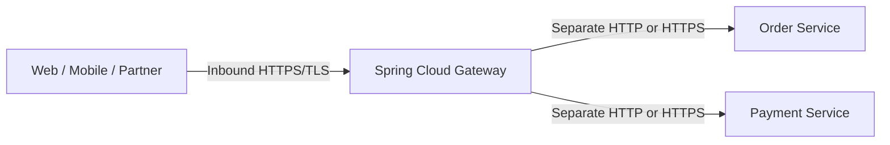
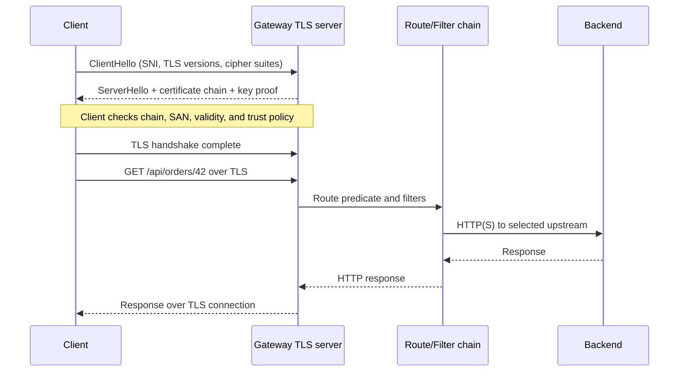
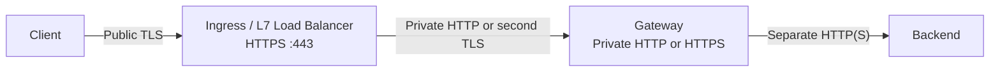
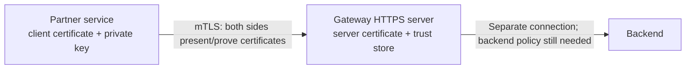

# Configuring inbound TLS and gateway certificates

## Lesson objectives

In the **Connections and TLS** chapter, this lesson guides you through setting up **inbound HTTPS/TLS** for **Spring Cloud Gateway**: from understanding certificates and trust chains to server configuration, connection testing, deploying behind a load balancer/ingress, and managing certificate renewal.

After completing this lesson, you will be able to:

- Distinguish **client → gateway** connections from **gateway → backend** connections; know which certificate is presented on each hop.
- Explain the roles of private key, leaf certificate, intermediate CA, root CA, SAN, hostname verification, and SNI.
- Enable HTTPS directly on **Spring Cloud Gateway Server WebFlux** using Spring Boot's `server.ssl` configuration with PKCS#12.
- Know an alternative option: configuring PEM via **Spring Boot SSL bundles**, depending on the version.
- Design TLS termination at the gateway, at the ingress/load balancer, or TLS on both hops.
- Understand the difference between TLS server authentication and **mutual TLS (mTLS)** with client certificates.
- Test HTTPS with `curl`/OpenSSL, troubleshoot handshake errors, and design a safe workflow for issuing, renewing, and replacing certificates.

**Scope:** Java/runtime examples focus on **Spring Cloud Gateway Server WebFlux** running on Spring Boot and Reactor Netty. Some property paths/methods change across Spring Boot/Spring Cloud Gateway versions; check your project's specific dependencies before deploying configurations to production. Configuring outbound TLS to backends is a **separate** topic from inbound TLS.

## 1. Which segment does inbound TLS protect?

An API Gateway sits at the edge of a microservices system. Clients can be browsers, mobile apps, partners, or internal services. When a client accesses `https://api.example.com`, it needs an encrypted connection that authenticates the remote peer with TLS.



In the diagram above:

- **Inbound TLS:** the client performs a TLS handshake with the Gateway, inspecting and verifying the certificate **presented by the Gateway**.
- **Outbound TLS:** the Gateway acts as an HTTP client when calling Order Service/Payment Service. If that hop uses HTTPS, the Gateway must verify the **backend's** certificate using appropriate trust configuration for its HTTP client.
- **Route predicate/filter chain:** begins processing an HTTP request only after the connection has been established and the HTTP server reads the request. A TLS handshake error can happen **even before there is a request to match a route**.

**Enabling `server.ssl` on the gateway does not automatically enable HTTPS or certificate verification for outbound connections.** Likewise, a route declaring `uri: lb://order-service` only expresses how to locate the logical backend; it does not guarantee that the entire path is encrypted.

### 1.1. Three security goals of TLS

1. **Confidentiality:** traffic over a TLS connection is encrypted, reducing the risk of eavesdropping in transit.
2. **Integrity:** TLS detects unauthorized tampering with data in transit.
3. **Authentication (peer authentication):** certificates give the client a basis to verify whether the connected server owns the domain name and corresponding key.

TLS does not guarantee that **a user is logged in** or **authorized to access an order**. Application authentication/authorization still requires Spring Security/OAuth2/JWT or another mechanism; the backend must still enforce business authorization rules. TLS also does not perform rate limiting, circuit breaking, retries, or tracing.

## 2. Certificate concepts to understand before configuring

### 2.1. Private key, server certificate, and CA chain

| Component | Role | How to manage |
| --- | --- | --- |
| **Private key** | Secret key the server uses to prove key ownership during the TLS handshake | Protect strictly; never commit to Git, never log, restrict read permissions |
| **Leaf/server certificate** | Server certificate containing public key, DNS/IP identity, and validity period | Sent by the server during the handshake; not a secret |
| **Intermediate CA certificate** | Certificate of an intermediate CA used to build a trust path | Typically sent by the server alongside the leaf so the client can build the chain |
| **Root CA certificate** | Trust anchor of the client | Typically already in the client's trust store; sending the root in the chain is not required by default |
| **Trust store** | List of CAs/certificates trusted by an endpoint | On the client to verify the server; on the server when verifying client certificates in mTLS |
| **Key store** | Storage holding the server's own private key and certificate (optionally with its chain) | On the Gateway when the Gateway terminates TLS directly |

For a gateway to present a valid certificate, it needs a **private key matching the public key in the leaf certificate**, a certificate with the right domain name, and a CA chain trusted by the client.

Example client connection:

```text
https://api.example.com/orders/42
```

The server certificate must contain the matching name in **Subject Alternative Name (SAN)**, such as `DNS:api.example.com`. The Common Name (CN) field **should not be treated as a substitute for SAN**. A certificate for `admin.example.com` is not automatically valid for `api.example.com`.

Wildcards like `*.example.com` have specific scope rules: they do not automatically match deeper subdomain levels. Choose a SAN list reflecting the exact hosts that clients use.

### 2.2. The handshake occurs before Gateway filters



If the certificate is expired, the CA is untrusted, or the SAN does not match, the client may reject the connection before `RoutePredicateHandlerMapping`. Therefore **you cannot expect a normal `GlobalFilter` to log the full root cause of every TLS handshake error**.

### 2.3. SNI and certificate selection

**Server Name Indication (SNI)** is the hostname information sent by many clients during the TLS handshake, allowing a server/proxy to pick a certificate matching the host. SNI **does not replace hostname verification**: the client must still verify that the received certificate matches the target host.

If a Gateway serves multiple domains/certificates, it may require an SNI-based certificate selector at the ingress/proxy or equivalent capability in the server being used. A `server.ssl.key-store` configuration with a single key alias does not automatically become a certificate manager for unlimited hosts.

## 3. Two common inbound TLS architectures

### 3.1. Gateway terminates TLS directly


The Gateway holds the **private key and certificate for the public domain**; the Gateway itself answers the TLS handshake. This approach makes sense when there is no TLS-terminating ingress in front, or when TLS passthrough is required.

Advantages:

- The Gateway directly owns the server TLS policy and certificates.
- Can enable client certificate authentication on the Gateway listener if mTLS is required.
- Does not have to trust `X-Forwarded-Proto` to know whether the client–Gateway connection used TLS.

Costs:

- Must distribute and protect the private key across Gateway replicas.
- Must manage timely certificate renewal/rotation, test handshakes, and ensure zero-downtime rollouts.
- Must open/route the HTTPS port properly, monitor TLS handshakes, and secure the runtime.

### 3.2. TLS termination at an ingress/load balancer



In this model, the **ingress** holds the public-facing private key and certificate; the client verifies the ingress certificate, not the certificate of a Gateway instance behind it. The Gateway can listen on plain HTTP inside a protected network, or enable HTTPS to **re-encrypt the ingress → Gateway hop**.

**TLS termination at the ingress does not automatically make the ingress → Gateway hop secure.** You must evaluate the trust boundary, network policy, mTLS/service mesh if present, organizational policy, and data protection requirements.

If the Gateway only receives HTTP from a trusted proxy, values such as the public scheme/host can be passed via `Forwarded` or `X-Forwarded-*`. Configure forwarded-header handling **only for trusted proxies**; do not allow clients to spoof these headers to influence generated URLs, redirects, access control, or logs.

### 3.3. Choosing where to terminate TLS based on responsibility

| Criterion | Terminate at Gateway | Terminate at ingress |
| --- | --- | --- |
| Public certificate | Installed on Gateway | Installed on ingress |
| Public private key | Each Gateway replica or the secret store it uses | Managed by ingress/certificate manager |
| Edge HTTPS redirect | Needs an appropriate listener/edge; `server.ssl` alone does not create an HTTP listener | Usually configured at ingress/edge |
| External client mTLS | Gateway verifies client certificate if receiving the handshake directly | Ingress verifies; requires a contract to pass verified identity to the Gateway |
| Public TLS handshake observability | Gateway/server metrics | Ingress/load balancer metrics |
| TLS between proxy and Gateway | No L7 proxy or TLS passthrough | Choose private HTTP, HTTPS, or separate mTLS |

In production, **having both an ingress and a Gateway** does not automatically mean enabling TLS twice, nor does it mean leaving the internal hop unprotected. Design based on networking, certificate ownership, latency, operations, and security policy.

## 4. Enabling HTTPS directly on Spring Cloud Gateway

**Spring Cloud Gateway Server WebFlux** runs on Spring Boot. When the application uses embedded Reactor Netty, the HTTPS listener is configured via **Spring Boot server SSL** properties — not via route predicates or `GatewayFilter`.

### 4.1. Configuring a PKCS#12 keystore

Example `application.yml`:

```yaml
server:
  port: 8443
  ssl:
    enabled: true
    key-store: file:/etc/gateway/tls/gateway.p12
    key-store-type: PKCS12
    key-store-password: ${GATEWAY_KEYSTORE_PASSWORD}
    key-alias: gateway
```

Meaning:

| Property | Example value | Purpose |
| --- | --- | --- |
| `server.port` | `8443` | Gateway HTTPS listener. Port 8443 is convenient for local/container; public traffic is typically mapped from 443 |
| `server.ssl.enabled` | `true` | Enables SSL/TLS for the embedded HTTP server |
| `server.ssl.key-store` | `file:/etc/gateway/tls/gateway.p12` | Location from which the server reads the keystore |
| `server.ssl.key-store-type` | `PKCS12` | Container type holding the private key and certificate chain |
| `server.ssl.key-store-password` | `${GATEWAY_KEYSTORE_PASSWORD}` | References the password via environment/secret provider instead of plaintext in YAML |
| `server.ssl.key-alias` | `gateway` | Selects the private key/certificate entry when the keystore contains multiple entries |

Notes:

- The file `/etc/gateway/tls/gateway.p12` must exist **in the Gateway's runtime environment** and the process must have read permissions. This is an example Linux/container path, not a pre-existing file.
- The keystore must contain a **private key entry**, not just a public certificate. If the file only contains certificate/trust entries, the TLS server has no key to present.
- If the private key entry has its own password, some configurations also require `server.ssl.key-password`; check your store type and how the entry was created.
- Never commit certificates bundled with private keys, passwords, Kubernetes Secret manifests with real data, or `.p12` files into source control.
- `server.port: 8443` with SSL configured **does not automatically open an additional HTTP port 8080**. To serve HTTP solely to redirect to HTTPS, an explicit secondary proxy/listener layer must be configured.

After starting properly, test from the client:

```bash
curl --cacert /path/to/trusted-ca.pem \
  https://api.example.com:8443/api/orders/42
```

`--cacert` points to the CA/certificate appropriate for the trust chain, not to the private key. If the cert uses a public CA already trusted by the OS/client, plain `curl` may suffice. A `404` from an unmatched path **is not necessarily a TLS error**: if the client received an HTTP response over HTTPS, the handshake succeeded.

### 4.2. A sample route behind TLS

```yaml
server:
  port: 8443
  ssl:
    enabled: true
    key-store: file:/etc/gateway/tls/gateway.p12
    key-store-type: PKCS12
    key-store-password: ${GATEWAY_KEYSTORE_PASSWORD}
    key-alias: gateway

spring:
  cloud:
    gateway:
      routes:
        - id: orders
          uri: lb://order-service
          predicates:
            - Path=/api/orders/**
          filters:
            - StripPrefix=1
```

This snippet illustrates a **Gateway Server WebFlux with inbound HTTPS** and a route using `lb://`. To run completely:

1. The Gateway has a valid keystore and secret password.
2. Routes are loaded under the **namespace matching your Spring Cloud Gateway version**.
3. Spring Cloud LoadBalancer is present with an instance source for `order-service`, or the route is changed to a static HTTP URI of a test backend.
4. Port 8443 is properly published/mapped; firewalls and load balancers allow traffic as designed.

**Important:** `server.ssl` protects **client → Gateway**. The URI `lb://order-service` is routing and service discovery configuration; it does not specify how the Gateway client will verify backend certificates.

## 5. Creating local test certificates (not for production)

For practice, you can generate a **self-signed** certificate with a SAN for `localhost`, then package it as PKCS#12. The commands below are illustrative and require OpenSSL on your machine:

```bash
# Step 1: generate a private key and a 30-day self-signed certificate.
openssl req -x509 -newkey rsa:3072 -sha256 -nodes \
  -days 30 \
  -keyout gateway.key \
  -out gateway.crt \
  -subj "/CN=localhost" \
  -addext "subjectAltName=DNS:localhost,IP:127.0.0.1"

# Step 2: package the key/cert into PKCS#12 for the server.
openssl pkcs12 -export \
  -inkey gateway.key \
  -in gateway.crt \
  -name gateway \
  -out gateway.p12
```

OpenSSL will prompt for an **export password** in step 2. Store the password in a local secret manager/environment variable, and never hardcode it into source code or production runbooks.

For example, to test locally with the `localhost` certificate, update the path in the config to point to `gateway.p12` and start the Gateway. Then:

```bash
# The self-signed certificate acts as the trust anchor solely for this test.
curl --cacert gateway.crt \
  https://localhost:8443/api/orders/42

# Inspect the certificate presented by the server.
openssl s_client -connect localhost:8443 \
  -servername localhost \
  -showcerts

# Inspect SAN, issuer, subject, and validity of the cert file.
openssl x509 -in gateway.crt -noout \
  -subject -issuer -dates -ext subjectAltName
```

**Do not use this self-signed certificate for Internet production.** Public certificates must be issued under a trusted PKI policy, have SANs matching the published DNS names, protected private keys, a complete chain, and automated renewal.

### 5.1. Testing hostnames without skipping verification

To test `api.example.test` at `127.0.0.1`, you can use:

```bash
curl --resolve api.example.test:8443:127.0.0.1 \
  --cacert /path/to/trusted-ca.pem \
  https://api.example.test:8443/api/orders/42
```

This lets the client connect to the test IP while still using **hostname `api.example.test`** for TLS SNI/hostname verification. The server certificate must have the matching SAN and its CA must be trusted. This is far better than disabling certificate verification.

Avoid using `curl -k`/`--insecure` as a passing test criterion: skipping certificate checks hides chain/SAN errors and creates a false sense of security.

## 6. Configuring PEM with Spring Boot SSL bundles

On Spring Boot versions that support **SSL bundles** (such as Spring Boot 3.1+), you can declare PEM certificates/private keys directly instead of PKCS#12:

```yaml
spring:
  ssl:
    bundle:
      pem:
        gateway:
          keystore:
            certificate: file:/etc/gateway/tls/fullchain.pem
            private-key: file:/etc/gateway/tls/privkey.pem

server:
  port: 8443
  ssl:
    bundle: gateway
```

Meaning:

- `fullchain.pem` usually contains the **leaf certificate and required intermediate chain**; do not mix the private key into the certificate file.
- `privkey.pem` holds the **private key**, which must have restricted read permissions and be distributed via a secure secret mechanism.
- `server.ssl.bundle: gateway` instructs the embedded server to use the defined bundle.
- **Do not mix** `server.ssl.bundle` and `server.ssl.key-store`/`server.ssl.key-store-password` properties on the same listener assuming Boot will automatically reconcile them.

Bundles are convenient when a certificate manager issues PEM files directly. However, do not assume every Spring Boot/Reactor Netty version **automatically hot-reloads** when PEM files change. Reload support, additional property names, and connection update behavior must be verified on your exact version; when no verified mechanism exists, perform a **rolling restart/redeployment** with availability checks.

## 7. TLS termination at ingress: what does the Gateway need?

In Kubernetes or architectures using a reverse proxy, the public certificate may live on the ingress:

```text
Client --HTTPS:443--> Ingress --HTTP:8080--> Gateway --HTTP(S)--> Backend
```

If **private HTTP** is acceptable for the ingress → Gateway hop per network policy:

```yaml
server:
  port: 8080
  ssl:
    enabled: false
```

In this model, the certificate for `api.example.com` is installed **on the ingress**, not inside the Gateway. Access to the Gateway should be restricted exclusively to the ingress or authorized components via services/network policies/firewalls. Never unintentionally expose the HTTP Gateway directly to the Internet.

If policy requires encrypting the ingress → Gateway hop as well:

```text
Client --HTTPS:443--> Ingress --HTTPS:8443--> Gateway --HTTP(S)--> Backend
```

The ingress must **verify the Gateway certificate** on the upstream hop, and the Gateway uses inbound TLS as configured in section 4 or 6. This is **TLS re-encryption**: there are two independent handshakes and two independent trust policies. Internal certificates can be issued by a private CA, provided the ingress trusts that CA and verifies the server name properly.

### 7.1. `X-Forwarded-*` and public URLs

When an ingress terminates HTTPS and calls the Gateway over HTTP, the Gateway may need to know that the original client used `https`. Spring Boot provides properties for handling forwarded headers, for example:

```yaml
server:
  forward-headers-strategy: framework
```

Depending on the runtime, a native handling option may also exist. **This property does not verify the origin of the headers.** `Forwarded`, `X-Forwarded-Proto`, `X-Forwarded-Host`, or `X-Forwarded-For` must be trusted **only from proxies controlled by your organization**, and the ingress must strip/overwrite spoofed client values at the outer boundary.

Trusting client-supplied headers can cause the application to generate wrong redirect URLs, log the wrong scheme/host, violate HTTPS policies, or use spoofed IP addresses in rate limiting. When configuring `server.forward-headers-strategy`, always pair it with network controls and a trusted proxy chain.

### 7.2. Redirecting HTTP to HTTPS

Enabling:

```yaml
server:
  port: 8443
  ssl:
    enabled: true
```

**does not automatically create an HTTP port 80/8080 to return 301/308 redirects**. In production systems, HTTPS redirects should be handled at the edge/load balancer or by an intentionally deployed HTTP listener. If configuring HSTS, emit it only over valid HTTPS connections and understand the domain-wide impact of `max-age`, `includeSubDomains`, and `preload`.

Never build redirects by naively concatenating untrusted `Host` or `X-Forwarded-Host` headers, as this risks host-header injection or open redirects.

## 8. Mutual TLS (mTLS): requiring client certificates

Standard HTTPS lets the client verify the **server** certificate. With **mTLS**, the server also requests and verifies a **client certificate** to authenticate the API caller.



This model is commonly useful for B2B partners or service-to-service traffic with its own PKI. It **does not** replace application authorization: a valid client certificate still must be mapped to the appropriate partner, scope, route, or business permissions.

### 8.1. Sample configuration requiring client certificates

Example of a Gateway terminating TLS directly:

```yaml
server:
  port: 8443
  ssl:
    enabled: true
    key-store: file:/etc/gateway/tls/gateway.p12
    key-store-type: PKCS12
    key-store-password: ${GATEWAY_KEYSTORE_PASSWORD}
    key-alias: gateway

    client-auth: need
    trust-store: file:/etc/gateway/tls/trusted-clients.p12
    trust-store-type: PKCS12
    trust-store-password: ${GATEWAY_TRUSTSTORE_PASSWORD}
```

In this configuration:

- **Gateway's key store**: private key + server certificate chain used to answer clients.
- **Gateway's trust store**: appropriate CAs/certificates used to verify the certificate presented by the **client**.
- `server.ssl.client-auth: need`: requires a client certificate during the TLS handshake; clients without a matching certificate generally fail to complete the handshake.
- `server.ssl.client-auth: want`: may request a certificate without requiring it; do not treat this as enforced mTLS authentication.
- `server.ssl.client-auth: none` or omitting client authentication: HTTPS requires only the server certificate.

The `need` setting applies **at the listener level**; it cannot be switched to "only one route requires mTLS" via a `Path` predicate because the TLS handshake occurs before route matching. If only a subset of APIs requires mTLS, separate them by hostname/listener/ingress policy or a dedicated architecture.

### 8.2. A valid certificate does not equal sufficient permissions

Even after the TLS server verifies the client certificate against the trust store, the application still needs to:

1. Identify which partner or workload corresponds to which certificate.
2. Map the verified identity to route access policies and permissions.
3. Check expiration, revocation mechanisms when needed, certificate rotation, and partner status.
4. Ensure the backend does not trust a spoofed `client-cert` or `client-id` header injected by an Internet client.

If mTLS terminates at the ingress, the Gateway **does not directly receive the client certificate in the public connection's handshake**. Any identity information forwarded from the ingress to the Gateway must travel over a trusted channel with an explicit verification policy; never assume an HTTP `X-Client-Cert` header alone proves mTLS succeeded.

### 8.3. Testing mTLS

Assuming the test environment has a valid CA and client certificate:

```bash
curl --cacert gateway-ca.pem \
  --cert partner-client.crt \
  --key partner-client.key \
  https://localhost:8443/api/partner/orders
```

Also test **without** providing `--cert/--key`: a listener configured with `client-auth: need` must reject access at the TLS layer. Test certificates issued by another CA, expired certificates, and certificates not mapped to proper permissions. Do not look solely at HTTP status codes; many mTLS failures happen during the handshake before any HTTP response is produced.

## 9. Configuring TLS versions, HTTP/2, and security policy

The baseline should be modern TLS as mandated by your organization's security policy. In many environments, **TLS 1.2 and TLS 1.3** should be supported while SSL 3.0/TLS 1.0/TLS 1.1 are disallowed.

Example Spring Boot Server SSL properties:

```yaml
server:
  port: 8443
  ssl:
    enabled: true
    key-store: file:/etc/gateway/tls/gateway.p12
    key-store-type: PKCS12
    key-store-password: ${GATEWAY_KEYSTORE_PASSWORD}
    enabled-protocols:
      - TLSv1.3
      - TLSv1.2
```

Notes:

- **Successfully negotiating TLS 1.3** also depends on the Java runtime, Reactor Netty/TLS provider, certificate/key, and client. Setting the property cannot make an unsupported runtime support it.
- Cipher suites should follow the modern baseline of your platform/runtime; avoid re-enabling weak ciphers/protocols just to accommodate legacy clients.
- Never place private keys, passwords, or tokens in JVM arguments or diagnostic logs in ways that expose them to other users or hosts.
- Never use a trust manager that skips certificate verification on the outbound hop to "fix" a TLS error; fix the CA/chain/SAN and trust configuration properly.

### 9.1. HTTP/2 over TLS

On supported Spring Boot/Reactor Netty versions, you may consider:

```yaml
server:
  http2:
    enabled: true
```

HTTP/2 over TLS requires runtime/TLS provider support and proper **ALPN** negotiation. Enabling HTTP/2 **does not increase certificate security**, replace authentication, or allow skipping TLS when the architecture requires HTTPS.

A system can accept HTTP/2 at the Gateway while calling the backend over HTTP/1.1; these are two independent HTTP hops. Connection-specific headers such as `Transfer-Encoding` cannot be copied verbatim across different protocol versions.

### 9.2. TLS only encrypts the connection; it does not enforce API policy

After the handshake, requests still must be handled properly:

- Route predicates select the appropriate API.
- Gateway filters may modify paths/headers, authenticate, or rate-limit traffic.
- Spring Security/OAuth2/JWT verifies identity and grants permissions per contract.
- Retries/circuit breakers/timeouts protect resilience when backends fail.
- Logging/metrics/tracing observe requests without leaking tokens, cookies, certificate private keys, or sensitive data.

TLS addresses one layer in this defense-in-depth chain; you cannot conclude an API is "secure" just because the browser shows a padlock icon.

## 10. Renewing, rotating, and protecting certificates in production

Certificates have expiration dates and must be **rotated before expiry**. Certificate rotation is an operational process, not merely replacing a file.

### 10.1. Recommended certificate rotation workflow

1. **Inventory:** know the hostnames/SANs, TLS termination points, CA, keystore type, owner, expiration date, and all Gateway/ingress instances using the cert.
2. **Issue:** generate keys/certificates under PKI policy, avoiding unauthorized private key reuse; verify chain and SANs are accurate.
3. **Distribute securely:** use a secret manager, Kubernetes Secret, or equivalent; enforce least-privilege read access, never commit keys to Git or logs.
4. **Pre-deployment checks:** verify private key matches cert, SAN, validity dates, chain, hostname, and process read permissions.
5. **Gradual rollout:** update replicas via rolling deployment or a **verified supported** reload mechanism; maintain enough healthy replicas to avoid total outage.
6. **Post-deployment checks:** connect with the expected hostname/SNI, inspect the live certificate presented by each endpoint, and monitor handshake errors.
7. **Revoke/decommission:** remove access to old keys per policy, audit backups/secret history, and handle compromised certificates if applicable.

Do not assume updating a mounted Secret file causes every Reactor Netty instance to immediately serve the new certificate. Depending on version and configuration, **restarting listeners or pods may be required**. If a hot-reload feature is available, test it thoroughly with the exact properties, file mount method, and product version.

### 10.2. Managing secrets and keystores

Practices to apply:

- Keep `gateway.p12` or `privkey.pem` in a directory/secret volume readable only by the account running the Gateway.
- Read passwords from a secret provider or properly protected environment variables; never hardcode them in a committed `application.yml`.
- Never emit private keys in metrics, logs, traces, or diagnostics; never attach them to support tickets.
- Restrict who can update certificates and secrets; audit changes per policy.
- Protect secrets on **every replica**; scaling replicas also increases the number of environments holding the key.
- Separate dev/test/production certificates; never use test private keys for public APIs.

### 10.3. Monitoring expiration dates and handshakes

Set up dashboards/alerts for:

| Signal | Reason |
| --- | --- |
| Days remaining until certificate expiration | Renew proactively before clients reject connections |
| Hostname/SAN and issuer of the live served certificate | Detect deploying the wrong cert |
| TLS handshake failures per listener | Surface protocol, cipher, CA, or client-auth incompatibilities |
| 4xx/5xx errors and latency **after** HTTP requests enter the Gateway | Distinguish API errors from TLS errors |
| Certificate rollout/reload status per replica | Detect when only part of a cluster uses the new cert |
| Outbound TLS metrics toward backends | Detect CA/hostname/handshake errors on the **other hop** |

Per-route HTTP request metrics will not record every failed handshake, because the route filter chain may never run. Combine monitoring at the **TLS listener/ingress**, properly leveled configuration logs, and proactive client-side checks.

## 11. Testing HTTPS/TLS from the client side

### 11.1. Inspecting the certificate chain and hostname

```bash
# Check which cert the endpoint is serving.
openssl s_client \
  -connect api.example.com:443 \
  -servername api.example.com \
  -showcerts
```

`-servername` explicitly sets SNI. The output shows the certificate chain, TLS version, and verification details, but **you must check the verification result and hostname** according to the tool/client in use. When verifying hostnames with OpenSSL, use the verify flags appropriate for your tool version and designated CA trust store.

Examples forcing TLS 1.2 and TLS 1.3 tests if supported by the client:

```bash
openssl s_client \
  -connect api.example.com:443 \
  -servername api.example.com \
  -tls1_2

openssl s_client \
  -connect api.example.com:443 \
  -servername api.example.com \
  -tls1_3
```

These two commands are compatibility checks, not proof that the entire configuration is secure. A successful TLS 1.2 handshake also does not guarantee the negotiated cipher complies with organizational policy.

### 11.2. Testing HTTPS with `curl`

```bash
# Certificate issued by a public CA already trusted by the client:
curl -v https://api.example.com/api/orders/42

# Certificate issued by a private CA:
curl -v --cacert ./trusted-root-ca.pem \
  https://api.example.com/api/orders/42

# Resolve the host to a test IP while still verifying the real domain name:
curl -v --resolve api.example.com:443:192.0.2.10 \
  --cacert ./trusted-root-ca.pem \
  https://api.example.com/api/orders/42
```

`192.0.2.10` is a documentation example IP address. In a test environment, replace it with the actual allocated IP. If the certificate is valid, `curl` may return HTTP `401`, `403`, or `404` due to auth/route/backend logic: that is distinct from a TLS handshake failure.

### 11.3. Distinguishing TLS errors from Gateway HTTP errors

| Symptom | Likely layer | How to diagnose |
| --- | --- | --- |
| `certificate verify failed` / `unknown CA` | CA chain/trust | Check issuer, intermediate, root CA, and client trust store |
| `hostname mismatch` | Wrong SAN or connecting with wrong hostname | Check `DNS`/`IP` in SAN and SNI |
| Certificate expired / not yet valid | Cert validity or system clock | Check cert dates, runtime clock, and rotation process |
| `wrong version number` or protocol error | Connecting HTTPS to HTTP port, misconfigured or incompatible TLS listener | Check port/proxy and protocol on each hop |
| Handshake failure with mTLS | Missing/wrong client certificate or CA trust | Check `client-auth`, client cert chain, trust store, and policy |
| TLS succeeds but HTTP 404 | Route/path/backend | Check route predicates, path rewrites, and target URI |
| TLS succeeds but HTTP 401/403 | Application authentication/authorization | Check `SecurityWebFilterChain`, tokens, scopes/roles |
| HTTP 502/503 after route match | Outbound connection/backend/discovery | Check route URI, load balancing, outbound TLS, timeouts, and upstream health |
| Client sees redirect to HTTP | Ingress/forwarded headers/redirect config | Check trusted proxies, URL scheme, and HTTPS redirect |

**Note:** similar exception messages can appear across multiple layers. Always identify where TLS terminates and correlate logs from the corresponding listener/hop rather than relying solely on error wording.

## 12. Common configuration mistakes

### 12.1. Keystore without a private key

A PKCS#12 file containing only a public certificate is not enough for a server to answer handshakes. Inspect entry types and aliases with an appropriate tool, such as:

```bash
keytool -list -v -storetype PKCS12 \
  -keystore gateway.p12
```

Do not attach the entire keystore or passwords to bug reports. Confirm the alias contains a `PrivateKeyEntry` and the matching certificate chain; a missing alias or wrong password can prevent the server from starting.

### 12.2. Sending HTTPS traffic to an HTTP port

If the Gateway is running:

```yaml
server:
  port: 8080
  ssl:
    enabled: false
```

while a load balancer sends TLS connections directly to 8080, both sides are speaking different protocols. This cannot be "fixed" by adding `RewritePath` or `SetRequestHeader`; configure the proper listener/terminator type and port.

### 12.3. Replacing the cert on ingress while clients still report certificate errors

Some ingress/load balancer replicas may still be serving the old certificate, DNS may point to a different endpoint, or SNI may select the wrong certificate. Test every endpoint, real hostname, and SNI; do not assume users see the new cert simply by inspecting the updated Secret file.

### 12.4. Enabling `client-auth: need` and locking out all browsers

`need` requires a client certificate on **every handshake on that listener**. Public browsers/users typically do not hold certificates accepted by an internal CA. Design mTLS per partner/workload or on a separate listener/host rather than enforcing mTLS across all public APIs.

### 12.5. Using the backend's certificate as the gateway certificate

A certificate for `orders.internal` is not automatically valid for `api.example.com`. Each TLS hop has its own **server name**: public clients verify the API Gateway/ingress host; the Gateway calling an HTTPS backend verifies the target host according to outbound settings.

### 12.6. Disabling certificate verification to silence errors

Mechanisms that bypass CA/hostname verification only mask the error rather than fixing it. They weaken protection against man-in-the-middle attacks. Fix the SAN, trust chain, SNI, or CA properly instead of turning insecure settings into production defaults.

## 13. Production deployment checklist

| Item | Question to answer |
| --- | --- |
| **TLS termination point** | Does client TLS terminate at the Gateway, ingress, or via L4 passthrough? |
| **Internal hops** | Do ingress → Gateway and Gateway → backend use HTTP/HTTPS/mTLS under which trust boundaries? |
| **Hostname/SAN** | Is the certificate issued for the exact DNS/IP clients actually connect to? |
| **Chain** | Are leaf and required intermediate certs present; does the client CA trust them? |
| **Private key** | Is the key distributed via a secret store, permission-restricted, and excluded from Git/logs? |
| **TLS policy** | Do protocols/cipher suites meet the organization's baseline on the actual runtime? |
| **mTLS** | If client certs are required, are CA trust, identity mapping, and authorization in place? |
| **HTTP redirect/HSTS** | Is an edge listener or ingress handling it; are redirects never built from untrusted headers? |
| **Forwarded headers** | Are only trusted proxies allowed to set/override them and does the Gateway process them safely? |
| **High availability** | Is the cert properly installed on every replica; do rollout/rollback avoid downtime? |
| **Rotation** | Who owns renewal, expiry alerts, reload/restart strategy, and post-update verification? |
| **Observability** | Are handshake metrics captured at the right terminator, alongside post-handshake HTTP status/latency/traces? |
| **Testing** | Have you tested `curl`/OpenSSL with valid hostnames, matching/mismatched SANs, expired certs, and mTLS if applicable? |

These items should accompany checks on **route predicates**, filter chains, path/header transformations, authentication, rate limiting, retries, circuit breakers, and timeouts. A valid certificate is essential, **but does not replace** API governance and protection.

## 14. Practice exercise with answers

### Scenario

You operate a Gateway with two services:

```text
api.example.com
  /api/catalog/**  → Catalog Service
  /api/orders/**   → Order Service
```

The application runs on Kubernetes. Currently, a public ingress serves `https://api.example.com`, and the Gateway listens on `http://gateway:8080` inside the cluster.

**Questions:**

1. Does a client connecting from the Internet see the certificate of the Gateway pod or the ingress?
2. If you change `server.ssl.enabled=true` on the Gateway without updating the ingress upstream protocol/port, what can happen?
3. When ingress → Gateway uses HTTP, is data on this segment protected by the public TLS?
4. If policy requires encryption between the ingress and Gateway, what design steps are needed?
5. If a client sends `X-Forwarded-Proto: https`, should the Gateway trust it unconditionally?
6. If the Gateway terminates HTTPS directly with `server.ssl.key-store`, where does the server need the private key?
7. If B2B partners require client certificates while public web users do not, should `server.ssl.client-auth: need` be enabled on every listener?
8. Does an HTTP 404 returned over `https://api.example.com` prove TLS is broken?
9. When a route URI to a backend changes from `http://` to `https://`, does the Gateway's inbound certificate automatically verify the backend?

**Answers:**

1. **The ingress**, because the ingress is the public TLS termination point.
2. A **protocol mismatch** can occur: the ingress keeps sending HTTP to a listener that only accepts HTTPS; the backend protocol, port, and trust must be reconfigured.
3. **No.** Client TLS terminates at the ingress. The ingress → Gateway hop needs its own network/TLS policy.
4. Enable inbound TLS on the Gateway, issue an internal certificate matching the host used by the ingress, configure the ingress to call HTTPS and **verify the Gateway certificate**; test end-to-end.
5. **No.** Headers must be controlled/overwritten by trusted proxies; never accept spoofed client values.
6. Inside a **keystore containing a private key entry** readable by the Gateway process, along with the certificate chain; managed via secure secrets.
7. **No.** `need` affects the entire listener; separate mTLS policies for partners using a dedicated entry point/listener/ingress.
8. **No.** An HTTP 404 proves an HTTP response reached the client; check route matching and upstream behavior to explain the 404.
9. **No.** Outbound TLS has its own trust and hostname verification, outside the scope of inbound `server.ssl`.

## Summary

**Inbound TLS** protects the **client → TLS termination point** connection of an API Gateway. If Spring Cloud Gateway Server WebFlux terminates HTTPS directly, configure Spring Boot's `server.ssl` with an appropriate PKCS#12 keystore or PEM SSL bundle; the certificate must match the hostname/SAN, have a proper chain, and keep its private key protected. If an ingress terminates TLS, the public certificate lives on the ingress and the hop into the Gateway requires its own security design.

Secure operations do not stop at turning on HTTPS: you need to **manage mTLS when required**, process forwarded headers only from trusted proxies, choose modern TLS protocols, track certificate expiry, rotate without downtime, and test with real clients **without skipping certificate verification**. Always distinguish handshake errors from route/filter/backend errors, and remember that inbound TLS **does not automatically protect outbound connections**. That is the foundation for a secure and sustainably operable microservices gateway.
