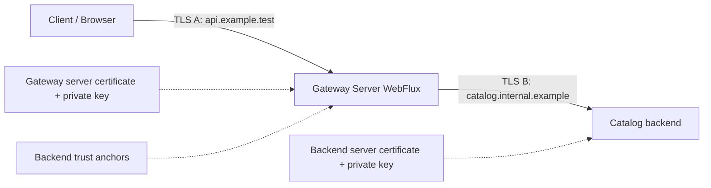
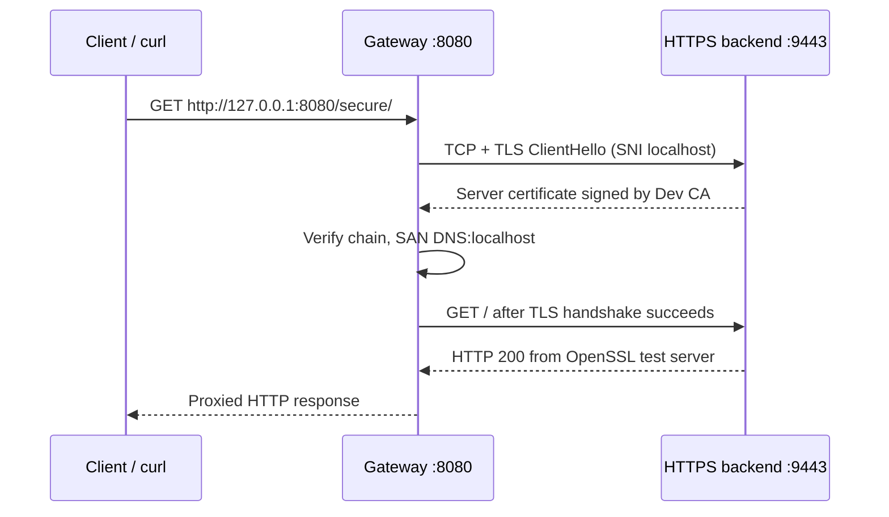

# Trust store, backend certificates, and hostname verification

## 1. The problem: how does the Gateway trust an HTTPS backend?

In **SPRING_CLOUD_GATEWAY**, a client sends a request to the API Gateway; the Gateway evaluates route predicates, executes the filter chain, and proxies the request to a microservice. When the target is `https://catalog.internal.example:9443`, **Spring Cloud Gateway Server WebFlux** acts as a **TLS client**. Before sending the HTTP request and headers that may contain sensitive data, the Gateway must verify that the backend server has a valid identity.

Three concepts must not be conflated:

- **Trust store / trust anchors** specify which CAs or certificates are permitted as trust roots when verifying the backend certificate.
- **Backend certificate chain** consists of the leaf certificate presented by the backend and the intermediate certificates needed to build a trust path.
- **Hostname verification** checks whether the host/IP that the Gateway connects to is accurately listed in the leaf certificate's **Subject Alternative Name (SAN)**.

A chain signed by a trusted CA is **still insufficient** if the certificate is issued only for `inventory.internal.example` while the Gateway is calling `catalog.internal.example`. Conversely, a matching SAN without a trusted CA must also fail TLS.

### Lesson objectives

After this lesson, you will be able to:

1. Distinguish **client → Gateway** TLS from **Gateway → backend** TLS and understand the roles of trust store, keystore, certificate, and private key.
2. Configure the list of trusted certificates for Gateway Server WebFlux's Reactor Netty HttpClient.
3. Identify the difference between **chain** verification and **hostname/SAN** verification, and understand the role of SNI.
4. Test an internal CA and local HTTPS backend with OpenSSL, then route through the Gateway.
5. Analyze `PKIX path building failed`, `No subject alternative DNS name`, protocol mismatches, and handshake timeouts.
6. Operate TLS safely alongside service discovery, rate limiting, retries, circuit breakers, request observability, and certificate rotation.

> **Version note:** examples use Spring Boot 3.5.x + Spring Cloud 2025.0.x / Gateway Server WebFlux 4.3.x. The **outbound HttpClient** prefix is `spring.cloud.gateway.server.webflux.httpclient`. Some older documentation writes `spring.cloud.gateway.httpclient`: do not mix prefixes across release trains. The Configuration Properties table for your exact version is the authoritative source for valid keys.

## 2. Inbound TLS differs from outbound TLS



| Direction | Gateway role | Typical configuration | Who verifies the peer? |
| --- | --- | --- | --- |
| Client → Gateway | TLS **server** | `server.ssl.*` (Spring Boot) | Client verifies the Gateway certificate. |
| Gateway → backend | TLS **client** | `spring.cloud.gateway.server.webflux.httpclient.ssl.*` | Gateway verifies backend chain and hostname. |
| Gateway → backend with mTLS | TLS client **presenting a client certificate** | Besides trust anchors, client key material is required | Both sides may need to verify each other's certificates. |

Example **inbound certificate** configuration (assuming the file and password are supplied via a secret mechanism):

```yaml
server:
  port: 8443
  ssl:
    enabled: true
    key-store: classpath:tls/gateway-identity.p12
    key-store-type: PKCS12
    # key-store-password: provided via separate protected secret configuration
```

This configuration **does not automatically add the backend CA** to HttpClient's trust. Conversely, configuring `httpclient.ssl.trusted-x509-certificates` **does not change** the certificate the Gateway presents to clients.

### How do keystore, truststore, and PEM differ?

| Artifact | Typically contains | Purpose |
| --- | --- | --- |
| Server keystore | Server certificate **and private key** | Gateway/backend proves its identity to TLS clients. |
| Client keystore | Client certificate **and private key** | Gateway presents a certificate if the backend requires mTLS. |
| Trust store | Public CA certificates/trust anchors, **contains no private keys** | Defines which peer certificate chains are trusted. |
| PEM `.crt`/`.pem` | One or more public certificates, or sometimes a private key if exported separately | File format; inspect contents and how it is configured. |
| PKCS12 `.p12` / JKS `.jks` | Java store capable of holding private keys/certs or trust anchors | Store format; does not by itself imply function. |

Avoid placing the CA's or backend's private key on the Gateway classpath when you only need to **trust** the backend. Distribute only the **public CA certificate** after verifying its source and fingerprint.

## 3. Two mandatory steps when verifying a backend

### 3.1. Certificate chain verification

A typical backend sends:

```text
Leaf:      DNS:catalog.internal.example
   |
   v
Intermediate CA: Internal Issuing CA
   |
   v
Root CA: Internal Root CA (trust anchor accepted by the Gateway)
```

The Gateway uses trust anchors to verify signatures, certificate chain linkage, and relevant constraints such as validity dates and the `serverAuth` extended key usage. The backend should send **all required intermediates**; do not expect the TLS client to fetch missing certificates from the Internet.

If a valid trust path cannot be constructed, logs typically show `SSLHandshakeException` or `PKIX path building failed` depending on the TLS provider. A browser may connect successfully while the Java Gateway fails because **the trusted CA sets and connection paths are not the same**.

### 3.2. Hostname verification

For:

```text
Route target: https://catalog.internal.example:9443
Certificate SAN:
    DNS:catalog.internal.example
    DNS:catalog.svc.example.test
```

The name `catalog.internal.example` matches the SAN. If the route changes to `https://10.20.1.8:9443` while the SAN **does not contain `IP Address:10.20.1.8`**, you must not assume that IP is a valid certificate identity.

Practical rules:

- Modern server certificates should include **SAN**. Do not rely solely on `Subject CN`.
- A `DNS:name` SAN is for DNS names; when connecting by IP address, an **`IP Address:...`** SAN matching that address is required.
- Wildcards like `*.internal.example` do not match arbitrary deeper subdomain levels; test with the actual DNS names.
- If a certificate is expired, not yet valid, or has the wrong key usage, simply adding its CA to the trust store will not fix it.
- Configuring an HTTP `Host` header is distinct from the TLS-verified name: HTTP headers are sent **after the TLS handshake**.

### 3.3. Server Name Indication (SNI)

In TLS, **SNI** allows a server hosting multiple virtual hosts on the same IP/port to pick the right certificate. Reactor Netty HttpClient normally sends the remote hostname as SNI. If a client connects via IP or overrides SNI incorrectly, the backend may present **a different certificate** than expected.

Distinction:

| Component | Function | Example value |
| --- | --- | --- |
| URI hostname | Target identity the Gateway intends to call | `catalog.internal.example` |
| SNI | Name sent in TLS ClientHello to choose the virtual host | `catalog.internal.example` |
| Certificate SAN | Identity proven by the backend | `DNS:catalog.internal.example` |
| HTTP `Host` header | Post-handshake HTTP metadata | `Host: catalog.internal.example` |

**A correct SNI does not prove the chain is valid, and a valid chain does not exempt hostname verification.**

## 4. Configuring trust in Gateway Server WebFlux 4.3

### 4.1. Using the Java runtime's default trust

If the Gateway is not given a custom trust list, Spring Cloud Gateway documentation describes using the **default trust store** (which can be overridden via the `javax.net.ssl.trustStore` system property). When backends use public CAs trusted by the JDK, manual certificate import is usually unnecessary.

Check the **actual JDK running inside the container**, not just the JDK on your laptop: the `cacerts` file, corporate policy CAs, and TLS inspection proxies can differ. Directly modifying `$JAVA_HOME/lib/security/cacerts` inside an image is hard to maintain across JDK upgrades; prefer a controlled trust distribution mechanism.

### 4.2. Configuring trusted PEM certificates in Netty HttpClient

For backends using an internal CA issued and verified by your organization:

```yaml
spring:
  cloud:
    gateway:
      server:
        webflux:
          httpclient:
            ssl:
              use-insecure-trust-manager: false
              trusted-x509-certificates:
                - classpath:certs/internal-root-ca.pem
              handshake-timeout: 10s
```

- `trusted-x509-certificates` points to the trusted X.509 certificate(s). The file must exist on the application's classpath at this location.
- Place only the **public certificate** of the internal CA in resources; never include `.key` or private keys.
- `handshake-timeout` sets the maximum duration for the TLS handshake, not the HTTP response timeout.
- `use-insecure-trust-manager: false` explicitly expresses the intent **not** to trust blindly.

**Warning:** when configuring a custom trust set, do not assume it automatically **merges** with all default JVM trust anchors. If you need to trust both public CAs and internal CAs, design the trust set to cover all upstreams and test each connection type.

Older examples may use camelCase `trustedX509Certificates`; prefer **kebab-case** as shown in the official `spring.cloud.gateway.server.webflux.httpclient.ssl.*` table.

### 4.3. PKCS12/JKS trust store

Organizations may manage CAs using a `gateway-truststore.p12` file. Use Java `keytool` to import a CA whose origin has been verified:

```bash
keytool -importcert -trustcacerts \
  -alias internal-root-ca \
  -file internal-root-ca.pem \
  -keystore gateway-truststore.p12 \
  -storetype PKCS12
```

The command prompts for a password and fingerprint verification. Inspect the store contents:

```bash
keytool -list -v \
  -keystore gateway-truststore.p12 \
  -storetype PKCS12
```

A JVM-wide option is `javax.net.ssl.trustStore`, `javax.net.ssl.trustStoreType=PKCS12`, with the password supplied by a secret management system. **Never hardcode passwords or private keys into Git files** or production commands that could leak through process lists.

### 4.4. Spring Boot SSL Bundle

Spring Boot can create a trust certificate bundle named `backend-ca` from PEM; Gateway Server WebFlux 4.3 provides the `httpclient.ssl.ssl-bundle` property:

```yaml
spring:
  ssl:
    bundle:
      pem:
        backend-ca:
          truststore:
            certificate: classpath:certs/internal-root-ca.pem
  cloud:
    gateway:
      server:
        webflux:
          httpclient:
            ssl:
              ssl-bundle: backend-ca
```

This is an **alternative** to declaring `trusted-x509-certificates` directly. Do not layer multiple trust strategies onto the same client without understanding precedence. When using an SSL Bundle, verify the Boot/Gateway version and run a TLS handshake test in the deployment environment before rolling out.

### 4.5. Configurations never to use in production

Do not set `use-insecure-trust-manager: true` to make `PKIX` errors disappear: that configuration trusts certificates without proper chain verification and can cause the Gateway to send tokens, cookies, and internal headers to a spoofed backend.

Likewise, never disable hostname verification or install a trust-all `TrustManager` inside an `HttpClientCustomizer`. **The right fix is correcting the CA, chain, or SAN/hostname**, not removing TLS guardrails.

## 5. Hostname verification in Reactor Netty when customizing SSL manually

Reactor Netty's `HttpClient.secure()` and `secure(Consumer)` are documented to enable hostname verification by default. However, when an application creates a custom **`SslProvider`** and calls `secure(SslProvider)`, Reactor Netty documentation notes that hostname verification **is not automatically enabled** unless `HttpClientSecurityUtils.HOSTNAME_VERIFICATION_CONFIGURER` is configured on the provider.

Therefore, when customizing client TLS at a low level:

1. Check the exact `secure(...)` overload and provider being used.
2. Ensure hostname verification remains enabled, not just chain verification.
3. Keep SNI aligned with the target virtual host.
4. Intentionally test with **a trusted-CA certificate whose SAN does not match**; the request must fail.
5. Do not alter TLS properties to pin a fake hostname just to bypass target URI risks.

Unless low-level SSL provider customization is truly required, **prefer the official Gateway configuration** to avoid subtle security bugs.

## 6. Hands-on: HTTPS backend with an internal CA

This hands-on separates the two TLS layers: **the Gateway receives HTTP on port 8080** so we can focus on **Gateway → HTTPS backend verification on port 9443**. Use OpenSSL to create a test CA, issue a backend certificate with SAN, and start a simple HTTPS server. The Gateway must trust the right CA and call the right hostname.

Prerequisites: **JDK 17+, Maven, OpenSSL, curl**; the commands below use **Bash** syntax (Linux/macOS/Git Bash). If running PowerShell, adapt line continuations, file creation instead of `printf`, and `/dev/null` redirection accordingly. All `tls/` files in this section are created **by the learner in their own test environment**, and are not pre-existing lesson files.



### 6.1. Create a private CA for the lab

```bash
mkdir -p tls

openssl req -x509 -newkey rsa:3072 -sha256 -nodes -days 14 \
  -keyout tls/dev-ca.key \
  -out tls/dev-ca.crt \
  -subj "/CN=SCG Lab Root CA" \
  -addext "basicConstraints=critical,CA:TRUE" \
  -addext "keyUsage=critical,keyCertSign,cRLSign"
```

- `dev-ca.crt`: **public** CA certificate that the Gateway can use as a trust anchor.
- `dev-ca.key`: **CA private key**; never place it in source control, the Gateway container, classpath, release artifacts, or logs.
- The CA has a 14-day validity period; this is for learning only, not a production PKI solution.

### 6.2. Create the backend certificate with the right SAN

```bash
openssl req -new -newkey rsa:2048 -sha256 -nodes \
  -keyout tls/backend.key \
  -out tls/backend.csr \
  -subj "/CN=localhost"

printf 'subjectAltName=DNS:localhost\nextendedKeyUsage=serverAuth\nbasicConstraints=critical,CA:FALSE\n' \
  > tls/backend.ext

openssl x509 -req \
  -in tls/backend.csr \
  -CA tls/dev-ca.crt \
  -CAkey tls/dev-ca.key \
  -CAcreateserial \
  -out tls/backend.crt \
  -days 7 -sha256 \
  -extfile tls/backend.ext
```

Generated artifacts:

- `backend.key`: backend private key, **never** copied to the Gateway.
- `backend.crt`: server certificate signed by the test CA.
- SAN `DNS:localhost`: valid for the URI `https://localhost:9443` in this lab.
- **Intentionally omits** `IP Address:127.0.0.1`: the negative test later will prove that connecting by IP must be rejected when hostname verification works.

Inspect the certificate metadata:

```bash
openssl x509 -in tls/backend.crt -noout -subject -issuer -dates
openssl x509 -in tls/backend.crt -noout -ext subjectAltName
openssl x509 -in tls/dev-ca.crt -noout -fingerprint -sha256
```

In production, CA fingerprints must be verified **over an independent trusted channel** before importing into a trust store. Never import an arbitrary CA merely because it appeared in a failing server's response.

### 6.3. Run the test HTTPS backend

OpenSSL includes a basic HTTP test server, avoiding the need to write another Spring Boot service:

```bash
openssl s_server \
  -accept 9443 \
  -cert tls/backend.crt \
  -key tls/backend.key \
  -www
```

Keep this process running in **terminal A**. It is solely for observing TLS and HTTP locally; never expose port 9443 to the Internet. On multi-interface hosts, use firewall or bind rules so only test connections are permitted.

In **terminal B**, test the handshake **with CA and DNS name verification**:

```bash
openssl s_client \
  -connect localhost:9443 \
  -servername localhost \
  -CAfile tls/dev-ca.crt \
  -verify_hostname localhost \
  -verify_return_error < /dev/null
```

Expect `Verify return code: 0 (ok)`. Specifying `-verify_hostname` makes OpenSSL match the SAN against `localhost`; `-CAfile` verifies the chain against the test CA.

Call directly with curl **without `-k`**:

```bash
curl -i --cacert tls/dev-ca.crt https://localhost:9443/
```

The HTTP response is typically `200 OK` with a test page generated by `s_server -www`. The exact HTML body depends on your OpenSSL version; this lesson does not depend on its specifics.

### 6.4. Initialize Gateway Server WebFlux

Create a minimal Maven app via Spring Initializr or the `pom.xml` below. Pick **a compatible Spring Boot/Spring Cloud pair**. The example uses Boot `3.5.0` and Cloud `2025.0.0` to illustrate the release train; in real deployments, pick a supported patch release rather than pinning the `.0` release indefinitely.

```xml
<?xml version="1.0" encoding="UTF-8"?>
<project xmlns="http://maven.apache.org/POM/4.0.0"
         xmlns:xsi="http://www.w3.org/2001/XMLSchema-instance"
         xsi:schemaLocation="http://maven.apache.org/POM/4.0.0
                             https://maven.apache.org/xsd/maven-4.0.0.xsd">
    <modelVersion>4.0.0</modelVersion>

    <parent>
        <groupId>org.springframework.boot</groupId>
        <artifactId>spring-boot-starter-parent</artifactId>
        <version>3.5.0</version>
        <relativePath/>
    </parent>

    <groupId>com.example</groupId>
    <artifactId>gateway-tls-lab</artifactId>
    <version>0.0.1-SNAPSHOT</version>

    <properties>
        <java.version>17</java.version>
    </properties>

    <dependencyManagement>
        <dependencies>
            <dependency>
                <groupId>org.springframework.cloud</groupId>
                <artifactId>spring-cloud-dependencies</artifactId>
                <version>2025.0.0</version>
                <type>pom</type>
                <scope>import</scope>
            </dependency>
        </dependencies>
    </dependencyManagement>

    <dependencies>
        <dependency>
            <groupId>org.springframework.cloud</groupId>
            <artifactId>spring-cloud-starter-gateway-server-webflux</artifactId>
        </dependency>
    </dependencies>

    <build>
        <plugins>
            <plugin>
                <groupId>org.springframework.boot</groupId>
                <artifactId>spring-boot-maven-plugin</artifactId>
            </plugin>
        </plugins>
    </build>
</project>
```

Do not pin a separate version on the starter since the Spring Cloud BOM manages it. Gateway Server WebFlux runs on **Reactor Netty**, requiring neither `spring-boot-starter-web` nor a servlet WAR.

Create `src/main/java/com/example/gateway/GatewayApplication.java`:

```java
package com.example.gateway;

import org.springframework.boot.SpringApplication;
import org.springframework.boot.autoconfigure.SpringBootApplication;

@SpringBootApplication
public class GatewayApplication {
    public static void main(String[] args) {
        SpringApplication.run(GatewayApplication.class, args);
    }
}
```

### 6.5. Place the CA in resources and configure the route

Copy only the **public CA certificate** into the Gateway project. If you are in the directory containing both `tls/` and `src/main/resources/`:

```bash
mkdir -p src/main/resources/certs
cp tls/dev-ca.crt src/main/resources/certs/dev-ca.crt
```

Adjust paths if the two directories sit elsewhere. **Never** copy `tls/dev-ca.key` or `tls/backend.key` into the Gateway.

Create `src/main/resources/application.yml`:

```yaml
server:
  port: 8080

spring:
  application:
    name: gateway-tls-lab
  cloud:
    gateway:
      server:
        webflux:
          httpclient:
            ssl:
              use-insecure-trust-manager: false
              trusted-x509-certificates:
                - classpath:certs/dev-ca.crt
              handshake-timeout: 10s
          routes:
            - id: tls-backend
              uri: https://localhost:9443
              predicates:
                - Path=/secure/**
              filters:
                - StripPrefix=1
                - AddResponseHeader=X-Gateway-Route, tls-backend
```

Key points:

1. The Gateway **accepts HTTP** on `8080` (`server.ssl` is not enabled for inbound).
2. `trusted-x509-certificates` provides the trust anchor **specifically for outbound connections** to the HTTPS backend.
3. `uri: https://localhost:9443` determines the TCP/TLS target and the name checked against SAN.
4. `StripPrefix=1` rewrites `/secure/` to `/` before forwarding to the OpenSSL backend.
5. `AddResponseHeader` adds a marker to identify the route; it performs no TLS verification.

Normally, the HttpClient SSL section is shared across Gateway proxy connections; it is not scoped exclusively to the `tls-backend` route. When multiple CA groups require different policies, design an appropriate trust model instead of blindly accumulating CAs.

### 6.6. Run the Gateway and call through the entry point

Open **terminal C** in the Gateway project:

```bash
mvn spring-boot:run
```

Or use the Maven Wrapper `./mvnw spring-boot:run` on Linux/macOS, `mvnw.cmd spring-boot:run` on Windows.

Open **terminal D**:

```bash
curl -i http://127.0.0.1:8080/secure/
```

When successful, the client receives the proxied HTTP response from the OpenSSL test server, typically `200 OK`, along with `X-Gateway-Route: tls-backend`. This test proves the Gateway established HTTPS to the backend **even though the client used plain HTTP to the Gateway**.

If it fails, re-check the CA file on the classpath, route URI, cert SAN, `s_server` process, Gateway property prefix, and root cause in the logs.

## 7. Negative tests: proving TLS verification is not bypassed

A secure TLS setup must fail properly when the chain or peer identity does not match.

### 7.1. Missing trusted CA

Remove `trusted-x509-certificates` from the lab configuration and restart the Gateway, while keeping `use-insecure-trust-manager: false`.

Because the lab CA is **not** in the default trust store, requests to `/secure/` must fail at certificate chain verification. You should see `SSLHandshakeException`, `PKIX path building failed`, or an equivalent Netty TLS message depending on the provider. The Gateway should return an HTTP **5xx** error rather than a business HTTP response from the backend.

Restore the CA configuration after this test.

### 7.2. Right CA, wrong backend name

Keep the CA trust but change the route URI to:

```yaml
uri: https://127.0.0.1:9443
```

The demo certificate only contains `DNS:localhost`, **not `IP Address:127.0.0.1`**. A TLS client with proper hostname verification must **reject connecting via this IP**, even though the chain is signed by the trusted CA.

Verify independently with OpenSSL:

```bash
openssl s_client \
  -connect 127.0.0.1:9443 \
  -CAfile tls/dev-ca.crt \
  -verify_ip 127.0.0.1 \
  -verify_return_error < /dev/null
```

Or with curl:

```bash
curl -i --cacert tls/dev-ca.crt https://127.0.0.1:9443/
```

The result must be an IP/SAN mismatch error. If the Gateway **still** proxies successfully when the hostname does not match, inspect `use-insecure-trust-manager`, any custom `SslProvider`, and whether **hostname verification was disabled**. Never treat this case passing as proof of security merely because the CA is trusted.

**Fix:** configure the URI with a DNS name listed in the SAN that resolves properly; if the use case genuinely requires an IP URI, issue a certificate with a valid IP SAN under your PKI policy.

### 7.3. Protocol mismatch or backend not listening

- Stop `s_server` and call `/secure/`: typically yields `Connection refused` or a timeout, occurring before certificate verification completes.
- Change URI to `http://localhost:9443` while 9443 expects TLS: the client sends plaintext HTTP to a TLS listener, causing a protocol error — not a trust store error.
- Change URL to `https://localhost:9555` with nothing listening: connection error, not a SAN mismatch.

These tests prevent the flawed reflex of "every 5xx means fix the certificate."

## 8. TLS troubleshooting methodology

| Symptom | Common cause | How to inspect |
| --- | --- | --- |
| `PKIX path building failed` | CA not trusted; missing intermediate; container uses a different trust store. | Inspect the chain sent by the server, verify the CA in use, and provide the right anchor. |
| `No subject alternative DNS name matching ...` | URI host is absent from DNS SANs. | Check `openssl x509 -ext subjectAltName`, fix the URI, or reissue the cert. |
| `No subject alternative names matching IP address ...` | Connecting by IP when SAN only has DNS names. | Use a valid hostname or a properly issued IP SAN. |
| `certificate expired` / `not yet valid` | Cert validity window mismatch or skewed system clock. | Check `notBefore/notAfter` and synchronize clocks. |
| `certificate_unknown` / `bad_certificate` | Peer rejected cert; possibly mTLS/chain/policy issue. | Identify which side sent the TLS alert; check both directions under mTLS. |
| Handshake timeout | Slow network, stalled TLS endpoint, proxy, or overly short timeouts. | Check TCP, TLS logs, metrics, and corresponding timeout settings. |
| `NotSslRecordException` / `wrong version number` | HTTP and HTTPS mismatched on scheme/port. | Check `uri`, listeners, proxies, and TLS termination. |
| `Connection refused` | No server listening on host/port. | Check backend process, firewall, and port. |
| `UnknownHostException` | DNS or service discovery did not return a valid hostname. | Check DNS names, discovery source, and resolution from the Gateway environment. |
| Client sees 5xx from Gateway | Could be TLS, timeout, filter, or upstream HTTP. | Trace the **root cause** and logs; do not guess from status code alone. |

### Commands to inspect a live backend

Inspect the certificate chain sent by the backend:

```bash
openssl s_client \
  -connect catalog.internal.example:443 \
  -servername catalog.internal.example \
  -showcerts < /dev/null
```

Verify **both CA and hostname**, not just whether TCP/TLS completes a handshake:

```bash
openssl s_client \
  -connect catalog.internal.example:443 \
  -servername catalog.internal.example \
  -CAfile internal-root-ca.pem \
  -verify_hostname catalog.internal.example \
  -verify_return_error < /dev/null
```

Inspect details of a certificate:

```bash
openssl x509 -in backend.crt -noout -subject -issuer -dates
openssl x509 -in backend.crt -noout -ext subjectAltName
openssl x509 -in backend.crt -noout -fingerprint -sha256
```

`openssl s_client` **does not always check the hostname unless you pass** `-verify_hostname`/`-verify_ip`. A completed TLS handshake is not proof that hostname verification passed.

If a browser opens the backend while the Gateway fails, compare browser vs. JVM trust stores, TLS inspection proxies, SNI, and the certificate chain. Never use `curl -k` as a success criterion in security testing.

## 9. Timeouts, Netty connection pool, and certificate rotation

Gateway Server WebFlux uses Reactor Netty HttpClient and a connection pool for outbound requests. The TLS handshake runs when establishing a new secure connection; with connection reuse, not every request performs a new handshake.

Selected 4.3 properties:

```yaml
spring:
  cloud:
    gateway:
      server:
        webflux:
          httpclient:
            connect-timeout: 3000
            response-timeout: 15s
            ssl:
              handshake-timeout: 10s
              close-notify-flush-timeout: 3s
              close-notify-read-timeout: 0s
```

These values are **illustrative**. Per the 4.3 configuration table, `connect-timeout` uses milliseconds while `ssl` timeouts use Duration. Do not confuse connect timeout (TCP), handshake timeout (TLS), response timeout (HTTP), and TLS close timeouts (`close_notify`).

### Zero-downtime CA/certificate rotation

1. Verify the new CA, announce the schedule, and allow enough lead time for instances to update.
2. Distribute the new trust anchors to the Gateway **before** backends switch certificates; validate on canary.
3. Roll out the new server certificates with valid SANs, chains, and dates; verify TLS/SNI.
4. Monitor handshake errors, 5xx rates, latency, and backend logs.
5. Remove the old CA once all instances are confirmed no longer dependent on it.
6. Verify whether updating PEM/SSL bundle files **is reloaded by Netty HttpClient**; do not assume editing files on disk suffices. Controlled application/connection cycling may be needed.

Keep CA and backend private keys out of logs and Gateway artifacts/containers; keep secret stores and access permissions isolated.

## 10. Integration with Gateway operational features

### 10.1. Service discovery and `lb://`

If a route uses `lb://catalog-service`, Spring Cloud LoadBalancer picks a `ServiceInstance` from discovery. The outbound HTTPS scheme and host used for TLS depend on instance metadata (such as `isSecure`) and route configuration. Therefore:

- An instance registered by **IP** whose certificate only lists a DNS SAN can trigger hostname verification errors.
- Do not infer Gateway → backend uses HTTPS simply because client → Gateway used HTTPS.
- Align service registry, DNS, SNI, SAN, and trust settings across every environment.
- Dynamically picking targets from client-supplied headers without an allowlist can create an open proxy/SSRF; TLS does not replace destination validation.

### 10.2. Authentication, rate limiting, retries, and circuit breakers

- **TLS server authentication** verifies the backend; **Spring Security WebFlux/OAuth2** authenticates and authorizes the client/user. These are two independent responsibilities.
- Rate limiting protects the Gateway and backends from overload; it does not fix certificate errors.
- Retries can replay failed requests, but cannot cure a wrong CA, expired certificate, or SAN mismatch. Avoid blind retries on state-mutating requests.
- Circuit breakers can record connection/TLS failures and trigger fallbacks per policy; fallbacks do not replace fixing trust properly.
- Never send JWTs, API keys, or private headers to an upstream not properly verified via TLS.
- TLS termination, `Forwarded`, and `X-Forwarded-*` require trusted proxy boundaries; a forged Host header must never substitute for TLS identity.

### 10.3. Request observability

Log route ID, service ID, HTTP status, connect/handshake latency, TLS error counts, and certificate age without logging tokens, private keys, or full URLs containing sensitive data. Enable TLS/Netty wiretap debugging only in controlled diagnostic environments; verbose TLS logs can be large and expose internal metadata.

## 11. Acceptance checklist and self-check questions

| Check | Pass criterion |
| --- | --- |
| Gateway inbound and outbound | Clearly separate `server.ssl` from `httpclient.ssl`. |
| Certificate chain | Backend serves proper leaf/intermediate certs with a verified trust anchor. |
| Hostname/SNI | Target URI, SNI, and SAN match DNS/IP per policy. |
| 4.3 configuration | Uses `spring.cloud.gateway.server.webflux.httpclient.ssl`, without mixing legacy prefixes. |
| Security | No trust-all, no disabled hostname verification, no private keys stored in Gateway trust resources. |
| Positive test | With valid CA and hostname, the HTTPS route returns backend responses through the Gateway. |
| Negative test | Missing CA or wrong SAN is rejected; no silent fallback to HTTP. |
| Operations | Configured timeouts, certificate expiry alerts, and a rotation procedure. |

**1. The Gateway has a valid `server.ssl.key-store`; why does an HTTPS route to a backend still fail with PKIX?**

Because `server.ssl` provides the **Gateway's inbound identity**; it does not install the backend CA into the outbound HttpClient trust store.

**2. Why does adding the CA to the trust store still fail to fix `No subject alternative DNS name`?**

Because chain trust and hostname verification are **two separate checks**. You must fix the DNS name in the URI or issue a certificate with the matching SAN.

**3. Will changing only the HTTP Host header fix the error when the Gateway calls `https://10.10.1.8` while the cert only has a DNS SAN?**

No. The Host header operates at the HTTP layer after the TLS handshake; peer identity must be verified at the TLS layer.

**4. When using `lb://catalog-service`, does the Gateway inherit the HTTPS scheme from the client-to-Gateway connection?**

No. The outbound scheme depends on route/instance configuration and LoadBalancer metadata, independent of inbound TLS.

**5. Why does a successful `openssl s_client -connect ...` not necessarily prove the hostname is valid?**

Because not every `s_client` invocation checks the hostname by default. You must pass `-verify_hostname`/`-verify_ip` along with the proper CA.

**6. Should `use-insecure-trust-manager` be enabled to quickly silence PKIX errors in production?**

No. You must provision a trusted CA, fix the certificate chain, or configure trust properly.

**7. If you only replace the CA file on disk, is the Gateway guaranteed to use the new CA immediately?**

No. SSL contexts, connection pools, and reload mechanisms have their own lifecycles; verify behavior for your version and perform controlled rotation.

## Conclusion

With Spring Cloud Gateway Server WebFlux, the security of the **Gateway → HTTPS backend** connection depends simultaneously on **trust anchors, certificate chains, and hostname verification**. The trust store defines **who is trusted**, while the certificate SAN verifies **whether the peer matches the identity targeted by the URI**. Use the proper 4.3 HttpClient configuration prefix, test both positive and negative cases, monitor TLS handshakes/expirations, and manage certificate rotation. **Never disable CA or hostname verification to hide configuration mistakes**: a safely operated Gateway protects both request routing/filtering and its connections to downstream microservices.

### Official references

- [Spring Cloud Gateway Server WebFlux 4.3 — TLS and SSL](https://docs.spring.io/spring-cloud-gateway/reference/4.3/spring-cloud-gateway-server-webflux/tls-and-ssl.html)
- [Spring Cloud Gateway 4.3 — Configuration Properties](https://docs.spring.io/spring-cloud-gateway/reference/4.3/configprops.html)
- [Spring Cloud Gateway Server WebFlux 4.3 — Global Filters](https://docs.spring.io/spring-cloud-gateway/reference/4.3/spring-cloud-gateway-server-webflux/global-filters.html)
- [Spring Boot — SSL Bundles](https://docs.spring.io/spring-boot/reference/features/ssl.html)
- [Reactor Netty HttpClient API — hostname verification](https://projectreactor.io/docs/netty/1.2.18/api/reactor/netty/http/client/HttpClient.html)
- [Reactor Netty — HTTP Client / SNI](https://projectreactor.io/docs/netty/release/reference/http-client.html)
- [Spring Cloud — release train compatibility](https://spring.io/projects/spring-cloud/)
