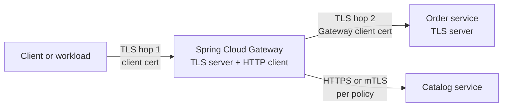
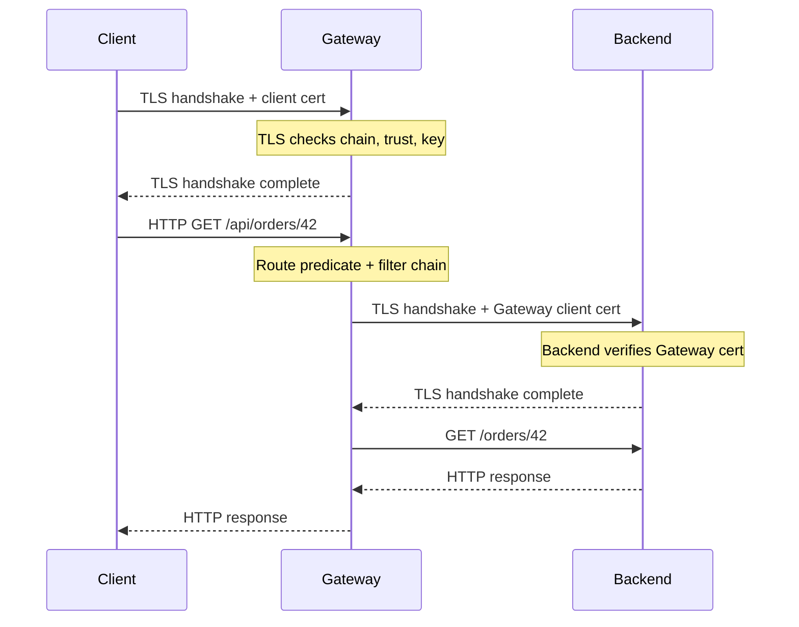
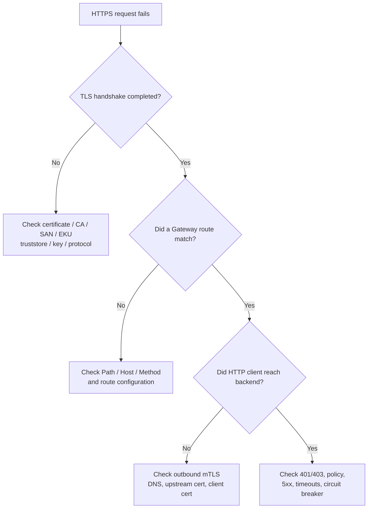

# Mutual TLS (mTLS) authentication when deploying Spring Cloud Gateway and supported versions

In a microservices architecture, **Spring Cloud Gateway** receives requests from clients, matches route predicates, runs filter chains, transforms paths/headers, and forwards traffic to backends. To secure these connections, standard HTTPS authenticates only the **server** to the caller. **Mutual TLS (mTLS)** adds **client certificate** verification directly during the TLS handshake: both endpoints present and verify each other's cryptographic identity.

The easiest point of confusion is that the Gateway acts as both a **server** toward clients/ingresses and an **HTTP client** toward microservices. Therefore, mTLS can occur across **two independent TLS connections**, with different certificates, keys, and trust stores. Enabling mTLS on one side does not automatically enable it on the other.

This lesson belongs to the **Connections and TLS** chapter of the `SPRING_CLOUD_GATEWAY` module, covering secure deployment of a microservices entry point alongside authentication, rate limiting, circuit breakers, retries, and request observability.

> **Reference version:** Primary examples use **Spring Cloud Gateway Server WebFlux 5.0.x**, Spring Cloud release train **2025.1.x**, and Spring Boot **4.x** (with compatible patch releases). In Gateway 5.0, HTTP client configuration uses `spring.cloud.gateway.server.webflux.httpclient`, and routes use `spring.cloud.gateway.server.webflux.routes`. Older examples using `spring.cloud.gateway.httpclient`/`spring.cloud.gateway.routes` should not be copied verbatim into 5.0. **Server Web MVC** has a different outbound HTTP client configuration, noted in the version section.

## 1. Learning objectives

After this lesson, you will be able to:

1. Explain the differences between one-way TLS, mTLS, and application-layer authentication/authorization.
2. Accurately diagram **client ↔ Gateway**, **ingress ↔ Gateway**, and **Gateway ↔ upstream** relationships in deployments.
3. Distinguish **keystore/key material** from **truststore/trust material**, certificate chains, CAs, SANs, and EKUs.
4. Enable `server.ssl.client-auth: need` so the Gateway verifies client certificates when terminating TLS directly.
5. Configure the Gateway's outbound HTTP client with its own certificate/key to connect to backends requiring mTLS.
6. Test both with and without certificates using `curl`/`openssl`, without disabling certificate verification.
7. Recognize the boundary between TLS identity and Spring Security authorization, and plan certificate/trust anchor rotation.

## 2. Two TLS directions where mTLS can apply



### 2.1. Client → Gateway: Gateway as TLS server

The Gateway presents a **server certificate** so the client verifies the hostname, CA, and certificate chain. If mTLS is enabled, the Gateway also **requests a client certificate** and checks whether it belongs to the trusted CA set.

| Side | Requires | Purpose |
|---|---|---|
| Gateway (TLS server) | Server private key + server certificate/chain | Proves the Gateway endpoint to the client |
| Gateway (TLS server) | Truststore containing allowed client CAs/certs | Authenticates the client certificate |
| Client | Truststore or CA bundle trusting the Gateway server | Authenticates the server certificate |
| Client | Client private key + client certificate/chain | Proves the client owns the private key |

The goal of `server.ssl.client-auth: need` is to **mandate** a trusted client certificate at the TLS layer. If the client lacks a certificate, the TLS handshake typically fails **before** any HTTP request is routed.

### 2.2. Gateway → backend: Gateway as TLS client

The Gateway must also verify the backend's certificate. If the backend requires mTLS, it sends a client certificate request; the Gateway uses a **separate outbound private key + certificate**.

| Side | Requires | Purpose |
|---|---|---|
| Backend (TLS server) | Server key + certificate/chain | Proves the backend to the Gateway |
| Backend (TLS server) | Truststore containing the CA that issued the Gateway's client cert | Authenticates the Gateway's certificate |
| Gateway (TLS client) | Trust material trusting the backend CA | Verifies the server certificate and CA chain |
| Gateway (TLS client) | Client key + client certificate/chain | Proves the Gateway's identity to the backend |

The two connections usually use **different certificates**, because roles, CAs, trust scopes, rotation schedules, and EKU requirements may differ.

**`uri: https://orders.internal.example` only guarantees HTTPS**, not whether the backend demands a client certificate or whether the Gateway has one ready to present. In the Gateway, presenting an outbound client certificate is configured in **HTTP client SSL**, not via a regular route predicate.

### 2.3. How the TLS handshake relates to the filter chain



If a TLS connection already exists in the connection pool, the Gateway **does not re-handshake on every request**. Thus, changes to certificates, CAs, or policies may only take effect when new connections are opened. Every rotation behavior must be tested against both new connections and reused connections.

## 3. How standard TLS, `want`, and `need` differ

In Spring Boot, `server.ssl.client-auth` supports these modes:

| Value | Status | Meaning |
|---|---|---|
| `none` | Does not request a client certificate | Server-authenticated HTTPS; not enforced mTLS |
| `want` | Requests if available | May accept clients **without** a certificate; **not suitable** for enforcing mTLS |
| `need` | Mandatory | Client must provide a valid, trusted certificate |

Choose `need` at the endpoint directly receiving TLS if the goal is **mandatory mTLS**. `want` can help during migrations or mixed services, but must not be used in place of mandatory authentication.

**TLS certificate validation and HTTP authorization are two separate tasks.** A client holding a certificate issued by a trusted CA is not necessarily authorized to call `POST /api/payments`. If the CA issues certificates to multiple workloads, you must validate workload identity, scopes/permissions, tenant, and corresponding policies after the handshake.

## 4. Certificates, CAs, SANs, and the two distinct stores

Concepts to master:

- **Private key**: secret belonging to each party; never shared between client and server, never placed in Git/images or logs.
- **Leaf certificate**: contains the public key and identity information of an endpoint; signed by a CA/trust anchor.
- **Certificate chain**: leaf plus intermediate CAs enabling the peer to verify the trust path.
- **Keystore/key material**: certificate + **private key** used by an endpoint to prove its identity.
- **Truststore/trust material**: CAs/certificates **trusted** to verify the remote peer; a truststore must never contain the remote peer's private key.
- **SAN (Subject Alternative Name)**: valid hostnames/IPs of a **server certificate**; clients must verify that the target hostname matches the SAN.
- **EKU (Extended Key Usage)**: intended purpose of a certificate; server certificates should include `serverAuth`, and client certificates should include `clientAuth` per CA policy.
- **Certificate revocation**: certificates may need early revocation; a valid chain alone does not guarantee CRL/OCSP or revocation list checks were performed per security policy.

For example, calling `https://orders.internal.example:9443` requires the backend's certificate to carry SAN `DNS:orders.internal.example`. Never fix a SAN mismatch by turning off hostname verification.

**A single CA for every component** works for small labs, but production setups often separate CAs for inbound clients, Gateway outbound identities, and backend servers to avoid overly broad trust scopes.

## 5. Versions and corresponding configuration approaches

mTLS is a capability of the **TLS stack and Spring Boot/HTTP client**, not a single GatewayFilter available only in newer versions. However, **outbound connection properties and APIs** have changed across branches.

| Stack | Version / relationship | What to watch when applying |
|---|---|---|
| **Gateway Server WebFlux 5.0.x** | Spring Cloud 2025.1.x, Spring Boot 4.0.x/4.1.x per specific release | Use `server.ssl.*` for inbound; `spring.cloud.gateway.server.webflux.httpclient.ssl.*` for outbound |
| Gateway Server WebFlux 4.x | Spring Cloud 2025.0.x ↔ Boot 3.5.x or older trains ↔ corresponding Boot | Check the 4.x property prefix, especially `spring.cloud.gateway.httpclient.ssl.*` in many older guides |
| Gateway Server Web MVC | Uses WebMvc.fn / RestClient | Outbound TLS is configured via `spring.http.client.ssl.bundle` and `spring.ssl.bundle.*` in the matching version's docs — **do not** copy WebFlux HTTP client properties |
| Custom Netty/RestClient/WebClient | May have an independent SSL context | Verify whether it inherits Spring Boot SSL bundles or must be configured separately |

The Spring Cloud **2025.1.x** release train is compatible with confirmed Spring Boot 4.x releases. For example, 2025.1.5 (released November 2026) supports Boot 4.0.x and 4.1.x; check the exact BOM patch when upgrading. End-of-support trains should not be chosen for new deployments when upgrades are possible.

Consult the **Spring Cloud compatibility matrix** to pair Spring Boot and the Spring Cloud BOM on the same branch. Some older TLS/SSL pages still show `spring.cloud.gateway.httpclient.ssl`; when using Gateway 5.0, cross-check **Configuration Properties 5.0** to avoid using the wrong prefix.

### 5.1. Minimal dependency

For Gateway Server WebFlux 5.0.x:

```xml
<dependency>
    <groupId>org.springframework.cloud</groupId>
    <artifactId>spring-cloud-starter-gateway-server-webflux</artifactId>
</dependency>
```

The project must have a **Spring Cloud BOM compatible with Spring Boot** alongside the Spring Boot parent/plugin. Spring Initializr is safer for initial project setup than manually mixing arbitrary versions. SSL is a built-in HTTP runtime capability; no separate "mTLS GatewayFilter starter" is required. **Spring Security** is a separate dependency needed when mapping certificates to application principals/authorities.

### 5.2. Separating configuration categories

| Concern | Key property in Gateway WebFlux 5.0 |
|---|---|
| Gateway HTTPS server certificate | `server.ssl.key-store` and password/type, or `server.ssl.bundle` |
| Require client certificate at Gateway | `server.ssl.client-auth: need` and inbound trust material |
| HTTPS route target | `spring.cloud.gateway.server.webflux.routes[*].uri: https://...` |
| Gateway presents client cert when proxying | `spring.cloud.gateway.server.webflux.httpclient.ssl.key-store*` or `ssl-bundle` |
| CA trusting backend | `...httpclient.ssl.trusted-x509-certificates` or truststore in SSL bundle |
| Outbound TLS handshake timeout | `...httpclient.ssl.handshake-timeout` |
| Skip backend certificate verification | `...httpclient.ssl.use-insecure-trust-manager` — **never use in production** |

**Scope:** `httpclient.ssl.*` settings here affect Gateway Server WebFlux's HTTP client, typically shared across many routes. If each backend needs **a distinct client identity or trust policy**, design custom per-client/per-route configuration, separate Gateway instances, or use a service mesh — do not assume an arbitrary `ssl-bundle` can be placed inside every `route.filters`.

## 6. Configuring inbound mTLS: client → Gateway

An easy-to-verify setup uses **PKCS12**: one keystore containing the **Gateway's** private key/certificate, and one truststore containing the **CA that issues client certificates**. These two files are not interchangeable.

### 6.1. `application.yml` using `server.ssl.*`

```yaml
server:
  port: 8443
  ssl:
    enabled: true
    key-store: file:/run/secrets/gateway-server.p12
    key-store-type: PKCS12
    key-store-password: ${TLS_SERVER_KEYSTORE_PASSWORD}
    trust-store: file:/run/secrets/clients-truststore.p12
    trust-store-type: PKCS12
    trust-store-password: ${TLS_CLIENT_TRUSTSTORE_PASSWORD}
    client-auth: need
    enabled-protocols: TLSv1.3,TLSv1.2

spring:
  application:
    name: secure-gateway
  cloud:
    gateway:
      server:
        webflux:
          routes:
            - id: orders
              uri: http://localhost:9001
              predicates:
                - Path=/api/orders/**
              filters:
                - StripPrefix=1
```

**Detailed explanation:**

- `server.port: 8443`: Gateway listens for HTTPS on port 8443.
- `key-store`: PKCS12 file holding the **Gateway server private key and certificate chain**.
- `trust-store`: file holding **trusted client CAs/certificates**; not the client's private key.
- `client-auth: need`: mandates a certificate during the inbound TLS handshake.
- `enabled-protocols`: illustrates a policy permitting only TLS 1.2/1.3; actual ciphers/protocols also depend on the JDK and operational policy.
- `uri: http://localhost:9001`: **only** an HTTP backend to isolate the inbound lab; no outbound mTLS yet.
- Environment variables `${...}` prevent hardcoding passwords in Git. In real deployments, configure a secret manager and appropriate file read permissions.

If the private key inside PKCS12 has a different password from the keystore password, `server.ssl.key-password` may be required. Never store production certificates and private keys in `src/main/resources` or bake them into public container images.

### 6.2. Configuring inbound with a PEM SSL bundle

Spring Boot now provides **SSL bundles** to configure certificates/keys and trust material via PEM without assembling PKCS12 files in every environment.

Alternative replacing the `server.ssl.key-store/trust-store` block above:

```yaml
server:
  port: 8443
  ssl:
    bundle: gateway-inbound
    client-auth: need

spring:
  ssl:
    bundle:
      pem:
        gateway-inbound:
          keystore:
            certificate: file:/run/secrets/gateway-server.crt
            private-key: file:/run/secrets/gateway-server.key
          truststore:
            certificate: file:/run/secrets/clients-ca.crt
```

The `gateway-inbound` SSL bundle is bound by Spring Boot to the **embedded Netty web server** via `server.ssl.bundle`. The `certificate`/`private-key` pair provides the Gateway's key material, and `truststore.certificate` provides the CA trusting clients. This is an **alternative**; do not mix it with legacy `server.ssl.key-store` keys in the same application without understanding precedence rules.

If intermediate CAs exist, configure the full chain and verify the supplied PEM format. If multiple client certificates are issued by a CA not trusted in the bundle, the TLS handshake will fail even if those certificates have not expired.

### 6.3. Inbound mTLS does not automatically create application users/roles

Spring Boot + Netty verifies the certificate at the TLS layer. This **does not automatically map** an X.509 subject to a user with `ROLE_ADMIN`, nor does it enforce order-reading permissions.

In Gateway WebFlux with Spring Security, you can enable **Reactive X.509 authentication** to map a certificate to an authenticated principal. Add the Security starter matching your Spring Boot BOM:

```xml
<dependency>
    <groupId>org.springframework.boot</groupId>
    <artifactId>spring-boot-starter-security</artifactId>
</dependency>
```

Then configure the reactive security chain:

```java
import org.springframework.context.annotation.Bean;
import org.springframework.context.annotation.Configuration;
import org.springframework.security.config.Customizer;
import org.springframework.security.config.web.server.ServerHttpSecurity;
import org.springframework.security.web.server.SecurityWebFilterChain;

@Configuration
public class GatewayX509Security {
    @Bean
    SecurityWebFilterChain securityWebFilterChain(ServerHttpSecurity http) {
        return http
            .x509(Customizer.withDefaults())
            .authorizeExchange(exchanges ->
                exchanges.anyExchange().authenticated())
            .build();
    }
}
```

**This snippet is a configuration skeleton**, not a complete setup for every system. Spring Security needs an appropriate user source or `ReactiveAuthenticationManager` to **accept/map the X.509 identity**; by default the principal extractor typically reads **CN** from the certificate and the authentication manager looks up the corresponding account. A valid TLS certificate does not automatically guarantee a valid account exists.

In production systems, consider mapping by **SAN URI/SPIFFE ID or standardized workload identity** when your PKI supports it, instead of blindly assuming CN is a unique identifier. Whether using X.509 or JWT, backends still need resource-level authorization.

### 6.4. Demo mapping a specific X.509 account

The following example replaces the `@Bean SecurityWebFilterChain` skeleton above and uses a **demo-client** user created for the lab (never use this in-memory setup as a production user directory):

```java
import org.springframework.context.annotation.Bean;
import org.springframework.context.annotation.Configuration;
import org.springframework.security.authentication.ReactiveAuthenticationManager;
import org.springframework.security.config.web.server.ServerHttpSecurity;
import org.springframework.security.core.userdetails.User;
import org.springframework.security.core.userdetails.ReactiveUserDetailsService;
import org.springframework.security.provisioning.MapReactiveUserDetailsService;
import org.springframework.security.web.server.SecurityWebFilterChain;
import org.springframework.security.web.server.authentication.ReactivePreAuthenticatedAuthenticationManager;

@Configuration
public class DemoX509Security {
    @Bean
    SecurityWebFilterChain x509Chain(ServerHttpSecurity http) {
        ReactiveUserDetailsService users =
            new MapReactiveUserDetailsService(
                User.withUsername("demo-client")
                    .password("{noop}not-used-by-x509")
                    .roles("SERVICE_CLIENT")
                    .build());

        ReactiveAuthenticationManager manager =
            new ReactivePreAuthenticatedAuthenticationManager(users);

        return http
            .x509(x509 -> x509.authenticationManager(manager))
            .authorizeExchange(exchanges ->
                exchanges.anyExchange().authenticated())
            .build();
    }
}
```

The `password` field above only satisfies the lab's `UserDetails` contract; mTLS/X.509 **does not authenticate using that password**. In real deployments, replace it with real accounts/identity sources, lifecycle management, account status, and permission policies. Do not register **both** `GatewayX509Security` and `DemoX509Security` in the same demo, as they create two security chains and can produce unpredictable results.

**Testing order:** first verify the mTLS handshake succeeds at the server; only then enable Spring Security X.509, because HTTP `401`/`403` from authorization differs from TLS handshake failures.

## 7. Configuring outbound mTLS: Gateway → backend

When the Gateway proxies to `https://orders.internal.example:9443`, the Gateway must verify **order-service's server certificate**. If order-service mandates client authentication, the Gateway must also send the **Gateway client certificate**.

### 7.1. Configuring via a PEM SSL bundle for the HTTP client

With **Gateway Server WebFlux 5.0.x**, a clean approach is declaring an SSL bundle containing both **client key material** and **trust material**, then referencing it from the Gateway HTTP client:

```yaml
spring:
  ssl:
    bundle:
      pem:
        upstream-mtls:
          keystore:
            certificate: file:/run/secrets/gateway-outbound-client.crt
            private-key: file:/run/secrets/gateway-outbound-client.key
          truststore:
            certificate: file:/run/secrets/upstream-server-ca.crt

  cloud:
    gateway:
      server:
        webflux:
          httpclient:
            ssl:
              ssl-bundle: upstream-mtls
              handshake-timeout: 10s
              use-insecure-trust-manager: false
          routes:
            - id: orders-secure
              uri: https://orders.internal.example:9443
              predicates:
                - Path=/api/orders/**
              filters:
                - StripPrefix=1
```

In this example:

- `upstream-mtls.keystore` holds the **cert + private key the Gateway uses when acting as a client**.
- `upstream-mtls.truststore` holds the **CA allowing the Gateway to trust order-service's server certificate**.
- `httpclient.ssl.ssl-bundle: upstream-mtls` binds the bundle to the Gateway's Netty HTTP client.
- `uri: https://...` enables TLS for upstream connections; the hostname must match a SAN on the server certificate.
- `handshake-timeout: 10s` limits TLS handshake duration without replacing connect/response timeouts.
- `use-insecure-trust-manager: false` explicitly states that **certificate verification is not bypassed**; false is also the 5.0 default.

This snippet illustrates **outbound mTLS** only. If you also want inbound mTLS, merge the `server.ssl.*` block from section 6 by **combining everything under a single `spring:` root in YAML**, or keep configurations in separate profile files with clear precedence. Never paste two YAML documents with duplicate `spring:` roots without checking the bound result.

### 7.2. Configuring outbound with PKCS12

Another option on the Server WebFlux 5.0.x HTTP client is using a PKCS12 keystore for the **client certificate** and a list of trusted backend CAs:

```yaml
spring:
  cloud:
    gateway:
      server:
        webflux:
          httpclient:
            ssl:
              key-store: file:/run/secrets/gateway-outbound-client.p12
              key-store-type: PKCS12
              key-store-password: ${TLS_OUTBOUND_KEYSTORE_PASSWORD}
              trusted-x509-certificates:
                - file:/run/secrets/upstream-server-ca.crt
              handshake-timeout: 10s
              use-insecure-trust-manager: false
```

This is also an **alternative**; do not combine it with `ssl-bundle` simultaneously unless you have verified precedence and how the HTTP client builds its SSL context.

Gateway 5.0 lists `key-store`, `key-store-password`, `key-store-type`, `ssl-bundle`, `trusted-x509-certificates`, and `use-insecure-trust-manager` under `spring.cloud.gateway.server.webflux.httpclient.ssl`. In production, also verify certificate chain loading, secret read permissions, SAN/hostname verification, and connection pool effects.

### 7.3. Avoiding two common mistakes

**Mistake 1: configuring only `server.ssl.client-auth: need` and expecting the backend to see the Gateway's client cert.**

`server.ssl.*` applies only to the Gateway's **inbound TLS server**. For outbound mTLS, you must configure the **HTTP client** separately.

**Mistake 2: setting only `uri: https://...` and assuming mTLS is enabled.**

HTTPS only means the client (Gateway) uses TLS. If the backend demands a client certificate, the Gateway must have a matching client key/cert; otherwise the TLS handshake will fail.

**Never set `use-insecure-trust-manager: true` in production** to resolve CA or SAN errors. It removes backend identity verification, allowing traffic to be intercepted, read, or spoofed by untrusted endpoints.

## 8. Real-world deployment: ingress, service mesh, TLS termination

Many topologies are valid; what matters is identifying **which component terminates TLS** and **which component actually verifies certificates**.

### 8.1. Gateway directly receives HTTPS/mTLS

```text
Client --mTLS--> [Gateway :8443] --mTLS--> [Backend :9443]
```

The Gateway can enforce `server.ssl.client-auth: need` on incoming connections, and an HTTP client SSL bundle on outgoing connections. Suitable when the Gateway terminates TLS directly, CAs/keys are centrally managed, and backends only permit access from the Gateway.

### 8.2. Ingress/LB terminates mTLS in front of the Gateway

```text
Client --mTLS--> [Ingress] --TLS/mTLS--> [Gateway] --mTLS--> [Backend]
```

Here, the **Ingress** is the TLS server facing the client. If Ingress → Gateway uses plain HTTP, the Gateway **cannot verify the original client certificate** via `server.ssl.client-auth: need`; the client's inbound TLS handshake already ended at the ingress.

Ensure that:

- The ingress requires the client certificate, verifies chain/trust/identity, and enforces access policy;
- the Ingress → Gateway connection is protected by a private network and preferably TLS/mTLS depending on your threat model;
- if client identity must be forwarded to the Gateway, use only **a contracted header from a trusted source** (stripped/overwritten by the ingress), or a signed token/assertion; never trust client-supplied headers like `X-SSL-Client-Cert` or `X-Client-DN`;
- the Gateway only accepts traffic from authorized ingresses; backends do not accept arbitrary traffic bypassing the Gateway.

**Important:** Enabling mTLS at the Ingress **does not mean** the Gateway already has a client certificate to present to the backend. Ingress → Gateway and Gateway → backend are two distinct TLS hops.

### 8.3. TLS passthrough or sidecar/service mesh

- **TLS passthrough:** the proxy forwards the TLS connection intact to the Gateway without decrypting it. In that case the Gateway can verify the client certificate; the ingress only performs TCP/SNI routing as supported.
- **Service mesh:** sidecar/ambient proxies can enforce workload mTLS at the infrastructure layer. The Gateway application sometimes sees only local HTTP to its sidecar; do not infer that the Gateway's `server.ssl.client-auth` controls mesh mTLS.
- **Re-encrypt:** the ingress terminates external TLS and opens a new TLS connection to the Gateway. The certificate/identity on the second connection is not necessarily the client's original certificate.

Document clearly on deployment diagrams: **real client → TLS terminator → Gateway → backend**, the CA type on each hop, who rotates secrets, and who owns policies. Do not merely check that a URL starts with `https://` and conclude end-to-end mTLS is active.

## 9. Lab: generating short-lived certificates to test inbound mTLS

This lab lets you directly verify that **the Gateway rejects clients without a certificate**, while a valid client can send requests to a route. Lab certificates are for testing only, never for production.

**Prerequisites:** JDK 17+ with a compatible Spring Boot/Gateway version, OpenSSL, and `keytool`; run the sample commands in **Bash (Linux/macOS/WSL)** inside a dedicated learner directory. On Windows PowerShell, equivalent OpenSSL commands work after adjusting line continuations/paths; the heredoc snippets below use Bash syntax.

### 9.1. Create a test CA

```bash
mkdir mtls-lab
cd mtls-lab

openssl req -x509 -newkey rsa:3072 -nodes \
  -keyout lab-ca.key -out lab-ca.crt \
  -sha256 -days 2 \
  -subj "/CN=Gateway Lab CA"
```

`lab-ca.key` is the **CA private key**; keep it strictly in your offline lab and never commit it to source control. `lab-ca.crt` is the public CA certificate used to build the trust store.

### 9.2. Issue a server certificate for `localhost`

```bash
openssl req -newkey rsa:3072 -nodes \
  -keyout gateway-server.key -out gateway-server.csr \
  -subj "/CN=localhost"

cat > gateway-server.ext <<'EOF'
subjectAltName=DNS:localhost,IP:127.0.0.1
extendedKeyUsage=serverAuth
keyUsage=digitalSignature,keyEncipherment
EOF

openssl x509 -req -in gateway-server.csr \
  -CA lab-ca.crt -CAkey lab-ca.key -CAcreateserial \
  -out gateway-server.crt -days 2 -sha256 \
  -extfile gateway-server.ext
```

`subjectAltName` allows `curl https://localhost:8443` to properly verify the `localhost` hostname. `serverAuth` specifies server TLS usage. If you generate a certificate with only `CN=localhost` and no SAN, many modern TLS clients will fail hostname verification.

### 9.3. Issue a certificate for `demo-client`

```bash
openssl req -newkey rsa:3072 -nodes \
  -keyout demo-client.key -out demo-client.csr \
  -subj "/CN=demo-client"

cat > demo-client.ext <<'EOF'
extendedKeyUsage=clientAuth
keyUsage=digitalSignature
EOF

openssl x509 -req -in demo-client.csr \
  -CA lab-ca.crt -CAkey lab-ca.key -CAcreateserial \
  -out demo-client.crt -days 2 -sha256 \
  -extfile demo-client.ext
```

In this lab, the CA signs both certificates for convenience, yet **server and client roles still differ**. The client certificate has `clientAuth`, while the server certificate has `serverAuth`. The `-nodes` flag creates **unencrypted private keys**, acceptable only for short-lived labs in a protected folder; production requires secure secret/key storage and rotation processes.

### 9.4. Convert the server key to PKCS12 and create the client truststore

```bash
openssl pkcs12 -export \
  -inkey gateway-server.key \
  -in gateway-server.crt \
  -certfile lab-ca.crt \
  -name gateway-server \
  -out gateway-server.p12

keytool -importcert -noprompt \
  -alias lab-ca -file lab-ca.crt \
  -keystore clients-truststore.p12 \
  -storetype PKCS12
```

Both commands may prompt you to **set a password**. Choose strong non-empty passwords and track each file's password separately; pass them via environment variables when running the Gateway. `gateway-server.p12` contains the server private key/chain; `clients-truststore.p12` contains the CA used by the Gateway to verify client certificates.

You can inspect metadata without printing private keys:

```bash
keytool -list -keystore gateway-server.p12 -storetype PKCS12
keytool -list -keystore clients-truststore.p12 -storetype PKCS12

openssl x509 -in gateway-server.crt -noout -subject -issuer -dates -ext subjectAltName
openssl x509 -in demo-client.crt -noout -subject -issuer -dates -ext extendedKeyUsage
```

Never copy `*.key` or `*.p12` files containing private keys to issue trackers or Git. Delete lab files after finishing according to your learning environment's policy.

### 9.5. Attach lab files to the Gateway

In the **demo Gateway's** `application.yml`, you can use the `server.ssl.*` setup from section 6, replacing the two certificate paths with files in the working directory:

```yaml
server:
  port: 8443
  ssl:
    key-store: file:./gateway-server.p12
    key-store-type: PKCS12
    key-store-password: ${TLS_SERVER_KEYSTORE_PASSWORD}
    trust-store: file:./clients-truststore.p12
    trust-store-type: PKCS12
    trust-store-password: ${TLS_CLIENT_TRUSTSTORE_PASSWORD}
    client-auth: need
```

Use **only one `server:` block** in YAML. Keep the `orders` route from section 6, or nest it under the `spring.cloud.gateway.server.webflux.routes` root. If files live outside the application's working directory, use exact absolute `file:...` paths.

In Bash, read passwords from the keyboard without saving them to command history:

```bash
read -rs -p "Password for gateway-server.p12: " TLS_SERVER_KEYSTORE_PASSWORD
echo
export TLS_SERVER_KEYSTORE_PASSWORD

read -rs -p "Password for clients-truststore.p12: " TLS_CLIENT_TRUSTSTORE_PASSWORD
echo
export TLS_CLIENT_TRUSTSTORE_PASSWORD
```

Start the Gateway using the Maven wrapper inside the project directory, ensuring `file:./...` points to where the two PKCS12 files live:

```bash
./mvnw spring-boot:run
```

On Windows PowerShell 5.1, run `.\mvnw.cmd spring-boot:run` and set `$env:TLS_SERVER_KEYSTORE_PASSWORD` and `$env:TLS_CLIENT_TRUSTSTORE_PASSWORD` via your machine's secret mechanism; never put real passwords into committed docs.

### 9.6. Echo backend to observe requests once TLS succeeds

If no order-service is listening on `localhost:9001`, create `LocalOrderBackend.java` in the lab directory:

```java
import com.sun.net.httpserver.HttpServer;
import java.net.InetSocketAddress;
import java.nio.charset.StandardCharsets;

public class LocalOrderBackend {
    public static void main(String[] args) throws Exception {
        HttpServer server = HttpServer.create(
            new InetSocketAddress("127.0.0.1", 9001), 0);

        server.createContext("/", exchange -> {
            String message =
                "path=" + exchange.getRequestURI().getRawPath() + "\n";
            byte[] bytes = message.getBytes(StandardCharsets.UTF_8);
            exchange.getResponseHeaders().set(
                "Content-Type", "text/plain; charset=utf-8");
            exchange.sendResponseHeaders(200, bytes.length);
            try (var out = exchange.getResponseBody()) {
                out.write(bytes);
            }
        });

        server.start();
        System.out.println("Backend http://localhost:9001");
    }
}
```

Run the backend in another terminal:

```bash
java --add-modules jdk.httpserver LocalOrderBackend.java
```

The Gateway route `Path=/api/orders/**` and `StripPrefix=1` rewrites `/api/orders/42` to `/orders/42`, and the echo backend returns `path=/orders/42`. Inbound TLS on the Gateway is tested independently because Gateway → backend remains HTTP on loopback in this lab.

### 9.7. Testing mandatory mTLS with `curl`

**Case A — sending no client certificate:**

```bash
curl -v --cacert lab-ca.crt \
  https://localhost:8443/api/orders/42
```

With `client-auth: need`, the TLS handshake is expected to fail or close the connection before the Gateway can return any backend HTTP response. The exact TLS alert name varies between TLS 1.2/1.3 and runtimes; **do not expect an HTTP 401 or 403**.

**Case B — sending a valid client certificate:**

```bash
curl -i --cacert lab-ca.crt \
  --cert demo-client.crt \
  --key demo-client.key \
  https://localhost:8443/api/orders/42
```

When certificate, route, and backend are valid, the response looks like:

```text
HTTP/1.1 200 OK
Content-Type: text/plain; charset=utf-8

path=/orders/42
```

If **Spring Security X.509** from section 6.3 is enabled, a valid HTTPS handshake can still lead to **HTTP 401/403** if the certificate does not map to a valid account/permission. That is a **different outcome** from a handshake error; debug each layer separately.

**Case C — verifying the handshake with OpenSSL:**

```bash
openssl s_client -connect localhost:8443 \
  -servername localhost \
  -verify_hostname localhost \
  -verify_return_error \
  -CAfile lab-ca.crt \
  -cert demo-client.crt \
  -key demo-client.key
```

This command lets you inspect the certificate chain, SAN/hostname verification, and server authentication status. When missing/wrong client certificates are sent, inspect the handshake alert from the Gateway. Never print private keys and never disable verification with `curl -k` or `--insecure` to treat a test as passing.

### 9.8. Testing outbound mTLS separately

Suppose there is an HTTPS upstream on `localhost:9443` with **server cert SAN=localhost**, requiring a **client certificate**, and trusting the CA that issued `demo-client.crt`. You can spin up a test upstream with OpenSSL using the matching server certificate:

```bash
openssl s_server -accept 9443 \
  -cert gateway-server.crt \
  -key gateway-server.key \
  -CAfile lab-ca.crt \
  -Verify 1 \
  -www
```

`s_server` is only a test TLS/HTTP endpoint, **not a production order-service**. In the lab, you can reuse the newly generated server/client certificates for simplicity, whereas production must issue **distinct identities for Gateway outbound and the backend**.

Before configuring the Gateway, test backend TLS directly:

```bash
curl -i --cacert lab-ca.crt \
  --cert demo-client.crt --key demo-client.key \
  https://localhost:9443/
```

Then adapt the outbound `upstream-mtls` example from section 7.1 for the lab: certificate is `demo-client.crt`, private key is `demo-client.key`, CA trust is `lab-ca.crt`, and route `uri: https://localhost:9443`. If inbound on `8443` is enabled at the same time, clients calling the Gateway must also provide a certificate for the first TLS hop. **Each hop must be tested independently**; a 502/5xx when the upstream handshake fails does not mean client → Gateway lacked a certificate.

## 10. Deployment testing: minimum test matrix

| Test case | Expected result |
|---|---|
| Client without certificate calls inbound `need` Gateway | TLS handshake rejected; typically never reaches HTTP routing |
| Client uses cert from untrusted CA or expired cert | Rejected at TLS/PKI layer |
| Valid client, matching route, healthy backend | Request passes through; HTTP status follows backend and security policy |
| Cert valid at TLS but user lacks app authorization | May return HTTP 403 from authorization |
| Gateway outbound lacks client cert, backend requires mTLS | Gateway → backend handshake fails |
| Backend uses server cert with wrong SAN vs. `uri` hostname | Gateway must reject the server identity |
| Backend CA not in Gateway's trust | PKIX/trust validation fails |
| Gateway upgraded, route still uses HTTP instead of HTTPS | No TLS/mTLS on that upstream hop |
| Ingress terminates client TLS, Gateway receives plain HTTP | Gateway `server.ssl.client-auth` cannot inspect the original cert |
| Certificate/CA rotated while old connections remain in pool | Must test new connections, old connections, and refresh timing |

**Never treat a lone `HTTP 200` as proof of working mTLS.** Inspect handshakes, peer certificates, routing logs, or metrics from the **actual TLS terminator** and ensure no bypassing plain-HTTP path exists.

## 11. Certificate rotation, revocation, and secret safety

mTLS is not configure-once-and-forget. Certificates expire; keys can be compromised; CAs can change. When running multiple Gateway replicas, synchronize certificate lifecycles and trust paths across all parties.

### 11.1. A zero-downtime rotation strategy

1. **Add the new CA to trust material first:** all sides trust both old and new CAs during a transition window.
2. **Issue new leaf certificates:** verify SAN, EKU, issuer, validity period, key usage, and exact service names.
3. **Roll out carefully:** deploy new certificates across replicas, testing both new requests and existing pooled connections.
4. **Monitor handshake errors:** count errors per route/upstream without logging private keys or sensitive full identities.
5. **Narrow trust:** once all endpoints use the new certificates and old connections are drained, remove the old CA as planned.
6. **Revoke compromised keys:** coordinate with CA/PKI, CRL/OCSP, or active infrastructure revocation mechanisms instead of merely waiting for expiration.

Spring Boot can **reload certain SSL bundles** when certificate files change and the consumer supports reloading. On modern Boot releases, the **Netty web server** is a documented reload-capable consumer. Example PEM bundle:

```yaml
spring:
  ssl:
    bundle:
      pem:
        gateway-inbound:
          reload-on-update: true
          keystore:
            certificate: file:/run/secrets/gateway-server.crt
            private-key: file:/run/secrets/gateway-server.key
          truststore:
            certificate: file:/run/secrets/clients-ca.crt
server:
  ssl:
    bundle: gateway-inbound
    client-auth: need
```

**Verify exact versions and consumers**: an SSL bundle supporting reload **does not guarantee** every HTTP client, connection pool, or already-open Netty channel immediately switches to the new certificate. For outbound mTLS, test a handshake on a new connection after rotation, and consider draining/rolling restarts if the HTTP client does not update its SSL context as expected.

### 11.2. Proper secret management

- Store private keys/keystores in **Kubernetes Secrets**, Vault, PKI/SPIFFE workload APIs, or an approved secret manager; restrict files to minimum read permissions.
- Avoid baking private keys into container images or committing `*.p12`/`*.key` to Git. Never commit CA private keys.
- Never use self-signed lab certificates in production, and never share private keys across dev/staging/prod environments.
- Never log raw `Authorization`, `Cookie`, `X-SSL-Client-Cert`, PEMs, keystore passwords, or TLS key material.
- Monitor certificate expiration, system clocks, intermediate chains, and renewal buffer times.
- Avoid overly broad CA trust; use dedicated CAs/identities per trust domain and enforce per-service authorization.

### 11.3. Connection controls beyond TLS

TLS only authenticates and encrypts **the transport channel between two endpoints**. A secure Gateway design also needs:

- Network policies/firewalls blocking direct Internet access that bypasses the Gateway to backends.
- Spring Security authenticating and authorizing users/workloads; an mTLS certificate can be one factor, not a replacement for business authorization.
- JWT/OAuth2 when delegated authorization, audience/scope, and tenant isolation are required.
- Rate limiting keyed by **authenticated** principal or client workload, not by a client-editable header.
- Bounded timeouts, circuit breakers, and retries/backoff, especially avoiding blind retries on non-idempotent `POST` requests.
- Observability for TLS handshake failures, connection pools, TLS protocols/ciphers, route IDs, and backend status/latency; without logging sensitive data.

## 12. mTLS troubleshooting table

| Symptom | Related layer | Common cause | Where to check |
|---|---|---|---|
| Client cannot connect to Gateway `8443` | Listener/transport | Wrong port, Gateway TLS disabled, firewall blocking | Check process, port, and `server.ssl.*` |
| `curl` sends no cert and sees TLS alert | Inbound mTLS | `client-auth: need` is working | Supply valid client cert/key; this is expected |
| Client sends cert but gets `bad_certificate`/`certificate_unknown` | Inbound trust | Client cert signed by wrong CA, expired, wrong EKU, or missing chain | Check issuer/chain, truststore, cert dates, and handshake |
| `curl: (60) SSL certificate problem` | Client trusting server | Gateway cert signed by wrong CA or missing chain | Pass `--cacert` with right CA, inspect certificate chain |
| Hostname mismatch when calling `localhost` | Server identity | Server certificate lacks SAN `localhost` | Reissue cert with SAN; never mask with `-k` |
| HTTP `401` after successful TLS handshake | Application authentication | Spring Security did not map X.509 to a valid account | Check X509 principal extractor/manager/user directory |
| HTTP `403` after successful TLS handshake | Application authorization | Principal holds valid cert but lacks permissions | Check roles/policies and target resource |
| Gateway returns `502`/`5xx` calling HTTPS backend | Outbound TLS/proxy | Backend unreachable, missing client cert, backend CA untrusted | Check Gateway logs and backend TLS handshake logs |
| `PKIX path building failed` | Outbound trust | Gateway does not trust backend CA or chain is broken | Check HTTP client truststore/bundle and issuer |
| `No subject alternative names matching ...` | Outbound hostname | Host in `uri` differs from upstream cert SAN | Fix DNS/route or issue server cert with proper SAN |
| Gateway HTTP client still uses old cert | Rotation/pooling | SSL bundle/connection pool did not reload as expected | Open new connections, try rolling restart, check consumer reload support |
| mTLS works on ingress while Gateway HTTP backend stays open | Deployment trust boundary | TLS stops at ingress; subsequent hop is unprotected | Inspect TLS termination, ingress → Gateway → backend |
| `X-SSL-Client-Cert` header present without TLS client identity | Spoofing | Header may be client-forged | Check trusted proxy sources, ingress overwrites, and network policy |
| Enabling `use-insecure-trust-manager: true` "fixes it" | Security regression | Skips server identity verification | Fix CA/SAN/trust instead of keeping insecure settings |

### 12.1. Distinguishing TLS handshake errors from HTTP errors



**HTTPS can succeed at the handshake while the application still returns an error.** Conversely, a failed TLS handshake usually yields no HTTP response with a status code for a GatewayFilter to catch or rewrite. Never use a retry filter to "fix" certificate validation errors.

### 12.2. Useful tools

**OpenSSL** inspects certificates without printing private keys:

```bash
openssl x509 -in gateway-server.crt -noout \
  -subject -issuer -dates -ext subjectAltName -ext extendedKeyUsage

openssl s_client -connect localhost:8443 \
  -servername localhost \
  -verify_return_error -verify_hostname localhost \
  -CAfile lab-ca.crt \
  -cert demo-client.crt -key demo-client.key
```

**curl** tests the HTTP request itself after the handshake:

```bash
curl -v --cacert lab-ca.crt \
  --cert demo-client.crt --key demo-client.key \
  https://localhost:8443/api/orders/42
```

**Actuator/metrics/logs** observe routes, connection failures, and TLS handshakes via runtime telemetry. Actuator `/actuator/gateway/routes` alone does not prove mTLS is enabled on each hop; inspect the actual TLS terminator configuration and handshake outcomes.

## 13. Practicing with service discovery and multiple backends

When the Gateway uses service discovery/LoadBalancer:

```yaml
spring:
  cloud:
    gateway:
      server:
        webflux:
          routes:
            - id: orders-discovered
              uri: lb://order-service
              predicates:
                - Path=/api/orders/**
              filters:
                - StripPrefix=1
```

`lb://` does not automatically imply TLS. It relies on Spring Cloud LoadBalancer and the instance source. If the chosen instance carries an HTTP scheme, the hop to that instance may be **HTTP**; to achieve HTTPS/mTLS, configure discovery/instance URIs, schemes, load-balancer metadata, and HTTP client TLS properly, and test certificate hostnames.

In Kubernetes, service DNS, ingresses, sidecars, and meshes can generate different TLS names. If routing to `https://order-service.namespace.svc.cluster.local`, the server certificate must be valid for the hostname used by the TLS client. If a mesh handles workload mTLS in sidecars, check identity in mesh policies rather than assuming certificates live inside the application's `server.ssl.*`.

When there are **multiple upstream trust domains** (for instance, order-service under CA A and payment-service under CA B), a single global outbound SSL bundle may grant broader trust than necessary. Separating Gateway instances, splitting client configurations, or delegating TLS policy to trusted infrastructure are options to weigh by risk and operability.

## 14. Production mTLS checklist

- [ ] Architecture diagram shows **all TLS terminators** and HTTP/TLS hops across client, ingress, Gateway, service mesh, and backend.
- [ ] Every hop clearly specifies server certificate, client certificate (if mTLS), trust CA, SAN, and secret owner.
- [ ] Only listeners requiring mandatory mTLS set `client-auth: need`; never use `want` as a substitute for mandatory policy.
- [ ] Clients verify server hostnames and certificate chains; insecure trust managers are disabled.
- [ ] The Gateway has an outbound client certificate whenever backends require it, not merely `uri: https://...`.
- [ ] Properties are verified against the **actual Gateway/Boot version**, especially `spring.cloud.gateway.server.webflux.httpclient.ssl.*` in Gateway 5.0.
- [ ] Certificates have proper SANs, EKUs, key usages, validity windows, and intermediate chains.
- [ ] Private keys, passwords, and CA private keys stay out of Git/images/logs, managed via secret managers and ACLs.
- [ ] Rotation/revocation procedures are tested across old and new connections, with expiration monitoring active.
- [ ] Ingress strips/overwrites forwarded client identity headers; Gateway/backends trust only verified sources.
- [ ] Backends cannot be reached directly from the Internet bypassing the Gateway, and enforce resource authorization.
- [ ] Retries/circuit breakers/rate limiting do not treat TLS handshake failures as ignorable business errors.
- [ ] Tested **at minimum**: client without cert, client cert from untrusted CA, valid cert, wrong backend SAN, backend requiring/not requiring cert, and certificate rollover.
- [ ] Monitoring distinguishes TLS handshake errors, HTTP 401/403, route 404, and proxy 5xx.

## 15. Self-check questions

**Question 1.** Why is setting `server.ssl.client-auth: need` insufficient to ensure backends receive mTLS from the Gateway?

**Answer:** It only requires a certificate on the **Gateway's inbound TLS listener**. Outbound is an independent TLS connection created by the Gateway HTTP client; you must configure a client certificate/key and trust material on that HTTP client.

**Question 2.** In inbound mTLS, where does the Gateway store the client's private key?

**Answer:** The Gateway **must never hold the client's private key**. The Gateway holds its own server private key and a **truststore** containing allowed client CAs/certs. The client keeps its own private key.

**Question 3.** Does `client-auth: want` enforce a client certificate?

**Answer:** No. For mandatory mTLS policies, use `need` at the appropriate TLS terminator.

**Question 4.** The Gateway runs behind an ingress that already terminates TLS. Does adding `server.ssl.client-auth: need` to the Gateway automatically verify the original client's cert?

**Answer:** No. The client certificate was already checked by the ingress on the first TLS hop; the Gateway only sees the connection from the ingress, which may be a new TLS hop or plain HTTP. Separate policies and trusted identity propagation are required — never trust raw headers.

**Question 5.** Is `use-insecure-trust-manager: true` the right fix for `PKIX path building failed`?

**Answer:** No. It disables backend certificate verification. Fix the CA/chain, truststore, and SAN according to policy.

**Question 6.** If a client sends a valid cert but Spring Security returns HTTP 403, did mTLS fail?

**Answer:** Not necessarily. TLS can succeed while the application authorization layer denies access.

**Question 7.** Does `uri: lb://order-service` perform outbound mTLS by default?

**Answer:** No. The instance scheme/address must resolve to HTTPS, the HTTP client needs matching client certs/trust, and LoadBalancer/discovery must be configured.

**Question 8.** Why do some requests still use the old connection after rotating certificates?

**Answer:** The Gateway uses a connection pool; certificates are negotiated during the TLS handshake when establishing a connection. Already-established connections can be reused without immediately re-handshaking.

**Practice exercise:** Starting from the lab in section 9, (1) verify `curl` without a certificate is rejected; (2) succeed with `demo-client.crt`; (3) enable Spring Security X.509 and map the principal to a demo account, distinguishing HTTP 401/403 from TLS alerts; (4) run a backend requiring client certs and configure the HTTP client SSL bundle; (5) redraw the diagram adding an ingress TLS terminator and mark where each certificate is verified.

## 16. Official references

- [Spring Cloud — Compatibility Matrix / Release Trains](https://spring.io/projects/spring-cloud/).
- [Spring Cloud Gateway Server WebFlux — TLS and SSL](https://docs.spring.io/spring-cloud-gateway/reference/spring-cloud-gateway-server-webflux/tls-and-ssl.html) (verify prefixes against your Gateway 5.0 release).
- [Spring Cloud Gateway 5.0 — Configuration Properties](https://docs.spring.io/spring-cloud-gateway/reference/5.0/configprops.html) (especially `server.webflux.httpclient.ssl.*`).
- [Spring Cloud Gateway 5.0 — Route Configuration](https://docs.spring.io/spring-cloud-gateway/reference/5.0/spring-cloud-gateway-server-webflux/configuring-route-predicate-factories-and-filter-factories.html).
- [Spring Cloud Gateway 5.0 — Server Web MVC TLS and SSL](https://docs.spring.io/spring-cloud-gateway/reference/5.0/spring-cloud-gateway-server-webmvc/tls-and-ssl.html) (outbound uses RestClient/SSL bundles, differing from WebFlux).
- [Spring Boot 4.0 — Common Application Properties, `server.ssl.*`](https://docs.spring.io/spring-boot/4.0/appendix/application-properties/).
- [Spring Boot 4.0 — SSL Bundles and reload](https://docs.spring.io/spring-boot/4.0/reference/features/ssl.html).
- [Spring Security 7.0 — Reactive X.509 Authentication](https://docs.spring.io/spring-security/reference/7.0/reactive/authentication/x509.html).
- [RFC 8446 — TLS 1.3](https://www.rfc-editor.org/rfc/rfc8446).
- [RFC 5280 — X.509 PKI certificate profile](https://www.rfc-editor.org/rfc/rfc5280).

**Remember:** Gateway mTLS is about **establishing and verifying identity on each TLS hop**, not enabling a single filter. For Gateway Server WebFlux 5.0.x, use `server.ssl.client-auth: need` with server certificate/truststore to protect inbound; use `spring.cloud.gateway.server.webflux.httpclient.ssl.*` with HTTP client certificate/trust to protect outbound. When deploying behind an ingress or service mesh, identify the exact TLS termination points, keep private keys secret, verify SANs/CAs, plan rotation, and pair with Spring Security for real authorization.
