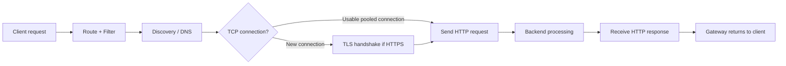
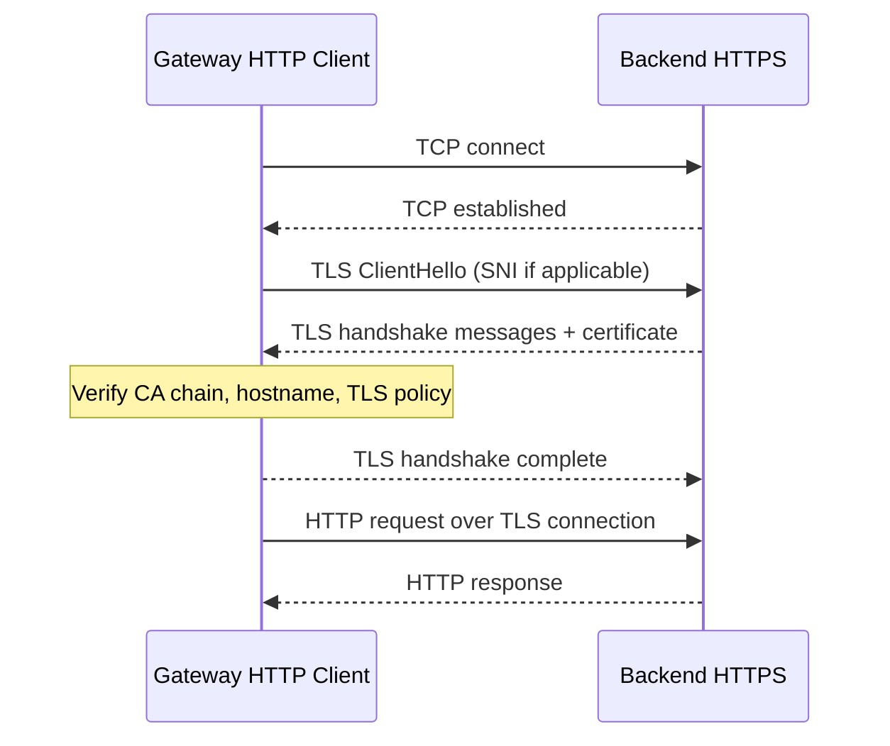
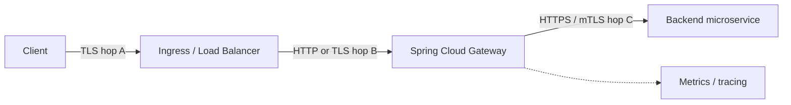
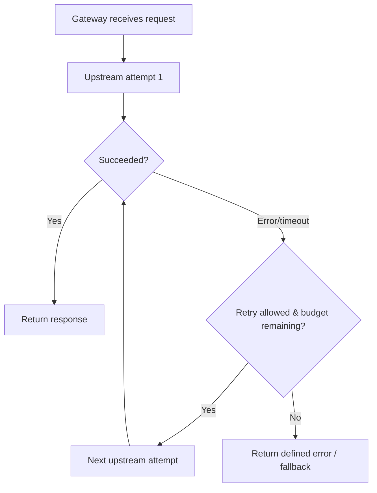
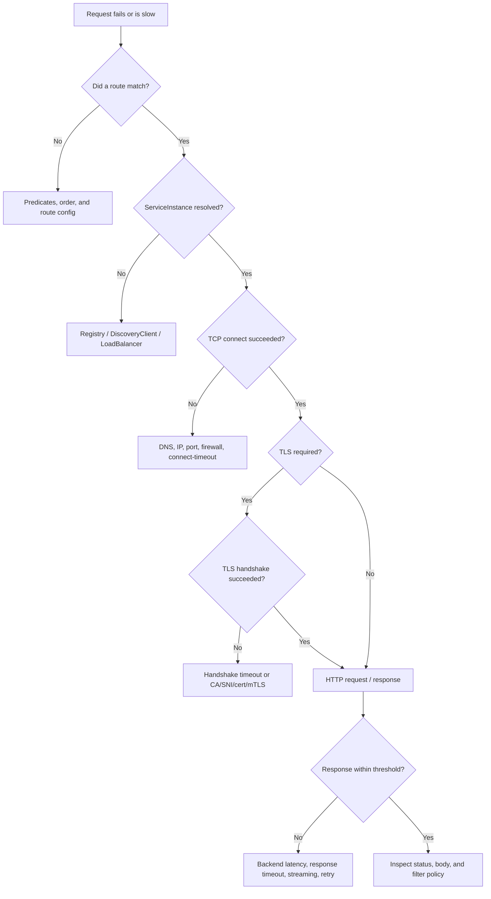

# Connection, response, and TLS handshake timeouts

In a microservices system, **Spring Cloud Gateway** may route a request properly yet the client still receives an error because the Gateway cannot connect to the backend, the backend responds too slowly, or the **TLS handshake** fails to complete. From the client's perspective, all three situations can appear as "the gateway is slow," yet they happen at **different stages** and require different diagnostic steps.

For example, a request `GET /api/catalog/products/42` routes to `lb://catalog-service`. The Gateway must locate an instance, open or reuse a TCP connection, establish TLS if the upstream uses HTTPS, send the HTTP request, and await/read the HTTP response. **Connect timeout**, **response timeout**, and **TLS handshake timeout** protect different segments of that chain; setting one of the three does not establish a **total deadline** for every request.

This lesson belongs to the **Connections and TLS** chapter of the **SPRING_CLOUD_GATEWAY** module. After this lesson, you will be able to distinguish these timeouts, configure them in **Gateway Server WebFlux**, understand the difference between inbound TLS and outbound TLS to backends, design latency budgets with retries/circuit breakers, and test and observe errors on an API gateway equipped with route predicates, filter chains, path/header transformations, service discovery, authentication, and rate limiting.

> **Version scope:** Examples using `spring.cloud.gateway.server.webflux.httpclient`, `RouteMetadataUtils`, and `RouteLocatorBuilder` target **Spring Cloud Gateway Server WebFlux** on lines using the newer WebFlux namespace. Older WebFlux versions typically use `spring.cloud.gateway.httpclient`; the **Server Web MVC** variant uses a different HTTP client model and configuration. Always cross-check the exact Spring Boot, Spring Cloud release train, Gateway, Reactor Netty, and Configuration Properties documentation for your deployed version.

## 1. Which stages does a request pass through?

Consider an HTTPS request to a backend:

```text
Client
  |
  | HTTPS to Gateway (if Gateway/Ingress accepts HTTPS)
  v
Spring Cloud Gateway
  | 1. Authenticate/select route and filter chain
  | 2. Resolve ServiceInstance (if route uses lb://)
  | 3. DNS lookup (when needed) and select target address
  | 4. TCP connect or acquire an open connection from the pool
  | 5. TLS handshake (if a new TLS connection)
  | 6. Send HTTP request and body
  | 7. Wait for/read HTTP response
  v
Backend microservice
```



**Not every request opens a new TCP connection or performs a new TLS handshake.** HTTP connection pooling/keep-alive can reuse established connections. With HTTP/2, multiple streams can share a single connection if configured and supported by both endpoints. Consequently, only a fraction of requests hit `connect-timeout` or `handshake-timeout`, whereas response waiting/reading time still affects requests using pooled connections.

### Stages that must be measured separately

| Stage | Components involved | Typical errors |
| --- | --- | --- |
| Route matching | Predicates and `RouteLocator` | No matching route; may return `404` if no other handler applies. |
| Instance resolution | DiscoveryClient, LoadBalancer | No instance for `lb://catalog-service`; commonly yields `503` depending on configuration. |
| Address resolution | DNS resolver, network | DNS returns no result or an unreachable IP. |
| TCP connection | Reactor Netty HTTP client | `connect-timeout`, connection refused, network unreachable. |
| TLS handshake | TLS engine/HTTP client | Handshake timeout, wrong cert/CA/SNI, protocol mismatch. |
| Sending HTTP request | HTTP client, request body | Mid-stream connection close, slow write, payload too large. |
| Waiting/receiving HTTP response | HTTP client and backend | `response-timeout`, upstream `5xx`, interrupted streaming. |
| Returning response to client | Gateway, ingress, client network | Client disconnects, front proxy times out. |

## 2. Three core timeout types

| Timeout | What does it protect? | What does it NOT guarantee? |
| --- | --- | --- |
| **Connect timeout** | Time allowed to open the **TCP connection** to the target. | Does not automatically bound total DNS time, TLS handshake, backend processing time, or total request time. |
| **TLS handshake timeout** | Time allowed for **TLS negotiation** on a new TLS connection. | Cannot fix bad certificates, untrusted CAs, SNI/hostname mismatches, or backends serving plain HTTP. |
| **Response timeout** | Limit governing **waiting for/reading the HTTP response** in the HTTP client. | Not necessarily an end-to-end deadline covering discovery, connect, TLS, body upload, retries, and full streaming duration. |

These timeouts **do not substitute for one another**. Setting `connect-timeout` to 1 second does not cut off a backend taking 30 seconds once the TCP connection succeeds. Conversely, setting `response-timeout` to 3 seconds does not guarantee immediate detection of a stalled TLS handshake if the handshake timeout is configured differently.

### Illustrative example

Suppose an application sets:

```text
connect-timeout       = 1000 ms
TLS handshake timeout = 4000 ms
response-timeout      = 5 s
```

These values are **illustrative test targets**, not recommended defaults for every system. If the backend uses plain HTTP, there is no TLS handshake stage. If an HTTP connection is reused from the pool, neither TCP connect nor TLS handshake happens for the current request.

Do not add the three numbers together and promise "every request finishes within 10 seconds." These timeouts measure **different phases**, alongside potential DNS/pool acquisition delays, body transmission, streaming, retries, and other proxy timeouts; when timers start or reset also depends on the HTTP client and version.

## 3. Connect timeout: opening a TCP connection to the backend

When the gateway needs a new connection to a `ServiceInstance` or specific host, the HTTP client performs a TCP connect. **`connect-timeout`** sets the limit for establishing that connection as supported by Reactor Netty.

In a route example:

```yaml
id: catalog-route
uri: lb://catalog-service
predicates:
  - Path=/api/catalog/**
filters:
  - StripPrefix=2
```

The gateway picks an instance, such as `10.0.1.21:8443`. Connection attempts can fail due to firewall drops, unreachable network addresses, wrong ports, or a backend not listening. These situations do not always produce the exact same timeout error:

- **Connection refused:** target rejects immediately, usually faster than the timeout threshold.
- **Connect timeout:** TCP connect fails to complete within the deadline.
- **DNS failure:** hostname resolution fails prior to connecting; error at an earlier step.
- **Pool acquisition delay:** HTTP client is waiting for a free pooled connection; not equivalent to a TCP connect timeout.

### Connect timeout does not necessarily cover DNS

DNS resolution may happen **before** opening the socket, with its own caching and timeouts. If DNS is slow, lowering `connect-timeout` alone will not guarantee a proportional drop in total latency. Measure DNS, connection pooling, and TCP connect independently when diagnosing connection latency.

### Connect timeout and LoadBalancer

`lb://catalog-service` identifies only the logical service. LoadBalancer fetches the `ServiceInstance` list from Eureka, Consul, Kubernetes, or another registry and selects one instance. If the list is empty, the gateway may reject the request before attempting any TCP connect. If an instance exists whose address is unreachable, the HTTP client then raises network/connection errors.

**Do not increase `connect-timeout` to fix a wrong service ID or an empty registry.** Inspect the right layer.

## 4. Response timeout: HTTP response arrives too slowly

After connecting and optionally completing the TLS handshake, the gateway sends the HTTP request to the backend. The backend may:

1. Sit queued too long before sending a response.
2. Start sending a response and stall mid-way.
3. Stream data continuously, sometimes for a long duration.
4. Return `500` or `503` quickly — this is a **valid protocol response**, not automatically a timeout.

Gateway WebFlux's `response-timeout` governs waiting for/reading the HTTP response in the Netty HTTP client. Reactor Netty documents response timeout as the allowed interval between network read operations while receiving a response in corresponding versions. Therefore, **do not treat it as an absolute deadline for a streaming response or an entire request**; test with realistic requests and responses.

### Comparison scenarios

| Scenario | What to observe | What NOT to infer |
| --- | --- | --- |
| Backend sends no response for several seconds | May hit the configured response timeout. | That every case always returns `504`. |
| Backend returns `500` after 100 ms | Upstream HTTP 500, not a timeout. | That raising response timeout will "fix" the `500`. |
| Backend sends periodic streaming chunks | Each chunk arrival can affect read-timeout tracking. | That the whole stream is always cut off at the exact configured total duration. |
| Client uploads a request body very slowly | May involve body receive/send, network, and server timeouts. | That response timeout alone bounds the entire upload. |

The HTTP status code the client sees on a timeout depends on exception mapping, error handlers, gateway filters, and upstream behavior; it can vary across releases. Record the **exception class, elapsed time, and route ID**, rather than hardcoding a single status code for every timeout.

## 5. TLS handshake timeout: TCP connected, TLS not yet established

When the outbound URI uses **HTTPS**, the gateway must establish a TLS session with the backend on new connections. The handshake negotiates protocol version and cipher suite, exchanges handshake messages, and verifies the server certificate against the trust configuration.



**Handshake timeout** bounds how long the gateway waits for the handshake to finish. It helps when:

- The TCP target accepts the connection but stalls during TLS.
- A proxy/middlebox or backend hangs mid-negotiation.
- Network issues prolong the handshake.

However, if the backend returns an untrusted certificate, the gateway can fail fast with **`SSLHandshakeException` or a certificate verification error** without waiting for `handshake-timeout` to expire. Likewise, calling `https://` on a plain HTTP port typically triggers a protocol error such as `NotSslRecordException` or handshake failure, not necessarily a timeout.

### Handshake timeout is not an application authentication timeout

The TLS handshake establishes the secure channel and endpoint identity per configuration. It is separate from:

- **JWT/OAuth 2.0** authentication of the HTTP request.
- Checking **authorization** for whether a user can view an order.
- Timeouts when calling an **Identity Provider** to fetch keys or configuration.
- Waiting for the backend to process the HTTP request after TLS succeeds.

Never raise TLS handshake timeout to fix JWT 401/403 errors, and never alter JWT filters to fix certificate errors.

## 6. Inbound TLS and outbound TLS are two separate configurations

In an architecture with an ingress/reverse proxy:



Each hop can be secured differently:

| Hop | TLS server | TLS client | Key configuration |
| --- | --- | --- | --- |
| Client → Ingress | Ingress | Browser/mobile/client | Public certificate, TLS policy, client trust. |
| Ingress → Gateway | Gateway if using HTTPS | Ingress | Spring Boot `server.ssl.*` if Gateway receives TLS directly, or corresponding infrastructure policy. |
| Gateway → Backend | Backend | **Gateway HTTP client** | `spring.cloud.gateway...httpclient.ssl.*`, trust manager, hostname/SNI, mTLS if needed. |

**Setting `server.ssl.*` does not configure the trust store for the Gateway HTTP client's outbound connections.** Likewise, adding a trusted CA for the outbound client does not turn on HTTPS on the Gateway's inbound listener.

### When an ingress already terminates TLS

If clients connect via HTTPS to an ingress and the ingress calls the gateway over HTTP inside an internal network, the gateway **does not perform a server-side TLS handshake for the client → ingress hop**. Still, evaluate the risk of plaintext HTTP on the ingress → gateway hop. In environments requiring end-to-end encryption or zero trust, use HTTPS/mTLS on this hop rather than implicitly trusting the entire internal network.

If the gateway uses `lb://` to select backend instances, check `ServiceInstance` metadata and secure-protocol selection policies. A `lb://catalog-service` URI **does not guarantee the backend connection is HTTPS**; scheme/secure resolution depends on instance metadata and filters per deployment version.

## 7. Global timeout configuration on Gateway Server WebFlux

Illustrative example for **versions using the Server WebFlux namespace**:

```yaml
spring:
  cloud:
    gateway:
      server:
        webflux:
          httpclient:
            connect-timeout: 1000
            response-timeout: 5s
            ssl:
              handshake-timeout-millis: 4000
```

### Reading units accurately

| Illustrative property | Value | Unit in WebFlux configuration | Effect |
| --- | --- | --- | --- |
| `httpclient.connect-timeout` | `1000` | Milliseconds | New TCP connections have a 1-second limit. |
| `httpclient.response-timeout` | `5s` | `java.time.Duration` | Limit governing waiting/reading responses is 5 seconds. |
| `httpclient.ssl.handshake-timeout-millis` | `4000` | Milliseconds | New TLS handshakes have a 4-second limit. |

Note that **`connect-timeout` and `handshake-timeout-millis` take millisecond values**, whereas the global response timeout in Gateway WebFlux documentation is specified as a **Duration**, such as `5s`. Do not copy `5000` into global `response-timeout` assuming every version parses it as 5 seconds; write `5s` for clarity and type accuracy.

Some older WebFlux documentation uses the branch:

```yaml
spring:
  cloud:
    gateway:
      httpclient:
        connect-timeout: 1000
        response-timeout: 5s
        ssl:
          handshake-timeout-millis: 4000
```

The two snippets express the **same configuration intent across different lines**, not a recommendation to declare both. Your actual Gateway/HTTP client version may support different property names or defaults; **lock your release train and verify official Configuration Properties before applying**.

### Other timeouts easily confused

| Concept | Role | One of the three timeouts covered here? |
| --- | --- | --- |
| **TCP connect timeout** | Deadline for opening a connection. | Yes. |
| **TLS handshake timeout** | Deadline for TLS negotiation. | Yes. |
| **HTTP response timeout** | Limit for waiting/reading responses. | Yes. |
| **DNS query timeout** | Waiting for resolver to return an address. | No; inspect DNS/resolver settings separately. |
| **Connection pool acquire timeout** | Waiting to borrow a connection from the pool. | No; not identical to TCP connect. |
| **Read/write timeout** | I/O read/write limit per a handler/client strategy. | Does not automatically equal response timeout. |
| **Idle timeout** | Inactivity period of a connection, HTTP server, or proxy. | No; must be designed across infrastructure. |
| **`close-notify-flush-timeout` / `close-notify-read-timeout`** | Time handling TLS close-notify on connection close. | Neither handshake timeout nor backend response time. |
| **Circuit breaker TimeLimiter** | Limits a protected call or execution segment per configuration. | Not automatically identical to HTTP client timeouts. |
| **Ingress/client total timeout** | Limit imposed by outer layers on the request. | An independent constraint. |

Do not set every timeout ultra-short just because you want fast responses. Proper configuration must reflect latency SLOs, network distance, new vs. pooled TLS handshakes, payload sizes, request types, and retry headroom.

## 8. Overriding timeouts per route

A system often needs different response timeouts:

- Catalog APIs need fast responses.
- Reporting APIs may need longer processing time.
- Order-creation APIs need moderate budgets and must not arbitrarily retry writes.

Gateway Server WebFlux supports **per-route timeouts** via `Route` metadata; the documentation uses two keys:

```text
connect-timeout
response-timeout
```

**Unlike the global response timeout:** both values in **per-route metadata** are expressed in **milliseconds** on WebFlux lines supporting this mechanism.

### 8.1. YAML with two routes

```yaml
spring:
  cloud:
    gateway:
      server:
        webflux:
          routes:
            - id: catalog-route
              uri: http://localhost:8081
              predicates:
                - Path=/api/catalog/**
              filters:
                - StripPrefix=2
              metadata:
                connect-timeout: 800
                response-timeout: 2000

            - id: report-route
              uri: http://localhost:8082
              predicates:
                - Path=/api/reports/**
              filters:
                - StripPrefix=2
              metadata:
                connect-timeout: 1500
                response-timeout: 12000
```

Here catalog has an **800 ms** connect limit and **2,000 ms** response limit; report has a **1,500 ms** connect limit and **12,000 ms** response limit. These are **illustrative POC values**, not SLAs or Gateway performance benchmarks.

A very common mistake:

```yaml
metadata:
  response-timeout: 5
```

Here `5` means **5 milliseconds**, not 5 seconds. If you want 5 seconds in WebFlux metadata, write:

```yaml
metadata:
  response-timeout: 5000
```

### 8.2. Configuring with Java DSL

```java
import static org.springframework.cloud.gateway.support.RouteMetadataUtils
    .CONNECT_TIMEOUT_ATTR;
import static org.springframework.cloud.gateway.support.RouteMetadataUtils
    .RESPONSE_TIMEOUT_ATTR;

import org.springframework.cloud.gateway.route.RouteLocator;
import org.springframework.cloud.gateway.route.builder.RouteLocatorBuilder;
import org.springframework.context.annotation.Bean;
import org.springframework.context.annotation.Configuration;

@Configuration
public class GatewayRoutes {

    @Bean
    RouteLocator catalogRoute(RouteLocatorBuilder builder) {
        return builder.routes()
            .route("catalog-route", route -> route
                .path("/api/catalog/**")
                .filters(filters -> filters.stripPrefix(2))
                .uri("lb://catalog-service")
                .metadata(CONNECT_TIMEOUT_ATTR, 800)
                .metadata(RESPONSE_TIMEOUT_ATTR, 2000))
            .build();
    }
}
```

This Java DSL snippet defines the route at runtime and requires Spring Cloud LoadBalancer plus a `ServiceInstance` source for `lb://catalog-service`. Avoid declaring duplicate route IDs across YAML and Java DSL without deliberate intent and precedence testing.

### 8.3. Disabling global response timeout for a single route?

In Gateway Server WebFlux versions supporting per-route response timeouts, a negative value in `metadata.response-timeout` can be used to **disable the global response timeout for that route**:

```yaml
metadata:
  response-timeout: -1
```

This **does not disable connect timeout, TLS handshake timeout, ingress timeout, client timeout, circuit breakers, or network/backend limits**. Especially for streaming, evaluate idle timeouts and per-proxy limits. Never use `-1` as a blanket "fix" for a slow backend without understanding the root cause and SLO.

### 8.4. Is there a per-route TLS handshake timeout?

Do not assume that because WebFlux supports `connect-timeout` and `response-timeout` in route metadata, it also supports an equivalent standard `metadata.handshake-timeout` key. **TLS handshake timeout primarily belongs to HTTP client SSL configuration**, and any per-route customization must be verified in the docs/API or implemented with a custom HttpClient design appropriate for your version.

If multiple backend groups require different TLS policies (CAs, client certificates, handshake timeouts), consider separating gateway/client configurations or explicit topologies rather than inventing custom metadata keys assuming the framework reads them.

## 9. Certificate trust: timeouts cannot fix trust

A secure HTTPS connection requires **verifying the server certificate**, not merely completing a handshake.

### 9.1. Common problem categories

| Symptom | Possible cause | Remediation |
| --- | --- | --- |
| Untrusted certificate | Internal CA missing from trust store. | Add the approved CA to the outbound HTTP client's trust mechanism. |
| Hostname mismatch | Certificate SAN omits the hostname the gateway connects to. | Issue certificate with the right DNS/route name; verify hostname validation. |
| Expired certificate | Certificate lifecycle/rotation not managed. | Renew and deploy cert; monitor expiry. |
| `NotSslRecordException` or TLS protocol error | Calling HTTPS on an HTTP-only port, or misconfigured proxy. | Check scheme, port, and TLS termination. |
| `SslHandshakeTimeoutException` or similar timeout | Server/proxy did not finish handshake within deadline. | Inspect TLS server, packets/network, latency, CPU, and handshake timeout. |
| Fails only on one instance | That instance's cert/hostname/SNI or TLS settings differ from peers. | Test each instance with the same host policy; fix rollout. |

**Never use trust-all/insecure trust managers in production.** Skipping certificate checks to "fix a handshake" lets the gateway connect to spoofed servers and leak tokens, cookies, or API payloads.

### 9.2. Private CAs and outbound trust stores

For backends using an internal CA, the gateway HTTP client must trust the corresponding CA or certificate through a supported mechanism. Some Gateway WebFlux lines offer properties like `httpclient.ssl.trusted-x509-certificates` to specify PEM certificates; verify resource loading, format, exact property names, and reload behavior for your version.

Proper operational workflow:

1. Security team issues/maintains the appropriate CA or backend certificates.
2. The Gateway receives **trust material** via a trusted configuration/secrets channel.
3. The backend URI uses a hostname permitted by the certificate, with proper SNI and hostname verification.
4. Test success cases as well as wrong-cert, expired-cert, and untrusted-CA cases.
5. Maintain a CA/certificate rotation plan that does not disrupt all new connections.

Never place private keys and keystore passwords into Git or route metadata for convenience. Trust stores and keystores serve distinct roles: **trust** verifies peers, while **key material** presents a certificate/identity when acting as a TLS server or mTLS client.

### 9.3. TLS versions, ciphers, and SNI

When TLS connections fail, inspect beyond timeouts:

- Supported TLS protocol versions and cipher suite policies on client and server.
- Which hostname is sent in TLS SNI; whether the backend sits behind a multi-vhost reverse proxy.
- Whether the returned certificate matches that hostname.
- Whether DNS/LoadBalancer routes the gateway to instances with inconsistent TLS settings.
- Whether a proxy or firewall interferes with the TLS handshake.

Increasing timeouts only helps when a **valid handshake is simply slow**, not when the two peers cannot negotiate compatible protocols or ciphers.

## 10. Mutual TLS and differences across verification hops

**mTLS (mutual TLS)** requires both sides to prove their identities with certificates per policy. When the gateway calls a backend:

```text
Gateway outbound TLS client             Backend TLS server
   - Trusts backend CA                   - Presents server cert
   - Sends client cert/key (if mTLS)     - Verifies gateway client cert
   - Verifies server hostname/cert       - Enforces service identity policy
```

If the backend requires a client certificate and the gateway fails to send the right one, the TLS handshake fails. This is an **mTLS or trust configuration error**, not by default a handshake timeout.

Conversely, if an ingress mandates client certificates on client → ingress, that does not automatically configure mTLS for gateway → backend. Each hop must be designed independently.

### Responsibilities that must not be mixed

| Goal | Primary tool |
| --- | --- |
| Encrypt and verify server/backend identity | TLS with CA trust and hostname verification. |
| Verify the gateway service identity to the backend | mTLS or appropriate service authentication. |
| Authenticate the end client/user | OAuth 2.0/JWT, sessions, or another identity mechanism. |
| Decide which resources a user may read/modify | Business authorization at gateway/backend. |
| Limit API call rates | Rate limiter keyed by identity/route; shared state across replicas. |

## 11. Retries, circuit breakers, and time budgets

Gateways often configure `Retry` and `CircuitBreaker` filters alongside HTTP client timeouts. Setting individual timeouts without an overall strategy can make client experience worse than expected.

### 11.1. Time budget example

Suppose a system requires **the client to receive a result within 8 seconds**. You might weigh illustrative constraints like:

```text
Client / ingress total deadline:          8 s
Gateway HTTP client connect-timeout:      1 s
Gateway HTTP client TLS handshake:        3 s
Gateway HTTP response timeout:            4 s
Retry:                                    only when safe, bounded
```

**Do not assume 1 + 3 + 4 = 8 guarantees meeting an 8-second deadline.** DNS, pool acquisition, sending the request body, scheduling, processing, tracing overhead, connection reuse, and multiple retries can extend real wall-clock time. Enforce an explicit **end-to-end deadline** if the architecture requires a hard total cap, and allocate hop budgets based on measurements.

### 11.2. Retries can amplify time and load



Two issues to control:

1. **Time:** each attempt can hit connect/TLS/response timeouts; without a total deadline, the client can wait several times longer than a single call.
2. **Correctness:** the backend might process `POST /payments` successfully while the gateway loses the response. Retrying can create duplicate payments unless an **idempotency key** and matching backend handling exist.

Do not automatically retry every TLS error: an invalid certificate will generally **not be fixed** by reconnecting. Unbounded retries only add load and mask the root cause.

### 11.3. Circuit breakers do not replace HTTP client timeouts

`CircuitBreaker` measures/limits call behavior per policy and can open the circuit when error rates, slow-call rates, or defined thresholds are breached. HTTP client timeouts are still needed to abort stalled connections or reads on individual attempts.

If pairing a TimeLimiter with a circuit breaker, verify which execution segment it wraps, how subscriptions are cancelled, and whether upstream connections are actually released. **Cancelling a request at one layer is not proof the backend stopped processing.**

## 12. Connection pooling: timeouts may appear less often than expected

One reason TLS handshake timeouts can be hard to reproduce in a POC is **connection reuse**:

- The first request opens the TCP connection and runs the TLS handshake.
- The second request reuses the live pooled connection and may skip the handshake.
- The backend closes an idle connection; a later request needs a fresh connection, triggering connect/handshake again.
- During a rolling deploy, a new instance has a bad cert; only traffic hitting that instance fails.

### Metrics to watch

| Category | What to measure |
| --- | --- |
| Pool | Active connections, idle connections, pending acquires, pool-full rejections. |
| TCP | Connection opens, refused/errors, connect latency. |
| TLS | New handshakes, handshake duration, cert/trust/hostname errors. |
| HTTP | Response latency, statuses, upstream errors, in-flight requests. |
| Discovery | Service ID, instance set, request distribution across instance groups. |

Do not measure handshakes by firing 100 sequential requests from one client and concluding "TLS is super fast" when 99 requests reused an existing connection. In testing, separate **cold connections** from **warm connections**, and record exact pool and network parameters.

## 13. Hands-on: three distinct failure modes

### 13.1. Environment setup

Assume you have:

- Gateway Server WebFlux on `http://localhost:8080`.
- A mock catalog backend for `/api/catalog/**`.
- A mock HTTPS backend holding a valid certificate for a **test hostname** with matching DNS/hosts entries (not necessarily `localhost`).
- Ability to simulate a slow backend, connection refused, or accepting TCP without completing TLS in the test environment.

You do not need Eureka or Consul for basic timeout tests; static route URIs isolate failures cleanly. When moving to `lb://catalog-service`, add LoadBalancer and an instance source to test discovery independently.

### 13.2. Baseline check

Illustrative route:

```yaml
spring:
  cloud:
    gateway:
      server:
        webflux:
          routes:
            - id: catalog-test
              uri: http://localhost:8081
              predicates:
                - Path=/api/catalog/**
              filters:
                - StripPrefix=2
              metadata:
                connect-timeout: 1000
                response-timeout: 3000
```

Have the backend listen on `localhost:8081` and answer `GET /products/42` quickly, then call:

```bash
curl -i "http://localhost:8080/api/catalog/products/42"
```

Record route ID, status, and elapsed time. A successful request does not prove timeouts are configured correctly; you must inject delays/failures to verify them.

### 13.3. Simulating connect timeout

In an **isolated POC environment**, configure an endpoint that fails to complete TCP connection within the threshold, such as via controlled network fault injection. Send the same request and record:

- Whether route `catalog-test` matched.
- Whether TCP connect to that IP/port actually started.
- Whether the resulting exception is timeout, refused, or DNS failure.
- Elapsed time logged by the gateway vs. `connect-timeout`.

**Never pick a random IP on the Internet to induce a timeout**: external hosts may fail immediately or receive unintended traffic. A port with no listener typically produces `Connection refused` rapidly rather than a true connect timeout.

### 13.4. Simulating response timeout

Restore the reachable backend, and make `/products/42` deliberately wait **5 seconds before sending the HTTP response** while the route sets `response-timeout: 3000`.

```bash
curl -i "http://localhost:8080/api/catalog/products/42"
```

Observe the response, exception logs, elapsed time, and whether the upstream received the request. This differs from a connect timeout because TCP succeeded and the HTTP request reached the backend.

If a streaming backend sends chunks periodically, run a separate test to check whether response timeout behaves as **read inactivity** or another mode on your Reactor Netty/Gateway version; never use a single-response test to conclude a stream will abort at a fixed total wall-clock cap.

### 13.5. Simulating TLS handshake timeout

Set the upstream to HTTPS in the test environment, e.g.:

```yaml
uri: https://catalog.test.internal:8443
```

With a test server that **accepts the TCP connection without finishing the TLS handshake**, observe the handshake timeout firing per the global `handshake-timeout-millis`.

**Distinguish two situations:**

- If the backend returns a wrong-CA/SAN certificate, the gateway may **fail TLS immediately** on certificate validation; that is not a stalled handshake.
- Only when the test server never completes the handshake are you exercising the timeout itself.

Test against intentionally configured mock hostnames/certificates; never disable certificate verification to make a test "pass."

### 13.6. Checking TLS with an independent tool

From an environment sharing the gateway's network path, you can run:

```bash
openssl s_client \
  -connect catalog.test.internal:8443 \
  -servername catalog.test.internal \
  -verify_hostname catalog.test.internal \
  -verify_return_error
```

This command is diagnostic only; success requires DNS, network reachability, CA trust, and OpenSSL support for those flags. `openssl s_client` inspects certificates/handshakes and SNI, and **does not prove** Gateway timeouts are applied. To test the gateway, send requests through the gateway and inspect HTTP client logs/metrics.

### 13.7. Using curl to separate client timeouts from gateway timeouts

```bash
curl --connect-timeout 2 --max-time 10 -i \
  "http://localhost:8080/api/catalog/products/42"
```

Here `--connect-timeout` is **curl's** TCP/TLS timeout connecting to the gateway, and `--max-time` is **curl's** total allowed duration. They are **not** the **gateway → backend** connection properties. If curl times out first, inspect gateway/backend logs to determine whether the gateway is still calling upstream or already finished.

### POC results table

| Case | Deliberate condition | Signals to verify |
| --- | --- | --- |
| T01 | Healthy HTTP backend | Right route selected, normal status/body. |
| T02 | Stalled TCP connect | Connect timeout, not confused with refused. |
| T03 | Port with no listener | Fast `Connection refused`, not misdiagnosed as connect timeout. |
| T04 | Wrong DNS hostname | Name resolution error, distinct from TCP connect. |
| T05 | Backend receives HTTP, responds after timeout | Response timeout, upstream received the request. |
| T06 | Streaming backend with heartbeats | Observe response/read timeout behavior rather than assuming a total deadline. |
| T07 | TCP accepted, TLS never completes | TLS handshake timeout. |
| T08 | Invalid CA/cert/hostname | TLS trust/hostname failure, not "fixed" by raising timeouts. |
| T09 | Connection reused | No new handshake on every request; compare cold vs. warm. |
| T10 | One instance in `lb://` unhealthy | Selected instance ID, check Discovery/LoadBalancer. |
| T11 | Bounded retry enabled | Total latency, backend call count, and idempotency. |
| T12 | Two gateway replicas | Consistent timeout/TLS settings and certificates. |

## 14. Diagnosing failures by symptom

| Symptom seen by client | What to investigate first | What NOT to do immediately |
| --- | --- | --- |
| Request returns `404` almost instantly | Route predicates, path/method, backend 404. | Increase TLS handshake timeout. |
| Request returns `503`, no instances | DiscoveryClient, `lb://serviceId`, LoadBalancer cache. | Increase connect timeout expecting instances to appear. |
| Instances exist but connections fail | IP/port, firewall, DNS, network routing, TCP timeout. | Assume a registry entry means the backend is healthy. |
| `SSLHandshakeException` thrown | CA/trust store, SAN, SNI, TLS protocol, mTLS. | Enable insecure trust manager. |
| Failure after waiting during TLS | TLS handshake timeout and server responsiveness. | Change JWT parser or route predicate. |
| Backend receives request then responds too late | HTTP response timeout, backend latency, queues/DB. | Only decrease connect timeout. |
| Only the first request fails | Cold connection, DNS, TCP connect, TLS handshake. | Measure only warm pool and conclude no bug exists. |
| Fails only under high load | Connection pool, pending acquires, CPU/memory, upstream saturation. | Raise all timeouts indefinitely. |
| Plain HTTP works, HTTPS fails | Scheme/port, certificate, SNI, proxy TLS termination. | Bypass certificate validation. |
| With retries, client waits longer | Attempt count, timeout budget, retry filter, circuit breaker. | Retry all statuses/methods without bounds. |
| 401/403 | Spring Security or backend authorization. | Adjust TLS connect timeout. |
| 429 | Rate limiting/quota. | Change HTTP client TLS configuration. |

### Minimal investigation flowchart



This diagram simplifies the inspection order. With connection pooling or retries, one request can span multiple connections or attempts; pinpoint the **specific attempt and upstream** to diagnose accurately.

## 15. Observing timeouts and TLS in production

Logging only `HTTP 502`/`504` is insufficient to distinguish DNS, connect, handshake, and response errors. Combine:

- **Route ID** and service ID, e.g., `catalog-route` → `catalog-service`.
- Selected upstream instance/group and controlled internal hostname/port logging.
- Latency split across ingress, gateway, connect, TLS, and backend where tooling supports it.
- Exception class/cause and final HTTP status; never classify failures by status code alone.
- Circuit breaker state/outcome, retry attempt count, and total elapsed time.
- Pooled/idle/pending connection counts, acquire failures, and timeouts.
- Distributed tracing/correlation across gateway and backend to know whether the request reached the backend.
- Certificate expiry indicators and TLS inconsistency across instances.

An **illustrative** log record (not default Gateway output):

```text
traceId:          [trace ID]
routeId:          catalog-route
serviceId:        catalog-service
upstreamGroup:    catalog-region-a
connectionState:  new
failureStage:     tls-handshake
failureClass:     [actual exception type]
elapsedMs:        [measured value]
status:           [status returned to client]
```

Spring Boot Actuator/Micrometer and tracing can expose corresponding Gateway/Netty HTTP metrics, though meter names, tags, and activation depend on versions and metric registries. **Do not invent metrics or assume the trace above appears by default**; verify the actual metrics emitted by your application.

### Protecting sensitive data in logs

Never log private keys, full certificates containing unnecessary sensitive attributes, bearer tokens, cookies/sessions, query strings with private data, or user payloads. For metrics, avoid high-cardinality tags like full URLs containing order IDs or user IDs; prefer bounded tags like route ID and upstream group.

## 16. Common configuration misconceptions

### "A low connect-timeout bounds every request"

False. Connect timeout only bounds opening the TCP connection; requests using keep-alive connections skip this phase. You still need response timeouts, overall deadlines, ingress/client limits, and properly scoped circuit breakers.

### "TLS handshake timeout is JWT validation time"

False. TLS establishes the secure channel and peer identity, whereas JWTs are validated in the HTTP security filter chain. Bad certificates and bad tokens belong to different diagnostic layers.

### "If SSLHandshakeException occurs, just increase the timeout"

False. If a CA is untrusted, hostname mismatches, or client certificates are wrong, raising timeouts will not fix the cause. Fix trust, certificates, or TLS settings.

### "HTTPS on the client side means the whole path is encrypted"

Not guaranteed. An ingress may terminate TLS and forward HTTP to the gateway, and the gateway may call backends over HTTP. Diagram every TLS hop and verify each segment.

### "Response-timeout is the total request deadline"

Do not assume this, especially with DNS, pooling, handshakes, retries, and streaming. Enforce a separate end-to-end deadline if SLAs demand a total cap.

### "Route metadata can set every Netty timeout"

Not by default. WebFlux docs support per-route connect/response timeout keys; TLS handshake timeout is primarily an HTTP client SSL setting. Never invent `metadata.tls-timeout` assuming the framework reads it.

### "Retries will automatically heal all connection errors"

No. If every instance serves an invalid certificate, retries merely multiply errors. For POST/PUT/PATCH, you must also guard idempotency and backend load.

### "No errors locally means production is fine"

Local environments have low latency, different connection reuse, simpler certificates, and fewer proxies. Test from production-like networks with cold/warm connections, discovered backends, and injected faults at each layer.

## 17. Pre-production checklist

- [ ] Mapped all TLS hops: client → ingress → gateway → backend, and which hops carry plain HTTP.
- [ ] Locked compatible Spring Boot, Spring Cloud release train, Gateway Server WebFlux/MVC, Reactor Netty, and starters.
- [ ] Verified property prefixes and **timeout units** against version-specific docs; no mixing of old and new WebFlux YAML.
- [ ] Set connect timeout for new connections, response timeout for desired HTTP behavior, and TLS handshake timeout for outbound HTTPS.
- [ ] If using per-route metadata, confirmed `connect-timeout`/`response-timeout` are in **milliseconds**.
- [ ] Did not assume route metadata controls handshake timeouts or every other timer by default.
- [ ] Enforced CA trust, SAN/hostname verification, SNI, and certificate rotation policies; insecure trust manager disabled.
- [ ] If backends require mTLS, the gateway holds client certificates/keys and backends trust the exact service identity.
- [ ] With `lb://`, verified instance secure/URI schemes and consistent TLS config across backend replicas.
- [ ] Tuned timeouts/pools/connection acquisition for load, measured cold/warm connections, and planned for DNS/registry outages.
- [ ] Designed **total deadlines** across client/ingress/gateway aligned with SLOs; bounded retries, avoiding unsafe retries on writes.
- [ ] Coordinated CircuitBreaker/TimeLimiter with HTTP client timeouts without hiding root causes or leaking data in fallbacks.
- [ ] Enabled metrics/logs/tracing distinguishing route, backend, connect/TLS/response errors, retry counts, and total latency.
- [ ] Tested at least one TCP connect failure, one TLS handshake/certificate failure, and one slow backend response.
- [ ] Tested multiple gateway/backend replicas and TLS misconfiguration on a single instance.
- [ ] Managed secrets/keystores/trust stores securely, with rollout/rollback plans and certificate expiry alerts.

## 18. Self-check questions

1. Why does `connect-timeout=1000` not guarantee an HTTP request finishes within one second?
2. State the differences among connection refused, connect timeout, DNS failure, and pool acquire timeout.
3. Why might a second request on a keep-alive connection skip performing a new TLS handshake?
4. How do TLS handshake timeout and response timeout differ in when they start and end?
5. When a backend sends response chunks steadily, why cannot response timeout be assumed to act as a total streaming deadline?
6. Compare the type and unit of `httpclient.response-timeout: 5s` vs. `metadata.response-timeout: 5000` in Gateway Server WebFlux.
7. If a route sets `metadata.response-timeout: -1`, are other timeouts also disabled?
8. Why does editing `server.ssl.*` on the Gateway not necessarily fix a TLS connection from the Gateway to a backend?
9. Distinguish an `SSLHandshakeException` caused by a wrong CA/SAN from a timeout caused by an incomplete handshake.
10. When a route uses `lb://catalog-service`, why must you inspect instance secure metadata and TLS settings on each backend?
11. When the gateway retries a `POST /payments` after a timeout, why does the backend need an idempotency key?
12. Which fields would you measure to determine whether a 502/504 came from connect, TLS handshake, or HTTP response?

## 19. Version-specific reference documentation

Consult the following official sources matching your project's exact dependencies; property names and behaviors can vary across Gateway and Reactor Netty releases:

- [Spring Cloud Gateway Server WebFlux — HTTP timeouts configuration](https://docs.spring.io/spring-cloud-gateway/reference/spring-cloud-gateway-server-webflux/http-timeouts-configuration.html)
- [Spring Cloud Gateway Server WebFlux — TLS and SSL](https://docs.spring.io/spring-cloud-gateway/reference/spring-cloud-gateway-server-webflux/tls-and-ssl.html)
- [Spring Cloud Gateway Server WebFlux — Global Filters](https://docs.spring.io/spring-cloud-gateway/reference/spring-cloud-gateway-server-webflux/global-filters.html)
- [Spring Cloud Gateway — Configuration Properties](https://docs.spring.io/spring-cloud-gateway/reference/configprops.html)
- [Spring Cloud Gateway Server Web MVC — Reference](https://docs.spring.io/spring-cloud-gateway/reference/spring-cloud-gateway-server-webmvc/index.html)
- [Reactor Netty — HTTP Client](https://projectreactor.io/docs/netty/release/reference/http-client.html)
- [Spring Boot — SSL](https://docs.spring.io/spring-boot/reference/features/ssl.html)

**Remember:** In Spring Cloud Gateway, **connect timeout** bounds opening a TCP connection, **TLS handshake timeout** bounds establishing TLS on a new connection, and **response timeout** governs waiting for/reading the HTTP response. These three distinct limits must be configured together with TLS trust/mTLS, LoadBalancer/discovery, retries/circuit breakers, and a measured end-to-end time budget. The goal is not merely "failing fast," but **pinpointing the exact failure stage and keeping the microservices gateway secure and reliable**.
