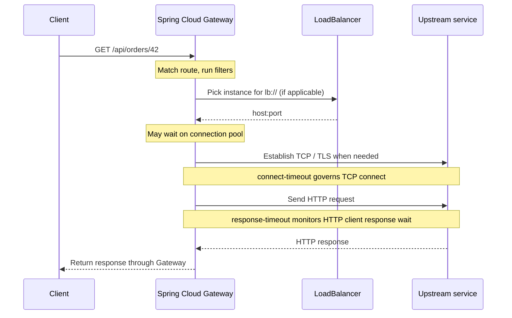
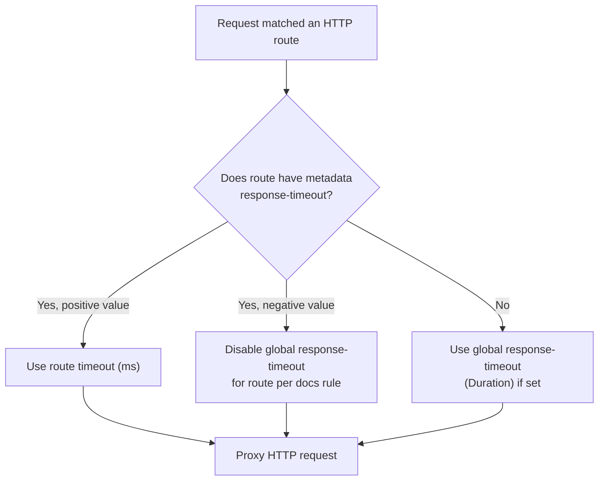

# Overriding timeouts via route metadata and configuration units

An API Gateway may simultaneously serve a product-lookup endpoint needing responses within a few hundred milliseconds and a report-generation endpoint needing several seconds for the backend to complete. If every route shares a single timeout threshold, a setting that is too short breaks legitimate requests; a setting that is too long leaves clients and gateway resources waiting far too long on unhealthy upstreams.

**Spring Cloud Gateway Server WebFlux** allows configuring **global HTTP connect timeout and response timeout**, then **overriding them per route via `metadata`**. This lets you differentiate API groups by backend characteristics while centralizing governance through route predicates and filter chains. The most critical point is that **configuration units differ between global properties and route metadata**: using the wrong unit can make a timeout a thousand times shorter or longer than intended.

This lesson belongs to the **Connections and TLS** chapter of the **SPRING_CLOUD_GATEWAY** module. When building a microservices gateway with routing, path/header transformations, service discovery, authentication, rate limiting, circuit breakers, retries, TLS, and request observability, setting timeouts at the proper boundaries is essential for safe operations.

Learning objectives:

1. Distinguish `connect-timeout` from `response-timeout`; recognize which durations are **not** controlled by these two options.
2. Configure global timeouts with the right units and override them via `Route.metadata` in YAML or Java DSL.
3. Understand how route metadata takes **precedence** over global configuration, as well as the special meaning of `response-timeout: -1`.
4. Avoid confusing timeouts with service discovery errors, TLS errors, connection pool limits, circuit breakers, and retries.
5. Design test scenarios with fast/slow routes, inspect effective route metadata, and interpret results accurately.

> **Scope and version note:** This lesson applies to **Spring Cloud Gateway Server WebFlux** using the Reactor Netty HTTP client. Primary examples use the Gateway WebFlux **5.x** namespace: `spring.cloud.gateway.server.webflux.httpclient` and `spring.cloud.gateway.server.webflux.routes`. For Gateway WebFlux **4.3.x**, docs use the legacy namespace `spring.cloud.gateway.httpclient` and `spring.cloud.gateway.routes`. Some example snippets in the 5.x *Http timeouts configuration* page still display the older namespace; when deploying, prioritize the configuration properties table and route metadata of the **exact artifact running**, then verify with integration tests. Server MVC has its own HTTP client/timeout mechanism; do not mechanically apply these WebFlux properties there.

## 1. Two distinct timers: connect and response

When a client calls `GET /api/orders/42`, the gateway must find a route, optionally select a service instance, establish or borrow a connection, and wait for upstream data. These phases do not share one uniform timer.



**Connect timeout** limits the time to establish a **TCP connection to the upstream address** when a new connection is needed. If the network silently drops SYN packets or traffic to the host is blackholed, a connect timeout can fire. However, if the target host immediately replies with "connection refused," the request fails **immediately** without waiting for the timeout.

**Response timeout** limits how long the **gateway's HTTP client** waits for a response from upstream. It prevents the gateway from waiting indefinitely on a backend after the connection is established and the request is in flight. Check Reactor Netty details for your specific version to distinguish response wait time, idle I/O intervals, and streaming response behavior; do not treat it as an **overall deadline from when the client sends a request to when the client receives the last byte**.

### Durations easily confused

| Stage | Directly controlled by `connect-timeout`? | Directly controlled by `response-timeout`? |
| --- | --- | --- |
| Matching predicates, running `GlobalFilter`/`GatewayFilter` | No | Does not cover all filter processing time |
| Waiting for an idle connection in the pool | No; governed by a separate **pool acquire timeout** | Should not treat response timeout as an acquisition limit |
| DNS resolution / `lb://` instance lookup | TCP connect timeout cannot act as an overall cap for these steps | No |
| Establishing a new TCP connection to upstream | **Yes**, within HTTP client connect scope | Not the whole response lifecycle |
| TLS handshake to HTTPS upstream | Distinct from TCP connect; has **TLS handshake timeout** | Does not replace handshake limits |
| Waiting for HTTP response data | No | **Yes**, per Reactor Netty HTTP client semantics |
| Custom filter making synchronous JDBC/HTTP calls | No | No, if work happens outside the Gateway HTTP client |
| All retry attempts + backoff combined | No | Not a total deadline across all attempts |
| Slow client request body upload / slow client response read | No | Not a general end-to-end inbound/outbound timeout |

**Rule of thumb:** Connect timeout protects the **connection-opening** phase; response timeout protects the **waiting for upstream HTTP response** phase. Both are Gateway HTTP client timeouts, not replacements for every infrastructure timeout.

## 2. Units table: the easiest configuration mistake

Spring Cloud Gateway documentation clearly specifies:

- **Global `connect-timeout`: milliseconds (ms).**
- **Global `response-timeout`: `java.time.Duration` type**, such as `5s` or `500ms`.
- **Per-route `metadata.connect-timeout`: milliseconds (ms).**
- **Per-route `metadata.response-timeout`: milliseconds (ms).**

| Placement | Key | Correct form | Interpretation |
| --- | --- | --- | --- |
| Global HTTP client | `connect-timeout: 1000` | Integer, ms | 1 second |
| Global HTTP client | `response-timeout: 5s` | `Duration` | 5 seconds |
| Global HTTP client | `response-timeout: 750ms` | `Duration` | 750 milliseconds |
| Route `metadata` | `connect-timeout: 300` | Integer, ms | 0.3 seconds |
| Route `metadata` | `response-timeout: 1200` | Integer, ms | 1.2 seconds |
| Route `metadata` | `response-timeout: 5000` | Integer, ms | 5 seconds |
| Route `metadata` | `response-timeout: -1` | Special negative value | **Disables global response timeout** for this route |

### Example errors from unit confusion

```yaml
# Do not use as route config: illustrates unit mistake
metadata:
  response-timeout: 5
```

If the author meant **5 seconds**, that line actually sets **5 milliseconds**, potentially causing mass timeouts even when the backend is very fast.

```yaml
# Per per-route docs, do not use a Duration string here
metadata:
  response-timeout: 5s
```

For route metadata, official examples use **numeric values in milliseconds**, not `Duration` strings. How Spring binds/reads metadata can vary by version and route definition source; to avoid type errors or unexpected values, write `5000` for 5 seconds.

For the global setting:

```yaml
# Intended: 5-second Duration on the HTTP client
response-timeout: 5s
```

**Unit conversions to remember:** `1s = 1000ms`; `0.5s = 500ms`; `30s = 30000ms`. Example numbers are not universal optimal thresholds; choose values based on backend latency, SLAs, request length, network behavior, and resilience needs.

### Why does metadata use integers?

Route `metadata` is a map attached to a route definition that can hold various technical attributes. `RouteMetadataUtils` provides constant keys such as `CONNECT_TIMEOUT_ATTR` and `RESPONSE_TIMEOUT_ATTR`. When reading these keys, the routing mechanism interprets them as **milliseconds** per the docs, unlike Spring Boot binding global `response-timeout` as a `Duration`.

Do not append `ms` to metadata key names or confuse `metadata.responseTimeout` with `metadata.response-timeout`; use the exact kebab-case keys/constants from the docs and inspect effective metadata.

## 3. Configuring global timeouts in Gateway WebFlux 5.x

For Spring Cloud Gateway Server WebFlux **5.x**, the configuration properties table lists HTTP client properties under `spring.cloud.gateway.server.webflux.httpclient`.

Example:

```yaml
spring:
  cloud:
    gateway:
      server:
        webflux:
          httpclient:
            connect-timeout: 1000  # ms, limit for opening a new TCP connection
            response-timeout: 5s    # java.time.Duration, 5 seconds
```

Meaning:

- When the outbound HTTP client must open a TCP connection, the connect timeout is **1000 ms**.
- For routes **without an override**, the HTTP client applies a global response timeout of **5 seconds** per Reactor Netty/Gateway mechanics.
- This policy applies broadly to HTTP/HTTPS routes proxied via that HTTP client; internal routes like `forward://`, WebSockets, or responses produced before routing are not automatically covered identically.
- This configuration **does not** directly configure timeouts for mobile clients, proxies in front of the gateway, JDBC calls in custom filters, or HTTP clients created inside backends.

### Gateway 4.3.x namespace

On **WebFlux 4.3.x**, the familiar global configuration is:

```yaml
spring:
  cloud:
    gateway:
      httpclient:
        connect-timeout: 1000
        response-timeout: 5s
```

Changing namespaces does not change **units**: `connect-timeout` remains ms, and `response-timeout` remains `Duration`.

> **5.x docs note:** The *Http timeouts configuration* page currently shows examples using `spring.cloud.gateway.httpclient` like the older branch, whereas the 5.x *Configuration Properties* table lists `spring.cloud.gateway.server.webflux.httpclient`. Use the namespace matching your running version/starter, check effective config properties, and test timeouts. Never enable both blocks by trial-and-error assuming both apply together.

## 4. Overriding via route metadata in application.yml

Suppose two endpoint classes are needed:

- `orders-fast`: order lookup/creation, expected to respond quickly.
- `reports-slow`: legitimate report queries taking longer.

Gateway WebFlux 5.x configuration:

```yaml
spring:
  cloud:
    gateway:
      server:
        webflux:
          httpclient:
            connect-timeout: 1000
            response-timeout: 5s

          routes:
            - id: orders-fast
              uri: http://localhost:8081
              predicates:
                - Path=/api/orders/**
              filters:
                - StripPrefix=1
              metadata:
                connect-timeout: 400     # 400 ms
                response-timeout: 1200   # 1.2 seconds

            - id: reports-slow
              uri: http://localhost:8082
              predicates:
                - Path=/api/reports/**
              filters:
                - StripPrefix=1
              metadata:
                connect-timeout: 1500    # 1.5 seconds
                response-timeout: 15000  # 15 seconds

            - id: catalog-inherit
              uri: http://localhost:8083
              predicates:
                - Path=/api/catalog/**
              filters:
                - StripPrefix=1
```

The backend at `localhost:8081` is assumed to serve `/orders/**`, the reporting backend at `localhost:8082` serves `/reports/**`, and the catalog backend at `localhost:8083` serves `/catalog/**`. This is a local test setup requiring those servers to verify.

### Reading the result from YAML

| Route | Connect timeout | Response timeout | Why |
| --- | --- | --- | --- |
| `orders-fast` | 400 ms | 1,200 ms | Both come from route metadata |
| `reports-slow` | 1,500 ms | 15,000 ms | Both override global settings |
| `catalog-inherit` | 1,000 ms | 5 seconds | No metadata declared, inherits global |

If a route sets only `metadata.response-timeout` without `metadata.connect-timeout`, it **overrides only the response timeout**; connect timeout still uses the global value. Per-route configuration applies **per individual property**, without requiring both keys to be replaced together.

### Why put them in metadata rather than filters?

Incorrect placement:

```yaml
# Incorrect example: response-timeout is not a GatewayFilter name
filters:
  - ResponseTimeout=1200
```

In Gateway WebFlux, per-route HTTP client timeouts are defined as **route metadata**, not a hypothetical `ResponseTimeout` filter. Certain filters have their own timeouts (such as circuit breakers), which are **separate mechanisms**.

## 5. Precedence rules and special cases

Conceptual order of precedence:

1. If the matched route has a valid metadata value for a timeout, **use the route's value** for that timeout.
2. If the route lacks that value, **inherit the global HTTP client setting**.
3. If the global setting is also unset, use the **framework/transport default for the running version**.



Illustrative table with global `response-timeout: 5s`:

| Route metadata | Actual meaning |
| --- | --- |
| No `response-timeout` | Inherits 5 seconds |
| `response-timeout: 800` | Overrides to 800 ms |
| `response-timeout: 12000` | Overrides to 12 seconds |
| `response-timeout: -1` | **Disables global response timeout** for the route |
| `response-timeout: 0` | **Do not use as a standard way to disable**; check how your version handles non-positive values |
| `response-timeout: 5s` | Not the ms integer format described in per-route docs |

**`-1` is a documented rule specifically for per-route `response-timeout`.** Do not extrapolate that `connect-timeout: -1` has an identical meaning. For connect timeout, use a sensible positive ms value and manage other connection settings separately.

### Disabling global response timeout for a single route

Some APIs like long polling/streaming or exceptional reports do not fit a global response limit. Spring Cloud Gateway documentation supports a **negative** metadata value, e.g.:

```yaml
- id: special-streaming
  uri: http://localhost:8084
  predicates:
    - Path=/api/stream/**
  filters:
    - StripPrefix=1
  metadata:
    connect-timeout: 800
    response-timeout: -1
```

This is a **route fragment** placed inside `routes` under the appropriate namespace.

**Warning:** `response-timeout: -1` only disables the **Gateway HTTP client's global response timeout for that route**; it does not mean requests "run forever" or that all other timeouts are off. Fronting ingresses/load balancers, clients, Reactor Netty/connection pools, circuit breakers, upstream servers, and operational policies can still bound request lifetimes.

In production, prefer a **sufficiently large** positive limit whenever processing time can still be estimated. Use `-1` only when you understand the stream behavior and have proper resource controls, cancellation, idle connection handling, monitoring, and end-to-end bounds.

## 6. Java DSL: RouteMetadataUtils and numeric values

Besides YAML, you can attach timeout metadata via the Spring Cloud Gateway Server WebFlux Java DSL. Use constant keys from `RouteMetadataUtils` to avoid typos:

```java
import static org.springframework.cloud.gateway.support.RouteMetadataUtils
    .CONNECT_TIMEOUT_ATTR;
import static org.springframework.cloud.gateway.support.RouteMetadataUtils
    .RESPONSE_TIMEOUT_ATTR;

import org.springframework.cloud.gateway.route.RouteLocator;
import org.springframework.cloud.gateway.route.builder.RouteLocatorBuilder;
import org.springframework.context.annotation.Bean;
import org.springframework.context.annotation.Configuration;

@Configuration(proxyBeanMethods = false)
public class GatewayTimeoutRoutes {

    @Bean
    RouteLocator timeoutRoutes(RouteLocatorBuilder builder) {
        return builder.routes()
            .route("orders-fast", r -> r
                .path("/api/orders/**")
                .filters(f -> f.stripPrefix(1))
                .uri("http://localhost:8081")
                .metadata(CONNECT_TIMEOUT_ATTR, 400)
                .metadata(RESPONSE_TIMEOUT_ATTR, 1200))
            .route("reports-slow", r -> r
                .path("/api/reports/**")
                .filters(f -> f.stripPrefix(1))
                .uri("http://localhost:8082")
                .metadata(CONNECT_TIMEOUT_ATTR, 1500)
                .metadata(RESPONSE_TIMEOUT_ATTR, 15000))
            .build();
    }
}
```

In Java DSL:

- `CONNECT_TIMEOUT_ATTR` and `RESPONSE_TIMEOUT_ATTR` are built-in constants, not custom definitions.
- Values `400`, `1200`, `1500`, and `15000` are all in **milliseconds**, even in Java.
- `.metadata(...)` attaches metadata to the **Route**; it does not call `Thread.sleep` or configure custom `WebClient` timeouts.
- The backend still receives the path transformed by `stripPrefix(1)`; timeout metadata does not alter paths, `Host` headers, JSON bodies, or service URIs.

**Note on mixing configs:** If you already declared `orders-fast` in YAML **and** define a route with the same ID in Java DSL, you risk duplicate route IDs or overlapping routes with unpredictable results. The snippet above is an **alternative** to the YAML example, not something to enable simultaneously.

### Reading route metadata at runtime

You can inspect metadata via the route attached by the framework to `ServerWebExchange`:

```java
import org.springframework.cloud.gateway.route.Route;
import org.springframework.web.server.ServerWebExchange;

import static org.springframework.cloud.gateway.support
    .ServerWebExchangeUtils.GATEWAY_ROUTE_ATTR;

Route route = exchange.getAttribute(GATEWAY_ROUTE_ATTR);
if (route != null) {
    Object connectTimeoutMs =
        route.getMetadata().get("connect-timeout");
    Object responseTimeoutMs =
        route.getMetadata().get("response-timeout");

    // For debugging in test environments only.
}
```

This is an illustrative snippet placed inside a `GatewayFilter`/`GlobalFilter` after route matching, not a complete Java class. `Route.getMetadata()` returns the selected route's metadata; value types may differ depending on the config source. Never expose all metadata to clients, as metadata can hold internal operational details.

## 7. Global and route metadata do not replace other timeouts

A production Gateway typically has **multiple independent clocks** running:

| Mechanism | Layer | Primary control |
| --- | --- | --- |
| HTTP client `connect-timeout` | Gateway → upstream | Opening a new TCP connection |
| HTTP client `response-timeout` | Gateway → upstream | Waiting for upstream response |
| Connection pool `acquire-timeout` | Reactor Netty connection pool | Waiting to acquire a pooled connection |
| TLS `handshake-timeout` | Outbound HTTPS connection | TLS handshake duration |
| Additional read/write timeouts | Transport per config | Specific I/O wait intervals |
| Circuit breaker TimeLimiter | Resilience wrapper around publisher | Duration/conditions permitted by circuit breaker policy |
| Retry backoff / attempt count | Gateway filter/resilience | When and how many times to resend upstream |
| Server/ingress idle timeout | Client ↔ ingress ↔ gateway | Inbound or reverse-proxy upstream connections |
| Client-side request timeout | Mobile/web/service calling Gateway | How long the caller is willing to wait |
| Database or legacy SDK timeout | Backend/custom filter | Resources outside Gateway HTTP client |

A request can time out at **multiple places**. For example:

- Gateway global response timeout is `5s`.
- Circuit breaker TimeLimiter is configured to `2s` for that route.
- Ingress timeout is `3s`.
- Client runs `curl --max-time 4`.

Then the request will terminate at **whichever threshold fires first in the real execution path**, not automatically at `5s`. Setting route metadata `response-timeout: 15000` **does not raise** the TimeLimiter, ingress timeout, or client timeout.

### Relationship with TLS

`https://` to a backend requires a TCP connect followed by a TLS handshake. TCP connect can succeed while the TLS handshake still fails due to untrusted certificates, hostname mismatches, incompatible TLS protocols, or handshake timeouts.

Do not try to fix TLS errors by raising `response-timeout` and disabling certificate checks. Inspect **certificate chain, SNI, truststore, mTLS, and handshake timeout** according to your topology. These are configured separately on the outbound Reactor Netty HTTP client, not via the two metadata keys in this lesson.

### Relationship with `lb://`

When a route uses `uri: lb://order-service`, LoadBalancer must pick an instance before the HTTP client connects. If **no instance exists** for that service ID, the Gateway can return `503` by default (or another configured status) **without ever opening a TCP connection**. Increasing connect timeout cannot fix an empty registry/LoadBalancer.

## 8. How route metadata interacts with retries and circuit breakers

### 8.1. Each attempt can consume its own time budget

Suppose a route sets:

```yaml
metadata:
  connect-timeout: 400
  response-timeout: 1200
```

And a `Retry` filter is configured for an eligible upstream error. If a request makes **two upstream attempts** (initial attempt + one retry), each attempt can incur its own response timeout per execution behavior, plus backoff, connection selection, and other overhead.

```text
Total request time from the client's perspective
  ≠ metadata.response-timeout alone

Rough breakdown for analyzing a retry scenario:
  pre-route processing
  + attempt 1 (connect/response)
  + backoff
  + attempt 2 (connect/response)
  + response processing
  + network/client latency
```

This is a **latency component breakdown**, not a rigid formula: a connection may be reused, an attempt may fail immediately, a circuit breaker may short-circuit early, or the client may cancel beforehand.

**Caution with POST/PUT/PATCH:** Retries can cause duplicate writes if the backend already processed the request while the gateway missed the response. Use idempotency keys, restrict retries by HTTP method/status, and verify request-body replayability before enabling retries.

### 8.2. Circuit breakers do not change metadata units

`CircuitBreaker` may have its own TimeLimiter or fallback policy. It does not convert `response-timeout` from milliseconds to seconds, nor does it repair an overly short metadata setting.

If `response-timeout: 200` while a healthy backend normally takes 300 ms to reply, the HTTP client can time out before the circuit breaker ever records a successful response. Misconfigured retries then **multiply load** on a healthy backend, worsening overall latency.

### 8.3. Timeouts do not guarantee cancelling all side effects

When the Gateway stops waiting on a response due to a timeout, the downstream service **may still be executing** order creation or payment capture. Never tell a client "the transaction definitely did not happen" without idempotency or business state verification. That is why timeouts, retries, and state reconciliation must be designed together.

## 9. Choosing appropriate timeouts per route type

There is no single magic number for every API. Measure real latency and define a **time budget** across client, ingress, gateway, and backend.

| Endpoint type | Characteristics | Sensible timeout approach |
| --- | --- | --- |
| `GET /catalog/products` | Typically fast, cacheable | Relatively short response timeout; monitor p95/p99 |
| `GET /orders/{id}` | Authenticated data read | Align with SLO and backend query time |
| `POST /orders` | Write with side effects | Moderate timeout; retry only with idempotency |
| `GET /reports/monthly` | Long aggregation processing | Longer route override or switch to async job |
| Large upload/download | Potential long streaming and large bodies | Separate data-read timeout from total session duration; check transport limits |
| Long polling / SSE | May wait or stream continuously | Consider dedicated timeouts, heartbeats, cancellation; use `-1` only with controls |

A practical process:

1. Measure `p50`, `p95`, and `p99` latency per **route ID and upstream** under normal load, peak load, and degraded backend conditions.
2. Pick a response timeout large enough for legitimate operations yet smaller than the **end-to-end budget** (except for specially designed streaming cases).
3. Pick connect timeout based on normal network latency between Gateway and instances, not business processing time.
4. Check outer layers: connection pool acquire, TLS handshake, load balancer, ingress, and client timeouts.
5. For long-running endpoints, prefer async APIs (`202 Accepted` + job/status endpoint) when synchronous budgets cannot be met.
6. Test with delayed downstreams, missing instances, DNS/port failures, TLS errors, and client cancellations.

**Illustrative budget example:** Client cap 8 seconds, ingress 7 seconds, Gateway route response timeout 5 seconds, backend p99 SLO 3 seconds. The remainder covers network, request ingestion, filter processing, and headroom. Do not treat the difference between these numbers as an automatic guarantee; verify actual runtime behavior and how each timeout is measured.

## 10. Testing with an intentionally delayed backend

### 10.1. Setup

Run Gateway WebFlux with `orders-fast` (1200 ms response timeout) and `reports-slow` (15000 ms response timeout) as in section 4.

In the test backend, create `GET /orders/delay/{millis}` and `GET /reports/delay/{millis}` endpoints returning after the specified delay. With Spring WebFlux:

```java
import java.time.Duration;
import java.util.Map;

import org.springframework.web.bind.annotation.GetMapping;
import org.springframework.web.bind.annotation.PathVariable;
import org.springframework.web.bind.annotation.RestController;

import reactor.core.publisher.Mono;

@RestController
class DelayDemoController {

    @GetMapping({"/orders/delay/{millis}",
                 "/reports/delay/{millis}"})
    Mono<Map<String, Object>> delay(
            @PathVariable long millis) {

        if (millis < 0 || millis > 20000) {
            return Mono.error(new IllegalArgumentException(
                "millis must be between 0 and 20000"));
        }

        return Mono.delay(Duration.ofMillis(millis))
            .map(tick -> Map.<String, Object>of(
                "delayedMs", millis,
                "status", "ready"));
    }
}
```

This is a **test controller**. `Mono.delay` does not block an event-loop thread with `Thread.sleep` while waiting, making it suitable for simulating a slow upstream cleanly. In the two-backend setup above, you can run this controller on both ports `8081` and `8082`, or point both routes to one test backend.

### 10.2. Test commands

```bash
# Backend delays 500 ms; orders-fast allows 1200 ms
curl -i --max-time 10 \
  http://localhost:8080/api/orders/delay/500

# Backend delays 2500 ms; exceeds orders-fast's 1200 ms
curl -i --max-time 10 \
  http://localhost:8080/api/orders/delay/2500

# Backend delays 2500 ms; under reports-slow's 15000 ms
curl -i --max-time 20 \
  http://localhost:8080/api/reports/delay/2500

# Backend delays 16000 ms; exceeds reports-slow's 15000 ms
curl -i --max-time 25 \
  http://localhost:8080/api/reports/delay/16000
```

| Scenario | Timeout metadata | Expected outcome under test conditions |
| --- | --- | --- |
| Orders delay 500 ms | 1200 ms | Succeeds if other layers operate normally |
| Orders delay 2500 ms | 1200 ms | Gateway response timeout fires before backend responds |
| Reports delay 2500 ms | 15000 ms | Succeeds |
| Reports delay 16000 ms | 15000 ms | Route response timeout fires |
| Route without response timeout override | Global 5s | Test delays on both sides of the 5-second mark |

Total latency observed from `curl` may exceed the metadata number due to TCP setup, filters, queueing, and steps outside response timeout. Never assert the Gateway **always returns HTTP 504**: errors may be mapped to another status by WebFlux exception handling, custom circuit breakers/filters, or fronting proxies.

### 10.3. Testing connection errors separately

Test a route targeting a host/port **with no listening server**. That case normally fails rapidly with `Connection refused`, **not** a connect timeout. To test a true TCP connect timeout, you need a test network environment permitted to simulate **no response** at the TCP layer (such as a controlled firewall drop), without targeting third-party addresses or disrupting production traffic.

**Do not add** arbitrary firewall rules on production hosts just to reproduce a timeout. In CI, use controlled network fault injection, stubs/containers on a test network, or dedicated integration tests.

### 10.4. Measuring timing with curl

When analyzing from the client side, you can run:

```bash
curl -s -o /dev/null \
  -w "http=%{http_code} total=%{time_total}s\n" \
  --max-time 10 \
  http://localhost:8080/api/orders/delay/500
```

`time_total` measures total elapsed time from `curl`'s viewpoint, **not** Gateway `response-timeout`. To confirm root cause, correlate route IDs, timestamps, HTTP client logs, connection metrics, and Gateway tracing spans.

## 11. Inspecting effectively loaded route metadata

To avoid YAML indentation mistakes or wrong namespaces, inspect the **effective route definitions**.

If the Spring Boot Actuator Gateway endpoint is enabled in a management environment, list the routes:

```bash
curl -s http://localhost:8080/actuator/gateway/routes
```

Look for:

- Route IDs `orders-fast` and `reports-slow`.
- Actual upstream URIs.
- Path predicates/filters.
- Metadata such as `connect-timeout: 400` and `response-timeout: 1200` when the endpoint/version exposes those fields.

Not every Actuator version/format prints all metadata identically; if missing, use logging or an internal observation filter reading `route.getMetadata()` (see section 6) in your test environment.

**Endpoint security:** Never expose `/actuator/gateway/routes` publicly on the Internet. Newer Spring Boot/Gateway releases provide properties controlling management access level (e.g., read-only) and web exposure; follow your exact running version. Do not grant route-refresh/mutation permissions via Actuator when read-only access suffices.

### Why does a configuration look right yet fail to work?

Possible reasons:

1. Using the 4.3 `spring.cloud.gateway.httpclient` prefix when running a 5.x starter requiring `spring.cloud.gateway.server.webflux.httpclient`.
2. Placing `metadata` under `filters` or mis-indenting YAML, leaving the route without timeouts.
3. Writing `response-timeout: 5` intending 5 seconds, which is actually 5 ms.
4. **Two routes matching** the same request and another route winning by order.
5. Testing through an ingress with a shorter timeout, or a shorter `curl --max-time`.
6. An `lb://` route having no instances, failing before the HTTP client ever connects.
7. A retry/circuit breaker enforcing its own limit, overriding metadata expectations.
8. Routing through a `forward://`/WebSocket branch rather than standard HTTP proxying.

Always verify **which route ID was selected** before concluding a timeout override was ignored.

## 12. Diagnosing timeout issues in operations

| Symptom | Causes to distinguish | How to handle |
| --- | --- | --- |
| Every request times out nearly instantaneously | Route `response-timeout` is in ms and set too low | Check ms value, e.g. `5` vs `5000` |
| Reports route times out around 5s despite 15000 metadata | Different route matched, global applied, or ingress/TimeLimiter has 5s limit | Verify route ID, runtime metadata, and timeouts across all layers |
| HTTP client reports connection refused | No process listening on host/port or network actively rejects | Inspect instance and port; do not just increase connect timeout |
| Instance selection failure with `lb://` | No instances in Registry/LoadBalancer | Check service ID, discovery, health, and load balancing config |
| HTTPS backend fails handshake | Certificate/TLS/SNI/mTLS or handshake timeout | Inspect outbound TLS; do not blindly increase response timeout |
| Gateway is slow before sending HTTP request | Blocking filters, DNS, pending connections, or queues | Inspect event loop, HTTP client pool, and trace timeline |
| Response timeout after retries | Each attempt has its own timeout; retries/backoff add latency | Bound retries, enforce idempotency and end-to-end deadlines |
| Client disconnected yet backend keeps processing | Cancellation does not guarantee backend aborts side effects | Reconcile state, idempotency keys, and tracing |
| Streaming route fails at 5s | Response timeout unsuitable for stream pattern/gaps between chunks | Configure heartbeats/idle timeouts; check streaming semantics |
| Metadata `-1` yet request still aborts | TimeLimiter, ingress, client, or another timeout still applies | Pinpoint which layer terminated it; `-1` does not disable all timers |
| Edited YAML with no effect | Config not reloaded, route cache, profile/env override, or wrong namespace | Inspect effective config; restart/refresh per safe procedure |
| Raising timeouts increases pending requests | Slow backends hold connections and resources longer | Shed load, bound queues, use circuit breakers, limit concurrency |

### Data sources to inspect

- **Route ID, status, and latency** per route, especially `p95/p99`.
- **Upstream instance** chosen by LoadBalancer and HTTP client latency.
- **Connection pool**: active, idle, pending acquires, timeouts, and saturation.
- **TLS/DNS errors** and logs with corresponding exception stacks.
- **Retry count, circuit breaker state, and cancellations**.
- **CPU/GC/event loop**: timeouts caused by an overloaded gateway do not necessarily originate in the backend.

Exact metric names vary across Reactor Netty, Micrometer, and Spring Cloud Gateway versions. Never label metrics with unbounded URLs/IDs; avoid logging tokens, cookies, sensitive query params, or full payloads.

## 13. Relationship to security, rate limiting, and resource stability

Timeouts are an **operational boundary**, not a comprehensive security barrier.

- **Not a substitute for authentication/authorization:** A short route timeout does not protect an admin endpoint from unauthorized access. Use Spring Security at the edge and resource authorization inside services.
- **Not a substitute for rate limiting:** An app can receive thousands of requests/sec, each holding resources for 5 seconds. Cap request rates, connection pools, pending queues, and body sizes.
- **Not a substitute for TLS:** HTTPS/mTLS requires certificate verification; raising connect/response timeouts will not cure a broken truststore.
- **Not a substitute for retry controls:** An upstream timeout can trigger a retry storm if many concurrent requests retry at once. Scope retries by HTTP method, idempotency, and bounded backoff.
- **Does not fix custom blocking filters:** `Thread.sleep()`, `RestTemplate`, synchronous JDBC, or `Mono.block()` inside a `GlobalFilter` can stall the event loop outside Netty HTTP client's `response-timeout`.
- **Not a circuit breaker:** Circuit breakers track upstream health and decide whether to allow or short-circuit calls; timeouts are one class of failure signal that can feed circuit breakers depending on config.

When many concurrent requests hit a slow backend, raising timeouts across the board keeps connections/pending requests alive longer, inflating tail latency and memory pressure. Measure in reality and prioritize fixing slow services, caching, queueing, or moving long work to async patterns.

## 14. Practice exercises

### Exercise 1 — Unit conversion

Given global:

```yaml
httpclient:
  connect-timeout: 250
  response-timeout: 3s
```

Route A:

```yaml
metadata:
  response-timeout: 6000
```

Route B:

```yaml
metadata:
  connect-timeout: 1200
```

**Answer:**

| Route | Connect timeout | Response timeout |
| --- | --- | --- |
| Route A | 250 ms from global | 6 seconds from route |
| Route B | 1200 ms from route | 3 seconds from global |

### Exercise 2 — Spotting a misconfiguration

A developer wants the payment route to wait at most 4 seconds and writes:

```yaml
metadata:
  response-timeout: 4
```

**What is wrong?** `4` in metadata means **4 ms**, not 4 seconds. Change it to `4000`. Additionally, a payment route requires explicit retry/idempotency policies; you cannot rely solely on response timeout to know transaction state.

### Exercise 3 — Disabling global for streaming

Global `response-timeout: 5s`, while route `/api/events/**` must hold a long-lived connection. Using:

```yaml
metadata:
  response-timeout: -1
```

**Explanation:** This disables only the Gateway's global HTTP client response timeout for this route per Gateway rules. You still must manage heartbeats, idle timeouts, client disconnects, concurrency limits, and proxies before/after the Gateway. If streaming has other controls, disabling timeouts should not be assumed optimal by default.

### Exercise 4 — Distinguishing connection refused from connect timeout

You configure `connect-timeout: 2000` and call `127.0.0.1:59999` with no server listening. The request fails in 3 ms.

**Was the config ignored?** Not necessarily. A connection **refused immediately** does not wait 2000 ms. A timeout is a **maximum threshold when an operation stalls**, not a fixed delay for every connection failure.

### Exercise 5 — Tracing which timeout fired

Client timeout is 10s, ingress is 8s, route response timeout is 12s, and circuit breaker TimeLimiter is 3s. The backend responds after 6s.

**Discussion:** The request can be cut off around 3s by the TimeLimiter if that policy wraps the call, even though metadata allows 12s. Inspect filter ordering, circuit breaker configuration, and traces rather than blaming Route Metadata.

## 15. Checklist before deploying per-route timeouts to production

- [ ] Using the right **Spring Cloud Gateway Server WebFlux** version and configuration namespace.
- [ ] Global `connect-timeout` is in **ms**; global `response-timeout` is a **Duration** like `5s`.
- [ ] Route `metadata.connect-timeout` and `metadata.response-timeout` are both in **ms**; never use `5s` per-route like global examples.
- [ ] When wanting 5 seconds in metadata, use the integer `5000`.
- [ ] Only use `response-timeout: -1` to disable global response timeout per route after evaluating lifecycle and resources; never extrapolate to connect timeout.
- [ ] Understand per-key overrides: omitting one key inherits that key from global.
- [ ] Verify route matching/ordering so traffic actually enters the route holding the metadata.
- [ ] Do not place HTTP client timeouts into hypothetical `filters` or inside backend service configs.
- [ ] Verify connection pool acquire, TLS handshake, ingress/client timeouts, and circuit breaker TimeLimiter independently.
- [ ] When using `lb://`, verify discovery/LoadBalancer has instances before blaming connect timeout.
- [ ] When enabling retries, account for backoff, attempt counts, and write idempotency.
- [ ] Validate timeouts using a controlled delayed backend and HTTP client traces/metrics, not status codes alone.
- [ ] Include boundary tests below/above thresholds, client cancellations, unresponsive upstreams, and TLS failures.
- [ ] Never raise timeouts indefinitely to mask slow backends or blocking logic on the event loop.
- [ ] Restrict Actuator and route metadata exposure to admin networks to avoid leaking service topology.
- [ ] Monitor `p95/p99`, connection pool saturation, retries/circuit breakers, and per-route error rates.

## Conclusion

**Spring Cloud Gateway Server WebFlux** supports setting global `connect-timeout` and `response-timeout` and **overriding them per route with metadata**. The most important rule is that **global `connect-timeout` uses milliseconds, global `response-timeout` uses `java.time.Duration`, and inside metadata both use milliseconds**. `response-timeout: -1` has a special meaning: it disables the global response timeout for that specific route without turning off all other system timeouts.

Understanding units, precedence, and timeout boundaries prevents "5 ms instead of 5 seconds" misconfigurations, exposes slow backends, and distinguishes TCP/TLS failures, missing discovery instances, connection pool saturation, and circuit breaker limits. Combining per-route timeouts with predicate/filter chains, authentication, rate limiting, idempotent retries, and observability keeps an API Gateway stable across microservices with vastly different response times.

## References

- [Spring Cloud Gateway Server WebFlux 5.x — Http timeouts configuration](https://docs.spring.io/spring-cloud-gateway/reference/spring-cloud-gateway-server-webflux/http-timeouts-configuration.html)
- [Spring Cloud Gateway Server WebFlux 4.3.x — Http timeouts configuration](https://docs.spring.io/spring-cloud-gateway/reference/4.3/spring-cloud-gateway-server-webflux/http-timeouts-configuration.html)
- [Spring Cloud Gateway 5.x — Configuration Properties](https://docs.spring.io/spring-cloud-gateway/reference/configprops.html)
- [Spring Cloud Gateway Server WebFlux — Route Metadata Configuration](https://docs.spring.io/spring-cloud-gateway/reference/spring-cloud-gateway-server-webflux/route-metadata-configuration.html)
- [Spring Cloud Gateway Server WebFlux — Global Filters](https://docs.spring.io/spring-cloud-gateway/reference/spring-cloud-gateway-server-webflux/global-filters.html)
