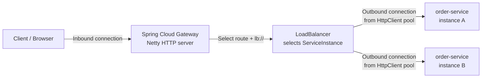
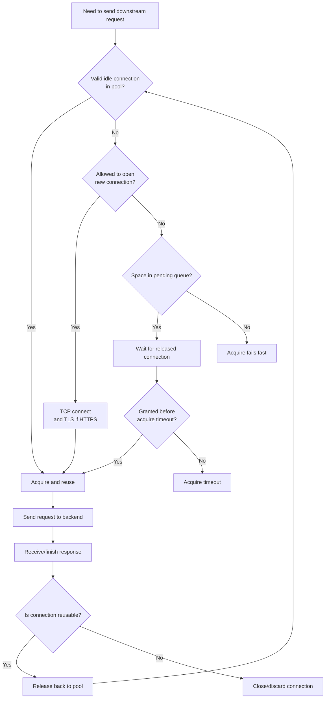
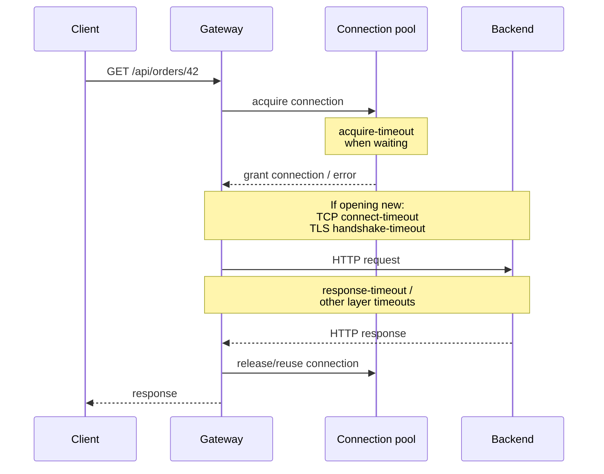

# Connection pools, connection limits, and pending queues

An API Gateway receives many concurrent HTTP requests without necessarily opening a new TCP connection to the backend for each request. With **Spring Cloud Gateway Server WebFlux**, when forwarding via Netty HTTP routing, the Gateway uses **Reactor Netty HttpClient**. This client can **reuse idle connections** in a *connection pool* to save TCP/TLS setup time and reduce resource consumption.

However, when a backend is slow or request volume spikes, every connection in the pool can become busy. If the pool is bounded, new requests must **wait to acquire a connection**, or fail when exceeding pending count or wait-time limits. Understanding this mechanism is crucial to avoiding situations where the Gateway stays up while waves of requests suffer rising latency, timeouts, or proxy-layer errors.

This lesson belongs to the **Connections and TLS** chapter in the **SPRING_CLOUD_GATEWAY** module. The topic connects directly to API Gateway systems using route predicates, filter chains, path/header transformations, and service discovery. Proper connection pool design also interacts with authentication, rate limiting, circuit breakers, retries, TLS, and request observability when operating microservices safely.

> **Scope:** This lesson focuses on **outbound connections from the Gateway to backends** when using **Spring Cloud Gateway Server WebFlux** and Reactor Netty. YAML examples distinguish the current Spring Cloud Gateway namespace from older 4.x releases. Settings, defaults, and metric names vary by framework version; verify against your actual Spring Cloud Gateway, Reactor Netty, and embedded server versions before applying.

## 1. Distinguishing inbound and outbound connections

Imagine a client sends:

```http
GET /api/orders/42 HTTP/1.1
Host: api.example.test
```

The Gateway matches route `orders-api`, forwards to `lb://order-service`, and Spring Cloud LoadBalancer selects instance `10.2.0.15:8080`. There are **two distinct network hops**:

1. **Client → Gateway:** inbound connections accepted by the Gateway's HTTP server. If a reverse proxy/ingress sits in front, there is also client → ingress → gateway.
2. **Gateway → backend:** outbound connections used by **Reactor Netty HttpClient** to send requests after route and target selection.



**The HTTP client pool's `max-connections` limit is not a limit on how many clients can connect to the Gateway.** It governs how the Gateway allocates **outbound connections toward backends** per its pooling policy. To cap inbound connections or protect the HTTP parser, configure the HTTP server, ingress, load balancer/WAF, or network infrastructure appropriately.

### 1.1. Four metrics easily confused

| Metric | What does it count? | Example |
| --- | --- | --- |
| **Inbound connections** | TCP connections from clients/proxies into the Gateway. | 300 open connections to Gateway port `8080` |
| **Outbound active connections** | Pooled connections currently busy communicating with a backend. | 50 busy connections to a backend endpoint |
| **Outbound idle connections** | Finished connections kept open for reuse. | 20 idle keep-alive connections |
| **Pending acquisitions** | Requests currently **waiting to borrow a connection** from the pool because none can be leased immediately. | 80 requests waiting for a downstream connection |

The number of **concurrent HTTP requests** does not always equal the number of **TCP connections**. With typical HTTP/1.1, a single connection cannot multiplex multiple concurrent requests like HTTP/2; with HTTP/2, one connection can carry multiple streams. In addition, WebSockets, streaming, and special modes occupy connections differently from short-lived requests.

## 2. How does the connection pool work?

A **connection pool** holds and manages connections to remote endpoints. When a request needs to call a backend, Reactor Netty HttpClient performs a logical **acquire** operation:

1. If a **valid idle connection** exists, it can be leased for reuse.
2. If no idle connection exists and the pool has capacity to open a new one, the client can **establish a new connection**: DNS when needed, TCP handshake, and TLS handshake if HTTPS.
3. If all connections are busy and the pool has reached its cap, the acquire request may enter a **pending queue**.
4. When a connection is **released** after a request completes and remains reusable, the pool can assign that connection to a waiting request.
5. If waiting takes too long or pending requests exceed the allowed count, acquire can **fail** before any HTTP request is sent to the backend.



This diagram is a conceptual model; not every request traverses branches in an identical fixed sequence. The pool may check connection health, lifetime limits, and leasing policies before granting one. If the peer already closed the connection, it is discarded and the client needs another connection.

### 2.1. Why reusing connections improves performance

Each new connection incurs costs:

- **TCP handshake**, affected by RTT between Gateway and backend.
- **TLS handshake** for HTTPS backends, including certificate verification and cipher negotiation.
- **Kernel sockets, file descriptors, and buffers** on Gateway and backend.
- **CPU/memory** for TLS encryption and managing concurrent connections.

When the same remote endpoint handles many short requests, keeping a reasonable set of connections for reuse avoids repeating those setup costs. However, holding **too many idle connections** also consumes resources; the pool needs limits and eviction policies aligned with backend behavior.

### 2.2. The pool is not a business task queue

The **pending acquire queue** holds only requests **waiting for an outbound connection**. It is distinct from:

- The HTTP server's TCP accept backlog.
- Request queues in an ingress/load balancer.
- Scheduler queues or tasks waiting on threads.
- Job processing queues inside the backend.
- The token bucket mechanism of `RequestRateLimiter`.

Consequently, increasing pending acquisitions **does not increase backend processing capacity**. It only lets more requests **wait outside the backend's door**, and can worsen latency and memory pressure if the backend cannot keep up.

## 3. Pools are partitioned per target, not one shared bucket for all backends

Reactor Netty HttpClient generally maintains pools per **remote host and port** along with related connection configuration details. In Reactor Netty documentation, the default is pooling **per remote host**, understood at minimum as a `hostname:port` pair.

Example:

```text
Gateway instance G1
  Pool for 10.2.0.15:8080  -> separate active / idle / pending
  Pool for 10.2.0.16:8080  -> separate active / idle / pending
  Pool for 10.2.0.30:8443  -> separate active / idle / pending
```

If a route uses `lb://order-service`, Spring Cloud LoadBalancer selects an instance during routing; the actual connection is acquired from the pool corresponding to the **resolved target**. Adding another backend instance creates another corresponding pool/connection group.

**Do not assume `max-connections: 100` means a grand total of 100 connections across all microservices and all Gateway replicas.** For a FIXED pool, this cap applies per pool/key used by the provider; total sockets can be larger when there are multiple remote endpoints. With **three Gateway replicas**, cluster-wide outbound connections also scale by the number of Gateway instances, traffic distribution, and other connection sources.

### 3.1. Service discovery and held connections

A registry may remove an instance from the available list, yet that does not mean every existing TCP connection to that instance vanishes instantly. Pooling, DNS, health checks, and load balancers each have their own update cycles.

When a backend is drained or terminated during deployment:

- Stop routing new requests to the draining instance.
- Drain in-flight requests under graceful shutdown policies.
- Verify idle sockets/connections are closed cleanly.
- Consider `max-idle-time` and `max-life-time` to limit stale long-lived connections.

Do not rely on the connection pool as a substitute for health checks, circuit breakers, or safe deregistration.

## 4. Three pool types: ELASTIC, FIXED, and DISABLED

Spring Cloud Gateway provides `httpclient.pool.type`. Current Server WebFlux configuration documentation describes **`elastic`**, **`fixed`**, and **`disabled`**, with **`elastic`** documented as the current default. Do not take the defaults of a standalone `Reactor Netty HttpClient.create()` and assume they apply identically to every Spring Cloud Gateway release.

| Type | Core idea | Advantages | Risks / caveats |
| --- | --- | --- | --- |
| **`ELASTIC`** | Pool scales on demand; can open more connections instead of enforcing the fixed cap configured below. | Convenient under varying load; less upfront fixed sizing required. | Can open many sockets/TLS sessions during spikes; requires capacity limits at other layers. |
| **`FIXED`** | Sets a **maximum connection limit** per pool; when exhausted, acquires can wait. | More predictable resource usage and explicit backpressure. | Too low causes pending/timeouts; too high can overload downstream. |
| **`DISABLED`** | Disables connection pooling/reuse under this option. | Useful to isolate pool issues in controlled diagnostics. | Loses keep-alive/reuse benefits; increases TCP/TLS handshakes and connection overhead. |

**Distinguish two default layers:** Reactor Netty's `HttpClient.create()` has its own `ConnectionProvider` model, while Spring Cloud Gateway manages its own HTTP client and properties. Actual defaults depend on version and customizers; verify effective configuration and metrics to be certain.

### 4.1. When to choose FIXED?

A FIXED pool typically fits well when:

- The Gateway has predictable traffic and backends need connection-level protection.
- You want to track **active/idle/pending** counts and enforce explicit wait deadlines.
- You have measured backend capacity and want to prevent sudden socket spikes.
- You need repeatable load testing/tuning across deployments.

Yet FIXED cannot guarantee SLAs on its own. If a backend service only handles 200 RPS while the Gateway steadily receives 1,000 RPS, neither a 50- nor a 100-connection limit **creates extra business throughput**; the system must scale, shed load, cache, or reject early per policy.

### 4.2. Why DISABLED is not a good production default

Without connection reuse, every request may pay the full TCP and TLS setup cost. Under network latency or high QPS, new connections/sec and TLS CPU usage can climb steeply. Use it only to investigate a specific issue, measure in a safe environment, and restore reuse afterward.

## 5. Key Gateway HttpClient pool configuration parameters

In Spring Cloud Gateway Server WebFlux documentation, the property group is:

```text
spring.cloud.gateway.server.webflux.httpclient.pool.*
```

The table below lists properties described in the official configuration documentation:

| Property | Meaning | Notes |
| --- | --- | --- |
| **`type`** | `elastic`, `fixed`, or `disabled`. | Certain cap/wait properties only apply to `FIXED`. |
| **`max-connections`** | Maximum connections before pending acquires begin. | Gateway docs note this **applies only to `FIXED`**. |
| **`acquire-timeout`** | Maximum wait time to acquire a connection, **milliseconds**. | Gateway docs note this **applies only to `FIXED`**. |
| **`max-idle-time`** | Maximum time a connection remains idle before becoming eligible to close. | Depending on version/binding, may use Duration or ms units. |
| **`max-life-time`** | Maximum connection lifetime before becoming eligible for eviction. | Does not mean in-flight requests are forcefully aborted at the exact threshold. |
| **`eviction-interval`** | Background check interval for evicting connections. | A value of 0 typically disables periodic eviction. |
| **`leasing-strategy`** | Strategy to pick an idle connection, typically `fifo` or `lifo`. | Support and default depend on version; current docs state `fifo`. |
| **`metrics`** | Collects pool metrics via Micrometer when configured. | Current docs state default `false`. |
| **`name`** | Connection pool name for identification. | Helps filter metrics/diagnostics; not the backend name. |

**Do not confuse with low-level Reactor Netty options:** `ConnectionProvider.builder(...).pendingAcquireMaxCount(...)` caps **how many requests can sit in the queue**, yet this property **does not appear as a universal `httpclient.pool.max-pending-acquires` setting in the current Gateway properties list**. To set queue length via Reactor Netty's API, use a customization hook supported by your Gateway version and verify the actual provider in use; never invent unbound YAML keys assuming queue length is capped.

## 6. Example bounded FIXED pool configuration

### 6.1. Newer Server WebFlux namespace

Illustrative example:

```yaml
spring:
  cloud:
    gateway:
      server:
        webflux:
          httpclient:
            pool:
              type: FIXED
              name: gateway-outbound
              max-connections: 100
              acquire-timeout: 3000
              max-idle-time: 30s
              max-life-time: 5m
              eviction-interval: 30s
              metrics: true
          routes:
            - id: orders-api
              uri: lb://order-service
              predicates:
                - Path=/api/orders/**
              filters:
                - StripPrefix=1
```

In this example configuration:

- `type: FIXED` selects a bounded-connection pool.
- `max-connections: 100` is the cap before acquire queuing begins, **not 100 requests/second**.
- `acquire-timeout: 3000` sets a maximum acquire wait of **3,000 ms** when the pool is busy.
- `max-idle-time: 30s` lets sufficiently idle connections close per pool mechanics.
- `max-life-time: 5m` caps connection age to avoid keeping sockets around indefinitely.
- `eviction-interval: 30s` enables periodic background connection eviction as supported.
- `metrics: true` enables pool metrics collection when Micrometer and a compatible registry are present.
- Route `lb://order-service` requires Spring Cloud LoadBalancer and an instance source; it **does not directly alter the acquire timeout concept**.

**These numbers are for hands-on practice only, not production defaults or recommendations.** Optimal thresholds depend on QPS, backend processing time, instance count, HTTP protocol, timeouts, resource capacity, and business tolerance for queuing.

### 6.2. Namespace common in Spring Cloud Gateway 4.x

Older versions commonly use:

```yaml
spring:
  cloud:
    gateway:
      httpclient:
        pool:
          type: FIXED
          max-connections: 100
          acquire-timeout: 3000
          max-idle-time: 30s
          max-life-time: 5m
          metrics: true
      routes:
        - id: orders-api
          uri: http://localhost:9090
          predicates:
            - Path=/api/orders/**
          filters:
            - StripPrefix=1
```

Pick **one** namespace matching your Spring Cloud Gateway BOM and starter; never define both simultaneously as it creates confusion over effective configuration. The `http://localhost:9090` URI lets you test pooling against a fixed backend isolated from service discovery.

### 6.3. Note on time units

In Spring Cloud Gateway, `acquire-timeout` is specified in **milliseconds**. Thus `3000` means three seconds, **not 3,000 seconds**.

Properties `max-idle-time` and `max-life-time` are typically bound as `Duration`, so suffixes like `30s` and `5m` avoid unit ambiguity on versions supporting this binding. When using bare numbers, check version docs to avoid confusing milliseconds with seconds.

In particular, never confuse `acquire-timeout` with `connect-timeout` or `response-timeout`: although all measure time, they govern **different phases**.

## 7. Pending acquire queue: waiting for a connection

With a FIXED pool, suppose:

```text
maxConnections = 3
All 3 connections are busy serving HTTP/1.1

New request R4 -> pending
New request R5 -> pending
New request R6 -> pending
... when a connection is released, a pending acquire can be served.
```

A request waiting for a connection **has not necessarily sent any HTTP request to the backend**. Thus, the backend may show nothing in its logs while the Gateway records prolonged request latency.

### 7.1. Two independent failure limits

There are **two reasons** an acquire request can fail:

1. **Pending queue full:** waiting requests exceed `pendingAcquireMaxCount` or the provider's equivalent cap. It can be rejected **immediately**, without waiting for the timeout.
2. **Waited too long:** a request entered the queue but was not granted a connection before `pendingAcquireTimeout`/`acquire-timeout`; it fails with a timeout.

An acquire failure is not `429 Too Many Requests` by definition. The Gateway maps Reactor Netty-layer errors to HTTP responses via its active error handling mechanism; **do not promise a single fixed status code** solely because the queue is full or acquire timed out. Inspect actual exceptions and your application's error handling.

### 7.2. Low-level Reactor Netty queue limiting

In the Reactor Netty API:

```java
import reactor.netty.resources.ConnectionProvider;
import java.time.Duration;

ConnectionProvider provider = ConnectionProvider.builder("example-pool")
    .maxConnections(50)
    .pendingAcquireMaxCount(100)
    .pendingAcquireTimeout(Duration.ofSeconds(3))
    .maxIdleTime(Duration.ofSeconds(20))
    .maxLifeTime(Duration.ofMinutes(2))
    .build();
```

This snippet demonstrates **building a Reactor Netty `ConnectionProvider`**. It **does not automatically wire this provider into Spring Cloud Gateway**. For the Gateway to use a custom provider, implement the extension point supported by your version and verify the live `HttpClient`, avoiding stray beans or local variables unused by routing filters.

Per Reactor Netty docs on the low-level builder:

- `pendingAcquireMaxCount(100)` allows at most 100 waiting requests in the pool queue.
- `pendingAcquireTimeout(Duration.ofSeconds(3))` caps how long requests wait to acquire a connection.
- A value of `-1` for `pendingAcquireMaxCount` signifies an unbounded queue in that API, but **never use unbounded queues under load** without resource controls at other layers.
- Where supported by the version/API, `pendingAcquireMaxCount(0)` disables queuing: exhausting idle/max connections fails fast.

Standalone Reactor Netty defaults can set pending counts as a multiple of connections; for example, docs mention a default of `2 × maxConnections` on the connection-provider builder. However, **do not enforce that default assumption across all modes and all Gateway versions**.

### 7.3. Large queues can inflate tail latency

Suppose a backend completes only 100 requests/second and is already saturated. If the Gateway keeps accepting 300 requests/second, nearly 200 additional waiting requests accumulate every second. A large queue does not fix the bottleneck; it can:

- Inflate p95/p99 latency and timeout counts.
- Retain extra request objects, trace contexts, and memory.
- Trigger cascading failures when clients time out and retry, adding even more requests.
- Unleash a massive burst onto the backend as soon as it recovers, saturating it again.

Sometimes **controlled fail-fast** at the edge, rate limiter, or circuit breaker is better than letting clients wait a long time only to fail. Still, that trade-off depends on SLAs, idempotency, and client retry behavior.

## 8. Distinguishing timeouts within a single request

A gateway → backend request has multiple stages to manage:



| Timeout | Stage | Example cause | Remediation |
| --- | --- | --- | --- |
| **`acquire-timeout`** | Waiting to borrow a connection from a FIXED pool. | All connections busy; long pending wait. | Measure active/pending, backend latency, tune pool and load-shedding policies. |
| **`connect-timeout`** | Establishing TCP to the remote endpoint when opening a new connection. | Unreachable DNS/network/host, slow path. | Check address, firewall, network, and new connection rate. |
| **TLS handshake timeout** | Negotiating TLS for a new HTTPS connection. | Certificate/trust, network, slow TLS handshake. | Check TLS, certificates, truststore, CPU, and handshake metrics. |
| **`response-timeout`** | Waiting for HTTP response from downstream per HTTP client semantics. | Slow backend, network, delayed response. | Optimize backend, align timeouts with SLAs and circuit breakers. |
| **Client-side timeout** | Total time the caller is willing to wait on the Gateway. | Caller gives up before gateway/backend finishes. | Design end-to-end timeout budgets; avoid wasted Gateway work. |

Example configuration with **distinct timeout layers**:

```yaml
spring:
  cloud:
    gateway:
      server:
        webflux:
          httpclient:
            pool:
              type: FIXED
              max-connections: 100
              acquire-timeout: 3000
            connect-timeout: 3000
            response-timeout: 5s
            ssl:
              handshake-timeout: 10s
```

Here:

- Requests can wait **up to roughly 3s to acquire a connection** when the pool is busy, depending on provider policy.
- If a new TCP connection is needed, **connect timeout** is a separate threshold.
- For HTTPS, **TLS handshake timeout** governs the handshake phase.
- **Response timeout** governs the HTTP response after the request is sent.

**Never mechanically sum those numbers to conclude "a request definitely times out after 21 seconds."** Actual timer behavior depends on start/end points, filter chains, retries, redirects, client logic, and cancellations. When an overall end-to-end cap is needed, design a **deadline/time budget** at the right layer and test it.

### 8.1. Route timeouts and HTTP client timeouts

Spring Cloud Gateway can support per-route timeout metadata alongside global HttpClient settings. When per-route settings exist, verify **which level takes precedence** in your version and measure actual behavior rather than just reading YAML.

For instance, a short-SLA order-read API may need a lower response timeout than a long report-generation API. However, if both share the same connection pool, one slow service can still consume busy connections rapidly; per-route timeouts do not substitute for pending queue limits.

## 9. Sizing max-connections from real traffic

There is no universal rule like "every gateway needs `max-connections=1000`." A rough starting estimate uses **Little's Law**:

\[
L = \lambda \times W
\]

Where:

- `L`: average number of **concurrent in-flight** requests/tasks in the measured scope.
- `\lambda`: average request arrival rate in the same scope, typically RPS.
- `W`: average processing/occupancy duration, in seconds.

Example: a backend receives **300 RPS** with an average connection occupancy of **200 ms = 0.2 s**:

\[
L \approx 300 \times 0.2 = 60
\]

That gives **about 60 concurrent in-flight requests** on average, **not a guarantee that exactly 60 connections are needed**. With HTTP/1.1 keep-alive and one in-flight request per connection, it serves as a baseline for sizing a pool when all load hits one remote endpoint. HTTP/2, retries, request streaming, instance balancing, and latency distributions can change the required connection count.

### 9.1. Size per endpoint/pool

Suppose two backend instances serve traffic evenly:

```text
order-service:
  instance A: 150 RPS × 0.2s ≈ 30 concurrent requests
  instance B: 150 RPS × 0.2s ≈ 30 concurrent requests
```

If each instance maps to its own pool, each pool may handle around 30 in-flight requests on average, plus headroom for bursts and variance. However, load balancers may distribute unevenly; a new instance may be cold, an older instance may hold more idle connections, or a canary may receive only a fraction of traffic.

**Measure per remote endpoint and per Gateway replica.** Picking one `max-connections` across all pools without inspecting traffic shape can leave some pools over-provisioned while others saturate.

### 9.2. Account for tail latency, not just averages

If a backend has a 200 ms mean latency yet a 2-second p99, during a burst of slow requests active connections can climb far past the average-based estimate. Track:

- Peak RPS and concurrent requests over short windows.
- Mean, p95, and p99 latency **of the backend** and **of the Gateway**.
- Active/idle/pending connections per remote endpoint.
- New connections/second, TCP connect errors, and TLS handshake errors.
- Timeout/retry rates and client-cancelled request rates.

Start from a configuration measured under production-like load, observe safely, and adjust with evidence. **Blindly increasing max-connections** can shift the bottleneck from the Gateway into the backend/database and cause a more severe overload.

## 10. HTTP/1.1, HTTP/2, WebSocket, and streaming

### 10.1. HTTP/1.1

In standard HTTP/1.1, a connection currently handling a request/response cannot process multiple concurrent requests via HTTP/2-style multiplexing. Busy connections therefore correlate more tightly with in-flight requests waiting for responses. Connection reuse avoids opening a fresh connection for subsequent requests.

### 10.2. HTTP/2

HTTP/2 can carry multiple **streams** over a single TCP/TLS connection. If Gateway and backend actually negotiate HTTP/2, a small `max-connections` value does not impose the same concurrent-request ceiling as in HTTP/1.1.

Do not observe client → Gateway using HTTP/2 and assume Gateway → backend also uses HTTP/2. **Each hop has its own connection and protocol**; ALPN/TLS, Reactor Netty configuration, and backend support determine the outbound protocol.

### 10.3. Streaming, SSE, and WebSocket

Long-lived response streams such as Server-Sent Events, large file transfers, long polling, or WebSockets hold connections active much longer than sub-100 ms JSON APIs. For such routes:

- Use appropriate pool/request budgets rather than mixing sizing assumptions with <100 ms APIs.
- Track active connection durations and long-lived session counts.
- Consider isolating routes/Gateway groups or resource policies if needed.
- **WebSocket routing** relies on connection upgrades with distinct characteristics; do not infer all behavior from short-lived Netty HTTP requests.

## 11. How does TLS affect the pool?

In an HTTPS architecture:


TLS from client to Gateway and TLS from Gateway to backend are **two separate TLS sessions**. If TLS terminates at an ingress in front of the Gateway, ingress → Gateway also has its own TLS policy.

By reusing outbound HTTPS connections, the Gateway avoids **repeated TCP/TLS handshakes**. That improves latency while requiring lifecycle management:

- **Certificate verification:** the Gateway must validate the backend certificate against the appropriate trust chain.
- **SNI and hostname:** connect using the proper endpoint so TLS validates hostnames; with `lb://`, verify URLs/protocols and how service names resolve.
- **Truststore/SSL bundle:** configure trust per version/stack; never disable certificate verification in production.
- **Idle timeout:** backends, meshes, or NATs may close idle connections before the Gateway notices.
- **Lifetime:** keeping connections forever can slow migration to new infrastructure or keep stale sockets around; enforce sensible lifecycle policies.

Spring Cloud Gateway Server WebFlux docs include HttpClient SSL settings such as `handshake-timeout` and trust options. **Never set `use-insecure-trust-manager: true` in production** because it skips remote certificate verification.

### 11.1. Choosing max-idle-time relative to backend idle timeout

Suppose a backend or intermediate proxy closes idle connections after **60 seconds**. If the Gateway tries to reuse a socket that sat idle for 120 seconds, it can hit I/O errors because the peer already closed it.

A principle from Reactor Netty docs is setting client `maxIdleTime` **less than or equal to** the target server's idle timeout, with margin for jitter and proxy/NAT behavior. For instance, if the backend idle timeout is 60s, the Gateway can try `max-idle-time: 30s` and measure results.

**Never treat `max-idle-time` as an in-flight request timeout.** It applies only to idle connections; slow requests must be bounded with appropriate response timeouts and deadlines.

### 11.2. max-life-time does not abruptly cut off active requests

`max-life-time` limits connection age so it becomes **eligible for eviction** per pool mechanics. In Reactor Netty, idle/life checks run on acquire/release and via background eviction when enabled. Therefore, do not rely on it to abort an active in-flight request the instant a connection reaches max age.

For safe shutdowns and rollouts, combine connection draining, readiness probes, load balancer instance updates, and request timeouts.

## 12. Observing the connection pool with metrics

Reactor Netty provides connection provider metrics, typically exported via Micrometer when enabled:

| Metric / metric family | What to observe |
| --- | --- |
| **`reactor.netty.connection.provider.active.connections`** | Number of active connections. |
| **`reactor.netty.connection.provider.idle.connections`** | Number of idle connections available for reuse. |
| **`reactor.netty.connection.provider.pending.connections`** | Number of requests waiting to acquire. |
| **`reactor.netty.connection.provider.total.connections`** | Total active + idle per provider/pool. |
| **`reactor.netty.connection.provider.max.connections`** | Corresponding connection cap when metric is available. |
| **`reactor.netty.connection.provider.max.pending.connections`** | Corresponding pending cap when metric is available. |
| **Pending/acquire timing metrics** | Connection wait latency; exact metric name/type depends on version. |

In current Gateway configuration:

```yaml
spring:
  cloud:
    gateway:
      server:
        webflux:
          httpclient:
            pool:
              metrics: true
```

To view live data, the application needs **Micrometer and an appropriate registry/exporter** (such as Prometheus via Actuator as configured in your project). Adding `metrics: true` alone **does not create dashboards**, guarantee metric endpoints are exposed, or permit exposing actuator metrics publicly without access controls.

### 12.1. Distinguishing pool metrics from request metrics

A Gateway showing:

- 90 active connections,
- 0 idle,
- 200 pending acquires,
- elevated `5xx` responses,
- rising p99 latency,

indicates **pool saturation or slow downstream behavior**. Yet active/pending numbers alone do not pinpoint the root cause: the backend might be overloaded, a streaming route might hold sockets open, retries might amplify traffic, or `max-connections` might be set too low.

To conclude accurately, combine Gateway route metrics, downstream call durations, backend metrics, TCP/TLS errors, and logs by route ID/instance.

### 12.2. Operational alerts to configure

- Sustained rise in pending acquisitions per endpoint.
- Active connections pinned at cap for a significant duration.
- Rising acquire timeouts or pending queue rejections.
- Unusual spikes in connect timeouts and TLS handshake errors.
- Sharp increase in new connections/sec despite steady traffic (sign of poor reuse/stale closes).
- Many idle connections alongside file descriptor/memory exhaustion.
- Simultaneous spikes in p95/p99 latency, retry rates, and circuit-breaker opens.

Avoid alerting on a single isolated metric. For example, active connections hitting cap for a few seconds during a brief burst while pending drains quickly may be normal; **sustained pending queues accompanied by rising latency/errors** warrants priority investigation.

## 13. Experimenting with a slow backend

To observe queuing clearly, run a test backend **intentionally responding slowly**. A simple WebFlux controller:

```java
package com.example.orders;

import java.time.Duration;
import java.util.Map;

import org.springframework.web.bind.annotation.GetMapping;
import org.springframework.web.bind.annotation.RequestMapping;
import org.springframework.web.bind.annotation.RestController;

import reactor.core.publisher.Mono;

@RestController
@RequestMapping("/orders")
public class OrdersDemoController {

    @GetMapping("/slow")
    public Mono<Map<String, String>> slow() {
        return Mono.delay(Duration.ofMillis(400))
            .map(tick -> Map.of("status", "ok"));
    }
}
```

This snippet illustrates a slow endpoint **without blocking the event loop with `Thread.sleep()`**. Run an actual Spring Boot WebFlux backend hosting this controller and point the Gateway to it.

### 13.1. Gateway with a tiny pool for easy observation

```yaml
spring:
  cloud:
    gateway:
      server:
        webflux:
          httpclient:
            pool:
              type: FIXED
              max-connections: 2
              acquire-timeout: 1000
              metrics: true
          routes:
            - id: orders-slow-demo
              uri: http://localhost:9090
              predicates:
                - Path=/api/orders/**
              filters:
                - StripPrefix=1
```

Expected logical behavior with **standard HTTP/1.1 and a single backend instance**:

1. The first two requests occupy the two connections.
2. Subsequent concurrent requests enter the pending state.
3. If connections are released quickly enough, some pending requests proceed.
4. Once the 1,000 ms wait limit is exceeded, requests can fail with acquire timeouts.

**Do not predict rigidly that request #3 always waits and request #6 always fails.** Subscription ordering, warm-up, idle state, scheduling, pool keys, OS networking, and Reactor Netty version all influence outcomes.

### 13.2. Generating controlled load

If `hey` is installed in your **test environment**, try:

```bash
hey -n 100 -c 20 -m GET http://localhost:8080/api/orders/slow
```

This sends 100 requests at a target concurrency of 20. Run only against authorized test targets, never unapproved production or external services. Observe:

- Mean and p95/p99 request latency through the Gateway.
- Successful/failed request counts and error types.
- Pool `active/idle/pending connections`.
- Actual requests reaching the backend.

Then **keep** the backend/test load constant and raise `max-connections` from 2 to 10 in the test environment. Compare: fewer pending acquires does not guarantee higher backend throughput; if the backend has fixed capacity, the bottleneck may simply shift from connection waiting to backend overload.

### 13.3. Experiment matrix

| Configuration | Expected symptom | What to inspect |
| --- | --- | --- |
| FIXED, small cap, slow backend | Active hits cap; pending rises | Acquire timeouts/rejections |
| FIXED, higher cap | Pending may drop | Do backend CPU, DB pool, and latency rise? |
| ELASTIC under burst | Opens many connections | Socket count, TLS CPU, file descriptors |
| DISABLED | Poor reuse; many new connections | TCP/TLS handshakes, latency |
| Max idle higher than backend idle timeout | Stale connection errors | Premature close, resets, controlled retries |
| Response timeout too low | Requests fail even after successful acquire | Backend latency, response timeout |
| Excessive retries enabled | Total backend requests jump | Retry rate, idempotency, queue pressure |

**Change only one variable per run** so comparisons stay valid. A valid load test measures both Gateway and backend, not merely the count of HTTP successes.

## 14. Diagnosing common failures

### 14.1. "Pool acquire timeout" yet backend logs show zero requests

**Likely cause:** the request never obtained an outbound connection, so it was never sent to the backend. Inspect pending acquisitions, active connections, response durations of requests holding connections, and the cap.

Do not rush to raise `connect-timeout`: the failure happens **before the TCP connect stage or before borrowing a reusable connection**.

### 14.2. "Connect timeout" even though the pool has many idle connections

The request may have routed to a **different remote host/instance** lacking eligible idle connections, or idle sockets were invalidated/closed. Check remote address, DNS, service discovery, network policy, and backend health. Pools are managed per remote endpoint; there is no global socket bank shared interchangeably across all hosts.

### 14.3. "PrematureCloseException" or resets under high load

This can stem from stale keep-alive connections, backend socket closes, proxy idle timeouts, flaky links, instance shutdowns, or excessive new connections. Reactor Netty docs note that an extremely high `max-connections` can also trigger `PrematureCloseException` paired with connect timeouts under heavy load.

Measure handshake/connect errors, backend idle timeouts, and align `max-idle-time`. Never mitigate blindly by raising caps indefinitely or enabling unbounded retries.

### 14.4. Pending keeps rising after increasing max-connections

Check:

- Is `type: FIXED` actually active?
- Does the config namespace match your version?
- Did the Gateway instance handling traffic actually receive the updated config?
- Are there multiple remote endpoints and are you reading metrics for the wrong pool?
- Did backend latency and streaming duration grow alongside connection count?
- Are retries or downstream dependencies saturated?
- Is another customizer on HTTP client routing overriding `ConnectionProvider`?

A YAML edit alone does not prove the runtime pool changed; measure and verify on live instances.

### 14.5. Retries cause pending connections to spike unexpectedly

If one client request can trigger 3 attempts at the Gateway, backend request volume can exceed inbound volume. When upstream slows down, retries amplify pool pressure and create an overload feedback loop.

Use a **retry budget**, sensible backoff, circuit breakers, proper timeouts, and write idempotency. Inbound rate limiting also sheds load; never treat retries as a default cure for pool saturation.

### 14.6. Many 5xx errors despite very low active connections

A small pool is not necessarily the culprit. Requests may fail early in auth, miss instances in discovery, hit an open circuit breaker, fail TLS certificates, or receive fast backend errors. Inspect route ID, status origin, per-layer logs, and end-to-end traces before tuning the connection pool.

## 15. Relationship with rate limiting, circuit breakers, and security

| Mechanism | What does it solve? | What can it NOT replace? |
| --- | --- | --- |
| **Connection pool** | Manages outbound sockets, reuse, and pending acquires. | Auth, rate limiting, backend business concurrency limits. |
| **`RequestRateLimiter`** | Caps request rates per key/quota. | TCP connection health/state. |
| **Circuit breaker** | Stops/reduces backend calls on failures per policy. | Keep-alive tuning and TLS trust. |
| **Retry** | Replays eligible transient errors when safe. | Adding backend capacity; surviving retry storms. |
| **Connect/response timeout** | Bounds duration of network/response phases. | Capping connection counts and pending queues. |
| **Service discovery/LB** | Selects target service and instance. | Managing pool resources at each remote endpoint. |
| **TLS/mTLS** | Authenticates/protects connections across hops. | Regulating socket counts and pending queues. |

**Security cannot rely on pool caps.** Connection limits do not stop token forgery, enforce resource permissions, or protect backends bypassed around the Gateway. Enforce security policies on Gateway/backends, network policies, and proper certificate validation.

For sensitive APIs like payments, a POST request already sent to the backend whose client timed out **never guarantees the operation did not occur**. Before retrying, enforce idempotency keys and reconciliation strategies; otherwise pool/timeout incidents can cause duplicate side effects.

## 16. Pool production-readiness checklist

1. **Clarify scope:** are you capping inbound or outbound? Using Netty HTTP routing or another protocol/handler?
2. **Verify version:** `server.webflux.httpclient.pool` vs `httpclient.pool`, default pool type, and supported properties.
3. **Measure load:** RPS, backend latency, concurrent requests per endpoint and per Gateway replica.
4. **Choose pool type:** evaluate FIXED if you want bounded caps and controlled acquire queues; avoid unmonitored ELASTIC connection growth.
5. **Set thresholds:** `max-connections` per pool, acquire timeout, and if queuing must be capped, use an API/provider hook actually supported.
6. **Design idle/life:** match backend/LB/NAT idle timeouts, TLS, and drain/rollout cycles.
7. **Design timeout budget:** separate acquire, TCP connect, TLS handshake, response, and client deadlines.
8. **Enable metrics:** active/idle/pending, connect/TLS errors, route/instance, and p95/p99 latency.
9. **Load test:** slow backends, bursts, retries, disconnects, discovery instance removal, shutdowns, and multiple Gateway replicas.
10. **Prepare rollback:** record previous settings and stop criteria if latency/errors worsen after tuning.

## 17. Self-check scenarios

### Scenario A — Saturated FIXED pool

The pool has `max-connections=10`, all 10 are busy, and 50 more requests arrive for the same backend.

**Question:** Will the Gateway automatically open 50 new connections?

**Explanation:** Under FIXED at cap, remaining acquire requests enter the queue or get rejected per pending limits. Never expect the Gateway to bypass the cap just because more requests arrive.

### Scenario B — Confusing connection limits with RPS

`max-connections=20`, and the backend responds in 20 ms on average.

**Question:** Is it true the Gateway can send at most 20 requests/second?

**Explanation:** No. Connections are continuously reused; a single connection can process many requests **over time**. `max-connections` limits concurrent connections per pool, not requests per second.

### Scenario C — Acquire timeout and response timeout

A request waits 2 seconds for a connection, and once granted, the backend responds after 4 seconds.

**Question:** Which timeout governs each phase?

**Explanation:** Waiting for the connection falls under acquire timeout; waiting for the downstream response falls under response timeout / other deadlines. Do not assume a single `response-timeout` covers pool wait time.

### Scenario D — Two instances behind LoadBalancer

Gateway calls `lb://orders`; the service has two instances `10.0.0.1:8080` and `10.0.0.2:8080`, with a FIXED cap of 30.

**Question:** Are total outbound connections for orders strictly capped at 30?

**Explanation:** No. Pools are managed per remote endpoint/context; each instance can have its own pool. You must also multiply across multiple Gateway replicas.

### Scenario E — Mismatched idle timeouts

Backend/mesh closes sockets after 40 seconds idle, while Gateway keeps idle connections for 2 minutes.

**Question:** What is the risk?

**Explanation:** The Gateway can attempt to reuse a socket already closed by the peer, causing resets or premature close errors. Set `max-idle-time` shorter than the real intermediate hop timeout and re-measure errors.

### Scenario F — ELASTIC during peak hours

Outbound connection counts climb steadily alongside pending requests on the backend.

**Question:** Will switching to FIXED with a low cap immediately make the backend healthy?

**Explanation:** No. It can curb socket growth but increases Gateway queuing and timeouts. Investigate backend throughput, shed or throttle load, and apply circuit breakers, load balancing, and proper scaling.

### Scenario G — Client using HTTP/2

A mobile app calls the Gateway over HTTP/2, while upstream accepts only HTTP/1.1.

**Question:** Can you assume a single outbound TCP connection carries multiple HTTP/2 streams?

**Explanation:** No. Each hop has its own protocol; inspect the outbound protocol. Pool sizing must reflect the actual Gateway-to-backend connection protocol.

### Scenario H — Retries on POST

A client submits a payment request, the backend writes the record, response times out, and the Gateway retries and creates a duplicate write.

**Question:** Is this caused by a low pool cap needing higher `max-connections`?

**Explanation:** Not necessarily. The core issue is timeout/retry semantics and idempotency; enlarging the pool may fail to fix it while increasing load.

## 18. Key takeaways

1. **Spring Cloud Gateway Server WebFlux's connection pool primarily manages outbound Netty HTTP client connections**. Do not confuse it with inbound Gateway connections.
2. **Acquire → use → release** is the basic lifecycle. When a FIXED pool runs out of connections, requests **wait pending** or fail due to queue limits/timeouts.
3. **`max-connections` is not an RPS limit**, nor necessarily a cluster-wide cap across the entire Gateway; pools typically partition per remote endpoint, and each Gateway replica maintains its own pools.
4. **`acquire-timeout`, `connect-timeout`, TLS handshake timeout, and `response-timeout` govern distinct stages**. Never sum or interchange them arbitrarily.
5. **ELASTIC, FIXED, and DISABLED serve different goals**; verify defaults and exact behavior in your running Gateway version.
6. **Pending queues add zero throughput**. Oversized queues inflate latency and amplify retries when downstream slows down.
7. **Keep-alive/TLS require sensible idle and lifetime caps**, alongside strict certificate verification. Never use insecure trust managers in production.
8. **Measure per route, instance, and Gateway replica**, combining pool metrics with latency, 5xx rates, DNS/TCP/TLS errors, retries, and backend health.

**Practical conclusion:** Size connection pools from **measured data** rather than copied example defaults. Connection limits and timeouts must align with backend capacity, service discovery, load balancing, rate limiting, circuit breakers, retries, and end-to-end SLAs. A well-operated Gateway is not the one opening the most connections, but the one keeping downstream pressure within safe bounds, failing clearly under overload, and preserving predictable latency.

### References

- [Spring Cloud Gateway — Configuration Properties (Server WebFlux)](https://docs.spring.io/spring-cloud-gateway/reference/configprops.html): `spring.cloud.gateway.server.webflux.httpclient.pool.*`, pool types, timeouts, and metrics.
- [Spring Cloud Gateway 4.1 — Configuration Properties](https://docs.spring.io/spring-cloud-gateway/reference/4.1/configprops.html): `spring.cloud.gateway.httpclient.pool.*` in earlier versions.
- [Reactor Netty Reference Guide — HTTP Client, Connection Pool](https://projectreactor.io/docs/netty/release/reference/http-client.html): per-remote-host connection provider, active/idle/pending, max connections, pending acquire, eviction, and connection pool metrics.
- [Reactor Netty API — ConnectionProvider.ConnectionPoolSpec](https://projectreactor.io/docs/netty/release/api/reactor/netty/resources/ConnectionProvider.ConnectionPoolSpec.html): `maxConnections`, `pendingAcquireMaxCount`, `pendingAcquireTimeout`, and queue limits API.
