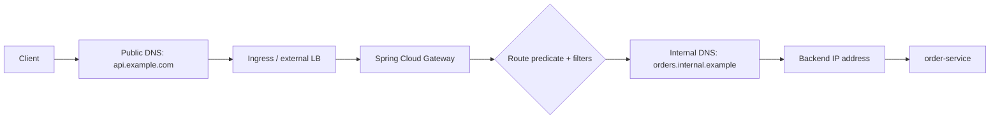
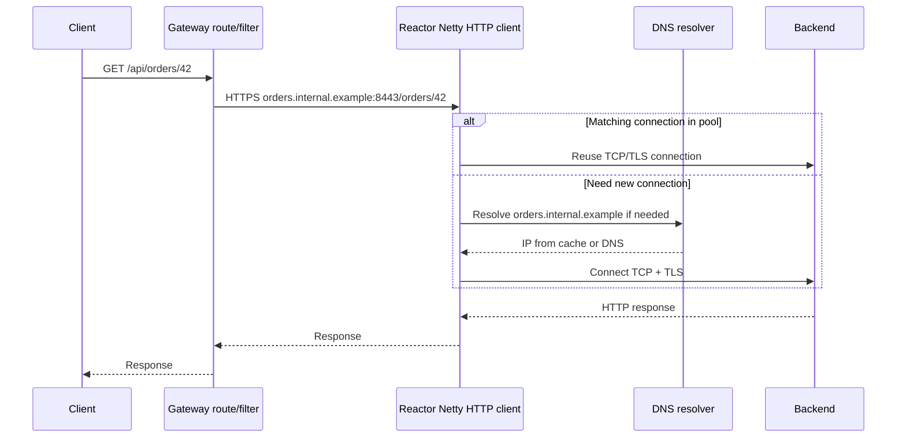
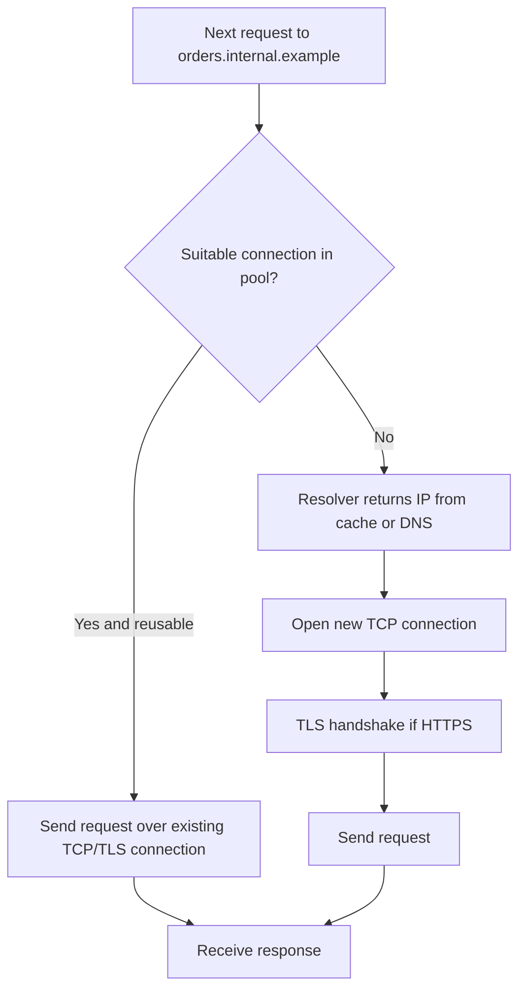
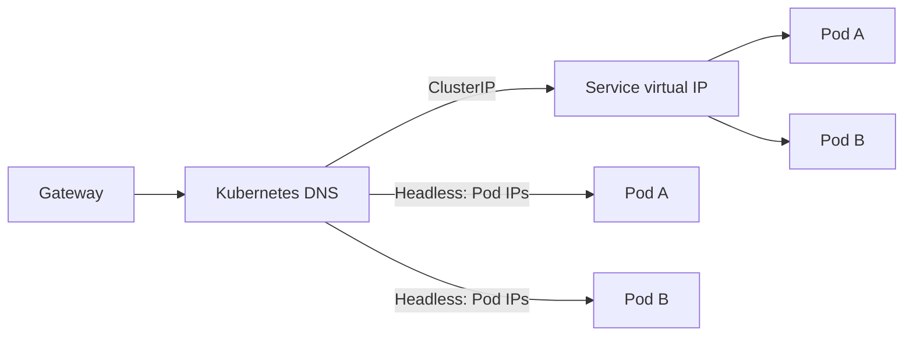
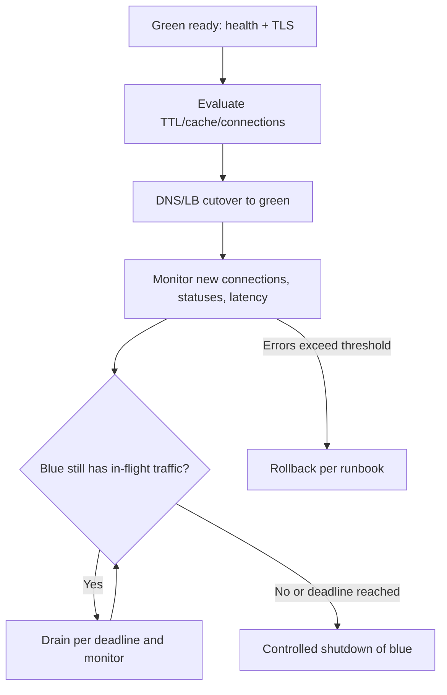

# DNS resolution and service address changes

In **Spring Cloud Gateway**, clients typically call a stable address such as `https://api.example.com`, while the Gateway must forward requests to backends whose addresses change during deployments, scale-out, failover, or maintenance. A route using `https://orders.internal.example` might connect to `10.20.1.10` today and `10.20.2.25` tomorrow. If backends run on Kubernetes, the service name may stay fixed while the backing pods change repeatedly.

**DNS (Domain Name System)** resolves addresses for domain names, yet **updating a DNS record does not automatically move already-open connections to the new IP**. Update delay also depends on caches, the resolver used by the Gateway, Reactor Netty connection reuse, and TLS configuration. This is why a system can experience connection errors after an IP change even when `nslookup` already returns the new address.

This lesson belongs to the **Connections and TLS** chapter, thoroughly explaining how Spring Cloud Gateway WebFlux resolves backend names, how DNS interacts with service discovery and load balancing, the role of TTLs and caching, risks during address changes, and how to test failovers safely. Sections connect to route predicates, filter chains, retries, circuit breakers, request observability, and TLS/mTLS for building a resilient microservices gateway.

> **Scope:** Content targets **Spring Cloud Gateway Server WebFlux** using Reactor Netty as its HTTP client with compatible library versions. Do not apply WebFlux Java code and properties verbatim to Gateway Server MVC. Resolver property/API names can change across versions; cross-check configuration examples against your actual dependencies before deploying to production.

## 1. Distinguishing client DNS from Gateway DNS

A request passing through the Gateway may require name resolution on **two completely different sides**:

1. **Client → Gateway:** the client resolves the public name `api.example.com` to reach the load balancer/ingress or Gateway host.
2. **Gateway → upstream:** the Gateway resolves a backend name like `orders.internal.example` (if the target URI contains a hostname) or selects an address via Spring Cloud LoadBalancer.

Example:

```text
Client                    Public entry                 Spring Cloud Gateway             Upstream
   |                           |                                |                        |
   |-- DNS api.example.com --->|                                |                        |
   |-- HTTPS request --------->|---- forwarded request -------->|                        |
   |                           |                                |-- DNS orders.internal.example
   |                           |                                |      -> 10.20.1.10     |
   |                           |                                |-- HTTPS request ------>|
   |                           |                                |<-- HTTP response ------|
   |<-------------------------- response ------------------------|                        |
```

**Changing public DNS for `api.example.com` is not the same as changing backend DNS for `orders.internal.example`**. The first governs how clients find the entry point; the second governs how the Gateway's internal HTTP client finds the target service. Intermediate reverse proxies or sidecars may introduce yet another resolution layer.



**What DNS does NOT do:** DNS does not match routes by `Path`/`Method`, authenticate JWTs, enforce rate limits, guarantee the server at the returned IP is healthy, or validate TLS certificates. Those belong to separate layers.

## 2. Route with a hostname: where does resolution happen?

Suppose the Gateway routes to a fixed hostname via:

```yaml
spring:
  cloud:
    gateway:
      routes:
        - id: orders-by-dns
          uri: https://orders.internal.example:8443
          predicates:
            - Path=/api/orders/**
          filters:
            - StripPrefix=1
```

Upon receiving `GET /api/orders/42`, the flow unfolds as follows:

1. WebFlux receives the request, and Spring Security handles authentication/authorization per configuration.
2. `RoutePredicateHandlerMapping` matches route `orders-by-dns` against the public path.
3. `FilteringWebHandler` executes matched and ordered Gateway filters; `StripPrefix=1` produces the forwarded path `/orders/42`.
4. HTTP routing uses Reactor Netty HTTP client to send the request to hostname `orders.internal.example` on port `8443`.
5. **When a new connection must be established**, the resolver uses a valid cached entry or queries DNS to determine the IP address.
6. A TCP connection is opened to the chosen address; for HTTPS URIs, the client also performs a TLS handshake and hostname verification per TLS policy.
7. The Gateway proxies the request and response. Subsequent requests may **reuse the existing connection** without necessarily issuing a new DNS query.



**Never assume "one HTTP request = one DNS lookup."** While maintaining HTTP keep-alive or HTTP/2 connections, many requests can travel over a connection already opened to the old DNS address. DNS TTL primarily affects **subsequent resolutions**, and does not automatically migrate an open connection to another backend.

### Version-dependent configuration prefix

`spring.cloud.gateway.routes` is the familiar prefix in traditional Gateway WebFlux versions. Newer Spring Cloud Gateway Server WebFlux versions/starters use `spring.cloud.gateway.server.webflux.routes`. When deploying, use the prefix matching the **actual running version**, verify routes loaded, and avoid mistaking a route config error for a DNS error.

## 3. What data does DNS actually provide?

DNS returns **records**, not business guarantees. Common record types include:

| Record type | Example | Meaning in Gateway context |
| --- | --- | --- |
| `A` | `orders.internal.example → 10.20.1.10` | Domain name to IPv4 |
| `AAAA` | `orders.internal.example → 2001:db8::10` | Domain name to IPv6 |
| `CNAME` | `orders.internal.example → orders-blue.internal.example` | Alias to another name; target name must then be resolved |
| `SRV` | Service/port record for certain protocols | Not automatically used by the HTTP client as a backend list just because the route URI is HTTP/HTTPS |
| `TXT` | String metadata | Not used by default by the Gateway to pick routing addresses |

A hostname can have multiple `A`/`AAAA` records. DNS servers or resolvers may rotate ordering, yet **DNS round-robin is not equivalent to a load balancer with health checks, weighted policies, or circuit breakers**. The HTTP client also has its own connection selection/creation behavior, so you cannot assume requests distribute evenly across all IPs.

### What is DNS TTL?

Records carry a **time to live (TTL)**, usually in seconds, indicating how long resolvers/caches may retain the answer per policy. For example:

```text
orders.internal.example.  30  IN  A  10.20.1.10
```

A TTL of `30` indicates caches may hold the result for roughly that interval; **it is not a promise** that after exactly 30 seconds every Gateway instance switches to the new address. Multiple cache layers may enforce min/max bounds, upstream resolvers may hold their own cached entries, and existing HTTP connections remain alive.

### DNS negative caching

When querying a non-existent name, resolvers can cache **negative results** (such as `NXDOMAIN`) for a period. When a brand-new service comes up, a Gateway that queried too early may keep seeing failures even after the record appears.

Conversely, setting negative cache duration too high prolongs inability to reach a backend. Distinguish:

- `NXDOMAIN`: domain name does not exist according to DNS.
- `NODATA`: name exists, but lacks records of the requested type.
- DNS timeout/SERVFAIL: resolver failed to return a valid response in time.
- DNS returns an IP, yet TCP connect is refused: **past DNS**, failure is at connection establishment.

These are distinct failure modes; relying solely on the client's HTTP status code to guess the cause is rarely sufficient.

## 4. DNS caching occurs across multiple layers, not a single TTL property

Depending on OS, runtime, and deployment environment, these layers may exist:

| Layer | Example | What can it hold? | When out of sync |
| --- | --- | --- | --- |
| Authoritative DNS / control plane | Internal DNS zone | Published records | Changes not yet published or wrong new record |
| Recursive/caching DNS | CoreDNS, corporate resolver | A/AAAA/CNAME answers and negative results | Gateways receive stale answers despite authoritative change |
| In-process resolver | Reactor Netty/Netty DNS resolver | Lookup results per resolver cache policy | New connections still use old IP |
| JVM/OS resolver when used | `InetAddress`, environment DNS cache | Hostname results and negative cache | Differs from Netty if another provider is actually used |
| HTTP connection pool | Reactor Netty pooled connections | **TCP/TLS connections already bound to an IP** | Next request reuses old connection even though DNS now returns new IP |
| Service discovery/load balancer | `DiscoveryClient`, `ServiceInstanceListSupplier` | Logical instance list | Stale instance list; distinct from DNS cache |

**Do not apply JVM `networkaddress.cache.ttl` rules to assume Reactor Netty behavior.** Reactor Netty's HTTP client typically uses an asynchronous Netty-based resolver; JVM `InetAddress` rules apply when the resolution path actually uses the JVM resolver. Identify which resolver is active before tuning cache settings.

### Why do you still see the old IP after adjusting TTL?

A scenario:

```text
09:00:00  Gateway opens TCP/TLS connection to 10.20.1.10.
09:00:10  DNS updates A record to 10.20.2.25, TTL=30s.
09:00:40  New resolver cache may return 10.20.2.25.
09:01:00  Gateway still holds a keep-alive connection to 10.20.1.10.
09:01:02  Request travels over the old connection; no DNS query needed.
```

Timestamps are illustrative only, not a fixed second-by-second Gateway default. **TTL expiration does not proactively close pooled connections**, and DNS refreshes do not force live connections to tear down.

When migrating traffic off an old IP, coordinate **DNS + connection lifetime/idle policies + backend draining**, not merely updating the record.

## 5. How does DNS differ from Spring Cloud service discovery?

Two similar-looking routes use **different address selection mechanisms**:

```yaml
spring:
  cloud:
    gateway:
      routes:
        - id: orders-dns
          uri: https://orders.internal.example:8443
          predicates:
            - Path=/dns/orders/**

        - id: orders-lb
          uri: lb://order-service
          predicates:
            - Path=/lb/orders/**
```

| Property | Hostname route URI `https://...` | `lb://order-service` route URI |
| --- | --- | --- |
| Logical target | A specific hostname/port | A service ID |
| Candidate source | DNS resolver returning IP(s) for hostname | LoadBalancer fetching `ServiceInstance` via discovery/supplier |
| Key caches | DNS resolver, recursive DNS, connection pool | Discovery client, instance list cache, and possibly DNS for instance hostnames |
| Discovery instance/zone/weight metadata? | Not present in DNS A/AAAA alone | Possible when metadata and policy integrations support it |
| When adding a new backend | Change or add A/AAAA records, or an LB behind the name | Update the `ServiceInstance` list |
| TLS | Validated per hostname/URI and SSL config | Must handle scheme, physical hostname, trust, and certificate of selected target |

**`lb://` is not a direct DNS lookup of the service ID.** Spring Cloud LoadBalancer selects an instance for the service ID. If the instance holds a **hostname**, the HTTP client still needs to resolve that hostname to an IP; if the instance holds an IP address, name resolution for that endpoint may be skipped. Hence an `lb://` system **can still encounter DNS failures** at the instance hostname layer.

Conversely, a DNS hostname can point to **an internal load balancer**. In that case, the Gateway resolves only the LB address, and the LB distributes traffic across backends. Do not assume each A/AAAA record represents an individual pod/service instance.

### Route cache is not DNS cache

Spring Cloud Gateway caches route definitions depending on version and route locator. If route `orders-dns` still points to `orders.internal.example` while the A record changes, **you do not necessarily need to refresh routes** to pick up the new IP; the layer involved is the resolver/cache/connection pool. Only when changing the `uri`, `Path`, or filters themselves does the **route definition** need reloading.

Triggering a route refresh via Actuator is not guaranteed to flush DNS caches, discovery caches, or close old TCP connections. Always pinpoint **which layer holds the stale value** before triggering refreshes.

## 6. Reactor Netty resolver in Gateway WebFlux

Spring Cloud Gateway Server WebFlux typically uses Reactor Netty `HttpClient` for upstream connections. Reactor Netty uses an asynchronous DNS resolver and allows configuring policies such as:

- Minimum/maximum DNS cache TTL (`cacheMinTimeToLive`, `cacheMaxTimeToLive`).
- Negative answer cache TTL (`cacheNegativeTimeToLive`).
- DNS query timeout (`queryTimeout`).
- DNS servers, search domains, and IPv4/IPv6 preferences per supported resolver configuration.

### Example resolver customization

For Gateway WebFlux versions providing `HttpClientCustomizer` and Reactor Netty supporting `resolver(spec -> ...)`, you can configure via Java:

```java
import java.time.Duration;

import org.springframework.cloud.gateway.config.HttpClientCustomizer;
import org.springframework.context.annotation.Bean;
import org.springframework.context.annotation.Configuration;

@Configuration
public class GatewayDnsConfig {

    @Bean
    HttpClientCustomizer dnsResolverCustomizer() {
        return httpClient -> httpClient.resolver(spec -> spec
            .queryTimeout(Duration.ofSeconds(3))
            .cacheMinTimeToLive(Duration.ZERO)
            .cacheMaxTimeToLive(Duration.ofSeconds(30))
            .cacheNegativeTimeToLive(Duration.ofSeconds(5)));
    }
}
```

**This is a sample configuration, not a recommended production setting for every system.** Verify that `HttpClientCustomizer` belongs to your Gateway version's module/namespace, that those `NameResolverSpec` methods exist in your Reactor Netty version, and that the Gateway actually applies the customized client. Across different version/starter combinations, providing `HttpClient` or configuring resolvers may differ.

Parameter meanings:

| Parameter | Sample value | Meaning |
| --- | --- | --- |
| `queryTimeout` | 3 seconds | Wait limit for an individual DNS query |
| `cacheMinTimeToLive` | 0 seconds | Does not force retaining records longer than low DNS TTLs via a minimum floor |
| `cacheMaxTimeToLive` | 30 seconds | Upper bound for positive caching in this resolver, per API |
| `cacheNegativeTimeToLive` | 5 seconds | Negative answer cache limit in this resolver |

These settings **do not** guarantee a backend whose IP changed receives traffic at the new address after exactly 30 seconds. Account for upstream DNS, CNAMEs, connection pooling, and differences across Gateway replicas.

### Limits of cache tuning

- Too-short TTL: increases DNS queries, making the gateway more dependent on DNS servers and adding latency when opening new connections.
- Too-long TTL: retains stale IPs too long, causing errors after backend removal or failover.
- Too-long negative TTL: prolongs failures if a hostname is created right after a failed lookup.
- Raising `queryTimeout`: cannot fix wrong records and can make clients wait longer.
- Configuring the resolver on one HTTP client does not ensure **every** networking library in the application shares that cache.

If your environment already places a stable load balancer behind a DNS name, balancing policies live at the LB layer; forcing the Gateway to refresh DNS aggressively may yield little benefit.

## 7. Connection pooling determines when DNS must be queried again

Reactor Netty HTTP client reuses HTTP/1.1 keep-alive or HTTP/2 connections. Connection pools are partitioned by properties such as endpoint, transport, scheme, and client configuration. A reused connection **is already bound to a specific remote socket address**.



Suppose DNS changes from `10.20.1.10` to `10.20.2.25`:

- An already-open connection to `10.20.1.10` **does not automatically switch peers** to `10.20.2.25`.
- A new connection **can** reach the new IP once the resolver updates.
- Old connections can keep serving while the old backend stays alive; once it stops, reuse attempts fail and trigger new connections.
- With HTTP/2, multiplexing multiple streams over one connection can make traffic shifting happen more slowly than "one request/one connection" intuition suggests.
- Connection pools have their own timeouts, lifetime, and idle limits; DNS TTL does not act as connection `maxLifeTime`.

### Zero-downtime IP migration plan

When changing service addresses, keep the old backend serving for a **drain period** aligned with TTLs and connection lifecycles, infrastructure permitting. Measure when new connections shift to the new IP and how long in-flight requests remain on the old IP. No single fixed wait fits every system because multiple caches adjust TTLs and streaming requests can run long.

**Do not recommend "flush the entire pool" as a routine action:** abruptly closing all connections spikes TLS handshakes, risks connection storms, and aborts in-flight requests. If pool/config changes are required, use controlled rolling updates with impact assessment.

## 8. Kubernetes: Service DNS, ClusterIP, and headless Services

When the Gateway runs in Kubernetes, at least two common patterns arise.

### Standard Service with ClusterIP

Example service DNS:

```text
orders.default.svc.cluster.local
    -> 10.96.42.15  (ClusterIP)
```

In this model, `orders.default.svc.cluster.local` returns a relatively stable **virtual Service IP**, not the list of individual Pod IPs. When backend pods change from `[A,B]` to `[B,C]` while the Service keeps its ClusterIP, the DNS answer **does not change**. Distribution across pods depends on Kubernetes Service, EndpointSlice, and CNI dataplane mechanics.

Therefore, if pod B is replaced by C while the Gateway still resolves the same ClusterIP, **do not look for the bug solely in DNS cache**. Inspect EndpointSlices, readiness, kube-proxy or platform dataplane, conntrack, and already-open connections.

### Headless Service

With a headless Service (`clusterIP: None`), DNS can return multiple endpoint/pod IPs:

```text
orders-headless.default.svc.cluster.local
    -> 10.244.1.18
    -> 10.244.2.23
```

Adding/removing pods updates the IP record set seen by the resolver. Here, DNS TTL/cache and address selection order noticeably affect reaching new instances. Still, do not assume the HTTP client spreads requests evenly across IPs; connection reuse and resolver address selection remain decisive.

### Diagram of both models



**Domain note:** `.svc.cluster.local` is common, though not every cluster uses `cluster.local`. Pod search domains and `ndots` also multiply DNS queries for short names, including failed lookup attempts before hitting the final match.

In Kubernetes, clearly separate three questions: did the DNS name resolve, does the Service/EndpointSlice have Ready backends, and does the actual connection to the backend succeed?

## 9. TLS: changing IPs must not break hostname verification

**DNS returns an IP, whereas TLS authenticates the peer against a configured identity.** When a route is:

```yaml
uri: https://orders.internal.example:8443
```

The Gateway must trust the certificate chain presented by the backend and perform **hostname verification** matching `orders.internal.example` (or the name defined by the client TLS policy). DNS changing to `10.20.2.25` does not require the certificate to contain only that IP; standard practice is a certificate with a Subject Alternative Name (SAN) for the **DNS name** being called.

```text
URI:                https://orders.internal.example:8443
DNS now returns:    10.20.2.25
TCP peer:           10.20.2.25:8443
TLS identity:       orders.internal.example
Certificate SAN:    DNS:orders.internal.example
```

HTTPS succeeds only when **network routing, TLS trust chain, and hostname verification** all align. Never disable certificate verification or enable trust-all in production to "quick-fix" errors after an IP change.

### SNI and backend changes

TLS **Server Name Indication (SNI)** tells the server which hostname the client wants when multiple domains share an IP. HTTP/TLS client configs typically use the hostname to set SNI. Switching a URI from a hostname to a raw IP, or having a registry supply an IP when the certificate only lists a DNS name, alters handshake and hostname verification outcomes.

With `lb://order-service`, LoadBalancer may supply instances with an IP or a specific hostname. Check how the Gateway builds the effective HTTPS URI, which hostname is verified, and what SNI is sent. **A Service ID is not automatically the backend certificate name.**

If using **mutual TLS (mTLS)**, besides the Gateway verifying the backend, the backend verifies the Gateway's client certificate. Switching to a new address/backend can fail due to truststores, identities, or SAN/client certificate policies even when DNS is correct.

### Inbound TLS and outbound TLS are two separate channels

Clients may connect over HTTPS to the ingress/Gateway while the Gateway uses HTTP or HTTPS to backends. Enabling HTTPS on the client side **does not guarantee** Gateway–backend traffic is encrypted or uses mTLS. When diagnosing TLS failures, pinpoint which connection failed; public DNS and upstream DNS are also typically separate record sets.

## 10. Planning a safe backend address change

Suppose operations wants to migrate `orders.internal.example` from `10.20.1.10` (blue) to `10.20.2.25` (green).

### A controlled rollout sequence

1. **Prepare the new backend:** green is running, listening on the right port, passing health/readiness checks, carrying a valid certificate for the expected hostname/SNI, and passing test requests.
2. **Verify connectivity before switching:** from the Gateway's network environment, verify IP/port/TLS to green; never test only from an operator laptop.
3. **Evaluate TTLs and caches:** check authoritative TTL, recursive resolvers, Reactor Netty resolver, and HTTP connection pool lifecycles. If lowering TTL before cutover, do it **far enough in advance** for caches holding old TTLs to expire.
4. **Update the record or swap addresses at the load balancer:** keep blue running so requests targeting the old IP continue succeeding during convergence.
5. **Observe across all Gateway replicas:** monitor IPs returned by resolvers, remote endpoints of new connections, DNS/TCP/TLS errors, and request outcomes.
6. **Drain blue:** stop new connections where infrastructure allows, letting existing requests/connections finish within a sensible deadline.
7. **Shut down blue:** only after observing traffic shift and within acceptable operational bounds.
8. **Keep a rollback plan:** know how to revert DNS/addresses, remembering rollback also faces TTL/cache and connection pool lag.



**Never promise instantaneous cutover based solely on TTL.** TTL does not actively close connections, caches vary across Gateway instances, and backends may still serve long requests or WebSockets/streams.

### Blue/green with multiple A records

Publishing both IPs temporarily can verify transition readiness, yet **multiple A records do not guarantee traffic ratios**. One client may hold long-lived connections to blue while another mostly hits green. When observable weighted/canary splitting is required, use a load balancer with health checks and traffic policies rather than relying on DNS record ordering.

## 11. Timeouts and error classification: do not lump DNS into generic HTTP 5xx

An upstream request can fail at multiple distinct steps:

| Stage | Example error | Signal | Action |
| --- | --- | --- | --- |
| DNS lookup | `UnknownHostException`, DNS query timeout | No valid IP yet to connect | Check name, DNS servers, caches, search domains |
| TCP connect | `ConnectException`, connect timeout | Address resolved but unreachable | Check IP, port, firewall, endpoint readiness |
| TLS handshake | `SSLHandshakeException`, hostname mismatch | TCP may connect, TLS rejected | Check truststore, SAN, SNI, mTLS, protocol/ciphers |
| HTTP request write | Connection reset, stream error | Body/chunks failed mid-send | Check keep-alive, backend closes, cancellation |
| HTTP response wait | Response timeout | Backend failed to respond fully/in time | Check timeout budget, upstream load, and logs |
| HTTP response | Upstream returns `503` or `504` | HTTP response received | Classify as backend error, not DNS failure |
| LoadBalancer selection | No `ServiceInstance` for `lb://` | Route matched but zero candidates | Check registry/supplier/cache and service ID |

**HTTP status codes have no fixed one-to-one mapping to exceptions.** Whether a client sees `502`, `503`, or `504` depends on error handlers and Gateway policies; some failures drop the connection after response commit with no final status sent. Never assert every DNS timeout always returns `504` or every `UnknownHostException` automatically returns `503`.

### Separating time budgets

- **DNS query timeout:** waiting for name resolution.
- **TCP connect timeout:** opening a connection to the IP/port.
- **TLS handshake timeout:** negotiating TLS with the peer.
- **Response timeout:** waiting for HTTP response per client config.
- **Total request deadline:** total time the entire journey may take, impacted by retries, circuit breakers, and filters.

Setting each timeout independently without an **overall deadline** can make clients wait excessively when DNS retries, TCP timeouts, and multiple HTTP attempts stack. Overly short timeouts cause false positives when resolvers, networks, or backends experience load.

## 12. Retries, circuit breakers, and rate limiting during DNS incidents

### Retries help only when the cause is transient

If a DNS lookup fails transiently, **bounded** retries can succeed once the resolver recovers. If the hostname is wrong or negative caching remains active, immediate repeated retries merely generate extra load and latency.

For requests that already started sending upstream, separate **requests that never reached the backend** from **requests that may have been processed while the response was lost**. For order/payment `POST` calls, retrying without an idempotency key risks duplicate transactions; DNS and TCP failures alone do not prove an operation is safe to repeat.

### Circuit breakers do not fix DNS caches

Circuit breakers fail fast or return fallbacks when downstream errors spike, protecting the system. They **do not update DNS records**, force old connections to close, or make resolvers pick up new IPs faster. When a circuit breaker opens, upstream traffic drops, requiring explicit health probes or half-open policies to detect recovery.

### Rate limiters are a separate layer

`RequestRateLimiter` caps request volume before consuming upstream resources, yet a quota `429 Too Many Requests` is fundamentally different from a DNS lookup failure. Dashboards must distinguish:

- Gateway rate-limit rejections.
- DNS resolution failures.
- Connect/TLS failures.
- Upstream HTTP `5xx`.
- Client cancellations and timeouts.
- Circuit breaker short-circuits.

If all errors get collapsed into "Gateway 5xx," operators may tweak DNS TTLs when the real culprit is an expired TLS certificate or an overloaded backend.

## 13. Diagnosing DNS from the Gateway's own environment

Running `nslookup` on an operator laptop **is insufficient** to prove the Gateway sees the same IP. The Gateway may run in another VPC/subnet, use split-horizon DNS, Kubernetes DNS servers, a service mesh, or a network proxy.

### Basic diagnostic commands

In an environment with the relevant tools:

```bash
# Check current DNS answer (depends on which resolver is queried).
nslookup orders.internal.example

# If dig is available: inspect records and TTL from the queried resolver.
dig orders.internal.example A
dig orders.internal.example AAAA
dig orders.internal.example CNAME

# Test HTTP from a network able to reach the backend.
curl -v --connect-timeout 3 https://orders.internal.example:8443/health
```

These commands provide useful clues yet **do not necessarily use the same resolver/cache or connection pool as Reactor Netty inside the app**. Pair them with logs and metrics from the Gateway process for accurate diagnosis.

In Kubernetes, run from a Pod sharing the same namespace, network policies, and DNS settings — or inside the Gateway Pod if tools exist and permissions allow:

```bash
# Replace <gateway-pod> and <namespace> with actual values.
kubectl exec -n <namespace> <gateway-pod> -- \
  nslookup orders.default.svc.cluster.local
```

Do not assume application images include `nslookup`/`dig`. Use a debug Pod configured with matching networking/DNS rather than modifying production images just to run diagnostic tools.

### Testing TLS against a specific IP while preserving hostname

During blue/green migrations, you may need to verify green **before public/internal DNS updates**. `curl --resolve` binds a hostname/port to an explicit IP while still using the URL's hostname for Host/SNI/certificate verification per curl behavior:

```bash
curl -v \
  --resolve orders.internal.example:8443:10.20.2.25 \
  https://orders.internal.example:8443/health
```

This is a helpful network/TLS check, yet **does not prove Gateway DNS has updated**; `--resolve` intentionally bypasses normal DNS resolution for that host/port. Never use `-k`/`--insecure` to "prove TLS works" because it skips certificate verification.

### Data to collect per failed request

Where available, structured logs should capture:

| Observation field | Why it helps |
| --- | --- |
| Gateway replica/pod ID | Each replica can hold its own cache and connection pool |
| Route ID and logical URI | Separates route-not-found from upstream networking |
| Upstream hostname/service ID | Shows which name the Gateway needed to resolve |
| Actual remote IP/port | Reveals whether connections hit the new or old IP |
| DNS lookup latency/result/error if instrumented | Classifies DNS failures and TTL behavior |
| Connect/TLS/response durations | Pinpoints where latency increased |
| Exception class/root cause | Distinguishes UnknownHost/connect/SSL/timeout |
| Final HTTP status and upstream status if present | Prevents confusing network errors with backend responses |
| Attempt/retry count, breaker state | Avoids treating retries as isolated requests |
| Trace/correlation ID | Follows requests across Gateway and backend |

Not all fields exist as built-in metrics with fixed names. Reactor Netty, Micrometer, tracing, Actuator, and custom instrumentation each supply parts; configure observability to match your version and avoid storing sensitive data.

## 14. Testing IP changes and consistency across Gateway replicas

A test checking only "DNS returns the current IP" is insufficient. You must simulate **address changes while the application stays running**.

### Lab scenario

Assume:

- Backend hostname: `orders.test.internal`.
- Blue: `10.20.1.10:8443`.
- Green: `10.20.2.25:8443`.
- DNS initially points to blue, then updates to green.
- Gateway runs two replicas with identical route `uri: https://orders.test.internal:8443`.

Prepare mock/stub servers at both targets with response markers:

```http
HTTP/1.1 200 OK
X-Test-Backend: blue
```

and:

```http
HTTP/1.1 200 OK
X-Test-Backend: green
```

For valid HTTPS testing, both servers need certificates matching `orders.test.internal` and trusted by the Gateway's trust config. In an isolated lab, use a test CA trusted by the test Gateway **without disabling hostname verification**.

### Test sequence

1. **T0:** DNS returns blue; send multiple GETs, confirm the blue marker header, establishing pooled connections.
2. **T1:** switch DNS to green; send GETs immediately. Observe some requests still hitting blue due to cache/pooling — expected behavior.
3. **T2:** after resolver convergence, open **controlled new connections** per lab conditions and verify green receives traffic. Do not rely purely on arbitrary fixed sleeps.
4. **T3:** keep blue serving until in-flight requests/drain complete, then stop blue. Observe connection reset/timeout rates.
5. **T4:** flip DNS back to blue to evaluate rollback if green fails; record convergence delay and pool behavior.
6. **T5:** repeat across another Gateway replica; compare when each replica sees the new IP.

A reliable test setup uses a DNS server/fake resolver where records, timing, and caching can be controlled explicitly. Whenever possible, **test both DNS lookup and HTTP connection reuse**, because mocking only the resolve method misses the biggest reason traffic keeps hitting old IPs.

### Test matrix

| Scenario | Primary expectation | What to prove |
| --- | --- | --- |
| Stable DNS A, healthy backend | Requests hit matching IP | Route, resolver, TCP/TLS work |
| DNS IP changes, keep-alive alive | Traffic may still reach old IP | TTL does not close connections |
| DNS IP changes, new connections | Post-convergence traffic uses new IP | Resolver updates and connects to green |
| DNS returns NXDOMAIN before name exists | May suffer negative cache | Recovery matches resolver negative TTL |
| DNS server timeout | DNS error classified properly | Not confused with response timeout |
| Right A record, wrong port | TCP connect error | Do not tweak TTL to fix port errors |
| New IP serves cert with wrong SAN | TLS hostname verification fails | Never disable TLS verification |
| One Gateway replica lags behind | Some traffic still reaches blue | Cache/pool are per-replica |
| `lb://` with instance hostname needing DNS | Physical host still uses DNS lookup | Separate discovery from DNS |
| Kubernetes ClusterIP stays fixed on pod churn | Service DNS name does not change | Inspect EndpointSlice/dataplane |
| Old backend drained properly | Fewer cutover errors | Link between draining and connection reuse |
| POST hits connect/response error | No blind retries | Idempotency and knowing whether backend was reached |

### Avoid fragile time-dependent tests

Assertions like "after `Thread.sleep(30000)` traffic must reach green" are flaky due to caches, minimum TTLs, startup jitter, connection reuse, DNS servers, and schedulers. Better to measure milestones **record published → resolver observes new → new connection reaches green** and set test timeouts appropriate for the tested configuration.

## 15. Common design mistakes

| Assumption / mistake | Problem | How to handle |
| --- | --- | --- |
| "Changing DNS sends all requests to the new IP instantly" | Caches and connection pools hold old addresses | Design a convergence/drain phase |
| "TTL=30 means zero blue traffic after 30s" | Keep-alive/HTTP2 connections can outlive TTL | Monitor active connections and in-flight traffic |
| "`nslookup` works on my laptop, so Gateway sees the same" | Split DNS, different resolvers/networks | Test from Gateway's environment and app telemetry |
| "Setting `networkaddress.cache.ttl` always tunes Reactor Netty DNS" | May not use JVM resolver | Identify which resolver the HTTP client uses |
| "Refreshing Gateway routes clears all DNS entries" | Route cache and DNS cache are separate | Refresh the right layer; inspect pooling |
| "`lb://` eliminates all DNS concerns" | Instance hostnames still need resolution | Separate service discovery from endpoint DNS |
| "Multiple A records split requests evenly" | DNS provides no per-request health-aware LB | Use a real LB matching traffic distribution goals |
| "New IP answers TCP so TLS is definitely fine" | SAN/SNI/trust/mTLS are independent | Test HTTPS with the right hostname |
| "Disabling hostname verification speeds up failover" | Breaks peer authentication, creates MITM risk | Fix certificates/trust and hostnames |
| "No traffic to new Pod means stale DNS" | ClusterIP stays constant; readiness/endpoints differ | Inspect Service/EndpointSlices and dataplane |
| "Retrying DNS errors constantly fixes itself" | Negative cache or wrong name persists | Use backoff, budgets, and fix root cause |
| "HTTP 503 always means no instance" | Could be filter/upstream/network mapping | Use route ID, exceptions, and resolver telemetry |
| "Hardcoding IP literals stabilizes the Gateway" | Removes DNS but adds coupling and certificate issues | Use hostnames/service discovery with proper policies |

## 16. Exercise: migrating a payment backend to a new cluster

You operate a Gateway with two routes:

- `GET /api/payments/{id}` reads payment status from `https://payments.internal.example:8443`.
- `POST /api/payments` creates a payment on the same backend, with an idempotency key enforced by the business system.
- Blue cluster is `10.30.1.10` and green is `10.30.2.20`.
- DNS currently points to blue, with DNS-managed TTL. The Gateway reuses HTTPS connections.
- Green uses a new certificate; multiple Gateway replicas are running.

**Prompt:** Propose an IP migration plan that preserves TLS verification, avoids duplicate payment retries, and distinguishes DNS, TLS, TCP, and backend HTTP errors.

### Analysis approach

1. From the Gateway's network, test green using hostname `payments.internal.example` against the new IP, verifying SAN, trust chain, and mTLS.
2. Assess authoritative TTL, Reactor Netty resolver settings, negative caching, and connection pool idle/lifetime policies. Do not rely solely on DNS queries from a laptop.
3. Keep blue serving during cutover. After updating DNS, monitor each Gateway replica to observe whether new connections target blue or green.
4. Instrument metrics/traces separating DNS resolution, TCP connect, TLS handshake, upstream status, and final HTTP status.
5. For `GET`, apply bounded retries/backoff where appropriate. For `POST`, retry only as permitted by the idempotency key and backend contract; a timeout does not prove the transaction was never created.
6. Drain blue based on active requests/connections; keep a rollback plan ready while accounting for reverse DNS convergence lag.

### Self-check questions

1. Why does updating an `A` record fail to move existing TCP connections to the new IP?
2. How do DNS TTL and connection pool `maxLifeTime` differ?
3. Why should `networkaddress.cache.ttl` not be treated as the single switch for DNS caching in Gateway WebFlux?
4. With an `lb://order-service` route, when does the HTTP client still need DNS resolution?
5. How do a Kubernetes `ClusterIP` Service and a headless Service differ in DNS answers?
6. Why might different Gateway replicas see a new IP at different times?
7. At which stages do `UnknownHostException`, `ConnectException`, and `SSLHandshakeException` differ?
8. What does `curl --resolve` verify, and what does it **not** confirm?
9. Why should `-k` or trust-all never be used to bypass certificate errors during an IP cutover?
10. When cutting over IPs for a POST API, why must idempotency be evaluated even when failures happen at the network layer?
11. Why does refreshing routes not automatically flush DNS caches or close HTTP connection pools?
12. What minimal telemetry lets you tell whether a request failed due to a stale resolver, a stale connection, or an unhealthy upstream?

**Remember:** DNS lets the Gateway locate addresses for **hostnames**; service discovery and LoadBalancer select instances by **service ID**; and Reactor Netty's connection pool decides **when new connections must be opened and names potentially re-resolved**. When backend addresses change, coordinate TTL/caching, connection lifecycles, readiness/draining, TLS hostname verification, safe retries, and per-replica monitoring. **DNS returning a new IP does not mean all traffic has left the old IP.**
