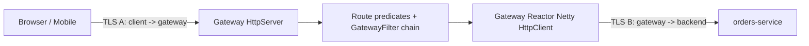

# HttpClientCustomizer and customizing Reactor Netty HttpClient in Spring Cloud Gateway

## 1. When do you need to customize the API Gateway's HTTP client?

In a microservices architecture, **Spring Cloud Gateway** receives HTTP requests, selects routes via predicates, runs **filter chains**, transforms paths/headers, discovers services via `lb://`, and forwards traffic to backends. Authentication, rate limiting, circuit breakers, retries, TLS, and request observability all operate along this path.

In **Gateway Server WebFlux**, standard HTTP/HTTPS routes proxy through **Reactor Netty `HttpClient`** on the *outbound* side. This is where the Gateway opens TCP connections, performs TLS handshakes when needed, manages connection pools, sends requests, and reads responses from downstream services.

You may need to customize HttpClient when:

- Backends sit behind networks with variable latency: you need to set **connect timeout**, **response timeout**, or TLS handshake timeout.
- Concurrency is high: you need to manage **connection pooling**, connection acquire wait times, and idle connections.
- Backends use HTTPS with an internal CA or mTLS: you need to configure certificate trust, client keys, and hostname verification.
- Your enterprise enforces an outbound HTTP proxy, egress policies, or detailed TCP/TLS error telemetry.
- Spring Cloud Gateway properties do not expose every Reactor Netty capability the application needs.

Two configuration approaches complement each other: **`spring.cloud.gateway.server.webflux.httpclient.*` properties** (preferred whenever supported) and **Java `HttpClientCustomizer`** (the extension point when advanced customization is required).

> **Scope and version note:** This lesson focuses on **Spring Cloud Gateway Server WebFlux 4.3+/5.x**. WebFlux 4.2 and earlier generally use the `spring.cloud.gateway.httpclient.*` property prefix. Gateway Server Web MVC uses a different web stack and HTTP client; do not use WebFlux `HttpClientCustomizer` there with the same expectations.

## 2. Inbound HttpServer differs from outbound HttpClient

A client can connect to the Gateway over HTTPS while the Gateway opens an **independent HTTPS connection** to the backend:



| Connection direction | Component | Typical configuration | Purpose |
|---|---|---|---|
Client → Gateway (**inbound**) | Reactor Netty `HttpServer`, Spring Boot | `server.port`, `server.ssl.*` | Gateway listens on HTTPS and presents its server certificate |
Gateway → Backend (**outbound**) | Gateway's Reactor Netty `HttpClient` | `spring.cloud.gateway.server.webflux.httpclient.*` and `HttpClientCustomizer` | Pool, TCP, TLS trust, proxy, response timeout |
Logical name → instance | DiscoveryClient, Spring Cloud LoadBalancer | Registry, `lb://service-id` | Finds target instance; `lb://` itself does not enable TLS |
Per-route policy | Route metadata and GatewayFilters | `Path`, `StripPrefix`, `Retry`, `CircuitBreaker` | Selects backend, transforms request, handles per-route failures |

**Do not confuse them:** `server.ssl.enabled=true` does not automatically supply CA trust or mTLS when the Gateway calls backends. Conversely, `HttpClientCustomizer` does not alter the listening port or certificate seen by browsers. If a route URI is `http://orders.internal:8081`, the outbound connection may remain unencrypted even when clients enter the Gateway via HTTPS.

## 3. `HttpClientCustomizer`: extension point and registration

Gateway Server WebFlux provides the interface in `org.springframework.cloud.gateway.config`:

```java
import org.springframework.cloud.gateway.config.HttpClientCustomizer;
import reactor.netty.http.client.HttpClient;

// Interface API shape:
// HttpClient customize(HttpClient httpClient);
```

The `customize(HttpClient)` method **takes a Gateway-created client and returns the configured HttpClient**. Spring applies `HttpClientCustomizer` beans when building the Netty HTTP client for proxying. A customizer is not a `GlobalFilter`; it is **not invoked per request** and is not the place to inspect JWTs or read HTTP bodies.

### 3.1. Minimal Java bean

Example setting TCP connect timeout to 3 seconds and Reactor Netty response timeout to 8 seconds:

```java
package com.example.gateway.config;

import java.time.Duration;

import io.netty.channel.ChannelOption;
import org.springframework.cloud.gateway.config.HttpClientCustomizer;
import org.springframework.context.annotation.Bean;
import org.springframework.context.annotation.Configuration;

@Configuration(proxyBeanMethods = false)
public class OutboundHttpClientConfig {

    @Bean
    HttpClientCustomizer gatewayOutboundCustomizer() {
        return httpClient -> httpClient
            .option(ChannelOption.CONNECT_TIMEOUT_MILLIS, 3_000)
            .responseTimeout(Duration.ofSeconds(8));
    }
}
```

In this example, `ChannelOption.CONNECT_TIMEOUT_MILLIS` is in **milliseconds** and governs only the **TCP connection establishment** step. Reactor Netty's `responseTimeout(Duration)` limits the **interval between network read operations while receiving a response**; it is not a single overall deadline covering DNS, pooling, TCP, TLS, retries, and full body transfer. This distinction is especially important for SSE and large downloads.

Reactor Netty's fluent builder methods return a new/enriched client instance; you must **return the customized result**:

```java
// Correct:
return httpClient.responseTimeout(Duration.ofSeconds(8));

// Easy mistake: customized result is discarded.
// httpClient.responseTimeout(Duration.ofSeconds(8));
// return httpClient;
```

Never call `block()`, perform blocking I/O, or execute requests inside `customize(...)`. This extension point is for **HTTP client configuration**, not processing individual request payloads.

### 3.2. Avoid `tcpConfiguration`/`SO_TIMEOUT` in new code

Older examples online sometimes use:

```java
// Legacy style, recognize only when maintaining old code:
return httpClient.tcpConfiguration(tcpClient ->
    tcpClient.option(ChannelOption.CONNECT_TIMEOUT_MILLIS, 3000));
```

`tcpConfiguration(...)` is **deprecated** in modern Reactor Netty releases. Prefer calling the API directly on `HttpClient`:

```java
return httpClient.option(ChannelOption.CONNECT_TIMEOUT_MILLIS, 3000);
```

Do not use `ChannelOption.SO_TIMEOUT` as a default way to bound HTTP responses in Netty's non-blocking model: it is not a reliable substitute for `HttpClient.responseTimeout(Duration)`.

### 3.3. Actual scope of the customizer

- Routes with `uri: http://...` or `https://...` using Netty HTTP routing are affected by this outbound client.
- Routes with `lb://orders-service`, once LoadBalancer resolves to a matching HTTP/HTTPS URI, also pass through this HTTP proxy path.
- `forward:...`, WebSockets, or custom handlers may take **different routing paths**; never assume every request uses the same HttpClient.
- `WebClient.create()` instantiated manually by your app and HTTP clients inside other microservices do not inherit the Gateway's `HttpClientCustomizer`.

Because the customizer applies broadly across the Gateway's HTTP client, **never attach static tokens, Authorization headers, or fixed hostnames** to all outbound requests. Use Spring Security, TokenRelay, or per-route filters with appropriate audiences/scopes.

## 4. Prefer Gateway properties for common needs

### 4.1. Namespace changes across version lines

| Setting | WebFlux 4.2 and earlier | WebFlux 4.3+/5.x |
|---|---|---|
TCP connect timeout | `spring.cloud.gateway.httpclient.connect-timeout` | `spring.cloud.gateway.server.webflux.httpclient.connect-timeout` |
Response read timeout | `spring.cloud.gateway.httpclient.response-timeout` | `spring.cloud.gateway.server.webflux.httpclient.response-timeout` |
Connection pool | `spring.cloud.gateway.httpclient.pool.*` | `spring.cloud.gateway.server.webflux.httpclient.pool.*` |
Outbound TLS | `spring.cloud.gateway.httpclient.ssl.*` | `spring.cloud.gateway.server.webflux.httpclient.ssl.*` |
Outbound proxy | `spring.cloud.gateway.httpclient.proxy.*` | `spring.cloud.gateway.server.webflux.httpclient.proxy.*` |
Netty client wiretap | `spring.cloud.gateway.httpclient.wiretap` | `spring.cloud.gateway.server.webflux.httpclient.wiretap` |

Use the exact prefix matching your release train and starter. The Gateway can start up cleanly even when a property sits under the wrong namespace, so always verify **actual runtime behavior** or bound properties.

### 4.2. Illustrative configuration without Java

```yaml
# application.yml for Gateway Server WebFlux 4.3+/5.x
server:
  port: 8080

spring:
  application:
    name: edge-gateway
  cloud:
    gateway:
      server:
        webflux:
          httpclient:
            connect-timeout: 3000
            response-timeout: 8s
            pool:
              type: fixed
              max-connections: 200
              acquire-timeout: 5000
              max-idle-time: 30000
              max-life-time: 180000
              metrics: true
            ssl:
              handshake-timeout: 10s
              use-insecure-trust-manager: false
            wiretap: false
          routes:
            - id: catalog
              uri: https://catalog.internal.example:8443
              predicates:
                - Path=/api/catalog/**
              filters:
                - StripPrefix=1
```

These numbers are **illustrative starting points** for learning how to configure, not universal production sizing defaults. `connect-timeout`, `pool.acquire-timeout`, `pool.max-idle-time`, and `pool.max-life-time` use **milliseconds** per Gateway properties; `response-timeout` and `ssl.handshake-timeout` are `Duration` values (such as `8s`, `10s`).

**Avoid duplicate configuration:** if `response-timeout`/`connect-timeout` is already in YAML, do not repeat the same setting in `HttpClientCustomizer`. If multiple sources set the same option, never guess precedence; verify on your exact version and observed behavior.

### 4.3. Properties or customizer?

| Requirement | Preferred option | When is a customizer needed? |
|---|---|---|
TCP/response timeout | `httpclient.*` or per-route metadata | When deeper Reactor Netty hooks are required |
Connection pool limits | `httpclient.pool.*` | When custom lifecycles/special `ConnectionProvider` are needed |
CA, TLS handshake, SSL bundle | `httpclient.ssl.*` | When standard config is insufficient and passes security review |
Outbound proxy | `httpclient.proxy.*` | When controlled specialized mechanisms are required |
Per-route request header | `AddRequestHeader`/`SetRequestHeader` | Never use global HttpClient headers |
JWT, authorization | Spring Security Resource Server/TokenRelay | Never replace authn/authz with a customizer |
Latency/status observability | Actuator, Micrometer, tracing | When Netty connection-level callbacks are needed |
Wire logging | `httpclient.wiretap` in controlled environments | When custom logging policies with strict redaction are needed |

## 5. Timeout types do not replace one another

```text
Client sends request
    |
    +-- Route predicates / GatewayFilters
    |
    +-- Wait for connection in pool ----> pool acquire timeout
    |
    +-- Discovery / DNS ----------------> discovery/DNS controls
    |
    +-- Open TCP socket ----------------> connect timeout
    |
    +-- TLS handshake (if HTTPS) -------> TLS handshake timeout
    |
    +-- Send request body --------------> body/flow control
    |
    +-- Wait & read HTTP response ------> response read timeout
    |
    +-- Return response to client ------> inbound flow / client disconnect
```

| Timeout | Scope | Typical configuration |
|---|---|---|
Pool acquire | Waiting for an idle/new connection | `pool.acquire-timeout: 5000` with fixed pool |
TCP connect | Connecting to chosen backend address | `connect-timeout: 3000` |
TLS handshake | TLS negotiation on HTTPS connections | `ssl.handshake-timeout: 10s` |
Response read | Waiting for response data over the network | `response-timeout: 8s` |
Retry/backoff | Request replays via `Retry` filter | Separate retry config, not an overall deadline |
End-to-end | Total time from client through Gateway to backend and back | Requires dedicated SLA/deadline design if business requires it |

With SSE or streaming downloads, responses are read in multiple chunks. **Long silent gaps** between events can exceed `responseTimeout` and trigger a timeout even while the stream is healthy logically. Conversely, if a backend trickles small amounts of data continuously, response read timeout does not necessarily cap **total** processing duration.

### 5.1. Per-route timeouts: units must be crystal clear

Gateway Server WebFlux allows setting per-route timeouts via `metadata`:

```yaml
spring:
  cloud:
    gateway:
      server:
        webflux:
          httpclient:
            connect-timeout: 3000   # Global: milliseconds
            response-timeout: 8s    # Global: Duration
          routes:
            - id: reports
              uri: https://reports.internal.example:8443
              predicates:
                - Path=/api/reports/**
              metadata:
                connect-timeout: 2000
                response-timeout: 15000
              filters:
                - StripPrefix=1
```

**Critical difference:** `connect-timeout` and `response-timeout` inside `metadata` **are both in milliseconds** (in the example: 2 seconds and 15 seconds). Global `response-timeout` under `httpclient` is declared as a `Duration` like `8s`. Docs also state a negative per-route response timeout can disable the global timeout; use only when other deadlines/rules exist and you understand hanging-connection risks.

### 5.2. Java DSL setting route metadata

```java
import org.springframework.cloud.gateway.route.RouteLocator;
import org.springframework.cloud.gateway.route.builder.RouteLocatorBuilder;
import org.springframework.context.annotation.Bean;
import static org.springframework.cloud.gateway.support.RouteMetadataUtils.CONNECT_TIMEOUT_ATTR;
import static org.springframework.cloud.gateway.support.RouteMetadataUtils.RESPONSE_TIMEOUT_ATTR;

@Bean
RouteLocator reportRoute(RouteLocatorBuilder builder) {
    return builder.routes()
        .route("reports", r -> r.path("/api/reports/**")
            .filters(f -> f.stripPrefix(1))
            .uri("https://reports.internal.example:8443")
            .metadata(CONNECT_TIMEOUT_ATTR, 2000)
            .metadata(RESPONSE_TIMEOUT_ATTR, 15000))
        .build();
}
```

This is an illustrative snippet **inside a Spring configuration class**, not a complete Java file. Never register both a YAML route and a Java DSL route with the same ID in an experiment.

## 6. Connection pool: performance paired with resource limits

Opening TCP and completing TLS handshakes per request costs CPU, network bandwidth, and latency. **Connection pooling** lets the Gateway reuse established connections to backends.

| `httpclient.pool.*` property | Meaning | Notes |
|---|---|---|
`type` | `fixed`, `elastic`, or `disabled` depending on version | `fixed` enforces a resource ceiling |
`max-connections` | Maximum connections in a fixed pool | Not equivalent to total RPS limit |
`acquire-timeout` | Milliseconds to wait for a connection | Can throw acquire errors under high load |
`max-idle-time` | Maximum idle time of a connection | Should align with backend/LB idle timeouts |
`max-life-time` | Maximum connection lifetime | Distinct from an HTTP request timeout |
`eviction-interval` | Interval to check for evictable connections | Background cleanup, not an exact hard deadline |
`leasing-strategy` | `fifo` or `lifo` | Determines which idle connection is picked |
`metrics` | Collects pool metrics via Micrometer | Requires a metrics registry and access controls |

**Pool too small:** requests wait for connections, inflating p95/p99 latency and causing pending acquire timeouts even while the backend has spare CPU. **Pool too large:** excess sockets/TLS sessions, file descriptors, direct memory, and backend load rise, risking connection storms. HTTP/2 multiplexing also changes the relationship between connection count and concurrent requests compared to HTTP/1.1.

Never pick `max-connections` from requests/second alone. Measure **active/idle/pending connections**, acquire wait times, downstream latency, Gateway replica count, and backend capacity before sizing.

## 7. Outbound TLS: trusting CAs, hostname verification, and mTLS

### 7.1. Encryption does not automatically verify the right backend

When the Gateway uses `uri: https://orders.internal.example:8443`, the HTTP client must verify the backend's certificate. For certificates signed by an internal CA, provide the proper trust material. When a backend requires **mTLS**, the Gateway must also present its own **client certificate and private key**.

| Need | Related configuration | Meaning |
|---|---|---|
Present server certificate to clients at Gateway inbound | `server.ssl.*` | TLS between client and Gateway |
Trust backend CA/certificate | `httpclient.ssl.trusted-x509-certificates` or trust store/bundle | Verifies backend certificate chain |
Verify backend hostname | HTTPS URI, certificate SAN, SNI/hostname verification | Ensures calling the intended named service |
Present Gateway certificate to backend (mTLS) | Client key store or SSL bundle with private key | Backend authenticates the Gateway workload |
Limit handshake time | `httpclient.ssl.handshake-timeout` | Caps TLS handshake wait |

**Never enable `use-insecure-trust-manager: true` as a "quick fix" for certificate errors in production.** It disables backend certificate trust verification and opens the door to connecting to spoofed targets. The channel stays encrypted, yet peer identity guarantees are lost.

### 7.2. Trusting an internal CA via PEM

Suppose an internal CA is mounted at `/etc/gateway/certs/backend-ca.pem` in the container:

```yaml
spring:
  cloud:
    gateway:
      server:
        webflux:
          httpclient:
            ssl:
              use-insecure-trust-manager: false
              trusted-x509-certificates:
                - /etc/gateway/certs/backend-ca.pem
              handshake-timeout: 10s
          routes:
            - id: secure-orders
              uri: https://orders.internal.example:8443
              predicates:
                - Path=/api/orders/**
              filters:
                - StripPrefix=1
```

`backend-ca.pem` is an **illustrative path**, which must be provisioned via volumes/secrets or a secure certificate distribution mechanism in real environments. Without custom trusted certs, the client normally uses the default trust store (subject to JVM properties like `javax.net.ssl.trustStore`). Never confuse **trust CA** with **private key**.

Even when the CA is trusted, the HTTPS backend certificate must still match the **hostname** used by the Gateway. If `uri` targets a raw IP while the certificate holds only a DNS SAN, fix DNS/URI/instance metadata rather than disabling hostname verification.

### 7.3. SSL bundle for outbound mTLS

Modern Gateway WebFlux releases provide `httpclient.ssl.ssl-bundle` to reference a **Spring Boot SSL bundle**. Example PEM bundle with client certificate and CA:

```yaml
# Example structure for Spring Boot/Gateway supporting SSL bundles.
# Files must exist at runtime with protected read permissions.
spring:
  ssl:
    bundle:
      pem:
        backend-client:
          keystore:
            certificate: file:/etc/gateway/certs/client.crt
            private-key: file:/etc/gateway/secrets/client.key
          truststore:
            certificate: file:/etc/gateway/certs/backend-ca.pem
  cloud:
    gateway:
      server:
        webflux:
          httpclient:
            ssl:
              ssl-bundle: backend-client
```

Meaning: `keystore` holds the **Gateway's identity/key pair as a TLS client**; `truststore` holds the certs/CAs the Gateway uses to verify the backend. `ssl-bundle: backend-client` requires that bundle name to exist on compatible Spring Boot/Gateway versions. In real deployments, plan certificate chains, private key protection, rotation schedules, and reload behavior on your running version; **never assume editing a PEM file immediately updates all pooled connections**.

**Workload mTLS does not replace end-user OAuth2/JWT.** When a route requires resource authorization, backends must still verify identity, scopes/claims, or equivalent access controls.

### 7.4. Inbound HTTPS must be configured separately

Example Gateway listening for HTTPS on 8443:

```yaml
server:
  port: 8443
  ssl:
    enabled: true
    key-store: classpath:gateway-keystore.p12
    key-store-type: PKCS12
    key-store-password: ${GATEWAY_KEYSTORE_PASSWORD}
```

This is the inbound **server key store**. It does not automatically become the client certificate for Gateway → backend connections. The password above is read from an environment variable/secret — **never write real passwords into configuration files**. Supply a valid certificate chain matching the Gateway's public DNS.

## 8. Outbound proxies and egress policies

If the environment requires the Gateway to go through an HTTP proxy to reach certain backends:

```yaml
spring:
  cloud:
    gateway:
      server:
        webflux:
          httpclient:
            proxy:
              type: http
              host: outbound-proxy.internal.example
              port: 3128
              non-proxy-hosts-pattern: 'localhost|.*\.svc\.cluster\.local'
```

This is an **outbound proxy for the Gateway calling backends**, distinct from fronting proxies/ingresses in front of the Gateway and distinct from `Forwarded`/`X-Forwarded-*` headers. If the proxy requires credentials, supply `username`/`password` from secret stores rather than hardcoding.

For dynamic routes or routes where clients influence target URIs, enforce an **egress allowlist**, DNS controls, and blocks on link-local/metadata endpoints and disallowed hostnames to prevent SSRF. Never use `HttpClientCustomizer` to blindly route all traffic through alternate proxies or hosts without checking trust boundaries.

## 9. Observing HttpClient without leaking bodies/tokens

### 9.1. Inbound wiretap differs from outbound wiretap

```yaml
spring:
  cloud:
    gateway:
      server:
        webflux:
          httpclient:
            wiretap: false
          httpserver:
            wiretap: false
```

- `httpclient.wiretap` logs Netty traffic in the **Gateway → backend** direction.
- `httpserver.wiretap` logs traffic in the **client → Gateway** direction.
- Enabling wiretap also requires matching Reactor Netty log levels; setting `true` alone does not guarantee logs appear under every logger config.

Wiretap can log **sensitive headers, authorization tokens, cookies, queries, and bodies** depending on logging mode. Enable it only temporarily in controlled environments with restricted log access, redaction, and a clear turn-off plan. Never leave wiretap enabled as default observability on a production Gateway handling customer data.

### 9.2. Lifecycle callbacks in Reactor Netty

`HttpClientCustomizer` can attach lightweight callbacks:

```java
package com.example.gateway.config;

import org.slf4j.Logger;
import org.slf4j.LoggerFactory;
import org.springframework.cloud.gateway.config.HttpClientCustomizer;
import org.springframework.context.annotation.Bean;
import org.springframework.context.annotation.Configuration;

@Configuration(proxyBeanMethods = false)
public class OutboundEventsConfig {
    private static final Logger log =
        LoggerFactory.getLogger(OutboundEventsConfig.class);

    @Bean
    HttpClientCustomizer outboundEvents() {
        return client -> client
            .doOnConnected(connection ->
                log.debug("outbound_connected channel={}",
                    connection.channel().id().asShortText()))
            .doOnResponse((response, connection) ->
                log.debug("outbound_response status={}",
                    response.status().code()));
    }
}
```

**Notes when reading logs:**

1. `doOnConnected` fires once and the connection is then **reused by the pool** across many HTTP requests; never count connection events as request counts.
2. `doOnResponse` fires when response headers arrive, **not necessarily once the entire body has been received**.
3. Netty callbacks may run on an **event loop**: never call blocking APIs, database queries, or `Thread.sleep` inside callbacks.
4. Never log headers containing tokens, bodies, cookies, user PII, or URIs with sensitive query strings; logging channel ID/status at DEBUG is purely illustrative.

The examples in section 3 and here can be combined into **one** customizer for easier production auditing. If multiple beans modify the same option, verify effective ordering and values on your version instead of relying on class scan order.

### 9.3. Important metrics

| Telemetry signal | Purpose |
|---|---|
Route ID, status, p95/p99 latency | Isolate slow or failing routes |
Connect failures, connect duration | Firewalls, closed backend ports |
TLS handshake errors/certificate failures | CAs, DNS/SAN, expired certs, mTLS |
Pool active/idle/pending connections | Pool exhaustion or long-held resources |
Acquire timeouts | Prolonged pool waits |
HTTP 5xx, cancellations, retries | Backend overload, client disconnects, retry impact |
Direct memory, file descriptors, JVM heap | Cost of pooled buffers and sockets |
Circuit breaker/fallback metrics | Rate of unresponsive backends |

Actuator/Micrometer and Reactor Netty metrics depend on dependencies, configuration, and versions. When setting `pool.metrics: true`, ensure a compatible metrics registry is present. **Never tag metrics with raw paths containing IDs, tokens, or high-cardinality data.**

## 10. HttpClient changes that easily cause incidents

### 10.1. Do not replace the Gateway-provided client with `HttpClient.create()`

```java
// Avoid: discards Gateway-configured settings.
@Bean
HttpClientCustomizer unsafe() {
    return ignored -> reactor.netty.http.client.HttpClient.create();
}
```

Replacing the entire client can wipe out connection providers, TLS, proxies, metrics, or options configured by the Gateway. **A customizer should refine the `client` parameter**, never build a brand-new client from scratch unless intentionally designed and verified.

### 10.2. Do not attach global bearer tokens at the Netty layer

`HttpClient.headers(...)` supports adding default headers, yet attaching `Authorization: Bearer ...` across the entire outbound client can leak credentials to the wrong service or audience. Use Spring Security, TokenRelay, or **per-route** service-to-service authentication rather than a single global token.

### 10.3. Avoid uncontrolled `followRedirect(true)`

If the outbound client automatically follows redirects, the Gateway may call another host instead of returning the 3xx to the client per API contract, creating risks around sensitive headers and egress policy bypass. When adjusting backend `Location` headers, consider `RewriteResponseHeader` or `RewriteLocationResponseHeader` with strict host and scheme allowlists.

### 10.4. Do not raise timeouts to hide a slow backend

Raising response timeouts to several minutes holds connections longer, lengthens pool queues, and amplifies load during retries. Before tuning, isolate the cause: pool waits, DNS, TCP, TLS, backend CPU/DB, streaming, large payloads, or circuit breakers. Pick deadlines tied to SLAs rather than arbitrarily "large enough" numbers.

## 11. Configuration and testing hands-on

### 11.1. Test project and route

A Gateway Server WebFlux app needs a compatible Spring Boot/Spring Cloud BOM and starters:

```xml
<dependency>
    <groupId>org.springframework.cloud</groupId>
    <artifactId>spring-cloud-starter-gateway-server-webflux</artifactId>
</dependency>
<dependency>
    <groupId>org.springframework.boot</groupId>
    <artifactId>spring-boot-starter-actuator</artifactId>
</dependency>
```

The Gateway on port 8080 calls a **test** backend on port 8081:

```yaml
server:
  port: 8080

spring:
  cloud:
    gateway:
      server:
        webflux:
          httpclient:
            connect-timeout: 1000
            response-timeout: 2s
          routes:
            - id: local-test
              uri: http://localhost:8081
              predicates:
                - Path=/test/**
              filters:
                - StripPrefix=1
```

The backend must expose `GET /ok`, `GET /delay` (intentionally slow), and `GET /stream` (SSE emitting events). The Gateway **does not create endpoints** on the backend.

To build the test backend in Spring WebFlux, you can use this controller:

```java
import java.time.Duration;
import org.springframework.http.MediaType;
import org.springframework.web.bind.annotation.GetMapping;
import org.springframework.web.bind.annotation.RestController;
import reactor.core.publisher.Flux;
import reactor.core.publisher.Mono;

@RestController
class SlowBackendController {
    @GetMapping("/ok")
    Mono<String> ok() {
        return Mono.just("ok");
    }

    @GetMapping("/delay")
    Mono<String> delay() {
        return Mono.delay(Duration.ofSeconds(4))
            .map(ignore -> "delayed");
    }

    @GetMapping(value = "/stream", produces = MediaType.TEXT_EVENT_STREAM_VALUE)
    Flux<String> stream() {
        return Flux.interval(Duration.ofSeconds(5))
            .map(i -> "event-" + i);
    }
}
```

This controller must live in a **separate backend application** running on 8081 with the WebFlux dependency. With the Gateway configured with `response-timeout: 2s`, `/delay` and the long-gap stream let you observe response read timeouts.

### 11.2. Verifying with `curl`

```bash
# Fast response
curl -i http://localhost:8080/test/ok

# May time out when backend waits 4 seconds before replying
curl -i http://localhost:8080/test/delay

# Observe streaming; a 5-second gap can exceed the 2-second timeout
curl -N -i http://localhost:8080/test/stream
```

**Never assert timeout errors always return HTTP 504.** Final status/body depends on exception type, response commit state, Gateway handlers, and filters. If the backend is stopped, `/ok` also fails with connection refused; distinguish TCP errors from response read errors.

### 11.3. Inbound and outbound TLS

If the Gateway listens at `https://localhost:8443` with a test CA:

```bash
curl --cacert gateway-ca.pem -i https://localhost:8443/test/ok
```

The Gateway's certificate must match the client's target hostname; `gateway-ca.pem` is only a sample filename. Never treat `curl -k` (skipping certificate verification) as a valid TLS security test.

Check backend TLS independently:

```bash
openssl s_client \
  -connect orders.internal.example:8443 \
  -servername orders.internal.example \
  -showcerts </dev/null
```

`openssl s_client` reveals the backend's certificate chain and handshake, yet does not prove the JVM/Gateway has the proper trust store/SSL bundle. Afterward, call the real route to verify TLS configured inside the Gateway.

### 11.4. Fault injection matrix

| Scenario | Expected signal | Where to isolate |
|---|---|---|
Backend closes port | Connection refused before HTTP response | Route host/port, connect error |
Backend stays silent after request | Response timeout | Backend latency, `response-timeout` |
Backend CA missing from trust store | TLS certificate validation failure | Trust certs, SSL bundle |
Certificate mismatches hostname | Hostname verification error | Route URI, SAN, SNI, DNS |
Backend requires mTLS, Gateway lacks client cert | TLS handshake/authentication error | Client key store, mTLS policy |
Fixed pool runs out of connections | Pending acquires, latency, or acquire timeout | Pool size and pool metrics |
`lb://` route finds no instances | Typically 503 or matching error policy | DiscoveryClient, LoadBalancer |
Backend returns HTTP 401 | TCP/TLS may have succeeded; API-layer error | JWT/audience/scopes/permissions |
Client cancels SSE | Stream cancelled before full completion | Cleanup, backpressure, timeouts |

### 11.5. Pre-production checklist

1. Choose **one primary configuration source** for timeouts/pools; add a customizer only when needed.
2. Measure pool waits, DNS, TCP, TLS, TTFB, and total latency under varied load levels.
3. Keep certificate and hostname verification enabled, store private keys in secret stores, and test rotation.
4. Test missing `lb://` instances, slow backends, connection resets, and retries/circuit breakers.
5. Separate response timeout policies for normal APIs, SSE, and file downloads.
6. Ensure wiretap is disabled and logs/metrics never expose PII, tokens, or bodies.
7. Maintain a rollback plan because a global `HttpClientCustomizer` can impact **all outbound HTTP routes**.

## 12. Common errors and troubleshooting

| Symptom | Causes to inspect | Resolution |
|---|---|---|
Customizer has no effect | Wrong Web MVC starter/stack, unregistered bean, route not using `NettyRoutingFilter` | Check dependencies, component scan, and route URI |
Java warns `tcpConfiguration` is deprecated | Copied legacy Reactor Netty snippet | Switch to `HttpClient.option(...)` or current API |
Connect timeout set yet requests still wait long | Pool wait, DNS, TLS, or backend; connect measures TCP only | Measure each stage; do not blindly raise timeouts |
SSE cuts off abruptly | Silent gap between events exceeds `response-timeout` | Add heartbeats or use per-route timeouts |
HTTPS fails even with `server.ssl` configured | Configured only inbound TLS, not outbound TLS | Add HTTPS URI, outbound trust/client cert |
TLS handshake failure | Wrong CA, wrong hostname/SAN, missing mTLS client cert | Check truststore, bundle, DNS, certificates |
Gateway returns `503` with `lb://` | No instances or missing LoadBalancer | Check discovery and instance health |
Pool pending spikes sharply | Slow backend or undersized `max-connections` | Measure acquire time, active/idle, and backend capacity |
Memory/CPU spikes after raising pool size | Too many TCP/TLS connections, Netty buffers | Cap concurrency, load test, check direct memory |
`curl` connects via TLS cleanly while Gateway fails | JVM/Gateway truststore differs from curl's trust | Test directly via Gateway and verify client bundle |
Authorization header reaches wrong backend | Customizer attached global header | Use per-route auth; verify audience/scopes |
Errors after upgrading Gateway | Property prefix or Reactor Netty API changed | Cross-check release train, configprops, and starter |

## 13. Practice questions and answers

**Exercise 1.** Client reaches Gateway over HTTPS, while the route sets `uri: http://orders.internal:8081`. Is Gateway → backend traffic protected by TLS?

**Answer:** No. `server.ssl` protects only inbound. An `http://` outbound URI does not enable TLS automatically; design secure backend connectivity with matching URIs and certificates.

**Exercise 2.** You want a global 2-second connect timeout and 6-second response timeout on WebFlux 5.x. Is Java code mandatory?

**Answer:** No. Use `spring.cloud.gateway.server.webflux.httpclient.connect-timeout: 2000` and `response-timeout: 6s`. Add `HttpClientCustomizer` only when Reactor Netty APIs outside properties are required.

**Exercise 3.** A customizer calls `httpClient.responseTimeout(Duration.ofSeconds(5)); return httpClient;`. Why is this buggy?

**Answer:** Because the customized client instance must be returned. Write `return httpClient.responseTimeout(Duration.ofSeconds(5));`.

**Exercise 4.** SSE emits events 15 seconds apart while response timeout is 5 seconds. What can happen?

**Answer:** The HTTP client may abort the stream after exceeding the read-wait interval. Add heartbeats or configure a suitable per-route timeout.

**Exercise 5.** Does `lb://orders-service` guarantee TLS/mTLS to the chosen instance?

**Answer:** No. `lb://` resolves the service/instance; TLS depends on target scheme, client SSL configuration, and backend certificates.

**Exercise 6.** Why is `use-insecure-trust-manager: true` dangerous?

**Answer:** It skips verifying backend certificate trust, creating impersonation/MITM risk. Configure proper CAs, trust stores/bundles, and hostname verification.

**Exercise 7.** Fixed pool `max-connections=20`, 100 concurrent requests, slow backend. Why can timeouts happen with zero network errors?

**Answer:** Many requests must queue to acquire a connection, potentially exceeding `acquire-timeout`. Measure pending/active connections and backend latency instead of infinitely enlarging the pool.

**Exercise 8.** Why should you avoid adding a static bearer token to all requests in `HttpClientCustomizer`?

**Answer:** Credentials could be sent to routes/hosts outside the intended audience or trust domain. Use Spring Security, TokenRelay, or per-route service credentials.

## 14. Official references

- [Spring Cloud Gateway Server WebFlux – The HttpClientCustomizer](https://docs.spring.io/spring-cloud-gateway/reference/spring-cloud-gateway-server-webflux/http-client.html): interface, `customize` method, and bean registration.
- [Spring Cloud Gateway 5.1 – Configuration Properties](https://docs.spring.io/spring-cloud-gateway/reference/5.1/configprops.html): `server.webflux.httpclient.*`, timeouts, pool, proxy, TLS, wiretap.
- [Spring Cloud Gateway – Http timeouts configuration](https://docs.spring.io/spring-cloud-gateway/reference/spring-cloud-gateway-server-webflux/http-timeouts-configuration.html): global timeouts and per-route metadata.
- [Spring Cloud Gateway – TLS and SSL](https://docs.spring.io/spring-cloud-gateway/reference/spring-cloud-gateway-server-webflux/tls-and-ssl.html): inbound/outbound TLS, trusted certs, and handshakes.
- [Reactor Netty – HTTP Client Reference](https://docs.spring.io/projectreactor/reactor-netty/docs/current/reference/html/http-client.html): response timeout, connections, pooling, proxies, hooks, and TLS.
- [Reactor Netty – HttpClient API](https://docs.spring.io/projectreactor/reactor-netty/docs/current/api/reactor/netty/http/client/HttpClient.html): `option`, `responseTimeout`, `doOnResponse`, and replacements for `tcpConfiguration`.
- [Spring Boot – SSL Bundles](https://docs.spring.io/spring-boot/reference/features/ssl.html): declaring and consuming keystore/truststore bundles.

**Remember:** **`HttpClientCustomizer` configures the Reactor Netty client the Gateway uses to call backends**, not the Gateway's HTTPS listener. Prefer `spring.cloud.gateway.server.webflux.httpclient.*` properties for standard settings; reserve Java customizers for genuinely advanced needs. Understand **pool acquisition, TCP connect, TLS handshake, and response read timeouts**, keep certificate/hostname verification intact, and observe real behavior before changing production.
