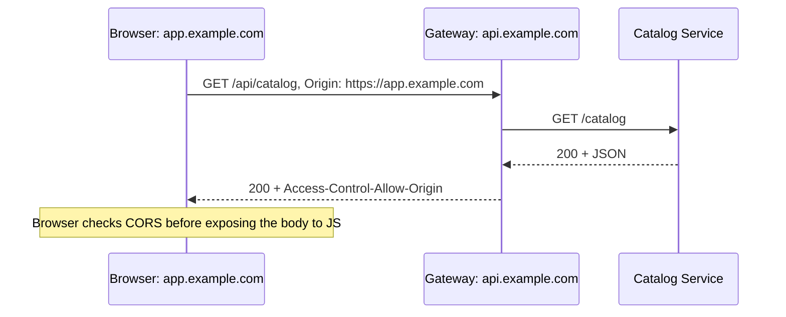
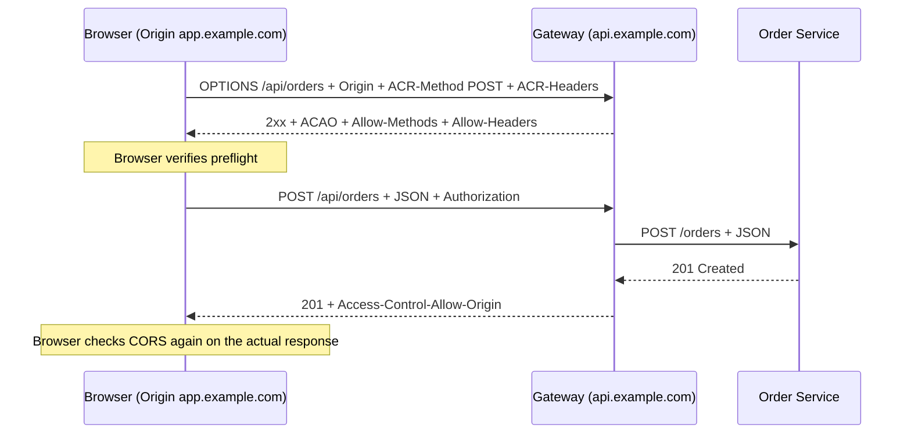
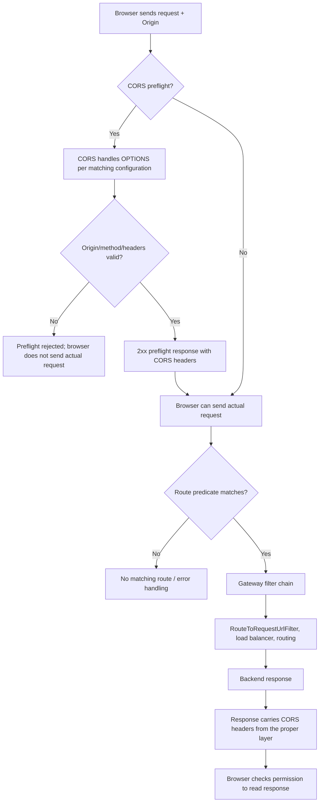

# Same-origin, cross-origin, and the role of CORS in Spring Cloud Gateway

A frontend application served at `https://app.example.com` may need to read data from an API at `https://api.example.com`. Even though both addresses belong to the same system and may go through the same API Gateway, they are still **two different origins**. Browsers enforce the **same-origin policy** and only allow a page's JavaScript code to read a cross-origin response if the target server permits it via **CORS** (*Cross-Origin Resource Sharing*).

In the `SPRING_CLOUD_GATEWAY` module, CORS is an important component when the microservices entry point provides APIs for SPAs, portals, and web applications. The Gateway manages route predicates, the filter chain, path/header transformations, and service discovery, and can also serve as the unified place to enforce CORS policy for browser clients. Configuring CORS needs to work in coordination with authentication, rate limiting, circuit breakers, retries, TLS, and observability, without mistaking CORS for those security or reliability mechanisms.

This lesson belongs to the **CORS** chapter and focuses on three questions:

1. **How do same-origin and cross-origin differ?**
2. **When does the browser check CORS, especially with `OPTIONS` preflight?**
3. **Where should Spring Cloud Gateway Server WebFlux place the CORS policy and how should it be tested to avoid errors or security gaps?**

> **Scope:** Examples target **Spring Cloud Gateway Server WebFlux**, not Gateway Server MVC. Starter names and configuration namespaces vary across Spring Cloud Gateway generations; verify against your actual Spring Boot/Spring Cloud version. The `example.com` hostname and localhost ports are for illustration only.

## 1. What is an origin? Comparing same-origin and cross-origin

The **origin** of a URL is essentially defined by the triple:

```text
origin = scheme + hostname + port
```

For example:

```text
https://app.example.com:443/dashboard
        └───── origin ──────┘
```

The path (`/dashboard`), query string (`?tab=reports`), and fragment (`#overview`) **are not part of the origin**. Default ports are typically normalized: `https://app.example.com` and `https://app.example.com:443` share the same origin when evaluated as normal HTTPS URLs.

Taking `https://app.example.com` as a page's origin:

| Target URL | Same-origin? | Why? |
| --- | --- | --- |
| `https://app.example.com/profile` | **Yes** | Same scheme, host, and default HTTPS port. |
| `https://app.example.com:443/api` | **Yes** | Port `443` is the default HTTPS port. |
| `https://api.example.com/orders` | **No** | Different hostname (`api` vs. `app`). |
| `http://app.example.com/profile` | **No** | Different scheme (`http` vs. `https`). |
| `https://app.example.com:8443/api` | **No** | Different port. |
| `https://partner.example.net/api` | **No** | Different hostname/domain. |

### 1.1. What does the same-origin policy protect?

The **same-origin policy (SOP)** is a set of browser rules designed to prevent code from one origin from freely reading sensitive data belonging to another origin. For example, a script from `https://app.example.com` is not allowed by default to read JSON returned from `https://api.bank.example` just because the user is logged into both.

However, SOP does not mean "the browser never sends a cross-origin request":

- Browsers have long been able to load images, stylesheets, or navigate to another origin under specific rules.
- An HTML form or a permitted request type can still **be sent**, even if the script is not allowed to read the response.
- With `fetch`/XHR, the browser checks CORS to decide whether to expose the response to the script; some requests also require a **preflight** before the actual request is sent.

Therefore, **CORS is primarily a mechanism that lets the browser share responses across origins according to server policy**, rather than a firewall that blocks all invalid requests from reaching the API.

### 1.2. "Same-site" does not mean "same-origin"

"Site" is generally evaluated by scheme and registrable domain in modern web mechanisms, whereas origin considers the **full hostname and port**. Thus `https://app.example.com` and `https://api.example.com` can be **same-site** while still being **cross-origin**.

This distinction affects:

- CORS: controls whether a script can access responses across **origins**.
- `SameSite` cookies: use the **site** concept, not the exact same origin triple as CORS.
- CSRF: requires policies against unintended state-changing requests; security cannot be inferred from CORS alone.

Do not conclude that CORS is unnecessary just because "two subdomains belong to the same company."

## 2. What is CORS, and what is CORS not?

CORS is a set of **HTTP request/response headers** and browser rules used when a script makes a request to a different origin. Normally, a frontend cannot "enable CORS" on its own to read an API: the **API server** must declare which origins are allowed.

For example, a frontend at `https://app.example.com` calls:

```javascript
const response = await fetch(
  "https://api.example.com/api/products/42"
);
const product = await response.json();
console.log(product);
```

The browser may send:

```http
GET /api/products/42 HTTP/1.1
Host: api.example.com
Origin: https://app.example.com
```

The Gateway/API responds:

```http
HTTP/1.1 200 OK
Content-Type: application/json
Access-Control-Allow-Origin: https://app.example.com
Vary: Origin

{"id":42,"name":"Java Book"}
```

With an appropriate policy, the browser allows the script from `app.example.com` to read the JSON body.

If the response lacks a valid `Access-Control-Allow-Origin`, the script may fail with a CORS error even though **the request reached the server and the server processed it successfully**. This is an important distinction when debugging with logs and metrics.

**CORS does not handle the following:**

| Mechanism | Can CORS replace it? |
| --- | --- |
| JWT/session/API key authentication | **No.** An allowed origin does not prove who the user is. |
| Authorization for reading orders or user-scoped resources | **No.** The backend must still enforce business-level permissions. |
| CSRF protection | **No.** A cross-origin request can still be sent under certain conditions. |
| Blocking `curl`, Postman, or server-to-server scripts | **No.** Those clients do not enforce browser SOP. |
| Request rate limiting | **No.** Dedicated rate limiting is required. |
| Connection security | **No.** HTTPS/TLS and trust/mTLS configuration are required. |
| Forwarding to `lb://...` services or retry/circuit breaker | **No.** That is the job of Gateway routing and reliability. |

An origin `https://app.example.com` permitted by CORS can still send an unauthenticated request and receive `401 Unauthorized`. When CORS is configured properly, the browser **can read** that 401 response; CORS does not force the API to return 200.

## 3. Cross-origin requests do not always trigger a preflight

How the browser enforces CORS depends on the HTTP method, the request headers used by your code, and the content type. There are two typical flows:

1. **Requests meeting CORS-safelisted criteria**: the browser sends the actual request, then checks the CORS response headers to decide whether JavaScript may read it.
2. **Requests requiring preflight**: the browser sends an `OPTIONS` check first; only if the server permits it does the browser send the actual request.

In common descriptions, case (1) is called a **simple request**, though the exact criteria are the browser's *CORS-safelisted* rules; do not oversimplify this as "every GET skips preflight."

### 3.1. Basic GET example

Frontend:

```javascript
const res = await fetch(
  "https://api.example.com/api/catalog"
);
```

Assuming no custom headers outside the allowed safelisted headers are added, the browser sends `GET` with `Origin` and evaluates `Access-Control-Allow-Origin` on the response; typically **no preflight is needed**.



Important: if the Gateway/backend performs an action with side effects on a GET request (which is poor API design), **CORS does not mean the action never occurred** just because the browser blocked reading the response.

### 3.2. When is a preflight typically triggered?

| Request from frontend | May require preflight? | Reason |
| --- | --- | --- |
| `GET` with no custom request headers | Usually no | May satisfy safelisted criteria. |
| `GET` with `Authorization: Bearer ...` | **Yes** | `Authorization` is not a CORS-safelisted request header. |
| `POST` with `Content-Type: application/json` | **Yes** | JSON is not among the safelisted request content types. |
| `POST` with `application/x-www-form-urlencoded` and allowed headers | Usually no | May satisfy safelisted criteria. |
| `PUT` or `DELETE` | **Yes** | Method is not among the safelisted methods. |
| `POST` with a custom `X-Request-Id` header set by code | Usually yes | Custom header is not in the safelisted group. |

Whether the browser sends a preflight can also be affected by the preflight cache, browser environment, and other policies. The **CORS preflight cache** is separate from standard HTTP caching of application responses.

## 4. How does preflight OPTIONS work?

Suppose an SPA at `https://app.example.com` wants to send JSON with a bearer token:

```javascript
await fetch("https://api.example.com/api/orders", {
  method: "POST",
  headers: {
    "Content-Type": "application/json",
    "Authorization": "Bearer <access-token>"
  },
  body: JSON.stringify({ sku: "BOOK-42", quantity: 2 })
});
```

Before the `POST` request, the browser typically sends:

```http
OPTIONS /api/orders HTTP/1.1
Host: api.example.com
Origin: https://app.example.com
Access-Control-Request-Method: POST
Access-Control-Request-Headers: authorization, content-type
```

Three headers to recognize:

| Request header | Meaning |
| --- | --- |
| `Origin` | The origin making the request in the browser context. |
| `Access-Control-Request-Method` | The HTTP method the browser intends to use for the actual request. |
| `Access-Control-Request-Headers` | The non-safelisted request header names the browser intends to send. |

A permissive preflight response might look like:

```http
HTTP/1.1 200 OK
Access-Control-Allow-Origin: https://app.example.com
Access-Control-Allow-Methods: GET, POST, OPTIONS
Access-Control-Allow-Headers: Authorization, Content-Type
Access-Control-Max-Age: 1800
Vary: Origin, Access-Control-Request-Method, Access-Control-Request-Headers
```

The browser checks those values and proceeds to send the `POST` request **only if valid**. A successful preflight status can be 200 or another 2xx status depending on infrastructure; **it does not have to be 204**.



**Preflight is not a business request.** The Gateway can handle `OPTIONS` in the CORS layer before invoking Order Service. Do not expect the backend to create an order or parse JSON from a preflight: the `OPTIONS` request **does not carry the intended POST JSON body**.

### 4.1. An accepted preflight does not guarantee the POST will succeed

Even when preflight is allowed:

- Spring Security can still return `401/403` for the actual POST request.
- `RequestRateLimiter` can return `429`.
- The load balancer may find no available instance, resulting in `503`.
- The backend may return `400` for invalid JSON or `500` for a business error.

CORS only governs whether the browser may proceed and read the response. Therefore, the actual request still needs an appropriate **`Access-Control-Allow-Origin` on the response**, even for error statuses. Allowing preflight while omitting CORS headers on 401/429/503 responses can cause the frontend to see only a generic CORS error instead of the status code it needs to handle.

### 4.2. Note on credentials during preflight

Browser-generated preflight requests normally **do not send cookies or application bearer tokens like the actual request does**. Preflight must still be processed under CORS rules; if the authentication layer requires a JWT on every `OPTIONS` request, the browser may fail to get through to send the real request.

Do not respond by **disabling all security across all methods**. Instead, integrate CORS in the proper order with Spring Security and restrict origin/method/header policies on the appropriate endpoints.

## 5. Key CORS headers

CORS uses both request and response headers. You can group them as follows:

| Header | Direction | Meaning |
| --- | --- | --- |
| `Origin` | Request | Origin of the browser context sending the request. |
| `Access-Control-Request-Method` | Preflight request | Intended method of the actual request. |
| `Access-Control-Request-Headers` | Preflight request | List of intended headers requesting permission. |
| `Access-Control-Allow-Origin` | Response | Origin allowed by the server to read the response, or `*` when appropriate. |
| `Access-Control-Allow-Methods` | Preflight response | Methods accepted during preflight. |
| `Access-Control-Allow-Headers` | Preflight response | Request headers accepted by the server. |
| `Access-Control-Allow-Credentials` | Response | Allows the browser to expose credentialed responses when set to `true` with compatible configuration. |
| `Access-Control-Max-Age` | Preflight response | Duration in seconds the browser may cache the preflight result, subject to browser caps. |
| `Access-Control-Expose-Headers` | Actual response | Non-safelisted response headers that JS is permitted to read. |
| `Vary: Origin` | Response/cache | Tells caches that the response can vary by `Origin`; preflight may also need to vary by requested method/headers. |

### 5.1. `Access-Control-Allow-Origin`

A response:

```http
Access-Control-Allow-Origin: https://app.example.com
```

allows a browser at that exact origin to read the response when other CORS conditions are satisfied. **The origin must match** in scheme, hostname, and port. `https://app.example.com` does not automatically include `http://app.example.com` or `https://partner.example.com`.

This header is not a comma-separated list of multiple origins. To allow multiple specific origins, the server normally checks `Origin` against an **allowlist**, then returns **a single matching origin** per response.

```http
Origin: https://partner.example.com
Access-Control-Allow-Origin: https://partner.example.com
Vary: Origin
```

`Vary: Origin` is especially important when responses pass through a CDN or reverse proxy cache, so a response for origin A is not replayed with the wrong CORS header to origin B.

### 5.2. `Access-Control-Allow-Methods` differs from the Method route predicate

`Access-Control-Allow-Methods: GET, POST` describes the methods the browser is permitted to use in the **CORS** context. It **does not create GET/POST routes**, does not replace the `Method` predicate, and does not bypass method checks in the backend.

For example, CORS might allow POST while the route only declares `Method=GET`; the actual request still will not match that POST route. Configuration must be consistent across all three layers: CORS, route mapping, and business endpoints.

### 5.3. `Access-Control-Allow-Headers`

If the frontend sends `Authorization` or `X-Request-Id`, the preflight response must permit the requested headers according to policy. If `Authorization` is missing from the allowed list, the browser may block the request before the bearer token is sent.

For example:

```http
Access-Control-Allow-Headers: Authorization, Content-Type, X-Request-Id
```

This header does not make the backend trust the values sent. A client-supplied `X-User-Id` or `X-Role` value from the browser still carries no security authority just because CORS allows that header name.

### 5.4. `Access-Control-Expose-Headers`

JavaScript cannot read every cross-origin response header merely because the API returns it. Only a default set of response headers is readable by the browser; other application headers must be **exposed**.

Suppose an API creates a resource and returns:

```http
HTTP/1.1 201 Created
Location: /api/orders/9001
X-Request-Id: req-123
Access-Control-Allow-Origin: https://app.example.com
Access-Control-Expose-Headers: Location, X-Request-Id
```

Then the frontend can read:

```javascript
const res = await fetch("https://api.example.com/api/orders", {
  method: "POST",
  headers: { "Content-Type": "application/json" },
  body: JSON.stringify({ sku: "BOOK-42", quantity: 2 })
});

const createdUrl = res.headers.get("Location");
const requestId = res.headers.get("X-Request-Id");
```

`Access-Control-Expose-Headers` **does not send extra headers** and does not allow the frontend to send request headers. It only controls **read access to response headers** that already exist.

## 6. Credentials: cookies, Authorization, and the limits of `*`

When the browser sends a cross-origin request with credentials—such as cookies via `fetch(..., { credentials: "include" })`—the CORS policy must meet stricter requirements.

Frontend:

```javascript
const response = await fetch(
  "https://api.example.com/api/account/me",
  { credentials: "include" }
);
```

An appropriate response for the origin `app.example.com` could be:

```http
Access-Control-Allow-Origin: https://app.example.com
Access-Control-Allow-Credentials: true
Vary: Origin
```

**Do not** configure:

```http
Access-Control-Allow-Origin: *
Access-Control-Allow-Credentials: true
```

and expect the browser to let JavaScript read the credentialed response. Wildcard `*` **is not accepted for `Access-Control-Allow-Origin` in credentialed flows**.

### 6.1. `credentials: "include"` does not guarantee cookies will always be sent

Cookies also depend on domain, path, `Secure`, `SameSite`, browser third-party cookie policies, and HTTPS connectivity. For example, cross-site cookies may require `SameSite=None; Secure`, yet that **does not force** the browser to send cookies if the user or browser blocks third-party cookies.

A CORS allowlist can be correct while the application still receives 401 because the cookie did not accompany the request. When debugging, inspect the Network tab, cookie policies, origin/site, and authentication separately.

### 6.2. Bearer tokens typically trigger preflight

A frontend sending an `Authorization: Bearer ...` header in a cross-origin request typically triggers a preflight because the header name is not safelisted, regardless of what cookie mode `fetch` uses. CORS must permit the `Authorization` header; the API then still validates the token using Spring Security or the appropriate backend mechanism.

**Allowing the Authorization header does not mean the token is valid**, and CORS does not determine the token's scopes or permissions.

### 6.3. CORS does not replace CSRF protection

A page from an attacker origin can trigger certain **outbound requests** even if it cannot read the response. If an endpoint uses session cookies for authentication and lacks CSRF protection, business actions may still be executed under certain conditions.

To protect requests with side effects, design CSRF tokens or an equivalent mechanism, sensible `SameSite` policies, authentication, and business authorization checks. **Never conclude "CORS is restricted so we are immune to CSRF."**

## 7. Why place CORS at the API Gateway?

When a frontend calls multiple microservices directly, each service must manage its own origins, methods, and headers. When public APIs are routed through a Gateway, enforcing CORS at the **HTTP entry point** usually provides:

- A centrally managed **origin allowlist**.
- Preflight handling before requests are forwarded via `lb://service-id`.
- Consistent responses across multiple routes sharing the `https://api.example.com` domain.
- Reduced conflicts between backend A, backend B, and reverse proxies.
- Request observability by route ID, HTTP status, latency, and error paths.
- Centralized policy updates when a frontend moves to a new hostname.

However, **not every application should use a single identical policy**. Admin UIs, payment APIs, and public catalogs may have different allowed origins. Overly broad Gateway configuration can defeat the intended isolation.

### 7.1. Where CORS sits in Gateway Server WebFlux

Spring Cloud Gateway Server WebFlux provides **`globalcors`** at the handler mapping level and can also support **per-route CORS metadata**. This CORS handling layer should not be thought of simply as a custom `GatewayFilter` running at the end of the filter chain.



This diagram shows a **conceptual flow**. Actual CORS handling is coordinated between Spring WebFlux/Gateway and Spring Security according to handler/filter ordering; preflight may complete without reaching a `GatewayFilter` or the backend. Test the configuration on your target runtime version.

### 7.2. Three places prone to overlap

| Configuration location | When appropriate | What to watch out for |
| --- | --- | --- |
| Gateway `globalcors` | Common baseline for public APIs sharing one set of origins. | Do not make it overly permissive; it may affect many routes. |
| Route metadata `cors` | Routes needing distinct origin/method/header policies. | Avoid unpredictable overlap with global CORS. |
| Spring Security/WebFlux/backend/ingress | Security web chain, unmatched-route cases, or systems bypassed around Gateway. | Must have one clear owning source; avoid conflicting `Access-Control-Allow-Origin` values. |

CORS headers added by a backend can be added a second time by the Gateway or a proxy. **Two `Access-Control-Allow-Origin` values in the same response usually cause the browser to reject it**, rather than "allowing more."

## 8. Global CORS configuration in Spring Cloud Gateway Server WebFlux

Suppose the Gateway is hosted at `https://api.example.com` and only the frontend `https://app.example.com` is permitted to access the required API endpoints.

In newer Server WebFlux versions, a namespace looks like this:

```yaml
spring:
  cloud:
    gateway:
      server:
        webflux:
          globalcors:
            cors-configurations:
              '[/**]':
                allowedOrigins:
                  - https://app.example.com
                allowedMethods:
                  - GET
                  - POST
                  - PUT
                  - DELETE
                allowedHeaders:
                  - Authorization
                  - Content-Type
                  - X-Request-Id
                exposedHeaders:
                  - Location
                  - X-Request-Id
                allowCredentials: true
                maxAge: 1800
          routes:
            - id: order-api
              uri: lb://order-service
              predicates:
                - Path=/api/orders/**
              filters:
                - StripPrefix=1
```

**How to read this configuration:**

1. `globalcors.cors-configurations` maps path patterns to CORS configurations. The key `'[/**]'` is **quoted** so YAML parses it strictly as a pattern name rather than treating the square brackets as sequence syntax.
2. `allowedOrigins` lists the exact permitted origins. It does not imply that `https://admin.example.com` is also allowed.
3. `allowedMethods` lists the methods that the CORS policy allows during browser checks. This list **does not replace route predicates or backend method handling**.
4. `allowedHeaders` allows the request headers declared in preflight, including bearer tokens and the JSON content type.
5. `exposedHeaders` lets JavaScript read `Location` and `X-Request-Id` from cross-origin responses.
6. `allowCredentials: true` supports cases where the frontend sends cookies/credentials per browser policy; therefore `allowedOrigins` must be specified safely.
7. `maxAge: 1800` instructs the browser to cache preflight results for roughly 1800 seconds, subject to browser caps. This is not a cache for Order Service JSON data.

**Only a subset of APIs needs cookies/sessions?** Then avoid enabling `allowCredentials: true` across every origin/route out of convenience. You can separate CORS policies by route or path and use bearer tokens under an appropriate security contract.

> **Verify version:** In many older Spring Cloud Gateway WebFlux versions, the configuration path is `spring.cloud.gateway.globalcors.cors-configurations` (without `server.webflux`). Choose the **correct namespace for your version** and verify that properties bind properly. Syntactically valid YAML does not prove CORS is active.

### 8.1. Why not set `allowedOrigins: "*"` by default?

If a public API does not require credentialed requests, `*` may sometimes be technically acceptable. However, for systems with accounts, cookies, tokens, or untrusted origins, an explicit allowlist helps:

- Restrict which origins browsers allow to read responses.
- Avoid wildcard configurations incompatible with credentialed fetches.
- Easily audit supported frontends/partners and manage changes.

CORS does not protect an API from `curl` or non-browser scripts, so an allowlist is not an authentication layer; it is simply part of browser access policy.

### 8.2. Do not confuse `globalcors` with `default-filters`

`globalcors` configures **CORS** handling at the WebFlux/Gateway mapping layer. `default-filters` applies `GatewayFilter Factory` items such as `StripPrefix`, `SecureHeaders`, or `SetResponseHeader` to routes.

The two mechanisms can participate in the same request but have **different timing and responsibilities**. Do not try to simulate full preflight behavior with `AddResponseHeader=Access-Control-Allow-Origin, *` in `default-filters`: this lacks origin/method/header validation, easily duplicates headers, and may fail to handle `OPTIONS` requests before route matching.

## 9. When route predicates do not match OPTIONS: `add-to-simple-url-handler-mapping`

A common pitfall when configuring CORS at the Gateway: a route only matches `Method=GET` or `Method=POST`, yet the browser sends a preflight with **HTTP method `OPTIONS`**. If the Gateway route predicate does not match `OPTIONS`, the preflight may not flow through the route's handler mapping as expected.

Some versions of Gateway Server WebFlux provide the **`globalcors.add-to-simple-url-handler-mapping`** option. When enabled, the global CORS configuration is also registered in `SimpleUrlHandlerMapping` to handle requests not matched by route predicates, especially `OPTIONS` preflights.

Example configuration in branches using the `server.webflux` namespace:

```yaml
spring:
  cloud:
    gateway:
      server:
        webflux:
          globalcors:
            add-to-simple-url-handler-mapping: true
            cors-configurations:
              '[/**]':
                allowedOrigins:
                  - https://app.example.com
                allowedMethods:
                  - GET
                  - POST
                allowedHeaders:
                  - Authorization
                  - Content-Type
                maxAge: 600
```

In older branches, the corresponding property is typically under `spring.cloud.gateway.globalcors.add-to-simple-url-handler-mapping`. **Verify the exact property name and behavior in your project version** rather than copying both namespaces and assuming one takes effect.

Points to remember:

- `Access-Control-Request-Method: POST` in a preflight does not turn an `OPTIONS` request into `POST` for route matching.
- A successful preflight response **does not mean** the actual route permits POST; when the browser sends POST, predicates and the backend are still evaluated.
- When Spring Security is involved, ensure CORS is ordered properly relative to authentication. Enabling the Gateway property alone may not fix a `401` rejected earlier by `SecurityWebFilterChain`.

## 10. Per-route CORS via metadata

When a public catalog and an admin API serve different frontends, configuring CORS in **route metadata** can be clearer than using one broad allowlist for all paths.

The example below illustrates CORS metadata for a catalog route:

```yaml
spring:
  cloud:
    gateway:
      server:
        webflux:
          routes:
            - id: catalog-api
              uri: lb://catalog-service
              predicates:
                - Path=/api/catalog/**
              metadata:
                cors:
                  allowedOrigins:
                    - https://shop.example.com
                  allowedMethods:
                    - GET
                  allowedHeaders:
                    - Content-Type
                  maxAge: 1200
              filters:
                - StripPrefix=1
```

Meaning:

- `catalog-api` publishes CORS only for origin `https://shop.example.com` as configured.
- A browser using `GET` that satisfies the policy can read the catalog route's response.
- The route does not automatically allow `https://admin.example.com` to read responses just because the hostname shares `example.com`.
- `allowedMethods: GET` is the CORS policy; other routes remain free to declare different methods per their contracts.
- The `cors` metadata must sit directly on the route (not as a filter named `cors`).

**Scope and interaction:** Gateway versions supporting route CORS metadata and global CORS configuration may apply different selection or merging rules. When combining them, **do not assume policies automatically merge via AND or OR**. Test with both allowed and rejected origins on each route, especially when `globalcors` covers the same path.

A maintainable design clearly designates which routes use the global policy and which use per-route policies, keeping allowlists and method sets aligned with business handlers.

## 11. CORS and Spring Security WebFlux

Spring Security in a WebFlux application can reject a request **before the Gateway route filter chain executes**. If an authentication filter demands a bearer token on `OPTIONS` preflights as well, the browser cannot send the actual request because preflights do not carry that token.

**CORS processing** must be coordinated properly with **`SecurityWebFilterChain`** so that:

1. CORS preflights for valid origins/methods/headers are handled by policy rather than treated as authenticated business requests.
2. Actual requests still undergo authentication, authorization, and CSRF checks when needed.
3. `401`, `403`, or other security status responses still include appropriate CORS headers so an allowed origin's frontend can inspect the result.
4. Requests from disallowed origins are blocked by the browser from reading responses, while the API still enforces standard server-side security checks.

### 11.1. Configuring CORS does not mean skipping authentication

A **conceptual** configuration in a resource server application:

```java
@Bean
SecurityWebFilterChain securityWebFilterChain(ServerHttpSecurity http) {
    return http
        // CORS must be integrated with a trusted configuration source
        // and the application's Spring Security version.
        .cors(Customizer.withDefaults())
        .authorizeExchange(exchanges -> exchanges
            .pathMatchers("/actuator/health").permitAll()
            .anyExchange().authenticated())
        .oauth2ResourceServer(oauth2 -> oauth2.jwt(Customizer.withDefaults()))
        .build();
}
```

This illustrates Spring Security WebFlux with appropriate imports/beans/configurers and **an integrated `CorsConfiguration` source**; it is not a complete standalone runnable application. How Security discovers the CORS source depends on the setup (such as `CorsConfigurationSource`/filter/handler mapping) and specific version. If you enable Spring Security CORS without providing or wiring a policy source, you **cannot assume** it will automatically apply all Gateway `globalcors` settings as intended.

If both Security and Gateway emit CORS headers, check for duplication and designate a clear owning source. In some architectures, WebFlux/Security configuration unifies the policy to also cover authentication errors before route matching; in others, Gateway `globalcors` suffices for selected routes. Choose your model after end-to-end testing.

### 11.2. Why not just set `OPTIONS /** permitAll` and skip everything else?

Allowing unauthenticated preflights is necessary, but a broad `OPTIONS` rule **does not replace** CORS validation. The server still needs to validate origin, method, and requested headers. Moreover, some APIs use `OPTIONS` for other purposes; bypassing all authorization checks based solely on HTTP method can unintentionally widen access.

Prefer handling CORS in the proper layer; if a Security rule is needed for preflight, scope it tightly and verify behavior against real requests.

## 12. Error statuses 401, 403, 404, 429, and 503 with CORS

An SPA making cross-origin requests can report a "CORS error" when the **actual status** is `401` or `503` but the response is missing headers for that origin. Therefore, key status codes should be tested:

| Scenario | Layer usually responsible | CORS consideration |
| --- | --- | --- |
| `200` / `201` from backend | Backend via Gateway | Response must include the matching `Access-Control-Allow-Origin` so JS can read the result. |
| `401 Unauthorized` | Spring Security or backend | If the frontend may read the response, the CORS policy must cover auth error branches as well. |
| `403 Forbidden` | Security, CSRF, or CORS rejection | Distinguish pre-request CORS rejection from business authorization denial. |
| `404` from unmatched route | WebFlux/Gateway mapping | Per-route CORS may not run; check the layer handling 404s. |
| `429 Too Many Requests` | Rate limiter | Short-circuiting can produce a response before a header-adding GatewayFilter runs. |
| `503` from missing `lb://` instance | Load balancer/Gateway | CORS is needed in a layer before the error branch; verify actual response headers. |
| `503` from backend | Backend | Gateway CORS must be applied consistently if designated as the single owning source. |
| `302` / `307` redirect | Gateway/backend | Browsers may apply extra CORS/redirect rules; the redirect target also needs a compatible policy. |

Avoid "fixing" frontend errors by adding `Access-Control-Allow-Origin: *` to every response without considering credentials and origins. Identify **where the HTTP status originates**, then place the CORS policy in a layer that covers that path.

A request blocked by CORS in the browser does not mean **the Gateway never processed the request**. For non-preflight requests, the backend may have already executed side effects before the browser prevented reading the response.

## 13. Avoiding multiple sources adding the same CORS header

Suppose the backend returns:

```http
Access-Control-Allow-Origin: https://app.example.com
```

but the Gateway also adds:

```http
Access-Control-Allow-Origin: *
```

or two values with the same header name are emitted by different layers. The browser may treat the response as **invalid** under CORS.

Possible configuration sources include:

- Gateway `globalcors`.
- Per-route CORS metadata.
- Spring Security/WebFlux `CorsWebFilter`.
- Backend controller or `WebFilter`.
- Reverse proxy/CDN/ingress injecting headers.

**Rule:** designate one **primary owner** for the policy seen by the browser. Even if the backend manages CORS for independent access paths outside the Gateway, configure deduplication/suppression at the edge and test end-to-end.

`DedupeResponseHeader` can be useful in certain setups to avoid duplicate CORS headers, but **deduplication does not replace deciding the right origin**. Two conflicting policies cannot become a sound security policy simply by picking one value arbitrarily.

### 13.1. CORS and cache/CDN

When the server chooses `Access-Control-Allow-Origin` dynamically based on the request `Origin`, consider `Vary: Origin`. Preflight responses can also vary by `Access-Control-Request-Method` and `Access-Control-Request-Headers`, so configure cache variation accordingly.

Also, `Access-Control-Max-Age` governs the **browser's preflight cache**, not the TTL of JSON responses in a CDN. Do not treat `maxAge` as proof that API data is safely cached.

### 13.2. CORS does not fix private caching issues

If a response contains user-specific data, configure appropriate `Cache-Control` headers (such as `private` or `no-store` depending on the contract), verify credentialed caching, and enforce backend authorization. An accurate CORS allowlist does not prevent an intermediary cache from storing sensitive bodies under the wrong cache key.

## 14. Origin security: allowlist, wildcard, null, and origin patterns

### 14.1. Allow only exact trusted frontends

For example, supported frontends:

```text
https://app.example.com
https://admin.example.com
```

Prefer declaring **exact origins** whenever the list of frontends is manageable. `https://*.example.com` or pattern variants must be evaluated carefully because any compromised subdomain would fall inside the allowed scope.

If using `allowedOriginPatterns` in a supported Spring Framework/Gateway version (especially when credentials are required), choose **narrow** patterns, test every accepted origin, and inspect the actual `Access-Control-Allow-Origin` value returned. Never use broad patterns like `*` with credentialed access, turning the Gateway into a mirror for every origin.

### 14.2. `Origin: null` is not a trusted internal origin

Browsers can send `Origin: null` in contexts such as sandboxed documents or opaque origins. It is **not** a signal that "the request came from an internal server." Broadly allowing `null` can open unexpected cross-origin read paths.

If `Origin: null` must be supported for a specific product requirement, design an explicit threat model and test controlled sandbox/file origin scenarios.

### 14.3. Do not use `Origin` as identity

The `Origin` header is useful for CORS, but it does not prove the caller is an authenticated user or partner. Non-browser HTTP clients can forge arbitrary `Origin` headers. The API must still verify tokens, mTLS, sessions, and permissions in the appropriate layer.

### 14.4. HTTPS and proxies

CORS distinguishes `http://app.example.com` from `https://app.example.com`. When the frontend switches to HTTPS, update the allowlist with the exact scheme. If the Gateway sits behind a TLS-terminating reverse proxy:

- The browser still sends the public frontend's `Origin`.
- The Gateway may receive internal HTTP connections from the proxy.
- Host/scheme forwarding must be configured only for **trusted proxies** per infrastructure policy.
- Never rely solely on client-supplied `X-Forwarded-Host` or `Origin` to select an upstream or grant permissions.

CORS does not configure TLS/mTLS to backends; `lb://`, certificates, trust stores, and hostname validation belong to the transport layer.

## 15. Distinguishing CORS from CSP, CORP, CSRF, and reverse proxies

| Mechanism | Primary control | Must not be confused with |
| --- | --- | --- |
| **CORS** | Whether the browser lets scripts read cross-origin responses and send permitted request types under the CORS protocol. | Authentication, authorization, CSRF protection. |
| **Same-origin policy** | Restricts cross-origin access inside the browser. | A firewall blocking all cross-origin network requests. |
| **CSP** (Content Security Policy) | Restricts which resource/script sources a page may load or execute. | A CORS configuration on the target API. |
| **CORP** (Cross-Origin-Resource-Policy) | Browser policy controlling which origins/sites may load certain resource types. | `Access-Control-Allow-Origin`. |
| **CSRF protection** | Prevents unintended side-effecting requests, typically in cookie-session contexts. | Merely blocking JS from reading responses with CORS. |
| **Spring Security** | Server-side request authentication and authorization. | CORS origin allowlists. |
| **API Gateway routing** | Matches routes, modifies URIs/headers, selects instances, and forwards requests. | Granting JavaScript permission to read any response. |

Cross-origin requests can be reduced by serving both the frontend and API under the same origin via a reverse proxy or BFF, e.g., `https://app.example.com/api/**` and `https://app.example.com/`. However, **same-origin does not eliminate the need for authentication, CSRF protection, rate limiting, or backend security**.

If the application genuinely needs cross-origin access, configuring CORS is the proper solution—not disabling browser security or using an uncontrolled proxy to bypass policy.

## 16. Testing CORS with curl and the browser

Suppose the test API Gateway runs at `http://localhost:8080` and allows only the frontend `http://localhost:3000`. These are **different origins** because the port differs (3000 vs. 8080).

### 16.1. Checking a GET without preflight

```bash
curl -i "http://localhost:8080/api/catalog" \
  -H "Origin: http://localhost:3000"
```

Look for response headers such as:

```http
Access-Control-Allow-Origin: http://localhost:3000
Vary: Origin
```

`Vary` may be absent in certain cases or configurations, but when allow-origin varies dynamically by `Origin`, appropriate caching rules should be reviewed. If the backend returns 404/500, still inspect headers and logs to separate business errors from CORS.

**Note:** `curl` **does not enforce CORS policy like a browser**. It will read the response body even when `Access-Control-Allow-Origin` is missing. The command only helps inspect headers and simulate HTTP requests.

### 16.2. Simulating a JSON preflight with Authorization

```bash
curl -i -X OPTIONS "http://localhost:8080/api/orders" \
  -H "Origin: http://localhost:3000" \
  -H "Access-Control-Request-Method: POST" \
  -H "Access-Control-Request-Headers: authorization, content-type"
```

A compliant response should return an appropriate 2xx status and headers permitting the origin/method/headers:

```http
HTTP/1.1 200 OK
Access-Control-Allow-Origin: http://localhost:3000
Access-Control-Allow-Methods: GET, POST
Access-Control-Allow-Headers: Authorization, Content-Type
Access-Control-Max-Age: 600
```

This is an **illustrative expected result**, not mandatory output across every version or config. If the server returns 401 on preflight, check Spring Security filter order and the CORS source. If it returns 404, check global CORS handler mapping, `Method` route predicates, and `OPTIONS` handling options.

### 16.3. Testing the actual POST request

```bash
curl -i "http://localhost:8080/api/orders" \
  -H "Origin: http://localhost:3000" \
  -H "Content-Type: application/json" \
  -H "Authorization: Bearer test-token" \
  -d '{"sku":"BOOK-42","quantity":2}'
```

This command **does not send a preflight automatically** because `curl` is not a browser. Receiving `401` with a dummy token is normal when auth is active; check the CORS headers on that response if the frontend should be allowed to read the authentication error state.

Use **non-sensitive test data**; never paste production tokens into examples or logs.

### 16.4. Testing a disallowed origin

```bash
curl -i "http://localhost:8080/api/catalog" \
  -H "Origin: https://untrusted.example"
```

The server response may still carry a business HTTP status. However, it **must not emit an `Access-Control-Allow-Origin` header permitting the untrusted origin** if the policy is right. A browser on that origin will block scripts from reading the response. Do not assume CORS is broken just because `curl` still prints the body.

### 16.5. Testing in a real browser

From the test frontend at `http://localhost:3000`, use DevTools/Console:

```javascript
fetch("http://localhost:8080/api/catalog", {
  method: "GET"
})
  .then(async response => {
    console.log("status", response.status);
    console.log(await response.text());
  })
  .catch(error => console.error("Network/CORS error", error));
```

In the **Network** tab, inspect:

1. Whether an `OPTIONS` preflight appears; check `Origin`, `Access-Control-Request-Method`, and `Access-Control-Request-Headers`.
2. What status the preflight returns, and whether matching `Access-Control-Allow-*` headers are present.
3. Whether the actual request is sent, reaching the backend or blocked earlier.
4. What status the actual response returns (`200/401/403/429/503`), and whether CORS headers are present.
5. Whether there are redirects, duplicate headers, `SameSite` cookie issues, or mixed content.

Always test **in a real browser** because `curl` alone does not confirm that browsers will allow JavaScript to read the response.

## 17. Common CORS errors and troubleshooting

| Symptom | Possible cause | What to check |
| --- | --- | --- |
| `curl` succeeds on the API but `fetch` reports CORS. | `curl` does not enforce SOP/CORS; browsers do. | Check `Origin` and `Access-Control-Allow-Origin` in DevTools. |
| Simple GET works, JSON POST is blocked. | JSON POST triggers preflight; `OPTIONS` or allowed methods/headers are misconfigured. | Inspect `OPTIONS` request, `Access-Control-Request-Headers`, and CORS config. |
| OPTIONS returns 401/403 before entering the route. | `SecurityWebFilterChain` blocks preflight. | Place CORS at the proper layer and order relative to Spring Security. |
| OPTIONS returns 404 while GET/POST route exists. | Route `Method` predicate does not match OPTIONS; global CORS mapping does not cover this path. | Check `globalcors`, `add-to-simple-url-handler-mapping`, and route loading. |
| `Authorization` is rejected despite matching origin. | `Access-Control-Allow-Headers` omits `Authorization`. | Add the header per contract while keeping server-side auth intact. |
| Browser reports wildcard origin invalid when sending cookies. | `Allow-Origin: *` combined with a credentialed request. | Allow exact origins and configure credentials properly. |
| Browser does not send cookies even with `allowCredentials` true. | `SameSite`, `Secure`, domain/path, third-party cookie policy. | Check `Set-Cookie` and request `Cookie` headers, HTTPS, and `fetch` credentials mode. |
| Frontend sees a CORS error when API actually returns 401. | Response blocked by Spring Security lacks CORS headers. | Check security/CORS ordering and headers on the actual 401 response. |
| Response has two `Access-Control-Allow-Origin` headers. | Gateway and backend/proxy/Security both add the header. | Pick one primary owner and deduplicate in a controlled way. |
| `app.example.com` works, `admin.example.com` is blocked. | Only the first origin is allowed; different hostname. | Add the second origin if genuinely authorized. |
| Client cannot read `Location` despite 201 status. | Missing `Access-Control-Expose-Headers`. | Expose `Location` on the appropriate response. |
| CORS works on success responses but fails on 429/503. | Response comes from a short-circuit/fallback branch. | Test all error statuses and apply policy ahead of those branches. |
| Switching URL to HTTPS causes CORS errors. | Scheme is part of origin; policy still lists HTTP. | Update the allowlist with the exact origin. |
| Wrong CORS headers when served through CDN. | Cache does not vary by Origin, or proxy overwrites headers. | Check `Vary`, CDN cache key, and final headers. |
| Preflight fires repeatedly. | Low `Access-Control-Max-Age`, browser cache cap, or varying methods/headers. | Check max-age, actual request headers, and browser behavior. |
| Route has `cors` metadata yet response is still wrong. | Overlapping metadata/global policy or wrong version/namespace. | Verify route loading, config binding, and end-to-end response. |

When the frontend reports a CORS error, **do not simply disable authentication or allow `*`**. Classify whether the failure is in **preflight**, the **actual request**, or **response headers**, then fix the appropriate layer.

## 18. Practice exercises with answers

### Exercise 1 — Identifying cross-origin

An SPA at `https://app.example.com` calls `https://api.example.com/api/products`. Both URLs use HTTPS and belong to the same organizational domain. Does CORS need to be considered?

**Answer:** Yes, because the hostnames differ, making it **cross-origin**. Same-site does not mean same-origin.

### Exercise 2 — Predicting preflight

The frontend sends:

```javascript
fetch("https://api.example.com/api/orders", {
  method: "POST",
  headers: {
    "Content-Type": "application/json",
    "Authorization": "Bearer ..."
  },
  body: '{"sku":"BOOK-42"}'
});
```

Will an `OPTIONS` request typically occur, and what should the preflight declare?

**Answer:** Yes. `Content-Type: application/json` and `Authorization` make the request non-safelisted. The preflight normally includes `Origin`, `Access-Control-Request-Method: POST`, and `Access-Control-Request-Headers: authorization, content-type`.

### Exercise 3 — CORS and JWT

The Gateway allows `https://app.example.com` and the browser sends a POST with an invalid JWT. Does a passing CORS check force the Gateway to return 200?

**Answer:** No. CORS only governs whether the browser may send and read according to policy; an invalid JWT can still return **401**. The 401 response should include appropriate CORS headers so an allowed origin's frontend can handle the error.

### Exercise 4 — Wildcard error with credentials

An API returns:

```http
Access-Control-Allow-Origin: *
Access-Control-Allow-Credentials: true
```

The frontend calls `fetch(..., { credentials: "include" })`. Is this configuration valid?

**Answer:** No. Browsers reject wildcard `*` for credentialed CORS responses. Return the specific allowlisted origin and review cookie/security policies.

### Exercise 5 — POST route method returns 404 on OPTIONS preflight

A route has `Method=POST` and `Path=/api/orders`. The browser sends `OPTIONS` with `Access-Control-Request-Method: POST` and gets 404. Is the bug necessarily in the backend?

**Answer:** No. Preflight uses the **OPTIONS** HTTP method, so the route predicate may not match. Inspect `globalcors`, preflight handler mapping, and `add-to-simple-url-handler-mapping` when supported by your version, while also checking Spring Security.

### Exercise 6 — Could the backend process a request even if the browser reports CORS?

The frontend sends a request that does not require preflight; the backend writes data and returns 200 without `Access-Control-Allow-Origin`. The browser reports a CORS error. Could backend data have changed?

**Answer:** **Yes, it could have changed.** The browser checks response read permission after the request has already been sent and processed. CORS does not guard against side effects and does not replace CSRF or auth.

### Exercise 7 — Why can't the frontend read a response header?

The API returns status 201 with `Location: /api/orders/9001` and a valid `Access-Control-Allow-Origin`, yet `response.headers.get("Location")` returns null on the frontend. What needs to be added?

**Answer:** Check `Access-Control-Expose-Headers: Location`. The `Location` header is not automatically readable by cross-origin JavaScript.

### Exercise 8 — CORS and route discovery

A route specifies `uri: lb://catalog-service` with valid CORS allow-origin settings, but the Gateway returns 503 because the load balancer finds no instances. Should you change `allowedOrigins` to fix the 503?

**Answer:** No. The failure is in discovery/load balancing, not CORS. Check the service ID, instance supplier, readiness, and connectivity, while verifying that the 503 response still carries CORS headers for allowed frontends.

### Exercise 9 — Does CORS replace CSRF?

An application uses session cookies and allows CORS only from `https://app.example.com`. Can all CSRF protection be removed from a password-change POST endpoint?

**Answer:** No. CORS restricts browser response reading and governs certain outbound requests, but it does not block every request capable of causing side effects. Enforce CSRF, cookie, and authorization protections according to the application's threat model.

## 19. Checklist for deploying CORS in Spring Cloud Gateway

- [ ] List exact allowed frontend origins, distinguishing **scheme + host + port**.
- [ ] Do not confuse same-site with same-origin; do not treat subdomains of the same company as automatically trusted.
- [ ] Identify which endpoints use cookie/session credentials and which use bearer tokens.
- [ ] Never use `Access-Control-Allow-Origin: *` with credentialed fetches.
- [ ] Keep `allowedMethods` and `allowedHeaders` aligned with actual frontend needs instead of opening them unboundedly.
- [ ] Distinguish CORS policy from the `Method` route predicate and backend HTTP methods.
- [ ] Ensure `OPTIONS` preflight can be handled before business auth, even when routes do not match `OPTIONS`.
- [ ] Use the **correct WebFlux version namespace** for `globalcors` / route `metadata.cors`.
- [ ] Verify `add-to-simple-url-handler-mapping` when preflight is not matched by route predicates.
- [ ] Ensure Spring Security does not block valid preflights while still authenticating/authorizing actual requests.
- [ ] Keep CORS headers consistent across 2xx, 401, 403, 404, 429, 503, and fallback/redirect responses as needed.
- [ ] Ensure there are no duplicate/conflicting `Access-Control-Allow-Origin` headers across Gateway, backend, or proxy.
- [ ] When allow-origin responds dynamically per `Origin`, configure `Vary: Origin` and CDN cache keys appropriately.
- [ ] Expose only the response headers the frontend genuinely needs to read, such as `Location` and correlation IDs.
- [ ] Do not use `Origin` as proof of identity; the backend must still enforce resource permissions.
- [ ] Configure cookies with appropriate `SameSite`, `Secure`, and CSRF policies; do not assume CORS protects against CSRF.
- [ ] Test both safelisted requests and preflighted requests in a **real browser**, not just `curl`.
- [ ] Debug rate limiting, circuit breakers, retries, TLS, and service discovery separately from CORS.
- [ ] Ensure metrics/logs/traces track routes and statuses without storing tokens, cookies, or sensitive data.

## 20. Summary

**Same-origin** means matching scheme, hostname, and port; **cross-origin** occurs when at least one component differs. Browsers enforce the **same-origin policy** to protect data reading, while **CORS** allows servers to declare which origins may access responses via `Access-Control-*` headers. Some requests are sent directly before checking the response, whereas requests with JSON, `Authorization`, or `PUT`/`DELETE` usually require an **`OPTIONS` preflight** first.

In **Spring Cloud Gateway Server WebFlux**, CORS can be managed centrally via `globalcors` or configured per **route metadata**; it must coordinate with handler mappings, Spring Security, and error response paths. Avoid wildcards with credentials, duplicate headers, and caches missing `Vary`, and do not mistake system 401/503 errors for "CORS errors" merely because the browser cannot read the response.

CORS is a **mechanism for safely sharing responses under browser policy**, not authentication, authorization, CSRF protection, or a routing filter. When origins, methods, and headers are properly scoped, both preflight and actual requests are tested, and clear boundaries are kept with TLS, rate limiting, retries, circuit breakers, and service discovery, `SPRING_CLOUD_GATEWAY` serves cross-origin frontends consistently without unintentionally widening API access.
