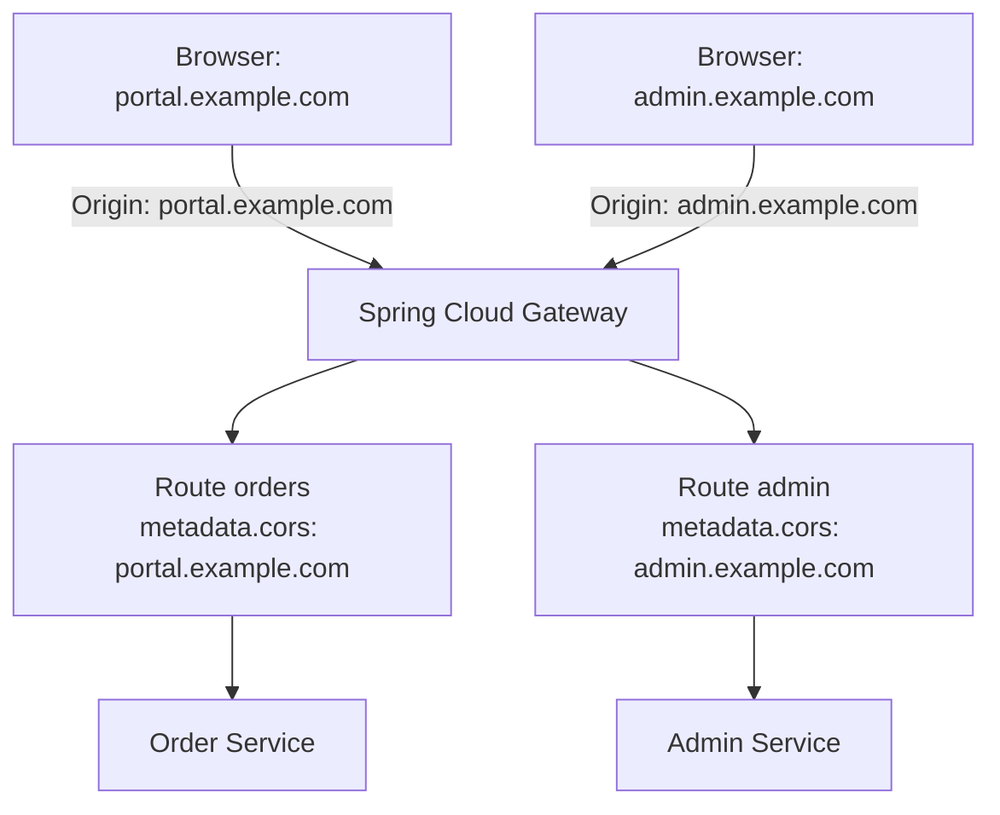
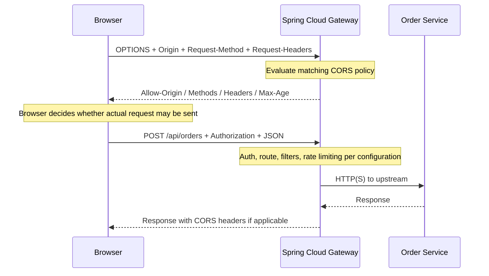

# Configuring CORS via per-route metadata

## Lesson objectives

In the **CORS** chapter, this lesson explains how to configure **Cross-Origin Resource Sharing** via **per-route metadata** in **Spring Cloud Gateway Server WebFlux**. This approach is useful when one API Gateway serves multiple microservices and each API group allows a different set of browser frontends, HTTP methods, and request headers.

After this lesson, you will be able to:

- Explain what an **origin** is, when browsers send an **`OPTIONS` preflight**, and which headers a CORS response needs.
- Configure `metadata.cors` directly on a route with `allowedOrigins`, `allowedMethods`, `allowedHeaders`, `exposedHeaders`, `allowCredentials`, and `maxAge`.
- Separate CORS policies across different routes rather than accidentally opening all origins across the entire Gateway.
- Understand the differences among **per-route CORS**, **global CORS**, **Spring Security WebFlux** CORS configuration, and backend-emitted headers.
- Diagnose cases where **`OPTIONS` fails to match a route** due to a `Method` predicate or is blocked by a security filter.
- Apply CORS to cookie/credential APIs without creating unsafe wildcard policies.
- Test with browsers, `curl`, and `WebTestClient`, while distinguishing CORS failures from TLS, authentication, routing, or upstream errors.

> Scope: **Spring Cloud Gateway Server WebFlux** using `RoutePredicateHandlerMapping`, `GlobalFilter`, `GatewayFilterChain`, and route configuration. YAML namespace names can vary across Spring Cloud Gateway/Spring Boot release lines; use the namespace matching your deployed dependencies. **CORS is a browser mechanism**, not a firewall, authentication, or backend authorization layer.

## 1. Why does an API Gateway need per-route CORS policies?

Suppose a system has the following origins and APIs:

| Component | Address | Purpose |
| --- | --- | --- |
| Customer website | `https://portal.example.com` | View orders |
| Admin website | `https://admin.example.com` | Manage accounts and system settings |
| API Gateway | `https://api.example.com` | Shared entry point |
| Order Service | `lb://order-service` | Handles `/api/orders/**` |
| Admin Service | `lb://admin-service` | Handles `/api/admin/**` |

Both websites call the Gateway, yet they should not have the same permission for JavaScript to read responses from every API:

```text
https://portal.example.com
    → https://api.example.com/api/orders/42
    → allowed per the orders route's CORS policy

https://portal.example.com
    → https://api.example.com/api/admin/users
    → not granted CORS access by the admin route

https://admin.example.com
    → https://api.example.com/api/admin/users
    → allowed per the admin route's CORS policy
```

With only a single global `allowedOrigins: '*'` configuration, the Gateway cannot separate these frontend needs. **Per-route CORS metadata** keeps the policy right next to the route ID, path predicate, upstream, and filters, making it easy for reviewers to see which origins are permitted per API.



This diagram illustrates **two sets of CORS rules**, not that each browser can only send requests to one route. CORS primarily determines **whether the browser lets JavaScript from that origin access the response**. The Gateway/backend still needs business authentication and authorization.

## 2. What is an origin?

An **origin** is defined by the triple:

```text
scheme + hostname + port
```

For example:

| Page address | Compared to `https://portal.example.com` |
| --- | --- |
| `https://portal.example.com` | Same origin |
| `http://portal.example.com` | Cross-origin due to scheme |
| `https://portal.example.com:8443` | Cross-origin due to port |
| `https://api.example.com` | Cross-origin due to hostname |
| `https://admin.example.com` | Cross-origin due to hostname |

Different paths on the same scheme/host/port do **not** create a different origin:

```text
https://portal.example.com/orders
https://portal.example.com/profile
```

these two addresses still share the same origin. When JavaScript loaded from `https://portal.example.com` calls `https://api.example.com`, it is a **cross-origin request** even though both hosts sit under `example.com`.

### 2.1. Same-Origin Policy and CORS

Browsers enforce the **Same-Origin Policy** to restrict a page from one origin from reading data at another origin. **CORS** is an HTTP-header-based protocol allowing servers to permit specific, explicitly defined cross-origin access.

Frontend example:

```javascript
const response = await fetch(
  "https://api.example.com/api/orders/42",
  { method: "GET", mode: "cors" }
);

const order = await response.json();
```

The browser inspects the CORS headers in the Gateway response before letting JavaScript read the data. A `curl` invocation, a backend HTTP client, or an attacker calling the API directly **is not constrained by browser CORS enforcement**. CORS can never serve as the sole defense for a sensitive API.

### 2.2. CORS is not CSRF protection, authentication, or authorization

- **CORS:** browser rules that allow or block JavaScript from reading cross-origin responses and govern preflight checks.
- **Authentication:** verifying who the caller is, such as validating a bearer token.
- **Authorization:** checking whether the caller has permission to access a specific route and data.
- **CSRF protection:** preventing unintended actions when the browser automatically attaches credentials like session cookies.
- **TLS:** encrypting and authenticating the HTTPS connection endpoint.

A cross-origin request may still be **sent to the server** even if JavaScript is blocked from reading the response, depending on the request/preflight type. Do not treat CORS as an absolute barrier against state-changing writes. For cookie-based apps, design dedicated CSRF and cookie policies.

## 3. How does the browser execute CORS requests?

### 3.1. Requests that do not need a preflight

Certain cross-origin requests satisfying **CORS-safelisted** criteria can be sent directly without an `OPTIONS` preflight. Illustrative example:

```http
GET /api/orders/42 HTTP/1.1
Host: api.example.com
Origin: https://portal.example.com
```

The Gateway may return:

```http
HTTP/1.1 200 OK
Access-Control-Allow-Origin: https://portal.example.com
Content-Type: application/json

{"id":42,"state":"created"}
```

`Access-Control-Allow-Origin` tells the browser which origin is allowed to read the response. Not every GET avoids preflight: adding a non-safelisted header such as `Authorization` can cause the browser to perform a preflight first.

### 3.2. Preflight OPTIONS

For a `POST` request sending JSON and `Authorization`, the browser typically sends an **`OPTIONS`** request first:

```http
OPTIONS /api/orders HTTP/1.1
Host: api.example.com
Origin: https://portal.example.com
Access-Control-Request-Method: POST
Access-Control-Request-Headers: authorization,content-type
```

If the route policy allows it, the preflight response may contain:

```http
HTTP/1.1 200 OK
Access-Control-Allow-Origin: https://portal.example.com
Access-Control-Allow-Methods: GET,POST
Access-Control-Allow-Headers: authorization,content-type
Access-Control-Allow-Credentials: true
Access-Control-Max-Age: 1800
```

The actual preflight status may be **200 or another appropriate success status**, depending on the framework and settings. Do not require tests to assert strictly 200 instead of verifying the semantics of the CORS response headers.

Once preflight succeeds, the browser sends the actual request:

```http
POST /api/orders HTTP/1.1
Host: api.example.com
Origin: https://portal.example.com
Authorization: Bearer <access-token>
Content-Type: application/json

{"itemId":"book-42","quantity":1}
```

In the Gateway, **preflight and the actual request are two separate HTTP requests**. Preflight should normally be answered at the CORS layer without forwarding a business request down to Order Service. The actual request still goes through authentication, routing, filters, load balancing, and the backend as usual.



**Key point:** `Access-Control-Request-Method: POST` only describes the method the browser **intends to use after preflight**. The HTTP method of the preflight request itself remains **`OPTIONS`**. This affects route `Method` predicates—see Section 7.

## 4. `cors` metadata on a route

Spring Cloud Gateway Server WebFlux supports declaring CORS **directly in route metadata**, under the `cors` key. With the traditional configuration namespace commonly seen:

```yaml
spring:
  cloud:
    gateway:
      routes:
        - id: orders
          uri: lb://order-service
          predicates:
            - Path=/api/orders/**
          metadata:
            cors:
              allowedOrigins:
                - https://portal.example.com
              allowedMethods:
                - GET
                - POST
              allowedHeaders:
                - Authorization
                - Content-Type
                - X-Request-Id
              exposedHeaders:
                - X-Correlation-Id
              allowCredentials: true
              maxAge: 1800
```

This is a **complete example for one route**: `orders` is matched by `Path`, and URI `lb://order-service` uses service discovery/load balancing when the appropriate dependencies and instance sources are configured. The CORS policy lives in `metadata.cors`, **not as a filter named `Cors` under `filters`**.

**Version note:** the `spring.cloud.gateway.routes` namespace applies to many earlier Server WebFlux releases; newer lines may use a separate namespace with `server.webflux`. Field names inside CORS may remain the same, but **never copy YAML prefixes across versions** without checking the docs and verifying the route actually loads.

### 4.1. Meaning of each field

| CORS metadata field | Example value | Effect |
| --- | --- | --- |
| `allowedOrigins` | `https://portal.example.com` | List of origins permitted to access responses via JavaScript |
| `allowedMethods` | `GET`, `POST` | HTTP methods permitted by the CORS policy |
| `allowedHeaders` | `Authorization`, `Content-Type` | Request headers the browser may ask to send during preflight |
| `exposedHeaders` | `X-Correlation-Id` | Response headers JavaScript is permitted to read beyond safelisted headers |
| `allowCredentials` | `true` | Enables credentialed CORS responses per browser rules |
| `maxAge` | `1800` | Preflight result cache duration in seconds; browsers may apply their own caps |
| `allowedOriginPatterns` | `https://*.trusted.example.com` | Optional origin pattern matching in Spring CORS; requires more caution than an exact allowlist |

Avoid broad `allowedOriginPatterns` simply because you have multiple subdomains: one compromised subdomain becomes an allowed origin. When the number of frontends is small and stable, **exact `allowedOrigins` is easier to audit**.

### 4.2. Distinguishing `allowedHeaders` from `exposedHeaders`

The two fields address **opposite directions**:

```text
Browser → Gateway:
  Authorization: Bearer ...
  Content-Type: application/json

Gateway → Browser:
  X-Correlation-Id: req-123
```

- `allowedHeaders` answers: **is the browser permitted to send that header in the actual cross-origin request?** The browser may ask beforehand via `Access-Control-Request-Headers`.
- `exposedHeaders` answers: **is JavaScript permitted to read that header from the response?** A response header can be present on the wire yet remain inaccessible to JavaScript if it is not safelisted and not exposed.

Frontend example:

```javascript
const response = await fetch(
  "https://api.example.com/api/orders/42",
  { headers: { Authorization: "Bearer <access-token>" } }
);

const requestId = response.headers.get("X-Correlation-Id");
```

If the response carries `X-Correlation-Id` but the policy does not expose it, `response.headers.get(...)` can return `null` in a CORS context. Conversely, adding `X-Correlation-Id` to `allowedHeaders` does not generate that header in the response.

### 4.3. Declaring CORS alone does not create business request/response headers

CORS metadata **does not add** `Authorization`, `X-Request-Id`, or `X-Correlation-Id` to business requests or responses. To generate correlation IDs, use a dedicated filter or observability instrumentation. To relay tokens, configure authentication and token relay properly. CORS only governs **browser access permissions by origin/method/header**; it does not implement the semantics of those headers.

## 5. Example of two routes with two different policies

Consider a Gateway with two APIs:

```yaml
spring:
  cloud:
    gateway:
      routes:
        - id: orders-api
          order: -10
          uri: lb://order-service
          predicates:
            - Path=/api/orders/**
          metadata:
            cors:
              allowedOrigins:
                - https://portal.example.com
              allowedMethods:
                - GET
                - POST
              allowedHeaders:
                - Authorization
                - Content-Type
                - X-Request-Id
              exposedHeaders:
                - X-Correlation-Id
              allowCredentials: true
              maxAge: 1800

        - id: admin-api
          order: -10
          uri: lb://admin-service
          predicates:
            - Path=/api/admin/**
          metadata:
            cors:
              allowedOrigins:
                - https://admin.example.com
              allowedMethods:
                - GET
                - PUT
                - DELETE
              allowedHeaders:
                - Authorization
                - Content-Type
              exposedHeaders:
                - X-Correlation-Id
              allowCredentials: true
              maxAge: 300
```

Sharing `order: -10` across both routes **causes no conflict in this example** because their path predicates do not overlap. If routes overlap, check route priority and route selection behavior as discussed in Section 9.

### 5.1. Expected behavior by origin and path

| Browser origin | Target API | Expected policy behavior in example |
| --- | --- | --- |
| `https://portal.example.com` | `/api/orders/42` | Allowed if method/headers match |
| `https://admin.example.com` | `/api/orders/42` | Not in `orders-api` allowed origins |
| `https://admin.example.com` | `/api/admin/users` | Allowed if method/headers match |
| `https://portal.example.com` | `/api/admin/users` | Not in `admin-api` allowed origins |
| `http://portal.example.com` | `/api/orders/42` | Mismatch because scheme is HTTP |
| `https://portal.example.com:8443` | `/api/orders/42` | Mismatch because port differs |
| `https://unknown.example.com` | Either route | Not in any declared origin set |

Even when `https://admin.example.com` is permitted by `admin-api` CORS, the backend still needs **admin authentication and authorization**. CORS only lets JavaScript access responses under defined conditions; it grants no account privileges.

### 5.2. Why might two routes have different `maxAge` values?

Preflight costs an `OPTIONS` round-trip. `Access-Control-Max-Age` lets the browser cache the result for a period to reduce repeated preflights.

- For a stable API, `maxAge: 1800` is an illustrative choice to reduce preflights.
- For an administrative API whose policy changes more often, `maxAge: 300` reduces how long browsers retain older results.

This is a **trade-off**, not a mandatory standard. Browsers may enforce their own upper limits, and changing a CORS policy does not immediately flush preflight caches in already-open browsers.

### 5.3. Per-route CORS supports separation of ownership

During configuration reviews, each route can specify:

1. **Owner:** the team responsible for the API and frontend domain.
2. **Trusted origins:** explicit list of approved HTTPS origins.
3. **Methods:** only the methods the frontend actually requires.
4. **Request headers:** only the headers required by the API.
5. **Response headers:** only expose headers needed by the UI.
6. **Credentials:** whether cookies/HTTP credentials are needed; avoid enabling if unnecessary.
7. **Testing:** preflight and actual requests with both allowed and disallowed origins.

Review any change to `metadata.cors` alongside route predicates and security policies so a new route does not inadvertently open access wider than an older one.

## 6. Credentials, wildcards, and `allowedOriginPatterns`

This group of settings is the most prone to vulnerabilities or browser errors.

### 6.1. Never combine credentials with `allowedOrigins: '*'`

**Improper** configuration:

```yaml
metadata:
  cors:
    allowedOrigins: '*'
    allowCredentials: true
```

In the credentialed CORS model, browsers reject `Access-Control-Allow-Origin: *` alongside `Access-Control-Allow-Credentials: true`. Spring Framework also validates wildcard origins when credentials are enabled; depending on version, conflicting settings may be rejected or fail.

Replace it with an explicit list of allowed origins:

```yaml
metadata:
  cors:
    allowedOrigins:
      - https://portal.example.com
      - https://admin.example.com
    allowCredentials: true
```

When the browser sends:

```http
Origin: https://portal.example.com
```

a successful CORS response should return **one** matching `Access-Control-Allow-Origin` value, for example:

```http
Access-Control-Allow-Origin: https://portal.example.com
Access-Control-Allow-Credentials: true
```

Never send a comma-separated list of multiple origins in `Access-Control-Allow-Origin`. When multiple origins are accepted, the CORS layer checks the request origin and returns the single matching one.

### 6.2. When should you use `allowedOriginPatterns`?

If an organization operates frontends across multiple **strictly controlled and clearly authorized** subdomains, Spring CORS supports patterns:

```yaml
metadata:
  cors:
    allowedOriginPatterns:
      - https://*.apps.example.com
    allowedMethods:
      - GET
    allowedHeaders:
      - Authorization
    allowCredentials: true
```

For an origin matching the pattern, the CORS response echoes back the **verified matching origin**, never literal `*` when credentials are enabled.

**Warnings:**

- Only use patterns when every subdomain in that scope is genuinely trusted; wildcards are risky if tenants, users, or partners can provision subdomains.
- Check scheme and port carefully; an HTTP origin is not equivalent to HTTPS.
- Never use patterns as a substitute for user authentication or tenant authorization.
- Test against similar-looking unauthorized origins, deceptive suffix domains, and externally controlled hosts.
- When the origin list is finite, an explicit allowlist remains easier to audit.

### 6.3. Cross-origin cookies and CSRF

In a cookie-based frontend:

```javascript
const response = await fetch(
  "https://api.example.com/api/orders/42",
  {
    method: "GET",
    mode: "cors",
    credentials: "include"
  }
);
```

`credentials: "include"` signals the browser's intent to send/receive credentials per its policy. When a CORS request includes credentials, the server must return matching CORS headers; enabling `allowCredentials: true` alone **does not automatically cause cookies to be sent**.

For **cross-site cookies**, modern browser environments often require attributes such as `SameSite=None; Secure`; third-party cookie restrictions in the browser may still block cookies. Do not conflate **cross-origin** and **cross-site**: they follow different definitions.

**CORS is not a CSRF defense.** An app using cookie authentication must evaluate CSRF protection, idempotency, `SameSite`, trusted request sources, and authorization independently. `allowCredentials: true` is only a CORS setting, not a security switch.

## 7. Key pitfall: preflight is `OPTIONS`, not the target method

Suppose a route is declared as:

```yaml
spring:
  cloud:
    gateway:
      routes:
        - id: reports-read
          uri: lb://report-service
          predicates:
            - Path=/api/reports/**
            - Method=GET
          metadata:
            cors:
              allowedOrigins:
                - https://portal.example.com
              allowedMethods:
                - GET
              allowedHeaders:
                - Authorization
```

The browser wants to call:

```http
GET /api/reports/42 HTTP/1.1
Origin: https://portal.example.com
Authorization: Bearer <token>
```

Because `Authorization` is not a safelisted request header, the browser may send a preflight:

```http
OPTIONS /api/reports/42 HTTP/1.1
Origin: https://portal.example.com
Access-Control-Request-Method: GET
Access-Control-Request-Headers: authorization
```

During route matching, the **`Method=GET`** predicate sees the preflight's HTTP method **`OPTIONS`** and may **fail to match the route**. Consequently, the Gateway cannot select the route to apply the CORS policy inside `reports-read`'s `metadata.cors`.

This is why some apps have GET routes that work from `curl` while browsers repeatedly report **preflight failures**.

### 7.1. Intentional solutions

Options depend on your architecture:

1. **Adjust the route predicate** if widening method matching fits the API design; keep in mind this also changes matching for actual requests, not just preflight.
2. **Use a path-scoped global CORS policy** so `OPTIONS` requests that miss routes can still be handled by the CORS handler.
3. **Handle CORS at ingress/WebFlux Security** ahead of route matching under a unified policy, if the system designates a single CORS owner at that layer.

Do not simply add `OPTIONS` to a backend handler and assume that is enough: the browser can be rejected **before the Gateway even routes to the backend**.

### 7.2. `globalcors.add-to-simple-url-handler-mapping`

In Gateway Server WebFlux lines that support global CORS configuration, the property:

```yaml
spring:
  cloud:
    gateway:
      globalcors:
        add-to-simple-url-handler-mapping: true
```

allows applying **global CORS configuration** to requests that do not match a Gateway route predicate, such as `OPTIONS` preflight when a route only matches `GET`. However, **enabling the flag alone does not create a complete CORS policy**; you must also configure `globalcors.cors-configurations` and test it.

Example of **path-scoped** global CORS:

```yaml
spring:
  cloud:
    gateway:
      globalcors:
        add-to-simple-url-handler-mapping: true
        cors-configurations:
          '[/api/reports/**]':
            allowedOrigins:
              - https://portal.example.com
            allowedMethods:
              - GET
            allowedHeaders:
              - Authorization
            maxAge: 300
```

This is an **additional path-level policy**, no longer solely metadata on one route. Ensure global CORS for `/api/reports/**` **does not conflict** with `metadata.cors` on routes serving that path. When multiple routes share a path yet require different origins by `Host`, tenant, or auth policy, an overly broad global CORS path pattern can accidentally grant read access to unintended origins.

If the system already has a `CorsWebFilter` or ingress CORS policy, establish **exactly one primary owner** or a tested coordination scheme; never stack policies haphazardly.

## 8. Route metadata CORS, global CORS, Spring Security, and the backend

These CORS configuration sources have **different scopes**:

| Where configured | Effective scope | Advantages | What to watch out for |
| --- | --- | --- | --- |
| **Route `metadata.cors`** | Matched route and its metadata | Policy lives next to the route; easy per-API review | `OPTIONS` preflight may miss the predicate |
| **Gateway `globalcors`** | Globally configured paths | Covers routes sharing one policy or unmatched `OPTIONS` | Overly broad scope; conflicts with route-specific policies |
| **Spring Security WebFlux CORS** | Security web filter chain | CORS can run before authentication checks in security layer | Can conflict/duplicate with Gateway CORS if unaligned |
| **Ingress/reverse proxy** | Edge in front of Gateway | Single place to handle preflight ahead of application | Can mask or conflict with downstream policies |
| **Backend microservice** | Individual backend service | Useful if clients call backend directly | Going through Gateway can produce duplicate CORS headers |

### 8.1. Where does Spring Security run?

In **Spring Security WebFlux**, security is structured via `SecurityWebFilterChain`. These WebFilters can run **before Spring Cloud Gateway route matching**, rather than sharing one ordered list with all `GatewayFilter` instances.

If security requires a bearer token on all requests without properly handling CORS preflight, browser `OPTIONS` requests typically **lack the actual request's bearer token**, yielding `401/403` before per-route CORS policy is ever applied.

Best practices:

- Permit or handle **valid preflights** at the chosen CORS/security layer prior to actual-request authentication constraints.
- Keep authentication and authorization strictly enforced on **actual HTTP requests**; never use preflight as an auth bypass.
- Test both preflight without `Authorization` and actual requests with/without `Authorization`.
- Do not assume enabling a generic Security CORS setup automatically reads every Gateway `metadata.cors` entry; the two systems must be wired to cooperate properly.

### 8.2. Avoiding duplicate `Access-Control-Allow-Origin`

If the backend returns:

```http
Access-Control-Allow-Origin: *
```

while the Gateway also applies route metadata to return:

```http
Access-Control-Allow-Origin: https://portal.example.com
Access-Control-Allow-Credentials: true
```

the final response may contain **two `Access-Control-Allow-Origin` values** or conflicting directives. Browsers generally reject responses with invalid duplicate values, even when one of the origins matches.

Spring Cloud Gateway provides the `DedupeResponseHeader` GatewayFilter Factory to strip duplicate header values, for example:

```yaml
filters:
  - DedupeResponseHeader=Access-Control-Allow-Credentials Access-Control-Allow-Origin
```

However, **deduplication only fixes duplicate headers**; it does not answer "which layer's policy is right?". If one layer emits `*` and another emits a specific origin, which value gets retained can affect security and correctness. The better approach is to **designate a single CORS owner** (usually the Gateway or ingress at the public API edge) and prevent backends from emitting conflicting CORS headers.

### 8.3. The `Vary` header and caching

When CORS responses depend on `Origin`, `Access-Control-Request-Method`, or `Access-Control-Request-Headers`, caches may need corresponding `Vary` headers so a response cached for origin A is not served mistakenly to origin B. Spring's CORS handler can add appropriate `Vary` values, though you should inspect output across the full proxy/CDN chain.

**Never mis-cache credentialed data**: CORS does not replace `Cache-Control`, cache keys, cookie handling, or reverse proxy security constraints. When changing an origin policy, preflight caches and CDN/browser caches may not expire immediately.

## 9. Metadata CORS depends on which route is selected

A Gateway might define routes like:

```yaml
routes:
  - id: api-generic
    order: -20
    uri: lb://generic-service
    predicates:
      - Path=/api/**
    metadata:
      cors:
        allowedOrigins:
          - https://generic.example.com

  - id: orders
    order: 0
    uri: lb://order-service
    predicates:
      - Path=/api/orders/**
    metadata:
      cors:
        allowedOrigins:
          - https://portal.example.com
```

For `/api/orders/42`, route `api-generic` may match first due to its **lower order**, so `orders`'s policy may not apply as the designer expected. Never assume a route with a "more specific" path automatically wins.

Make sure to:

1. Verify the actual **route ID** selected based on predicates and `order`.
2. Place more specific routes ahead of broader routes whenever routes intentionally overlap.
3. Avoid generic wildcard routes that obscure CORS policies of sensitive services.
4. Test preflight and actual requests on the **same path** across multiple origins and HTTP methods.
5. Observe the difference between **no route matched** and **CORS rejected**, since error handling differs.

In Spring Cloud Gateway Server WebFlux, the matched route can be stored in the exchange attribute `GATEWAY_ROUTE_ATTR`. Route metadata is **routing** information, not proof that a request is authenticated. A correctly matched route can still be rejected by a security filter, rate limiter, or backend.

## 10. Security when building per-route CORS

### 10.1. Never reflect arbitrary Origins blindly

Some custom CORS filters take the incoming header:

```text
Origin: https://untrusted.example
```

and blindly write back:

```text
Access-Control-Allow-Origin: https://untrusted.example
Access-Control-Allow-Credentials: true
```

**without checking an allowlist**. This lets any origin read credentialed responses when other conditions hold, risking data leakage. Never echo `Origin` unless validated against a trusted policy.

### 10.2. Never use CORS as authorization

A browser denied by CORS cannot read the response from JavaScript, yet the API can still be called from `curl`, server-side HTTP clients, or non-browser environments. Moreover, safelisted requests can reach the server before the browser blocks reading the response.

Therefore:

- Admin routes must still enforce Spring Security/OAuth2/JWT/mTLS or an appropriate authentication mechanism.
- Backends must still verify permissions on specific resources.
- `Host`/`Origin`/`Referer` do not constitute trusted identity.
- Cookies, CSRF, token audience/scopes, and trust boundaries must be designed independently.
- Never place secrets, session tokens, or personal data in CORS response headers or access logs.

### 10.3. Precise, least-privilege configuration

| Decision | Recommendation |
| --- | --- |
| Origin | Exact HTTPS allowlist whenever possible |
| Methods | Only `GET`, `POST`, `PUT`, etc. genuinely needed by the frontend |
| Request headers | Only permitted headers; review `Authorization` carefully |
| Exposed headers | Only headers the frontend must read; never expose tokens/cookies casually |
| Credentials | Enable only if actually used and backed by cookie/CSRF policies |
| Patterns | Avoid broad subdomain wildcards, especially where tenants can create hosts |
| Preflight cache | `maxAge` balancing performance with policy agility |
| Ownership | One primary CORS owner to avoid Gateway/backend/ingress conflicts |

Never fix a browser error by changing `allowedOrigins` from a specific host to `*` across the whole Gateway when sensitive data is involved.

### 10.4. CORS and other Gateway features

CORS only governs **browser ability to send/read cross-origin requests**; it does not on its own:

- Select instances for `lb://` URIs or check service discovery.
- Rewrite paths via `RewritePath`/`StripPrefix`.
- Relay bearer tokens or establish authenticated identity.
- Enforce per-resource authorization, rate limits, circuit breakers, or retries.
- Enable TLS on inbound/outbound connections.
- Generate standardized trace IDs or correlation IDs.

Preflights answered at the CORS layer may **skip the rest of the `GatewayFilter` chain and backend**, so do not expect route/backend metrics to equal the `OPTIONS` count seen at ingress. Observe preflights, actual requests, and outbound attempts at their respective layers.

## 11. Testing per-route CORS metadata with `curl`

Browsers are the party that **enforces** CORS. Still, `curl` is very helpful for inspecting the **response headers** returned by the Gateway. It **does not block** responses on CORS policy like a browser does.

Assume the Gateway runs at `https://api.example.com` with the `orders-api` route from Section 5.

### 11.1. Valid preflight

```bash
curl -i -X OPTIONS \
  'https://api.example.com/api/orders' \
  -H 'Origin: https://portal.example.com' \
  -H 'Access-Control-Request-Method: POST' \
  -H 'Access-Control-Request-Headers: authorization,content-type'
```

Verify the response carries appropriate headers, for example:

```http
Access-Control-Allow-Origin: https://portal.example.com
Access-Control-Allow-Methods: GET,POST
Access-Control-Allow-Headers: authorization,content-type
Access-Control-Allow-Credentials: true
Access-Control-Max-Age: 1800
```

**Header list ordering, casing, and whitespace do not have to match the example verbatim.** What matters is that the browser receives the exact permissions required by policy, without a wildcard origin when credentials are enabled, and without duplicate/conflicting headers.

### 11.2. Preflight from a disallowed origin

```bash
curl -i -X OPTIONS \
  'https://api.example.com/api/orders' \
  -H 'Origin: https://untrusted.example' \
  -H 'Access-Control-Request-Method: POST' \
  -H 'Access-Control-Request-Headers: authorization,content-type'
```

Expectation: **no successful CORS grant for that origin**. The Gateway/framework may return `403 Invalid CORS request` or another response depending on where it is handled; do not tie checks strictly to a single fixed status. The critical condition is that the browser never receives an `Access-Control-Allow-Origin` accepting the untrusted origin.

### 11.3. Disallowed method or header

```bash
# DELETE method is not in orders-api allowedMethods:
curl -i -X OPTIONS \
  'https://api.example.com/api/orders/42' \
  -H 'Origin: https://portal.example.com' \
  -H 'Access-Control-Request-Method: DELETE'

# X-Admin-Override header is not in allowedHeaders:
curl -i -X OPTIONS \
  'https://api.example.com/api/orders/42' \
  -H 'Origin: https://portal.example.com' \
  -H 'Access-Control-Request-Method: GET' \
  -H 'Access-Control-Request-Headers: x-admin-override'
```

Both cases must **not be granted by preflight** under the policy. If an unexpected response comes back, check whether a global CORS policy or ingress is granting broader access than the route metadata.

### 11.4. Actual request with `Origin`

```bash
curl -i \
  'https://api.example.com/api/orders/42' \
  -H 'Origin: https://portal.example.com' \
  -H 'Authorization: Bearer <test-token>'
```

An actual request can return 401 for an invalid token, 404 if the route/backend lacks the record, or 503 if the upstream is unavailable. **Distinguish these HTTP errors from CORS.** When errors occur before route metadata is processed, the response may omit CORS headers, causing the browser to display a CORS message instead of the underlying error details.

Never use `curl -k` to bypass TLS verification as a default test habit. CA/SAN errors are HTTPS issues, not CORS configuration issues.

## 12. Automated testing with `WebTestClient`

In an integration test that boots the Gateway and test backends, you can simulate a preflight:

```java
import org.junit.jupiter.api.Test;
import org.springframework.beans.factory.annotation.Autowired;
import org.springframework.http.HttpHeaders;
import org.springframework.test.web.reactive.server.WebTestClient;

class CorsRouteIntegrationTest {

    @Autowired
    WebTestClient webTestClient;

    @Test
    void allowsPortalToPostOrders() {
        webTestClient.options()
            .uri("/api/orders")
            .header(HttpHeaders.ORIGIN, "https://portal.example.com")
            .header(HttpHeaders.ACCESS_CONTROL_REQUEST_METHOD, "POST")
            .header(
                HttpHeaders.ACCESS_CONTROL_REQUEST_HEADERS,
                "authorization,content-type"
            )
            .exchange()
            .expectStatus().is2xxSuccessful()
            .expectHeader().valueEquals(
                HttpHeaders.ACCESS_CONTROL_ALLOW_ORIGIN,
                "https://portal.example.com"
            )
            .expectHeader().valueEquals(
                HttpHeaders.ACCESS_CONTROL_ALLOW_CREDENTIALS,
                "true"
            )
            .expectHeader().exists(
                HttpHeaders.ACCESS_CONTROL_ALLOW_METHODS
            );
    }

    @Test
    void doesNotAllowUntrustedOrigin() {
        webTestClient.options()
            .uri("/api/orders")
            .header(HttpHeaders.ORIGIN, "https://untrusted.example")
            .header(HttpHeaders.ACCESS_CONTROL_REQUEST_METHOD, "POST")
            .exchange()
            .expectHeader().doesNotExist(
                HttpHeaders.ACCESS_CONTROL_ALLOW_ORIGIN
            );
    }
}
```

This is an **illustrative test skeleton**; it will not run standalone without the required annotations, dependencies, and application context. For example, the test class must boot the Gateway application in a test runtime, inject `WebTestClient` appropriately, and provide backend stubs when testing actual requests.

Also test backend responses that already include `Access-Control-Allow-Origin` to catch duplicate headers, as well as cases where `SecurityWebFilterChain` rejects the actual request. A unit test merely checking that YAML contains `cors` does not prove the policy is applied properly.

### 12.1. Testing in a real browser

In browser DevTools → Network:

1. Open the website at `https://portal.example.com`.
2. Issue a `fetch` to `https://api.example.com/api/orders/42`.
3. If preflight runs, find the **`OPTIONS`** request and inspect `Origin`, `Access-Control-Request-Method`, `Access-Control-Request-Headers`, and the response.
4. Verify whether the actual request is sent; if so, check whether auth, routing, or the backend rejected it.
5. Inspect response headers and try reading `X-Correlation-Id` via `response.headers.get(...)` once exposed.
6. Retest with disallowed origins, with and without credentials, and under realistic cookie policies.

A console message like "blocked by CORS policy" can **mask an upstream or auth failure** because the browser prevents JS from accessing the response. Do not assume every such message is caused by a missing `allowedOrigins` entry; inspect the Network tab, ingress/security logs, and response headers.

## 13. Pre-production test matrix

| Case | Origin / request | What to verify |
| --- | --- | --- |
| Allowed origin | Portal → orders | Appropriate CORS headers present |
| Disallowed origin | Untrusted → orders | No CORS permission granted |
| Route-specific separation | Portal → admin | Not accidentally opened by orders policy |
| Different scheme | `http://portal.example.com` | Does not match HTTPS origin |
| Different port | `https://portal.example.com:8443` | Does not match unless explicitly allowlisted |
| Preflight GET | OPTIONS + `Request-Method: GET` | Handled when route/policy allows |
| Preflight POST JSON | OPTIONS + POST + `content-type` | Handled per allowedMethods/Headers |
| Disallowed method | OPTIONS + DELETE | Rejected in preflight on orders |
| Disallowed header | OPTIONS + `x-admin-override` | Rejected in preflight |
| Cookie request | `credentials: include` | Exact Allow-Origin, matching Allow-Credentials; separate cookie/CSRF checks |
| Exposed header | JS reads `X-Correlation-Id` | Readable when server emits header and policy exposes it |
| `Method=GET` predicate | OPTIONS for GET with Authorization | Not dropped due to route mismatch |
| Security blocks OPTIONS | Preflight without token | Valid CORS handling path before actual auth |
| Backend also emits CORS | Gateway + upstream | No duplicate or conflicting CORS headers |
| Overlapping routes | `/api/orders/**` and `/api/**` | Correct route ID/policy per `order` |
| 401/403 response | Invalid token | Actual auth still denied; CORS headers follow defined policy |
| 5xx response | Backend unavailable | Backend error not mistaken for an Origin error |
| Cache | Multiple origins accessing sequentially | Proper `Vary`/cache key; no mis-cached credentialed content |
| TLS | Valid/invalid HTTPS | Never use CORS to "fix" certificate errors |

### 13.1. Observability data to collect

For Spring Cloud Gateway, record:

- Normalized **Route ID**, method, HTTP status, latency, and error type.
- `OPTIONS` preflight counts per API group where needed, kept separate from actual requests or backend attempts.
- Security denials from `SecurityWebFilterChain`, CORS validation rejections, and upstream errors at their respective layers.
- Trace ID/correlation ID from configured observability tooling; avoid logging raw `Origin`, cookies, or `Authorization` by default.

Note that `Origin` can be forged arbitrarily by clients; placing it directly in metric labels causes **high cardinality**. For logs, consider recording **allowed/denied** outcomes and stable policy/route names rather than every raw origin.

## 14. Troubleshooting common CORS errors

### Scenario A — Preflight returns 404 even though the GET route exists

**Symptom:** `curl GET /api/reports/42` matches the route, yet the browser sends `OPTIONS` and fails.

**Possible cause:** the route has `Method=GET`, so `OPTIONS` fails to match and `metadata.cors` is never applied.

**Resolution:** inspect actual predicates and configure preflight handling in `globalcors`/edge/security with a suitably narrow path; do not only change the backend handler.

### Scenario B — OPTIONS returns 401/403

**Symptom:** the browser never sends the actual request; only preflight is rejected.

**Possible cause:** Spring Security or ingress checks authentication before CORS processes preflight, even though standard `OPTIONS` carries no actual-request bearer token.

**Resolution:** configure a valid preflight path and align `SecurityWebFilterChain` with the CORS owner; keep authentication mandatory for actual requests.

### Scenario C — Browser reports wildcard and credentials are incompatible

**Symptom:** browser reports wildcard origin cannot be used in credential mode.

**Cause:** `allowedOrigins: '*'` paired with `allowCredentials: true`, or ingress/backend overrides the policy.

**Resolution:** use exact allowed origins, check the final `Access-Control-Allow-Origin`, and eliminate duplicate headers.

### Scenario D — Duplicate `Access-Control-Allow-Origin`

**Symptom:** response contains two origin values or `*, https://portal.example.com`.

**Cause:** Gateway and backend/ingress/Spring Security both add CORS headers.

**Resolution:** designate one CORS policy owner and remove overlapping configurations; use `DedupeResponseHeader` only when you understand which value is retained and have tested safely.

### Scenario E — JS cannot read `X-Correlation-Id`

**Symptom:** DevTools shows the response header, yet `response.headers.get("X-Correlation-Id")` returns `null`.

**Cause:** the header is not listed in `exposedHeaders` or the response came from another path lacking proper CORS headers.

**Resolution:** confirm the backend/Gateway actually emits the header and `exposedHeaders` metadata is set on the right route.

### Scenario F — CORS succeeds yet the API returns 403

**Symptom:** origin is allowed, preflight passes, and the actual request returns 403.

**Cause:** authentication/authorization policy, CSRF, or backend denial. Valid CORS **does not grant resource permissions**.

**Resolution:** inspect Spring Security scopes, cookies, CSRF tokens, user roles, and backend logs; do not widen `allowedOrigins` needlessly.

### Scenario G — Fails only in certain environments

**Symptom:** dev `localhost:3000` works, staging `https://staging.portal.example.com` fails.

**Possible cause:** different scheme/host/port in origin, version configuration namespace mismatch, ingress headers, route order, or policy caching.

**Resolution:** list exact origins per environment, test with real browser/SNI HTTPS, and compare CORS response headers. Never enable `*` in production as a quick workaround.

## 15. Practice exercise with answers

Suppose the Gateway defines:

```yaml
routes:
  - id: payments-read
    uri: lb://payment-service
    predicates:
      - Path=/api/payments/**
      - Method=GET
    metadata:
      cors:
        allowedOrigins:
          - https://billing.example.com
        allowedMethods:
          - GET
        allowedHeaders:
          - Authorization
        exposedHeaders:
          - X-Correlation-Id
        allowCredentials: true
        maxAge: 600
```

Predict what happens in these scenarios:

1. JavaScript at `https://billing.example.com` sends a GET with `Authorization`. Which request might the browser send before the actual GET?
2. Why might `Method=GET` prevent `metadata.cors` from applying to preflight?
3. Will JavaScript at `https://portal.example.com` calling the same API receive CORS permission?
4. Will a client calling the API with `curl` from an external server be blocked by browser CORS?
5. Does `allowCredentials: true` replace JWT/scopes and CSRF protection?
6. If `allowedOrigins` is changed to `'*'` while keeping `allowCredentials: true`, what goes wrong?
7. If the backend sends `Access-Control-Allow-Origin: *` while the Gateway sends a specific origin, what must be checked?
8. Does `exposedHeaders` automatically create `X-Correlation-Id`?
9. If the system uses `globalcors` as a fallback for OPTIONS, how do you avoid granting a wider policy than the payments route?

**Suggested answers:**

1. The browser may send an **`OPTIONS` preflight** with `Origin`, `Access-Control-Request-Method: GET`, and `Access-Control-Request-Headers: authorization`.
2. Because the **preflight's method is OPTIONS**, whereas `Method=GET` only matches actual GETs. You need an appropriate preflight handling path, such as path-scoped global CORS or designed security/ingress-layer CORS.
3. **No**, because `https://portal.example.com` is not in the route's `allowedOrigins`.
4. **Not in the browser CORS sense**; `curl` does not enforce the Same-Origin Policy. The API still needs authentication/authorization and other controls.
5. **No.** Credentialed CORS neither authenticates the caller nor protects against CSRF.
6. **Invalid configuration** for credentialed CORS. Use explicit origins or a tightly controlled pattern supported by the framework.
7. Check whether the final response has duplicate or conflicting CORS headers; prefer unifying policy ownership rather than relying on arbitrary deduplication.
8. **No.** It only permits JS to read the header when the header actually exists on the response.
9. Scope the global configuration to a sufficiently narrow path matching the route's policy, and test both rejected origins and overlapping routes.

## Deployment checklist

Before publishing a route with `metadata.cors`, verify:

- [ ] **Exact frontend origins** are listed per dev/staging/production, with accurate scheme and port.
- [ ] `allowedMethods`, `allowedHeaders`, and `exposedHeaders` are scoped strictly to the API contract.
- [ ] If `allowCredentials: true`, `allowedOrigins: '*'` is never used; cookies/CSRF are designed independently.
- [ ] `OPTIONS` preflight is handled even when routes use a `Method` predicate.
- [ ] Spring Security does not unintentionally block preflights before CORS; actual requests remain authenticated and authorized.
- [ ] CORS across Gateway, backend, and ingress has no duplicates or conflicts.
- [ ] Route `order` and overlapping path/`Host` predicates are verified.
- [ ] Error responses 401/403/5xx are also tested from a browser.
- [ ] Caching, `Vary`, and preflight `maxAge` are configured appropriately; sensitive data is never cached for the wrong origin.
- [ ] Integration tests cover allowed/disallowed origins, methods, headers, and credentials.
- [ ] Logs/metrics never capture raw tokens, cookies, or unbounded-cardinality origins.
- [ ] YAML namespace and runtime behavior are verified on the actual Spring Cloud Gateway version.

## Summary

**Per-route metadata CORS** lets Spring Cloud Gateway Server WebFlux define **origins, methods, request headers, exposed response headers, credentials, and preflight caching** right alongside each route:

```yaml
metadata:
  cors:
    allowedOrigins:
      - https://portal.example.com
    allowedMethods:
      - GET
      - POST
    allowedHeaders:
      - Authorization
      - Content-Type
    allowCredentials: true
    maxAge: 1800
```

The three most important rules are: **(1)** route metadata only helps when routing/preflight are handled properly—pay special attention to `OPTIONS` and `Method` predicates; **(2)** CORS across Gateway, Security, ingress, and backends must be unified so no conflicting headers appear; and **(3)** CORS **does not replace** authentication, authorization, CSRF protection, TLS, or resilience policies. Testing both preflight and actual requests in the browser and at the Gateway gives your microservices a clear, scoped, and safe cross-origin sharing policy.
