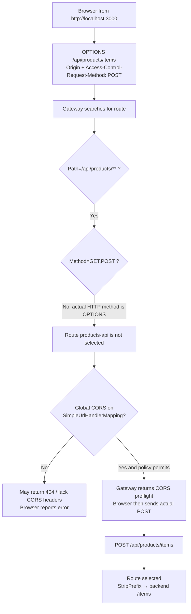
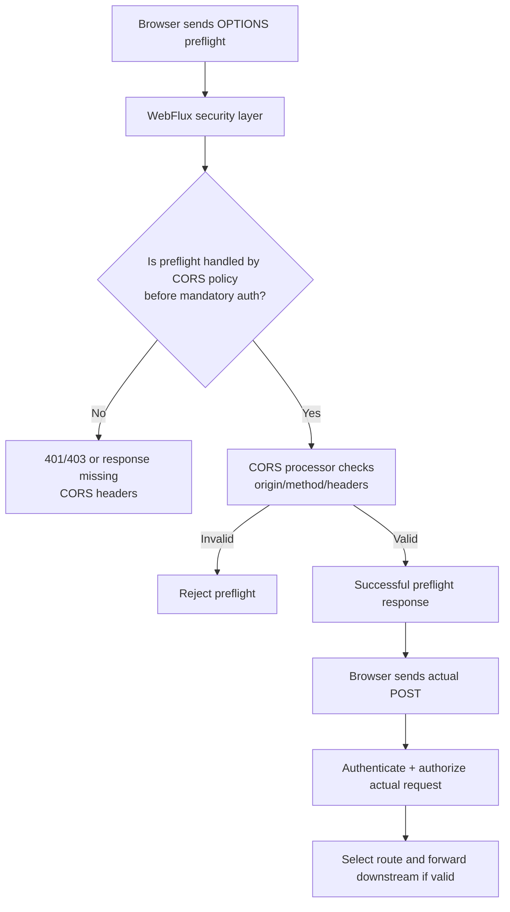
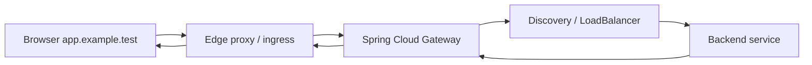

# Preflight not matching route predicates and Simple URL Handler Mapping

**Chapter:** CORS  
**Module:** `SPRING_CLOUD_GATEWAY` — Spring Cloud Gateway

In a microservices architecture, a web application at `http://localhost:3000` may call an API through **Spring Cloud Gateway** at `http://localhost:8080`, while the Gateway forwards requests to a backend at `http://localhost:8081`. The API request may already have `Path`, `Method`, header/body processing filters, load balancing, authentication, rate limiting, circuit breakers, and retries configured. Even so, the browser still reports a **CORS error** before the business request ever reaches the backend. A common cause is that the browser sends a **CORS preflight `OPTIONS`** while the route only matches `GET`/`POST`, so the Gateway does not select the route to apply the CORS configuration attached to that route.

This lesson explains the mechanics of **preflight not matching a route predicate**, the roles of `RoutePredicateHandlerMapping` and `SimpleUrlHandlerMapping` in **Spring Cloud Gateway Server WebFlux**, and the configuration property:

```properties
spring.cloud.gateway.server.webflux.globalcors.add-to-simple-url-handler-mapping=true
```

We will stand up a small HTTP backend, declare a route with `Method=GET,POST`, send preflight requests with `curl`, enable the additional handler mapping, and verify the response. From there, we distinguish CORS issues from 404, 401/403, downstream errors, TLS, and actual security policies.

> **Scope:** Primary examples target **Spring Cloud Gateway Server WebFlux** using the configuration prefix of modern Spring Cloud lines (e.g., Spring Cloud 2025.0+/Gateway Server WebFlux 4.3+). In many older releases, the prefix is `spring.cloud.gateway.globalcors.*` and `spring.cloud.gateway.routes`. Server Web MVC and Proxy Exchange have different pipelines and configuration points; do not copy WebFlux's `SimpleUrlHandlerMapping` mechanism to other flavors without checking version documentation.

## 1. Learning objectives

After completing this lesson, you will be able to:

1. Distinguish **same-origin**, **cross-origin**, **simple CORS requests**, and **preflight requests**.
2. Explain why `OPTIONS /api/products/items/42` may fail to match a `Path=/api/products/**` plus `Method=GET,POST` route.
3. Understand the difference between **route matching** and **CORS processing**, especially the `SimpleUrlHandlerMapping` path.
4. Write `globalcors.cors-configurations` alongside `add-to-simple-url-handler-mapping: true`.
5. Inspect `Access-Control-Allow-Origin`, `Access-Control-Allow-Methods`, `Access-Control-Allow-Headers`, `Access-Control-Max-Age`, and behavior on actual responses.
6. Distinguish CORS policy errors from Spring Security, backend, gateway filters, reverse proxies, or TLS configuration.
7. Design safe origin/method/header allowlists without using CORS in place of authentication and authorization.

## 2. What is CORS and when does the browser send a preflight?

An **Origin** is defined by **scheme + hostname + port**. Two URLs are considered same-origin only when all three components match:

| Frontend | API Gateway | Relationship |
|---|---|---|
| `http://localhost:3000` | `http://localhost:3000` | Same origin |
| `http://localhost:3000` | `http://localhost:8080` | Cross-origin due to port |
| `http://example.test` | `https://example.test` | Cross-origin due to scheme |
| `https://app.example.test` | `https://api.example.test` | Cross-origin due to hostname |
| `https://app.example.test` | Backend `http://localhost:8081` that the **browser does not call directly** | Browser checks the origin of the URL it calls (Gateway), not the downstream URI |

CORS (*Cross-Origin Resource Sharing*) is the browser-enforced mechanism applied when JavaScript on one origin attempts to read resources from another origin. The server returns HTTP response headers indicating which origins, methods, and request headers are allowed. **CORS is not an authentication system**; `curl`, backend-to-backend HTTP clients, and many non-browser apps do not enforce browser CORS policies.

### 2.1. Preflight vs. actual request

The browser may need to send an `OPTIONS` request to ask ahead of time:

```http
OPTIONS /api/products/items HTTP/1.1
Host: localhost:8080
Origin: http://localhost:3000
Access-Control-Request-Method: POST
Access-Control-Request-Headers: content-type,x-client-id
```

Three key headers:

- `Origin`: origin of the page making the request.
- `Access-Control-Request-Method`: **method of the intended actual request**, `POST` in this example.
- `Access-Control-Request-Headers`: names of request headers the actual request wants to send, such as `content-type` and `x-client-id`.

Preflight asks the Gateway whether a `POST` request from `http://localhost:3000` is permitted to carry those headers. If accepted, the Gateway may respond similarly to:

```http
HTTP/1.1 200 OK
Access-Control-Allow-Origin: http://localhost:3000
Access-Control-Allow-Methods: GET,POST
Access-Control-Allow-Headers: content-type,x-client-id
Access-Control-Max-Age: 600
Vary: Origin
```

This is an **illustrative response**: the success HTTP status may vary (e.g., `200` or `204`), and formatting/values/`Vary` headers depend on runtime and configuration. Do not define CORS success by one exact status string. What matters to the browser are valid CORS response headers matching its request and rules.

Once preflight is permitted, the browser can send the **actual request**:

```http
POST /api/products/items HTTP/1.1
Host: localhost:8080
Origin: http://localhost:3000
Content-Type: application/json
X-Client-Id: lab-browser

{"sku":"SKU-42","quantity":1}
```

The **actual request's** response must still carry appropriate CORS headers (especially `Access-Control-Allow-Origin`) for the browser to let JavaScript read the result.

### 2.2. Not every cross-origin request triggers a preflight

Requests meeting "CORS-safelisted" conditions can be sent directly by the browser (such as a plain `GET` with permitted headers). Conversely, cases that usually trigger a browser preflight include:

- `PUT`, `PATCH`, `DELETE`, or methods outside the safelisted set;
- `POST` with `Content-Type: application/json`;
- Requests with custom headers such as `X-Client-Id`;
- `Authorization` or non-safelisted request headers.

**Do not confuse:** preflight is an **`OPTIONS` request actually sent over the network**; `Access-Control-Request-Method: POST` only describes the method the browser wants to use afterward. A `Method=POST` route predicate checks the HTTP method of the current request—meaning `OPTIONS` during the preflight phase—rather than converting it into POST.

### 2.3. Valid preflight vs. generic OPTIONS

An `OPTIONS` request **without** `Origin` and `Access-Control-Request-Method` is usually not a CORS preflight. Spring's CORS processor checks the expected header set; do not assume enabling CORS configuration causes **every** arbitrary `OPTIONS` request to return the same status/headers.

## 3. Why does preflight fail to match a route predicate?

Consider an illustrative route:

```yaml
- id: products-api
  uri: http://localhost:8081
  predicates:
    - Path=/api/products/**
    - Method=GET,POST
  filters:
    - StripPrefix=2
```

A `POST /api/products/items` request matches both `Path` and `Method`. However, its preflight is `OPTIONS /api/products/items`:

| Criterion | Actual POST | Preflight OPTIONS |
|---|---|---|
| `Path=/api/products/**` | Matches | Matches |
| `Method=GET,POST` | Matches | **Does not match** because method is `OPTIONS` |
| Route `products-api` selected | Can be selected | Not selected by this predicate set |
| Route's `StripPrefix=2` | Runs when route is selected | **Does not run** if no route matches |
| HTTP request to backend | Yes, if subsequent layers allow | Not forwarded to backend via this route |

In Gateway Server WebFlux, `RoutePredicateHandlerMapping` must find a route satisfying all predicates to choose the Gateway processing pipeline. If the `Method` predicate excludes preflight, it cannot use `products-api`'s route metadata to return a CORS response as a matched request.



**Point to remember:** a CORS error in the browser does not prove the backend is broken. The backend may never have seen `OPTIONS` and never been called; the route may also have returned `404` or been blocked by Security before the CORS step.

### 3.1. Why adding filters to the route usually doesn't solve it

`AddRequestHeader`, `SetResponseHeader`, or a custom `GatewayFilter` attached **to the `products-api` route itself** never gets a chance to run if preflight fails to match predicates. Putting `DedupeResponseHeader` on the route also will not make an unmatched preflight get selected.

You could edit the route to accept the `OPTIONS` method, though that requires considering whether `OPTIONS` might continue downstream to the backend, whether Spring Security rejects it, and how multiple routes need distinct CORS policies. For the problem described in Gateway documentation, a cleaner solution is **global CORS configuration on Simple URL Handler Mapping**.

## 4. How does SimpleUrlHandlerMapping help?

Spring WebFlux uses `HandlerMapping` implementations to resolve handlers for an HTTP exchange. Gateway Server WebFlux includes `RoutePredicateHandlerMapping` for route matching; Spring also provides URL handler mappings such as `SimpleUrlHandlerMapping`.

Spring Cloud Gateway provides the property:

```properties
spring.cloud.gateway.server.webflux.globalcors.add-to-simple-url-handler-mapping=true
```

According to official documentation, this option **registers the same global CORS configuration on `SimpleUrlHandlerMapping`**, applying it to requests not handled by Gateway route predicates—especially preflights excluded due to `Method=OPTIONS`.

### 4.1. Understanding the exact behavior

| When `false` (default) | When set to `true` |
|---|---|
| Global CORS applies at matching route handler points | Global CORS configuration is also added to Simple URL Handler Mapping |
| Unmatched preflights may fail to receive the expected CORS response | Preflights can be resolved by the CORS processor even when no business route is selected |
| Does not auto-generate a business handler for `OPTIONS` | Backend does not need an `@RequestMapping(method=OPTIONS)` controller to answer permitted preflights |

**Do not misunderstand:** `add-to-simple-url-handler-mapping: true` **does not** make `Method=GET,POST` match `OPTIONS`, does not add an HTTP route to downstream services, and does not automatically allow every origin or method. It applies the **declared CORS configuration** at an additional handler mapping point.

### 4.2. A global CORS policy must exist

If you only set:

```yaml
globalcors:
  add-to-simple-url-handler-mapping: true
```

without **declaring an appropriate `cors-configurations` policy**, the Gateway has no allowed origins/methods/headers list to authorize preflights. This is not a "disable all CORS checks switch."

### 4.3. A passing preflight does not mean the actual request has a route

With an overly broad global CORS pattern like `[/**]`, the CORS processor may accept preflight for a URL that **has no business route**. The browser then sends the actual request, which may still receive `404` from the Gateway. There is no contradiction: CORS allows the browser to attempt the call; Gateway routes are still matched by their own predicates.

When a system has multiple API groups, scope CORS policy URL patterns tightly and verify mapping/authorization for **actual requests**, rather than treating "2xx preflight" as proof that the backend or route exists.

## 5. Complete configuration in Gateway Server WebFlux

Here is an illustrative lab configuration on the **Gateway application** running on `8080`:

```yaml
server:
  port: 8080

spring:
  application:
    name: products-gateway
  cloud:
    gateway:
      server:
        webflux:
          globalcors:
            add-to-simple-url-handler-mapping: true
            cors-configurations:
              '[/api/products/**]':
                allowedOrigins:
                  - http://localhost:3000
                allowedMethods:
                  - GET
                  - POST
                allowedHeaders:
                  - Content-Type
                  - X-Client-Id
                  - Authorization
                exposedHeaders:
                  - X-Backend-Id
                allowCredentials: false
                maxAge: 600

          routes:
            - id: products-api
              uri: http://localhost:8081
              predicates:
                - Path=/api/products/**
                - Method=GET,POST
              filters:
                - StripPrefix=2
                - AddRequestHeader=X-Routed-Via, spring-cloud-gateway
```

### 5.1. Reading each configuration field

| Configuration | Effect |
|---|---|
| `globalcors.cors-configurations` | Declares shared URL patterns and CORS policies |
| `'[/api/products/**]'` | Applies policy to the products path group; square brackets represent a map key in YAML binding |
| `allowedOrigins` | List of permitted browser origins, including **scheme and port** |
| `allowedMethods` | HTTP methods **requested for actual requests**; here GET/POST |
| `allowedHeaders` | Request header names the browser may propose during preflight |
| `exposedHeaders` | Non-safelisted response headers that JavaScript may read |
| `allowCredentials` | Whether CORS credentials mode is permitted; demo uses `false` |
| `maxAge` | Preflight result cache duration in seconds; browsers may apply their own caps |
| `add-to-simple-url-handler-mapping: true` | Allows CORS config to apply when preflight misses route predicates |
| `Path=/api/products/**` | Matches requests by URL path |
| `Method=GET,POST` | Business route does **not** accept `OPTIONS` as an actual method |
| `StripPrefix=2` | After route matches, `/api/products/items/42` becomes `/items/42` |
| `AddRequestHeader` | Adds an observability marker to forwarded requests, not security |

**Why isn't `OPTIONS` listed in `allowedMethods`?** When preflight asks `Access-Control-Request-Method: POST`, Spring checks whether `POST` is in `allowedMethods`. `OPTIONS` is the method of the **pre-check itself**; you do not have to allow `OPTIONS` as a business method. At the same time, the `Method=GET,POST` route still does not match `OPTIONS`, which is precisely why the additional CORS handler mapping exists.

To apply a policy across all routes and URLs, Spring docs use the map key `'[/**]'`. In public environments, restrict patterns to actively managed APIs so you do not return positive preflight responses for unintended URLs.

### 5.2. Use the right namespace and release train

| Application line | Typical prefix |
|---|---|
| Modern Gateway Server WebFlux | `spring.cloud.gateway.server.webflux.globalcors.*` |
| Older Gateway Server WebFlux | `spring.cloud.gateway.globalcors.*` |
| Gateway Server Web MVC | Server MVC CORS configuration mechanism; do not assume identical to WebFlux |

In newer Spring Cloud Gateway lines, the WebFlux Maven starter is typically:

```xml
<dependency>
    <groupId>org.springframework.cloud</groupId>
    <artifactId>spring-cloud-starter-gateway-server-webflux</artifactId>
</dependency>
```

Use a Spring Cloud BOM compatible with your project's Spring Boot version. If you copy valid YAML content under the **wrong prefix**, the app may still boot, yet the Gateway will not apply the expected route/CORS properties. Check your version's docs and runtime config rather than blaming browser cache.

### 5.3. Can per-route CORS metadata replace it?

Gateway Server WebFlux also supports CORS inside a route's `metadata.cors`:

```yaml
- id: products-route-cors
  uri: http://localhost:8081
  predicates:
    - Path=/api/products/**
    - Method=GET,POST
  metadata:
    cors:
      allowedOrigins:
        - http://localhost:3000
      allowedMethods:
        - GET
        - POST
      allowedHeaders:
        - Content-Type
        - X-Client-Id
  filters:
    - StripPrefix=2
```

This is a **standalone route example**; do not paste it over the lab config above on the same path without controlling route order. Route metadata places policy alongside the route, yet **when `OPTIONS` preflight misses `Method=GET,POST`, this route is not selected**. Therefore, do not treat adding `metadata.cors` alone as a full fix for unmatched predicates; check `globalcors.add-to-simple-url-handler-mapping` or design your route/preflight handler appropriately.

## 6. Building a backend to prove OPTIONS need not reach downstream

Create a simple Spring Boot backend so you can see whether business requests are forwarded. On [Spring Initializr](https://start.spring.io/), create a Java Maven project with **Spring Web**, package `com.example.products`. Use Java 17+ for Spring Boot 3.x; if using Boot 4.x, select the corresponding starter generated by Initializr.

### 6.1. Structure

```text
products-backend/
├── pom.xml
└── src/main/
    ├── java/com/example/products/
    │   ├── ProductsApplication.java
    │   └── ProductController.java
    └── resources/application.yml
```

Backend `src/main/resources/application.yml`:

```yaml
server:
  port: 8081
spring:
  application:
    name: products-backend
```

`ProductsApplication.java`:

```java
package com.example.products;

import org.springframework.boot.SpringApplication;
import org.springframework.boot.autoconfigure.SpringBootApplication;

@SpringBootApplication
public class ProductsApplication {
    public static void main(String[] args) {
        SpringApplication.run(ProductsApplication.class, args);
    }
}
```

`ProductController.java`:

```java
package com.example.products;

import jakarta.servlet.http.HttpServletRequest;
import java.util.LinkedHashMap;
import java.util.Map;
import org.springframework.http.HttpHeaders;
import org.springframework.http.MediaType;
import org.springframework.http.ResponseEntity;
import org.springframework.web.bind.annotation.GetMapping;
import org.springframework.web.bind.annotation.PathVariable;
import org.springframework.web.bind.annotation.PostMapping;
import org.springframework.web.bind.annotation.RequestBody;
import org.springframework.web.bind.annotation.RequestMapping;
import org.springframework.web.bind.annotation.RestController;

@RestController
@RequestMapping("/items")
public class ProductController {

    @GetMapping("/{sku}")
    public ResponseEntity<Map<String, Object>> find(
            @PathVariable String sku,
            HttpServletRequest request) {
        Map<String, Object> body = new LinkedHashMap<>();
        body.put("backend", "products-8081");
        body.put("sku", sku);
        body.put("method", request.getMethod());
        body.put("path", request.getRequestURI());
        body.put("gatewayMarker", request.getHeader("X-Routed-Via"));
        return ResponseEntity.ok()
                .header("X-Backend-Id", "products-8081")
                .body(body);
    }

    @PostMapping(consumes = MediaType.APPLICATION_JSON_VALUE)
    public ResponseEntity<Map<String, Object>> create(
            @RequestBody Map<String, Object> payload,
            HttpServletRequest request) {
        Map<String, Object> body = new LinkedHashMap<>();
        body.put("backend", "products-8081");
        body.put("method", request.getMethod());
        body.put("path", request.getRequestURI());
        body.put("payload", payload);
        body.put("gatewayMarker", request.getHeader("X-Routed-Via"));
        return ResponseEntity.ok()
                .header("X-Backend-Id", "products-8081")
                .body(body);
    }
}
```

The lab backend **has no dedicated `OPTIONS` handler**. This is helpful for testing whether the Gateway handles preflight itself. Spring Web on the backend may still have default `OPTIONS` handling; however, in this lab's standard CORS preflight flow, the goal is **not needing to forward `OPTIONS` requests to the backend**.

### 6.2. Run the backend and verify the API

Inside `products-backend`:

```bash
./mvnw spring-boot:run
```

On Windows:

```powershell
.\mvnw.cmd spring-boot:run
```

Once the server listens on `8081`, test:

```bash
curl -i http://localhost:8081/items/SKU-42
curl -i -X POST http://localhost:8081/items \
  -H "Content-Type: application/json" \
  --data '{"sku":"SKU-42","quantity":1}'
```

Abbreviated GET response:

```json
{
  "backend": "products-8081",
  "sku": "SKU-42",
  "method": "GET",
  "path": "/items/SKU-42",
  "gatewayMarker": null
}
```

The POST response includes `payload.sku=SKU-42` and `path=/items`. If the direct backend does not work yet, fix the backend before testing CORS on the Gateway.

### 6.3. Run the Gateway

Create a separate **Gateway Server WebFlux** app on `8080` with the matching starter and Spring Cloud BOM. Use the full `application.yml` from Section 5; start the Gateway. Keep both backend and Gateway running during testing.

For comparison, you can first set `add-to-simple-url-handler-mapping: false`, then switch it to `true` and restart the Gateway (or refresh config via a supported mechanism in your lab environment). Do not change `allowedOrigins`, `allowedMethods`, or `Path/Method` at the same time, as that makes it hard to attribute the change to the property under study.

## 7. Verifying preflight with curl

In a third terminal, send a **valid preflight**:

```bash
curl -i -X OPTIONS "http://localhost:8080/api/products/items" \
  -H "Origin: http://localhost:3000" \
  -H "Access-Control-Request-Method: POST" \
  -H "Access-Control-Request-Headers: content-type,x-client-id"
```

### 7.1. Before enabling Simple URL Handler Mapping

With `add-to-simple-url-handler-mapping: false`, the `OPTIONS` request still fails to match the `Method=GET,POST` route. Depending on WebFlux setup, other handlers, and Spring Security, the client may see `404`, `403`, or a response lacking the expected CORS headers. **Do not hardcode one expected error code**; observe the actual response and check backend logs to see whether `OPTIONS` arrived.

What to note is that **the business route is not selected** and the browser does not receive a valid CORS preflight policy. If the request was handled by a separate `CorsWebFilter` or another `OPTIONS` handler, results may vary—list every active CORS configuration source before interpreting results.

### 7.2. After setting `true`

With the full global CORS configuration from Section 5 and `add-to-simple-url-handler-mapping: true`, the request above can receive a successful response from the Gateway containing:

```http
HTTP/1.1 200 OK
Access-Control-Allow-Origin: http://localhost:3000
Access-Control-Allow-Methods: GET,POST
Access-Control-Allow-Headers: content-type,x-client-id
Access-Control-Max-Age: 600
Vary: Origin
```

This is an **abbreviated sample**, not a byte-for-byte specification: header names are case-insensitive; additional `Vary` headers or another success status may appear. Check the essentials: the origin is allowed, requested method `POST` is allowed, and requested headers are allowed. Preflight responses normally have **no business body**.

**Note:** `allowedMethods` in the response may list GET/POST; the absence of `OPTIONS` in `Access-Control-Allow-Methods` is not an error. That header reflects the business methods callable via CORS, not a requirement for the Gateway to route actual `OPTIONS` through to the backend.

### 7.3. Sending the actual POST

```bash
curl -i "http://localhost:8080/api/products/items" \
  -H "Origin: http://localhost:3000" \
  -H "Content-Type: application/json" \
  -H "X-Client-Id: lab-browser" \
  --data '{"sku":"SKU-42","quantity":1}'
```

The Gateway selects the `products-api` route because the actual HTTP method is `POST`, `StripPrefix=2` rewrites the path to `/items`, and the backend processes the body. Expected JSON response:

```json
{
  "backend": "products-8081",
  "method": "POST",
  "path": "/items",
  "payload": {
    "sku": "SKU-42",
    "quantity": 1
  },
  "gatewayMarker": "spring-cloud-gateway"
}
```

At the same time, the actual response still needs `Access-Control-Allow-Origin: http://localhost:3000` so browser JavaScript can read it; `X-Backend-Id` is readable by JavaScript because `exposedHeaders: X-Backend-Id` is set. Returning the right backend body while **missing `Allow-Origin`** still causes a CORS error in the browser.

### 7.4. Testing a GET that does not necessarily trigger preflight

```bash
curl -i "http://localhost:8080/api/products/items/SKU-42" \
  -H "Origin: http://localhost:3000"
```

For an ordinary browser GET with no custom headers triggering preflight, the request can be sent directly. The `Method=GET,POST` route matches GET; the Gateway still needs to emit CORS headers on the actual response. Hence **never test only `OPTIONS`** and assume all cross-origin requests succeed.

### 7.5. Testing from browser JavaScript

On a page served from `http://localhost:3000`, illustrative example:

```javascript
const response = await fetch("http://localhost:8080/api/products/items", {
  method: "POST",
  headers: {
    "Content-Type": "application/json",
    "X-Client-Id": "lab-browser"
  },
  body: JSON.stringify({ sku: "SKU-42", quantity: 1 })
});

console.log("status:", response.status);
console.log("backend:", response.headers.get("X-Backend-Id"));
console.log("body:", await response.json());
```

The browser typically sends `OPTIONS` before this request due to `Content-Type: application/json` and the custom header. Open DevTools → Network and inspect **two HTTP entries**: the `OPTIONS` preflight and the actual `POST` (unless the browser reused a valid cached preflight or environment policies alter behavior). If preflight is rejected, **the actual POST may never be sent**.

`curl` does not block JavaScript like a browser and does not auto-generate preflights; the cURL commands in Section 7 are **manual HTTP exchange simulations**. To confirm browser behavior, always test in a browser on the exact origin.

## 8. Positive and negative CORS test matrix

Do not test only one passing preflight. A proper policy must **permit approved cases** and reject calls outside the API contract.

### 8.1. Disallowed origin

```bash
curl -i -X OPTIONS "http://localhost:8080/api/products/items" \
  -H "Origin: http://localhost:9999" \
  -H "Access-Control-Request-Method: POST" \
  -H "Access-Control-Request-Headers: content-type,x-client-id"
```

`http://localhost:9999` is not in `allowedOrigins`. The CORS processor must not grant permission as it did for `http://localhost:3000`. Depending on the Spring/Gateway/security stack, you may see `403 Invalid CORS request` or another non-permissive response. Do not enforce one single status code: **verify no Allow-Origin/Allow-Credentials combination accidentally lets an unknown origin read responses in a browser**.

### 8.2. Disallowed requested method

```bash
curl -i -X OPTIONS "http://localhost:8080/api/products/items" \
  -H "Origin: http://localhost:3000" \
  -H "Access-Control-Request-Method: DELETE"
```

In the lab, `allowedMethods` only includes GET/POST, so a preflight requesting DELETE must be denied by policy. Having `Method=GET,POST` on the route also reject DELETE is a separate constraint layer: **preflight policy and business route predicates should align**, yet they do not replace one another.

### 8.3. Disallowed header

```bash
curl -i -X OPTIONS "http://localhost:8080/api/products/items" \
  -H "Origin: http://localhost:3000" \
  -H "Access-Control-Request-Method: POST" \
  -H "Access-Control-Request-Headers: x-unapproved-header"
```

Header `X-Unapproved-Header` is not in `allowedHeaders`. The browser must not be allowed to send this custom header in the actual request under the lab policy. HTTP header names are case-insensitive: `x-client-id` matches `X-Client-Id`, whereas `x-unapproved-header` does not.

### 8.4. OPTIONS request lacking required preflight headers

```bash
# Generic OPTIONS, not a valid CORS preflight.
curl -i -X OPTIONS "http://localhost:8080/api/products/items"

# Origin present without Access-Control-Request-Method.
curl -i -X OPTIONS "http://localhost:8080/api/products/items" \
  -H "Origin: http://localhost:3000"
```

Do not treat these two commands as "successful preflight" tests because they lack the headers browsers send for preflights. The CORS processor and other handlers may handle them differently. Always send **Origin + Access-Control-Request-Method** when simulating an actual preflight.

### 8.5. URL with no route

```bash
curl -i -X OPTIONS "http://localhost:8080/api/products/unknown-path" \
  -H "Origin: http://localhost:3000" \
  -H "Access-Control-Request-Method: GET"
```

Because the lab's global CORS uses pattern `/api/products/**`, the request may pass the **CORS policy** check even though the backend has no matching endpoint. Afterward, the actual GET may hit the backend and receive `404`. **Preflight only answers whether the actual method/headers may be sent from that origin**; it does not confirm a business endpoint exists.

Also test `/api/unknown/items`, which lies **outside** the policy pattern; it should not be allowed merely because `products-api` has a policy. If the global pattern were `[/**]`, behavior would be much broader.

### 8.6. Results table to record

| Case | `Origin` | Proposed method | Requested headers | Policy outcome |
|---|---|---|---|---|
| Valid | `http://localhost:3000` | POST | `content-type,x-client-id` | Allowed |
| Wrong origin | `http://localhost:9999` | POST | `content-type` | Denied |
| Wrong method | `http://localhost:3000` | DELETE | None | Denied |
| Wrong header | `http://localhost:3000` | POST | `x-unapproved-header` | Denied |
| Generic OPTIONS | None | None | None | Not a preflight |
| Out-of-policy URL | `http://localhost:3000` | POST | `content-type` | Products policy not applied |

When recording results, capture **HTTP status, `Access-Control-*` response headers, route/backend logs**, and whether the actual request was dispatched. A `curl` client receiving a body from an API blocked by browsers **does not prove CORS is open**.

## 9. Spring Security and preflight

A valid Gateway CORS configuration can still fail if **Spring Security** blocks `OPTIONS` before the CORS handler runs. Browser preflights normally **do not carry session cookies like actual requests**, so a security filter requiring authentication on every request can return `401`/`403` and prevent the browser from sending the actual request.

### 9.1. Target ordering



Spring Security provides reactive CORS integration. When Security is enabled, **ensure CORS runs in the proper order relative to Security**, using configuration compatible with your current WebFlux version. Do not rely solely on `globalcors.add-to-simple-url-handler-mapping` if a security filter already rejects the request before it reaches the handler mapping.

### 9.2. Should OPTIONS be permitted?

Allowing `OPTIONS` preflight through an appropriate Security policy is common to prevent the browser from being blocked ahead of the actual request. However:

- `permitAll()` on `OPTIONS` **does not automatically generate** `Access-Control-Allow-Origin`, `Allow-Methods`, or `Allow-Headers`. You still need a valid CORS policy.
- Never allow unauthenticated actual `GET`/`POST` calls just because preflight was allowed. Actual-request authentication/authorization must still be enforced.
- Do not rely solely on HTTP method: plain `OPTIONS` and preflight have different header structures; review security rules functionally.
- If using OAuth2, cookie sessions, JWT, or CSRF protection, test each independently rather than treating CORS as proof of login/permissions.

No single `SecurityWebFilterChain` template fits every system. For a lab **without Spring Security**, no auth policy changes are needed; for a Gateway already using Spring Security, follow your version's official CORS/Security setup and never turn off production authentication to "fix CORS."

### 9.3. CORS vs. CSRF and authentication

| Mechanism | Question it answers | What it does not guarantee |
|---|---|---|
| CORS | Which origins may browsers allow JavaScript to read responses from and send certain cross-origin requests? | Who the user is or whether they may buy products |
| Authentication | Which verified principal/account/service is tied to the request? | Automatically restricting cross-origin JavaScript |
| Authorization | Is this principal allowed to invoke this API/mutate this data? | That the browser may read the response via CORS |
| CSRF protection | Can unintended browser actions using existing login state be prevented? | Replacing login/permissions or CORS policy |

CORS does not block non-browser tools from calling the API. Even with browsers, certain cross-origin requests can be **sent** even when the browser denies JavaScript access to the response. Therefore, never treat "disallowed origin" as a firewall or data-access control.

## 10. Credentials, wildcards, and origin policies

In the lab, `allowCredentials: false`. When an application needs to send cross-origin authentication cookies, requirements become stricter:

```javascript
// Browser syntax example only, not a requirement to use cookies.
fetch("https://api.example.test/orders", {
  method: "GET",
  credentials: "include"
});
```

If actually using cross-origin credentials:

1. Configure `allowCredentials: true` when permitted by the security contract.
2. Use **explicit origins** in `allowedOrigins`, such as `https://app.example.test`.
3. **Never combine `allowedOrigins: '*'` with `allowCredentials: true`**. Spring Framework rejects this invalid combination in CORS config validation; browsers also reject wildcard Allow-Origin on credentialed requests.
4. If dynamic origin patterns are required, inspect Spring's `allowedOriginPatterns` and scope patterns very narrowly. A broad pattern is not safe merely because literal `*` is absent from `allowedOrigins`.
5. Configure cookie `SameSite`/`Secure`/domain/path per actual requirements, and evaluate CSRF. CORS allow-credentials **does not guarantee cookies will be sent**: browsers still enforce cookie and privacy policies.

### 10.1. `Access-Control-Allow-Credentials` does not send cookies itself

`Access-Control-Allow-Credentials: true` is a **response header** telling the browser whether the response to a credentialed CORS request may be exposed under policy. It does not create a login session, grant permissions, or force the browser to send cookies if cookie policy or `credentials` mode forbids it.

### 10.2. Distinguishing allowedHeaders and exposedHeaders

| Setting | Data direction | Examples |
|---|---|---|
| `allowedHeaders` | Browser wants to send **request headers** to the API | `Content-Type`, `X-Client-Id`, `Authorization` |
| `exposedHeaders` | JavaScript wants to read non-safelisted **response headers** | `X-Backend-Id`, `X-Correlation-Id` |

If `X-Backend-Id` is present in the response without being listed in `exposedHeaders`, JavaScript may fail to read it via `response.headers.get("X-Backend-Id")` even though DevTools or `curl` displays it. This is the distinction between a **header present on the wire** and a **header the browser lets scripts read**.

### 10.3. `Origin` is not proof of identity

Any non-browser HTTP program can forge an `Origin` header. Relying on `Origin: https://trusted.example` to authorize data operations is insecure. Every critical endpoint must still validate token/session/service identity and enforce authorization; CORS is purely a browser behavior control.

## 11. CORS across Gateway, backend, and other proxies

A browser request may traverse:



If **both Gateway and backend** add `Access-Control-Allow-Origin`, the response can carry multiple values or duplicate headers that browsers reject. Environments where a CDN/ingress injects CORS headers are even more prone to conflicts.

### 11.1. Designating the CORS-owning layer

| Handling location | Advantages | What must be controlled |
|---|---|---|
| Gateway | Centralizes one policy for APIs traversing the Gateway; preflight can be answered at the edge | Policy must fit each API and URL path; never replaces authentication |
| Backend | Service manages its own policy for direct callers | Easy to produce duplicate headers if Gateway also emits them; may have to handle preflights downstream |
| Ingress/reverse proxy/CDN | Can answer preflights before Gateway, reducing load | Config must stay aligned with Gateway/backend, auth, and caching |

In this lab, **the Gateway handles CORS**, while the backend only provides the business API and the `X-Backend-Id` header. That is an easy-to-observe design, not a mandate that every production deployment must handle CORS at the Gateway.

### 11.2. DedupeResponseHeader does not fix OPTIONS route misses

Spring Cloud Gateway offers `DedupeResponseHeader` to clean up duplicate response headers on routes that need it. Illustrative example:

```yaml
filters:
  - DedupeResponseHeader=Access-Control-Allow-Credentials Access-Control-Allow-Origin
```

However, this filter belongs to the **matched route's `GatewayFilter` chain**. If preflight misses the `Method=GET,POST` route, you **cannot expect that route's filter to run** and repair preflight. The better approach is to unify where CORS headers originate; only use deduplication when you understand the duplicate source and execution order.

### 11.3. `Vary` and caching

When CORS responses depend on `Origin` or preflight request headers, caches/CDNs must distinguish variants properly. Spring CORS processing can add `Vary` headers such as:

```http
Vary: Origin
Vary: Access-Control-Request-Method
Vary: Access-Control-Request-Headers
```

Do not strip or overwrite `Vary` casually in the presence of shared caches. Caching a response with `Access-Control-Allow-Origin` for origin A and serving it to origin B can break functionality, cause false negatives, or introduce risks depending on caching and credential policies.

## 12. Impact on route predicates and other Gateway filters

`SimpleUrlHandlerMapping` handling preflight **does not mean** the business route's full filter chain executed. Distinguish responsibilities:

| Component | When preflight misses `Method=GET,POST` | When actual POST matches route |
|---|---|---|
| `Path` and `Method` predicates | Business route is not selected | Evaluated and route can be selected |
| Global CORS + simple URL handler mapping | Can process CORS per policy | CORS processed for actual request |
| Route-attached `StripPrefix` or `RewritePath` | Does not run | Modifies downstream path |
| Route-attached `AddRequestHeader`/`RemoveRequestHeader` | Does not run | Modifies request sent to backend |
| Route-attached `RequestRateLimiter` | Does not run via that route | Runs per filter/policy if route is selected |
| Route-attached `CircuitBreaker`/`Retry` | Does not run via that route | Can affect downstream request |
| `RequestSize`/`ReadBody` depending on setup | Do not assume it runs | Depends on predicates/filters and route method |
| `lb://products-service` | Does not select an instance via that route | LoadBalancer picks an instance when route is selected |
| `https://backend` and outbound TLS | No backend connection on that route | Gateway establishes proper outbound connection |

### 12.1. Does this affect rate limiting?

Rate limits **attached to a route** may not count preflights handled by `SimpleUrlHandlerMapping`. If a system must guard against abnormal `OPTIONS` traffic volumes, apply controls at the ingress/edge or appropriate request-intake layer in addition to per-route business limits. Avoid counting preflights as user business operations when sizing quotas.

### 12.2. Should OPTIONS be retried?

Valid preflights are typically answered by the **Gateway's CORS processor** without calling the backend, so there is no reason to apply an API route's `Retry`/`CircuitBreaker` to "fix" them. If preflight is blocked by Security or mismatched origin/method policy, retrying the same endpoint will not alter the policy.

If the backend handles `OPTIONS` directly in a different architecture, review it explicitly; do not treat every `OPTIONS` call as an idempotent business request to route/retry like GET.

### 12.3. TLS and mixed content are distinct from CORS

If a page loads over HTTPS yet JavaScript tries calling an insecure HTTP API, the browser may block it for **mixed content** before any request reaches the Gateway. Adding CORS headers will not fix missing TLS.

`http://localhost:3000` and `http://localhost:8080` are two different origins even on the same local machine. If the Gateway terminates HTTPS from the browser and calls an internal HTTP backend, CORS evaluates the **frontend origin and the Gateway URL called by the browser**, not the hidden internal backend URL. Outbound `https://`/`wss://` TLS policies must be verified separately.

### 12.4. Service discovery does not fix CORS paths

Changing `uri: http://localhost:8081` to `lb://products-service` does not make a `Method=GET,POST` route match `OPTIONS`, nor does it emit `Access-Control-Allow-Origin`. Service discovery resolves **backend instances**, whereas CORS governs **browser response access** at a completely different layer.

## 13. Layer-by-layer CORS troubleshooting

| Symptom | Common cause | What to check |
|---|---|---|
| Browser reports CORS, backend logs show no request | Preflight missed route or was blocked before Gateway handler | Network tab: OPTIONS status/headers; inspect `Method` |
| OPTIONS 404 while direct curl POST works | `Method=GET,POST` excludes `OPTIONS` | Check `globalcors.add-to-simple-url-handler-mapping` |
| Enabled `true` yet preflight still fails | Wrong CORS config prefix, URL pattern mismatch, Security blocks, or origin/method/header disallowed | Read response status, headers, and logs of the exact Gateway instance |
| OPTIONS 401/403 with Spring Security enabled | Security runs before CORS preflight is permitted | Configure reactive Security CORS and preflight ordering |
| OPTIONS returns 2xx yet actual request returns 404 | Actual URL misses route or backend handler is missing | Check `Path`, `Method`, `StripPrefix`, and backend mappings |
| OPTIONS returns 2xx yet actual POST returns 401/403 | Actual request lacks credentials or sufficient permissions | Check authentication/authorization; do not broaden CORS blindly |
| `Access-Control-Allow-Origin` missing or wrong | `allowedOrigins` lacks exact origin (scheme/host/port) | Compare actual `Origin` against config |
| `Access-Control-Allow-Headers` rejects request | Custom header missing from `allowedHeaders` | Inspect `Access-Control-Request-Headers` |
| Browser rejects even though cURL sees response | Browser enforces CORS; cURL does not | Use DevTools and inspect both preflight and actual response headers |
| Browser blocks credentialed CORS | Invalid `allowCredentials`, wildcard origin, or cookie SameSite/Secure | Inspect credentials mode, ACAO/ACAC, and cookie attributes |
| Duplicate `Access-Control-Allow-Origin` | Gateway/backend/proxy each emit CORS headers | Designate one primary owner and trace response path |
| Unexpected HTTP/HTTPS origin mismatch | Different scheme/port or mixed content | Compare full origin, TLS, and fetch URL |
| Policy changed yet browser uses old result | Preflight cached per `maxAge` or by proxy | Use a fresh session/test and check cache and headers |
| GET works while JSON POST fails | GET skipped preflight; JSON POST needs preflight | Send OPTIONS requesting POST |
| OPTIONS returns non-200 status | Another implementation may use 204, or it is an error | Read all CORS headers before concluding |
| Fails only through one Gateway instance | Config/prefix/release train mismatch across replicas | Inspect each instance and deployment version |

### 13.1. Reliable debugging workflow

1. **Verify the real frontend origin**: scheme, hostname, and port; do not guess from production URLs.
2. **Inspect DevTools Network:** did the browser send `OPTIONS`, what method/headers were requested, and what was the actual status?
3. **Reproduce with cURL:** send `OPTIONS` with the exact `Origin`, `Access-Control-Request-Method`, and `Access-Control-Request-Headers`.
4. **Check route predicates:** `Path`, `Method`, and route order; determine why preflight matched or missed.
5. **Check CORS configuration:** exact WebFlux version prefix, URL pattern, origins, methods, headers, and `add-to-simple-url-handler-mapping`.
6. **Check Security:** is an auth/CSRF filter blocking `OPTIONS` ahead of the CORS handler?
7. **Check the actual request:** did POST/GET reach the right backend, and did the response include ACAO and expected status/body?
8. **Check proxies/caches:** did an ingress, CDN, backend, or another filter add or strip CORS headers?

Never patch every error with `allowedOrigins: '*'` or by disabling authentication. Identify **which layer** caused the failure and adjust only that layer's configuration.

## 14. Observability and safe operations

A Gateway serving multiple microservices should observe both business routes and preflights:

| Metric/log to track | Meaning |
|---|---|
| `OPTIONS` count by path pattern | Measures preflight traffic and detects anomalies |
| Preflight success/failure breakdown | Surfaces CORS policy or frontend changes |
| Allowlisted vs. rejected `Origin` (grouped cleanly) | Audits origin policy while avoiding high-cardinality raw Origin labels |
| Route ID of actual GET/POST | Confirms business requests match expected routes |
| 401/403/404/5xx statuses by layer | Separates Security, routing, downstream, and CORS |
| TLS handshake/connection errors | Distinguishes network/protocol issues from CORS policy issues |
| CORS response headers across Gateway/backend/ingress | Catches missing/duplicate headers and `Vary` cache behavior |
| Tracing/correlation ID | Links actual requests to backends (preflights usually terminate at Gateway) |

Never use arbitrary client-supplied raw `Origin` values, tokens, cookies, or dynamic header names as metric labels. When logging preflights, normalize pattern/path and reason codes, and protect logs per privacy policy. `traceparent`/`tracestate` and Micrometer Observation help with tracing, though do not assume preflight shares the same trace ID or path as the actual request.

### 14.1. Backend request counts do not reflect preflight volume

With this lab's standard setup, a single user button click can generate two HTTP exchanges at the Gateway (`OPTIONS` then `POST`), while the backend **only sees `POST`**. If the backend logs one entry while the frontend sees two Network rows, that is not a "duplicate request from retry" bug. Conversely, if the backend receives multiple POSTs, check retries, client resubmissions, or application logic rather than blaming CORS.

### 14.2. Managing policies across environments

In dev, origins are often `http://localhost:3000`. In staging/production, create explicit allowlists for official addresses like `https://app.staging.example.test` and `https://app.example.test`, verifying you do not unintentionally expose every subdomain or port. Never promote lab wildcards into production when handling sessions or credentials.

Review CORS whenever frontend domains, API Gateway hostnames, schemes/ports, authentication methods, or custom headers change. Keep configurations synchronized across every Gateway replica; a single replica missing `add-to-simple-url-handler-mapping` can cause intermittent, hard-to-reproduce browser failures.

## 15. Extended practice exercises

Perform the following exercises only in an **isolated lab environment** using dummy data where Gateway settings can be changed safely. Test one item at a time, record results, then restore the original config so variables do not mix.

### Exercise 1 — Disable then enable simple URL handler mapping

1. Keep `Path=/api/products/**` and `Method=GET,POST`.
2. Set `add-to-simple-url-handler-mapping: false` and send a POST preflight with `Origin` and `Access-Control-Request-Method`.
3. Record the status, `Access-Control-Allow-Origin`, and backend logs.
4. Change it to `true`, restart the Gateway, and send the exact same request.
5. Explain the difference when CORS is applied outside route predicates.

**Key question to answer:** adding simple handler mapping **does not alter the `Method` predicate**, so why can `OPTIONS` now be handled?

### Exercise 2 — Distinguish allowedMethods from the Method predicate

In the global CORS policy, temporarily allow only `allowedMethods: [GET]` while leaving the route at `Method=GET,POST`. Send a preflight proposing `POST` and an actual `POST` using `curl`.

Explain why the browser **is not allowed** to send the actual POST under CORS policy, yet `curl` (which does not enforce CORS) can still POST directly to the business route. Restore `allowedMethods` to include GET/POST.

### Exercise 3 — Compare an Origin with a different port

Replace `Origin: http://localhost:3000` with `Origin: http://localhost:3001`. Demonstrate that they are two different origins despite sharing the same hostname. Then consider what happens when the frontend deploys to a new HTTPS domain.

### Exercise 4 — Verify custom headers and exposed headers

Send a preflight requesting `X-Client-Id` (allowed), then one requesting `X-Admin-Token` (not allowed). Afterward, read the `X-Backend-Id` response header from JavaScript via `response.headers.get` and explain the role of `exposedHeaders`.

### Exercise 5 — Test CORS with Security in a separate lab

Add a reactive Spring Security policy to a test Gateway requiring proper authorization for actual POSTs. Determine how to handle preflights **before mandatory login** while keeping actual POSTs authenticated. Compare Security `401/403` responses with CORS rejection responses. Never "turn off Security entirely" in production to pass checks.

### Exercise 6 — Discovery routing does not alter CORS

Replace `uri: http://localhost:8081` with `lb://products-service` **only after** configuring Spring Cloud LoadBalancer and a valid instance supplier. Keep `Path`, `Method`, and global CORS unchanged. Verify preflight is still handled by the Gateway while only the actual POST selects an instance; do not treat `lb://` as a replacement for CORS.

### Exercise 7 — Verify results in the browser

Run the test frontend at `http://localhost:3000`, execute the Section 7 `fetch`, and inspect DevTools:

- Does `OPTIONS` appear?
- Does the preflight response carry the right `Access-Control-Allow-*` headers?
- Is the actual POST sent?
- Does the actual response include `Access-Control-Allow-Origin`?
- Can JavaScript read `X-Backend-Id`?

Try toggling or bypassing the preflight cache in a controlled way so you do not misread results from a previously cached browser preflight.

### Assessment rubric

| Check | Passing criterion |
|---|---|
| Origin understanding | Distinguishes scheme/hostname/port; does not confuse backend URL with Gateway URL |
| Preflight understanding | Knows actual HTTP method is OPTIONS while requested method sits in a header |
| Route predicate | Can explain why `Method=GET,POST` misses OPTIONS |
| Simple handler mapping | Understands the role of `add-to-simple-url-handler-mapping: true` |
| CORS policy | Declares accurate patterns, origins, methods, and headers |
| Valid preflight | Returns proper response headers for the browser |
| Negative tests | Disallowed origins/methods/headers are rejected |
| Actual request | Backend receives POST on the path rewritten by `StripPrefix` |
| Security | Does not substitute CORS for auth/authorization or CSRF protection |
| Observability | Separates Gateway OPTIONS, downstream POST, caching, and metrics |

## 16. Self-check questions

**1. A frontend at `http://localhost:3000` calls a Gateway at `http://localhost:8080`. Is this cross-origin?**  
Yes. Port is part of the origin, so `3000` differs from `8080`.

**2. The browser wants to POST JSON and include `X-Client-Id`. Which HTTP method does preflight use?**  
The preflight HTTP method is **OPTIONS**, while `Access-Control-Request-Method` carries **POST**.

**3. Why doesn't a `Path=/api/products/**`, `Method=GET,POST` route accept preflight?**  
Because `Path` matches, yet `Method` inspects the current request's `OPTIONS` method, not the proposed `POST` in the request header.

**4. Does `add-to-simple-url-handler-mapping: true` modify the `Method=GET,POST` predicate?**  
No. It registers the global CORS configuration on `SimpleUrlHandlerMapping` so preflight can be handled even when route predicates do not match.

**5. Does enabling the simple handler mapping property without `cors-configurations` allow every origin?**  
No. A matching CORS policy is still required; this property does not open all origins or methods.

**6. Why might preflight succeed yet the browser still get 404 on the actual request?**  
CORS only permits attempting the cross-origin call; the route or backend mapping for the actual request may still not exist.

**7. Must `allowedMethods` include `OPTIONS` for the browser to send a POST preflight?**  
No. When asking `Access-Control-Request-Method: POST`, the policy must permit `POST` as the actual method; preflight itself uses `OPTIONS`.

**8. Can `allowedOrigins: '*'` be combined with `allowCredentials: true`?**  
Do not use this combination. For credentialed CORS, configure explicit origins, evaluate cookies/CSRF, and check Spring CORS validation.

**9. If Spring Security returns 401 for `OPTIONS` before the CORS handler runs, is enabling simple mapping enough?**  
Not necessarily. Ensure Security and CORS are integrated and ordered properly; handler mapping alone cannot bypass a Security filter that already rejected the request.

**10. Why does `curl` receive JSON successfully while the browser still reports CORS?**  
`curl` does not enforce browser CORS rules; the response may lack or misconfigure `Access-Control-Allow-Origin`, or preflight may be failing.

**11. `Access-Control-Allow-Origin` is duplicated by both Gateway and backend—where should you fix it?**  
Prefer designating a single primary CORS-owning layer across ingress/backend/Gateway. `DedupeResponseHeader` helps in certain cases, though a route filter cannot fix an unmatched preflight by itself.

**12. Why can't `Origin` be used for API authorization?**  
`Origin` can be forged arbitrarily by non-browser clients, and CORS does not authenticate a principal. Use authentication and authorization at the appropriate layer.

## 17. Summary

In **Spring Cloud Gateway Server WebFlux**, when a route is configured with `Path=/api/products/**` and `Method=GET,POST`, browser preflight uses HTTP method **OPTIONS** and therefore may **fail to match the route predicate**. Relying solely on route-attached CORS metadata or filters may leave preflight unhandled. The property:

```properties
spring.cloud.gateway.server.webflux.globalcors.add-to-simple-url-handler-mapping=true
```

applies **global CORS configuration** to `SimpleUrlHandlerMapping` as well, allowing preflights skipped by `RoutePredicateHandlerMapping` due to method mismatch to be answered. For it to work properly, you must still declare `cors-configurations` for the intended origins, methods, headers, and URL patterns, and ensure Spring Security/proxies do not block or overwrite responses ahead of the CORS processor.

When debugging, follow the order **browser Origin/preflight → Path/Method predicates → CORS handler mapping → Security → actual request/route → backend → response headers**. A passing preflight never authorizes business actions on its own; authentication, authorization, CSRF, rate limiting, TLS, circuit breakers, retries, and service discovery must still be engineered at their proper layers. This keeps an API Gateway both browser-compatible and secure in microservices operations.

## Official references

1. [Spring Cloud Gateway Server WebFlux — CORS Configuration](https://docs.spring.io/spring-cloud-gateway/reference/spring-cloud-gateway-server-webflux/cors-configuration.html) — docs on global/per-route CORS and `add-to-simple-url-handler-mapping`.
2. [Spring Cloud Gateway — Configuration Properties](https://docs.spring.io/spring-cloud-gateway/reference/configprops.html) — look up the `spring.cloud.gateway.server.webflux.globalcors.*` prefix by version.
3. [Spring Cloud Gateway Server WebFlux — Route Predicate Factories](https://docs.spring.io/spring-cloud-gateway/reference/spring-cloud-gateway-server-webflux/request-predicates-factories.html) — `Path`, `Method`.
4. [Spring Framework WebFlux — CORS](https://docs.spring.io/spring-framework/reference/web/webflux-cors.html) — CORS rules and `CorsConfiguration`.
5. [Spring Security — CORS (Reactive)](https://docs.spring.io/spring-security/reference/reactive/integrations/cors.html) — CORS interaction with Security.
6. [MDN — Cross-Origin Resource Sharing (CORS)](https://developer.mozilla.org/en-US/docs/Web/HTTP/Guides/CORS) — preflight, credentialed requests, and browser behavior.
7. [Fetch Standard — CORS Protocol](https://fetch.spec.whatwg.org/#http-cors-protocol) — foundational specification for browser CORS processing.

> **Release train note:** Older Spring Cloud Gateway documentation uses the `spring.cloud.gateway.globalcors.add-to-simple-url-handler-mapping` prefix instead of `spring.cloud.gateway.server.webflux.globalcors.add-to-simple-url-handler-mapping`. Before deploying, pick the docs matching your Gateway/Boot/Spring Cloud version and test with both HTTP clients and real browsers. This content completes the STEP 4 lesson and does not replace academic QA review or production security auditing.
