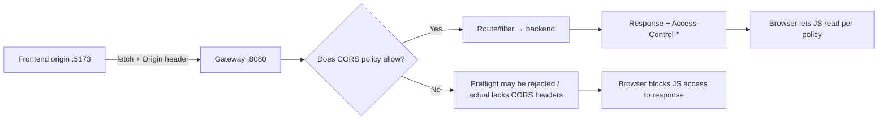
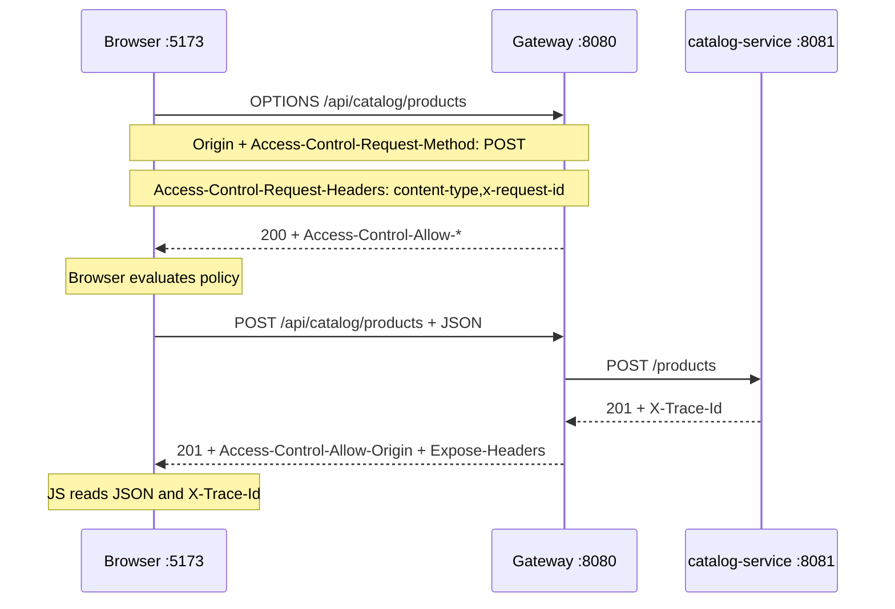

# Allowed origins, methods, headers, and exposed headers

## 1. Where does CORS sit in Spring Cloud Gateway?

In a microservices application, **Spring Cloud Gateway** receives requests from clients, selects routes via **predicates**, runs the **filter chain** to rewrite paths/headers, and forwards traffic to target services. The Gateway also commonly integrates service discovery, authentication, rate limiting, retries, circuit breakers, TLS, and metrics/tracing. For **web applications running in browsers**, you need an additional **Cross-Origin Resource Sharing (CORS)** policy to determine which web pages JavaScript may use to read responses from the Gateway.

Suppose:

- Frontend: `http://localhost:5173` (running Vite or a dev web server).
- Gateway: `http://localhost:8080`.
- Backend: `http://localhost:8081` (clients should not call the backend directly in this architecture).

The frontend and Gateway share the hostname `localhost` yet have **different ports**, making them **two distinct origins**. When the frontend calls `fetch("http://localhost:8080/api/catalog/products/42")`, the browser enforces CORS. Server-to-server clients or `curl` do not enforce browser response-blocking policies.

The goal of this lesson in the **CORS** chapter is to understand four settings accurately:

1. **`allowedOrigins`:** which page origins are accepted?
2. **`allowedMethods`:** which HTTP methods may the web page invoke on the API?
3. **`allowedHeaders`:** which **request headers** may the web page send in cross-origin requests?
4. **`exposedHeaders`:** which additional **response headers** may JavaScript read?

In addition, this lesson covers **`OPTIONS` preflight**, `allowCredentials`, `maxAge`, global/per-route CORS configuration for Gateway Server WebFlux, testing with `curl` and browsers, and troubleshooting common issues when integrating with Spring Security.

> **Scope:** Gateway configuration examples use **Spring Cloud Gateway Server WebFlux 5.0.x** with the `spring.cloud.gateway.server.webflux` namespace. Gateway 4.x lines may use the older `spring.cloud.gateway.globalcors` namespace; Gateway Server Web MVC uses the Servlet stack and requires consulting its own documentation. CORS follows **browser + Spring Framework** rules; it is not a `GatewayFilter` that replaces authentication.

## 2. Defining origins properly and how browsers decide

An **origin** is defined by the triple **scheme + hostname + port**:

```text
Origin = scheme://host:port

http://localhost:5173             # Dev frontend
http://localhost:8080             # Dev Gateway: DIFFERENT origin due to port
https://app.example.test          # Prod frontend
https://api.example.test          # Prod Gateway: DIFFERENT origin due to hostname
```

| URL 1 | URL 2 | Same-origin? | Reason |
|---|---|---|---|
| `http://localhost:5173` | `http://localhost:5173/products` | Yes | Path is not part of the origin definition |
| `http://localhost:5173` | `http://localhost:8080` | No | Different port |
| `http://localhost:5173` | `https://localhost:5173` | No | Different scheme |
| `https://app.example.test` | `https://api.example.test` | No | Different hostname |
| `https://app.example.test` | `https://app.example.test:443` | Yes | Default HTTPS port equals 443 |
| `http://127.0.0.1:5173` | `http://localhost:5173` | No | Different hostname per origin rules |

**Origins exclude paths, queries, and fragments.** Therefore `https://app.example.test/dashboard` is not a valid entry for `allowedOrigins` when you want to allow the website's origin: use **`https://app.example.test`**.

### 2.1. CORS is a rule governing browser response reading

A request can **reach the server** while JavaScript is still blocked from **reading the response** because CORS headers are missing or invalid. CORS is not a firewall: non-browser applications, `curl`, or other servers can still call the API if authentication and network rules do not block them. For requests **not requiring preflight**, browsers normally send the actual request first and then decide whether scripts may read the result.



**Do not confuse CORS with CSRF, OAuth2, JWT, or mTLS.** CORS restricts which origins in a browser can read responses; **authentication** verifies who calls the API, and **authorization** checks what that caller may do. Sensitive APIs require all of those independent defenses.

### 2.2. Headers in a CORS exchange

| HTTP header | Sender | Purpose |
|---|---|---|
| `Origin` | Browser → Gateway | Origin of the page calling the API |
| `Access-Control-Request-Method` | Browser → Gateway on **`OPTIONS` preflight** | Actual HTTP method the browser intends to call after preflight |
| `Access-Control-Request-Headers` | Browser → Gateway on **`OPTIONS` preflight** | List of actual request header names the browser intends to send |
| `Access-Control-Allow-Origin` | Gateway → Browser | Origin permitted to read the response |
| `Access-Control-Allow-Methods` | Gateway → Browser (typically preflight) | Methods allowed under CORS |
| `Access-Control-Allow-Headers` | Gateway → Browser (typically preflight) | Allowed **request headers** |
| `Access-Control-Expose-Headers` | Gateway → Browser on actual response | Additional **response headers** that JS is allowed to read |
| `Access-Control-Allow-Credentials` | Gateway → Browser | Allows the browser to expose credentialed responses when policy fits |
| `Access-Control-Max-Age` | Gateway → Browser on preflight | Duration in seconds to cache preflight results |

Note: `Origin` is a request header identifying the web page's origin, **distinct** from `Host`, which is the authority of the HTTP request sent to the Gateway. `Host=api.example.test` does not mean `Origin=https://api.example.test`.

## 3. Four core configuration groups

### 3.1. allowedOrigins — which origins are accepted?

`allowedOrigins` is a list of **valid origins**, for example:

```yaml
allowedOrigins:
  - https://app.example.test
  - http://localhost:5173
```

A request carrying `Origin: http://localhost:5173` matches the config; the server can reply:

```http
Access-Control-Allow-Origin: http://localhost:5173
Vary: Origin
```

**Never return a comma-separated list** in a single `Access-Control-Allow-Origin` header. That header accepts only **one specific origin**, `*` when appropriate, or `null` in special contexts. Spring normally echoes the **matched** origin from the allowlist.

**Common mistakes:**

- Writing `https://app.example.test/dashboard`: contains a path, so it is not an origin.
- Allowing only `https://app.example.test` while the frontend calls from `http://localhost:5173`: different origin.
- Allowing `http://localhost:5173` while opening the browser at `http://127.0.0.1:5173`: different hostname.
- Putting `https://*.example.test` inside **`allowedOrigins`** expecting wildcard subdomain matching; see **`allowedOriginPatterns`** in Section 8.

### 3.2. allowedMethods — permitted actual methods

`allowedMethods` lists the HTTP methods browsers may use for **actual cross-origin requests**:

```yaml
allowedMethods:
  - GET
  - POST
  - PUT
```

If preflight asks `Access-Control-Request-Method: POST`, the CORS server checks whether **POST** is permitted. Although the preflight request uses **`OPTIONS`** at the HTTP layer, **you do not need to add `OPTIONS` to `allowedMethods`** merely to approve preflights for an already-allowed GET/POST. `OPTIONS` is the method of the **preflight check**, whereas `Access-Control-Request-Method` names the **actual request's** method.

At the same time, `allowedMethods` **differs from the `Method` route predicate**. Allowing POST in CORS does not create a POST route; if a route specifies only `Method=GET`, an actual POST still fails to match that route.

### 3.3. allowedHeaders — which request headers may be sent?

`allowedHeaders` answers: "If the frontend wants to send `Authorization`, `Content-Type`, and `X-Request-Id`, does the Gateway permit those **request header names**?"

```yaml
allowedHeaders:
  - Authorization
  - Content-Type
  - X-Request-Id
```

The browser may send a preflight:

```http
OPTIONS /api/catalog/products HTTP/1.1
Origin: http://localhost:5173
Access-Control-Request-Method: POST
Access-Control-Request-Headers: content-type,x-request-id
```

If allowed, the preflight response includes `Access-Control-Allow-Headers` listing or reflecting the matching request headers. HTTP header names are **case-insensitive**.

**Important:** `allowedHeaders: [Authorization]` only states that the browser may send a header **named `Authorization`**; it **does not** validate bearer tokens. Checking JWT signatures, expiration, scopes, and permissions remains the responsibility of Spring Security or your auth service. `allowedHeaders` also does not let JavaScript arbitrarily set **forbidden request headers** like `Host` or `Cookie`; browsers manage those under separate rules.

### 3.4. exposedHeaders — response headers JavaScript may inspect

`exposedHeaders` controls **which response headers JavaScript can read** beyond CORS-safelisted response headers. For example:

```yaml
exposedHeaders:
  - X-Trace-Id
  - X-RateLimit-Remaining
```

When the backend/Gateway actually returns `X-Trace-Id: trace-demo-42`, Spring CORS can add:

```http
Access-Control-Expose-Headers: X-Trace-Id, X-RateLimit-Remaining
```

And the frontend reads:

```javascript
const response = await fetch("http://localhost:8080/api/catalog/products/42");
console.log(response.headers.get("X-Trace-Id"));
```

**Both conditions must hold:** the actual response contains `X-Trace-Id` **and** the CORS exposure policy lets JS read it. `exposedHeaders` **does not create** headers; to emit a header, set it in the backend response or via Gateway's `AddResponseHeader`/`SetResponseHeader`.

Browsers already allow reading certain response headers by default, including `Cache-Control`, `Content-Language`, `Content-Length`, `Content-Type`, `Expires`, `Last-Modified`, and `Pragma`. You do not need to list those names just to read them. Conversely, `Set-Cookie` is a **forbidden response header name** in Fetch: adding it to `exposedHeaders` **does not allow** `response.headers.get("Set-Cookie")` to read cookies.

### 3.5. Quick comparison table

| Setting | Controls | Corresponding HTTP header generated | What it does NOT do |
|---|---|---|---|
| `allowedOrigins` | Calling website origin | `Access-Control-Allow-Origin` | Does not authenticate users |
| `allowedMethods` | Method of actual request | `Access-Control-Allow-Methods` | Does not create routes or backend mappings |
| `allowedHeaders` | Request header names browser wants to send | `Access-Control-Allow-Headers` | Does not add response headers or validate JWTs |
| `exposedHeaders` | Response header names JS may read | `Access-Control-Expose-Headers` | Does not permit request headers or generate headers |

## 4. Preflight and actual request: two distinct phases

### 4.1. Why does the browser need a preflight?

Certain cross-origin requests can be sent **without a preflight** (for example, a GET with no custom request headers satisfying CORS-safelisted criteria). Requests with **non-simple methods**, **`Content-Type: application/json`**, or **custom headers** typically trigger an **`OPTIONS`** request so the browser can ask ahead of time.



In this model, **CORS preflight is normally handled by the Gateway/WebFlux CORS processor** without reaching the backend, while only the actual POST traverses routes/filters to the backend. Exact behavior depends on installed handlers and security filters; if preflight is blocked early, **the browser does not send the actual request**.

### 4.2. OPTIONS preflight does not mean allowedMethods: [OPTIONS]

Suppose a route includes `Method=GET,POST`. Preflight uses HTTP method `OPTIONS`, so the route's `Method` predicate may **not match**. Gateway Server WebFlux provides:

```yaml
spring:
  cloud:
    gateway:
      server:
        webflux:
          globalcors:
            add-to-simple-url-handler-mapping: true
```

This property also registers the **global CORS configuration** on `SimpleUrlHandlerMapping`, which helps when preflight misses `RoutePredicateHandlerMapping` solely due to the `OPTIONS` method. The snippet above is a **partial fragment**; it requires global CORS rules like those in Section 5 to take effect. Never simply add `OPTIONS` to a route method predicate and hope a CORS policy magically appears.

### 4.3. How does the browser handle the preflight response?

Example preflight response (values and header ordering may vary by runtime):

```http
HTTP/1.1 200 OK
Access-Control-Allow-Origin: http://localhost:5173
Access-Control-Allow-Methods: GET,POST
Access-Control-Allow-Headers: content-type,x-request-id
Access-Control-Allow-Credentials: true
Access-Control-Max-Age: 1800
Vary: Origin
Vary: Access-Control-Request-Method
Vary: Access-Control-Request-Headers
```

Once the browser confirms the origin, method, and request headers are valid, it can send the actual request and store the preflight outcome in its **preflight cache** per browser rules. `Access-Control-Max-Age: 1800` is measured in **seconds**; browsers may cap cache duration per their own policies.

If the method or request header is disallowed, preflight is normally **rejected** and the actual request **is not sent**. With Spring Framework, invalid preflights may return `403 Invalid CORS request`, though applications should not depend on a single exact status or error message since ingress/security and runtimes vary.

### 4.4. CORS response headers do not replace HTTP authorization

HTTP `200` with `Access-Control-Allow-Origin` only means the browser **is allowed to read the response** under CORS—not that the request was authenticated or authorized. HTTP `401` or `403` responses may also need CORS headers so the frontend can read error bodies. CORS configuration must work properly for **both success and error paths**, not just `200`.

## 5. Global CORS configuration in Gateway Server WebFlux

### 5.1. A runnable Gateway application example

Here is a **complete `application.yml` for a demo Gateway** using WebFlux:

```yaml
server:
  port: 8080

spring:
  application:
    name: cors-gateway-demo
  cloud:
    gateway:
      server:
        webflux:
          globalcors:
            # Allow CORS to operate even when OPTIONS preflight
            # misses Method=GET,POST on the route below.
            add-to-simple-url-handler-mapping: true
            cors-configurations:
              '[/**]':
                allowedOrigins:
                  - http://localhost:5173
                  - https://app.example.test
                allowedMethods:
                  - GET
                  - POST
                allowedHeaders:
                  - Authorization
                  - Content-Type
                  - X-Request-Id
                exposedHeaders:
                  - X-Trace-Id
                  - X-RateLimit-Remaining
                allowCredentials: true
                maxAge: 1800
          routes:
            - id: catalog-route
              uri: http://localhost:8081
              predicates:
                - Path=/api/catalog/**
                - Method=GET,POST
              filters:
                - StripPrefix=2
```

This example fits Spring Cloud Gateway Server WebFlux 5.0.x and **requires no Java DSL** for CORS: `globalcors.cors-configurations` is a **map from URL patterns to Spring Framework `CorsConfiguration`**.

Explanation:

1. `'[/**]'` is a **map key with pattern `/**`**; the square brackets are quoted so Spring Boot's binder preserves the URL pattern key (per Gateway documentation syntax).
2. `allowedOrigins` lists **two exact origins** rather than opening every website with `*`.
3. `allowedMethods` permits actual GET and POST; the route's `Method=GET,POST` also permits those two methods at the route predicate layer.
4. `allowedHeaders` covers `Authorization`, `Content-Type`, and `X-Request-Id` in **requests**. When a backend does not use `Authorization`, omit it from the allowlist.
5. `exposedHeaders` lets JS read `X-Trace-Id` and `X-RateLimit-Remaining` if the actual response includes them.
6. `allowCredentials: true` should be kept only when the frontend needs cookie/credentialed requests and security policies are designed (Section 8).
7. `maxAge: 1800` lets browsers cache **preflight results**, without replacing HTTP response caching.
8. `add-to-simple-url-handler-mapping: true` handles preflights that miss routes with method predicates.
9. `StripPrefix=2` strips the two segments `api` and `catalog`: backend `:8081` receives `/products/42` instead of `/api/catalog/products/42`.

**Why specify allowed methods in both CORS and the route?** They make two distinct decisions: CORS answers "may a browser at this origin use that method?"; the route predicate answers "should the Gateway select this route for that method?". To reject other methods cleanly, **define both consistently** and enforce authorization in the backend.

### 5.2. Replacing `[/**]` with a narrower URL pattern

When only `/api/**` APIs need cross-origin access, swap the key:

```yaml
# WebFlux cors-configurations fragment (not a standalone file).
cors-configurations:
  '[/api/**]':
    allowedOrigins:
      - https://app.example.test
    allowedMethods:
      - GET
      - POST
    allowedHeaders:
      - Content-Type
    exposedHeaders:
      - X-Trace-Id
```

Narrowing the pattern avoids accidentally enabling CORS on management/Actuator endpoints or unrelated routes. Still, **a CORS pattern is not an access-control rule**: non-CORS requests or non-browser clients can still reach endpoints if network/security permits.

### 5.3. Public APIs that do not use cookies

If an API is completely public and **never uses credentialed requests**, the policy can be simpler:

```yaml
# CorsConfiguration excerpt for a public read-only API.
allowedOrigins: '*'
allowedMethods:
  - GET
allowedHeaders:
  - Accept
allowCredentials: false
```

With `allowedOrigins: '*'`, the server can return `Access-Control-Allow-Origin: *`. **Never combine this wildcard with `allowCredentials: true`**: Spring Framework rejects that combination because the CORS standard forbids wildcard origins on credentialed responses.

**Caution:** "public API readable by browsers from any website" is a product choice; never default to `*` for APIs returning personal or internal data.

## 6. Per-route CORS via metadata

If routes serve different frontend origins, you can declare CORS **individually on a route** using `metadata.cors`. This is an **alternative** to placing a global policy on the same paths; avoid duplicating the full policy in both places unnecessarily.

```yaml
# Standalone example: application.yml for Gateway Server WebFlux.
server:
  port: 8080

spring:
  cloud:
    gateway:
      server:
        webflux:
          routes:
            - id: order-route
              uri: http://localhost:8081
              predicates:
                - Path=/orders/**
              metadata:
                cors:
                  allowedOrigins:
                    - https://orders.example.test
                  allowedMethods:
                    - GET
                    - POST
                  allowedHeaders:
                    - Authorization
                    - Content-Type
                  exposedHeaders:
                    - X-Request-Id
                  allowCredentials: true
                  maxAge: 900
```

**Meaning:** route `order-route` advertises CORS only for `https://orders.example.test`; it does not grant access to the catalog route's `https://app.example.test`. Gateway documentation confirms per-route CORS uses the **`cors` metadata key** and the same properties as `CorsConfiguration`.

**What to test separately:** preflight is HTTP `OPTIONS`. If the route also has a `Method=GET` predicate, preflight may fail to match the route; in that case **use a global CORS policy with simple URL handler mapping** or equivalent version-specific CORS/handler/security configuration. Seeing `cors` metadata in YAML alone does not guarantee `OPTIONS` is handled.

### 6.1. Global vs. per-route: which should you choose?

| Criterion | Global CORS | Route metadata CORS |
|---|---|---|
| Scope | Every path matching the global pattern | Specific route |
| Best fit | Multiple APIs sharing frontend origins/policies | Routes serving different frontends |
| Preflight missing route due to method | Supported via `add-to-simple-url-handler-mapping` | Must explicitly verify `OPTIONS` flow and route predicates |
| Risk | `/**` pattern broader than necessary | New routes may omit `cors` metadata |
| Operations | Centralized policy | Distributed policy requiring per-route testing |

If you enable CORS at the Gateway while also keeping `@CrossOrigin` or a CORS filter on a proxied **backend**, responses may emit **multiple `Access-Control-Allow-Origin` headers** or conflicting values. Browsers may reject responses with duplicate or invalid ACAO values. Clearly designate **one layer as the sole issuer of client-facing CORS headers** (typically the Gateway at the public edge) and eliminate overlapping settings.

## 7. Hands-on echo backend and testing with curl

### 7.1. Creating a backend with GET/POST for testing

Create a Spring Boot application using Spring Web (Servlet) running on `:8081`. `CatalogApplication.java`:

```java
package com.example.catalog;

import java.util.Map;
import org.springframework.boot.SpringApplication;
import org.springframework.boot.autoconfigure.SpringBootApplication;
import org.springframework.http.HttpStatus;
import org.springframework.http.ResponseEntity;
import org.springframework.web.bind.annotation.GetMapping;
import org.springframework.web.bind.annotation.PathVariable;
import org.springframework.web.bind.annotation.PostMapping;
import org.springframework.web.bind.annotation.RequestBody;
import org.springframework.web.bind.annotation.RestController;

@SpringBootApplication
@RestController
public class CatalogApplication {

    public static void main(String[] args) {
        SpringApplication.run(CatalogApplication.class, args);
    }

    @GetMapping("/products/{id}")
    public ResponseEntity<Map<String, String>> get(@PathVariable String id) {
        return ResponseEntity.ok()
            .header("X-Trace-Id", "trace-demo-" + id)
            .header("X-RateLimit-Remaining", "99")
            .body(Map.of("id", id, "name", "Sample item"));
    }

    @PostMapping("/products")
    public ResponseEntity<Map<String, String>> create(
            @RequestBody Map<String, String> request) {
        return ResponseEntity.status(HttpStatus.CREATED)
            .header("X-Trace-Id", "trace-created-demo")
            .header("X-RateLimit-Remaining", "98")
            .body(Map.of(
                "id", "new-1",
                "name", request.getOrDefault("name", "Unnamed")));
    }
}
```

**Backend** `application.yml`:

```yaml
spring:
  application:
    name: catalog-demo
server:
  port: 8081
```

The example backend **declares no CORS**: all browser-facing CORS policy is configured on the Gateway. In real applications, backends must still protect internal connectivity and enforce authentication/authorization on non-public endpoints.

Start the backend and test directly first:

```bash
./mvnw spring-boot:run

# Run in another terminal:
curl -i 'http://localhost:8081/products/42'
```

When running properly, the response is `200 OK` with `X-Trace-Id: trace-demo-42` and JSON `{"id":"42","name":"Sample item"}` (field order may vary).

### 7.2. Run the Gateway and verify GET

Create a separate Gateway project using `spring-cloud-starter-gateway-server-webflux` with a compatible Spring Boot/Spring Cloud BOM and the configuration from **Section 5.1**. Start it on port `8080`, keeping the backend on `8081`.

```bash
# Send a cross-origin GET to the Gateway, simulating an Origin from dev frontend.
curl -i \
  -H 'Origin: http://localhost:5173' \
  'http://localhost:8080/api/catalog/products/42'
```

Expected response (abbreviated):

```http
HTTP/1.1 200 OK
Access-Control-Allow-Origin: http://localhost:5173
Access-Control-Allow-Credentials: true
Access-Control-Expose-Headers: X-Trace-Id, X-RateLimit-Remaining
X-Trace-Id: trace-demo-42
X-RateLimit-Remaining: 99
Content-Type: application/json

{"id":"42","name":"Sample item"}
```

**Two things happen together:** the `StripPrefix=2` route forwards the request to the backend's `GET /products/42`; the CORS processor adds response headers so the browser can read the response. Do not conflate `X-Trace-Id` with `Access-Control-Expose-Headers`: the first carries **data**, while the second grants **permission to read that header's data**.

### 7.3. Verifying preflight for a JSON POST

The browser prepares to send a `POST` with JSON and custom header `X-Request-Id`, so it can send:

```bash
curl -i -X OPTIONS \
  -H 'Origin: http://localhost:5173' \
  -H 'Access-Control-Request-Method: POST' \
  -H 'Access-Control-Request-Headers: content-type,x-request-id' \
  'http://localhost:8080/api/catalog/products'
```

The expected reply is a **successful preflight**, usually HTTP 200, containing:

```http
Access-Control-Allow-Origin: http://localhost:5173
Access-Control-Allow-Methods: GET,POST
Access-Control-Allow-Headers: content-type,x-request-id
Access-Control-Allow-Credentials: true
Access-Control-Max-Age: 1800
```

Header ordering, casing, and formatting may differ across framework versions. **No JSON body is required on preflight**; it is handled as a permission check ahead of the actual request.

Then send the **actual POST**:

```bash
curl -i -X POST \
  -H 'Origin: http://localhost:5173' \
  -H 'Content-Type: application/json' \
  -H 'X-Request-Id: req-demo-1' \
  --data '{"name":"Keyboard"}' \
  'http://localhost:8080/api/catalog/products'
```

Expected result is **`201 Created`** with a body containing `id` and `name`, plus `Access-Control-Allow-Origin` and `Access-Control-Expose-Headers`. `curl` does not send preflight automatically; here we issue **two separate commands** purely to verify server behavior.

> These commands and responses are **hands-on instructions / expected outputs**, not pre-executed runs in this document. If the Gateway runs in a separate container, replace `localhost:8081` in the route with a backend address reachable from the Gateway container.

## 8. Credentials, wildcards, and allowedOriginPatterns

### 8.1. allowCredentials is a separate security decision

When the frontend sends requests with `credentials: "include"`, the browser may attach cookies or credentials allowed by browser policy. For the frontend to read the response of a **credentialed cross-origin request**, the response needs:

```http
Access-Control-Allow-Origin: https://app.example.test
Access-Control-Allow-Credentials: true
```

For credentialed requests, **`Access-Control-Allow-Origin: *` is invalid**. Spring Framework proactively rejects `allowedOrigins: '*'` combined with `allowCredentials: true`, rather than silently emitting a wildcard.

A credentialed CORS policy must **strictly limit origins** and pair with CSRF protection, authentication/authorization, and cookie policies. `Access-Control-Allow-Credentials: true` alone creates no cookie/session and does not prove the request is logged in.

**Cookie note:** for the browser to actually transmit cross-site cookies, you also need `SameSite=None; Secure` where applicable, HTTPS, matching cookie domain/path, and allowance under browser third-party cookie blocking rules. Valid CORS **does not guarantee cookies will be sent**.

### 8.2. allowedOriginPatterns instead of dynamic wildcard origins

Spring Framework supports `allowedOriginPatterns` to match hostnames by pattern:

```yaml
# CorsConfiguration excerpt; NEVER declare alongside allowedOrigins: '*'.
allowedOriginPatterns:
  - https://*.example.test
allowedMethods:
  - GET
allowedHeaders:
  - Authorization
allowCredentials: true
```

If an incoming origin **matches the pattern**, Spring can return that **specific matched origin** in `Access-Control-Allow-Origin` instead of writing the pattern into the response. Mechanically, this can therefore be combined with credentials.

However, **broad patterns carry significant risk**: any subdomain can match, including a hijacked subdomain or one controlled by another user. In multi-tenant environments, use patterns only with strict hostname/tenant governance and trusted origin registration; prefer an **explicit list of origins**.

For example, `https://*.example.test` does not automatically trust `http://app.example.test`: the `https` scheme remains part of the origin. Test apex domains, multi-level subdomains, disallowed hostnames, and different ports.

### 8.3. Wildcard allowedHeaders and allowedMethods have caveats

Spring `CorsConfiguration` permits `*` in `allowedHeaders` and `allowedMethods`. When credentials are enabled, Spring can reflect the **actual requested method and headers from preflight** in the response rather than sending literal `*`.

Still, do not assume that makes permitting everything safe: **`allowedHeaders: '*'` expands the custom headers browsers may request**, and `allowedMethods: '*'` expands methods. Browsers and Fetch standards also enforce special rules for headers like `Authorization`. For credentialed APIs, **prefer explicitly listing** `Authorization`, `Content-Type`, and required custom headers.

**`exposedHeaders: '*'` also requires caution:** Spring docs note cases where wildcard output occurs even with `allowCredentials` enabled, yet Fetch and browsers enforce their own restrictions on wildcards for credentialed requests. For compatibility, **explicitly list the response headers to expose**, such as `X-Trace-Id` and `X-RateLimit-Remaining`.

### 8.4. Null origin does not mean localhost

Browsers can emit `Origin: null` in opaque-origin contexts such as `file://` pages or sandboxed iframes. Never use `allowedOrigins: ["null"]` as a shortcut to "allow local dev" without a clear security justification: many untrusted contexts can also produce a null origin. For local development, specify exact origins like `http://localhost:5173`.

## 9. Testing in the browser: allowedHeaders vs. exposedHeaders

Suppose the test frontend runs at **`http://localhost:5173`** and the Gateway at **`http://localhost:8080`**. In the frontend tab's DevTools Console, run:

```javascript
// Cross-origin GET requiring no custom request headers.
const response = await fetch(
  "http://localhost:8080/api/catalog/products/42",
  { credentials: "include" }
);

console.log("HTTP status", response.status);
console.log("Trace header", response.headers.get("X-Trace-Id"));
console.log("Remaining", response.headers.get("X-RateLimit-Remaining"));
console.log("JSON", await response.json());
```

With the Section 5 config and running backend, `response.headers.get("X-Trace-Id")` returns `trace-demo-42`. If you remove `exposedHeaders: [X-Trace-Id, ...]` from the policy, the network response still carries `X-Trace-Id`, yet the script **cannot read that header** (typically getting `null`). This is the signature test for **exposed response headers**.

Next, test a JSON POST with a custom request header:

```javascript
const postResponse = await fetch(
  "http://localhost:8080/api/catalog/products",
  {
    method: "POST",
    headers: {
      "Content-Type": "application/json",
      "X-Request-Id": "req-browser-1"
    },
    credentials: "include",
    body: JSON.stringify({ name: "Keyboard" })
  }
);

console.log(postResponse.status);
console.log(postResponse.headers.get("X-Trace-Id"));
console.log(await postResponse.json());
```

In DevTools → Network, you should see **`OPTIONS`** sent before the actual **`POST`** due to `Content-Type: application/json` and `X-Request-Id`. If `X-Request-Id` is removed from `allowedHeaders`, the browser blocks the POST **at preflight**, even though the backend POST endpoint is valid.

**Note:** these `fetch` snippets must run inside **an actual page served from `http://localhost:5173`**, not from the address bar or a `file://` tab with a different origin. `credentials: "include"` merely illustrates credentials mode; the demo backend creates no login session, so this is **not a cookie-authentication lab**.

### 9.1. Comparing Network failures and JavaScript errors

| Observation | Interpretation |
|---|---|
| `OPTIONS` rejected; no `POST` sent | Preflight failed; browser did not issue the actual request |
| `GET` returns 200 in Network yet JS throws a CORS error | Browser received response without valid CORS headers and blocked script access |
| JS reads JSON yet `headers.get("X-Trace-Id")` is `null` | `exposedHeaders` omitted, backend omitted header, or a proxy stripped it |
| `OPTIONS` succeeds yet actual returns 401/403 | CORS permitted calling/reading; it **does not mean** the user is authenticated/authorized |
| `fetch(..., {mode:"no-cors"})` returns an opaque response | Not a fix; JS still cannot read body or headers like a normal response |

Never work around CORS errors by disabling browser security or installing CORS-disabling extensions. Fix the policy **on the Gateway/server side** and verify in DevTools.

## 10. CORS with Spring Security, route predicates, and filter chains

### 10.1. Why can Spring Security block preflight?

In a WebFlux Gateway with Spring Security, a `SecurityWebFilterChain` may require authentication on `/api/**`. Preflights normally **do not carry login cookies** and are not actual requests. If security treats them as authenticated API calls before the CORS processor responds, the browser receives `401`/`403` for `OPTIONS` and never sends `GET`/`POST`.

Per Spring Security documentation, **CORS must be processed before actual-request authorization**. One approach is configuring a `CorsWebFilter` / `CorsConfigurationSource` and integrating Security per your version. On a Gateway, clarify whether CORS applies at **`HandlerMapping`** or **`WebFilter`**, avoiding two overlapping CORS processors.

Depending on your Security/WebFlux version, adjust the security chain so **preflights are handled safely by CORS**, while actual requests still enforce JWT/cookie/CSRF checks as normal. **Never set `permitAll("/api/**")` just to make `OPTIONS` pass**—that unintentionally strips protection from real APIs.

### 10.2. Configuring CORS in Java with CorsWebFilter — an alternative

If you need full programmatic control over CORS in **Spring WebFlux**, you can use Spring Framework's `CorsWebFilter`. This is an **independent Java approach**; **do not register it alongside** Gateway's `globalcors` from Section 5 on the same patterns without integration testing:

```java
package com.example.gateway;

import java.util.List;
import org.springframework.context.annotation.Bean;
import org.springframework.context.annotation.Configuration;
import org.springframework.web.cors.CorsConfiguration;
import org.springframework.web.cors.reactive.CorsWebFilter;
import org.springframework.web.cors.reactive.UrlBasedCorsConfigurationSource;

@Configuration
public class CorsConfig {

    @Bean
    CorsWebFilter corsWebFilter() {
        CorsConfiguration cors = new CorsConfiguration();
        cors.setAllowedOrigins(List.of(
            "http://localhost:5173",
            "https://app.example.test"));
        cors.setAllowedMethods(List.of("GET", "POST"));
        cors.setAllowedHeaders(List.of(
            "Authorization", "Content-Type", "X-Request-Id"));
        cors.setExposedHeaders(List.of(
            "X-Trace-Id", "X-RateLimit-Remaining"));
        cors.setAllowCredentials(true);
        cors.setMaxAge(1800L);

        UrlBasedCorsConfigurationSource source =
            new UrlBasedCorsConfigurationSource();
        source.registerCorsConfiguration("/api/**", cors);
        return new CorsWebFilter(source);
    }
}
```

When using Spring Security, inspect **filter ordering**, the `CorsConfigurationSource` bean, and `.cors(...)` integration for your Security version. A `CorsWebFilter` bean handling CORS **does not automatically replace** JWT authentication, CSRF protection, or Gateway route configuration.

### 10.3. CORS should not be duplicated across multiple layers

A request path might traverse:

```text
Browser → CDN/WAF → Ingress → Gateway → Backend
```

If the CDN adds `Access-Control-Allow-Origin: *`, the Gateway adds a specific origin, and the backend adds yet another ACAO header, the browser can reject the response even though the API logically returned 200. Pick **one source responsible for CORS at the public edge**, specify who handles `OPTIONS` and who attaches headers on actual/error responses, and confirm proxies/caches preserve `Vary`.

Some Spring Framework setups **combine** global and local CORS configs by merging, yet never rely on guesswork about precedence: whenever multiple `HandlerMapping`s, Spring Security, Gateway route metadata, or proxy headers coexist, **test real requests** to see the effective policy.

## 11. Server Web MVC supports CORS, but not via WebFlux config syntax

**Spring Cloud Gateway Server Web MVC** builds on Servlets and `WebMvc.fn`, whereas **Server WebFlux** uses reactive `HandlerMapping`/`WebFilter` components. Both follow HTTP CORS rules (origins/methods/headers/exposed headers), yet **you must not copy the `spring.cloud.gateway.server.webflux.globalcors` namespace into an MVC app** and assume it applies.

In a standard **Spring MVC** application, CORS can be configured via `WebMvcConfigurer`:

```java
package com.example.mvc;

import org.springframework.context.annotation.Configuration;
import org.springframework.web.servlet.config.annotation.CorsRegistry;
import org.springframework.web.servlet.config.annotation.WebMvcConfigurer;

@Configuration
public class MvcCorsConfig implements WebMvcConfigurer {

    @Override
    public void addCorsMappings(CorsRegistry registry) {
        registry.addMapping("/api/**")
            .allowedOrigins(
                "http://localhost:5173",
                "https://app.example.test")
            .allowedMethods("GET", "POST")
            .allowedHeaders("Authorization", "Content-Type", "X-Request-Id")
            .exposedHeaders("X-Trace-Id", "X-RateLimit-Remaining")
            .allowCredentials(true)
            .maxAge(1800);
    }
}
```

**Important caveat:** The snippet above illustrates **Spring MVC's** CORS API; it does not guarantee every **Gateway Server Web MVC** route automatically picks up CORS from this bean in every release. For Gateway MVC, check the **CORS mechanism supported by your exact version's HandlerMapping/router/security**, then test preflights and actual responses on real routes. If adding a `CorsFilter` on the Servlet stack, watch its interaction with Spring Security so CORS is not processed twice.

## 12. Negative testing: what must be rejected?

Testing only one allowed origin and a successful GET is not enough. With the Section 5.1 policy, run the following checks. Outcomes listed **are expected results**, not pre-executed outputs.

### 12.1. Unlisted origin

```bash
curl -i -X OPTIONS \
  -H 'Origin: https://unknown.example.test' \
  -H 'Access-Control-Request-Method: POST' \
  -H 'Access-Control-Request-Headers: content-type' \
  'http://localhost:8080/api/catalog/products'
```

The policy **must not** return a CORS response accepting `https://unknown.example.test`. In Spring, an invalid preflight may return 403. For regular requests, missing or mismatched `Access-Control-Allow-Origin` likewise stops the browser from letting JS read the response. Never infer browser acceptance purely from `curl`'s HTTP status.

### 12.2. Method outside allowedMethods

```bash
curl -i -X OPTIONS \
  -H 'Origin: http://localhost:5173' \
  -H 'Access-Control-Request-Method: DELETE' \
  'http://localhost:8080/api/catalog/products/42'
```

`DELETE` is not in `allowedMethods`, so preflight must be rejected under CORS. Even if you added `DELETE` to the CORS policy, the demo backend **has no** DELETE mapping and the demo Gateway route only matches `GET,POST`, so an actual DELETE would still not succeed.

### 12.3. Request header outside allowedHeaders

```bash
curl -i -X OPTIONS \
  -H 'Origin: http://localhost:5173' \
  -H 'Access-Control-Request-Method: POST' \
  -H 'Access-Control-Request-Headers: content-type,x-admin-override' \
  'http://localhost:8080/api/catalog/products'
```

`X-Admin-Override` is not in `allowedHeaders`; the browser must not be permitted to send that custom header per policy. **Even if added to the allowlist**, the backend must treat client-supplied headers as **untrusted input**, never as admin privileges.

### 12.4. Response header present yet not exposed

Keep the backend returning `X-Trace-Id` and temporarily remove it from `exposedHeaders` in your lab. `curl -i` still **displays** `X-Trace-Id` because `curl` does not enforce CORS. In the browser, `response.headers.get("X-Trace-Id")` cannot read that header because it is not safelisted. This test separates **exposure** from **header presence**.

### 12.5. Required test matrix

| Case | Origin | Actual method | Request headers | Expected CORS outcome |
|---|---|---|---|---|
| T1 | `http://localhost:5173` | GET | Browser safelisted | Permitted |
| T2 | `https://app.example.test` | POST | `Content-Type`, `X-Request-Id` | Permitted |
| T3 | `https://unknown.example.test` | GET | None custom | JS blocked from reading |
| T4 | `http://localhost:5173` | DELETE | None custom | Preflight rejected |
| T5 | `http://localhost:5173` | POST | `X-Admin-Override` | Preflight rejected |
| T6 | `http://127.0.0.1:5173` | GET | None custom | Does not match `localhost` origin |
| T7 | `http://localhost:5173` | POST | `Content-Type: application/json` | Preflight passes; actual handled separately |
| T8 | `http://localhost:5173` | GET | None custom | JS reads `X-Trace-Id` when backend emits it and exposure allows |

**Note:** `allowCredentials: true` matters only when the frontend actually performs credentialed fetches; testing must cover **credentials mode**, cookie policies, authentication, and CSRF for your architecture. The demo backend's endpoints are public; never treat them as proof of production safety.

## 13. Layer-by-layer troubleshooting

| Symptom | Common cause | How to check / resolve |
|---|---|---|
| Browser reports **No Access-Control-Allow-Origin** | CORS unconfigured at Gateway, wrong YAML key, path pattern mismatch, or origin mismatch | Compare `Origin`, globalcors/route metadata, and response headers |
| `OPTIONS` returns 404 while curl GET works | Route with `Method=GET` misses `OPTIONS` preflight | Check `add-to-simple-url-handler-mapping`; do not blindly add OPTIONS |
| `OPTIONS` returns 401 or 403 once Spring Security is added | CORS blocked by security chain before preflight runs, or CORS policy rejected it | Inspect `CorsWebFilter`/Security CORS integration; distinguish auth vs. CORS errors |
| Preflight reports **method not allowed** | `allowedMethods` lacks requested method | Compare `Access-Control-Request-Method` against allowlist |
| Preflight reports **request header not allowed** | `allowedHeaders` lacks Content-Type/Authorization/custom header | Check `Access-Control-Request-Headers` and update minimal allowlist |
| Browser blocks credentialed request with ACAO `*` | Wildcard origin invalid with credentials | Use exact origins or controlled `allowedOriginPatterns` |
| CORS succeeds yet JS misses `X-Trace-Id` | Omitted `exposedHeaders` or actual response lacks the header | Inspect browser DevTools and backend/Gateway response |
| `curl` succeeds while browser fails | `curl` does not enforce browser CORS; preflight, origin, or credentials differ | Use browser DevTools and inspect OPTIONS/actual separately |
| Two `Access-Control-Allow-Origin` headers | Backend/ingress/Gateway all emit CORS headers | Choose one layer to emit CORS headers; remove duplicate configs |
| Frontend on `127.0.0.1` blocked while `localhost` works | Different origin hostname | Allow approved exact origin; avoid `*` on sensitive APIs |
| `Set-Cookie` visible in Network yet JS cannot read it | Fetch prevents JS from reading `Set-Cookie` | Do not attempt to expose cookie headers; verify cookie policy properly |
| CORS allowed yet API returns 401 | Missing/invalid token or session | Fix authentication; never loosen CORS to resolve 401 |
| CORS allowed yet API returns 404/405 | Route predicate or backend handler mismatch | Check route method/path, `StripPrefix`, and backend mappings |
| One user receives CORS headers for another origin | Cache/CDN fails to vary by `Origin` or uses wrong cache key | Inspect `Vary` and cache policies at every hop |
| YAML edited yet output unchanged | Multiple instances, wrong profile, or route config not reloaded | Verify effective config/instance, version, and runtime logs |

### 13.1. Notes on proxies and caching

If the Gateway reflects a specific origin in `Access-Control-Allow-Origin`, response caches/proxies should preserve `Vary: Origin` to avoid serving the wrong CORS header across origins. For preflights, `Access-Control-Request-Method` and `Access-Control-Request-Headers` can also affect the response; preserve `Vary` accordingly.

A CDN caching preflights or injecting its own CORS headers can cause browser behavior to diverge from Gateway configuration. Inspect requests/responses **before and after the CDN/ingress** instead of looking solely at Gateway YAML.

### 13.2. Observing active routes and policies

With Spring Boot Actuator enabled in Gateway WebFlux, `/actuator/gateway/routes` and `/actuator/gateway/routedefinitions` help verify loaded routes and metadata. However, **global CORS mapping does not appear as a `GatewayFilter` inside route filter lists**; to prove the policy is active, **send real preflight and actual requests** and inspect response headers.

Never expose Actuator publicly or log environment variables, tokens, or full request/response headers—especially avoid leaking `Authorization` and `Cookie`. When investigating, log route IDs, methods/paths, normalized origins, statuses, and rejection reasons.

## 14. CORS as one part of API Gateway security

**CORS lets an origin read a response; it does not verify the user.** An API can have flawless CORS settings and still leak data if the backend lacks authorization. Other module mechanisms serve distinct goals:

- **Spring Security / OAuth2/JWT:** authentication and authorization; cannot be replaced by `allowedOrigins`.
- **CSRF protection:** especially vital for cookie/session APIs; CORS alone does not stop state-changing requests from unintended contexts.
- **Rate limiting:** throttles calls using trusted keys, never treating `Origin` as user identity.
- **TLS:** secures HTTPS connections client → Gateway and/or Gateway → backend; CORS does not encrypt data.
- **Circuit breakers/retries:** handle downstream faults; they do not make untrusted-origin requests safe.
- **Service discovery:** picks backend instances; it does not decide which browser origins may call.
- **Observability:** measures route IDs, preflight/actual statuses, latencies, and CORS rejection rates without logging cookies/tokens.

Pre-production checklist:

1. Identify **real frontend origins** by scheme/host/port, separating dev/staging/prod.
2. Restrict `allowedOrigins` or controlled `allowedOriginPatterns`; avoid `*` for sensitive APIs.
3. Align `allowedMethods` with HTTP routes and keep `allowedHeaders` limited to genuinely needed request headers.
4. Expose only the **response headers** the UI needs; never expect JavaScript to read `Set-Cookie`.
5. Set `allowCredentials` per actual requirements and verify cookie policies, `SameSite`/`Secure`, and CSRF.
6. Ensure preflight is handled properly ahead of authorization while keeping actual requests authenticated/authorized.
7. Eliminate duplicate CORS setups across CDN/ingress/Gateway/backend.
8. Preserve `Vary` properly when caching; test error responses too.
9. Test in a real browser across `OPTIONS` preflight, GET/POST, disallowed origins, disallowed headers, and credentials.
10. Monitor route/security changes and add CORS regression tests whenever deploying new frontends.

## 15. Exercises and self-check questions

**Exercise 1 — Origin.** The frontend runs on `http://localhost:5173` and the Gateway on `http://localhost:8080`. Why is this considered cross-origin? When the frontend switches to `http://127.0.0.1:5173`, will a policy listing only `localhost` still match?

**Exercise 2 — Preflight.** The browser sends:

```http
OPTIONS /api/catalog/products HTTP/1.1
Origin: http://localhost:5173
Access-Control-Request-Method: POST
Access-Control-Request-Headers: content-type,x-request-id
```

Explain which values `allowedOrigins`, `allowedMethods`, and `allowedHeaders` validate. Do you need to add `OPTIONS` to `allowedMethods`?

**Exercise 3 — Exposed headers.** The backend returns `X-Trace-Id: abc123`. The Gateway only sets `allowedHeaders: [X-Trace-Id]` with no `exposedHeaders`. Can the browser's `response.headers.get("X-Trace-Id")` read that header? Which config must be updated?

**Exercise 4 — Request header.** The frontend sends a JSON POST with `Authorization: Bearer ...`, yet preflight reports `authorization is not allowed`. Which property should you update? After updating it, is the request automatically authenticated?

**Exercise 5 — Credentials.** A policy has `allowedOrigins: '*'` and `allowCredentials: true`. Why is this invalid? Write an alternative for a single frontend `https://app.example.test`.

**Exercise 6 — Route Method.** A route specifies `Method=GET,POST`, yet `OPTIONS` preflight returns 404. Explain the difference between the preflight method and the actual request method, then suggest the appropriate WebFlux global CORS property.

**Exercise 7 — Cookies.** Even after receiving `Access-Control-Allow-Credentials: true` and a valid origin, cookies still are not sent on cross-site fetches. List at least three other conditions to check.

**Exercise 8 — Caching.** Two frontends `https://a.example.test` and `https://b.example.test` call the same endpoint. The Gateway echoes the respective origin, yet a CDN caches one response and serves it to both. Which header helps caches distinguish responses by origin, and what should you verify on the proxy?

**Exercise 9 — CORS is not auth.** An API only has a CORS allowlist for `https://app.example.test` without authentication. Can a non-browser script still call the API with `curl`? Which protection layers must be added?

**Exercise 10 — Policy design.** A Gateway exposes `/api/catalog/**` solely for public frontend `https://shop.example.test` and `/api/admin/**` for admin SPA `https://admin.example.test`. Choose path-scoped global CORS or route metadata, and design a test preventing the shop frontend from reading admin responses.

### Suggested answers

1. Port is part of an origin; `:5173` differs from `:8080`. `127.0.0.1` differs from `localhost`, so the policy must list the exact permitted origin.
2. `allowedOrigins` checks `http://localhost:5173`; `allowedMethods` checks **POST** in `Access-Control-Request-Method`; `allowedHeaders` checks `content-type,x-request-id`. You do not need to add `OPTIONS` just to permit preflight for POST.
3. Not readable by default. `allowedHeaders` governs **request headers**; use `exposedHeaders: [X-Trace-Id]` to expose that **response header**.
4. Add `Authorization` to `allowedHeaders`. This does not validate bearer tokens; you still need Spring Security/resource server and authorization.
5. Wildcard origin is invalid for credentialed responses. Replace with `allowedOrigins: [https://app.example.test]` and `allowCredentials: true`; also verify cookies and CSRF.
6. Preflight's `OPTIONS` fails to match `Method=GET,POST`; enable `spring.cloud.gateway.server.webflux.globalcors.add-to-simple-url-handler-mapping: true` with matching global CORS config and ensure Security does not block preflights.
7. `credentials: "include"` in `fetch`; cookie domain/path; `SameSite=None; Secure` for cross-site; HTTPS; browser third-party cookie blocking policies; valid session/auth.
8. `Vary: Origin`; verify the cache key and that the CDN/ingress preserves `Vary`. Preflights may also vary by requested method/headers.
9. Yes, because `curl`/server clients do not enforce browser CORS. Add authentication, authorization, network ACLs, and endpoint protections.
10. Configure CORS per path prefix or per route with exact origins; test that the shop origin is denied CORS on admin paths, while also verifying admin **authorization** still blocks non-browser requests.

## Official references

- [Spring Cloud Gateway Server WebFlux 5.0 — CORS Configuration](https://docs.spring.io/spring-cloud-gateway/reference/5.0/spring-cloud-gateway-server-webflux/cors-configuration.html) — `globalcors`, `add-to-simple-url-handler-mapping`, and `metadata.cors`.
- [Spring Cloud Gateway 5.0 — Configuration Properties](https://docs.spring.io/spring-cloud-gateway/reference/5.0/configprops.html) — `spring.cloud.gateway.server.webflux.globalcors.*` namespace.
- [Spring Framework — WebFlux CORS](https://docs.spring.io/spring-framework/reference/web/webflux-cors.html) — `CorsConfiguration`, `allowedOriginPatterns`, `allowCredentials`, and `CorsWebFilter`.
- [Spring Framework — Spring MVC CORS](https://docs.spring.io/spring-framework/reference/web/webmvc-cors.html) — `CorsRegistry`, `WebMvcConfigurer`, and Servlet-stack preflight handling.
- [Spring Security — Reactive CORS](https://docs.spring.io/spring-security/reference/reactive/integrations/cors.html) — handling preflight before Spring Security and configuring CORS with `SecurityWebFilterChain`.
- [MDN — Cross-Origin Resource Sharing (CORS)](https://developer.mozilla.org/en-US/docs/Web/HTTP/Guides/CORS) — preflight, actual requests, credentials, and browser behavior.
- [MDN — Access-Control-Allow-Headers](https://developer.mozilla.org/en-US/docs/Web/HTTP/Reference/Headers/Access-Control-Allow-Headers) — headers browsers are permitted to send in actual requests.
- [MDN — Access-Control-Expose-Headers](https://developer.mozilla.org/en-US/docs/Web/HTTP/Reference/Headers/Access-Control-Expose-Headers) — response headers JS can read and wildcard restrictions.
- [WHATWG Fetch Standard](https://fetch.spec.whatwg.org/) — CORS model, credentials mode, forbidden response headers, and browser enforcement.
