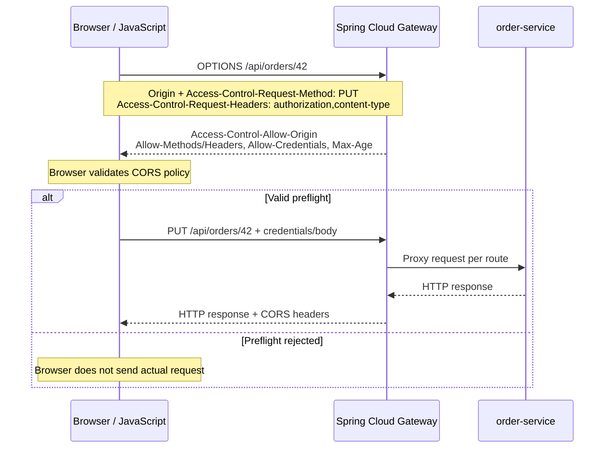
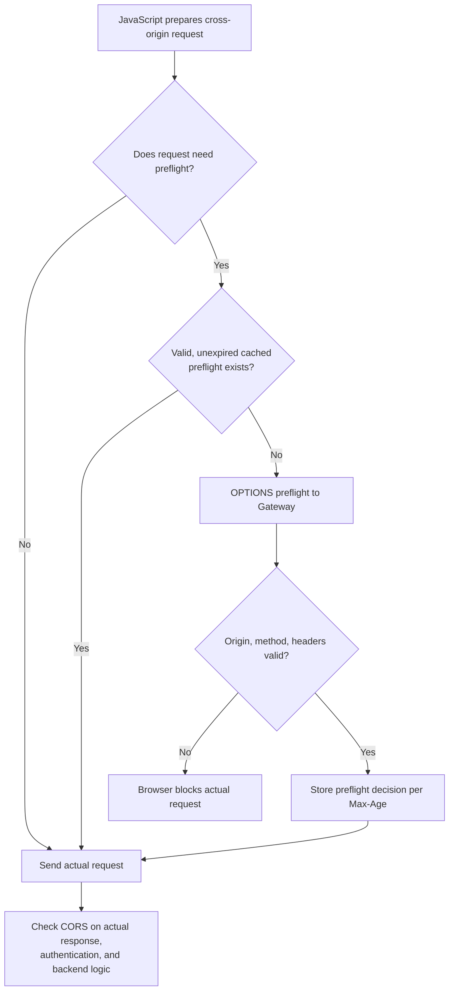

# Credentials, wildcard origins, and preflight cache duration

Suppose a web application is loaded from `https://app.example.com` and calls an API via `https://api.example.com` through **Spring Cloud Gateway**. These two addresses are different **origins**, even though both may belong to the same organization. When the browser sends a login cookie with a request, the API must return matching CORS response headers so the web frontend's JavaScript is **allowed to read** the result. Even one seemingly convenient setting like `allowedOrigins: "*"` combined with `allowCredentials: true` renders the CORS configuration invalid.

At the same time, requests with methods or headers that need pre-verification trigger an **`OPTIONS` preflight**. If the browser has to send a preflight before every request, latency and request volume hitting the gateway rise noticeably. `maxAge` allows the browser to cache the **preflight decision**, yet it **does not** cache business responses and **does not** grant access to disallowed websites.

This lesson belongs to the **CORS** chapter in the **SPRING_CLOUD_GATEWAY** module. When building an API Gateway with route predicates, filter chains, path/header transformations, and service discovery, CORS must be tightly controlled at the edge layer and coordinated with authentication, rate limiting, circuit breakers, retries, TLS, and observability. This lesson centers on three closely linked concepts: **credentials**, **wildcard origins**, and **preflight cache duration**.

After this lesson, you will be able to:

1. Distinguish `Origin`, CORS, and authentication/authorization; predict when browsers let JavaScript read a response.
2. Configure `allowCredentials` with `allowedOrigins` or `allowedOriginPatterns` without granting overly broad access.
3. Use `maxAge` correctly in **seconds** and understand browser preflight cache limits.
4. Configure global or per-route CORS in **Spring Cloud Gateway Server WebFlux**, including handling `OPTIONS` when a route predicate specifies `Method`.
5. Test with a browser and `curl`, pinpointing root causes when requests are blocked, cookies are not sent, or preflights return `401`/`403`.

> **Version scope:** Primary examples target **Spring Cloud Gateway Server WebFlux 5.x**, using the `spring.cloud.gateway.server.webflux.globalcors` and `spring.cloud.gateway.server.webflux.routes` namespaces. In **Gateway Server WebFlux 4.3.x**, namespaces are typically `spring.cloud.gateway.globalcors` and `spring.cloud.gateway.routes`. CORS semantics build on Spring Framework's `CorsConfiguration`, though binding/configuration details must be verified against your exact version, starter, and security setup. Gateway Server MVC does not use the exact WebFlux flow presented here.

## 1. What is CORS and what does the browser actually protect?

**CORS (Cross-Origin Resource Sharing)** is an HTTP header exchange mechanism allowing a web page at origin A conditional JavaScript access to resources at origin B. Browsers enforce the **same-origin policy** and CORS; CLI HTTP clients or typical service-to-service callers **do not enforce browser-style CORS policies**.

An **origin** consists of three parts:

```text
scheme + host + port

https://app.example.com       -> https, app.example.com, default port 443
https://api.example.com       -> https, api.example.com, default port 443
http://app.example.com        -> http, app.example.com, default port 80
https://app.example.com:8443  -> https, app.example.com, port 8443
```

In the following table, every request originates from JavaScript running on `https://app.example.com`:

| Target URL | Same origin? | Reason |
| --- | --- | --- |
| `https://app.example.com/api/orders` | Yes | Scheme, host, and port match |
| `https://api.example.com/orders` | No | Different hostname |
| `http://app.example.com/orders` | No | Different scheme `https` vs. `http` |
| `https://app.example.com:8443/orders` | No | Different port |
| `https://app.example.com:443/orders` | Yes | Port 443 is the HTTPS default |

`Origin` is a header sent by the browser telling the server the **origin of the JavaScript** requesting access. An origin is not the full path; `https://app.example.com/dashboard` is not a different origin from `https://app.example.com/login`.

### CORS is not authentication or a firewall

If a server disables CORS, an attacker **can still call the endpoint** with `curl` or from another backend if the endpoint is reachable on the network. CORS primarily controls **browser JavaScript permission to read responses** and certain related cross-origin flows. It does not validate tokens, verify whether a user is allowed to view an order, or prevent all forms of CSRF.

Certain cross-origin requests can still **be dispatched** even when JavaScript is subsequently blocked from reading the response. Therefore, services must use authentication, authorization, and CSRF defenses suited to their cookie mechanics and safe HTTP methods.

## 2. CORS headers directly relevant to this topic

| HTTP header | Direction | Meaning |
| --- | --- | --- |
| `Origin` | Request | Origin of the page initiating the request |
| `Access-Control-Request-Method` | Preflight request | HTTP method the browser intends to use for the actual request |
| `Access-Control-Request-Headers` | Preflight request | Names of non-safelisted headers the browser intends to send |
| `Access-Control-Allow-Origin` | Response | Origin allowed to access the response, or `*` when non-credentialed |
| `Access-Control-Allow-Credentials` | Response | `true` indicates the browser may expose a credentialed request's response |
| `Access-Control-Allow-Methods` | Preflight response | Permitted methods |
| `Access-Control-Allow-Headers` | Preflight response | Permitted request headers |
| `Access-Control-Expose-Headers` | Actual response | Additional response headers that JavaScript may read |
| `Access-Control-Max-Age` | Preflight response | Number of **seconds** the browser may cache the preflight decision |
| `Vary: Origin` | Response/cache | Tells intermediate caches that responses vary by `Origin` |

**Distinguish inbound and outbound headers:** The client sends `Origin`; the gateway decides whether to emit `Access-Control-Allow-Origin`. Never let clients dictate CORS rights via custom application-invented headers or query parameters.

## 3. How does CORS preflight work?

Browsers automatically send a **preflight** ahead of cross-origin requests whose method or request headers require pre-checking under Fetch/CORS rules—such as a `PUT` carrying `Authorization` and JSON `Content-Type: application/json`.



Preflight example:

```http
OPTIONS /api/orders/42 HTTP/1.1
Host: api.example.com
Origin: https://app.example.com
Access-Control-Request-Method: PUT
Access-Control-Request-Headers: authorization,content-type
```

When permitted, the gateway may respond with headers such as:

```http
HTTP/1.1 200 OK
Access-Control-Allow-Origin: https://app.example.com
Access-Control-Allow-Credentials: true
Access-Control-Allow-Methods: GET,POST,PUT
Access-Control-Allow-Headers: Authorization,Content-Type
Access-Control-Max-Age: 600
Vary: Origin
```

The status can be `200` or another suitable success status depending on stack and configuration; what matters to the browser is a **valid CORS decision** in the headers. Preflight normally **does not need to call the backend** when CORS is handled at the gateway.

Per Fetch/CORS, preflight normally **does not carry application cookies or credentials**, so **never require preflight to have an authenticated session**. Certain browsers or TLS client-certificate setups behave differently and do not follow that model strictly; do not rely on such quirks as a business authentication mechanism.

### Preflight vs. actual request

- Preflight asks "Is this Origin allowed to send that method and those headers?".
- The actual request sends business data to the service, such as creating an order or updating a profile.
- The browser still checks CORS headers on the **actual response** whenever JavaScript needs to read the body.
- `Access-Control-Max-Age` caches only the **preflight check result**, not `GET /orders` responses or `POST` outcomes.

A simple `GET` without custom headers typically **skips preflight**, yet remains subject to CORS validation on the response.

## 4. What are credentials and when should allowCredentials be enabled?

In CORS, **credentials** include cookies, HTTP authentication, and TLS client certificates. With `fetch`, a web client requests sending cross-origin credentials via:

```javascript
const response = await fetch(
  "https://api.example.com/api/orders/42",
  {
    method: "GET",
    credentials: "include"
  }
);

const order = await response.json();
```

`credentials: "include"` tells the browser to consider sending matching cookies to the target URL and apply credentialed CORS rules. Whether cookies are actually sent also depends on domain, path, `Secure`, `SameSite`, and the **browser's third-party cookie blocking policy**.

On the gateway side, the Spring Framework setting is:

```yaml
allowCredentials: true
```

When the CORS request is permitted, the server returns:

```http
Access-Control-Allow-Credentials: true
```

This header only takes the value **`true`** when used; when credentials are not allowed, normally **omit the header** rather than sending `false` expecting browsers to parse a symmetric boolean.

### Common misconceptions

1. **`allowCredentials: true` does not authenticate users itself.** It permits the browser to share the response when credentials are used; authentication remains the job of Spring Security/backend.
2. **Enabling `allowCredentials` does not force the browser to send every cookie.** Browsers still enforce Fetch credentials mode and cookie policies.
3. **Using a Bearer token does not mean skipping CORS.** Requests with an `Authorization` header typically require a preflight because it is not a safelisted request header; the backend must still validate the JWT.
4. **CORS does not prevent CSRF.** With cookie auth, you still need CSRF tokens, `SameSite`, and safe method policies.
5. **Never enable credentials for the entire Internet** just to silence a frontend error. Which origins are allowed to read responses affects sensitive user data tied to user cookies.

## 5. Why can't allowCredentials: true be paired with allowedOrigins: "*"?

This is a foundational constraint of Fetch/CORS:

```http
Access-Control-Allow-Origin: *
Access-Control-Allow-Credentials: true
```

This response header pair **is invalid for credentialed requests**. Browsers deny JavaScript access to a response when credentials mode requires credentialed sharing yet `Access-Control-Allow-Origin` is the wildcard `*`.

In Spring Framework, `CorsConfiguration` likewise **rejects** configuring `allowCredentials=true` at the same time `allowedOrigins` contains the literal wildcard `*`. The configuration may be rejected or flagged as invalid when evaluated, depending on when the version applies the config; do not assume it always fails immediately at startup.

### Invalid configuration

```yaml
# DO NOT USE: wildcard origin combined with credentials
allowedOrigins: "*"
allowCredentials: true
```

**Security rationale:** `Access-Control-Allow-Origin: *` means any website can read non-credentialed responses within CORS scope. If paired with user cookies, allowing overly broad origins risks leaking sensitive data.

### Valid configuration: list explicit origins

```yaml
allowedOrigins:
  - https://app.example.com
  - https://admin.example.com
allowCredentials: true
```

When the browser sends `Origin: https://app.example.com`, the CORS processor permits only that matching origin and responds with:

```http
Access-Control-Allow-Origin: https://app.example.com
Access-Control-Allow-Credentials: true
Vary: Origin
```

Never return a single `Access-Control-Allow-Origin` header containing **two comma-separated origins**. This CORS header holds one specific origin or `*` (for non-credentialed cases). When multiple origins are allowed, the server **picks the request's origin if it is in the allowlist**.

### When is allowedOrigins: "*" appropriate?

If an API is public and uses neither cookies nor credentialed cross-origin fetches, you can allow all origins:

```yaml
allowedOrigins:
  - "*"
allowedMethods:
  - GET
allowCredentials: false
```

This is intended for **genuinely public data**, not as a shortcut for user endpoints. Even when browsers can read responses from any origin, the backend still enforces its own resource access policies.

## 6. allowedOriginPatterns: controlled wildcards and associated risks

For multi-tenant apps with many subdomains, listing every origin manually is impractical. Spring Framework provides **`allowedOriginPatterns`**, distinct from `allowedOrigins`.

For example:

```yaml
allowedOriginPatterns:
  - "https://*.customer.example.com"
allowCredentials: true
```

When the pattern matches `Origin: https://acme.customer.example.com`, Spring's CORS processor emits the **actual origin**:

```http
Access-Control-Allow-Origin: https://acme.customer.example.com
Access-Control-Allow-Credentials: true
Vary: Origin
```

It does not need to return `Access-Control-Allow-Origin: *`. Consequently, pattern configurations are **protocol-compatible** with credentials.

### Comparing origin wildcards

| Configuration | `allowCredentials` | `Access-Control-Allow-Origin` response | Assessment |
| --- | --- | --- | --- |
| `allowedOrigins: ["*"]` | `false` | `*` | Suitable for public data intentionally open to all origins |
| `allowedOrigins: ["*"]` | `true` | Not a valid configuration | **Avoid** |
| `allowedOrigins: ["https://app.example.com"]` | `true` | Specific origin when matched | Preferred for apps using cookies/sessions |
| `allowedOriginPatterns: ["https://*.customer.example.com"]` | `true` | Specific matched origin | Usable when you **control** every matching subdomain |
| `allowedOriginPatterns: ["*"]` | `true` | Can reflect any caller's specific origin | **Very dangerous**; equivalent to trusting every origin by policy |
| `allowedOriginPatterns: ["http://localhost:[3000,5173]"]` | `true` | Local origin matching port | Reasonable only in dev profiles; never deploy accidentally to production |

**Warning:** `allowedOriginPatterns: ["*"]` bypasses the technical restriction against "wildcard response headers with credentials" by **echoing arbitrary Origins**. That does not make it secure. With login cookies, it can open data-read access to attacking websites. **Never use pattern `*` with credentials enabled on APIs handling user data.**

### Wildcard subdomains still need a trust boundary

The pattern `https://*.customer.example.com` is inappropriate if attackers can register subdomains under it or if a subdomain faces takeover risk. Only use patterns when all matching hosts share the same trust boundary, with governed subdomain registration, DNS management, and permission checks.

If each tenant can bring its own website, the CORS policy may need a **per-tenant explicit allowlist**. Taking an arbitrary host from `Origin` and echoing it verbatim into `Access-Control-Allow-Origin` without verifying ownership is an **anti-pattern**.

## 7. maxAge and Access-Control-Max-Age: must be in seconds

When a preflight is accepted, the response may contain:

```http
Access-Control-Max-Age: 600
```

`600` means **600 seconds = 10 minutes**. In Spring Framework's `CorsConfiguration`, the corresponding YAML property is:

```yaml
maxAge: 600
```

This is in **seconds**, **not milliseconds**.

| `maxAge` | Intended duration | Notes |
| --- | --- | --- |
| `0` | Do not intentionally cache preflight for a TTL | Browsers still apply their own request handling rules |
| `30` | 30 seconds | Easy to observe when testing policy changes |
| `300` | 5 minutes | Moderate value for apps calling APIs frequently |
| `600` | 10 minutes | Common example balancing performance and policy updates |
| `3600` | 1 hour | Reduces preflights but delays browser pickup of policy changes |
| `86400` | 24 hours | Browsers may enforce a lower cap; evaluate operational risk |

**Do not confuse** `maxAge: 600` with `Cache-Control: max-age=600` on business responses. `Access-Control-Max-Age` belongs to the **browser's dedicated preflight cache**, separate from regular HTTP caching. It does not cache order JSON, does not cache cookies, does not make the backend respond faster, and does not skip CORS checks on actual responses.

### Browsers may cap the maximum duration

Even if the gateway returns `Access-Control-Max-Age: 86400`, browsers **can cap the effective TTL**—for instance, according to Chromium/Firefox release limits or browser policy. Never assume 24 hours always takes effect. Cache entries can also expire early on browser restart, cache clearing, partitioning, or changing request characteristics.

Factors such as **Origin, target URL, method, request header set, credentials policy, and cache partitioning** affect entry reuse. Therefore, `maxAge: 600` does not mean "zero `OPTIONS` requests for the next 10 minutes," especially when an API spans multiple endpoints, methods, or headers.

### When do CORS policy changes take effect?

When you narrow allowed origins, methods, or headers, a browser may **retain an older cached preflight result** until its TTL expires. Still, the actual response must pass CORS validation, and backend authorization must continue rejecting unauthorized actions.

For frequently changing policies, avoid setting overly long TTLs merely to cut `OPTIONS` counts. Consider a shorter `maxAge` during rollouts, test policy updates, and always keep **server-side authorization** independent of preflight caching.

## 8. Global CORS configuration for Spring Cloud Gateway WebFlux 5.x

Here is an example for an API gateway at `https://api.example.com`, allowing only trusted web and admin apps to call `/api/**` with credentials:

```yaml
spring:
  cloud:
    gateway:
      server:
        webflux:
          globalcors:
            add-to-simple-url-handler-mapping: true
            cors-configurations:
              '[/**]':
                allowedOrigins:
                  - https://app.example.com
                  - https://admin.example.com
                allowedMethods:
                  - GET
                  - POST
                  - PUT
                  - DELETE
                  - OPTIONS
                allowedHeaders:
                  - Authorization
                  - Content-Type
                  - X-Correlation-Id
                exposedHeaders:
                  - X-Request-Id
                allowCredentials: true
                maxAge: 600

          routes:
            - id: orders-api
              uri: http://localhost:8081
              predicates:
                - Path=/api/orders/**
              filters:
                - StripPrefix=1
```

**Meaning of each part:**

- `globalcors.cors-configurations`: maps URL patterns to Spring Framework `CorsConfiguration`.
- `'[/**]'`: quoted map key so YAML/Spring binding treats the pattern as gateway-wide. To limit scope, use a narrower URL pattern such as `'[/api/**]'` and test actual routes/handlers.
- `allowedOrigins`: explicit origin list, **including scheme and host**, without paths.
- `allowedMethods`: methods permitted by the CORS policy; do not assume `GET` covers `PUT`.
- `allowedHeaders`: request headers the browser may propose during preflight.
- `exposedHeaders`: additional response headers JavaScript may read, such as `X-Request-Id`.
- `allowCredentials: true`: enables credentialed CORS requests from the allowed origins.
- `maxAge: 600`: suggests a 10-minute preflight cache.
- `add-to-simple-url-handler-mapping: true`: ensures global CORS applies to `OPTIONS` requests that **do not match a route predicate** (especially when routes specify only `Method=GET`/`POST`).

**Production note:** The example uses `'[/**]'` to illustrate global scope. In systems with admin, actuator, or public endpoints following different rules, narrow URL patterns, separate policies, and tighten access controls. Global CORS does not make every route public if backends enforce auth, yet an overly broad origin allowlist still expands browser data exposure.

### For Gateway WebFlux 4.3.x

The corresponding namespace is:

```yaml
spring:
  cloud:
    gateway:
      globalcors:
        add-to-simple-url-handler-mapping: true
        cors-configurations:
          '[/**]':
            allowedOrigins:
              - https://app.example.com
            allowedMethods:
              - GET
              - POST
              - PUT
            allowedHeaders:
              - Content-Type
              - Authorization
            allowCredentials: true
            maxAge: 600
```

Never place 4.3.x global CORS under the 5.x prefix or vice versa without verifying version support. Check **effective config and actual response headers** instead of merely checking indentation in `application.yml`.

## 9. Per-route CORS via metadata

When only one route needs credentials, you can attach CORS **directly to route metadata** under the `cors` key:

```yaml
spring:
  cloud:
    gateway:
      server:
        webflux:
          routes:
            - id: orders-user
              uri: lb://order-service
              predicates:
                - Path=/api/orders/**
              filters:
                - StripPrefix=1
              metadata:
                cors:
                  allowedOrigins:
                    - https://app.example.com
                  allowedMethods:
                    - GET
                    - POST
                    - PUT
                  allowedHeaders:
                    - Authorization
                    - Content-Type
                  exposedHeaders:
                    - X-Request-Id
                  allowCredentials: true
                  maxAge: 300
```

Route `orders-user` should only use `lb://order-service` when the app includes Spring Cloud LoadBalancer and a valid service instance/discovery source. If that infrastructure is absent in your test environment, replace it with `http://localhost:8081`.

**Per-route CORS metadata** is applied by the Gateway during route matching/handler mapping; it is not a `GatewayFilter` name to add under `filters`. Per Gateway documentation, when a route lacks a `Path` predicate, its CORS config may be mapped to `/**`; avoid creating overly broad routes just by omitting `Path`.

### Global or per-route?

| Criterion | Global CORS | Route metadata CORS |
| --- | --- | --- |
| Scope | By URL patterns in `cors-configurations` | Tied to matched route |
| Best suited for | APIs sharing the same policy across services | Private/admin APIs and public APIs needing distinct policies |
| `OPTIONS` preflight missing route predicate | Can enable `add-to-simple-url-handler-mapping` | Must verify route selection by handler mapping and global/security integration |
| Maintainability | One central place across many routes | Can become repetitive across many routes |
| Risk | Overly broad scope accidentally hitting sensitive endpoints | Route missing/mismatching expectations; preflight left unhandled |

**Never configure conflicting rules** across global CORS, route metadata, Spring Security WebFlux, and backend-added CORS headers. If your application combines them, understand ordering and `CorsConfiguration.combine`, and test actual responses. For single-valued properties like `allowCredentials` and `maxAge`, a more specific config can override global settings per Spring Framework rules; do not assume every field simply "merges into a list."

## 10. Coordinating with Spring Security: preflight must not be blocked for lacking cookies

Even a valid CORS setup can fail if **Spring Security** runs ahead of preflight handling and demands a session/JWT on every request.

Browsers normally send preflight as:

```http
OPTIONS /api/orders/42 HTTP/1.1
Origin: https://app.example.com
Access-Control-Request-Method: PUT
Access-Control-Request-Headers: authorization,content-type
```

This request **is not a business operation request** and normally **carries no user cookies**. If security policy forces `OPTIONS` to present a `JSESSIONID` or Bearer token to proceed, the browser gets `401`/`403` and never sends the actual `PUT`.

Spring Security WebFlux recommends **processing CORS before Security**, for example by integrating a `CorsWebFilter`/`CorsConfigurationSource` with an explicit policy. When using Gateway global CORS, route metadata, and Spring Security in the same app, agree on **one CORS policy owner** to prevent multiple layers from injecting headers or behaving differently.

### Example with CorsWebFilter — an alternative to Gateway global policy

You can use Java WebFlux configuration if you want CORS controlled at a filter layer ahead of security. This is **an alternative approach**, **not** meant to be registered simultaneously with the global CORS or route metadata examples in Sections 8 and 9:

```java
import java.util.List;

import org.springframework.context.annotation.Bean;
import org.springframework.context.annotation.Configuration;
import org.springframework.web.cors.CorsConfiguration;
import org.springframework.web.cors.reactive.CorsWebFilter;
import org.springframework.web.cors.reactive.UrlBasedCorsConfigurationSource;

@Configuration(proxyBeanMethods = false)
public class CorsWebFluxConfiguration {

    @Bean
    CorsWebFilter corsWebFilter() {
        CorsConfiguration cors = new CorsConfiguration();
        cors.setAllowedOrigins(List.of("https://app.example.com"));
        cors.setAllowedMethods(List.of("GET", "POST", "PUT"));
        cors.setAllowedHeaders(List.of(
            "Authorization", "Content-Type"));
        cors.setAllowCredentials(true);
        cors.setMaxAge(600L);

        UrlBasedCorsConfigurationSource source =
            new UrlBasedCorsConfigurationSource();
        source.registerCorsConfiguration("/api/**", cors);

        return new CorsWebFilter(source);
    }
}
```

If using this approach, verify integration with the security filter chain for your **exact Spring Security version** and confirm preflight runs before authentication checks. `CorsWebFilter` does not grant permission to read orders: actual requests still need tokens, and backends must still verify ownership and permissions.

**Never "fix" errors by setting `permitAll()` on all `OPTIONS` requests and calling CORS done.** `permitAll` lets requests past security, yet the browser still requires valid `Access-Control-Allow-*` headers. Conversely, successful CORS handling does not excuse actual requests from authentication.

## 11. How does preflight caching affect Gateway performance?

An SPA can issue dozens of requests to the same API with `Authorization` and JSON `Content-Type`. If every call triggers a preflight, HTTP traffic to the gateway increases. When `Access-Control-Max-Age` lets the browser reuse valid decisions, repeated preflights can be reduced.



Key points to remember:

- `maxAge` cuts **repeated `OPTIONS` traffic** when browsers can reuse cache entries.
- The preflight cache is a **separate cache**; it does not replace CDN caches, HTTP `Cache-Control`, or API response caches.
- Browsers may **cap TTL** and partition caches by context; two tabs, two origins, or two sets of request headers do not necessarily share entries.
- A CORS decision **is not user authorization**. If a token expires or the backend revokes access, a cached preflight cannot turn a failed request into a success.
- For rate limiting, never rely on preflight caching as the sole defense; actual requests must still be throttled. You can let preflights pass under an appropriate policy without requiring JWTs while still protecting against infrastructure abuse.
- For APIs whose CORS policy changes often, a long TTL makes debugging harder because browsers remember older decisions.

**Illustrative calculation:** A browser sends 20 identical requests over a few minutes. Without preflight caching and with every request needing preflight, there could be 20 preflights + 20 actual requests. If one preflight is validly reused, the `OPTIONS` count can be much lower. Do not apply this ratio mechanically across arbitrary URLs/methods/headers because browsers determine actual keys and TTLs.

## 12. Cookies, SameSite, CSRF, and TLS: layers outside CORS

When `allowCredentials: true` is enabled for `https://app.example.com` calling `https://api.example.com`, verify **cookie policy** and **application security** independently:

| Component | Question to resolve |
| --- | --- |
| Cookie `Domain` / `Path` | Does the browser attach the cookie for `api.example.com/api/orders`? |
| `Secure` | Does the cookie require HTTPS and is the request actually over TLS? |
| `SameSite` | Is this same-site or cross-site per browser rules? Is `SameSite=None; Secure` needed? |
| Third-party cookie policy | Does the browser or environment block cookies in this context? |
| CSRF | With cookie auth, do state-changing methods require CSRF tokens or an equivalent defense? |
| Authentication | Are JWTs/sessions verified and expired properly? |
| Authorization | Is the user permitted to access that specific order or tenant? |
| TLS between Gateway and backend | Does internal connectivity use HTTPS/mTLS per operational requirements? |

**Same-origin and same-site are not the same concept.** `app.example.com` and `api.example.com` are **cross-origin** yet may be **same-site** under browser site rules. Thus do not always require `SameSite=None` just because hostnames differ. Conversely, if the web app runs on an entirely different site, `SameSite=Lax`/`Strict` can prevent cookies from being sent.

TLS protects data in transit. CORS governs sharing responses with JavaScript on another origin. An HTTPS endpoint can still have broken CORS, and valid CORS cannot make up for misconfigured HTTPS/mTLS.

### WebSockets do not follow regular fetch CORS preflight

A WebSocket handshake has a related `Origin` mechanism, yet **it does not run CORS preflight using the Fetch/XHR protocol**. For `ws://` or `wss://` routes, check WebSocket handshake `Origin` policies and authentication separately rather than relying on CORS preflight `maxAge` to protect WebSockets.

## 13. Avoiding duplicate or conflicting Access-Control-Allow-Origin headers

In a gateway + backend setup, sometimes both insert CORS headers:

```text
Backend: Access-Control-Allow-Origin: https://app.example.com
Gateway: Access-Control-Allow-Origin: https://app.example.com
```

If the response reaching the browser contains **two `Access-Control-Allow-Origin` values** or an invalid merged value, the browser can reject the response even when each layer thinks its own config is right.

**Preference:** Designate one CORS owner for APIs passing through the gateway. If the policy lives at the Gateway, backends should avoid emitting redundant CORS headers on proxied responses. Backends may still need their own CORS if browsers access them directly under a separate contract.

Spring Cloud Gateway provides the `DedupeResponseHeader` GatewayFilter Factory to strip duplicate response headers when needed, for example:

```yaml
filters:
  - name: DedupeResponseHeader
    args:
      name: Access-Control-Allow-Credentials Access-Control-Allow-Origin
      strategy: RETAIN_UNIQUE
```

This is a **route config snippet**, not a substitute for proper CORS design. If the Gateway returns `*` while the backend returns a specific origin, merely deduplicating does not verify which policy should apply. Fix the underlying configuration so only one CORS policy takes effect, and test both preflight and actual responses.

### Vary and response caches

When `Access-Control-Allow-Origin` varies by request `Origin`, responses generally need `Vary: Origin`. When using a CDN or intermediary cache, configure cache keys and `Vary` handling properly to avoid serving responses with origin A's CORS headers to origin B.

For preflights, `Access-Control-Request-Method` and `Access-Control-Request-Headers` can also affect the CORS decision; intermediate proxy caches must respect those headers' semantics. **Never publicly cache responses containing user data just because CORS is enabled.**

## 14. Testing with curl: preflight and actual requests

Assume Gateway WebFlux 5.x runs the Section 8 configuration at `localhost:8080`, routing `/api/orders/**` to a test backend exposing `PUT /orders/42`.

### 14.1. Valid preflight

```bash
curl -i -X OPTIONS \
  http://localhost:8080/api/orders/42 \
  -H "Origin: https://app.example.com" \
  -H "Access-Control-Request-Method: PUT" \
  -H "Access-Control-Request-Headers: authorization,content-type"
```

Verify the response includes the matching fields:

```http
Access-Control-Allow-Origin: https://app.example.com
Access-Control-Allow-Credentials: true
Access-Control-Allow-Methods: GET,POST,PUT,DELETE,OPTIONS
Access-Control-Allow-Headers: Authorization,Content-Type
Access-Control-Max-Age: 600
```

Actual output may differ in **listing order, header casing, `Vary`, or status**. What matters is that it matches policy and browsers accept it. When the Gateway handles preflight, the backend does not need to receive this `OPTIONS` request.

### 14.2. Disallowed origin

```bash
curl -i -X OPTIONS \
  http://localhost:8080/api/orders/42 \
  -H "Origin: https://evil.example.net" \
  -H "Access-Control-Request-Method: PUT" \
  -H "Access-Control-Request-Headers: authorization,content-type"
```

Expect **no CORS grant permitting an origin outside the allowlist**. Depending on the handler, the gateway may return `403 Invalid CORS request` or another response; do not assume every version returns the exact same status.

### 14.3. Method or header outside the allowlist

```bash
# PATCH is not in the example allowedMethods
curl -i -X OPTIONS \
  http://localhost:8080/api/orders/42 \
  -H "Origin: https://app.example.com" \
  -H "Access-Control-Request-Method: PATCH"

# X-Unsafe-Test is not in allowedHeaders
curl -i -X OPTIONS \
  http://localhost:8080/api/orders/42 \
  -H "Origin: https://app.example.com" \
  -H "Access-Control-Request-Method: PUT" \
  -H "Access-Control-Request-Headers: x-unsafe-test"
```

Neither request should be permitted if the policy matches the example. Test each factor individually to pinpoint misconfigurations rather than opening allowed headers/methods to `*` unconditionally.

### 14.4. Actual request

```bash
curl -i -X PUT \
  http://localhost:8080/api/orders/42 \
  -H "Origin: https://app.example.com" \
  -H "Content-Type: application/json" \
  -H "Authorization: Bearer <test-token>" \
  -d '{"quantity":2}'
```

`curl` **does not send preflights automatically and does not enforce browser CORS policies**. This simply inspects actual HTTP headers and status. With a dummy token, the backend can return `401`, yet the response still needs proper CORS headers so an allowed frontend can read the error status/body.

### 14.5. Testing in a real browser

From a page at `https://app.example.com`, run:

```javascript
const response = await fetch(
  "https://api.example.com/api/orders/42",
  {
    method: "PUT",
    credentials: "include",
    headers: {
      "Content-Type": "application/json"
    },
    body: JSON.stringify({ quantity: 2 })
  }
);

console.log(response.status);
```

If the system uses a JWT in `Authorization` instead of cookies, the frontend must send the Bearer token securely; never record real tokens in examples or logs. For cookie sessions, check cookie policies and corresponding CSRF protections.

Open **DevTools → Network**, inspect both the `OPTIONS` preflight and the actual request, and compare `Origin` with `Access-Control-Allow-*`. Repeat the call under the same conditions to observe whether the browser reuses the preflight cache. When testing policy updates, clear caches, start a fresh test profile, or change the URL in a controlled manner; do not assume a simple page reload always clears the preflight cache.

## 15. Common errors and diagnostic guide

| Symptom | Causes to inspect | Resolution |
| --- | --- | --- |
| Browser reports error with `Access-Control-Allow-Origin: *` and credentials | `allowCredentials=true` paired with wildcard origin | Use explicit origin allowlist or bounded pattern, never `*` |
| CORS config rejected due to credentials | `allowedOrigins: ["*"]` combined with `allowCredentials` | Replace with explicit origin list; test Spring `CorsConfiguration` |
| Preflight returns `401` | Spring Security demands session/token before handling CORS | Run CORS before auth; integrate `CorsWebFilter`/`CorsConfigurationSource` |
| Preflight misses route | Route has `Method=GET`/`POST`, excluding `OPTIONS` | Consider `globalcors.add-to-simple-url-handler-mapping: true` |
| `OPTIONS` returns `403` | Origin, method, or request headers not in allowlist | Inspect `Origin`, `Access-Control-Request-Method/Headers`, and runtime config |
| Actual request succeeds on server yet JS cannot read it | Actual response missing/duplicating CORS headers or origin mismatch | Inspect headers on the **actual response**, not only preflight |
| Cookies not sent despite CORS allowing | `fetch credentials`, `SameSite`, `Secure`, cookie domain/path, third-party blocking | Check DevTools cookie diagnostics and site policies |
| CORS breaks only behind ingress/CDN | Proxy rewrites Origin/headers, cache lacks `Vary: Origin`, duplicate CORS headers | Inspect each hop and designate one CORS owner |
| `curl` succeeds yet browser fails | `curl` does not enforce CORS or send preflight | Test in browser and simulate `OPTIONS` to inspect server headers |
| `maxAge: 600` yet `OPTIONS` still fires | Different cache key, browser cap/clear, or policy/header/method changed | Check DevTools and compare actual requests; do not assume cache is broken |
| `maxAge: 600000` mistaken for 10 minutes | Confused ms with seconds | Use `600` for 10 minutes; avoid excessive TTLs |
| User API readable by every website | `allowedOriginPatterns: ["*"]` with credentials | Switch to trusted allowlist and test against origin spoofing |
| Admin endpoints exposed by overly broad global CORS | `[/**]` pattern covers unintended areas | Narrow policies by path/route and enforce auth and network controls |
| WebSocket Origin failure | Assuming CORS preflight handles WebSocket | Configure separate WebSocket handshake Origin policies |
| 502/503 mistaken for CORS | Backend unavailable, discovery/load balancer/TLS failure | Separate routing errors from CORS errors using route ID and traces |

**Ordered debugging sequence:** Verify origin scheme-host-port → check whether preflight was sent → inspect preflight response → check whether actual request was sent → inspect actual response CORS headers → only then inspect authentication, route ID, backend, discovery, TLS, and cookie policies. A single failure can span multiple layers, so never guess-fix by allowing `*`.

## 16. Practice exercise: choosing policies for three API groups

**Context:** A Gateway exposes three endpoint groups:

1. `/api/public/catalog/**`: public product catalog data, no cookies needed.
2. `/api/user/orders/**`: personal order data for authenticated users.
3. `/api/admin/**`: administrative functions, solely for the organization's admin web app.

### Tasks

- For the public catalog, broader origins can be permitted **if the data is genuinely public** and no credentials are used.
- For personal orders, allow only `https://app.example.com`, enable credentials when using cookies/sessions, and enforce authorization in the backend.
- For the admin API, allow only `https://admin.example.com` and verify admin roles; never treat origin as proof of authentication.
- Choose different `maxAge` values by policy change cadence—for example, `600` seconds for catalog and `120` seconds for admin.
- Add test cases for `OPTIONS` preflight, missing cookies, unknown origins, disallowed methods, actual error responses, and policy changes while preflight cache is still active.

### Sample route metadata for the user API

```yaml
- id: user-orders
  uri: http://localhost:8081
  predicates:
    - Path=/api/user/orders/**
  metadata:
    cors:
      allowedOrigins:
        - https://app.example.com
      allowedMethods:
        - GET
        - POST
        - PUT
      allowedHeaders:
        - Authorization
        - Content-Type
      allowCredentials: true
      maxAge: 300
```

This is an **element in a `routes` list**, not a standalone `application.yml`. The example backend must accept the exact path forwarded by the route; if `/api/user` must be removed, add `StripPrefix`/`RewritePath` separately and test.

### Acceptance table

| Scenario | Expected result |
| --- | --- |
| Origin `https://app.example.com` accesses orders with a valid cookie | CORS lets JS read response if user is authorized and browser sends cookie |
| Origin `https://evil.example.net` calls orders | No CORS permission for JavaScript on that origin to read response |
| Browser preflights `PUT` + `Content-Type` to orders | Handled per policy before actual request session checks |
| Browser preflights `PATCH` to orders | Rejected because method is not in `allowedMethods` |
| User lacks permission for `orderId=42` | Backend returns authorization error; CORS never turns failure into success |
| Allowed origins change while preflight is cached | Cached preflight does not grant user permissions; actual response and backend still check |
| Catalog uses `allowedOrigins: "*"` with `allowCredentials=false` | Valid if data is genuinely public and uses no cookie auth |
| Admin accepts only `https://admin.example.com` | Matching origin **is not enough**; authentication and admin role/permission remain mandatory |

### Self-check questions

**Question 1.** Why cannot `allowCredentials=true` be paired with `allowedOrigins="*"`?

> Because browsers reject `Access-Control-Allow-Origin: *` when a credentialed request needs its response shared. Spring `CorsConfiguration` also blocks this setup. Specify explicit origins or a suitably bounded pattern.

**Question 2.** Is `allowedOriginPatterns="*"` safer than `allowedOrigins="*"` when credentials are enabled?

> No. It can cause the server to reflect the actual origin of any website while still returning `Access-Control-Allow-Credentials: true`. Only use patterns when you truly control every permitted origin.

**Question 3.** Is `maxAge: 600` equal to 600 ms or 600 seconds?

> 600 seconds—i.e., 10 minutes—unless the browser enforces a lower TTL cap.

**Question 4.** Does the preflight cache store order JSON responses?

> No. It only stores method/header/origin permissions for CORS preflights in the browser's dedicated cache.

**Question 5.** Why might Spring Security block preflight even when the actual request carries a cookie?

> Preflights normally do not send cookies or session credentials. If security requires login before CORS processing, `OPTIONS` gets rejected; place CORS before authentication checks.

**Question 6.** Are cross-origin hosts `app.example.com` and `api.example.com` always cross-site?

> No. They have different hostnames and are thus cross-origin, yet they can be same-site under browser rules. `SameSite` cookies and CORS are two distinct mechanisms.

**Question 7.** If CORS allows `https://admin.example.com`, can a user access all orders?

> No. CORS only governs sharing responses with JavaScript; authentication, authorization, and data ownership belong to security and service layers.

**Question 8.** `curl` shows no CORS error—does that prove the configuration is right?

> Not conclusively. `curl` does not enforce browser CORS checks and does not auto-send preflights; verify `OPTIONS`, actual headers, and real browser behavior.

## 17. Pre-production CORS checklist

- [ ] Define **origins** precisely by scheme, host, and port; never confuse with paths, cookie domains, or service IDs.
- [ ] When using credentials, **never** set `allowedOrigins: "*"`; prefer an explicit, controlled origin list.
- [ ] Never use `allowedOriginPatterns: ["*"]` with credentials on user APIs; audit wildcard subdomain trust.
- [ ] Keep `allowedMethods` and `allowedHeaders` minimal; avoid arbitrary `*` on sensitive APIs.
- [ ] Enable `allowCredentials: true` only when credentials are actually needed; check `fetch credentials` and cookie policy.
- [ ] Configure `maxAge` in **seconds**, accounting for browser caps, cache partitioning, and policy-update impact.
- [ ] Never confuse the preflight cache with HTTP response caches; keep auth/authorization and CSRF enforced.
- [ ] Use the exact Gateway WebFlux 4.3.x or 5.x namespace; verify active policy via real responses.
- [ ] When route `Method` predicates block `OPTIONS`, check `add-to-simple-url-handler-mapping` or an equivalent CORS handler.
- [ ] Process CORS before Spring Security; never require cookies/JWTs on preflights.
- [ ] Prevent both gateway and backend from emitting conflicting `Access-Control-Allow-*` headers; designate one policy owner.
- [ ] For dynamic origins, preserve `Vary: Origin` so intermediary caches/proxies never serve responses to the wrong origin.
- [ ] Test both preflights and actual responses, valid/invalid origins, 401/403/5xx errors, and browser DevTools.
- [ ] Verify `SameSite`, `Secure`, third-party cookie restrictions, and TLS on both external and internal hops.
- [ ] Never replace auth, rate limiting, circuit breakers, retries, network policies, or backend permission checks with CORS.
- [ ] Monitor `OPTIONS` rates, route IDs, statuses, latencies, auth errors, and traces without logging tokens or cookies.
- [ ] Evaluate separate policies for WebSocket handshakes, admin APIs, and non-browser endpoints.

## Conclusion

**CORS credentials**, **wildcard origins**, and **preflight caching** directly affect browser access to APIs exposed through **Spring Cloud Gateway**. For requests needing credentials, the right setup allows **explicit origins** or **strictly controlled `allowedOriginPatterns`**, never `allowedOrigins: "*"`. In particular, a `*` pattern reflecting arbitrary origins is unsafe for cookie-based APIs.

`maxAge` maps to `Access-Control-Max-Age` in **seconds** and only helps the browser cache **preflight decisions**—it neither caches business results nor replaces authentication. When deploying Gateway Server WebFlux, choose global CORS or per-route metadata appropriately, handle `OPTIONS` ahead of Spring Security, test both preflight and actual responses, and maintain complementary defenses including TLS, rate limiting, service authorization, CSRF protection, and observability.

## References

- [Spring Cloud Gateway Server WebFlux — CORS Configuration](https://docs.spring.io/spring-cloud-gateway/reference/spring-cloud-gateway-server-webflux/cors-configuration.html)
- [Spring Cloud Gateway Server WebFlux 4.3.x — CORS Configuration](https://docs.spring.io/spring-cloud-gateway/reference/4.3/spring-cloud-gateway-server-webflux/cors-configuration.html)
- [Spring Cloud Gateway 5.x — Configuration Properties](https://docs.spring.io/spring-cloud-gateway/reference/configprops.html)
- [Spring Framework 7 — WebFlux CORS](https://docs.spring.io/spring-framework/reference/web/webflux-cors.html)
- [Spring Security — CORS integration for reactive applications](https://docs.spring.io/spring-security/reference/reactive/integrations/cors.html)
- [MDN — Cross-Origin Resource Sharing (CORS)](https://developer.mozilla.org/en-US/docs/Web/HTTP/Guides/CORS)
- [MDN — Access-Control-Allow-Credentials](https://developer.mozilla.org/en-US/docs/Web/HTTP/Reference/Headers/Access-Control-Allow-Credentials)
- [MDN — Access-Control-Max-Age](https://developer.mozilla.org/en-US/docs/Web/HTTP/Reference/Headers/Access-Control-Max-Age)
