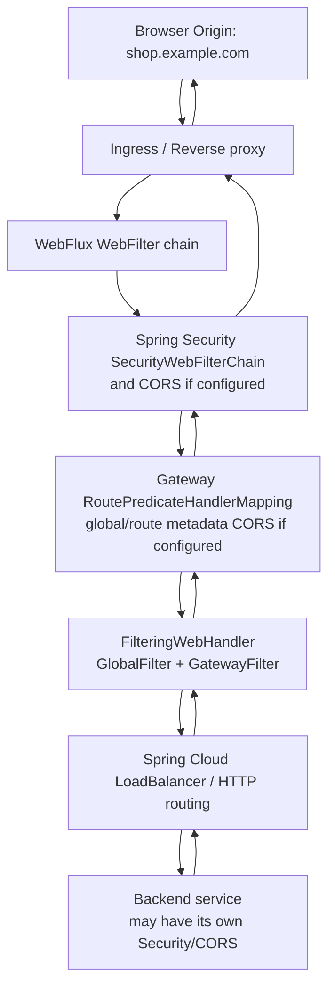
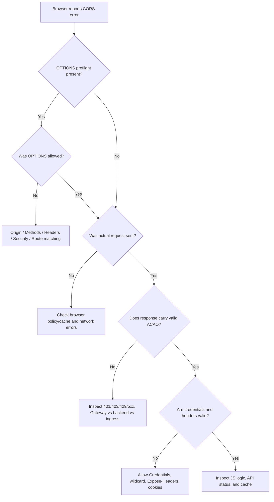

# Coordinating CORS across the gateway, Spring Security, and downstream services

A web application running at `https://shop.example.com` wants to call the API `https://api.example.com/api/orders` through **Spring Cloud Gateway**. The browser may still report a CORS error even when routes are right, the backend is healthy, and `curl` calls the API cleanly. Some failures appear only when sending `Authorization`, using login cookies, or when the backend returns `401`, `403`, or `429`. Often the cause is not merely a missing header—it is that **the Gateway, Spring Security, and the downstream microservice are handling the same CORS policy across different layers**.

In the **SPRING_CLOUD_GATEWAY** module, we already have route predicates, filter chains, path/header transformations, discovery, and load balancing. This lesson in the **CORS** chapter explains how to coordinate CORS with those mechanisms to keep the microservices entry point secure: from preflight and security-chain responses to centralized CORS policies, API authorization, rate limiting, circuit breakers, retries, TLS, and observability.

**Learning objectives:**

1. Distinguish CORS from authentication, authorization, CSRF, and TLS connection security.
2. Understand which layers a **preflight request** and an **actual request** traverse.
3. Choose a clear **CORS policy owner** when using Gateway, Spring Security, and backends.
4. Configure CORS globally, per route, or in Spring Security WebFlux without producing conflicting responses.
5. Diagnose `OPTIONS` failures, duplicate headers, cookie/credential issues, and errors emitted before routing.
6. Test both success and genuine error scenarios using HTTP tools **and a real browser**.

> **Version scope:** Primary examples target **Spring Cloud Gateway Server WebFlux** with **reactive Spring Security**. Gateway Server Web MVC uses Servlet `SecurityFilterChain` and corresponding route/filter config; it **does not directly use** `ServerHttpSecurity`/`SecurityWebFilterChain` APIs. Starter names and property namespaces such as `spring.cloud.gateway.server.webflux.*` can differ in older Gateway releases; verify against your actual Spring Boot/Spring Cloud/Gateway versions.

## 1. Opening scenario: the API works yet the browser still reports CORS

Suppose:

| Component | Assumed address | Responsibility |
| --- | --- | --- |
| Frontend SPA | `https://shop.example.com` | Calls the API from a browser. |
| Spring Cloud Gateway | `https://api.example.com` | Matches routes, enforces auth/quotas, and forwards requests. |
| `order-service` | `http://order-service:8080` | Checks business logic; reads/creates orders. |
| Discovery/LoadBalancer | `lb://order-service` | Selects a backend instance if configured. |

The frontend calls:

```javascript
const response = await fetch("https://api.example.com/api/orders", {
  method: "POST",
  headers: {
    "Content-Type": "application/json",
    "Authorization": "Bearer <access-token>"
  },
  body: JSON.stringify({ productId: 42, quantity: 2 })
});
```

Because the request goes to a **different origin** and uses non-simple headers/method/content type, the browser typically sends an **`OPTIONS` preflight** before sending the actual POST. If preflight gets a `401` from Spring Security because it carries no bearer token, the POST **is never sent**.

If preflight succeeds yet the POST returns `403` **without matching CORS headers**, JavaScript may see only a CORS-policy error, making the actual 403 status hard to read via `fetch`. Tweaking routes or raising timeouts would do nothing to fix it.

```mermaid
sequenceDiagram
    participant B as Browser
    participant G as Gateway / Security / CORS
    participant O as order-service
    B->>G: OPTIONS /api/orders + Origin + Access-Control-Request-*
    Note over G: Evaluate CORS policy; do not require POST token
    G-->>B: Preflight permitted + Access-Control-Allow-*
    B->>G: POST /api/orders + Authorization + JSON
    Note over G: Auth / authorization / route matching / filters
    G->>O: POST /orders + JSON
    O-->>G: HTTP response
    G-->>B: Response + matching CORS headers
```

This diagram shows a **typical success flow**. Not every cross-origin request triggers a preflight: a simple GET may go straight to the actual request, yet the browser **still validates CORS on the actual response**. Likewise, a preflight cached by the browser under `Access-Control-Max-Age` may not appear before every call.

## 2. What is CORS — and what is it not?

**Cross-Origin Resource Sharing (CORS)** is an HTTP-header-based mechanism allowing a web server to declare **which origins browsers allow to access responses** under the same-origin policy.

An **Origin** is defined by the triple:

```text
(scheme, hostname, port)
```

Examples:

| Frontend origin | API origin | Cross-origin? | Explanation |
| --- | --- | --- | --- |
| `https://shop.example.com` | `https://shop.example.com` | No | Same scheme, host, and implicit port. |
| `https://shop.example.com` | `https://api.example.com` | Yes | Different hostname. |
| `http://localhost:3000` | `http://localhost:8080` | Yes | Different port. |
| `http://api.example.com` | `https://api.example.com` | Yes | Different scheme. |
| `https://shop.example.com` | `https://shop.example.com:8443` | Yes | Different port. |

### CORS does not replace backend security

- **Not authentication:** `Origin: https://shop.example.com` is a client-supplied header, not proof of user identity.
- **Not authorization:** letting an origin read responses does not mean every user on that origin may view every order.
- **Not a firewall or anti-SSRF:** `curl`, mobile apps, and non-browser HTTP clients can issue requests without obeying browser CORS.
- **Not CSRF protection:** cookies can accompany requests per browser rules; certain cross-site requests can still be sent even if JavaScript cannot read responses.
- **Not TLS:** CORS does not encrypt traffic; use HTTPS at each hop per system policy.

**Security conclusion:** backends must still validate tokens/sessions, check resource permissions, validate input, and prevent unauthorized side effects. CORS is **a browser rule layer**, not a microservice "lock."

## 3. How do preflight requests and actual requests differ?

### 3.1. Preflight OPTIONS

For a JSON POST carrying `Authorization`, the browser may generate:

```http
OPTIONS /api/orders HTTP/1.1
Host: api.example.com
Origin: https://shop.example.com
Access-Control-Request-Method: POST
Access-Control-Request-Headers: authorization,content-type
```

This asks **"May this origin send a POST request with these headers?"**. It is not an order-creation command. Browsers normally **do not put the actual request's bearer token into preflight's `Authorization` header**; the server must not demand that token on preflight.

A valid conceptual CORS response might include:

```http
HTTP/1.1 200 OK
Access-Control-Allow-Origin: https://shop.example.com
Access-Control-Allow-Methods: GET, POST
Access-Control-Allow-Headers: Authorization, Content-Type
Access-Control-Allow-Credentials: true
Access-Control-Max-Age: 1800
Vary: Origin
Vary: Access-Control-Request-Method
Vary: Access-Control-Request-Headers
```

**`200 OK` is only an example**: successful preflight can return any suitable 2xx code depending on framework. `Access-Control-Allow-Credentials` is needed only when policy/callers use credentialed mode; avoid adding it as a generic "CORS fix" if the API does not need credentialed cross-origin requests.

### 3.2. Actual request

Once the browser accepts preflight, it sends the actual POST:

```http
POST /api/orders HTTP/1.1
Host: api.example.com
Origin: https://shop.example.com
Authorization: Bearer <access-token>
Content-Type: application/json

{"productId":42,"quantity":2}
```

The actual response must also satisfy the CORS policy for JavaScript to access it:

```http
HTTP/1.1 201 Created
Access-Control-Allow-Origin: https://shop.example.com
Vary: Origin
Content-Type: application/json

{"orderId":"demo-123"}
```

If the frontend uses `credentials: "include"` to send cross-origin cookies/credentials, the response must comply with credentialed CORS rules, including `Access-Control-Allow-Credentials: true` and an **explicit origin** rather than a wildcard. Cookies must also meet browser `SameSite`/`Secure` rules.

### 3.3. Key CORS headers

| Header | Sender | Role |
| --- | --- | --- |
| `Origin` | Browser/request | Origin of the page requesting access. |
| `Access-Control-Request-Method` | Browser, in preflight | Intended HTTP method of the actual request. |
| `Access-Control-Request-Headers` | Browser, in preflight | Non-simple header names the actual request wants to send. |
| `Access-Control-Allow-Origin` | Server response | Origin allowed to read the response under CORS. |
| `Access-Control-Allow-Methods` | Server, preflight response | Methods permitted under CORS. |
| `Access-Control-Allow-Headers` | Server, preflight response | Request headers permitted under CORS. |
| `Access-Control-Allow-Credentials` | Server response | Enables credentialed CORS when configured properly. |
| `Access-Control-Expose-Headers` | Server, actual response | Non-safelisted response headers that JavaScript may read. |
| `Access-Control-Max-Age` | Server, preflight response | Duration the browser may cache the preflight result, subject to browser caps. |
| `Vary` | Server/intermediary | Informs shared caches which request headers affect the response. |

**Do not confuse `Access-Control-Allow-Headers` with `Access-Control-Expose-Headers`.** The first permits the frontend to **send** headers like `Authorization`; the second permits JavaScript to **read** response headers like `X-Request-Id`.

## 4. Where is CORS processed in a Gateway architecture?

A WebFlux request may pass through these layers:



**The exact order** depends on filter ordering, handler mappings, the security chain, and whether preflight is answered early. Know the common conflict points:

1. **Spring Security can reject a request before the Gateway selects a route.** A route filter adding response headers later will never touch that response.
2. **Preflight uses the `OPTIONS` method.** If a route declares `Method=GET` or `Method=POST`, preflight may **fail to match the route** even though the actual request matches.
3. **The Gateway can answer preflight directly in its CORS handler** without calling the backend.
4. **The backend may also add CORS headers** to actual responses, creating duplicate or conflicting values against the Gateway.
5. **Ingress/CDN** may add, strip, cache, or overwrite CORS headers; valid Java config alone does not guarantee the final response is right.

Therefore, before editing YAML, identify **which layer owns the policy**, **which layer actually answers preflight**, and **who attaches CORS headers on success and error responses**.

## 5. Choosing a single CORS policy owner

No single option fits every system, yet **each public API should have one clear policy source**, avoiding three independent layers emitting conflicting CORS rules.

| Model | Primary CORS owner | Advantages | What to verify |
| --- | --- | --- | --- |
| **A. Spring Security/WebFlux at gateway** | Security CORS config handles CORS early in the gateway process. | Can process preflight ahead of authentication and attach CORS to many `401/403` responses. | Do not duplicate Gateway global/route CORS on the same paths; test security error responses. |
| **B. Spring Cloud Gateway CORS** | Gateway `globalcors` or route `metadata.cors`. | Policy aligns directly with public routes; convenient for API gateways. | Unmatched preflights, Security blocking OPTIONS, errors emitted before handler. |
| **C. Backend CORS** | Each microservice emits CORS headers. | Makes sense when backends are called directly by browsers on dedicated hostnames. | Gateway may not forward preflight; backends easily drift out of sync. |
| **D. Ingress/CDN CORS** | Edge proxy owns policy and response headers. | Enforces rules at the outermost edge. | Cache/`Vary`, gateway errors, rules outside app code, and change ownership. |

**Practical recommendation:** for a Gateway with reactive Spring Security protecting authenticated APIs, **Option A typically yields the most consistent behavior across both preflight and `401/403` responses**, if operations wants CORS managed in the security chain. Option B also works well when the Gateway owns the policy and security/ingress are configured not to block preflights; test errors returned **before** Gateway handlers separately.

Never enable both A and B simultaneously on the same paths without planning. Two rule sets processing CORS can produce baffling results when one permits an origin while the other denies or alters the response.

### When the backend still needs its own CORS

If `order-service` exposes **another public hostname** called directly by browsers, it may need CORS on that public endpoint. For traffic going through `https://api.example.com`, however, keep roles clear:

- **Through Gateway:** policy lives on Gateway/Security/Ingress per the chosen owner.
- **Direct backend access:** separate policy only for approved direct public hostnames.
- **Service-to-service paths:** CORS is not an auth check or prerequisite for internal HTTP clients.

The backend can still enforce Spring Security and authorization on all paths; only **CORS header ownership** needs clear separation.

## 6. Option A — Reactive Spring Security owns CORS

In WebFlux, use `SecurityWebFilterChain` paired with a `CorsConfigurationSource` reflecting allowed origins, methods, and headers. Security must process CORS **before authentication checks that could reject preflight**.

### 6.1. Java configuration example

The following example illustrates a **stateless API authenticated by bearer JWT**, without cookie/session login. It intentionally disables CSRF for that model; **never copy disabling CSRF into a session/cookie-based application**.

```java
import java.util.List;

import org.springframework.context.annotation.Bean;
import org.springframework.context.annotation.Configuration;
import org.springframework.http.HttpMethod;
import org.springframework.security.config.Customizer;
import org.springframework.security.config.annotation.web.reactive.EnableWebFluxSecurity;
import org.springframework.security.config.web.server.ServerHttpSecurity;
import org.springframework.security.web.server.SecurityWebFilterChain;
import org.springframework.web.cors.CorsConfiguration;
import org.springframework.web.cors.reactive.CorsConfigurationSource;
import org.springframework.web.cors.reactive.UrlBasedCorsConfigurationSource;

@Configuration
@EnableWebFluxSecurity
public class GatewaySecurityConfiguration {

    @Bean
    CorsConfigurationSource corsConfigurationSource() {
        CorsConfiguration cors = new CorsConfiguration();
        cors.setAllowedOrigins(List.of("https://shop.example.com"));
        cors.setAllowedMethods(List.of("GET", "POST", "OPTIONS"));
        cors.setAllowedHeaders(List.of(
            "Authorization", "Content-Type", "X-Correlation-Id"));
        cors.setExposedHeaders(List.of("X-Request-Id"));
        cors.setAllowCredentials(false); // Example uses bearer token only, no cookies.
        cors.setMaxAge(1800L);

        UrlBasedCorsConfigurationSource source =
            new UrlBasedCorsConfigurationSource();
        source.registerCorsConfiguration("/api/**", cors);
        return source;
    }

    @Bean
    SecurityWebFilterChain securityWebFilterChain(
            ServerHttpSecurity http,
            CorsConfigurationSource corsSource) {

        return http
            .cors(cors -> cors.configurationSource(corsSource))
            .csrf(ServerHttpSecurity.CsrfSpec::disable)
            .authorizeExchange(exchanges -> exchanges
                .pathMatchers(HttpMethod.OPTIONS, "/api/**").permitAll()
                .pathMatchers(HttpMethod.GET, "/api/catalog/**").permitAll()
                .anyExchange().authenticated())
            .oauth2ResourceServer(oauth2 -> oauth2
                .jwt(Customizer.withDefaults()))
            .build();
    }
}
```

To run this example, the application needs Spring Security/WebFlux OAuth2 Resource Server dependencies and a trusted **JWT issuer/JWK set** configuration for your environment. The snippet focuses solely on CORS and illustrative security rules; it **does not issue tokens or define all business permissions**.

**Why `setAllowCredentials(false)`?** In this example, the frontend sends bearer tokens via `Authorization` rather than relying on cross-origin cookies/sessions; `fetch` can use a credentials mode that omits cookies. If the app **genuinely uses cookies or `credentials: "include"`**, separately design and verify `allowCredentials=true`, explicit origins, `SameSite`/`Secure`, and CSRF.

### 6.2. Distinguishing two separate settings in Security

```java
.cors(cors -> cors.configurationSource(corsSource))
```

tells Security **how to process CORS**. Meanwhile:

```java
.pathMatchers(HttpMethod.OPTIONS, "/api/**").permitAll()
```

is an **authorization rule for `OPTIONS`**. A `permitAll` rule **does not generate** `Access-Control-Allow-Origin`, `Access-Control-Allow-Methods`, or `Access-Control-Allow-Headers`. It simply prevents normal authorization rules from blocking those requests if they reach that step.

With Option A, **avoid adding Gateway `globalcors` or `metadata.cors` on the same URLs**. If policies must differ by API, register multiple path-mapped `CorsConfiguration` entries in `CorsConfigurationSource`, or structure distinct scoped security chains and test matching order.

### 6.3. Benefit on 401 or 403 responses

Because CORS runs early in Security, an actual request from an allowed origin with a missing or invalid token can receive `401 Unauthorized` **with CORS headers attached**. JavaScript in the browser can then inspect status 401 and handle login/error UI properly, instead of seeing only a "CORS error" due to missing headers.

Keep in mind that an ingress, firewall, or proxy can still generate responses **before reaching Security**; Security cannot attach CORS to responses that never enter the application. Always verify the full infrastructure chain.

## 7. Option B — Spring Cloud Gateway owns CORS

Gateway Server WebFlux can process CORS **globally** or via **route metadata**. This fits well when you want browser access policies aligned visibly with the public APIs published by the Gateway.

### 7.1. Global CORS configuration in WebFlux

Example for WebFlux lines using the `spring.cloud.gateway.server.webflux.*` namespace:

```yaml
spring:
  cloud:
    gateway:
      server:
        webflux:
          globalcors:
            add-to-simple-url-handler-mapping: true
            cors-configurations:
              '[/**]':
                allowedOrigins:
                  - https://shop.example.com
                allowedMethods:
                  - GET
                  - POST
                  - OPTIONS
                allowedHeaders:
                  - Authorization
                  - Content-Type
                  - X-Correlation-Id
                exposedHeaders:
                  - X-Request-Id
                allowCredentials: false
                maxAge: 1800

          routes:
            - id: orders-route
              uri: lb://order-service
              predicates:
                - Path=/api/orders/**
              filters:
                - StripPrefix=2
```

In this YAML:

- `globalcors.cors-configurations` defines CORS policies for pattern-matched paths.
- `'[/**]'` must be **quoted in YAML** to preserve the literal pattern key.
- `allowedOrigins` lists **exact origins**, not backend hostnames.
- `allowedMethods` only declares CORS permissions for browsers; it **does not** add a `POST` route or Spring Security authorization.
- `allowedHeaders` lets actual requests carry `Authorization`, `Content-Type`, and approved custom headers.
- `add-to-simple-url-handler-mapping: true` is supported by certain Gateway WebFlux lines to process CORS for requests **missing route predicates** in gateway handler mappings, especially `OPTIONS` preflights.
- `lb://order-service` still requires Spring Cloud LoadBalancer and a valid `ServiceInstance` source; CORS has nothing to do with backend discovery.

This snippet does not create `order-service` or a security policy. If Spring Security is active, ensure **`OPTIONS` is not wrongly blocked**; better yet, verify the actual handling path of `401/403` responses. Because Gateway handler mappings can run after Security, responses rejected early by Security **may lack CORS headers from Gateway `globalcors`**. When consistent CORS on security errors is required, consider Option A or an intentionally placed early CORS layer.

### 7.2. Prefixes across Gateway release lines

Some earlier Gateway WebFlux documentation uses:

```yaml
spring:
  cloud:
    gateway:
      globalcors:
        add-to-simple-url-handler-mapping: true
        cors-configurations:
          '[/**]':
            allowedOrigins:
              - https://shop.example.com
            allowedMethods:
              - GET
              - POST
```

This illustrates the **property structure of older lines**, not a directive to declare both prefixes side by side. Verify your WebFlux/MVC starter, Spring Cloud Gateway version, and Configuration Properties catalog. If properties fail to bind, the app may still start while preflight lacks your expected headers.

### 7.3. Why does add-to-simple-url-handler-mapping matter?

Suppose a route only matches:

```yaml
predicates:
  - Path=/api/orders/**
  - Method=POST
```

Browser preflight uses `OPTIONS`, so `Method=POST` **does not match**; route-specific processing may never fire. Supported Gateway WebFlux versions let you register global CORS on simple handler mapping for such cases.

**Keep two caveats in mind:**

1. Registering CORS mapping **does not bypass Spring Security** if Security blocks `OPTIONS` ahead of the handler mapping.
2. Preflight is answered per the **applicable CORS policy**; it does not prove a POST route actually exists or the backend is ready. The actual request must still clear route predicates, authentication, and authorization.

## 8. Per-route CORS via metadata

Gateway WebFlux can declare `cors` in route `metadata`. Example of a catalog API exposed to one storefront:

```yaml
spring:
  cloud:
    gateway:
      server:
        webflux:
          routes:
            - id: catalog-public
              uri: http://localhost:8081
              predicates:
                - Path=/api/catalog/**
              metadata:
                cors:
                  allowedOrigins:
                    - https://shop.example.com
                  allowedMethods:
                    - GET
                  allowedHeaders:
                    - Authorization
                    - X-Correlation-Id
                  exposedHeaders:
                    - X-Request-Id
                  maxAge: 1800
```

This is **route-level CORS metadata** interpreted by the Gateway according to its configuration; it differs from arbitrary metadata keys such as `owner: catalog-team` (which enforce no policy).

### When should you use per-route metadata?

- Public APIs have **distinct origin sets** and operators want to review policies directly inside route definitions.
- The route has a straightforward browser contract and is not intercepted earlier by another Security/Ingress layer returning responses ahead of the Gateway.
- Route and CORS changes must be managed together with synchronized metadata validation and refresh/deployment.

### Limitations to know

A route-attached metadata policy is generally useful only when the Gateway **finds the route**. For `OPTIONS` preflights that miss a route because of `Method=GET`/`POST`, you need global or earlier-layer CORS handling. Never assume a route's `metadata.cors` automatically covers every preflight when the route predicate fails to match.

If multiple routes overlap on the same path with different CORS metadata, results also depend on route matching and `order`. Test with real `Origin`, `Access-Control-Request-Method`, and paths to confirm policies do not inadvertently widen cross-origin access.

## 9. Backend layer: avoiding duplicate CORS headers

Suppose the Gateway already returns:

```http
Access-Control-Allow-Origin: https://shop.example.com
```

while the backend also returns:

```http
Access-Control-Allow-Origin: *
```

As the response passes back through the Gateway, the browser may see two `Access-Control-Allow-Origin` values or a combined list-like value. For this header, browsers **reject multiple origins in one response** as invalid. The outcome is a CORS failure even though both layers thought they were "allowing" it.

### Governance rules

1. Designate **one owner** to emit CORS response headers for the public host `api.example.com`.
2. If Gateway/Security owns CORS, the backend handles business logic and auth and should omit CORS headers on Gateway-proxied traffic unless specifically required.
3. If browsers also call the backend directly on a separate hostname, configure CORS specifically for **that direct public path**, never emitting wildcards indiscriminately for internal requests.
4. Verify whether an edge CDN/ingress is also overwriting or injecting CORS headers.
5. Distinguish **missing header**, **duplicate header**, and **wrong header value** before making fixes.

### DedupeResponseHeader is only a conflict-cleanup layer

Gateway WebFlux includes the `DedupeResponseHeader` filter to clean up certain duplicate response headers, for example:

```yaml
filters:
  - name: DedupeResponseHeader
    args:
      name: Access-Control-Allow-Credentials Access-Control-Allow-Origin
      strategy: RETAIN_UNIQUE
```

This is an **abbreviated filter snippet** to attach to a route or `default-filters` under your version's namespace. The filter supports strategies such as retaining the first, last, or unique values.

**Important:** deduplication does not decide which origin **should be allowed**. If the Gateway emits `https://shop.example.com` while the backend emits `*`, keeping a "unique" value does not resolve the policy contradiction. The best fix is to **stop duplicate emission at the source** and use deduplication only intentionally when integrating legacy backends, followed by testing the final response.

### Never patch CORS manually with AddResponseHeader

Adding:

```yaml
filters:
  - AddResponseHeader=Access-Control-Allow-Origin, *
```

is not a complete CORS policy: it checks neither origin, method, request headers, credentials mode, nor preflight. It can also create duplicates alongside Spring Security or backends. Use the framework's CORS processor with an explicit policy instead of scattering header-injection directives across routes.

## 10. Origins, wildcards, credentials, and cookies

### 10.1. Avoid indiscriminate wildcards

`Access-Control-Allow-Origin: *` may fit **certain public resources with no credentialed access**, yet it is invalid when browsers send credentials via `credentials: "include"`. Under credentialed CORS, the server must return the **specific allowed origin** and `Access-Control-Allow-Credentials: true`.

In Spring, never configure:

```yaml
allowedOrigins:
  - '*'
allowCredentials: true
```

and expect the framework or browser to accept it. Spring's configuration APIs enforce compatibility checks between wildcard `allowedOrigins` and `allowCredentials`.

Some Spring versions support `allowedOriginPatterns` for pattern matching, yet an **overly broad pattern** still essentially permits too many origins. Prefer an explicit, controlled origin list, especially for cookie/session apps.

### 10.2. Cross-origin cookies require more than CORS

Suppose the frontend uses session cookies:

```javascript
const response = await fetch("https://api.example.com/api/me", {
  credentials: "include"
});
```

For the browser to transmit cookies and let JavaScript read the response, evaluate all of the following together:

- CORS policy permits the actual origin and credentials.
- Cookies set `SameSite`, `Secure`, `Domain`, and `Path` appropriately for the cross-site/cross-origin context.
- Browser tracking/cookie policies and restrictions.
- Spring Security enforces session authentication and proper **CSRF protection** on state-changing requests.
- HTTPS between browser and the cookie-receiving endpoint.

Never disable CSRF just because CORS checks `Origin`. CORS does not guarantee all state-changing requests cannot originate from another page, and browsers handle simple requests and form submissions differently.

### 10.3. Bearer JWTs via the Authorization header

For SPAs using:

```http
Authorization: Bearer <access-token>
```

the `Authorization` header typically causes cross-origin requests to require preflight. The CORS policy must allow the `Authorization` header name if the frontend sends it. Yet API access still depends on:

1. Validating JWT signature, issuer, audience, and expiration.
2. Security chain permitting the path/method for that identity.
3. Backend enforcing business authorization on the specific order/product.

Never set `allowCredentials: true` merely because `Authorization` appears in the config. Whether a credentialed CORS response is needed depends on **browser credentials mode / how credentials are attached**, and does not replace JWT resource server setup.

### 10.4. Localhost and staging environments

`http://localhost:3000` and `http://localhost:5173` are **two different origins**; `http://127.0.0.1:3000` also differs from `http://localhost:3000`. Use an exact list of dev origins in development profiles; never carry dev wildcards into production.

## 11. CORS on error responses: 401, 403, 429, 5xx

A well-behaved system does not just pass preflight; it also lets allowed frontends observe genuine HTTP errors.

| Scenario | Layer that may emit response | CORS question to verify |
| --- | --- | --- |
| **401 Unauthorized** | Spring Security at gateway or backend | Can the browser read status 401, or does it report only missing `Access-Control-Allow-Origin`? |
| **403 Forbidden** | Authorization at gateway/backend | Is CORS policy applied even when the user lacks permission? |
| **429 Too Many Requests** | Gateway `RequestRateLimiter` or ingress | Do quota responses carry CORS headers, and does `Retry-After` need `Expose-Headers`? |
| **404 Not Found** | Unmatched route or backend 404 | Does route-specific CORS run when no route matches? |
| **503 Service Unavailable** | Missing `ServiceInstance`, circuit breaker/fallback, or backend | Does the error occur before or after the CORS handler? |
| **502/504 and timeouts** | Gateway HTTP client/ingress | Whichever side emits the error, does it attach/preserve CORS headers? |
| **5xx from backend** | Downstream microservice | Gateway/CORS owner must process error responses just like success responses. |

**CORS should never turn `401` into `200`**, nor expose sensitive error internals. It simply ensures a browser from an **allowed origin** can observe the response per policy while authentication and authorization remain enforced.

### When Security blocks before a Gateway route

If Security returns `401` inside `SecurityWebFilterChain`, route-attached `AddResponseHeader` or `DedupeResponseHeader` filters **may never run**. That is why "adding headers on every route" is insufficient to let the frontend read all error responses.

Inspect the exact **point where the response is generated**, rather than tweaking route YAML and hoping CORS errors vanish.

## 12. Route predicates, OPTIONS, and the filter chain

### 12.1. When a Method predicate causes preflight to miss

Suppose:

```yaml
predicates:
  - Path=/api/orders/**
  - Method=POST
```

Browser preflight sends `OPTIONS /api/orders/123` with `Access-Control-Request-Method: POST`. **Preflight's actual HTTP method is `OPTIONS`**; the Gateway does not treat it as `POST` to satisfy `Method=POST`.

You have several options:

1. **Security-owned CORS** handling preflights early by allowed path/origin/method.
2. **Gateway global CORS** with unmatched-route preflight handling where supported by your version and permitted past Security.
3. Appropriate route/predicate design so `OPTIONS` is handled, **never** forwarding all unchecked `OPTIONS` traffic to backends just to fix CORS.

Never open an unconditional wildcard `OPTIONS /**` route without reviewing management endpoints, sensitive paths, and overall CORS policy.

### 12.2. Path rewriting does not change origin

Suppose the Gateway defines:

```yaml
predicates:
  - Path=/api/catalog/**
filters:
  - StripPrefix=2
uri: lb://catalog-service
```

`StripPrefix=2` makes the backend receive `/products/42` instead of `/api/catalog/products/42`. Yet **the browser sees API origin `https://api.example.com`**, not `lb://catalog-service` or the backend path. Design CORS policies around **public URLs/origins** and browser-called request routes rather than backend URIs.

If Spring Security inspects paths ahead of Gateway rewriting, define security matchers against **public paths**. Backends still authenticate/authorize against their own business paths. A `403` from a backend may have nothing to do with CORS even if the browser hides the status.

### 12.3. Header filters differ from the CORS processor

`SetRequestHeader`, `AddRequestHeader`, and `RemoveRequestHeader` mutate request headers. The CORS processor, however, inspects `Origin` and `Access-Control-Request-*` to compute a policy decision rather than blindly injecting a static header string.

Never synthesize `Origin` or treat `X-Forwarded-Host` as the browser's origin. Behind an ingress/reverse proxy, configure trust for forwarded headers so Spring interprets requests safely; trust only headers generated by managed network proxies.

## 13. CORS with service discovery, rate limits, retries, and TLS

| Gateway feature | Dedicated role | CORS intersection |
| --- | --- | --- |
| **DiscoveryClient / `lb://`** | Resolves backend instances by service ID. | Preflight should be handled per public API policy without probing backends to check allowed origins. |
| **Route predicates** | Matches path/method/header/host. | `OPTIONS` may not match actual-request predicates. |
| **GatewayFilter / GlobalFilter** | Rewrites paths/headers, records metrics, throttles requests. | Short-circuiting may skip route-level header filters. |
| **Spring Security** | Authentication and authorization. | Must handle preflight early and ensure `401/403` errors carry CORS if desired. |
| **RequestRateLimiter** | Enforces quotas per identity/API key. | Preflight lacks actual-request tokens; decide explicitly whether `OPTIONS` is rate-limited. |
| **CircuitBreaker** | Protects against slow/failing backends. | Fallback/error responses need CORS headers from the proper owner. |
| **Retry** | Retries upstream calls under conditions. | Preflight should not be retried upstream just to decide CORS; actual requests must still be safe/idempotent. |
| **TLS/HTTPS** | Encrypts and authenticates connections. | CORS distinguishes scheme in origin; never replaces certificates/mTLS. |
| **Observability** | Tracks routes/statuses/latencies/traces. | Distinguish `OPTIONS` preflight from actual requests instead of treating both as one business transaction. |

### Rate limiting for preflight

An `OPTIONS` preflight normally lacks the actual request's bearer token or cookies due to browser CORS behavior. If a `RequestRateLimiter` extracts keys from a JWT and runs ahead of preflight handling, it can:

- Fail because no key exists for preflight.
- Charge quota anomalously for a single user action.
- Cause browsers to block the actual request even when main API quota remains.

Decide quota policy explicitly: if preflight is answered early by the CORS processor, downstream route limiters may never see it; to guard against `OPTIONS` floods, apply controls at the ingress/network layer without demanding actual-request tokens.

### TLS, Host, and Origin

Frontend origin belongs to the **browser page**, whereas upstream hostnames in `lb://`/ServiceInstance represent the **Gateway → Backend** hop. CORS does not validate upstream TLS certificates, and TLS handshakes do not authorize frontend origins. Verify TLS independently across client → ingress → gateway → backend.

### Observability

Record at least:

- **Controlled** `Origin` values or allowlist groups (avoiding unbounded metric tag cardinality from raw values).
- Actual HTTP method (`OPTIONS`/`POST`), plus `Access-Control-Request-Method` for preflights.
- Public path/route ID and which layer generated the response (Security, Gateway, backend, ingress).
- HTTP status, distinguishing policy-rejected CORS from actual-request HTTP errors.
- Trace IDs for actual requests; note that preflight and actual request are **two separate HTTP requests**.

Never log bearer tokens, cookies, or sensitive bodies when investigating CORS.

## 14. CDNs, caching, and the Vary header

When responses vary by `Origin`, shared caches need to know. The header:

```http
Vary: Origin
```

helps caches distinguish responses carrying different per-origin CORS policies. For preflights, you may also need to account for:

```http
Vary: Access-Control-Request-Method
Vary: Access-Control-Request-Headers
```

Framework CORS processors usually emit the required headers per case, yet **proxies/CDNs or custom cache policies can break them**. Do not test responses solely at the app and ignore upstream caches.

### Two cache layers not to confuse

| Type | Controlled by | Meaning |
| --- | --- | --- |
| **Preflight cache** | Browser based on `Access-Control-Max-Age` and internal rules. | Reduces repeated `OPTIONS` calls before actual requests. |
| **HTTP response cache/CDN** | Cache headers, `Vary`, cache key, gateway/edge. | Reuses HTTP responses per its own policy; not controlled automatically by `Access-Control-Max-Age`. |

For APIs using tokens/cookies and user data, never let CDNs cache sensitive responses merely because they include CORS headers. Enforce proper `Cache-Control`, authorization, and cache keys. A wrong `Vary` setup can serve site A's origin response to site B or cause hard-to-reproduce CORS bugs.

## 15. Common CORS failures and diagnostics

| Symptom | Possible causes | How to verify |
| --- | --- | --- |
| `curl` works yet browser fails | `curl` does not enforce browser CORS policy. | Check Network tab: preflight, actual response, and CORS headers. |
| `OPTIONS` preflight returns `401` | Security demands a token on `OPTIONS`. | Check `SecurityWebFilterChain`, `CorsWebFilter` order, and `OPTIONS` rules. |
| `OPTIONS` returns `404` | Misses Gateway route due to `Method=POST` or CORS mapping misses it. | Check `globalcors`/simple URL handler mapping or Security-owned CORS. |
| `OPTIONS` returns `403` | Origin/method/headers rejected by policy or Security denial. | Compare `Origin`, `Access-Control-Request-*`, and CORS processor logs. |
| Preflight passes yet POST still fails CORS | Actual response lacks or mismatches `Access-Control-Allow-Origin`. | Inspect the actual response, especially `401/403/429/5xx`. |
| Browser reports multiple `Access-Control-Allow-Origin` values | Gateway, backend, or ingress each emit the header. | Inspect each hop and pick one owner rather than relying on dedupe as primary policy. |
| Browser rejects cookie request despite matching origin | Wildcard ACAO, missing credentials flag, or invalid cookie `SameSite`/`Secure`. | Check `credentials: "include"`, `Set-Cookie`, and browser rules. |
| `Authorization` blocked at preflight | `Access-Control-Allow-Headers` omits `Authorization`. | Check `Access-Control-Request-Headers` and `OPTIONS` response. |
| Frontend cannot read `X-Request-Id` | Missing `Access-Control-Expose-Headers`. | Inspect actual response and `response.headers.get(...)`. |
| Failure occurs only on one API route | Route metadata CORS differs from global policy, predicate misses, or Security matcher differs. | Compare route ID, path, and method. |
| Fails after enabling cache/CDN | Cache key/`Vary` issue or proxy rewrites headers. | Bypass cache, compare `Vary`, and check final response. |
| Fails only in browser, not mobile app | Mobile/native HTTP clients do not enforce browser CORS. | Confirm client runtime and real security policy. |
| Fails when backend returns 503 | Response emitted by Gateway/ingress before or after CORS handler. | Check where response originates alongside discovery/timeout errors. |

### Quick debugging flowchart



Do not modify `StripPrefix`/`RewritePath` filters or registry settings when the real issue is Spring Security blocking `OPTIONS`, unless route matching/path rewriting is already proven to be the cause.

## 16. Practice A — Testing CORS with curl and the browser

### 16.1. POC environment

- Frontend running at `http://localhost:3000`.
- Gateway Server WebFlux running at `http://localhost:8080`.
- Mock catalog backend at `http://localhost:8081` and/or orders at `http://localhost:8082`.
- One `/api/catalog/**` route using `StripPrefix=2` and one `/api/orders/**` route accepting a POST body.
- Choose **one** of the two CORS options: Security-owned or Gateway-owned. In the local POC, replace `https://shop.example.com` in the allowlist with `http://localhost:3000` to match the origin.

Never test against public backends or real customer data.

### 16.2. Valid preflight

```bash
curl -i -X OPTIONS \
  "http://localhost:8080/api/orders" \
  -H "Origin: http://localhost:3000" \
  -H "Access-Control-Request-Method: POST" \
  -H "Access-Control-Request-Headers: authorization,content-type"
```

Verify:

1. Response status is appropriate for a successful preflight.
2. `Access-Control-Allow-Origin` allows `http://localhost:3000` per policy.
3. `Access-Control-Allow-Methods` allows POST.
4. `Access-Control-Allow-Headers` allows `Authorization` and `Content-Type`.
5. There are no two conflicting `Access-Control-Allow-Origin` values.
6. The backend **does not necessarily receive `OPTIONS`** if CORS is handled at the gateway.

`curl` here only lets you **inspect HTTP headers**; the browser itself makes the final CORS decision.

### 16.3. Preflight from a disallowed origin

```bash
curl -i -X OPTIONS \
  "http://localhost:8080/api/orders" \
  -H "Origin: https://not-allowed.example" \
  -H "Access-Control-Request-Method: POST" \
  -H "Access-Control-Request-Headers: authorization,content-type"
```

Expect **no CORS permission granted to that origin**. The framework may return an error or omit `Access-Control-Allow-Origin`; exact status and behavior depend on settings. Do not insist on one fixed status code across every version—what matters is that the browser is not allowed to read responses for a disallowed origin.

### 16.4. Actual public GET

```bash
curl -i \
  -H "Origin: http://localhost:3000" \
  "http://localhost:8080/api/catalog/products/42"
```

Verify the `catalog` route works, the backend receives the path after `StripPrefix`, and the response includes matching CORS headers. If the backend returns `404` due to a wrong path, that is a **business/route path error**; never use wildcard ACAO to mask it.

### 16.5. Actual request missing a token or with an invalid token

```bash
curl -i \
  -H "Origin: http://localhost:3000" \
  "http://localhost:8080/api/orders/123"
```

For an authenticated route, the response may be `401`. Verify **CORS headers are still emitted** per your chosen owner (if the goal is for the frontend to read the error status). With Security-owned CORS, early CORS processing usually accomplishes this. With Gateway-owned CORS, `401` may happen before the route; live testing is essential.

### 16.6. Browser verification

Open a page from `http://localhost:3000` and run:

```javascript
async function checkCatalog() {
  const response = await fetch(
    "http://localhost:8080/api/catalog/products/42",
    { mode: "cors" }
  );
  console.log("HTTP status:", response.status);
  console.log("Request id:", response.headers.get("X-Request-Id"));
  console.log("Body:", await response.text());
}
checkCatalog().catch(console.error);
```

Check the **Network** tab in DevTools to see:

- Whether an `OPTIONS` preflight occurred and why.
- Which actual request the browser sent.
- HTTP status and CORS headers on each response.
- Whether anything was blocked due to credentials, exposed headers, origin policy, or mixed content.

**Note:** `fetch` does not reject merely because status is `401/403/500` if CORS allows reading the response; check `response.ok`/`status`. If CORS fails, JavaScript typically receives a network-like error and cannot access the specific HTTP response via the Fetch API.

## 17. Practice B — Simulating a Gateway and backend conflict

In the POC environment:

1. Configure **Security-owned CORS** at the gateway for origin `http://localhost:3000`.
2. Have the mock backend also emit `Access-Control-Allow-Origin: *` on actual responses.
3. Send a GET from the browser and record the final response headers.
4. Remove CORS headers from the backend (or disable backend CORS middleware for Gateway-proxied traffic).
5. Resend the request and compare results.
6. If temporary compatibility with a legacy backend is required, test `DedupeResponseHeader` **with verification** rather than using it instead of unifying policies.

When comparing, check `Access-Control-Allow-Credentials` and `Vary` as well. If Gateway and backend set the same header to **different values**, never assume retaining an arbitrary one satisfies your security policy.

### POC test matrix to keep

| ID | Case | What to prove |
| --- | --- | --- |
| C01 | Simple GET from allowed origin | Actual response carries right ACAO even without preflight. |
| C02 | JSON POST + Authorization | `OPTIONS` runs first; actual POST runs when token/roles are valid. |
| C03 | Preflight from rejected origin | No ACAO granted to that origin. |
| C04 | Preflight requesting disallowed header | Browser does not send the actual request. |
| C05 | `OPTIONS` preflight hitting `Method=POST` route | CORS owner handles it properly even though POST predicate misses. |
| C06 | Actual missing token | `401` stays protected; frontend may read status if policy desires. |
| C07 | Actual with token yet insufficient role | `403` is not disguised by missing CORS headers. |
| C08 | Quota exceeded | `429` still carries proper CORS behavior per owner. |
| C09 | No `ServiceInstance` | Distinguish `503`/discovery errors from CORS header errors. |
| C10 | Both Gateway and backend emit ACAO | Detect duplicate/conflicting headers; fix at the owner. |
| C11 | `credentials: "include"` | Explicit origin, Allow-Credentials, `Secure`/`SameSite` cookies, and CSRF. |
| C12 | Backend returns `X-Request-Id` | Browser reads it when `Expose-Headers` is configured. |
| C13 | Upstream CDN/cache | Response includes proper `Vary`; no data leakage across origins/users. |
| C14 | Two Gateway replicas | Identical CORS policy, security chain, and route config. |
| C15 | Path rewrite to another backend | Browser still evaluates public origin; never leak backend host into ACAO. |
| C16 | Browser preflight cache | Understand why `OPTIONS` does not appear before every actual request. |

## 18. Responsibility split template for development teams

One way to document CORS architecture decisions in a project:

| Question | Sample decision to state clearly |
| --- | --- |
| What is the public API hostname? | `https://api.example.com` |
| Allowed frontend origins? | `https://shop.example.com`, plus a separate staging profile. |
| Which layer owns CORS? | E.g., Spring Security WebFlux on the gateway. |
| Which layer handles preflight? | CORS processor in the security chain ahead of authentication. |
| May the backend add ACAO? | No for Gateway-proxied paths; exceptions must be documented explicitly. |
| When `401/403/429/503` is returned? | Preserve CORS semantics for allowed origins without altering error codes. |
| Does the API use cookies/sessions? | If yes, separate credentials/`SameSite`/`Secure` and CSRF policies. |
| Does the API use bearer JWTs? | Security validates JWT; preflight is not required to carry a bearer token. |
| Is there a CDN? | Review `Vary`/cache keys and `Cache-Control` on sensitive responses. |
| Who reviews origin changes? | Security/platform owners and frontend API contract owners. |
| How do we roll back? | Versioned config, tested per replica, and redeployed as needed. |

For APIs with per-route origin sets, add a **`route ID → allowedOrigins/allowedMethods/allowedHeaders`** column and identify a single configuration source. Never rely on unconsumed custom metadata as a substitute for a real CORS processor.

## 19. Production checklist

- [ ] Public frontend origins and public API hostnames are clearly identified, including scheme and port.
- [ ] One CORS owner is chosen per public API: Spring Security, Gateway, backend, or edge.
- [ ] If using Security-owned CORS, `CorsConfigurationSource` and security matchers are configured properly without duplicating Gateway policy on the same paths.
- [ ] If using Gateway-owned CORS, `globalcors`/`metadata.cors` match your exact version and `OPTIONS` unmatched by routes is handled.
- [ ] Preflight is not required to carry a bearer token or login session like actual requests; `permitAll OPTIONS` is not mistaken for a CORS policy.
- [ ] `allowedOrigins`, `allowedMethods`, and `allowedHeaders` reflect the API contract without unintended wildcards.
- [ ] Credentialed CORS uses explicit origins and corresponding cookie/CSRF policies; CSRF is never disabled on session auth just to fix CORS.
- [ ] `Access-Control-Expose-Headers` lists only response headers the browser needs to read and that are safe to expose.
- [ ] Gateway, backend, and ingress do not emit duplicate or conflicting ACAO/ACAC headers.
- [ ] Tested `200/201`, `401`, `403`, `404`, `429`, `502/503/504`, and early Spring Security rejections.
- [ ] Route `Method`, `Path` predicates, and path rewrites do not send preflight to the wrong handler.
- [ ] `lb://`, discovery, TLS, timeouts, circuit breakers, retries, and rate limits are verified independently of CORS.
- [ ] If a CDN is present, `Vary`, cache keys, `Cache-Control`, and sensitive responses are verified.
- [ ] Tested with browser DevTools, not solely `curl`/Postman.
- [ ] Metrics/logs capture route, method, status, and CORS policy outcome without recording tokens, cookies, or raw bodies.
- [ ] Gateway replicas run consistent policies with versioned review, rollout, rollback, and documentation processes.

## 20. Self-check questions

1. Do `http://localhost:3000` and `http://localhost:8080` share the same origin? Why or why not?
2. Why does a `POST` request with `Authorization` usually trigger an `OPTIONS` preflight before the actual request?
3. Why is adding `permitAll()` for `OPTIONS` in Spring Security alone insufficient to configure CORS?
4. When a Gateway route has `Method=POST`, why can an `OPTIONS` preflight fail to match despite `Access-Control-Request-Method: POST`?
5. If the Gateway sets `Access-Control-Allow-Origin: https://shop.example.com` while the backend sets `*`, what error might the browser encounter?
6. Why should `DedupeResponseHeader` not be treated as a policy-definition tool for allowed origins?
7. For an API using session cookies, which factors beyond `allowCredentials=true` must be verified?
8. Does a valid bearer JWT in `Authorization` replace `Access-Control-Allow-Headers: Authorization` during preflight?
9. Why can a `401` missing CORS headers be mistaken by the frontend for a CORS error instead of an authentication error?
10. When the browser calls an API at `https://api.example.com` and the Gateway forwards to `lb://order-service`, which origin/host should the CORS policy evaluate?
11. When `RateLimiter` returns `429` before calling the backend, which layer must ensure CORS headers are attached if the frontend needs to read `429`?
12. Why does `Access-Control-Max-Age` not permit a CDN to cache a user's JSON response?
13. Can Spring Cloud Gateway Server Web MVC use the exact `SecurityWebFilterChain` shown in this lesson? Which structure must it use instead?
14. What steps would you take using `curl` and DevTools to distinguish a preflight failure from an actual-response failure?

## 21. Version-specific references

The following resources help cross-check **syntax, processing order, and policies**. When deploying, open the docs matching your exact release train, Spring Security/Framework version, and WebFlux/Web MVC flavor:

- [Spring Cloud Gateway Server WebFlux — CORS Configuration](https://docs.spring.io/spring-cloud-gateway/reference/spring-cloud-gateway-server-webflux/cors-configuration.html)
- [Spring Cloud Gateway Server WebFlux — DedupeResponseHeader GatewayFilter Factory](https://docs.spring.io/spring-cloud-gateway/reference/spring-cloud-gateway-server-webflux/gatewayfilter-factories/deduperesponseheader-factory.html)
- [Spring Cloud Gateway — Configuration Properties](https://docs.spring.io/spring-cloud-gateway/reference/configprops.html)
- [Spring Security Reactive — CORS](https://docs.spring.io/spring-security/reference/reactive/integrations/cors.html)
- [Spring Security Reactive — Authorization](https://docs.spring.io/spring-security/reference/reactive/authorization/authorize-http-requests.html)
- [Spring Framework WebFlux — CORS](https://docs.spring.io/spring-framework/reference/web/webflux-cors.html)
- [MDN — Cross-Origin Resource Sharing (CORS)](https://developer.mozilla.org/en-US/docs/Web/HTTP/Guides/CORS)
- [Spring Cloud Gateway Server Web MVC — Reference](https://docs.spring.io/spring-cloud-gateway/reference/spring-cloud-gateway-server-webmvc/index.html)

**Takeaway:** **CORS is a browser policy governing cross-origin response access, not authentication or authorization.** With Spring Cloud Gateway, decide whether **Gateway, Spring Security, or the backend owns CORS**, process `OPTIONS` preflight ahead of authentication checks that could reject it, prevent duplicate CORS headers, and test error responses too. By tightly coordinating route predicates, filter chains, security, rate limiting, discovery, TLS, and observability, frontends receive semantically accurate HTTP responses without relaxing security just to "fix CORS."
