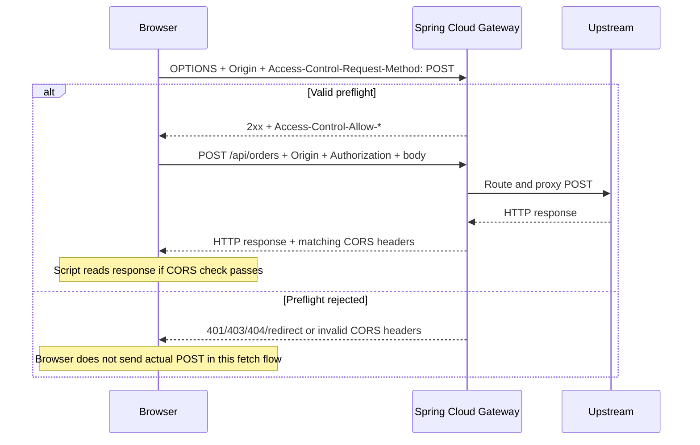
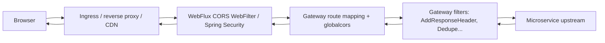
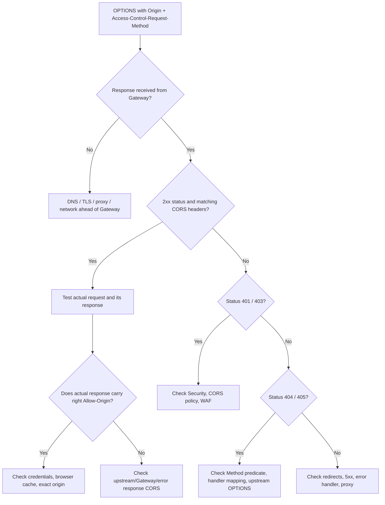

# Diagnosing duplicate CORS headers or rejected preflights

In a microservices system, a browser may run an application at `https://app.example.test` while sending API requests to `https://api.example.test` through **Spring Cloud Gateway**. Because the two origins differ, the browser enforces **Cross-Origin Resource Sharing (CORS)** to decide whether JavaScript may access the response. In particular, for requests carrying `Authorization`, custom headers, or certain `Content-Type` values, the browser typically sends an **`OPTIONS` preflight** before the main request.

Two failure categories commonly consume significant troubleshooting time for Gateway operators:

- **Duplicate CORS headers:** Both the Gateway and an upstream service emit `Access-Control-Allow-Origin`, or a filter appends the header a second time. The browser sees multiple values—such as two origins or `*` alongside a specific origin—and refuses to let the script read the response.
- **Rejected preflight:** `OPTIONS` misses the route's `Method` predicate, is blocked by Spring Security, lacks a matching CORS policy, or gets redirected/errored by a proxy or upstream service.

This lesson belongs to the **CORS** chapter and focuses on a **layered diagnostic workflow**: reproducing the request, reading complete headers and statuses, separating root causes across WebFlux/Security/Gateway/upstream, configuring a single CORS-owning source, using `DedupeResponseHeader` properly, and testing both preflight and actual requests. These skills tie directly into Spring Cloud Gateway route predicates, filter chains, path/header modifications, service discovery, and edge security.

> **Scope:** Examples use **Spring Cloud Gateway Server WebFlux**, reactive Spring Security when enabled, and modern browsers. Configuration prefixes depend on the Gateway version; Gateway Server MVC does not use the exact pipeline or Java APIs illustrated here.

## 1. What does CORS decide — and what does it not decide?

An **origin** has three parts: **scheme, hostname, and port**. Two URLs differing in any of those parts can be two distinct origins:

| App URL | API URL | Same origin? | Reason |
| --- | --- | --- | --- |
| `https://app.example.test` | `https://app.example.test/api` | Yes | Scheme, host, and port match |
| `https://app.example.test` | `https://api.example.test` | No | Different host |
| `http://localhost:5173` | `http://localhost:8080` | No | Different port |
| `http://app.example.test` | `https://app.example.test` | No | Different scheme |
| `https://app.example.test` | `https://app.example.test:8443` | No | Port differs from default HTTPS port |

CORS is a **browser-enforced rule** when JavaScript accesses cross-origin resources. The server returns response headers declaring which origins, methods, and headers are allowed; the browser interprets them. A command-line client like `curl` does not apply browser CORS blocking and can receive HTTP `200` plus a body even when browser JavaScript fails with a CORS error.

**CORS is not an authentication/authorization system.** It does not replace JWT verification, scope checks, upstream data protection, or CSRF protection for cookie/session apps. Non-browser clients can forge `Origin` or omit `Origin` entirely; therefore never treat `Origin` as proof of identity.

### Regular requests vs. preflight

Suppose JavaScript needs to call:

```javascript
const response = await fetch("https://api.example.test/api/orders", {
  method: "POST",
  headers: {
    Authorization: "Bearer <access-token>",
    "Content-Type": "application/json",
    "X-Request-Id": "req-123"
  },
  body: JSON.stringify({ productId: "sku-1", quantity: 2 })
});
```

Because the request carries headers/characteristics requiring pre-verification, the browser typically sends:

```http
OPTIONS /api/orders HTTP/1.1
Host: api.example.test
Origin: https://app.example.test
Access-Control-Request-Method: POST
Access-Control-Request-Headers: authorization,content-type,x-request-id
```

This is a **separate HTTP request**. The method received by the Gateway is **`OPTIONS`**, not `POST`. The `Access-Control-Request-Method: POST` header only indicates that the browser intends to call `POST` once preflight is allowed.

A valid preflight response might look like:

```http
HTTP/1.1 200 OK
Access-Control-Allow-Origin: https://app.example.test
Access-Control-Allow-Methods: GET,POST
Access-Control-Allow-Headers: authorization,content-type,x-request-id
Access-Control-Max-Age: 1800
Vary: Origin
Vary: Access-Control-Request-Method
Vary: Access-Control-Request-Headers
```

`200` is only **one example**; another valid 2xx response such as `204` may be returned depending on the handler. `Vary` headers can appear on multiple lines or combined validly. After a successful preflight, the browser sends the actual `POST` request (unless a valid preflight result is still cached by the browser).



**Key point:** A passing preflight **is not enough**. The **actual request's** response must also carry a valid `Access-Control-Allow-Origin`; if credentials mode requires it, an appropriate `Access-Control-Allow-Credentials` is also needed.

## 2. Common CORS error messages

Browsers can surface different failures that all appear under a "CORS" label. Inspect the **Network tab** or the raw HTTP response to separate root causes.

| Browser/HTTP symptom | Likely cause | First check |
| --- | --- | --- |
| `No 'Access-Control-Allow-Origin' header` | Response lacks header for calling origin; could be 401/403/5xx from another layer | Status, response origin layer, CORS owner |
| `contains multiple values` or `*, https://app...` | Both Gateway and upstream set Allow-Origin; or a filter duplicated it | All `Access-Control-Allow-Origin` values |
| Preflight status `401` | Security requires a token on `OPTIONS` | `SecurityWebFilterChain` and CORS handling |
| Preflight status `403` | Origin/method/headers disallowed or blocked by another policy | CORS policy, Security, WAF/proxy |
| Preflight status `404` | `OPTIONS` misses route/handler or path rewritten wrongly | Route predicates, `globalcors`, handler mapping |
| Preflight status `405` | A handler or upstream rejects `OPTIONS` | Check whether preflight was proxied to backend |
| Redirect `301`/`302`/`307`/`308` | Proxy/app rewrites URL or HTTP → HTTPS | `Location` and final origin/URL |
| Missing `Access-Control-Allow-Credentials` | Request sends credentials yet server does not permit it | `credentials` mode, `allowCredentials` |
| `Access-Control-Allow-Origin: *` with credentials | Wildcard invalid for credentialed CORS | Allowed origins and cookie/auth policy |
| Method/header disallowed | `Access-Control-Allow-Methods` or `Access-Control-Allow-Headers` omits required value | Actual preflight request |
| Preflight 2xx yet POST is "CORS blocked" | POST response lacks right CORS headers, or proxy/error handler generated a different response | Inspect both `OPTIONS` and `POST` |
| CORS fails only intermittently | Gateway/upstream replicas differ in policy, cache/proxy differs, or routes overlap | Log instance/route ID and compare responses |

A `CORS policy blocked` error does not prove the request **never reached the backend**. If preflight failed, the browser usually never sent the actual request for that call. However, if the actual request was already sent and only the **response** lacked CORS headers, the backend may have completed the write even though JavaScript could not read the response. This matters critically for `POST` calls creating payments or orders: never retry blindly just because the browser reported a CORS error.

## 3. Sources of CORS headers: locate the exact layer before fixing

A request can pass through multiple components capable of writing response headers:



This diagram shows **points that may create or alter headers**; it does not imply every mechanism runs on every request or follows a rigid additive order. Preflight can be handled early and **bypass route filters and upstream services**.

### Common actors

| Layer | What it can do | Common risk |
| --- | --- | --- |
| Reverse proxy/Ingress/CDN | Add `Access-Control-Allow-*`, handle `OPTIONS`, cache preflights | Header added again at Gateway; cache serves wrong Origin |
| WebFlux `CorsWebFilter` | Handle CORS requests early using a configuration source | Conflicts if Gateway/another component also sets CORS |
| Reactive Spring Security | Allow/block requests, integrate CORS handling per config | Blocks `OPTIONS` with `401/403` ahead of Gateway route matching |
| Gateway `globalcors` | Define CORS policy attached to handler mapping | `OPTIONS` misses route `Method` or wrong config prefix |
| Per-route CORS metadata | Route-specific policy (when supported by version) | Route overlap; global vs. route policy mismatch |
| `AddResponseHeader`/custom filter | Append header to route response | Duplicates an already-present header |
| Upstream service | Responds with backend-framework-generated headers | Both backend and Gateway emit `Access-Control-Allow-Origin` |
| Error handler/fallback | Produces `4xx/5xx` or fallback response | Omits CORS headers on error branches |

**Design rule:** For a given public API and response path, establish **one clear CORS-owning source**, usually at the Gateway edge or a unified mechanism ahead of it. Backends do not need to emit CORS for internal traffic when the Gateway manages the public browser policy.

Having two CORS configurations does not always guarantee duplicate headers: some components detect an already-handled response and skip re-adding. Still, you cannot rely on that as a contract across mixed frameworks, proxies, and filters. Always inspect the **final response**.

## 4. When is a header genuinely "badly duplicated"?

CORS does not forbid multi-valued headers across the board. Check **the semantics of each header**.

### `Access-Control-Allow-Origin` must represent one allowed origin

Invalid examples:

```http
Access-Control-Allow-Origin: https://app.example.test
Access-Control-Allow-Origin: *
```

or merged by a proxy into:

```http
Access-Control-Allow-Origin: https://app.example.test, *
```

Browsers **do not** interpret this list as "either origin is permitted." A CORS response must provide a single valid value—typically **one exact origin** matching the request, or `*` when wildcards are allowed and credentials are not required under applicable rules.

Even two **identical** Allow-Origin lines should not be kept:

```http
Access-Control-Allow-Origin: https://app.example.test
Access-Control-Allow-Origin: https://app.example.test
```

Some stacks fold them into a comma-separated list, causing browsers to reject the response for lacking a single valid Allow-Origin value.

### `Access-Control-Allow-Credentials`

The value `true` permits browsers to include/expose credentials on cross-origin requests per CORS rules. Emitting the header twice can cause proxy/browser errors. Never set `Access-Control-Allow-Credentials: true` merely because "the API uses JWTs"; evaluate whether requests use cookies, HTTP auth, TLS client credentials, or a specific fetch credentials mode, and apply the matching policy.

### Headers allowed to hold lists

`Access-Control-Allow-Methods` and `Access-Control-Allow-Headers` carry token lists under the CORS contract. `Vary` is a response header that can list multiple fields such as `Origin`, `Access-Control-Request-Method`, and `Access-Control-Request-Headers`. Repeating `Vary` is not equivalent to the "multiple values" error on `Access-Control-Allow-Origin`.

Never apply a blanket filter to "strip every multi-valued header," as that breaks HTTP semantics. Diagnostic fixes should **target only CORS headers with duplicate sources and invalid values**.

## 5. Diagnostic workflow for rejected preflights

### Step 1 — Capture the exact request sent by the browser

In DevTools → Network, filter by `OPTIONS` or the API URL and inspect:

- Request URL, scheme, host, port, path, and query.
- `Origin`, e.g., `https://app.example.test`.
- `Access-Control-Request-Method`, e.g., `POST`.
- `Access-Control-Request-Headers`, e.g., `authorization,content-type,x-request-id`.
- Response status, response headers, and `Location` header on redirects.
- Whether an actual `POST`/`PUT` request followed.

**Note:** Not every cross-origin request triggers a preflight. Simple `GET` calls only need CORS headers on the **actual response**. Thus, the absence of `OPTIONS` in the Network tab is not automatically an error.

### Step 2 — Reproduce with curl

Example with local Gateway `http://localhost:8080` and frontend origin `https://app.example.test`:

```bash
curl -i -X OPTIONS 'http://localhost:8080/api/orders' \
  -H 'Origin: https://app.example.test' \
  -H 'Access-Control-Request-Method: POST' \
  -H 'Access-Control-Request-Headers: authorization,content-type,x-request-id'
```

`curl` displays the **raw response headers**, including duplicate Allow-Origin lines that browsers reject. Avoid `curl -L` initially when investigating redirects, since following `Location` automatically hides the initial redirect. Use `curl -v` in test environments when inspecting connection details, and avoid printing real tokens into shared logs.

**Never interpret "`curl` succeeded" as valid CORS.** `curl` does not enforce browser CORS checks; it simply lets you inspect HTTP responses to find the cause.

### Step 3 — Pinpoint where the request is blocked



If preflight returns `401`/`403`, inspect the **Security/CORS** layer before blaming route predicates. If it returns `404`/`405`, determine whether the Gateway handled `OPTIONS` or forwarded it to the upstream service.

### Step 4 — Compare responses across layers

When internal testing access is available, compare:

1. Response from the **backend directly** (bypassing Gateway).
2. Response through the **Gateway directly** (if network allows).
3. Response through the **Ingress/CDN/public domain**.

Examples:

| Backend | Gateway | Public edge | Initial diagnosis |
| --- | --- | --- | --- |
| One Allow-Origin | Two Allow-Origins | Two Allow-Origins | Gateway likely added a duplicate |
| No Allow-Origin | One Allow-Origin | Two Allow-Origins | Ingress/CDN likely added a duplicate |
| One Allow-Origin | One Allow-Origin | One Allow-Origin | No duplication; inspect the **value** |
| `200` | `200` | `401` | Edge Security/WAF likely blocked it |
| OPTIONS not sent to backend | Gateway returns 2xx | Edge returns redirect | Check canonical URL / HTTPS redirect at edge |

This is **evidence-based inference**, not an automatic conclusion: each layer can also modify, strip, or rewrite headers. Use correlation IDs and route/instance logs to trace the exact same request.

## 6. Why doesn't `Method=POST` match an `OPTIONS` preflight?

A route might declare:

```yaml
spring:
  cloud:
    gateway:
      routes:
        - id: orders-write
          uri: lb://order-service
          predicates:
            - Path=/api/orders/**
            - Method=POST
          filters:
            - StripPrefix=1
```

The browser sends:

```http
OPTIONS /api/orders HTTP/1.1
Origin: https://app.example.test
Access-Control-Request-Method: POST
```

At route matching, the `Method=POST` predicate inspects the HTTP method **`OPTIONS`** and therefore **does not match**. You cannot "fix" this using `StripPrefix`, `AddResponseHeader`, or another filter on `orders-write`, because route filters execute **only after the route is selected**.

**Do not blindly add `Method=OPTIONS` to every route** just to push preflights downstream to backends. For browser preflights, a WebFlux/Gateway CORS processor should normally respond early per public API policy rather than forcing business backends to implement `OPTIONS` on every endpoint.

Even if you changed it to `Method=POST,OPTIONS`, the backend might still return `405` or responses missing `Access-Control-Allow-*`. If another route has a broader `Path`, `OPTIONS` might even match the wrong route. Fix CORS design at the preflight handling layer itself.

## 7. Configuring `globalcors` for Gateway WebFlux

Spring Cloud Gateway supports CORS configuration on routes and handler mappings. In versions using the traditional prefix, for example:

```yaml
spring:
  cloud:
    gateway:
      globalcors:
        add-to-simple-url-handler-mapping: true
        cors-configurations:
          '[/**]':
            allowedOrigins:
              - https://app.example.test
            allowedMethods:
              - GET
              - POST
              - PUT
              - PATCH
              - DELETE
            allowedHeaders:
              - Authorization
              - Content-Type
              - X-Request-Id
            exposedHeaders:
              - X-Request-Id
            allowCredentials: true
            maxAge: 1800

      routes:
        - id: orders
          uri: lb://order-service
          predicates:
            - Path=/api/orders/**
            - Method=GET,POST
          filters:
            - StripPrefix=1
```

**Key meanings:**

- `cors-configurations` defines policies by path pattern. Pattern `'[/**]'` is quoted so YAML preserves special characters; in real deployments, narrow the scope such as `'/api/**'` where appropriate.
- `allowedOrigins` lists permitted origins—**not** schemeless domain patterns.
- `allowedMethods` lists methods the browser **intends to call**, such as `POST`. Preflight's own HTTP method is `OPTIONS`, yet you do not have to add `OPTIONS` to `allowedMethods` just to permit `POST` preflights.
- `allowedHeaders` must match actual `Access-Control-Request-Headers`. Sending `Authorization` from a browser is a frequent trigger for preflight.
- `exposedHeaders` lets JavaScript read response headers outside the default exposed set; it **does not** replace `allowedHeaders`.
- `allowCredentials: true` should only be enabled when the app genuinely needs credentialed cross-origin requests and origins are tightly defined.
- `maxAge` is how long the browser **may cache preflight results**, not a service discovery or route cache TTL.
- `add-to-simple-url-handler-mapping: true` registers the CORS policy on `SimpleUrlHandlerMapping` for requests **not matched by Gateway route predicates**, such as `OPTIONS` preflight when a route only accepts `POST`.

**Important Security note:** `globalcors` on handler mapping **does not guarantee** bypassing a reactive Spring Security `WebFilter` that demands authentication on `OPTIONS` ahead of route mapping. If Security blocks earlier, integrate a CORS mechanism that executes sufficiently early in `WebFilter`/Security and avoid duplicating headers across layers.

**Important version note:** Newer Spring Cloud Gateway Server WebFlux releases use the `spring.cloud.gateway.server.webflux.globalcors` prefix alongside `spring.cloud.gateway.server.webflux.routes`. Never mix prefixes across generations without checking configuration metadata and version docs, because YAML may parse cleanly while routes or CORS policies fail to bind. Examples here illustrate configuration conceptually; check the documentation for your exact app version.

### Route-specific CORS

Some versions support CORS metadata on routes:

```yaml
spring:
  cloud:
    gateway:
      routes:
        - id: orders-read
          uri: http://localhost:8081
          predicates:
            - Path=/api/orders/**
          metadata:
            cors:
              allowedOrigins:
                - https://app.example.test
              allowedMethods:
                - GET
                - POST
              allowedHeaders:
                - Authorization
                - Content-Type
```

Route metadata is useful when a route has its own policy, yet still requires a consistent strategy for unmatched preflights and Security coordination. Never define a broad policy in `globalcors` alongside another policy on a route without understanding merging and precedence in your version.

## 8. When Spring Security rejects OPTIONS before Gateway routing

A classic scenario:

1. Browser sends a preflight without a Bearer token.
2. Spring Security enforces `anyExchange().authenticated()`.
3. The `OPTIONS` request receives `401`.
4. No Gateway route is reached; `globalcors` on route mapping or Gateway route filters cannot fix an upstream security block.

One solution is configuring **a `CorsWebFilter`** with a `CorsConfigurationSource` early enough in the WebFlux `WebFilter` chain, ensuring Security does not intercept preflights ahead of CORS handling.

Example of centralized CORS in WebFlux (instead of simultaneously enabling Gateway `globalcors` on the exact same API):

```java
@Configuration
public class CorsAtEdgeConfiguration {

    @Bean
    @Order(Ordered.HIGHEST_PRECEDENCE)
    CorsWebFilter corsWebFilter() {
        CorsConfiguration cors = new CorsConfiguration();
        cors.setAllowedOrigins(
            List.of("https://app.example.test"));
        cors.setAllowedMethods(
            List.of("GET", "POST", "PUT", "PATCH", "DELETE"));
        cors.setAllowedHeaders(
            List.of("Authorization", "Content-Type", "X-Request-Id"));
        cors.setExposedHeaders(List.of("X-Request-Id"));
        cors.setAllowCredentials(true);
        cors.setMaxAge(1800L);

        UrlBasedCorsConfigurationSource source =
            new UrlBasedCorsConfigurationSource();
        source.registerCorsConfiguration("/api/**", cors);

        return new CorsWebFilter(source);
    }
}
```

This Java snippet references `CorsConfiguration`, `CorsWebFilter`, `UrlBasedCorsConfigurationSource`, `Order`, `Ordered`, and `List`; include the Spring Framework imports, Spring Security version config, and proper filter ordering. If the framework/security already provides a CORS filter for the same paths, **do not add a second bean** as an experiment; identify which component currently handles the request.

In an OAuth2 Resource Server setup, authorization rules can remain intact, such as:

```java
@Bean
SecurityWebFilterChain apiSecurity(ServerHttpSecurity http) {
    return http
        .authorizeExchange(exchanges -> exchanges
            .pathMatchers("/api/**").authenticated()
            .anyExchange().permitAll())
        .oauth2ResourceServer(oauth2 ->
            oauth2.jwt(Customizer.withDefaults()))
        .build();
}
```

This illustrates only the Security policy; real applications also require method/scope authorization, appropriate CSRF policies, exception handling, and JWT verification setup. **An early-ordered CORS filter resolves preflights before Security**, while actual requests still pass through authentication and authorization.

Another common setup permits `OPTIONS` in the appropriate preflight scope, yet **`permitAll(OPTIONS)` only prevents Security from blocking it—it does not generate `Access-Control-Allow-Origin`**. An actual CORS policy is still mandatory. Never open the entire application with `anyExchange().permitAll()` to "fix CORS."

### CORS and CSRF are not the same thing

CORS restricts cross-origin JavaScript from reading responses; CSRF is the risk that another site causes a browser to send state-changing requests using ambient credentials (especially cookies/sessions). Enabling valid CORS **does not eliminate CSRF**. For stateless Bearer-token APIs, CSRF choices differ from session-cookie apps; decide based on the actual authentication mechanism.

## 9. Handling duplicate headers with `DedupeResponseHeader`

Spring Cloud Gateway provides the `DedupeResponseHeader` GatewayFilter Factory to strip duplicate values according to a configured strategy on **response headers** of a matched route.

Example:

```yaml
spring:
  cloud:
    gateway:
      routes:
        - id: orders
          uri: http://localhost:8081
          predicates:
            - Path=/api/orders/**
          filters:
            - name: DedupeResponseHeader
              args:
                name: Access-Control-Allow-Credentials Access-Control-Allow-Origin
                strategy: RETAIN_FIRST
```

Common strategies:

| Strategy | Practical effect | What to watch out for |
| --- | --- | --- |
| `RETAIN_FIRST` | Keeps the first value | The first value could come from upstream and be **wrong** for public policy |
| `RETAIN_LAST` | Keeps the last value | The last value could likewise be a wrong policy or wildcard |
| `RETAIN_UNIQUE` | Keeps distinct values | For `Access-Control-Allow-Origin`, **multiple distinct origins remain invalid** |

Header names are **space-separated** in the `name` argument. Use expanded YAML as shown above to avoid confusing shortcut commas with separators between header names.

**Do not treat `DedupeResponseHeader` as a cure-all for CORS errors:**

1. It operates inside the **route filter chain**. If Security blocks preflight before routing, this filter never runs.
2. If preflight is answered early by the CORS processor, route filters may not execute; route-level Dedupe also cannot fix headers added later by an ingress.
3. Retaining one value does not guarantee it is the **right value**. If upstream returns `*` and the Gateway returns a specific origin on a credentialed response, keeping `*` still causes the browser to block it.
4. The filter touches only named headers and does not fix root causes like dual CORS ownership or misconfigured proxy caches.
5. If a response is already committed or headers are injected **after the Gateway**, route filters cannot alter what the client ultimately receives.

**Recommendation:** First designate **one CORS owner** and remove duplicate settings in upstreams, ingresses, or custom filters. Use `DedupeResponseHeader` only when integrating a backend you cannot modify immediately, and verify the exact final header values. For responses from Gateway error handlers or early preflight processing, fix the layer emitting the response rather than merely adding a route filter.

## 10. Example: distinguishing upstream vs. Gateway duplication

Suppose backend `order-service` runs its own CORS middleware and responds:

```http
HTTP/1.1 200 OK
Access-Control-Allow-Origin: *
Content-Type: application/json

{"orders":[]}
```

While the Gateway adds:

```yaml
filters:
  - AddResponseHeader=Access-Control-Allow-Origin,https://app.example.test
```

After proxying, the client may see:

```http
Access-Control-Allow-Origin: *
Access-Control-Allow-Origin: https://app.example.test
```

That response **lacks a single valid CORS policy**. Especially when the browser sends credentials, only one matching explicit origin with `Access-Control-Allow-Credentials: true` is valid; `*` cannot remain.

Remediation options in priority order:

1. **Eliminate the duplicate writer:** Make the Gateway the CORS owner for public APIs; disable CORS middleware on backends called only internally. Never add manual `AddResponseHeader` rules when `globalcors` or `CorsWebFilter` already handles CORS.
2. **Unify policy across preflight and actual responses:** One layer emits `Access-Control-Allow-Origin`; other hops pass it through untouched.
3. **If Dedupe is unavoidable:** Verify source ordering and values, pick `RETAIN_FIRST` or `RETAIN_LAST` deliberately, and test every status branch including 2xx, 401/403, 429, and 5xx.
4. **If a proxy/CDN injects headers after Gateway:** Fix the proxy configuration or assign CORS ownership at the edge, because the Gateway cannot strip headers added after responses leave the Gateway.

**Watch out for:** Dynamically reflecting the request's `Origin` (`echo Origin`) without validating against an allowlist can allow untrusted websites to read credentialed responses. Deduplication never fixes overly permissive origins; restrict origins inside the CORS policy itself.

## 11. Test the actual request too, not just preflight

After preflight succeeds, run the actual request with `Origin`:

```bash
curl -i 'http://localhost:8080/api/orders/42' \
  -H 'Origin: https://app.example.test'
```

If the API requires a Bearer token, authorized test runs can attach `Authorization: Bearer ...` from a secure source; never copy real tokens into logs, docs, or shared shell histories.

Example valid response:

```http
HTTP/1.1 200 OK
Access-Control-Allow-Origin: https://app.example.test
Access-Control-Allow-Credentials: true
Vary: Origin
Content-Type: application/json

{"id":42}
```

Another request might return `401` for an invalid token. Even then, the frontend still needs a **valid CORS response** if JavaScript must read the error status/body. If Security or an error handler emits `401` without Allow-Origin, the browser may display only a CORS error, leading developers to suspect broken Gateway routing.

Likewise, `429` responses from a rate limiter, `503` when the LoadBalancer finds no service instance, or `504` from an upstream timeout can follow different code paths than `200`. Test CORS on **error branches**, not just the happy path.

### CORS does not guarantee whether the backend processed the request

Distinguish two critical cases:

- **Preflight failed:** The browser did not send the actual request in that fetch call. Here you can fix CORS before business logic runs.
- **Actual request sent yet response blocked:** The backend may already have committed the business operation. If JavaScript cannot read the response, use a request ID or idempotency key to query status or reconcile before retrying.

This is vital for non-idempotent POSTs creating orders, charges, or refunds. Never initiate a duplicate payment solely because the console logged "CORS."

## 12. Credentials, wildcards, and origin lists

### Explicit origins when using credentials

If the frontend calls:

```javascript
fetch("https://api.example.test/api/me", {
  credentials: "include"
});
```

the browser needs a response with Allow-Origin matching the calling origin plus `Access-Control-Allow-Credentials: true`. Never use:

```http
Access-Control-Allow-Origin: *
Access-Control-Allow-Credentials: true
```

because wildcard Allow-Origin is invalid for credentialed CORS.

**Key reminders:**

- `allowedOrigins` must capture **scheme + host + port**—e.g., `http://localhost:5173` differs from `https://localhost:5173`.
- With multiple explicit origins, the server normally selects **one matching origin** and emits a single `Access-Control-Allow-Origin` per request, never a list of origins in the same header.
- When configuring origin patterns, verify `allowedOriginPatterns` semantics in your Spring version. Overly broad patterns can unintentionally permit untrusted subdomains.
- Enabling `allowCredentials` requires checking cookie attributes like `SameSite`, `Secure`, browser third-party cookie policies, and CSRF. Allowing CORS response reads **does not guarantee the browser will send cookies**.
- `Access-Control-Expose-Headers` only determines which response headers JavaScript can read; it does not enable sending `Authorization`.

### `Vary: Origin` and caching

When backend/Gateway responses vary Allow-Origin by request `Origin`, shared caches (proxies/CDNs) must separate those variants. `Vary: Origin` is an essential signal; for preflights, `Vary` can also include `Access-Control-Request-Method` and `Access-Control-Request-Headers`.

Dangerous example: a CDN caches a response for `https://admin.example.test` and serves the exact `Access-Control-Allow-Origin: https://admin.example.test` header to `https://app.example.test`. The app browser rejects it even though Gateway policy is correct. The bug lies in **CDN cache key / `Vary` handling**, not `DedupeResponseHeader`.

Never strip valid `Vary` headers just to "clean up" responses; doing so invites cross-origin cache poisoning and flaky behavior.

## 13. CORS across other Spring Cloud Gateway layers

### Route predicates and route order

An `OPTIONS` preflight can miss a `Method=GET,POST` route. Besides `Method`, predicates such as `Host`, `Header`, and `Query` can also fail to match, preventing route-attached CORS policies from running when expected. A broad route with a higher-priority `order` can also capture `OPTIONS` and proxy it to a service that rejects it.

**Diagnosis:** Check the matched route ID (if any), route `order`, and whether the CORS processor ran. Never look solely at `Path`.

### Path/header modification filters

`StripPrefix`, `RewritePath`, and `AddRequestHeader` execute inside the Gateway filter chain **after route matching**. They cannot rescue a preflight rejected before mapping. `AddResponseHeader` can introduce duplicate CORS headers on actual responses, while `DedupeResponseHeader` operates only within the chain per execution order.

### Spring Security

CORS governs `Origin`; Security governs identity and permissions. Proper configuration answers preflights without needlessly requiring access tokens while still enforcing JWT/scope checks on actual `POST` calls. Never disable Security, disable CSRF indiscriminately, or treat a CORS allowlist as user authorization.

### Rate limiters, circuit breakers, and retries

An `OPTIONS` request usually should not hit business upstreams. If preflight enters route filters and gets `429` from a rate limiter, decide whether preflight belongs earlier in the CORS layer. When a circuit breaker/fallback returns `503`, the error response still needs valid CORS headers so the frontend can distinguish a service outage. Retries will not fix a `403` preflight and will not guarantee duplicate-free final headers.

### Service discovery and TLS

If `lb://order-service` finds no instances, the Gateway may emit `503`. The browser displays "CORS blocked" if that error response lacks `Allow-Origin`, masking the underlying discovery failure. Likewise, DNS, TLS, or upstream timeouts can produce `5xx` responses that miss inconsistent CORS handling.

Inspect **HTTP status, route ID, error origin, and headers** together rather than assuming every CORS message means a wrong origin config.

## 14. Integration testing with WebTestClient

A reliable test suite should verify **preflight**, **actual responses**, **Allow-Origin header count**, and **whether requests hit upstream services**.

Illustrative assertion snippet with `WebTestClient` (assuming Gateway is booted with CORS configured for `https://app.example.test` and `POST` allowed):

```java
@Test
void validPreflightHasExactlyOneAllowedOrigin() {
    var result = webTestClient.options()
        .uri("/api/orders")
        .header(HttpHeaders.ORIGIN, "https://app.example.test")
        .header(HttpHeaders.ACCESS_CONTROL_REQUEST_METHOD, "POST")
        .header(
            HttpHeaders.ACCESS_CONTROL_REQUEST_HEADERS,
            "authorization,content-type,x-request-id")
        .exchange()
        .expectStatus().is2xxSuccessful()
        .returnResult(Void.class);

    List<String> origins = result.getResponseHeaders()
        .get(HttpHeaders.ACCESS_CONTROL_ALLOW_ORIGIN);

    assertThat(origins)
        .containsExactly("https://app.example.test");
}
```

This snippet shows part of a test and requires `WebTestClient`, an assertion library, `HttpHeaders`, corresponding imports, and test fixtures. When preflight is handled at the Gateway, confirm **upstream did not receive `OPTIONS`**:

```java
// Pseudo-assertion on mock upstream:
// verify no OPTIONS /orders request occurred
wireMockServer.verify(0,
    optionsRequestedFor(urlPathMatching("/orders.*")));
```

`optionsRequestedFor` and matchers require the appropriate WireMock static imports. Zero upstream calls should only be asserted when your architecture genuinely **handles preflights early**, not when a dedicated route forwards `OPTIONS` to the backend.

### Testing a disallowed origin

```java
@Test
void disallowedOriginIsNotApproved() {
    var result = webTestClient.options()
        .uri("/api/orders")
        .header(HttpHeaders.ORIGIN, "https://evil.example.test")
        .header(HttpHeaders.ACCESS_CONTROL_REQUEST_METHOD, "POST")
        .exchange()
        .returnResult(Void.class);

    List<String> origins = result.getResponseHeaders()
        .get(HttpHeaders.ACCESS_CONTROL_ALLOW_ORIGIN);

    assertThat(origins)
        .doesNotContain("https://evil.example.test");
}
```

This test only illustrates verifying **non-approval of Origin**. Depending on the CORS processor, Security, and handler mapping, the status for a rejected origin may vary. If your app policy mandates `403`, add an exact status assertion and verify the backend was never called.

### Required cases in the test matrix

| Test | Request | What to assert |
| --- | --- | --- |
| T1 | `OPTIONS` from allowed origin, method `POST` | 2xx preflight response and a single exact `Allow-Origin` |
| T2 | `OPTIONS` requesting `Authorization` in `Access-Control-Request-Headers` | `Access-Control-Allow-Headers` accepts the required values |
| T3 | `OPTIONS` from disallowed origin | Origin not approved; business upstream not called |
| T4 | `OPTIONS` requesting disallowed `DELETE` method | Method not approved |
| T5 | `OPTIONS` requesting header outside allowlist | That header not approved |
| T6 | Actual `GET` from valid origin | Success response carries valid `Allow-Origin` |
| T7 | Actual `POST` needing valid JWT | Security permits; upstream receives expected body |
| T8 | Actual `POST` missing token | Security returns error and CORS handles the error branch consistently |
| T9 | Upstream emits its own `Allow-Origin` | Final response has no duplicate/invalid `Allow-Origin` values |
| T10 | Upstream `5xx` or fallback | Error response includes matching CORS headers if policy requires |
| T11 | Two Gateway replicas with differing configs | Catch drift via route/replica IDs |
| T12 | Request with `credentials: include` | Specific `Allow-Origin` and matching `Allow-Credentials` |
| T13 | Request with query/path rewrite | CORS matches public path; route filters handle actual request properly |
| T14 | CDN/Ingress ahead of Gateway | Public response does not gain duplicate headers |

**Testing status alone is not enough.** A `200` preflight might lack `Access-Control-Allow-Origin`, and a `200` actual response might carry two `Allow-Origin` headers and still be blocked by browsers. Tests must assert **exact headers** and, when needed, verify client behavior in a real browser.

## 15. Production CORS incident runbook

When receiving a "Frontend cannot call API" incident, proceed in order:

1. **Scope it:** Which `Origin`, URL, and method; are credentials used; does it affect all requests or one route/version?
2. **Capture Network trace:** Was an `OPTIONS` preflight sent, what were its status/headers, and was the actual request sent?
3. **Reproduce one request:** `curl -i -X OPTIONS` with **full** `Origin`, `Access-Control-Request-Method`, and `Access-Control-Request-Headers`; inspect header counts and values.
4. **Classify the error:** `401/403` from Security/CORS, `404/405` from route/handler, `3xx` from redirect, `5xx` from upstream/proxy, or error response missing CORS.
5. **Find the header owner:** Backend, Gateway `globalcors`/`CorsWebFilter`, route filter, ingress/CDN. Document which layer adds or removes headers.
6. **Fix at the root layer:** Choose one responsible CORS policy; remove duplicates; align origins/methods/headers; use Dedupe only where appropriate.
7. **Security test:** Disallowed origins stay blocked; JWT/scopes/CSRF are not weakened; credentials are never paired with wildcards.
8. **Test happy path and error branches:** 2xx, Security `401/403`, rate limit `429`, upstream `5xx`, and timeouts/fallbacks.
9. **Check caches/replicas:** Browser preflight cache per `Max-Age`, CDN `Vary`, all Gateway replicas, and rollout configs.
10. **Monitor after fix:** Track preflight rejection rate, responses with invalid `Allow-Origin`, frontend errors, and upstream traffic; avoid logging tokens or cookies.

### Quick diagnostic decision table

| If you see… | Do next… | Avoid… |
| --- | --- | --- |
| `401` on `OPTIONS` | Check CORS ordering ahead of Security | Disabling all authentication |
| `404` on `OPTIONS` | Check `Method` predicate and non-route `OPTIONS` handling | Blindly adding `StripPrefix` |
| Two `Access-Control-Allow-Origin` headers | Identify both writers and remove the duplicate | Arbitrarily keeping first or last origin |
| `Access-Control-Allow-Origin: *` with credentials | Use a controlled explicit allowed origin | Enabling `Allow-Credentials` while keeping wildcard |
| Preflight 2xx, actual response blocked | Inspect actual response CORS headers and Security/upstream errors | Assuming passing preflight solved everything |
| Fails only right after deployment | Compare Gateway replicas, config profiles, Ingress/CDN, caches | Raising random timeouts/TTLs without evidence |
| `503` reported by browser as CORS | Check instance discovery, upstream, error handler | Tweaking `allowedOrigins` alone |
| POST may have reached backend | Look up request ID / idempotency state | Retrying business calls just because console shows an error |

## 16. Practice exercise: fixing duplicate headers and 401 preflight

### Context

An SPA at `https://app.example.test` calls `POST https://api.example.test/api/orders` with a Bearer token and JSON body. Infrastructure includes:

- Ingress terminating TLS to Gateway WebFlux.
- Spring Security JWT protecting `/api/**`.
- Gateway route `Path=/api/orders/**`, `Method=POST`, `uri=lb://order-service`.
- Backend `order-service` emits `Access-Control-Allow-Origin: *` itself.
- Gateway has filter `AddResponseHeader=Access-Control-Allow-Origin,https://app.example.test`.
- Frontend intermittently receives `401` on preflight and "multiple values" errors on actual responses.

### Analysis

**Preflight `401` error:** The browser sends `OPTIONS` without the actual request's Bearer token. When Security requires a JWT before the CORS handler runs, preflight is blocked. At the same time, `Method=POST` does not match `OPTIONS`. **Preflight must be handled at a properly ordered CORS layer**, not merely by editing route predicates.

**Duplicate header error:** Both backend and Gateway emit `Allow-Origin` on actual responses. Pick one owner for public CORS—such as Gateway/WebFlux CORS—and disable CORS middleware on the internal backend. If the backend cannot be changed immediately, `DedupeResponseHeader` can be used after verifying values and ordering; never allow wildcard `*` to win in credentialed requests.

**Post-fix verification:** `OPTIONS` is approved for the exact origin, method, and headers without reaching the backend; `POST` still requires a valid token; actual responses carry exactly **one** `Access-Control-Allow-Origin: https://app.example.test`; unknown origins receive no grant; `401/429/503` error responses still carry appropriate headers.

### Self-check questions

1. Why doesn't `Access-Control-Request-Method: POST` make an `OPTIONS` preflight match a `Method=POST` route?
2. When Gateway CORS is configured yet the browser still receives `401` on preflight, which layer should you inspect first?
3. Should two identical `Access-Control-Allow-Origin` lines be left in a response? Why or why not?
4. Can `DedupeResponseHeader=Access-Control-Allow-Origin` fix a preflight blocked by Security?
5. How do `RETAIN_FIRST` and `RETAIN_UNIQUE` differ, and why can `RETAIN_UNIQUE` still fail to produce a valid `Allow-Origin`?
6. Why does a frontend seeing a CORS error on an actual POST **not prove** the backend failed to process the transaction?
7. With `credentials: include`, why is a wildcard `Allow-Origin` invalid?
8. Which two distinct concerns do CORS and JWT authorization control?
9. Why can relying solely on `curl` without checking the browser Network tab miss problems?
10. How important is `Vary: Origin` when a CDN caches responses across multiple frontend origins?
11. Why can a `503` error response missing `Allow-Origin` cause an incident to be mislabeled as a "CORS bug"?
12. When CORS is configured on both Gateway and reverse proxy, how do you identify which layer emitted the duplicate header?

**Takeaway:** When CORS fails, diagnose **the actual preflight request**, **the final status/headers**, and **the policy-owning layer**. `OPTIONS` does not match `Method=POST` routes automatically; Spring Security can block ahead of Gateway routing; upstreams, Gateway filters, and proxies can all emit `Access-Control-Allow-Origin`. Designate one intentional CORS owner, use `DedupeResponseHeader` only where appropriate, keep security policies independent, and test both preflight and actual responses to fix root causes instead of masking symptoms.
