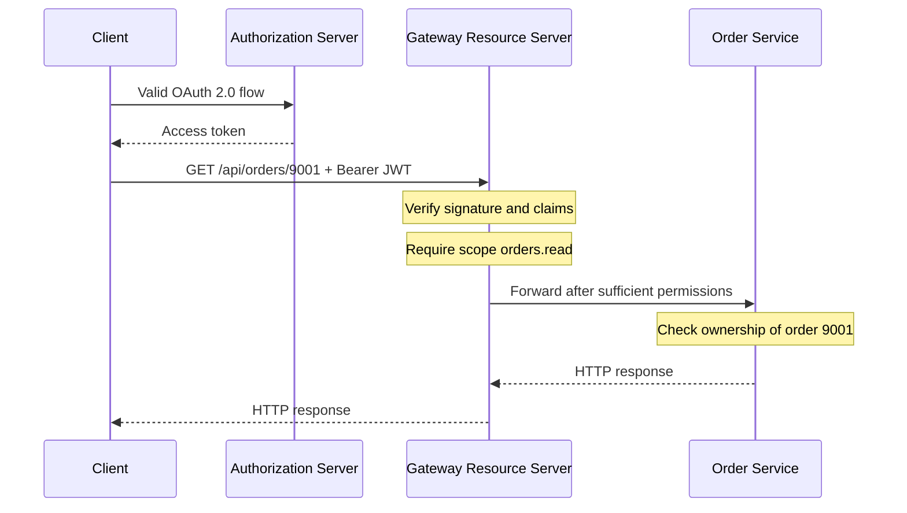
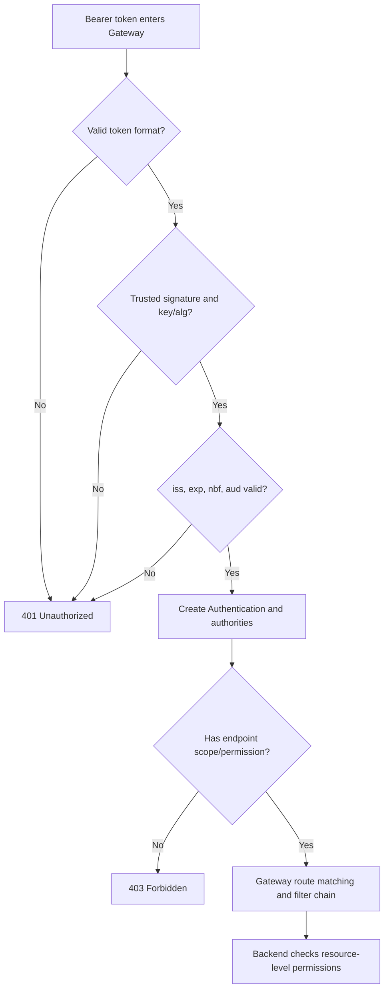

# OAuth 2.0 Resource Server and JWT Verification in Spring Cloud Gateway

An API Gateway can correctly match the `/api/orders/**` route and target `lb://order-service`, yet that alone does not answer **who the caller is**, **whether the token is valid**, or **what the caller is allowed to do**. When exposing microservices APIs, the Gateway often serves as the initial authentication and authorization enforcement point. In **Spring Cloud Gateway Server WebFlux**, you can use **Spring Security OAuth 2.0 Resource Server** to validate **JWT** access tokens before allowing requests into the routing pipeline.

This lesson belongs to the **Authentication and Authorization** chapter of the `SPRING_CLOUD_GATEWAY` module. This topic complements route predicates, filter chains, path/header transformations, and service discovery; it also establishes boundaries with rate limiting, circuit breakers, retries, TLS, and request observability to operate a microservices entry point securely.

After this lesson, you will be able to:

- Distinguish **Authorization Server**, **OAuth Client**, **Resource Server**, and backend APIs.
- Understand why **decoding a JWT does not equal verifying a JWT**, and why signature, issuer, audience, and lifetime checks are mandatory.
- Set up **reactive Spring Security** for the Gateway, authorize by scope, and distinguish 401 from 403.
- Protect backends against spoofed identities, decide how tokens are propagated, and test CORS, JWKS, and key rotation.
- Diagnose security failures separately from routing failures or missing instances.

> **Scope:** Examples use **Spring Cloud Gateway Server WebFlux** and reactive Spring Security. The Gateway Server MVC variant uses a different servlet security pipeline. Configuration and some APIs may vary across Spring Boot, Spring Cloud, and Spring Security versions; always choose a compatible set of versions. All domains, keys, and tokens below are purely illustrative.

## 1. What Role Is the OAuth 2.0 Resource Server?

OAuth 2.0 is an authorization framework. In an API access flow, the main roles include:

| Role | Responsibility | Example |
| --- | --- | --- |
| **Resource Owner** | Entity associated with the resource. | User owning order `9001`. |
| **OAuth Client** | Application obtaining and using access tokens via the appropriate flow. | SPA, mobile app, BFF, or machine-to-machine client. |
| **Authorization Server** | Issues tokens, provides metadata/JWKS, enforces token-issuance policies. | `https://identity.example.com/realms/store`. |
| **Resource Server** | Receives access tokens; verifies tokens and enforces API access permissions. | Spring Cloud Gateway or Order Service. |
| **API Gateway** | Routing gateway and shared policy enforcement point; may simultaneously be a Resource Server. | `https://api.example.com`. |

**A Resource Server is not responsible for issuing tokens.** Configuring the Gateway as an OAuth 2.0 Resource Server does not automatically create login pages, an Authorization Code Flow, a token endpoint, or a user store. Those belong to the Authorization Server and corresponding OAuth Client.



The Gateway can stop requests early with 401/403 before the backend ever receives an HTTP request. The backend still needs to enforce business permissions per resource, because a broad scope such as `orders.read` does not prove a user owns every order.

## 2. What Does a JWT Contain and Why Must It Be Verified?

A JWS-formatted JWT (*JSON Web Token*) typically has three parts:

```text
BASE64URL(header).BASE64URL(payload).BASE64URL(signature)
```

Example decoded **header**:

```json
{
  "alg": "RS256",
  "typ": "JWT",
  "kid": "key-2026-11"
}
```

Example decoded **payload**:

```json
{
  "iss": "https://identity.example.com/realms/store",
  "sub": "user-123",
  "aud": ["edge-api"],
  "scope": "catalog.read orders.read",
  "iat": 1795000000,
  "nbf": 1795000000,
  "exp": 1795003600
}
```

These timestamps are illustrative; real lifetimes must correspond to issuance time and system clocks.

| Field | Meaning | What to do? |
| --- | --- | --- |
| `alg` | JWT signature algorithm. | The decoder must only permit agreed-upon, secure algorithms. |
| `kid` | Identifier of the key used to verify the signature. | Select the key from a **trusted** JWKS set; never fetch arbitrary URLs from the token. |
| `iss` | Issuer identifier. | Must match the configured issuer. |
| `sub` | Token subject. | Use as identity context; do not infer all business permissions from it. |
| `aud` | Intended recipient APIs/targets the token was issued for. | Must include the Gateway API's audience per contract. |
| `scope`/`scp` | Granted permission scopes. | Map to authorities by convention and enforce per endpoint. |
| `iat` | Timestamp when the token was issued. | Useful for token lifetime policies. |
| `nbf` | Earliest timestamp when the token is valid. | Validate time, allowing only reasonable clock skew. |
| `exp` | Expiration timestamp. | Reject expired tokens. |
| `jti` | Token identifier if provided by issuer. | Supports audit/denylists if designed, does not revoke tokens by itself. |

**Base64URL is not security encryption.** Any holder of a JWT can read the header and payload; the JWS signature protects integrity and origin **only after** verification with a trusted key. Never put passwords, secrets, sensitive payment info, or confidential data into a JWT.

### 2.1. Mistake: Decoding Payload and Trusting a `role` Claim

Code that splits a JWT on dots, Base64URL-decodes it, and reads `role=admin` **does not prove the token was issued by the issuer**. An attacker can craft any payload. Granting permissions must happen only after the decoder verifies signature, algorithm, issuer, timestamps, audience, and other claim checks per contract.

Do not accept `alg=none` or arbitrary algorithms merely because they are declared in the header. Do not fetch signing keys from token-specified `jku`/`x5u` URLs without strict trust mechanisms.

### 2.2. JWT Tokens vs. Opaque Tokens

A Resource Server can use a **JWT decoder** when the access token is a signed JWT supporting local verification, or **opaque token introspection** when tokens cannot/should not be verified locally per contract.

Two different models:

- **JWT:** verifies signatures and claims using public keys/JWKS; avoids querying the Authorization Server on every request, though immediate revocation requires extra design.
- **Opaque token:** the Resource Server queries the issuer's introspection endpoint with appropriate security and caching; depends more heavily on the identity service at request time.

Do not apply `jwt()` to an opaque token simply because it looks long or unreadable.

## 3. Steps to Verify a Bearer JWT

Given a request:

```http
GET /api/orders/9001 HTTP/1.1
Host: api.example.com
Authorization: Bearer eyJ...<shortened-token>
```

Spring Security Resource Server performs meaningful verification steps:

1. Extract the Bearer token from `Authorization` as supported by the parser.
2. Parse the JWT and validate JOSE header/payload structure.
3. Determine the algorithm/key from a trusted key set, then **verify the signature**.
4. Validate **`iss`**, **`exp`**, **`nbf`**, and other time constraints.
5. Validate **`aud`** and token purpose for the API being served.
6. Map appropriate scopes/claims to **`GrantedAuthority`** and construct **`Authentication`**.
7. Evaluate Spring Security's **path/method/authority** policy.
8. If allowed, pass the HTTP request along to Gateway route matching, filter chain, and backend.



In WebFlux, **Spring Security uses `WebFilter`/`SecurityWebFilterChain` at the web layer**, which differs from Spring Cloud Gateway's `GlobalFilter` and `GatewayFilter`. Requests rejected before route matching may not appear in a `GlobalFilter` log because that filter is never invoked.

### 3.1. Signatures, Algorithms, and Keys

With `RS256`, the Authorization Server signs tokens with a private key, while the Gateway verifies them using the corresponding public key. JWKS publishes the matching public keys. This is convenient for multiple services because only the Authorization Server holds the private key.

Do not let the JWT dictate whichever algorithm the Gateway trusts. When configuring the decoder, restrict algorithms per the issuer contract, monitor key rotation, and fetch JWKS only over HTTPS from trusted endpoints.

### 3.2. Issuer Differs from Audience

- **`iss`:** **Who issued** the token?
- **`aud`:** **Which API was the token issued for**?

A token with a valid signature and valid issuer, but `aud=["billing-api"]`, should not be accepted at `edge-api` if the contract specifies the Gateway requires `aud=edge-api`.

```text
Gateway expects issuer = https://identity.example.com/realms/store
Gateway expects audience = edge-api

JWT A: valid iss, aud=edge-api     -> may be valid
JWT B: valid iss, aud=billing-api  -> must be rejected at Gateway
```

**Do not assume declaring `issuer-uri` alone checks audience thoroughly.** In many Resource Server configurations, issuer and timestamps have default validators, while `aud` requires additional configuration/validators depending on version and token profile.

### 3.3. Lifetimes and Clock Skew

Tokens expired per `exp` or not yet valid per `nbf` must be rejected. Servers can experience minor clock drift; validators can allow a reasonable clock skew window. Do not open skew indefinitely to mask errors. Synchronize NTP/clocks across issuer, Gateway, and backends, and choose access token TTLs per your threat model.

## 4. Configuring Resource Server for Gateway Server WebFlux

### 4.1. Dependencies

An appropriate project needs:

- The version-appropriate Spring Cloud Gateway **Server WebFlux starter**.
- Reactive Spring Security for WebFlux.
- Spring Boot OAuth 2.0 Resource Server starter (typically `spring-boot-starter-oauth2-resource-server`).
- JWT decoder/Nimbus and dependencies managed by the BOM.
- Spring Cloud LoadBalancer/discovery if routes use `lb://service-id`, independent of JWT security.

Example Maven dependency for Resource Server (Boot plugin/BOM manages the version):

```xml
<dependency>
    <groupId>org.springframework.boot</groupId>
    <artifactId>spring-boot-starter-oauth2-resource-server</artifactId>
</dependency>
```

Do not declare standalone Spring Security versions incompatible with the application's Spring Boot/Spring Cloud BOM.

### 4.2. Declaring the Issuer

```yaml
spring:
  security:
    oauth2:
      resourceserver:
        jwt:
          issuer-uri: https://identity.example.com/realms/store
```

`issuer-uri` is the **issuer identifier**, not a login URL and not a token endpoint. With proper issuer discovery, Spring Security can query issuer metadata to locate `jwks_uri`, create a decoder, and validate the issuer claim.

Depending on configuration and version, fetching issuer metadata may occur at startup or during the decoder lifecycle. Therefore, account for startup dependencies on the Identity Provider, DNS/TLS, and boot ordering.

### 4.3. Routes Do Not Replace Security

```yaml
spring:
  cloud:
    gateway:
      server:
        webflux:
          routes:
            - id: catalog-api
              uri: lb://catalog-service
              predicates:
                - Path=/api/catalog/**
              filters:
                - StripPrefix=1

            - id: order-api
              uri: lb://order-service
              predicates:
                - Path=/api/orders/**
              filters:
                - StripPrefix=1
```

The `Path` predicate only selects the route; `StripPrefix` only modifies the path; the `lb://...` URI only asks the load balancer to pick a service instance. **None of these three steps verifies a Bearer JWT.** Spring Security at the WebFlux layer handles authentication/authorization before requests enter the Gateway chain.

In older Server WebFlux versions, route configuration typically uses `spring.cloud.gateway.routes` instead of `spring.cloud.gateway.server.webflux.routes`. Choose the right namespace for your version so routes actually load.

## 5. Writing a `SecurityWebFilterChain` to Protect APIs by Scope

The following reactive Spring Security configuration protects several public Gateway endpoints:

```java
import org.springframework.context.annotation.Bean;
import org.springframework.context.annotation.Configuration;
import org.springframework.http.HttpMethod;
import org.springframework.security.config.Customizer;
import org.springframework.security.config.annotation.web.reactive.EnableWebFluxSecurity;
import org.springframework.security.config.web.server.ServerHttpSecurity;
import org.springframework.security.web.server.SecurityWebFilterChain;

@Configuration
@EnableWebFluxSecurity
public class GatewaySecurityConfig {

    @Bean
    SecurityWebFilterChain securityWebFilterChain(ServerHttpSecurity http) {
        return http
            // Only use for stateless APIs receiving Bearer tokens in headers,
            // not relying on automatically attached cookies/sessions.
            .csrf(ServerHttpSecurity.CsrfSpec::disable)
            .authorizeExchange(exchanges -> exchanges
                .pathMatchers(HttpMethod.GET, "/actuator/health").permitAll()
                .pathMatchers(HttpMethod.GET, "/api/catalog/**")
                    .hasAuthority("SCOPE_catalog.read")
                .pathMatchers(HttpMethod.GET, "/api/orders/**")
                    .hasAuthority("SCOPE_orders.read")
                .pathMatchers(HttpMethod.POST, "/api/orders/**")
                    .hasAuthority("SCOPE_orders.write")
                .anyExchange().denyAll())
            .oauth2ResourceServer(oauth2 ->
                oauth2.jwt(Customizer.withDefaults()))
            .build();
    }
}
```

**Explanation:**

1. `@EnableWebFluxSecurity` applies security configuration under the WebFlux model.
2. Rules match the **public Gateway path**, before `StripPrefix`/`RewritePath` forwards to the backend.
3. `hasAuthority("SCOPE_catalog.read")` requires catalog read permission on GET.
4. Order read and write permissions are separated by method and scope.
5. `denyAll()` denies by default for routes lacking explicit policies. Real projects must declare required endpoints per contract.
6. `oauth2ResourceServer(...jwt(...))` enables Bearer JWT processing through the configured decoder.
7. `csrf(...disable)` **is only appropriate** when the API is truly stateless Bearer-token and does not use cookies/sessions for automatic authentication. If a BFF/browser login or cookie session endpoints exist, design CSRF separately.

The public health check example is illustrative; do not expose `/actuator/**` to every client. Health/readiness endpoints can be placed on a separate management port or restricted by network policy.

### 5.1. How Does `scope` Become `SCOPE_...`?

A JWT containing:

```json
{
  "scope": "catalog.read orders.read"
}
```

In standard Resource Server setups, `JwtGrantedAuthoritiesConverter` maps `scope` or `scp` into:

```text
SCOPE_catalog.read
SCOPE_orders.read
```

Therefore, `hasAuthority("SCOPE_orders.read")` differs from `hasRole("orders.read")`. Spring Security uses distinct prefix and role conventions; do not mix them arbitrarily.

If the issuer uses a `permissions` or `realm_access.roles` claim instead of `scope`, map it intentionally with a converter. Never promote a client-claimed value into an admin role without a clear trust contract.

### 5.2. Why Check the HTTP Method Too?

A rule checking only `/api/orders/**` against `orders.read` could allow a read-only client to send an unintended `POST` if downstream layers do not protect tightly enough. Separating GET/POST/DELETE/PUT and their corresponding permissions makes auditing easier.

A `Method=POST` route predicate also does not replace Spring Security policy. If security allows it but no route matches, a routing error occurs; if a route exists but security blocks it, the backend is never called.

## 6. Customizing Validators to Check Audience

When a token has a valid `iss` and signature but may be intended for another API, the Gateway must check `aud`. You can create a `ReactiveJwtDecoder` bean from an **operator-configured trusted JWKS URI** and combine validators.

```java
import java.util.List;

import org.springframework.beans.factory.annotation.Value;
import org.springframework.context.annotation.Bean;
import org.springframework.context.annotation.Configuration;
import org.springframework.security.oauth2.core.DelegatingOAuth2TokenValidator;
import org.springframework.security.oauth2.core.OAuth2Error;
import org.springframework.security.oauth2.core.OAuth2TokenValidator;
import org.springframework.security.oauth2.core.OAuth2TokenValidatorResult;
import org.springframework.security.oauth2.jwt.Jwt;
import org.springframework.security.oauth2.jwt.JwtValidators;
import org.springframework.security.oauth2.jwt.NimbusReactiveJwtDecoder;
import org.springframework.security.oauth2.jwt.ReactiveJwtDecoder;

@Configuration
public class GatewayJwtDecoderConfig {

    @Bean
    ReactiveJwtDecoder jwtDecoder(
            @Value("${app.security.issuer}") String issuer,
            @Value("${app.security.jwk-set-uri}") String jwkSetUri,
            @Value("${app.security.audience}") String audience) {

        NimbusReactiveJwtDecoder decoder =
            NimbusReactiveJwtDecoder.withJwkSetUri(jwkSetUri).build();

        OAuth2TokenValidator<Jwt> issuerAndTime =
            JwtValidators.createDefaultWithIssuer(issuer);

        OAuth2TokenValidator<Jwt> audienceValidator = jwt -> {
            List<String> audiences = jwt.getAudience();

            if (audiences != null && audiences.contains(audience)) {
                return OAuth2TokenValidatorResult.success();
            }

            return OAuth2TokenValidatorResult.failure(
                new OAuth2Error(
                    "invalid_token",
                    "Token audience is not accepted",
                    null
                )
            );
        };

        decoder.setJwtValidator(
            new DelegatingOAuth2TokenValidator<>(
                issuerAndTime, audienceValidator
            )
        );

        return decoder;
    }
}
```

Application configuration for the bean:

```yaml
app:
  security:
    issuer: https://identity.example.com/realms/store
    jwk-set-uri: https://identity.example.com/realms/store/protocol/openid-connect/certs
    audience: edge-api
```

**Important to understand:**

- `ReactiveJwtDecoder` is used by reactive Spring Security; do not mistakenly use the servlet `JwtDecoder` in a WebFlux application.
- `withJwkSetUri(jwkSetUri)` fetches keys from a **server-controlled configuration URL**, not from a URL inside a client's JWT.
- `JwtValidators.createDefaultWithIssuer(issuer)` provides issuer checking along with default validators such as timestamps per version; `audienceValidator` enforces the API audience requirement.
- Algorithms accepted by the decoder must be verified and restricted per the issuer contract; do not enable every algorithm for compatibility.
- This is **a custom approach**. If your Spring Boot/Spring Security version supports built-in audience configuration, you can use it instead of a custom bean, provided you verify it actually takes effect.
- When declaring a custom decoder bean, understand how it interacts with auto-configuration and avoid conflicting decoder configurations.

### 6.1. Using `issuer-uri` and `jwk-set-uri` Directly

An alternative configuration (not necessarily combined with the custom bean above):

```yaml
spring:
  security:
    oauth2:
      resourceserver:
        jwt:
          issuer-uri: https://identity.example.com/realms/store
          jwk-set-uri: https://identity.example.com/realms/store/protocol/openid-connect/certs
```

Depending on the version, specifying both can avoid calling issuer discovery to locate JWKS at startup while still checking the issuer. The JWKS endpoint must still be reachable when new keys need to be loaded. **Do not assume adding `jwk-set-uri` automatically verifies audience.**

## 7. JWKS, `kid`, and Key Rotation

An Authorization Server can publish multiple keys; the JWT header includes `kid` to identify the matching key. The Resource Server uses a trusted **JSON Web Key Set (JWKS)** to verify signatures.

A sound rotation workflow:

1. Publish the new public key in JWKS while retaining the old key during a transition window.
2. The Authorization Server starts signing new tokens with the corresponding new private key.
3. The Gateway/Resource Server refreshes JWKS via its cache/decoder and recognizes the new `kid`.
4. After tokens signed with the old key expire and the transition window completes, remove the old key.

When a new key appears before JWKS/caches update, clients may encounter widespread 401 errors even for freshly issued tokens. The fix is to repair the key rotation process, JWKS reachability, and refresh logic—**never disable signature verification**.

### 7.1. JWKS Must Be Fetched Over a Trusted Channel

Verify DNS, HTTPS, certificates, hostnames, trust stores, and reachability to the issuer/JWKS from the Gateway's runtime environment. Do not use `-k`/skip TLS verification in production to make JWKS fetches "succeed."

A client-sent `kid` only selects **an already trusted key from the configured JWKS**, not a permission to specify a new URL for the Gateway to fetch. Reading `jku` from a token and fetching keys from it can create SSRF vulnerabilities and allow forged token validation if not strictly controlled.

### 7.2. JWTs Do Not Inherently Support Instant Revocation

In an offline JWT verification model, an unexpired token signed with a valid key that passes claim validation may still be accepted even if the user has logged out on the client, unless an extra denylist/revocation mechanism or special policy exists.

To reduce the impact of stolen tokens, consider short access token TTLs, secure storage, HTTPS, refresh/revocation policies, and anomaly monitoring. Never promise that logout immediately invalidates every JWT if the architecture does not support it.

## 8. Distinguishing Access Token, ID Token, and Refresh Token

In the OpenID Connect ecosystem, clients may receive several token types:

| Token | Role | How does a Resource Server API handle it? |
| --- | --- | --- |
| **Access token** | Authorizes API access by audience/scope. | Verified and authorized when requests call the API. |
| **ID token** | Provides authentication event details to the OIDC client. | Do not substitute for an access token just because it is also a JWT. |
| **Refresh token** | Lets the client obtain new access tokens per granted flow. | Never sent as a Bearer token when calling APIs; protect separately. |

For example, an ID token has `aud=web-client` while an access token has `aud=edge-api`. If the Gateway only checks the issuer signature while ignoring audience/purpose, it may mistakenly accept an ID token. This is a key reason to validate the proper token profile, `aud`, and token-type claims if defined by the issuer.

Do not treat `typ=JWT` as proof that "this is definitely an OAuth 2.0 access token for the API."

## 9. How Far Does Gateway Authorization Go, and What Must the Backend Do?

Suppose user `user-123` has a valid access token containing `orders.read` and calls:

```http
GET /api/orders/9001
Authorization: Bearer <valid-access-token>
```

The Gateway can determine that the token is valid and the caller has the order-read scope, but it does not necessarily know **who owns order 9001**. Order Service must check ownership, tenant, and data constraints.

| Control | Usually Appropriate Location |
| --- | --- |
| JWT signature, issuer, expiry, audience from client | Gateway Resource Server; backend also verifies or receives a trusted assertion per design. |
| API group permission like `SCOPE_orders.read` | Gateway, and may be repeated at the backend for defense in depth. |
| Does the user have permission on a specific order ID? | Order Service owning the data/rules. |
| Is the tenant allowed to view the resource? | Business service using the authenticated context. |
| Rate limiting by trusted principal? | Gateway `RequestRateLimiter` and backend protection mechanisms. |
| Retries, timeouts, circuit breakers | Gateway/HTTP client with safety and idempotency policies. |
| Is the backend connection protected? | Network policies, TLS/mTLS, infrastructure trust boundaries. |

**Do not treat the Gateway as the sole barrier** if the backend can be called from other networks. Protect the backend directly or use verifiable assertions/mTLS/service-to-service authorization.

### 9.1. Do Not Trust Client-Supplied Identity Headers

A spoofed request:

```http
GET /api/orders/9001 HTTP/1.1
X-Authenticated-User: admin
```

If the backend trusts `X-Authenticated-User` sent by any client, the Gateway can be exploited. When identity must be passed downstream:

- Strip/overwrite client-sent identity headers at the trust boundary.
- Generate assertions/headers only from a verified `Authentication`, under a clear contract.
- Protect backend access paths (network/mTLS) so third parties cannot send the same headers directly.
- The backend still checks resource permissions and does not let path/body values such as `userId` replace the authenticated identity.

## 10. Token Forwarding and TokenRelay Are Not the Same as Resource Server

Two capabilities are often confused:

**Resource Server** at the Gateway verifies the **Bearer token in the incoming request**. Meanwhile, **TokenRelay** is a GatewayFilter used in appropriate OAuth2 Client scenarios to forward an access token from `OAuth2AuthorizedClient`/auth context upstream.

Enabling `oauth2ResourceServer().jwt()` **does not automatically create an OAuth2 Client, an AuthorizedClient repository, or TokenRelay**. When a route proxies, whether the `Authorization` header is forwarded depends on configured header filters/policies; inspect carefully and never assume the backend receives the exact token you expect.

### 10.1. Three Identity-Passing Models

| Model | Gateway | Backend |
| --- | --- | --- |
| **Both verify Bearer token** | Verifies JWT before routing; forwards token under trust contract. | Verifies token and appropriate permissions. |
| **Token exchange/delegation** | Verifies client token, then requests a new token for the target service. | Verifies token with the service's audience. |
| **Internal identity assertion** | Builds assertion/header from verified principal over a trusted connection. | Accepts only from authorized Gateway/sources, verifies assertion and resource permissions. |

If the Gateway receives a token with `aud=edge-api` while Order Service requires `aud=order-api`, do not disable audience checks in Order Service just to share the token. Use token exchange, properly designed multi-audience tokens, or another valid delegation contract.

### 10.2. Bearer Tokens Can Be Replayed If Exposed

If an unexpired token is leaked, anyone holding it can reuse it unless sender-constrained mechanisms like DPoP/mTLS token binding are supported and enforced per profile. Therefore:

- Never put tokens in URL queries, access logs, tracing attributes, or metric labels.
- Never return raw JWTs in HTTP error responses.
- Use HTTPS, control log systems, and protect token storage.
- Design TTL, rotation, revocation, and alerts commensurate with risk.

## 11. Distinguishing HTTP 401 and 403

| Status | Common Cause | Illustrative Case |
| --- | --- | --- |
| **401 Unauthorized** | Missing or invalid authentication credentials. | Missing Bearer token, invalid signature, expired, wrong issuer/audience. |
| **403 Forbidden** | Authenticated but insufficient permissions. | Valid token has `catalog.read` but calls POST requiring `orders.write`. |

Example 401:

```http
HTTP/1.1 401 Unauthorized
WWW-Authenticate: Bearer
```

Spring Security Bearer token error handling may include `WWW-Authenticate` details such as `error="invalid_token"` or `error="insufficient_scope"` depending on the case; exact content depends on configuration. Never include keys, tokens, or sensitive stack traces in client-facing errors.

**Do not confuse 401/403 with Gateway 404/503:** 404 may come from an unmatched route or missing backend resource; 503 may come from `lb://` having no instances or an upstream failure. A valid token does not guarantee service discovery has an instance, and an existing route does not prove the caller is authorized.

### 11.1. Why Can 404 Also Appear with a Valid Token?

Spring Security may let the request pass, yet:

- No route matches `Path`/`Method` → Gateway may return 404.
- Route matches, backend receives the request, but resource does not exist → backend returns 404.
- A business security layer intentionally returns 404 to avoid leaking resource existence → understand the specific contract.

Do not convert every 403 into 404 at the Gateway and treat that as a substitute for service-level authorization.

## 12. CORS Preflight and Spring Security WebFlux

An SPA at `https://app.example.com` sending a `POST` with an `Authorization` header typically triggers a **CORS preflight OPTIONS**:

```http
OPTIONS /api/orders HTTP/1.1
Origin: https://app.example.com
Access-Control-Request-Method: POST
Access-Control-Request-Headers: authorization, content-type
```

Preflight requests usually **do not carry the access token of the actual request**. If Spring Security requires a JWT on OPTIONS before CORS runs, the browser may never send the real POST.

The design must:

1. Verify origin/method/headers against a controlled CORS policy.
2. Allow **valid preflight requests** through CORS handling at the right layer, before business authentication checks.
3. Still require a JWT and `orders.write` for the actual POST request.
4. Ensure 401/403/429/503 responses include appropriate CORS headers if the frontend is allowed to read error responses.
5. Avoid wildcard `Access-Control-Allow-Origin: *` for credentialed CORS requests.

Spring Cloud Gateway Server WebFlux has `globalcors` and per-route CORS metadata; Spring Security WebFlux has its own CORS integration. **You must verify ordering and maintain a single effective CORS source**, rather than merely enabling `cors()` and assuming Spring Security automatically reuses all Gateway config.

### 12.1. Do Not Disable Security Just to Make OPTIONS Return 200

An overly broad `OPTIONS /**` permit rule does not itself validate `Origin`, `Access-Control-Request-Method`, or `Access-Control-Request-Headers`. CORS preflight must be processed according to policy, and real OPTIONS APIs must still be governed if they have business meaning.

## 13. CSRF and Cookie Sessions: Stateless Assumptions Must Be Explicit

In the section 5 example, `csrf(...disable)` is only appropriate when the API **truly uses Bearer tokens in headers** and does not rely on automatically sent cookie/session credentials.

A BFF or web app with cookie sessions has a different threat model:

- Browsers automatically attach cookies by domain/path/SameSite and client rules.
- Cross-origin requests can trigger side effects in certain scenarios.
- CORS primarily controls response reading, **not replacing CSRF protection**.
- CSRF tokens, `Secure`/`HttpOnly`/`SameSite` cookies, and session policies must be configured properly.

If a Gateway serves both stateless APIs and cookie-session web logins, you may need multiple `SecurityWebFilterChain` beans with clear matchers/order or separate applications. Do not apply `csrf(disable)` mechanically across the whole system.

## 14. Testing Requests with curl

Assume the Gateway runs at `http://localhost:8080` in a test environment (use HTTPS in production), the catalog route requires `SCOPE_catalog.read`, and the backend is running.

### 14.1. Missing Access Token

```bash
curl -i "http://localhost:8080/api/catalog/products/42"
```

Expect 401 as Spring Security blocks before routing. Confirm the backend **does not receive the request**.

### 14.2. Malformed Token

```bash
curl -i "http://localhost:8080/api/catalog/products/42" \
  -H "Authorization: Bearer invalid.jwt.value"
```

Expect 401. Failure may occur during parsing before signature verification. Do not log the raw Authorization header.

### 14.3. Valid Token with Wrong Scope

Use an access token from a **test issuer** that is genuinely signed, has `aud=edge-api`, is unexpired, but only contains `scope=orders.read`. Send a GET to catalog.

Expect 403 because the JWT is valid but lacks `SCOPE_catalog.read`. If you get 401, check issuer, signature, `aud`, and `exp` before debugging scope mapping.

### 14.4. Valid Token with Right Scope

```bash
curl -i "http://localhost:8080/api/catalog/products/42" \
  -H "Authorization: Bearer ${ACCESS_TOKEN}"
```

Use an `ACCESS_TOKEN` environment variable in your test shell; never paste production tokens into docs, issues, or logs. Once past security, the final status depends on route and backend: it could be 200, 404, 503, or a business error code.

### 14.5. Test Matrix

| Token | Permission | Request | Expected Security |
| --- | --- | --- | --- |
| None | — | `GET /api/catalog/products/42` | 401 |
| Invalid signature/format | — | `GET /api/catalog/products/42` | 401 |
| Expired | `catalog.read` | `GET /api/catalog/products/42` | 401 |
| Wrong issuer | `catalog.read` | `GET /api/catalog/products/42` | 401 |
| Wrong audience | `catalog.read` | `GET /api/catalog/products/42` | 401 if audience validator is configured |
| Valid | Only `orders.read` | `GET /api/catalog/products/42` | 403 |
| Valid | `catalog.read` | `GET /api/catalog/products/42` | Passes security; backend result depends on actual state |
| Valid | `orders.read` | `POST /api/orders` | 403 |
| Valid | `orders.write` | `POST /api/orders` | Passes security; business validation still required |

**Distinguish "passing security" from "returning 200."** An authenticated request can still fail route matching or encounter an unavailable backend.

## 15. Automated Testing with `WebTestClient` and `mockJwt`

Spring Security Test provides mock authentication helpers for testing WebFlux **path/method/authority policies**.

Example:

```java
import org.junit.jupiter.api.Test;
import org.springframework.beans.factory.annotation.Autowired;
import org.springframework.boot.test.autoconfigure.web.reactive.AutoConfigureWebTestClient;
import org.springframework.boot.test.context.SpringBootTest;
import org.springframework.security.core.authority.SimpleGrantedAuthority;
import org.springframework.test.web.reactive.server.WebTestClient;

import static org.springframework.security.test.web.reactive.server
    .SecurityMockServerConfigurers.mockJwt;

@SpringBootTest(webEnvironment = SpringBootTest.WebEnvironment.RANDOM_PORT)
@AutoConfigureWebTestClient
class GatewaySecurityTests {

    @Autowired
    WebTestClient webTestClient;

    @Test
    void insufficientScopeIsForbidden() {
        webTestClient.mutateWith(
            mockJwt().authorities(
                new SimpleGrantedAuthority("SCOPE_orders.read")
            )
        )
        .get()
        .uri("/api/catalog/products/42")
        .exchange()
        .expectStatus().isForbidden();
    }
}
```

Requires the `spring-security-test` dependency and compatible test environment. `mockJwt()` creates a simulated principal/authorities to test authorization, **not proof that the Gateway verified real token signatures**.

To test cryptography and claim validation, write integration tests with a test issuer/JWKS and JWTs signed with test keys; verify:

- Token with matching issuer/audience/key/expiry → passes validation.
- Invalid signature or `kid` absent from JWKS → rejected.
- Wrong `iss` or `aud` → rejected.
- Past `exp` or future `nbf` → rejected.
- Temporary JWKS endpoint error or key rotation → observable and predictable behavior.

Verify 401/403 responses **do not call the backend**, and CORS preflight is not mistakenly blocked.

## 16. Observing Authentication Failures Without Leaking Tokens

A useful security dashboard should distinguish:

- `401` rate due to missing/invalid/expired/wrong-issuer/wrong-audience tokens.
- `403` rate due to missing scopes or backend resource authorization.
- JWKS fetch/cache/rotation errors.
- 404 from route matching vs. 503 from missing `lb://` instances.
- 429 from rate limiting and circuit breaker/retry events.

You may log **route/public path template**, HTTP method, status, latency, trace/correlation ID, and **high-level error category**. Never log full tokens, refresh tokens, session cookies, sensitive raw queries, PII from claims, or private keys.

If a `GlobalFilter` does not log 401s produced by Spring Security, that does not mean requests never reached the Gateway. Security can block **before** `FilteringWebHandler`. To observe authentication failures, add proper instrumentation/logging at the **Spring Security layer**, not just in a `GlobalFilter`.

In particular, if rate limiting per user, rely only on the authenticated principal or a trusted identity. Client-sent `X-User-Id` headers are unsuitable as a security source.

## 17. Common Errors and How to Diagnose Them

| Symptom | Possible Cause | Remediation |
| --- | --- | --- |
| Every API returns 401. | Wrong issuer/JWKS, Bearer token not sent, misconfigured security. | Check `issuer-uri`, security chain, token, and headers. |
| JWT has valid signature but still 401. | Wrong issuer/audience, expired, or `nbf` in the future. | Check validators and server clocks; do not disable validation. |
| JWT has valid signature and is accepted by wrong API. | Missing audience/token-purpose check. | Add `aud` check per API contract. |
| Valid JWT returns 403. | Scope mapping lacks `SCOPE_...` or backend rejects resource access. | Distinguish Gateway vs. backend 403; check authorities/ownership. |
| New tokens return 401 after rotation. | New `kid` not yet in JWKS/cache, network/TLS failure. | Check key overlap, JWKS refresh, connectivity. |
| Browser preflight OPTIONS returns 401. | Security runs before CORS or wrong CORS origin. | Configure CORS/Security order properly while keeping POST protected. |
| Browser shows only CORS error instead of 403. | Error response lacks valid `Access-Control-Allow-Origin`. | Check CORS headers on security error paths. |
| Backend uses spoofed `X-User-Id` header. | Client can forge header; backend does not verify source. | Strip/overwrite headers, protect network/mTLS, authenticate at backend. |
| TokenRelay does not work despite Resource Server enabled. | TokenRelay requires OAuth2 Client/AuthorizedClient setup. | Clarify token-forwarding model and configure properly. |
| Backend rejects token accepted by Gateway. | Backend requires different audience/scope. | Use token exchange or aligned token contract; do not skip audience validation. |
| Request with JWT returns 404. | Route unmatched or backend resource missing. | Inspect route predicates/endpoints rather than changing decoder blindly. |
| Request with JWT returns 503. | Load balancer has no instances or upstream error. | Check `lb://`, discovery, readiness, TLS/network. |
| Cookie session vulnerable to CSRF. | Copied `csrf(disable)` from stateless Bearer sample. | Design dedicated CSRF policy for session-based endpoints. |
| `mockJwt()` test passes yet forged tokens succeed at runtime. | Mock does not verify crypto; runtime decoder config is wrong. | Add integration tests using test keys/JWKS and real signatures. |

## 18. Practice Exercises with Answers

### Exercise 1 — Issuer and Audience

The Gateway requires `iss=https://identity.example.com/realms/store` and `aud=edge-api`. A token has a valid signature and matching issuer, but its audience is `billing-api`. Should it be allowed?

**Answer:** No. The token is not intended for the Gateway API; the audience validator must reject it even though the signature is valid.

### Exercise 2 — Distinguishing 401 and 403

The first request has no token; the second request has a valid JWT with only `orders.read` when calling `GET /api/catalog/products/42`. Which status codes make sense?

**Answer:** Typically 401 for the first request, and 403 for the second due to missing `SCOPE_catalog.read`.

### Exercise 3 — Order Ownership

User A has `orders.read` but accesses User B's order. The Gateway lets the request through. Must the backend return the data?

**Answer:** No. Scope only grants API-group access. The backend must still verify ownership/tenant on the specific resource.

### Exercise 4 — ID Token Instead of Access Token

An app has an ID token with `aud=spa-client` and an access token with `aud=edge-api`. Can the ID token be used to call the Gateway since both use `alg=RS256`?

**Answer:** No. A Resource Server API must require an access token intended for that API, verifying token purpose and audience properly.

### Exercise 5 — JWKS Issue After Rotation

The Authorization Server rotates keys, and new JWTs have a `kid` not yet in the Gateway's JWKS cache. Should signature verification be disabled to recover quickly?

**Answer:** No. Inspect JWKS key publication, network/TLS, cache refresh, and key overlap windows. Disabling signature verification introduces a critical vulnerability.

### Exercise 6 — Preflight and Authorization

A browser wants to send a JSON POST with a Bearer token. Preflight OPTIONS returns 401 because it carries no token. Should all of Spring Security be disabled?

**Answer:** No. Integrate CORS at the appropriate layer to handle valid preflights, while still authenticating and checking `orders.write` on the actual POST.

### Exercise 7 — TokenRelay

Someone claims enabling Resource Server makes the Gateway automatically fetch an OAuth2 Client token from the session and attach it to every backend request. Is that true?

**Answer:** No. Resource Server verifies incoming Bearer tokens; TokenRelay belongs to OAuth2 Client/AuthorizedClient configuration and requires separate setup, including backend audience alignment.

### Exercise 8 — Is `mockJwt()` Enough to Test Signatures?

A test using `mockJwt()` claims to verify that the decoder rejects invalid signatures. Is that conclusion justified?

**Answer:** No. Mocks are suited for testing authorization policies. You must run integration tests with tokens signed by a test private key and a real test JWKS.

### Exercise 9 — Identity-Based Rate Limiting

The Gateway uses the client-sent `X-User-Id` header as the rate-limit key, and the backend uses it as the principal. What is the risk?

**Answer:** Clients can spoof identities and evade quotas. Use the principal from a verified token, enforce downstream trust boundaries, and never accept untrusted identity headers.

### Exercise 10 — Sessions and CSRF

The Gateway exposes stateless Bearer APIs while also serving cookie-session logins. Should CSRF be disabled across all routes?

**Answer:** No. Requests relying on session cookies require proper CSRF protection; split security chains by matcher and define clear scopes.

## 19. Pre-Production Checklist

- [ ] Correct Gateway **Server WebFlux** and compatible Spring Boot/Spring Cloud/Spring Security dependencies.
- [ ] Distinguish Resource Server token verification from Authorization Server issuance and OAuth2 Client flows.
- [ ] Accept only **access tokens** with the proper token profile; never substitute ID tokens for access tokens.
- [ ] Verify **signatures**, trusted algorithms, and public keys from the configured issuer/JWKS.
- [ ] Validators cover `iss`, `exp`, `nbf`, and **`aud`** per API contract.
- [ ] Clocks are synchronized, TTL/skew are reasonable, and plans exist for revocation or mitigating leaked tokens.
- [ ] HTTPS/TLS for issuer/JWKS and client–gateway; TLS/mTLS for Gateway–backend per threat model.
- [ ] Key rotation includes overlap windows, JWKS caching, and monitoring for fetch/refresh errors.
- [ ] Scope-to-authority mapping is explicit, rules separate methods/paths, and deny-by-default is enforced.
- [ ] Backend still checks business permissions per resource/tenant.
- [ ] Never trust client-sent `X-Authenticated-User` or `X-User-Id`.
- [ ] Decided between token forwarding, token exchange, or internal assertions for each service.
- [ ] CORS preflight OPTIONS does not require a bearer token like real POSTs; CORS headers appear on required error paths.
- [ ] CSRF is disabled only on appropriate stateless Bearer APIs; sessions/cookies have dedicated policies.
- [ ] Distinguished security 401/403 from routing/discovery/backend 404/503.
- [ ] Logs and traces exclude JWTs, Authorization headers, cookies, and sensitive claims.
- [ ] Rate limiting, retries, circuit breakers, TLS, and discovery tested independently.
- [ ] Tests include `mockJwt()` for policies **and** real signed JWTs/test JWKS for cryptography.
- [ ] Alerts configured for spikes in 401/403, JWKS outages, or elevated rejections after key rotation.

## 20. Summary

**Spring Security OAuth 2.0 Resource Server** enables **Spring Cloud Gateway Server WebFlux** to validate Bearer JWT access tokens before forwarding requests. An accepted token must pass verification of **signature, trusted algorithm/key, issuer, lifetime, and audience**, and then satisfy **scope/authority** policies. When a token is missing or invalid, the Gateway typically returns 401; when valid but lacking permissions, it typically returns 403.

The Gateway is well suited for enforcing authentication and **coarse-grained** authorization at the edge; the backend remains responsible for permissions on specific resources. JWKS requires rotation and caching plans; token forwarding requires audience checks; and CORS, CSRF, TLS, rate limiting, circuit breakers, retries, and service discovery are complementary layers, not substitutes for JWT validation.

By establishing clear boundaries between Spring Security, the Gateway filter chain, and backend services, `SPRING_CLOUD_GATEWAY` can reject unsafe requests early, enforce consistent access policies across microservices, and observe incidents without exposing credentials.
