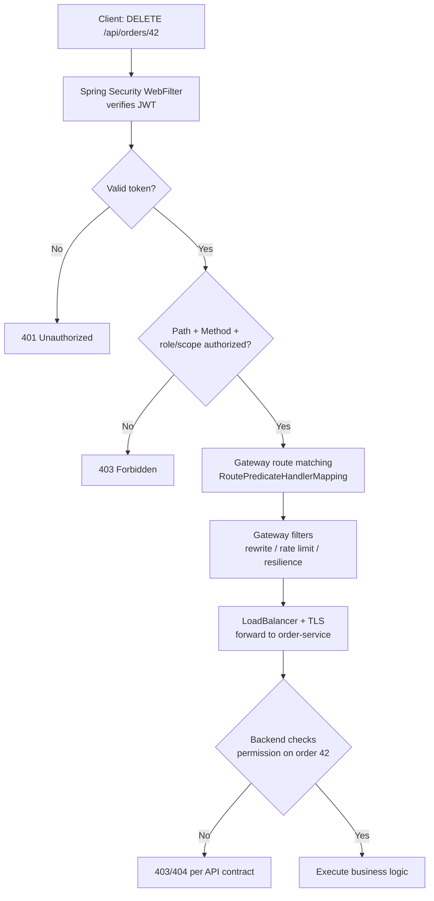
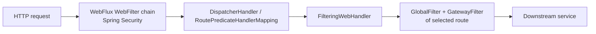

# Authorization by Path, HTTP Method, Role, and Scope

An API Gateway typically exposes many APIs under a single domain: reading a product catalog, creating orders, issuing refunds, and system administration. Requests may all pass through one entry point, yet **permissions for each operation are not identical**. A user allowed to view orders is not necessarily allowed to create them; a support agent is not automatically allowed to administer the entire system; and a client holding a valid token is not necessarily permitted to call every endpoint.

In **Spring Cloud Gateway Server WebFlux**, **Spring Security** can enforce access policies right at the edge using **`SecurityWebFilterChain`** and **`authorizeExchange`** rules. Rules can be based on **HTTP path**, **HTTP method**, **role**, or **scope** converted into the caller's `GrantedAuthority`. This serves as a protective layer before the Gateway dispatches requests to microservices.

This lesson belongs to the **Authentication and Authorization** chapter of the **SPRING_CLOUD_GATEWAY** module. It connects route predicates, filter chains, path/header modifications, and service discovery with authentication, rate limiting, circuit breakers, retries, TLS, and request observability to build a secure API Gateway. The focus is not merely writing a list of rules, but **placing rules in the right layer, in the right order, and against verified permissions**.

> **Scope:** Examples use **Spring Cloud Gateway Server WebFlux** and **Spring Security Reactive** (`ServerHttpSecurity`, `SecurityWebFilterChain`). Do not copy Spring MVC/Servlet APIs (`HttpSecurity`, `SecurityFilterChain`, or `authorizeHttpRequests`) into a Gateway WebFlux application. Route configuration examples follow the WebFlux namespace of newer releases; some earlier 4.x lines used `spring.cloud.gateway.routes`. Check API and starter names against your Spring Boot/Spring Cloud version set.

## 1. Separating Four Concepts: Authentication, Authorization, Routing, and Downstream

| Concept | Question to Answer | Typical Component |
| --- | --- | --- |
| **Authentication** | Who/what tool sent the request? Are the credentials valid? | Spring Security OAuth2 Resource Server, JWT decoder, opaque-token introspection |
| **Authorization** | Is the authenticated caller permitted to invoke this operation? | `authorizeExchange`, `hasRole`, `hasAuthority`, `ReactiveAuthorizationManager` |
| **Route matching** | Which backend should receive this request? | `RoutePredicateHandlerMapping`, `Path`/`Method`/`Host` route predicates |
| **Downstream authorization** | Does the caller have permission for a **specific resource** at the backend? | Business policies inside `order-service`, `payment-service`, etc. |

For example, a request:

```http
DELETE /api/orders/42 HTTP/1.1
Host: api.example.test
Authorization: Bearer <access-token>
```

may go through these steps:

1. **Authentication:** validate the access token and establish `Authentication`.
2. **Gateway authorization:** does `DELETE` on `/api/orders/**` require `orders.delete` or a specific role?
3. **Route selection:** path matches the `orders-api` route, whose target URI may be `lb://order-service`.
4. **Request transformation:** the Gateway may apply `StripPrefix=1`, rewriting `/api/orders/42` to `/orders/42`.
5. **Backend data-level authorization:** does order 42 belong to this account, or is the caller permitted to cancel the order?

**Do not confuse:** A `Method=DELETE` route predicate only qualifies the request for the route; by itself it **does not check permission to delete orders**. Conversely, a `hasAuthority("SCOPE_orders.delete")` rule can reject requests before the Gateway calls the backend, yet lacks the information to assert that every order belongs to the user.



The `401`/`403` codes in the diagram represent typical Resource Server outcomes. Actual behavior is influenced by the authentication entry point, exception handling, selected security chain, and other proxy layers. The backend may also return `404` under policies that avoid disclosing inaccessible resources.

## 2. Designing the Authorization Matrix Before Writing Code

Suppose the Gateway exposes three endpoint groups:

- `/actuator/health/**`: health checks, exposed in a controlled manner.
- `/api/orders/**`: reading, creating, updating, and canceling orders.
- `/api/admin/**`: administrative APIs.

An example policy matrix:

| Public Path | HTTP Method | Who Is Permitted? | Illustrative Gateway Rule |
| --- | --- | --- | --- |
| `/actuator/health`, `/actuator/health/**` | `GET` | Permitted per health endpoint policy | `permitAll()` |
| `/api/orders`, `/api/orders/**` | `GET` | User/client with `orders.read` scope | `hasAuthority("SCOPE_orders.read")` |
| `/api/orders` | `POST` | User/client with `orders.write` scope | `hasAuthority("SCOPE_orders.write")` |
| `/api/orders/**` | `PUT`, `PATCH` | User/client with `orders.write` scope | `hasAuthority("SCOPE_orders.write")` |
| `/api/orders/**` | `DELETE` | User/client with `orders.delete` scope | `hasAuthority("SCOPE_orders.delete")` |
| `/api/admin`, `/api/admin/**` | Methods supported by the API | Caller with validly mapped `ADMIN` role | `hasRole("ADMIN")` |
| Undeclared requests | Any | **Deny by default** | `anyExchange().denyAll()` |

This is an **example policy matrix**, not a universal standard for every product. Health endpoints should restrict exposed information and access paths; do not open all Actuator endpoints publicly by default. For real APIs, explicitly decide permissions for `HEAD`, `OPTIONS`, `TRACE`, `POST`, and paths without trailing slashes.

### 2.1. Do Not Apply One Overly Broad Permission Across All HTTP Methods

This configuration:

```java
.pathMatchers("/api/orders/**").authenticated()
```

only requires **an authenticated caller**. It does not distinguish `GET` from `DELETE`. If the backend lacks additional checks, anyone with a valid token can execute unauthorized operations.

Similarly:

```java
.pathMatchers("/api/orders/**").hasAuthority("SCOPE_orders.read")
```

is also too broad if applied across all methods: merely having read permission lets `POST`/`DELETE` requests bypass Gateway policy. A better design is **listing methods for each operation** along with a default-deny rule.

### 2.2. Match the Public Path, Not the Backend Path

If a route:

```yaml
filters:
  - StripPrefix=1
```

transforms `/api/orders/42` into `/orders/42` downstream, Spring Security's `authorizeExchange` rules **are normally evaluated against the original public request**: `/api/orders/42`. Spring Security WebFilters run before Gateway route filters. Therefore:

```java
.pathMatchers(HttpMethod.GET, "/api/orders/**")
    .hasAuthority("SCOPE_orders.read")
```

matches the URL sent by the client; do not write a matcher solely for `/orders/**` just because the backend sees that path. Test paths rewritten via `RewritePath`/`SetPath` and newly added routes to prevent security gaps.

## 3. Role of SecurityWebFilterChain in Gateway WebFlux

Reactive Spring Security operates through WebFlux's **WebFilter chain**. The Gateway has a separate dedicated filter chain: **`GlobalFilter` and `GatewayFilter`** inside `FilteringWebHandler`.



Key takeaways:

- **`SecurityWebFilterChain`** can protect requests **before a route is selected**. When rejected, there is no reason to expect the route's Gateway filters to run.
- **`GlobalFilter`** only joins the Gateway pipeline when the corresponding handler processes the request; it is not a full replacement for the Spring Security chain.
- **A route-specific `GatewayFilter`** applies only when that route is chosen. A broader route winning earlier could bypass a hand-written security filter on a specialized route.
- **Gateway Route `order`** is neither the `@Order` across multiple `SecurityWebFilterChain` beans nor the `SecurityWebFiltersOrder` ordering.

For general URL/method authorization in Gateway WebFlux, **prefer Spring Security** over reading `Authorization` headers manually and comparing tokens inside a `GatewayFilter`.

### 3.1. Rule Ordering Inside authorizeExchange

Spring Security evaluates declared rules in order; **the first matching rule** determines the applied policy.

**Incorrect example:**

```java
.authorizeExchange(exchanges -> exchanges
    .pathMatchers("/api/**").authenticated()
    .pathMatchers("/api/admin/**").hasRole("ADMIN")
    .anyExchange().denyAll()
)
```

For `GET /api/admin/users`, the `/api/**` rule matches first, causing the subsequent `hasRole("ADMIN")` policy **never to be used**. This is a critical bug if the author expects admin routes to always require admin privileges.

**Correct ordering principle:**

```java
.authorizeExchange(exchanges -> exchanges
    .pathMatchers("/api/admin", "/api/admin/**").hasRole("ADMIN")
    .pathMatchers("/api/**").authenticated()
    .anyExchange().denyAll()
)
```

The second example fixes the ordering, though it still only requires `authenticated()` for regular APIs. When read/write separation is needed, declare each HTTP method as shown in the full configuration below.

## 4. How Do Role, Scope, and GrantedAuthority Differ?

In Spring Security, permissions placed in `Authentication.getAuthorities()` are typically `GrantedAuthority` strings.

| Concept | External Example | Typical Spring Security Authority | How to Check |
| --- | --- | --- | --- |
| **Role** | `ADMIN` | `ROLE_ADMIN` | `hasRole("ADMIN")` or `hasAuthority("ROLE_ADMIN")` |
| **OAuth2 Scope** | `orders.read` | `SCOPE_orders.read` | `hasAuthority("SCOPE_orders.read")` |
| **OAuth2 Scope** | `orders.write` | `SCOPE_orders.write` | `hasAuthority("SCOPE_orders.write")` |
| **Custom Authority** | `tenant:manage` | Per trusted mapper convention | `hasAuthority("tenant:manage")` |

**`hasRole("ADMIN")`** typically checks for the **`ROLE_ADMIN`** authority. Do not write `hasRole("ROLE_ADMIN")`, which double-prefixes it. If you want to match the exact existing authority string, use `hasAuthority("ROLE_ADMIN")`.

**`hasAuthority("SCOPE_orders.read")`** checks that exact authority string without adding a prefix. With Spring Security OAuth2 Resource Server JWT, scopes in the `scope`/`scp` claim are mapped to authorities prefixed with **`SCOPE_`** by default.

### 4.1. Structurally Valid JWT Example

Illustrative payload, **not a real signed or verified token**:

```json
{
  "iss": "https://idp.example.test/issuer",
  "sub": "user-123",
  "aud": ["gateway-api"],
  "scope": "orders.read orders.write",
  "roles": ["SUPPORT"],
  "exp": 2000000000
}
```

Once the JWT has been verified against issuer, signing key, lifetime, and audience policy:

- Scope `orders.read` can become `SCOPE_orders.read`.
- Scope `orders.write` can become `SCOPE_orders.write`.
- Claim `roles: ["SUPPORT"]` **does not automatically** become `ROLE_SUPPORT` in every Resource Server configuration. A **role converter** matching the issuer's claim structure is required.
- Having `SUPPORT` also **does not automatically** grant `ADMIN` unless the system defines corresponding role inheritance rules.

**Never trust roles/scopes from client-sent headers**, such as `X-Role: ADMIN` or `X-Scope: orders.delete`. When using JWTs, permission sources must come from verified tokens with trusted issuers/audiences; when using opaque tokens, they must come from valid introspection/identity provider results.

### 4.2. Scope Is Not Synonymous with Role

A machine-to-machine token may hold the `orders.write` scope without carrying any user role. It may be permitted to POST to an API if the policy requires that scope. A user holding `ADMIN` does not inherently possess every OAuth2 client scope unless the system policy **explicitly** dictates so.

In large system designs, roles typically describe the subject's **function/position**, while scopes describe the **permission boundaries** granted to an access token. Real models can be more nuanced; specify explicitly **which role, which scope, and which combination** may perform an action.

## 5. Configuring the Gateway as a JWT OAuth2 Resource Server

For the Gateway to verify Bearer JWTs itself, the application needs reactive Spring Security for WebFlux and OAuth2 Resource Server/JWT components. With Spring Boot, a common dependency set includes:

```xml
<dependency>
    <groupId>org.springframework.boot</groupId>
    <artifactId>spring-boot-starter-security</artifactId>
</dependency>
<dependency>
    <groupId>org.springframework.boot</groupId>
    <artifactId>spring-boot-starter-oauth2-resource-server</artifactId>
</dependency>
```

Select the Gateway Server WebFlux starter matching your project's **Spring Cloud Gateway version**. Do not accidentally pull in `spring-boot-starter-web`/Spring MVC when targeting Gateway Server WebFlux.

### 5.1. Specifying the Identity Provider's Issuer URI

```yaml
spring:
  security:
    oauth2:
      resourceserver:
        jwt:
          issuer-uri: https://idp.example.test/issuer
```

This is an **illustrative** endpoint. In real applications, use the official issuer URI provided by your Identity Provider over HTTPS.

With proper Resource Server configuration, Spring Security can:

1. Resolve the issuer's metadata and public key set/JWKs.
2. Verify the JWT signature using the matching trusted key.
3. Validate standard conditions such as `exp`, `nbf`, and `iss` per configuration.
4. Convert `scope`/`scp` claims to `SCOPE_`-prefixed authorities by default.

**Separate audience checking:** An access token with a valid signature and issuer **is not enough** if it was issued for a different API. Define the `aud` rules accepted by the Gateway/backend and configure an appropriate validator. Do not assume specifying `issuer-uri` alone checks audience or all business claims thoroughly.

**Never accept** a JWT with a forged/invalid signature, `alg=none`, or an expired token simply because its JSON payload happens to look good with `roles`/`scope`. Base64 parsing is not authentication.

## 6. Full SecurityWebFilterChain Configuration: Path + Method + Role + Scope

The example below illustrates an API **using Bearer tokens only, without cookie-session authentication**. The role mapper extracts the `roles` claim from a Resource-Server-verified JWT while **preserving default scope authorities**.

```java
package com.example.gateway.security;

import java.util.ArrayList;
import java.util.Collection;
import java.util.List;
import java.util.Set;

import org.springframework.context.annotation.Bean;
import org.springframework.context.annotation.Configuration;
import org.springframework.http.HttpMethod;
import org.springframework.core.convert.converter.Converter;
import org.springframework.security.config.annotation.web.reactive.EnableWebFluxSecurity;
import org.springframework.security.config.web.server.ServerHttpSecurity;
import org.springframework.security.core.GrantedAuthority;
import org.springframework.security.core.authority.SimpleGrantedAuthority;
import org.springframework.security.oauth2.jwt.Jwt;
import org.springframework.security.oauth2.server.resource.authentication.JwtAuthenticationConverter;
import org.springframework.security.oauth2.server.resource.authentication.JwtGrantedAuthoritiesConverter;
import org.springframework.security.oauth2.server.resource.authentication.ReactiveJwtAuthenticationConverterAdapter;
import org.springframework.security.authentication.AbstractAuthenticationToken;
import org.springframework.security.web.server.SecurityWebFilterChain;
import reactor.core.publisher.Mono;

@Configuration
@EnableWebFluxSecurity
public class GatewaySecurityConfiguration {

    @Bean
    SecurityWebFilterChain gatewaySecurity(ServerHttpSecurity http) {
        return http
            // Appropriate for stateless APIs accepting Bearer tokens only.
            .csrf(ServerHttpSecurity.CsrfSpec::disable)
            .authorizeExchange(exchanges -> exchanges
                .pathMatchers(HttpMethod.GET,
                    "/actuator/health", "/actuator/health/**").permitAll()

                // Declare sensitive routes BEFORE broad patterns.
                .pathMatchers("/api/admin", "/api/admin/**")
                    .hasRole("ADMIN")

                .pathMatchers(HttpMethod.GET,
                    "/api/orders", "/api/orders/**")
                    .hasAuthority("SCOPE_orders.read")

                .pathMatchers(HttpMethod.POST, "/api/orders")
                    .hasAuthority("SCOPE_orders.write")

                .pathMatchers(HttpMethod.PUT, "/api/orders/**")
                    .hasAuthority("SCOPE_orders.write")
                .pathMatchers(HttpMethod.PATCH, "/api/orders/**")
                    .hasAuthority("SCOPE_orders.write")

                .pathMatchers(HttpMethod.DELETE, "/api/orders/**")
                    .hasAuthority("SCOPE_orders.delete")

                // Do not expose new APIs by default.
                .anyExchange().denyAll()
            )
            .oauth2ResourceServer(oauth2 -> oauth2
                .jwt(jwt -> jwt.jwtAuthenticationConverter(jwtConverter()))
            )
            .build();
    }

    // Example assumes trusted issuer provides claim "roles": ["ADMIN"].
    private Converter<Jwt, Mono<AbstractAuthenticationToken>> jwtConverter() {
        JwtGrantedAuthoritiesConverter scopes = new JwtGrantedAuthoritiesConverter();
        JwtAuthenticationConverter converter = new JwtAuthenticationConverter();

        converter.setJwtGrantedAuthoritiesConverter(jwt -> {
            Collection<GrantedAuthority> result =
                new ArrayList<>(scopes.convert(jwt));

            List<String> roles = jwt.getClaimAsStringList("roles");
            if (roles != null) {
                for (String role : roles) {
                    // Only map roles explicitly defined in policy.
                    if (Set.of("ADMIN", "SUPPORT").contains(role)) {
                        result.add(new SimpleGrantedAuthority("ROLE_" + role));
                    }
                }
            }
            return result;
        });

        return new ReactiveJwtAuthenticationConverterAdapter(converter);
    }
}
```

**Scope of the example:** This is a sample configuration for Java 17+ and reactive Spring Security supporting the APIs above. It assumes tokens arrive from a trusted issuer, the `roles` claim is a list of strings, and the policy recognizes only `ADMIN`/`SUPPORT`. Another Identity Provider might use a different claim name or nested structure like `realm_access.roles`; in that case, write a converter compatible with the **verified issuer** rather than copying this converter without checking real claims.

**Regarding CSRF:** Disable CSRF only when designing a **stateless Bearer API** that does not rely on automatically sent cookies/sessions for state-changing operations. For web apps logging in via session cookies, disabling CSRF globally can introduce vulnerabilities; apply proper CSRF protection.

**Regarding role mappers:** Default Spring Security Resource Server converts scopes into `SCOPE_*`, yet **does not interpret provider-specific role claims automatically**. The example converter preserves default scopes while adding `ROLE_*` from an agreed claim. Only map necessary roles and verify audience/tenant/issuer; identical role names across issuers or tenants may not carry equal trust.

### 6.1. Why Is anyExchange().denyAll() Important?

Using `anyExchange().authenticated()` could expose a newly added endpoint to **any valid token**, even without a policy decision. In fast-moving microservices environments, a new service or a route auto-generated by the Discovery Locator could create an unreviewed access path.

`denyAll()` is a **fail-closed** policy: requests not permitted by an explicit rule are rejected. When adding APIs, deliberately update the permission matrix, policy, and tests.

### 6.2. Why Do GET/POST/DELETE Have Different Permissions?

With the configuration above:

| Request | Required Authority | If Token Has Only `SCOPE_orders.read` |
| --- | --- | --- |
| `GET /api/orders/42` | `SCOPE_orders.read` | May pass the Gateway layer |
| `POST /api/orders` | `SCOPE_orders.write` | `403` |
| `PATCH /api/orders/42` | `SCOPE_orders.write` | `403` |
| `DELETE /api/orders/42` | `SCOPE_orders.delete` | `403` |
| `GET /api/admin/users` | `ROLE_ADMIN` | `403` |
| `GET /actuator/health` | No authority required per demo rule | May reach health handler |

The word "may" is intentional: token validation, routing, backend authorization, and other filters/rate limits also apply. An authorized request **is not guaranteed** to return `200 OK`.

### 6.3. When Both Role and Scope Are Required

Some endpoints require **both simultaneously**:

- Role `ADMIN` confirming administrator privilege.
- Scope `orders.delete` confirming this specific token was granted deletion permission.

Do not write two consecutive rules for the same path assuming the framework combines them with **AND**:

```java
// INCORRECT if the goal is requiring both permissions simultaneously:
.pathMatchers(HttpMethod.DELETE, "/api/admin/orders/**")
    .hasRole("ADMIN")
.pathMatchers(HttpMethod.DELETE, "/api/admin/orders/**")
    .hasAuthority("SCOPE_orders.delete")
```

The first matching rule wins. To combine permissions, use **a single `ReactiveAuthorizationManager`** or equivalent policy logic at the right layer that checks both conditions. Core example:

```java
import org.springframework.security.authorization.AuthorizationDecision;
import org.springframework.security.authorization.ReactiveAuthorizationManager;
import org.springframework.security.web.server.authorization.AuthorizationContext;

static ReactiveAuthorizationManager<AuthorizationContext>
    adminWithDeleteScope() {
    return (authentication, context) -> authentication.map(auth -> {
        boolean admin = auth.getAuthorities().stream()
            .anyMatch(a -> a.getAuthority().equals("ROLE_ADMIN"));
        boolean canDelete = auth.getAuthorities().stream()
            .anyMatch(a -> a.getAuthority().equals("SCOPE_orders.delete"));
        return new AuthorizationDecision(admin && canDelete);
    });
}
```

Attach this policy to **one** rule, before the broad admin matcher:

```java
.pathMatchers(HttpMethod.DELETE, "/api/admin/orders/**")
    .access(adminWithDeleteScope())
.pathMatchers("/api/admin", "/api/admin/**")
    .hasRole("ADMIN")
```

This snippet illustrates building an AND policy in reactive Spring Security. When integrating, place the method in an appropriate Java class, verify the `ReactiveAuthorizationManager` signature for your version, and test unauthenticated, missing-role, missing-scope, and both-present cases.

## 7. Gateway Route Configuration Must Align with Security Paths

Security declares policies against **public URLs**. The Gateway can route to backends as follows:

```yaml
spring:
  cloud:
    gateway:
      server:
        webflux:
          routes:
            - id: admin-api
              order: -100
              uri: lb://admin-service
              predicates:
                - Path=/api/admin,/api/admin/**
              filters:
                - StripPrefix=1

            - id: orders-api
              order: -20
              uri: lb://order-service
              predicates:
                - Path=/api/orders,/api/orders/**
              filters:
                - StripPrefix=1
```

For `GET /api/orders/42`:

1. Spring Security evaluates `GET` + `/api/orders/**` + `SCOPE_orders.read`.
2. The Gateway selects route `orders-api` once the request passes security.
3. The `StripPrefix=1` filter rewrites the path to `/orders/42`.
4. Spring Cloud LoadBalancer resolves an instance of `order-service` if discovery is configured.
5. The backend checks permissions on order 42 and processes the request.

**Be careful:** If Spring Security protects `/api/orders/**` yet the Gateway has another route sending `/legacy/orders/**` to the same backend without explicit authorization rules, you may create a **policy bypass path**. With `anyExchange().denyAll()` in the example, undeclared public paths are rejected; nonetheless, the backend must still protect itself in case it is called directly or via another gateway.

In 4.x releases using the `spring.cloud.gateway.routes` namespace, adjust the route configuration per that version's docs. **Do not convert `SecurityWebFilterChain` into Servlet APIs** merely because the route namespace changed.

## 8. Path-Based Authorization: Edge Cases to Account For

### 8.1. Exact Paths and Subpaths

An order-creation API may use `POST /api/orders`, while reading one order uses `GET /api/orders/42`. Do not assume `/api/orders/**` behaves identically to `/api/orders` across all matcher versions and trailing-slash conventions. That is why the example explicitly lists both `/api/orders` and `/api/orders/**` where both must be covered.

Test at least:

- `/api/orders`
- `/api/orders/`
- `/api/orders/42`
- `/api/orders/42/items`
- `/api/Orders/42` if the environment has case-sensitivity rules

Do not rely on "the path pattern looks like it matches" and skip testing actual matchers.

### 8.2. Catch-All Rules Can Shadow Sensitive Rules

If you declare:

```java
.pathMatchers("/api/**").permitAll()
.pathMatchers("/api/admin/**").hasRole("ADMIN")
```

the broad rule can unintentionally leave admin endpoints open. Put sensitive matchers first and avoid `permitAll()` on an entire API prefix without clear justification.

### 8.3. URL Encoding, Separators, and Normalization

Reverse proxies, Gateways, and backends may normalize paths differently:

- Percent-encoded characters in paths.
- Duplicate slashes, trailing slashes, and encoded slashes.
- Segments like `.` or `..` (if accepted by the HTTP stack).
- Case sensitivity and path parameters per framework.
- Prefixes added or stripped by an ingress before the Gateway.

When layers interpret paths **differently**, a request can be authorized against one path yet routed/decoded as another. Use standard matchers and HTTP parsers, restrict accepted URL forms, test boundary inputs, and avoid inconsistent manual path decoding/normalization across layers.

### 8.4. Host/Tenant and Route Discovery

Checking `/api/orders/**` alone is insufficient in a multi-tenant gateway if the same path serves multiple hostnames/tenants. Establish clear boundaries:

- Host/proxy headers must be verified from trusted sources.
- Tokens must carry matching issuer, audience, and tenant.
- Backends must verify the user has rights within the requested tenant and resource.
- Route discovery/canary/fallback must never route requests to another service with weaker protection.

Never accept client-sent `X-Tenant-Id` or `X-User-Role` as proof of permission; if the Gateway forwards identity details to backends, enforce a trusted protocol, authenticate the source, and strip/overwrite spoofed client headers.

## 9. HTTP Method Authorization: Never Treat GET and DELETE the Same

The HTTP method is a core part of the action:

| Method | Typical Operation | Risk If Misauthorized |
| --- | --- | --- |
| `GET` | Read data | Unauthorized data exposure |
| `HEAD` | Read response metadata without body | Can leak resource existence, headers, or size |
| `POST` | Create resource or trigger action | Data creation, payments, side-effect actions |
| `PUT`/`PATCH` | Modify resource state | Overwriting or altering unowned data |
| `DELETE` | Delete/cancel | Irreversible or hard-to-recover side effects |
| `OPTIONS` | Method discovery / CORS preflight | Must follow CORS policy, not POST business permissions |

If a Gateway route specifies only `Path=/api/orders/**` without a `Method` predicate, **the route can forward many HTTP methods** to the same backend. Likewise, never rely solely on a `Method` predicate for authorization; Spring Security and the backend must enforce which methods are permitted.

### 9.1. CORS Preflight

Browsers may send:

```http
OPTIONS /api/orders HTTP/1.1
Origin: https://shop.example.test
Access-Control-Request-Method: POST
Access-Control-Request-Headers: authorization,content-type
```

Preflight requests usually **do not carry the business request's Bearer token** in the way learners might expect. Requiring a JWT on every `OPTIONS` before CORS processing causes browsers to block the API before the POST request is ever sent.

Configure **CORS in WebFlux/Spring Security or Gateway** with **allowed** Origins, methods, and headers, and verify execution order relative to authentication. Never just write `OPTIONS /** permitAll` and assume CORS is configured; `permitAll()` **does not generate** valid `Access-Control-Allow-*` headers.

**CORS is not backend authorization.** It governs browser JavaScript access to resources based on origin policies. Non-browser HTTP clients can still call the API given network access and tokens; the Gateway/backend must enforce auth/authz.

### 9.2. Undeclared HTTP Methods

With the matrix in section 2, `POST /api/orders/42` is not allowed by `POST /api/orders`. It falls into `anyExchange().denyAll()` per the example. Explicit rejection prevents out-of-contract methods from accidentally reaching the backend.

If you want `405 Method Not Allowed` instead of a security policy denial, design a clean way to distinguish **unsupported methods** from **missing permissions** at the proper layer. Never "let every method past authz" just so the backend returns 405, especially for sensitive APIs.

## 10. When Multiple SecurityWebFilterChains Exist

An application may define multiple `SecurityWebFilterChain` beans for different path areas, such as one chain for JWT REST APIs and another for session-based web UIs.

In this setup:

- Use `securityMatcher(...)` to determine which chain claims a group of requests.
- Use `@Order` to specify the evaluation order across **security chains**.
- Spring Security picks **one** matching `SecurityWebFilterChain` per request, rather than merging rules across chains.
- Inside the chosen chain, `authorizeExchange` continues evaluating rules in order.

Do not confuse three levels of ordering:

| Level | Target of Precedence | Consequence If Misconfigured |
| --- | --- | --- |
| **`@Order` on security chain** | Which security chain protects the request | Request lands in a weaker or wrong chain |
| **`authorizeExchange` order** | Which path/method/role/scope rule wins | Broad rule shadows sensitive rule |
| **Gateway Route `order`** | Which backend route is selected | Request goes to wrong backend or filter chain |

When using multiple chains, ensure complete coverage: avoid leaving sensitive URL groups **matching no security chain at all**. For a JWT-only REST Gateway, a single chain ending with `anyExchange().denyAll()` is often easier to review than multiple overlapping chains.

## 11. 401, 403, 404, and 429: Distinguishing Errors

A failed request does not mean the Gateway route is broken:

| Status | Typical Meaning | Possible Origin |
| --- | --- | --- |
| **`401 Unauthorized`** | Missing valid credentials or Bearer token rejected | Spring Security Resource Server, backend |
| **`403 Forbidden`** | Authenticated but insufficient permissions | Spring Security authorization, backend policy |
| **`404 Not Found`** | No matching route/handler or backend resource missing | Gateway handler mapping, backend |
| **`405 Method Not Allowed`** | Endpoint does not support method per handler contract | WebFlux handler or backend |
| **`429 Too Many Requests`** | Request exceeds rate-limit policy | `RequestRateLimiter`, proxy, backend |
| **`502`/`503`/`504`** | Upstream error or connection/timeout depending on config | Gateway, ingress, downstream |

Concrete examples:

1. `GET /api/orders/42` **with no token** → typically `401`.
2. Valid token with only `SCOPE_orders.read` calling `DELETE /api/orders/42` → typically `403`.
3. Token with `SCOPE_orders.delete` not permitted to cancel someone else's order → backend should reject per resource policy.
4. Valid token but no matching Gateway route → may return `404` after passing security.
5. Valid token with sufficient permissions blocked by rate limiter → `429` if policy applies.

**Do not rewrite every error to `401` or `403`** at the Gateway: it hinders troubleshooting. Measure route ID (if matched), HTTP status, response origin, and sanitized error info to pinpoint causes.

## 12. How to Test Authorization

Do not only test "valid token returns `200`." Test **with/without JWT**, **right/wrong scope**, **right/wrong role**, **different methods**, **sensitive paths**, and **unexpected routes**.

### 12.1. Manual Testing with curl

The environment variables below represent **hypothetical tokens legitimately issued by an IdP**. Never use real tokens in documentation, logs, source code, or commands saved in shared spaces.

```bash
# Missing token: typically 401.
curl -i http://localhost:8080/api/orders/42

# READ_TOKEN: valid access token with orders.read scope.
curl -i \
  -H "Authorization: Bearer $READ_TOKEN" \
  http://localhost:8080/api/orders/42

# READ_TOKEN lacks DELETE permission: typically 403.
curl -i -X DELETE \
  -H "Authorization: Bearer $READ_TOKEN" \
  http://localhost:8080/api/orders/42

# WRITE_TOKEN: valid access token with orders.write scope.
curl -i -X POST \
  -H "Authorization: Bearer $WRITE_TOKEN" \
  -H "Content-Type: application/json" \
  -d '{"sku":"BOOK-1","quantity":1}' \
  http://localhost:8080/api/orders
```

In real systems, never send side-effecting POST or DELETE requests against production data just to test permissions. Use **backend stubs**, test data, and appropriate idempotency controls.

### 12.2. Testing Rules with WebTestClient and mockJwt

Spring Security Test provides `mockJwt()` for `WebTestClient`, ideal for focusing on **authorization** without signing test tokens manually.

Example inside an integration test with Spring Security test support and a backend stub configured:

```java
import static org.springframework.security.test.web.reactive.server
    .SecurityMockServerConfigurers.mockJwt;

import org.springframework.security.core.authority.SimpleGrantedAuthority;

// Has read permission: request passes Gateway authorization layer.
webTestClient
    .mutateWith(mockJwt().authorities(
        new SimpleGrantedAuthority("SCOPE_orders.read")))
    .get().uri("/api/orders/42")
    .exchange()
    .expectStatus().isOk();

// Only has read permission: cannot delete.
webTestClient
    .mutateWith(mockJwt().authorities(
        new SimpleGrantedAuthority("SCOPE_orders.read")))
    .delete().uri("/api/orders/42")
    .exchange()
    .expectStatus().isForbidden();

// Has ROLE_ADMIN: passes administrative rule.
webTestClient
    .mutateWith(mockJwt().authorities(
        new SimpleGrantedAuthority("ROLE_ADMIN")))
    .get().uri("/api/admin/users")
    .exchange()
    .expectStatus().isOk();
```

**Note:** These are illustrative assertion snippets, not a complete test class. Expectations of `200` assume the backend stub returns `200` and no other filter blocks the call; in real projects, asserting **whether the backend stub received the request** may be better than hardcoding `200`.

`mockJwt()` **does not prove JWT signatures are checked properly**, nor does it prove issuer/JWK/audience are configured safely: it supplies a simulated `Authentication` to test authorization rules. Add separate integration/e2e tests using JWTs signed with test keys, plus cases for invalid signatures, wrong `iss`/`aud`, expired, and not-yet-valid tokens.

### 12.3. Recommended Test Matrix

| Scenario | Expected at Gateway Layer | Additional Verification |
| --- | --- | --- |
| GET orders, no Bearer token | `401` | Request not forwarded to backend |
| GET orders, invalid JWT signature | `401` | Decoder/validator actually runs |
| GET orders, only `orders.read` | Passes authorization | Backend checks data permissions |
| POST orders, only `orders.read` | `403` | No order created |
| POST orders, has `orders.write` | Passes authorization | Backend validates payload and business rules |
| DELETE orders, missing `orders.delete` | `403` | Data not deleted |
| GET admin, has orders scope without ADMIN role | `403` | Role converter does not grant ADMIN |
| GET admin, has `ROLE_ADMIN` from valid source | Passes authorization | Backend still checks admin permissions |
| DELETE admin/orders, only role or only scope | `403` if policy requires both | Test AND policy |
| GET undeclared endpoint | Blocked by `denyAll` | New discovery routes not accidentally exposed |
| Request with differing slashes or encoding | Does not bypass rule | Matcher and backend interpret path consistently |
| Valid CORS preflight | Handled per CORS design | Origin/method/header allowlist |
| Request with path rewritten by Gateway filter | Policy checks public URL | No bypass via another route |

### 12.4. Testing When Routes or Service Discovery Change

If the Gateway auto-generates routes via Discovery Locator or when adding `/api/payments/**`, an `anyExchange().denyAll()` rule blocks requests to **unconfigured endpoints**. When opening that API, follow these steps:

1. Add it to the path/method matrix.
2. Define accepted scopes/roles and issuer/audience.
3. Update `authorizeExchange` in the proper order.
4. Verify route ID, filters, and which backend is actually invoked.
5. Test unauthorized callers and any similar routes that could accidentally match.

Do not let a deployment pipeline auto-create sensitive routes without evaluating their impact on security policy.

## 13. Protecting the Gateway ↔ Backend Boundary

Even when the Gateway validates JWTs and checks path/method/role/scope, **the backend should still enforce critical authorization**.

### 13.1. Why the Backend Must Check Resource Permissions

The Gateway may know the caller has `SCOPE_orders.read`, yet it does not know:

- Which tenant order `42` belongs to.
- Whether the user is the owner or an authorized delegate.
- Whether the order is already closed and no longer editable.
- Whether refund policies require extra confirmation.

The backend holds the business data to make these decisions. Stronger security setups combine **Gateway role/scope checks** with **backend ABAC/RBAC or ownership checks**. Never take a `userId` from the path and trust it as sufficient proof of ownership.

### 13.2. Token Forwarding Does Not Mean Default TokenRelay

`oauth2ResourceServer().jwt(...)` enables the Gateway to **verify incoming client Bearer JWTs**; it does not by default define how every downstream service trusts identity. Some designs forward the `Authorization` header verbatim to backends; others use token exchange or an internal assertion format.

The **`TokenRelay` GatewayFilter Factory** applies when the Gateway acts as an **OAuth2 Client** with a suitable authorized client/token. Do not assume enabling Resource Server JWT guarantees `TokenRelay` always has an OAuth2 authorized client to relay.

Explicitly decide:

- Does the backend validate JWTs itself? Does it check issuer, audience, lifetime, and scopes?
- Is the token allowed for this backend based on audience?
- Is OAuth2 Token Exchange used to mint a distinct downstream token?
- Does the proxy/Gateway strip or overwrite client-set identity headers?
- Does Gateway ↔ backend have required network policies and TLS/mTLS?

Never treat an `X-Authenticated-User` header as proof of permission if clients can inject it or if direct calls bypassing the Gateway are possible.

### 13.3. How Do Rate Limiting, Retries, and Circuit Breakers Relate?

**Rate limiting:** an authenticated caller can still flood requests. Use `RequestRateLimiter` or quota policies keyed by verified principal/client/tenant where appropriate; `hasAuthority` does not cap request volume.

**Retry:** an authorized request may be retried against the backend on failure. For `POST`/`DELETE`, require idempotency and retry budgets; never let write permission allow unintended duplicate execution.

**Circuit breaker:** when a backend fails, the Gateway may return a fallback; ensure fallback responses never leak data and sensitive endpoints never downgrade security policies on errors.

**TLS:** protects connections to the Gateway and from Gateway to backend. TLS alone does not grant roles/scopes, and valid tokens do not replace transport protection.

## 14. Common Mistakes

### 14.1. Using HttpSecurity Instead of ServerHttpSecurity

`HttpSecurity` and `SecurityFilterChain` are **Servlet** Spring Security APIs. In Gateway Server WebFlux, use `ServerHttpSecurity` and `SecurityWebFilterChain`. Mixing the two models can prevent security from being applied as intended.

### 14.2. Placing Broad Rules Before Admin Rules

`/api/**` matches `/api/admin/**` as well. If an `authenticated()` or `permitAll()` rule comes first, a later `hasRole("ADMIN")` rule may never execute. Place sensitive matchers before broad matchers and end with `denyAll()`.

### 14.3. Confusing ROLE_ADMIN with a roles Claim

A JWT containing `"roles": ["ADMIN"]` is not automatically mapped to `ROLE_ADMIN` by Spring Security. Configure a converter for the trusted issuer's **actual claim structure**; test tokens both with and without the role.

### 14.4. Dropping Default Scopes in a Custom Converter

If a custom converter produces **only** `ROLE_*` from the roles claim, scopes may stop becoming `SCOPE_*`. Then `hasAuthority("SCOPE_orders.read")` will continually reject tokens carrying valid scopes. Combine both authority sources when your policy uses both.

### 14.5. Using Scope to Decide Data Ownership

`SCOPE_orders.read` does not mean the caller can view **every order**. The Gateway checks API-level capability; the backend checks ownership and tenant for each resource. For sensitive data, the backend must deny unauthorized access.

### 14.6. Checking Only Issuer While Skipping Audience

A validly signed token from an IdP issued for a different API should not be accepted automatically. Define valid audiences and use the corresponding validator; also check tenant and client where required.

### 14.7. Treating CORS as Authorization

Allowing an Origin in CORS does not mean the caller is permitted to access the API. The server must still authenticate/authorize every request. Conversely, a valid token is not enough for a browser to pass CORS preflight if Origin policy disallows it.

### 14.8. Writing Security Rules Against Post-Rewrite Paths

Spring Security WebFilters typically evaluate requests before `StripPrefix`/`RewritePath`. If you write matchers for the backend path instead of the public path, rules may fail to match or a broader rule may win instead.

### 14.9. Logging Tokens to Diagnose 401s

A Bearer token is a credential. Never log full `Authorization` headers, cookies, JWTs, or token-bearing query strings in logs, traces, metrics, or error responses. Log only route ID, correlation ID, sanitized error category, and details permitted by security policy.

### 14.10. Trusting Roles/Scopes from Headers or Unverified JWTs

Clients can send `X-Role: ADMIN` or forged JWT payloads. Map permissions only from an **Authentication** created after verifying against trusted issuer/keys/audience or over an authenticated internal channel—never from arbitrary client-supplied strings.

## 15. Observability, Auditing, and Policy Operations

A Gateway can monitor:

| Observable Signal | Purpose | Security Warning |
| --- | --- | --- |
| Normalized HTTP path, method, route ID | Identify applied rule/route | Do not log paths/queries with unintended PII/tokens |
| `401` by API and issuer | Detect invalid/expired tokens, misconfigured clients | Never log raw tokens |
| `403` by endpoint and policy | Detect missing scope/role or mapping errors | Do not expose sensitive permission lists to clients |
| `429` and request rate | Detect abuse/quota exhaustion | Never log full credentials |
| Backend `403`/`404` after Gateway pass-through | Distinguish backend resource checks from Gateway authz | Preserve correlation ID across hops |
| New/changed routes, config version | Detect drift between routing and security | Protect actuator/config endpoints |

When updating role/scope policies, a deployment process should include:

1. **Review the permission matrix** against business logic and resources.
2. **Confirm claims and issuer/audience** with the Identity Provider.
3. **Run negative tests:** missing token, invalid token, missing role/scope, out-of-contract methods.
4. **Inspect all route paths** reaching the same backend, including fallback, canary, and discovery routes.
5. **Roll out gradually across environments/replicas**, comparing `401`/`403` rates before and after.
6. **Have a rollback plan** if legitimate clients are rejected; never hotfix by setting `permitAll()` on all of `/api/**`.

### 15.1. Avoid Building a Custom Auth System Solely with Gateway Route Filters

A custom filter reading `X-User-Roles` and passing requests through may look concise, yet usually misses what Spring Security already handles: signature validation, issuer/audience, token expiration, entry points, security context, exception handling, and test support. Use standard components first; extend via converters or `ReactiveAuthorizationManager` only when policy genuinely demands it.

## 16. Self-Check Scenarios

### Scenario A — Read Token Calling DELETE

A valid JWT has `scope: orders.read`. A client sends `DELETE /api/orders/42`.

**Question:** Should the Gateway allow it because the token is valid, or deny it?

**Answer:** Deny per the illustrative policy because `SCOPE_orders.delete` is missing. A valid token only satisfies **authentication**; it does not grant every permission.

### Scenario B — Scope Named Like a Role

A token has `scope: admin` but lacks `ROLE_ADMIN`. The rule is `hasRole("ADMIN")`.

**Question:** Does it match automatically?

**Answer:** Not under default mapping; scopes typically become `SCOPE_admin`, whereas `hasRole("ADMIN")` requires `ROLE_ADMIN`. If an enterprise policy maps scopes to roles, that conversion must be explicitly defined and tested.

### Scenario C — Broad Rule Placed Before Admin

`/api/**` has `authenticated()` and appears before `/api/admin/**` with `hasRole("ADMIN")`.

**Question:** Which rule applies to an admin request?

**Answer:** The broad rule can match first, leaving the later admin rule unused. Move sensitive rules earlier and add regression tests.

### Scenario D — Backend Checking Ownership

User A has `orders.read` and requests an order belonging to User B.

**Question:** Can the Gateway conclude A is allowed to view B's order?

**Answer:** No. The Gateway only confirms coarse-grained API read permission; the backend must check ownership/tenant and deny unauthorized access.

### Scenario E — JWT Contains roles Yet hasRole Always Returns 403

A JWT has `roles: ["ADMIN"]` and a valid signature, yet calls to `/api/admin/users` are still denied.

**Question:** What should you investigate?

**Answer:** Check mapping from the `roles` claim to `ROLE_ADMIN`, actual claim structure, issuer/audience, and which security chain/rule matched first. Default scope mapping does not automatically map roles.

### Scenario F — Route Rewrites Path

A client calls `GET /api/orders/42`; the route uses `StripPrefix=1` so the backend receives `/orders/42`.

**Question:** Which path should Spring Security WebFlux path matchers target?

**Answer:** The public URL `/api/orders/**` that initially enters the WebFilter; `/orders/**` is only the downstream backend path after filtering.

### Scenario G — One Request Requires Both ROLE_ADMIN and SCOPE_orders.delete

A developer writes two consecutive DELETE matchers for the same path: the first `hasRole("ADMIN")`, the second `hasAuthority("SCOPE_orders.delete")`.

**Question:** Does this require both simultaneously?

**Answer:** No. The first matching rule decides. Use a single authorization manager combining the AND condition, or an equivalent tested policy layer.

### Scenario H — CORS Preflight Missing Token

A browser sends `OPTIONS /api/orders` without a Bearer token, whereas the subsequent business POST will carry a Bearer token.

**Question:** Should OPTIONS be treated like an already-authorized POST?

**Answer:** No. CORS preflight must be handled by dedicated Origin/method/headers policy; the actual POST must still authenticate and carry `orders.write`. Never turn CORS allowance into data-access permission.

### Scenario I — Adding a New Microservice via Discovery Locator

A new service is discovered and generates route `/api/payments/**`, before any security rule is added.

**Question:** With `anyExchange().denyAll()`, what happens?

**Answer:** The Gateway rejects requests not permitted by policy. This fail-closed behavior ensures teams review roles/scopes and write tests before exposing new APIs.

## 17. Pre-Production Checklist

1. **Design a path + method matrix:** Do not write a single blanket rule for the whole API; specify GET/POST/PUT/PATCH/DELETE/OPTIONS clearly.
2. **Establish trusted identity sources:** JWT Resource Server with issuer/JWK and audience validation or proper introspection.
3. **Standardize authorities:** scopes to `SCOPE_*`, roles to `ROLE_*` when needed, via tested converters.
4. **Order rules properly:** Sensitive rules before broad rules; `anyExchange().denyAll()` at the end.
5. **Protect public URLs:** Matchers check pre-rewrite paths/methods; test static, fallback, discovery/canary routes.
6. **Control CORS/CSRF:** Handle CORS preflight properly; disable CSRF only when matching the auth architecture.
7. **Authorize resources at the backend:** Tenant, ownership, business actions, and resource state.
8. **Protect the Gateway–backend hop:** Define TLS/mTLS/network policies and token/identity propagation clearly.
9. **Write positive and negative tests:** No token, invalid token, insufficient permissions, valid permissions, different methods, unusual URLs.
10. **Monitor failures:** `401`, `403`, `404`, `429`, route IDs, and configuration changes without logging tokens.

## 18. Key Takeaways

1. **Spring Security WebFlux's `SecurityWebFilterChain`** is the right place to declare authorization by HTTP path, method, role, and scope at the Gateway.
2. **Authentication is not authorization:** A valid token does not grant permission to perform every operation.
3. **`hasRole("ADMIN")` typically requires `ROLE_ADMIN`**, while JWT scopes typically become `SCOPE_orders.read`/`SCOPE_orders.write`; custom role claims need explicit mappers.
4. **Rule ordering matters:** Place sensitive matchers before broad matchers and use `denyAll()` for undeclared endpoints.
5. **Spring Security WebFilters differ from GatewayFilters:** Policies normally evaluate public paths before the Gateway rewrites and selects downstream routes.
6. **Scopes only authorize API-level operations:** Backends must still verify resources, tenants, ownership, and business state.
7. **Combine policies intentionally:** When both role and scope are required, use a single AND policy rather than stacking duplicate matchers expecting them to accumulate.
8. **Test and observe:** Distinguish `401`/`403`, run negative tests, verify CORS preflight and route changes, and never log credentials.

**Practical conclusion:** A secure API Gateway does not merely decide which service receives a request—it must also decide **who is permitted to perform which action at which path**. Use reactive Spring Security to enforce path/method/role/scope policies against verified identity sources; always include a default-deny rule, test thoroughly, and protect data at the backend. Combine this authorization layer with route predicates, service discovery, rate limiting, circuit breakers, retries, TLS, and observability to operate Spring Cloud Gateway under least-privilege principles.

### References

- [Spring Cloud Gateway — Spring Security Integration (Server WebFlux)](https://docs.spring.io/spring-cloud-gateway/reference/spring-cloud-gateway-server-webflux/spring-security.html): configuring `SecurityWebFilterChain` with Gateway and introducing TokenRelay.
- [Spring Security — Authorize ServerHttpRequest](https://docs.spring.io/spring-security/reference/reactive/authorization/authorize-http-requests.html): `authorizeExchange` rules, matcher ordering, `hasRole`, and `denyAll`.
- [Spring Security — Reactive OAuth2 Resource Server JWT](https://docs.spring.io/spring-security/reference/reactive/oauth2/resource-server/jwt.html): issuer, JWT verification, scope mapping, and customizing authorities.
- [Spring Security — WebFlux Security](https://docs.spring.io/spring-security/reference/reactive/configuration/webflux.html): configuring and ordering multiple `SecurityWebFilterChain` beans.
- [Spring Security — Testing OAuth 2.0 (Reactive)](https://docs.spring.io/spring-security/reference/reactive/test/web/oauth2.html): using `mockJwt()` with `WebTestClient` for authorization tests.
