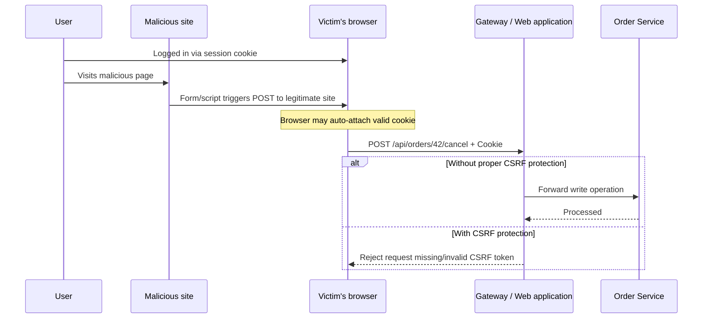
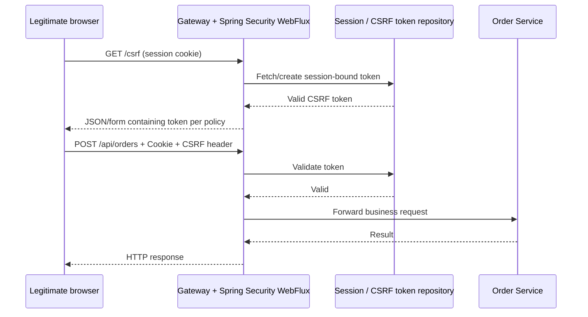

# CSRF for Cookie-Based vs. Bearer-Token Client Models

## Lesson Objectives

In the **Authentication and Authorization** chapter of **Spring Cloud Gateway**, we examine **Cross-Site Request Forgery (CSRF)** under two common communication models:

1. **Browser using session cookies:** browsers automatically attach cookies matching the request destination. A malicious website can exploit this behavior to trigger actions under the victim's identity.
2. **Client sending an explicit bearer token in the `Authorization` header:** if the API **only** authenticates via this header and browsers do not automatically attach fallback credentials, classical CSRF risk differs substantially from cookie sessions.

Spring Cloud Gateway also manages **route predicates**, **filter chains**, **path/header rewrites**, **service discovery**, **TLS**, **rate limiting**, **retries**, **circuit breakers**, and **observability**. CSRF is a targeted security control and cannot replace authentication or authorization across the gateway and microservices.

After this lesson, you will be able to:

- Explain the conditions for a successful CSRF attack and why **browsers automatically sending credentials** is central.
- Distinguish **session cookies**, **bearer tokens in HTTP headers**, and **JWTs stored in cookies**.
- Know when you must **keep CSRF protection** and when it can be **narrowly disabled** for bearer-only APIs.
- Configure Spring Security WebFlux with `SecurityWebFilterChain`, `CookieServerCsrfTokenRepository`, or JWT resource server validation.
- Coordinate CSRF with **CORS preflight**, `SameSite`, `Secure`, `HttpOnly` cookies, and Gateway trust boundaries.
- Test valid requests, missing/invalid CSRF tokens, session cookies, cross-site forms, and bearer headers via HTTP tests.
- Avoid common mistakes such as disabling CSRF system-wide to fix 403 errors or assuming `SameSite`/CORS alone replaces CSRF defenses.

> **Scope:** Examples use **Spring Cloud Gateway Server WebFlux** and **reactive Spring Security (`ServerHttpSecurity`)**, not servlet `HttpSecurity` or Spring Cloud Gateway Server MVC. Match Spring Boot/Spring Security/Spring Cloud Gateway to your target version, especially regarding CSRF token generation/delivery for SPAs.

## 1. What Does CSRF Actually Exploit?

Suppose a user is logged into a website:

```text
https://shop.example.com
```

The website backend or API Gateway identifies the user via a cookie:

```http
Cookie: SESSION=<session-id>
```

The user inadvertently visits a page:

```text
https://attacker.example
```

The malicious page tricks the user's browser into sending a state-changing request:

```html
<form action="https://shop.example.com/api/orders/42/cancel"
      method="POST">
  <input name="reason" value="cancelled" />
</form>
<script>
  document.forms[0].submit();
</script>
```

If the browser automatically attaches the session cookie in that context, and the server checks only the cookie **without** verifying the request origin/intent, the order cancellation can execute without the user's consent.

This is **request forgery**: the attacker does not need to read the cookie value, only to make the victim's browser **automatically send** the credential. The outcome also depends on cookie attributes, `SameSite`, browser policies, request type, and other defenses. A cookie with `SameSite=Lax` or `Strict` blocks many cross-site scenarios, yet should not be relied upon as the sole layer of defense.



The diagram shows an **exploitable condition**, not a claim that every browser always sends cookies on every cross-site POST. Cookie controls and modern browsers mitigate parts of this scenario; systems must still define their threat model accurately.

### 1.1. Three Conditions That Make CSRF a Concern

1. **Credentials can be auto-sent by the browser** to the target site, such as session cookies or another automatic auth mechanism.
2. **The request changes state**, such as changing a password, making a payment, canceling an order, or updating a profile.
3. **The server lacks anti-forgery verification** suited to the authentication model.

An attacker being **unable to read the response** does not necessarily prevent a write action. Browsers can send certain cross-site requests and only afterward restrict reading the response. That is why CSRF cannot be equated with CORS.

### 1.2. How CSRF Differs from XSS and Token Theft

| Attack Type | Goal | Key Difference |
| --- | --- | --- |
| **CSRF** | Abuse browser-auto-attached credentials to send unintended requests | Does not need to read cookies/tokens |
| **XSS** | Execute untrusted JavaScript within a valid origin | Can read JS-accessible data, send valid requests, or steal unprotected tokens |
| **Token theft** | Steal credentials to call APIs directly | Attacker holds the token; no victim browser needed to issue requests |
| **CORS misconfiguration** | Let untrusted origins read cross-origin responses | Can leak data, but is not a prerequisite for CSRF |
| **IDOR/BOLA** | Access unauthorized resources | Requires backend object-level authorization even without CSRF |

CSRF protection **does not replace** XSS prevention; conversely, merely setting `HttpOnly` on a cookie does not stop the browser from auto-attaching that cookie during a CSRF request.

## 2. The Key Question: Does the Browser Automatically Send Credentials?

Do not toggle CSRF using a naive **"JWT vs. session"** rule. What matters is **how credentials are transported and whether they are sent automatically**.

| Client Model | Auth Credential | Browser Auto-Attaches Credential? | CSRF Concern Level |
| --- | --- | --- | --- |
| Web app using sessions | `SESSION` cookie | Yes, if cookie policy permits | **Requires CSRF protection** on state-changing ops |
| SPA using JWT in `Authorization: Bearer ...` | Header explicitly set by JavaScript | External sites cannot simply set a header with the victim's token | Classical CSRF is usually not a primary threat **if the API truly accepts only bearer headers** |
| SPA storing JWT in a cookie read by server | Cookie containing JWT | Yes, per cookie policy | **Still requires CSRF evaluation** like cookie sessions |
| Browser using HTTP Basic or auto-credentials | Browser-managed credentials | May be sent automatically per mechanism/browser | Must evaluate and protect against CSRF |
| Native mobile app / server-to-server sending bearer header | Header explicitly added by client | No browser auto-attaching session cookies | Usually no CSRF token needed; still needs auth/TLS and other policies |
| Gateway accepts **both** session cookies and bearer headers | Either | **Yes** via the cookie branch | Never disable CSRF merely because some clients use bearer tokens |

### 2.1. A Bearer Token Inside a Cookie Is Not a "Bearer-Only Header"

These two requests look different:

```http
GET /api/profile HTTP/1.1
Host: api.example.com
Authorization: Bearer eyJ...
```

and:

```http
GET /api/profile HTTP/1.1
Host: api.example.com
Cookie: ACCESS_TOKEN=eyJ...
```

Both can use **the exact same JWT format**, yet browsers handle them differently. In the second case, browsers can automatically attach the cookie on requests to matching hosts. **Carrying a JWT does not make a cookie immune to CSRF.**

Similarly, placing a session ID in an `Authorization` header explicitly sent by JavaScript changes the threat model compared to a session cookie, even if the credential value represents the same account.

### 2.2. Bearer Headers Reduce One Risk but Are Not Automatically Safe

When an SPA holds a bearer token in JavaScript and sends it only via `Authorization`:

```javascript
const response = await fetch("/api/orders/42", {
  headers: {
    Authorization: `Bearer ${accessToken}`
  }
});
```

An external site outside the SPA's origin cannot read `accessToken` without another vulnerability, and cross-origin HTML forms cannot forge arbitrary `Authorization: Bearer ...` headers. Hence CSRF tokens are typically unnecessary for truly stateless APIs that **authenticate solely via bearer headers**.

However:

- **XSS** on the legitimate origin can issue API calls as the user, even if the token stays only in memory.
- Storing access tokens in `localStorage`/`sessionStorage` increases exposure to malicious JavaScript; token storage needs separate evaluation.
- If the backend/Gateway also accepts session cookies, Basic auth, refresh-token cookies, or another automatic credential for sensitive actions, **re-evaluate CSRF** for those endpoints.
- Bearer tokens still require verifying signature, issuer, audience, expiry, scopes, and resource-level authorization.

**Conclusion:** never say "JWT means disable CSRF"; say **"this API accepts only explicitly client-sent bearer tokens in headers, with no cookies or automatic credentials for protected operations."**

## 3. Cookies, SameSite, and the Boundary Between Origin and Site

Cookies carry attributes that directly govern whether browsers auto-attach credentials:

```http
Set-Cookie: SESSION=<opaque-id>; Path=/; Secure; HttpOnly; SameSite=Lax
```

| Attribute | Purpose | What It Does Not Do Alone |
| --- | --- | --- |
| `Secure` | Sends cookie only over secure connections per browser rules | Does not stop CSRF over HTTPS |
| `HttpOnly` | Blocks JavaScript from reading cookie values directly | **Does not** stop browsers from auto-sending cookies |
| `SameSite=Strict` | Strongly restricts cookies in many cross-site contexts | Does not replace authorization; can break valid navigations |
| `SameSite=Lax` | Reduces cookie sending on many cross-site subrequests/unsafe requests | Has browser/context exceptions; does not fully replace CSRF tokens |
| `SameSite=None; Secure` | Allows intentional cross-site cookies (when browser allows) | Makes CSRF threat model critical for auth cookies |
| `Domain`, `Path` | Controls which hosts/paths receive the cookie | **Not** an application authorization boundary |
| `__Host-` prefix | Enforces Secure, Path=/, and no Domain on supporting browsers | Does not guarantee CSRF/authorization safety |

### 3.1. Cross-Origin Differs from Cross-Site

**Origin** is the tuple scheme + host + port. **Site** in modern cookie models is based on scheme and registrable domain; thus two subdomains can be **cross-origin yet still same-site**.

For example:

```text
https://portal.example.com
https://api.example.com
```

These two addresses have different **origins**, yet typically belong to the same **site**. Consequently:

- JavaScript from portal calling API may require **CORS**.
- `SameSite` cookies may treat this exchange as **same-site** rather than cross-site.
- A compromised sibling subdomain can mount attacks not blocked by `SameSite` as expected.

Do not assume `SameSite=Strict` eliminates all CSRF possibilities when an organization operates multiple subdomains, hosts user-generated content, or faces subdomain takeover risks.

### 3.2. Host-Only Cookies vs. Shared Domain Cookies

A **host-only** session cookie scoped to `api.example.com` normally does not appear in `document.cookie` when JavaScript runs on `portal.example.com`, even when the browser can send the cookie to the API under appropriate rules.

Widening a cookie to `Domain=.example.com` just so JavaScript on a subdomain can read it expands cookie scope. This increases the risk that sibling subdomains can tamper with cookies, sessions, or CSRF tokens.

Do not rush to broaden `Domain` to fix frontend failures reading `XSRF-TOKEN`; design a **proper CSRF-token endpoint**, same-origin reverse proxy, or clear trusted frontend/BFF architecture instead.

## 4. CSRF Token Mechanism for Session-Cookie Browsers

The classic defense is the **synchronizer token pattern**:

1. The server generates an unpredictable token bound to the protected session/context.
2. Legitimate frontends obtain the token via a permitted channel, such as an HTML form or a `/csrf` endpoint exposed only to controlled origins.
3. On state-changing requests (`POST`, `PUT`, `PATCH`, `DELETE`, etc.), the client sends the token in a dedicated header or form field.
4. The server compares the received token with the session's valid token and rejects missing or mismatched tokens.

An attacker on another origin may cause the browser to attach cookies under certain conditions, yet **cannot read the valid token** and cannot forge a matching token via a simple HTML form.



The diagram illustrates **CSRF enforced at the Gateway**. If session cookies and CSRF protection live inside the backend, token validation can occur **at the backend**; the Gateway cannot validate a backend's session token on its own without sharing an explicitly designed trust/session mechanism.

### 4.1. HTTP Methods Requiring Attention

By default, Spring Security applies CSRF protection to methods **not considered safe**, such as `POST`, `PUT`, `PATCH`, and `DELETE`. `GET`, `HEAD`, `OPTIONS`, and `TRACE` must never execute state-changing operations.

| Request | Should It Mutate Data? | CSRF Protection |
| --- | --- | --- |
| `GET /api/orders/42` | No | Typically no CSRF token required |
| `HEAD /api/orders/42` | No | Typically no CSRF token required |
| `OPTIONS /api/orders` | No | Typically no CSRF token required |
| `POST /api/orders` | Yes | Token required if authenticated via cookies/auto-credentials |
| `PATCH /api/profile` | Yes | Token required if authenticated via cookies/auto-credentials |
| `DELETE /api/orders/42` | Yes | Token required if authenticated via cookies/auto-credentials |

**Never hide write operations behind GET**, such as `GET /api/orders/42/cancel`. Safe methods bypass CSRF checks by default; mutating state via GET leaves the system vulnerable via links, prefetches, crawlers, or cross-site navigation.

## 5. Spring Security WebFlux: Keeping CSRF for Cookie Sessions

In Gateway Server WebFlux, reactive security is configured via `SecurityWebFilterChain` and `ServerHttpSecurity`. Spring Security WebFlux CSRF protection is **enabled by default** in many common setups. When using session cookies, **keep** this protection, configure a token repository/delivery mechanism matching the client type, and test write methods.

### 5.1. Sample Configuration for Cookie Clients

```java
import org.springframework.context.annotation.Bean;
import org.springframework.http.HttpMethod;
import org.springframework.security.config.web.server.ServerHttpSecurity;
import org.springframework.security.web.server.SecurityWebFilterChain;
import org.springframework.security.web.server.csrf.CookieServerCsrfTokenRepository;

@Bean
SecurityWebFilterChain browserCookieSecurity(ServerHttpSecurity http) {
    return http
        .authorizeExchange(exchanges -> exchanges
            .pathMatchers(HttpMethod.GET, "/public/**").permitAll()
            .anyExchange().authenticated()
        )
        .csrf(csrf -> csrf
            .csrfTokenRepository(
                CookieServerCsrfTokenRepository.withHttpOnlyFalse()
            )
        )
        .build();
}
```

This snippet illustrates the **CSRF mechanism**, not a complete authentication setup. Real applications still require **login/session initialization**, a `ReactiveAuthenticationManager`/identity provider or equivalent, cookie flags, logout handling, CORS, and session management.

`CookieServerCsrfTokenRepository.withHttpOnlyFalse()` suits SPAs that need to read the **CSRF token cookie** in JavaScript to echo it back in a header. It **does not** mean the session cookie should drop `HttpOnly`; the two cookies have different roles:

- `SESSION` or equivalent session cookie is an **authentication credential**: it should use `HttpOnly`, `Secure`, and appropriate `SameSite`.
- `XSRF-TOKEN` is an **anti-CSRF value for a designed mechanism**: some SPAs need to read it, requiring `HttpOnly=false` **solely on the token cookie**.

Depending on the Spring Security version, tokens may be **deferred** (generated only when accessed) and **masked/XOR-encoded** to protect against BREACH. Merely setting a cookie repository **does not guarantee** every SPA sees a token on the first GET or can echo the raw cookie value unconditionally. Configure **token initialization/delivery** and the request handler to match how the frontend sends tokens in **your exact Security WebFlux version**.

### 5.2. CSRF Token Repositories in WebFlux

| Repository / Delivery | Characteristics | What to Watch |
| --- | --- | --- |
| `WebSessionServerCsrfTokenRepository` | Server-side token managed in WebSession; a default WebFlux choice | Frontend needs a valid endpoint to obtain the token |
| `CookieServerCsrfTokenRepository` | Cookie-backed token; often used with SPAs | Do not confuse this cookie with credentials; check request handler, flags, and token generation |
| Custom repository | Can integrate custom infrastructure | Must ensure unpredictability, session/context binding, lifecycle, anti-forgery, and scalability |

The **double-submit cookie** pattern also uses a token in a cookie paired with a copy in a header/body. If self-implementing, **cryptographically bind tokens to the session/context**, avoiding arbitrary self-chosen tokens susceptible to cookie injection from subdomains or unintended cookie writes. Never write a naive "header equals cookie is enough" check for sensitive apps without evaluating those risks.

### 5.3. Providing a Token Endpoint for an SPA

For an SPA sharing the **same origin** as the Gateway, a CSRF token endpoint lets the client proactively fetch a token before sending write requests. **Illustrative skeleton** for Spring Security WebFlux:

```java
import java.util.Map;
import org.springframework.security.web.server.csrf.CsrfToken;
import org.springframework.web.bind.annotation.GetMapping;
import org.springframework.web.bind.annotation.RestController;
import org.springframework.web.server.ServerWebExchange;
import reactor.core.publisher.Mono;

@RestController
class CsrfTokenController {

    @GetMapping("/csrf")
    Mono<Map<String, String>> csrf(ServerWebExchange exchange) {
        Mono<CsrfToken> tokenMono =
            exchange.getAttribute(CsrfToken.class.getName());

        if (tokenMono == null) {
            return Mono.error(
                new IllegalStateException("CSRF is not configured")
            );
        }

        return tokenMono.map(token -> Map.of(
            "headerName", token.getHeaderName(),
            "token", token.getToken()
        ));
    }
}
```

In many Spring Security WebFlux versions, the exchange attribute holds a `Mono<CsrfToken>`; **verify with your application version**. Crucially, subscribing to the publisher triggers token generation when deferred tokens are used. The endpoint must:

- Be protected by proper CORS/same-origin policies so untrusted origins cannot read the token.
- Return `Cache-Control: no-store` or an equivalent safe cache policy; prevent shared CDNs from caching per-session tokens.
- Never log tokens or place them in query strings, trace attributes, or error messages.
- Stay synchronized with session/cookie and token lifecycles, especially after login, logout, or session rotation.
- Return tokens in the form accepted by the active **CSRF request handler** (which may include masked token handling).

This endpoint applies when **CSRF is enforced at the Gateway**. If security filters reject requests before the controller runs, configure matchers/permissions for the token endpoint intentionally—never `permitAll` across the whole API.

### 5.4. Same-Origin Frontend Sending the Token on Unsafe Requests

Assuming frontend and API share origin `https://shop.example.com`, with the Gateway serving `/api/**` under the same host:

```javascript
async function cancelOrder(orderId) {
  const csrfResponse = await fetch("/csrf", {
    method: "GET",
    credentials: "same-origin",
    cache: "no-store"
  });

  if (!csrfResponse.ok) {
    throw new Error("Cannot obtain CSRF token");
  }

  const csrf = await csrfResponse.json();

  const response = await fetch(`/api/orders/${orderId}/cancel`, {
    method: "POST",
    credentials: "same-origin",
    headers: {
      [csrf.headerName]: csrf.token,
      "Content-Type": "application/json"
    },
    body: JSON.stringify({ reason: "customer-request" })
  });

  if (!response.ok) {
    throw new Error("Request rejected or failed");
  }

  return response;
}
```

This example uses **same-origin fetch**, not cross-origin cookies. If the frontend sits on `portal.example.com` and the API on `api.example.com`, adjust `credentials: "include"`, CORS, cookie flags, and token retrieval accordingly. A host-only `XSRF-TOKEN` cookie on `api.example.com` **cannot be read via `document.cookie` from portal.example.com**.

Never pass CSRF tokens in URL queries, hardcode tokens into publicly cached HTML, or reuse one static token across all users.

## 6. Bearer-Only APIs: When Can CSRF Be Disabled?

An API using **OAuth2 Resource Server JWT** may accept only:

```http
Authorization: Bearer <valid-jwt>
```

If **every privileged request** on that API group uses only the bearer header and **does not accept cookies, sessions, or automatic HTTP Basic auth** for write operations, CSRF tokens are typically unnecessary for that route group. This decision is **threat-model-based**, not a blanket default for the whole application.

### 6.1. Scoped WebFlux Configuration

Example route group `/api/bearer/**` designed for SPA/mobile/service clients explicitly attaching tokens:

```java
import org.springframework.context.annotation.Bean;
import org.springframework.core.annotation.Order;
import org.springframework.security.config.Customizer;
import org.springframework.security.config.web.server.ServerHttpSecurity;
import org.springframework.security.web.server.SecurityWebFilterChain;
import org.springframework.security.web.server.context.NoOpServerSecurityContextRepository;
import org.springframework.security.web.server.util.matcher.PathPatternParserServerWebExchangeMatcher;

@Bean
@Order(1)
SecurityWebFilterChain bearerOnlyApi(ServerHttpSecurity http) {
    return http
        .securityMatcher(
            new PathPatternParserServerWebExchangeMatcher("/api/bearer/**")
        )
        .securityContextRepository(
            NoOpServerSecurityContextRepository.getInstance()
        )
        .authorizeExchange(exchanges -> exchanges
            .anyExchange().authenticated()
        )
        .oauth2ResourceServer(oauth2 -> oauth2
            .jwt(Customizer.withDefaults())
        )
        .csrf(ServerHttpSecurity.CsrfSpec::disable)
        .build();
}
```

**Prerequisites:** issuer/JWKS, audience validation, JWT signature/expiry, scope policies, and dependencies must be configured. This snippet only illustrates the CSRF decision alongside a JWT resource server—it **does not implement complete JWT verification**. Nor does it protect other routes automatically; if an app has multiple `SecurityWebFilterChain` beans, configure chains covering **all remaining paths** so no endpoint is left unprotected.

`NoOpServerSecurityContextRepository` ensures this chain does not store security contexts in WebSession. Adding this repository alone **is insufficient** if a custom filter or backend still accepts cookies to execute requests. Verify **both the request path and actual auth mechanisms**.

### 6.2. Do Not Skip Authorization Checks

Disabling CSRF on a bearer-only API **does not mean**:

```text
permitAll()
```

The Gateway must still reject invalid tokens, expired tokens, or insufficient scopes; the backend must still verify the user has permissions for the specific order.

For example, a JWT with scope `orders.read` may suffice to list orders while **still not granting permission** to read another user's order `42`. That is **resource-level authorization**, not CSRF.

### 6.3. Warning About Refresh Tokens

An SPA might use:

- Access token in the `Authorization` header.
- **Refresh token stored in an `HttpOnly` cookie** to call `/auth/refresh`.

Thus `/api/bearer/**` may not need CSRF if strictly bearer-only, whereas the **`/auth/refresh`** endpoint receiving automatic cookies **must be evaluated separately for CSRF**. Depending on design, attackers could trigger refresh/logout/login requests or state changes without reading the token.

Split chains or policies by **each endpoint's credential mechanism**, not by whether the system uses JWTs anywhere.

## 7. A Single Gateway Serving Both Cookie Sessions and Bearer Tokens

This scenario is easy to misconfigure:

```text
/web/**          Browser logging in via session cookie
/api/bearer/**   Mobile/SPA explicitly sending Authorization: Bearer
/auth/refresh    Refresh token in cookie
```

Recommended policy:

| Endpoint Group | Credential | CSRF | Authorization |
| --- | --- | --- | --- |
| `/web/**` | Session cookie | **Enabled**, token on unsafe methods | User/session/role and business permissions |
| `/api/bearer/**` | Bearer header only | May disable for this group after threat assessment | JWT issuer/audience/scope and backend permissions |
| `/auth/refresh` | Refresh-token cookie | Evaluate and typically protect per cookie threat model | Token rotation, reuse detection, and session/CSRF policy |
| `/auth/logout` | Session/refresh cookie | Protect per cookie policy, especially POST logout | Properly clear session/tokens |
| `/health` | No user credentials | Dedicated policy; read-only endpoint | Limit exposed info and network exposure |

When using multiple `SecurityWebFilterChain` beans, `@Order` and `securityMatcher` determine which chain claims a request. **Chains do not combine rules with each other**; a request is normally handled only by the first matching chain in order. A broad rule in an earlier chain can prevent a specific cookie/bearer chain from ever applying.

Reference example of two split chains, not production-ready on its own:

```java
@Bean
@Order(1)
SecurityWebFilterChain jwtEndpoints(ServerHttpSecurity http) {
    return http
        .securityMatcher(
            new PathPatternParserServerWebExchangeMatcher("/api/bearer/**")
        )
        .securityContextRepository(
            NoOpServerSecurityContextRepository.getInstance()
        )
        .authorizeExchange(ex -> ex.anyExchange().authenticated())
        .oauth2ResourceServer(oauth -> oauth.jwt(Customizer.withDefaults()))
        .csrf(ServerHttpSecurity.CsrfSpec::disable)
        .build();
}

@Bean
@Order(2)
SecurityWebFilterChain browserEndpoints(ServerHttpSecurity http) {
    return http
        .securityMatcher(
            new PathPatternParserServerWebExchangeMatcher("/web/**")
        )
        .authorizeExchange(ex -> ex.anyExchange().authenticated())
        .csrf(csrf -> csrf.csrfTokenRepository(
            CookieServerCsrfTokenRepository.withHttpOnlyFalse()
        ))
        .build();
}
```

This snippet relies on imports from sections 5/6 and **only expresses policy scoping**, omitting login/session providers and a fallback chain. For a real app, declare all beans, configure authentication, and protect paths outside these two groups (`/auth/**`, actuator, admin, health). Do not copy this example alongside the previous sample beans without checking for bean conflicts.

### 7.1. Do Not Bind CSRF Blindly to Route IDs

Spring Security WebFlux normally runs in the **WebFilter chain**, **before** Spring Cloud Gateway picks a route and runs its `GatewayFilter`s. When security evaluates CSRF for `/api/orders/**`, it typically inspects the **incoming request URL/method**, not the URI after `RewritePath`.

For example:

```text
Browser → POST /api/orders/42/cancel
  ↓
Spring Security WebFilter: auth + CSRF
  ↓
RoutePredicateHandlerMapping: select orders route
  ↓
RewritePath: /api/orders/... → /orders/...
  ↓
RouteToRequestUrlFilter + Load balancing + Routing
  ↓
Order Service
```

Do not place a custom `GlobalFilter` at the end of the filter chain expecting it to guard **every request**: unmatched routes, actuator handlers, or requests already blocked by security may never reach the Gateway filter chain. CSRF for cookie-based web apps should live at the proper security layer or at the backend owning the session, rather than relying haphazardly on late filters.

### 7.2. When the Session Actually Lives in the Backend

Suppose the Gateway simply proxies a `SESSION` cookie to the backend, while the **backend** stores the session and validates credentials. The Gateway may lack the data needed to verify a CSRF token bound to the backend's session.

In this design:

- The backend **must protect itself** on cookie-authenticated requests unless a centralized auth/CSRF architecture truly covers it.
- The Gateway must preserve relevant headers/cookies per contract rather than stripping or altering a token the backend needs without redesigning the flow.
- If centralizing CSRF checks at the Gateway, explicitly design the token repository, session binding, state transitions, and trust boundary—never just enable a Gateway filter and turn off backend protection.
- When callers can reach the backend directly outside the Gateway, backend policies must never rely solely on assuming "the Gateway checked it."

## 8. CORS Does Not Replace CSRF

With a browser from `https://portal.example.com` calling `https://api.example.com`:

```javascript
await fetch("https://api.example.com/api/orders", {
  method: "POST",
  credentials: "include",
  headers: {
    "Content-Type": "application/json",
    "X-XSRF-TOKEN": csrfToken
  },
  body: JSON.stringify({ itemId: "BOOK-42" })
});
```

Because origins differ, the browser may send a **preflight OPTIONS**:

```http
OPTIONS /api/orders HTTP/1.1
Origin: https://portal.example.com
Access-Control-Request-Method: POST
Access-Control-Request-Headers: content-type,x-xsrf-token
```

The Gateway must emit valid CORS responses for allowed origins/methods/headers. Yet:

1. **Preflight OPTIONS is not an order-creation request.** Do not require a CSRF token on preflight per default unsafe-method policy.
2. Preflights typically **do not carry session cookies or bearer credentials like actual requests**. If security blocks OPTIONS before the CORS processor, browsers may never send the POST even when actual-request CSRF is configured properly.
3. The actual POST still needs **authentication + CSRF token** if using cookie sessions.
4. `allowedHeaders: [X-XSRF-TOKEN]` only lets browsers send that header; it **does not validate** the CSRF token value.
5. `Access-Control-Allow-Origin` cannot replace backend authorization policies.

### 8.1. Route-Level CORS Configuration

In Gateway Server WebFlux versions supporting `metadata.cors`, for example:

```yaml
spring:
  cloud:
    gateway:
      routes:
        - id: orders-web
          uri: lb://order-service
          predicates:
            - Path=/api/orders/**
          metadata:
            cors:
              allowedOrigins:
                - https://portal.example.com
              allowedMethods:
                - GET
                - POST
              allowedHeaders:
                - Content-Type
                - X-XSRF-TOKEN
              allowCredentials: true
              maxAge: 300
```

This is purely a **CORS policy**; it does not mean a CSRF token repository is active or requests are authenticated. With `allowCredentials: true`, never use `allowedOrigins: '*'` for credentialed CORS. Specify explicit origins and enforce cookies/CSRF in `SecurityWebFilterChain`.

### 8.2. When a Route Uses `Method=POST`

A route with predicate:

```yaml
predicates:
  - Path=/api/orders/**
  - Method=POST
```

may fail to match **OPTIONS** preflight requests. Then route `metadata.cors` might not apply to OPTIONS. Configure CORS via global mapping, Security, or ingress **narrowly and consistently**. Never disable CSRF to work around a preflight that failed to match a route—those are two separate issues.

### 8.3. Cross-Origin Cookies and Protective Policies

`credentials: "include"` does not guarantee browsers send every cookie; it still depends on domain/path, `SameSite`, `Secure`, third-party cookie policies, and session state.

An SPA on another subdomain may need to **fetch CSRF tokens from an authorized endpoint** instead of reading the API's host-only cookie from JavaScript. The token endpoint needs a strict CORS allowlist, session binding, and `Cache-Control: no-store`. If the frontend and Gateway can share the **same origin via a reverse proxy**, managing cookies and CSRF is usually much simpler.

## 9. TLS, Header Forwarding, and Cookie Policy at the Gateway

When the Gateway sits behind an ingress:

```text
Browser --HTTPS--> Ingress --HTTP(S)--> Gateway --HTTP(S)--> Backend
```

CSRF does not replace TLS:

- `Secure` cookies are sent by browsers only over secure connections per cookie rules.
- If ingress terminates TLS, a Gateway receiving internal HTTP still needs trust boundaries, network policies, proxy header validation, and internal-hop security decisions.
- Client-spoofed `X-Forwarded-Proto`, `Forwarded`, or `X-Forwarded-Host` headers **must never** be trusted as proof of HTTPS or a trusted origin.
- If the Gateway rewrites request/response headers or cookies, ensure `Set-Cookie` and CSRF tokens are not unintentionally stripped, re-domained, or re-pathed.

Never log `Cookie`, `Set-Cookie`, `Authorization`, CSRF tokens, or sensitive bodies to debug 403 errors. Log route ID, HTTP method, status, error category, controlled trace ID, and boolean token-check result (valid/invalid) without raw token values.

### 9.1. Configuring Cookie Attributes

A typical secure session cookie:

```http
Set-Cookie: SESSION=<opaque-id>; Path=/; Secure; HttpOnly; SameSite=Lax
```

This is a **format example**, not a single Spring Boot property that auto-generates these exact flags in every setup. WebSession stores, cookie names, session management, and reverse proxies must be configured and tested against your actual runtime. Use `SameSite=None` only when cross-site flows truly require it, always paired with `Secure` on modern browsers.

A CSRF token cookie may need to be JS-readable **if** choosing a cookie-token SPA pattern; that never applies to session cookies. When setting `HttpOnly=false` on a CSRF cookie, mitigating XSS remains paramount: malicious scripts running on a valid origin can read the token and issue requests.

## 10. Pitfalls When Protecting Against CSRF in Microservices

### 10.1. Disabling CSRF Across the Entire Gateway After Seeing a 403

**Dangerous example for cookie-based apps:**

```java
http.csrf(ServerHttpSecurity.CsrfSpec::disable);
```

Applying this to endpoints using session cookies can remove protection against cross-site unsafe requests. **A 403 is not always CSRF**: it could be missing roles/scopes, backend denial, a CORS failure, or a mismatched CSRF token. Identify the cause before changing policy.

### 10.2. Enabling Token Repository While Frontend Never Fetches the Token

In modern Spring Security, CSRF tokens may be generated **lazily upon access** (deferred). If the SPA hits no endpoint/token view triggering token creation, or omits the header expected by the repository, POST requests are still rejected.

Fix: build a **fetch token → send token → handle rotation** flow, test after login/logout, and verify the matching request handler if BREACH/XOR token processing is active. Never call CSRF "broken" and disable it.

### 10.3. Sending `X-XSRF-TOKEN` When the Bearer JWT Is Invalid

A valid CSRF token never grants access to a request lacking a valid session/JWT. **A CSRF token is not an access token** and does not replace `Authorization`. On bearer-only APIs, requiring a CSRF header does not stop XSS, token theft, or missing scope validation.

### 10.4. Relying Only on `SameSite` and Skipping CSRF Tokens

`SameSite` helps, yet has edge cases with same-site cross-origin setups, browser quirks, widened `Domain` cookies, and systems requiring cross-site cookies. For cookie-authenticated apps performing critical operations, pair CSRF tokens with defense-in-depth per your threat assessment rather than relying on a single cookie attribute.

### 10.5. Using `GET` to Mutate State

If `GET /api/payments/42/approve` updates data, mechanisms built around "safe methods" may skip CSRF token checks. That path can be triggered via links, crawlers, or prefetches. **Place mutations on unsafe methods** and protect them with authentication, CSRF (if cookie-based), and proper authorization.

### 10.6. Reversing Filter Order and Bypassing Protection

Spring Security WebFlux normally executes before `RoutePredicateHandlerMapping`, whereas `RewritePath`, `StripPrefix`, Retry, load balancing, and HTTP routing run in the Gateway filter chain. Path-based security rules see the **original path**, which differs from what backends receive.

Never rely on fragile filter ordering to protect an endpoint only after rewriting. With custom filters, audit incoming HTTP requests, security matchers, route predicates, and `order`; a new route or fallback can bypass an overly narrow policy.

### 10.7. Combining Retries with Unsafe Requests

Once a valid POST clears CSRF and reaches the backend, **Retry** can replay the outbound request on connection errors. A CSRF token verifies request origin, **not making POST idempotent**. Operations like payments or order creation require idempotency keys, backend deduplication, and bounded retry policies.

### 10.8. Naively Trusting Origin or Referer

Checking `Origin`/`Referer` can serve as **defense in depth**, provided you handle null/missing values, scheme/host/port, proxy trust, and privacy policies. Never write naive checks like "Origin containing `example.com` is valid"; `attacker-example.com` is not the same origin as `example.com`.

Some systems also use `Sec-Fetch-Site`, `Sec-Fetch-Mode`, and Fetch Metadata headers to filter cross-site requests. Those too are **supplementary layers** requiring clear fallbacks for clients omitting those headers, never replacing token validation in cookie-based flows.

## 11. Testing: CSRF Under Both Models

To confirm the Gateway is secure, verify both **response status** and **whether the backend actually received the request or mutated state**. Looking only for 403 without knowing whether it came from CSRF or authorization is insufficient.

### 11.1. Test Cases for Cookie Sessions

Assume the browser logged in with a session cookie, and Gateway/Backend enforce CSRF:

| Case | Cookie/Session | CSRF Token | Expected Outcome |
| --- | --- | --- | --- |
| GET read data | Valid | Not sent | May succeed if authorized |
| POST create order | Valid | Matches session | Passes CSRF; proceeds to authz and backend |
| POST create order | Valid | Missing | **Denied** by CSRF policy |
| POST create order | Valid | Invalid | **Denied** by CSRF policy |
| DELETE order | Valid | Token from another session | **Denied** |
| POST after logout | Invalidated session | Old token | Business logic must not execute |
| POST without session | Invalid/missing | Any token | Must not be treated as authenticated user |
| POST from disallowed Origin | Cookie may be sent per policy | No valid token | No business side effects |
| OPTIONS preflight | Usually no token | Not sent | Evaluated by CORS layer; no write action |

Ordinarily, Spring Security returns **403 Forbidden** when a CSRF token is missing/invalid. If unauthenticated or handled by another chain, the response may be 401/redirect/login page. Do not rigidly assume every 403 is CSRF or every CSRF failure has the exact same body.

### 11.2. Test Cases for Bearer-Only APIs

| Case | `Authorization` | Auth Cookie | Expected Outcome |
| --- | --- | --- | --- |
| Valid GET | Valid JWT with sufficient scope | None | Passes auth/authz |
| Valid POST | Valid JWT with sufficient scope | None | May succeed **without CSRF token** under bearer-only policy |
| POST missing token | None | None | Denied |
| POST invalid token | Expired/bad signature/wrong audience JWT | None | Denied |
| POST missing scope | Valid JWT lacking permission | None | Denied |
| Browser cross-site form | Cannot auto-attach victim's bearer token | None | Cannot execute as victim |
| POST with cookie only | None | Any cookie | **Must not authenticate** if API is truly bearer-only |
| POST with both cookie and bearer | Valid bearer | Different cookie | Verify API strictly uses **bearer only**, never falling back to cookie |

Key distinction: disabling CSRF is justified only after proving **cookies are not accepted as a fallback authentication method** on the bearer-only group.

### 11.3. Testing with `curl`

For a cookie-session test environment, illustrative requests:

```bash
# Assume session cookie and CSRF token were issued by a test login flow.
# Token and cookie here are placeholders, not real credentials.
curl -i -X POST "https://api.example.com/api/orders" \
  -H "Content-Type: application/json" \
  -H "Cookie: SESSION=<test-session>" \
  -d '{"itemId":"BOOK-42"}'

# CSRF-valid request (authorization must still be checked):
curl -i -X POST "https://api.example.com/api/orders" \
  -H "Content-Type: application/json" \
  -H "Cookie: SESSION=<test-session>" \
  -H "X-XSRF-TOKEN: <valid-csrf-for-session>" \
  -d '{"itemId":"BOOK-42"}'
```

In the first test, if the session is recognized and CSRF is active, the tokenless request must be rejected. In the second test, only when both the token is valid and the user is authorized does the backend process the request. **Never leave real tokens/cookies in shell history, tickets, or diagnostic logs.**

For a bearer-only endpoint:

```bash
curl -i -X POST "https://api.example.com/api/bearer/orders" \
  -H "Authorization: Bearer <test-jwt>" \
  -H "Content-Type: application/json" \
  -d '{"itemId":"BOOK-42"}'
```

If the API authenticates solely via JWT header and CSRF is scoped-disabled, omitting `X-XSRF-TOKEN` is not a reason to reject. You can still get 401/403 due to invalid tokens or insufficient scopes.

**Note:** `curl` does not enforce browser CORS policies. To test real cross-origin attacks, test in a browser or accurately simulate browser/cookie rules; never declare CSRF safe just because a `curl` command can or cannot send a header.

### 11.4. Reactive Testing with `WebTestClient`

An integration test with Gateway, Spring Security, and a backend stub can verify:

```java
// Scenario initialized with an authenticated session via appropriate test setup.
webTestClient.post()
    .uri("/api/orders")
    .cookie("SESSION", "<test-session>")
    .contentType(MediaType.APPLICATION_JSON)
    .bodyValue(Map.of("itemId", "BOOK-42"))
    .exchange()
    .expectStatus().isForbidden();
```

This snippet only illustrates a **request missing a CSRF token**; if the test lacks a valid session or uses different route/security matchers, the actual status may be 401/redirect. Complete tests must configure the session/authentication and server token repository properly, then assert that the **backend stub received zero requests** when tokens are missing/invalid.

Add a parallel test sending the session's valid token and verifying the backend receives **exactly one** request. For bearer-only APIs, supply a test JWT signed/accepted by the test decoder and verify no CSRF token is required while invalid or under-scoped JWTs are still rejected.

### 11.5. Observing Failure Origins

When browsers report 403 or "blocked by CORS policy," check:

1. Which request failed: **preflight OPTIONS** or actual POST?
2. Are Origin and `Access-Control-Request-Headers` allowed by CORS policy?
3. Was the cookie actually sent given Domain/Path/SameSite/Secure and fetch credentials?
4. Which security chain matched the path?
5. Was the CSRF token issued, sent in the expected header, and matched by the repository/session?
6. Is the JWT/session valid and carrying sufficient scopes/permissions?
7. Did the request reach the Gateway filter chain/backend, or was it blocked before route matching?
8. Did any rewrite/header/retry filter alter behavior?

Never log full credentials or CSRF token values to debug; log only presence/absence, validation result, safe route/path pattern, trace ID, and error category.

## 12. Pre-Implementation Design Checklist

| Question | What to Confirm |
| --- | --- |
| **Who is the client?** | Browser SPA, browser form, mobile app, or service-to-service? |
| **Where do credentials travel?** | Auto-sent cookies, app-set `Authorization` header, or mixed? |
| **Any auth fallback?** | Does bearer-only strictly reject session cookies/Basic auth? |
| **Unsafe methods?** | Are POST/PUT/PATCH/DELETE protected, and GET/HEAD kept state-safe? |
| **Token repository?** | Is the token session/context-bound, unpredictable, and properly verified? |
| **Token delivery?** | Does SPA/form fetch tokens securely without shared caching or logging? |
| **Cookie flags?** | Do session cookies set appropriate `Secure`, `HttpOnly`, `SameSite`, Domain/Path? |
| **CORS?** | Explicit origins, proper allowCredentials/allowedHeaders; preflight unblocked by auth? |
| **CSRF owner?** | Does Gateway or backend hold the session and validate tokens, with neither missing it? |
| **Security chains?** | Do matchers/order cover routes properly without leaving paths outside chains? |
| **Authorization?** | Does backend check per-resource permissions rather than trusting Gateway alone? |
| **TLS/proxies?** | Inbound/outbound TLS, trusted forwarded headers, proper secure cookies? |
| **Retries?** | Idempotency safeguards on writes; never confuse CSRF with duplicate requests? |
| **Observability?** | Route/status/latency/CSRF metrics without logging secrets? |
| **Tests?** | Missing/invalid cookie tokens blocked; bearer-only works; mixed flows covered? |

## 13. Practice Exercises with Answers

An API Gateway serves:

```text
https://shop.example.com/web/orders
  → Browser logged in via SESSION cookie

https://api.example.com/api/bearer/orders
  → Mobile app sending Authorization: Bearer <JWT>

https://api.example.com/auth/refresh
  → Browser using HttpOnly refresh-token cookie
```

**Answer these:**

1. Does `/web/orders` require a CSRF token on `POST` if using session cookies?
2. Does storing a JWT inside an `HttpOnly` cookie eliminate CSRF risk?
3. Why can a bearer-only API skip CSRF tokens yet still need protection against XSS and token theft?
4. Can CSRF be disabled Gateway-wide just because mobile routes use JWTs?
5. Should cookie-based `/auth/refresh` be evaluated separately for CSRF?
6. If a frontend on `portal.example.com` calls an API on `api.example.com`, does `SameSite=Lax` make CORS unnecessary?
7. Why not switch to `GET /web/orders/42/cancel` to avoid 403 CSRF errors?
8. If a POST carries a valid CSRF token yet the JWT lacks `orders.write`, should the request update data?
9. If the backend manages its own sessions and the Gateway has no access to them, where must CSRF protection run?
10. Once CSRF is validated, can Retry safely replay a payment POST indefinitely?

**Suggested answers:**

1. **Yes**, under the session-cookie model, unsafe requests require CSRF protection.
2. **No.** `HttpOnly` blocks JavaScript from reading the cookie, not the browser from automatically sending it.
3. Off-origin sites cannot auto-read/attach the victim's bearer header the way session cookies work, yet XSS on the legitimate origin or token theft can still invoke the API.
4. **No.** Separate security chains/policies by credential type and protect cookie endpoints.
5. **Yes.** It relies on automatic credentials and carries dedicated session/token risks.
6. **No.** CORS governs cross-origin access; SameSite is a site-level cookie policy.
7. Because GET must remain safe; state-changing GETs can be triggered by links/prefetches/crawlers and are normally skipped by CSRF filters.
8. **No.** CSRF and authorization are independent checks; missing scopes/permissions must still be denied.
9. The backend owning the session must protect itself unless a true centralized Gateway CSRF mechanism has been built and verified.
10. **No.** CSRF does not provide idempotency. Retries must be bounded and writes protected by dedicated idempotency mechanisms.

## Summary

**CSRF depends on how browsers send credentials, not merely on token format.** With **session cookies** or JWTs stored in auto-sent cookies, state-changing requests need proper CSRF policies. With **APIs accepting only explicitly client-attached bearer tokens in `Authorization` headers**, classical CSRF usually does not require a separate token—yet JWT verification, authorization, TLS, XSS defense, and token-storage policies remain mandatory.

In **Spring Cloud Gateway Server WebFlux**, enforce these decisions in **`SecurityWebFilterChain`** or at the backend actually owning the session, scoped clearly per endpoint. Combine CSRF tokens, cookie flags, CORS preflight, SameSite, route/filter ordering, and integration tests instead of disabling CSRF globally to clear 403s. A sound design stops unintended sites from abusing browser credentials without imposing unnecessary CSRF overhead on genuinely stateless bearer-only clients.
