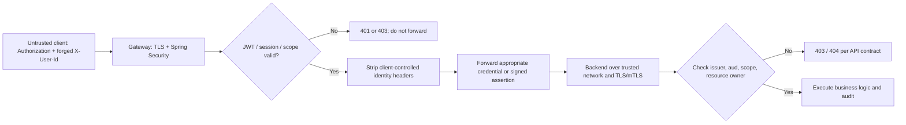
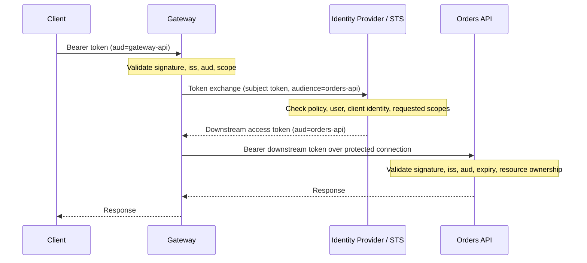

# Propagating Identity Downstream Within a Trust Boundary with Spring Cloud Gateway

## 1. Why "Authenticated at the Gateway" Does Not Mean the Backend Can Trust Everything

In a microservices system, **Spring Cloud Gateway** is the HTTP entry point: selecting routes via **route predicates**, running the **filter chain**, transforming paths/headers, routing via service discovery, and enforcing policies such as authentication, rate limiting, circuit breakers, retries, TLS, and request observability. The Gateway is often the first place authenticating clients, yet **the backend is where data is processed and permissions on specific resources are decided**.

Suppose an authenticated user calls:

```http
GET /api/orders/42 HTTP/1.1
Host: api.example.test
Authorization: Bearer <access-token>
X-User-Id: administrator
```

The `X-User-Id: administrator` header was **sent by the client itself**; it does not become trustworthy simply because the request passed through the Gateway. The Gateway may verify the access token and see `sub=user-123`, yet if it blindly forwards spoofed headers, a backend reading only `X-User-Id` could mistake the caller for an administrator.

**Lesson objectives:** distinguish *credential propagation* from *verified identity propagation*, explain **trust boundaries**, use Spring Security Resource Server or OAuth2 Client/`TokenRelay` in the right context, constrain audience and scopes, prevent header spoofing, configure TLS/mTLS, and test authorization at both Gateway and backend.

> **Implementation scope:** primary examples use **Spring Cloud Gateway Server WebFlux 4.3+/5.x**, with routes under `spring.cloud.gateway.server.webflux.routes`. WebFlux 4.2 and earlier commonly used `spring.cloud.gateway.routes`. Gateway Server Web MVC uses a different Servlet security/filter API; do not copy WebFlux `SecurityWebFilterChain` or Java `RouteLocatorBuilder` code into MVC.

## 2. Identity, Credential, Principal, and Access Permission Are Four Different Things

| Concept | Example | Meaning | Risk If Confused |
|---|---|---|---|
**Credential** | OAuth2 access token, client certificate | Proof that must be verified by the receiver | Copying a token and treating it as "verified" without checking |
**Identity / principal** | `sub=user-123`, client ID, service identity | Who or which workload is performing the action | Mistaking a service identity for an end user |
**Authorization attributes** | `scope=orders.read`, tenant, roles | Permissions evaluated within a context | Trusting `role=admin` from a client-crafted header |
**Resource authorization** | Can user `user-123` view order `42`? | Permission check on a **specific resource** | Checking only token validity and allowing reading all orders |

A JWT may carry claims such as `iss` (issuer), `sub` (subject), `aud` (audience), `exp`, `nbf`, and `scope`; **Base64 decoding** does not prove those claims are trustworthy. A resource server must verify signature/key source, issuer, lifetime, expected audience, and API scopes/permissions.

**Access tokens** are for accessing resource servers. OpenID Connect **ID tokens** confirm a login event to an OAuth2 client, **not as a substitute for access tokens when calling APIs**. **Refresh tokens** are for obtaining new tokens and should never be forwarded to every microservice.

### 2.1. Trust Boundary Diagram



**There are multiple boundaries, not just one:** browser → Gateway; Gateway → backend; backend → further internal services; Gateway ↔ registry/IdP. Any client-controlled header sits on the **untrusted** side even if its name starts with `X-Internal-`.

### 2.2. Entities You Must Actually Control

- **User identity**: the individual or tenant requesting the action.
- **Gateway identity**: the workload/ingress calling the backend; can be proven with mTLS/service credentials.
- **Actor identity**: a service acting on behalf of a user, critical in delegation/on-behalf-of flows.
- **Request context**: route ID, request/trace ID, source, IP, user agent; primarily for observability, **not user permissions**.

Never equate an OAuth2 client's `client_id` with a user's `sub`. A client-credentials token normally represents an application/service and does not inherently carry an end-user identity.

## 3. Choosing a Propagation Strategy Before Writing Filters

| Strategy | What Backend Receives | When to Use | Security Conditions |
|---|---|---|---|
**Bearer pass-through** | Client-sent access token | API Gateway and backend accept the same token by design | Both Gateway and backend verify token independently; consistent issuer, audience, scope, and ownership |
**OAuth2 TokenRelay** | Access token from `OAuth2AuthorizedClient` | Gateway acts as OAuth2 client/SSO with login session or matching registration | Client registration, authorized-client storage, matching token audience; backend verifies independently |
**Token exchange / on-behalf-of** | New token scoped for downstream | Backend requires narrow audience/scopes and explicit delegation | IdP/STS supports token exchange, identifies actor/subject; never forge tokens |
**Service credentials** | Client-credentials or workload identity token | Gateway acts as the **service itself** | Never claim it is a user token; constrain service scopes/audience |
**Trusted identity assertion** | Signed assertion or identity headers over protected channel | Legacy system cannot understand OAuth2/JWT user tokens | Strip spoofed headers before writing, authenticate Gateway at backend, prevent replay, block direct backend calls |

**One rule:** only forward a token when **the token is genuinely permitted for use at the backend**. An access token valid at the Gateway with `aud=gateway-api` is **not automatically valid** for the `orders-api` backend.

## 4. Model A — Bearer Pass-Through via Gateway Resource Server

This architecture suits REST APIs receiving `Authorization: Bearer ...` headers from clients. Spring Security at the Gateway verifies the JWT to block invalid requests **before the Gateway route chain**. The access token remains on the proxied request unless stripped or replaced by a filter/ingress; the backend **independently re-verifies it**.

### 4.1. Gateway WebFlux Dependencies

```xml
<!-- Versions managed by compatible Spring Boot and Spring Cloud BOMs -->
<dependency>
    <groupId>org.springframework.cloud</groupId>
    <artifactId>spring-cloud-starter-gateway-server-webflux</artifactId>
</dependency>
<dependency>
    <groupId>org.springframework.boot</groupId>
    <artifactId>spring-boot-starter-oauth2-resource-server</artifactId>
</dependency>
```

If routes use `lb://orders-api`, add `spring-cloud-starter-loadbalancer` and a service instance source (DiscoveryClient/registry or equivalent). `oauth2-resource-server` validates bearer/JWT tokens, **not automatically creating a `TokenRelay` filter**.

### 4.2. `application.yml`: Issuer, Audience, Route, and Stripping Spoofed Headers

This example shows **a Gateway dedicated to exposing the Orders API**, using access tokens intentionally issued by the IdP with audience `orders-api` so both Gateway and backend verify them:

```yaml
server:
  port: 8080

spring:
  security:
    oauth2:
      resourceserver:
        jwt:
          issuer-uri: https://idp.example.test/realms/shop
          audiences:
            - orders-api
  cloud:
    gateway:
      server:
        webflux:
          routes:
            - id: orders-api
              uri: lb://orders-api
              predicates:
                - Path=/api/orders/**
              filters:
                - StripPrefix=1
                - RemoveRequestHeader=X-User-Id
                - RemoveRequestHeader=X-User-Roles
                - RemoveRequestHeader=X-Authenticated-User
```

`audiences` is a **Spring Boot OAuth2 Resource Server** property adding `aud` checks per supported version. `issuer-uri` provides metadata to verify the issuer and IdP signing keys (or configure `jwk-set-uri` alongside issuer to control key sources). `idp.example.test` is an illustrative hostname and must be replaced with a real IdP.

The `RemoveRequestHeader` filters strip **self-declared identity headers** before forwarding downstream. They do not strip `Authorization`: Model A intends for the backend to receive the token and verify it itself. In systems with multiple routes/proxies, verify outbound headers in practice and check for alternate paths bypassing route filters.

### 4.3. Gateway `SecurityWebFilterChain`: Authentication and Scope Before Routing

```java
package com.example.gateway.security;

import org.springframework.context.annotation.Bean;
import org.springframework.context.annotation.Configuration;
import org.springframework.http.HttpMethod;
import org.springframework.security.config.Customizer;
import org.springframework.security.config.web.server.ServerHttpSecurity;
import org.springframework.security.web.server.SecurityWebFilterChain;

@Configuration(proxyBeanMethods = false)
public class GatewayApiSecurity {

    @Bean
    SecurityWebFilterChain apiSecurity(ServerHttpSecurity http) {
        return http
            // Only suitable for stateless Bearer-authenticated APIs,
            // not using session cookies for browser authorization.
            .csrf(csrf -> csrf.disable())
            .authorizeExchange(exchanges -> exchanges
                .pathMatchers(HttpMethod.GET, "/api/orders/**")
                    .hasAuthority("SCOPE_orders.read")
                .pathMatchers(HttpMethod.POST, "/api/orders/**")
                    .hasAuthority("SCOPE_orders.write")
                .anyExchange().denyAll())
            .oauth2ResourceServer(oauth2 ->
                oauth2.jwt(Customizer.withDefaults()))
            .build();
    }
}
```

By default, Spring Security Resource Server maps JWT scopes into `SCOPE_`-prefixed authorities, so `orders.read` becomes `SCOPE_orders.read`. If the IdP uses custom role/scope claims, configure an explicit converter rather than guessing permissions from claim names.

**Note on CSRF:** the example intentionally disables CSRF for a **stateless bearer API**. Never copy this setting into a Gateway using `oauth2Login`/browser session cookies or forms if browsers can automatically send credentials; design CSRF specifically for that model.

### 4.4. Backend Re-Verification: Do Not "Trust" Gateway Results on Faith

In `orders-api`, configure Spring Boot Resource Server **independently**:

```yaml
# orders-api application.yml, NOT the Gateway file
spring:
  security:
    oauth2:
      resourceserver:
        jwt:
          issuer-uri: https://idp.example.test/realms/shop
          audiences:
            - orders-api
```

The backend should also require `orders.read`/`orders.write` scopes on corresponding paths **and check ownership/tenant on each order**:

```java
// Illustrative Spring WebFlux backend controller:
@GetMapping("/orders/{orderId}")
Mono<OrderDto> findOrder(
        @AuthenticationPrincipal Jwt jwt,
        @PathVariable String orderId) {
    return orderService.findVisibleToSubject(jwt.getSubject(), orderId);
}
```

`findVisibleToSubject(...)` is an **illustrative business method** that must verify permissions on the order, tenant, and related data; having the `orders.read` scope does not prove the user can view **all** orders. The controller must import `@GetMapping`, `@PathVariable`, `@AuthenticationPrincipal`, `Jwt`, and `Mono` appropriately in a real backend app.

**Why must the backend verify again?** If a client reaches the backend directly, if an internal route is accidentally exposed, or if forwarded headers are spoofed, the backend must still protect sensitive resources. Never assume "only the Gateway calls here" unless network and workload identities are strictly enforced and monitored.

### 4.5. Limitations of Pass-Through

This model is valid only when the token **was issued by the IdP for that resource**, not merely when its signature is valid. If the IdP issued `aud=gateway-api`, a backend expecting `aud=orders-api` must **reject** it. Never alter `aud` by editing JWT JSON: the signature breaks and does not grant new authority.

Pass-through also places the same bearer token across multiple services: if leaked at one backend or misconfigured logger, blast radius widens. When strict target audience, short lifetimes, and narrower per-backend scopes are needed, consider **token exchange** rather than sharing one token everywhere.

## 5. Model B — OAuth2 `TokenRelay` with Gateway Login

`TokenRelay` is a built-in **GatewayFilter** for OAuth2 Clients. It retrieves the access token from `OAuth2AuthorizedClient` and places it into the proxied request's `Authorization` header. This is typical when the Gateway serves as a **BFF/SSO**: the browser holds a **Gateway session cookie**, while the Gateway forwards an **OAuth2 access token** downstream.

### 5.1. Requirements for the Filter to Exist and Work

Gateway Server WebFlux documentation requires:

- The `spring-boot-starter-oauth2-client` dependency.
- `spring.security.oauth2.client.*` properties producing a `ReactiveClientRegistrationRepository`.
- An active OAuth2 authorized client/token (commonly created via `oauth2Login()`).
- The backend genuinely accepts the relayed token, including issuer, audience, expiry, and scopes.

**Do not assume adding `- TokenRelay=` automatically reads and relays every Bearer token from incoming requests.** Specifically, the **stateless Resource Server JWT** setup in section 4 does not create an `OAuth2AuthorizedClient` just from validating a bearer token. For pass-through, understand proxy header forwarding; for separate tokens, use OAuth2 Client/token exchange appropriately.

### 5.2. `application.yml` for OAuth2 Login

```yaml
spring:
  security:
    oauth2:
      client:
        registration:
          company:
            provider: company-idp
            client-id: ${OAUTH_CLIENT_ID}
            client-secret: ${OAUTH_CLIENT_SECRET}
            authorization-grant-type: authorization_code
            redirect-uri: "{baseUrl}/login/oauth2/code/{registrationId}"
            scope: openid,profile,orders.read
        provider:
          company-idp:
            issuer-uri: https://idp.example.test/realms/shop
  cloud:
    gateway:
      server:
        webflux:
          routes:
            - id: orders-browser
              uri: lb://orders-api
              predicates:
                - Path=/api/orders/**
                - Method=GET
              filters:
                - StripPrefix=1
                - RemoveRequestHeader=X-User-Id
                - RemoveRequestHeader=X-User-Roles
                - RemoveRequestHeader=Cookie
                - TokenRelay=
```

`${OAUTH_CLIENT_ID}` and `${OAUTH_CLIENT_SECRET}` are **Spring placeholders** loaded from secrets/env; never commit real credentials to the repository. `TokenRelay=` (without a `clientRegistrationId`) uses the access token of the user logged in via `oauth2Login`. `RemoveRequestHeader=Cookie` is placed on this route to avoid sending the **Gateway's session cookie** to Orders; only do this if the backend does not require a separate cookie per contract.

Note that `orders.read` in the client registration is a **requested scope** to the IdP and does not guarantee the received token has audience `orders-api`. Configure IdP policies and inspect real JWTs in test environments without leaking tokens.

### 5.3. Security Chain for Browser Sessions

```java
package com.example.gateway.security;

import org.springframework.context.annotation.Bean;
import org.springframework.context.annotation.Configuration;
import org.springframework.http.HttpMethod;
import org.springframework.security.config.Customizer;
import org.springframework.security.config.web.server.ServerHttpSecurity;
import org.springframework.security.web.server.SecurityWebFilterChain;

@Configuration(proxyBeanMethods = false)
public class BrowserSecurity {
    @Bean
    SecurityWebFilterChain browserSecurity(ServerHttpSecurity http) {
        return http
            .authorizeExchange(ex -> ex
                .pathMatchers("/login/**", "/oauth2/**").permitAll()
                .pathMatchers(HttpMethod.GET, "/api/orders/**")
                    .authenticated()
                .anyExchange().denyAll())
            .oauth2Login(Customizer.withDefaults())
            .oauth2Client(Customizer.withDefaults())
            .build();
    }
}
```

This is an **alternative model** to the bearer Resource Server in section 4; do not place both security classes side-by-side in one demo expecting Spring to magically pick the right chain. If an app supports both bearer APIs and browser SSO, configure **multiple `SecurityWebFilterChain` beans with explicit matchers and order** so one chain does not intercept the other's requests.

In the browser model, CSRF must be considered by default for cookie/session-based state mutations; do not apply blanket `csrf.disable()` like the bearer-only example. OAuth2 login may redirect unauthenticated clients instead of returning JSON 401 like a REST API—test this design difference carefully.

### 5.4. When Supplying `clientRegistrationId`

These two forms differ in token source:

```yaml
filters:
  - TokenRelay=
```

This uses the access token currently bound to the user's OAuth2 login (when present). The alternative:

```yaml
filters:
  - TokenRelay=backend-client
```

When specifying `backend-client`, the filter uses **that client registration** to obtain/relay a matching OAuth2 access token. If that registration uses `client_credentials`, the token represents the **client/workload**, **not automatically** carrying the end user's identity and permissions. Never treat the `clientRegistrationId` parameter as an automatic "on behalf of" mechanism.

Gateway docs note `ReactiveOAuth2AuthorizedClientService` defaults to **in-memory storage**; for multi-replica Gateway clusters or durable login sessions, redesign authorized-client/session storage, token encryption at rest, and refresh/revocation strategies. `SaveSession`, Spring Session, or appropriate backing stores may be required depending on architecture, though they do not by themselves fix token audiences.

## 6. Model C — Token Exchange to Constrain Audience and Permissions

**Problem:** the client brings an access token meant for the edge API, e.g.:

```json
{
  "iss": "https://idp.example.test/realms/shop",
  "sub": "user-123",
  "aud": ["gateway-api"],
  "scope": "orders.read catalog.read",
  "exp": 1900000000
}
```

This is an **illustrative payload** explaining claims, not a valid token or signed JWT. The `orders-api` backend checking `aud=orders-api` must reject the token above even if the Gateway validated it and `sub` looks right. That is **correct security behavior**: the token was not issued for the backend.

If the IdP/STS supports **OAuth 2.0 Token Exchange (RFC 8693)**, the Gateway or an authorized service can request a new token **targeting `orders-api` specifically** and carrying only `orders.read`.



A **protocol-structured** token exchange request may use parameters:

```text
grant_type=urn:ietf:params:oauth:grant-type:token-exchange
subject_token=<incoming-access-token>
subject_token_type=urn:ietf:params:oauth:token-type:access_token
audience=orders-api
scope=orders.read
```

The IdP must also **authenticate the OAuth2 client** performing the exchange and enforce policy on whether delegation on behalf of the user is permitted. `actor_token`/`act` claims can represent **delegation**; exact rules are agreed between the IdP and token consumers. Not every IdP supports RFC 8693 or allows exchanging every token type.

**`TokenRelay` does not automatically perform RFC 8693.** Standard `TokenRelay` pulls tokens from authorized clients and forwards them; **token exchange** requires IdP/STS support, client integration, caching/rotation/error handling, and dedicated audience/scope mapping policies.

### 6.1. Relay, Exchange, and Client Credentials Differ

| Behavior | `sub` and Actor | Audience/Scope | Notes |
|---|---|---|---|
**Relay** user token | Keeps existing token | Does not alter audience/scope | Use only when backend is already a valid audience |
**Exchange** token | Can represent user and actor/delegation | Requests new token scoped for downstream | Must be authorized by STS/IdP |
**Client credentials** | Workload/client identity | Service-specific token | Does not prove a user is acting |
**Only adding `X-User-Id`** | Proxy-set string | No signature/token unless designed | Not equivalent to any OAuth2 model |

Token exchange limits **lateral movement** if a token leaks: a token for `orders-api` should not be accepted by `billing-api`. This works only if each backend **actually validates audience** and no shortcut bypasses verification.

### 6.2. Things You Must Never DIY

- Never edit `aud`/`scope` claims inside a JWT and resend it; the digital signature breaks.
- Never self-sign "fake IdP" JWTs with an unmanaged shared secret trusted unconditionally by every backend.
- Never substitute an `id_token` for an `access_token` to authorize resource server access.
- Never forward refresh tokens downstream; only the authorized OAuth2 client should manage refresh lifecycles.
- Never use a `client_credentials` token alongside `X-User-Id` expecting backends to treat it as user delegation.

## 7. Legacy Case: Passing Identity via Headers Within a Trusted Domain

Some legacy backends understand only `X-User-Id` or `X-User-Roles`. This is **identity propagation based on trust between gateway and backend**, distinct from backends directly verifying OAuth2 access tokens.

### 7.1. Why Using `AddRequestHeader` Alone Is Unsafe

A client can send:

```http
GET /api/orders/42 HTTP/1.1
X-User-Id: administrator
X-User-Roles: ROLE_ADMIN
```

If the Gateway forwards these headers intact or merely runs `AddRequestHeader=X-User-Id, user-123`, the backend may see **multiple header values** and pick the client-supplied one. And if the backend is directly reachable from the Internet or other services, attackers can **bypass the Gateway** and send forged headers.

Therefore, **never treat self-declared client headers as proof of identity**. If forced to support a legacy protocol:

1. Gateway verifies real credentials before building an identity context.
2. At the **ingress trust boundary**, strip every untrusted `X-User-Id`, `X-User-Roles`, `X-Gateway-Identity`, or variant a client could inject.
3. Gateway builds the identity assertion from a **verified `Authentication`/JWT**, never from client-supplied headers/query params/body.
4. Send assertions only to **designated backends**, over HTTPS/mTLS or a protected, source-authenticated network/mesh.
5. Backend trusts assertions only after verifying **Gateway identity**, restricting paths/APIs, and blocking direct external calls.
6. When identity impacts sensitive rights, prefer **signed assertions** over plain headers, carrying `iss`, `aud`, `sub`, `iat`, `exp`, and optionally `jti` and actor.
7. Backend still verifies **resource permissions** rather than treating any Gateway-sent role as final authorization.

### 7.2. Stripping Spoofed Headers in the Gateway

```yaml
spring:
  cloud:
    gateway:
      server:
        webflux:
          routes:
            - id: legacy-orders
              uri: https://legacy-orders.internal.example:8443
              predicates:
                - Path=/api/legacy-orders/**
              filters:
                - StripPrefix=1
                - RemoveRequestHeader=X-User-Id
                - RemoveRequestHeader=X-User-Roles
                - RemoveRequestHeader=X-Gateway-Identity
                - RemoveRequestHeader=X-Authenticated-User
```

This YAML **only removes** suspicious headers; it **does not create a trusted assertion yet**. Assertion creation must run in a component reading a valid `SecurityContext`. A sound algorithmic design:

```text
PSEUDOCODE (not runnable Java):

authentication = requireAuthenticatedSecurityContext()
identity = validatePrincipalAndRequestedRoute(authentication)

cleanRequest = removeAllUntrustedIdentityHeaders(incomingRequest)
downstreamAssertion = trustedIssuer.sign({
  iss: "edge-gateway",
  sub: identity.subject,
  aud: "legacy-orders",
  scope: allowedScopesForThisRoute(identity),
  exp: shortExpiry,
  jti: uniqueIdentifier
})

sendOverMutuallyAuthenticatedTLS(
  cleanRequest.withHeader("X-Gateway-Identity", downstreamAssertion)
)
```

The backend must **verify** signature, issuer, audience, expiry, and any contract-required anti-replay checks. Signed headers remain sensitive credentials and must be excluded from logs and untrusted forwarding. If the system lacks reliable assertion signing/verification tooling, prioritize modernizing the backend into an OAuth2 Resource Server rather than inventing a custom protocol.

### 7.3. Why `default-filters` Is Not an Absolute Boundary

`spring.cloud.gateway.server.webflux.default-filters` can attach `RemoveRequestHeader` to **route definitions** handled by `RouteDefinitionRouteLocator`; however, it does not automatically cover all WebFlux endpoints, requests rejected by Spring Security before Gateway routing, or routes built directly via `RouteLocatorBuilder`. If "never trust client-sent identity headers" is a system-wide invariant, enforce it additionally at **ingress/reverse proxies**, appropriate Spring Security/WebFilters, and the backend itself.

A multi-replica Gateway deployment must enforce the same policy across **every** entry point, including internal, admin, debug, actuator routes, and calls from internal workloads.

## 8. Network Trust and Metadata: `X-Forwarded-*` Is Not Identity

`Forwarded`, `X-Forwarded-For`, `X-Forwarded-Host`, and `X-Forwarded-Proto` can reflect proxy hops. They **do not** authenticate users and must not decide permissions on orders or tenants.

- Browsers/clients can send `X-Forwarded-For` themselves if edge proxies fail to strip/overwrite it.
- The Gateway may need to trust `X-Forwarded-*` from an **authenticated ingress** to build redirect URLs or record real client IPs. `trusted-proxies` and forwarding settings must match your Gateway version.
- The `Host` header is client-supplied HTTP data; a `Host=internal.example.test` predicate **is not authentication**. Never use a client-selectable hostname as the sole barrier protecting admin routes.
- When restricting by IP, derive addresses only from a **configured trusted proxy chain**, and never replace application authorization with an IP allowlist.

### 8.1. Two-Way HTTPS/mTLS

```text
Browser --HTTPS--> Ingress --HTTPS/mTLS--> Gateway
                                         |
                                         +--HTTPS/mTLS--> Orders API
                                         +--HTTPS/mTLS--> Billing API
                                         +--registry/IdP over protected network
```

**Client → Gateway** TLS is configured at the HTTPS listener/ingress. **Gateway → backend** TLS belongs to outbound `HttpClient`/service-mesh configuration: certificate trust, hostname verification, and client certificates when required by backends. `lb://orders-api` only selects an instance; **it does not turn the connection into mTLS**.

**mTLS authenticates the Gateway workload**, not replacing user-level authorization. Conversely, a valid user JWT combined with a backend accepting direct connections from untrusted networks remains an attack surface to close.

## 9. Integrating with Rate Limiting, Retries, Discovery, and Auditing

Passing identity through the Gateway must be coordinated with operational features:

| Mechanism | Safe Usage with Identity |
|---|---|
`RequestRateLimiter` | Choose a `KeyResolver` using the **authenticated principal** or verified tenant; avoid client-supplied `X-User-Id` for quotas |
`Retry` | Retry only appropriate operations; avoid non-idempotent payment POSTs; prevent retries from spreading tokens across hosts |
`CircuitBreaker` | Fallbacks must never leak another user's data or bypass security policies |
Discovery / `lb://` | Target only approved service IDs; restrict auto-generating routes for internal services |
`StripPrefix`/`RewritePath` | Policies must account for both **Gateway-received** and **backend-handled** paths; block path-normalization bypasses |
OAuth2 session | Protect cookies with proper Secure/HttpOnly/SameSite; never forward Gateway session cookies downstream |
TLS / mTLS | Protect credentials in transit and workload identity |
Tracing / metrics | Record route ID, status, request ID; **never record bearer tokens, cookies, refresh tokens, or full JWTs** |

### 9.1. Rate Limiters Need Keys from Verified Identities

Once authenticated ahead of the Gateway via Spring Security, a `KeyResolver` can extract the principal from `ServerWebExchange`:

```java
import java.security.Principal;
import org.springframework.cloud.gateway.filter.ratelimit.KeyResolver;
import org.springframework.context.annotation.Bean;
import reactor.core.publisher.Mono;

@Bean
KeyResolver authenticatedUserKeyResolver() {
    return exchange -> exchange.getPrincipal()
        .map(Principal::getName);
}
```

This belongs **inside a configuration class**, assuming rate-limited routes require authentication via **Spring Security**. When no principal exists, the resolver emits `Mono.empty()`; define explicit deny/anonymous behavior per your rate limiter. Never casually use `switchIfEmpty(Mono.just("admin"))` or collapse all unauthenticated callers into an identifier that looks legitimate.

If quotas depend on tenants, using a `tenant_id` claim is allowed only after **JWT verification** and verifying the IdP's tenant-mapping policy.

## 10. Positive Testing, Negative Testing, and Anti-Header-Spoofing

Do not test only one valid-token request and declare the system secure. Test **routes**, **tokens**, **scopes**, **audiences**, **spoofed headers**, and **direct backend calls**.

### 10.1. Testing Bearer Pass-Through

Assume the Gateway runs at `localhost:8080`, `orders-api` exposes `/orders/{id}`, and you hold a **real test-environment token issued by the IdP**:

```bash
# TOKEN_VALID: access token with matching issuer, audience, and scope.
# NEVER record real tokens in shared shell history or log outputs.
curl -i \
  -H "Authorization: Bearer $TOKEN_VALID" \
  http://localhost:8080/api/orders/42

# Request with spoofed identity headers: backend MUST NOT trust X-User-Id=admin.
curl -i \
  -H "Authorization: Bearer $TOKEN_VALID" \
  -H "X-User-Id: administrator" \
  -H "X-User-Roles: ROLE_ADMIN" \
  http://localhost:8080/api/orders/42

# Missing credentials:
curl -i http://localhost:8080/api/orders/42
```

Tokens missing required scopes should be blocked at Gateway/Backend per policy. Tokens with the right scope for an order `42` the user does not own must still be denied at the backend. **Never put real access tokens in answers, screenshots, or shared logs**; issue short-lived test tokens to demo principals and store them in test-environment secret stores.

### 10.2. Expected Outcome Matrix

| Case | Expected at Gateway | Expected at Backend |
|---|---|---|
No Bearer token on protected route | Typically `401 Unauthorized` | Should not receive request if Gateway blocks properly |
Expired token, bad signature, or wrong issuer | Typically `401` | Receives no request, or returns `401` if called directly |
Token with wrong `aud` for API | `401` if Gateway validates audience | `401` if wrong audience for backend |
Valid token missing `orders.read` on GET | Typically `403 Forbidden` | Must also enforce same permission |
Token has scope but no permission for order `42` | May pass scope check | Must block via resource-level authorization |
Valid token + spoofed `X-User-Id: admin` | Strip spoofed header before proxying | Never trusts self-declared value |
Route does not exist | No route matched | Receives no request via that route |
Browser OAuth2 login without session | May redirect to IdP instead of JSON `401` | Receives no request until login succeeds |
`TokenRelay=` with no authorized client/token | Never pretends user has an access token | No valid credential; handle per policy |
Backend called directly bypassing Gateway | Gateway uninvolved | Independently verifies token/mTLS and permissions |

Exact status codes can vary with `AuthenticationEntryPoint`, exception handling, and API contracts. **`403` alone does not prove audience was verified**; maintain dedicated tests for issuer/audience and scopes.

### 10.3. Verifying Actual Headers at the Backend

In test environments, the backend can log **header presence** rather than values:

```text
Request observability (safe):
  routeId=orders-api
  authScheme=Bearer
  tokenPresent=true
  issuerValidation=passed
  audienceValidation=passed
  subjectHash=<non-reversible correlation if needed>
  spoofedIdentityHeaderPresent=false
  status=200
```

This illustrates a **desired log format**, not Spring Security's default output. Never log full `Authorization`, `Cookie`, `X-Gateway-Identity`, or PII-bearing JWT claims. For sensitive claims, follow approved logging and pseudonymization policies; prefer trace IDs/route IDs for observability.

### 10.4. Testing Token Exchange and Browser SSO

For TokenRelay/browsers:

1. Access a GET route unauthenticated: Gateway redirects through the login flow.
2. Log in with client `company` via IdP; inspect callback and session cookie.
3. Call `GET /api/orders/42`; backend must receive a **valid access token** and **must not receive the Gateway's session cookie** when `RemoveRequestHeader=Cookie` is set.
4. Log out, expire session, or revoke/expire token: proxying must stop using old credentials out of policy.
5. Run multiple Gateway replicas to verify authorized-client/session storage when clustered.

For token exchange, prepare **two token sets with distinct audiences**: client token `aud=gateway-api` and downstream token `aud=orders-api`. Test IdP exchange rejections, missing scopes, revoked user rights, backend rejecting expired tokens, and retries not replaying unsafe side effects.

## 11. Common Configuration Mistakes

| Symptom | Cause to Investigate | Remediation |
|---|---|---|
Token valid at Gateway yet backend returns `401` | Backend expects different `aud`, issuer/key, or token wasn't forwarded | Check token audience, trust/keys, and outbound headers; never disable audience validation |
`TokenRelay` factory missing | Missing OAuth2 client starter or `ReactiveClientRegistrationRepository` | Add `spring-boot-starter-oauth2-client` and configure registration |
`TokenRelay=` has no token to relay | Only Resource Server JWT configured, no OAuth2 authorized client | Distinguish bearer pass-through from OAuth2 login/token acquisition |
Backend receives app token instead of user token | Registration uses `client_credentials` | Never treat service tokens as user delegation; use on-behalf-of/token exchange if needed |
Spoofed `X-User-Roles: ADMIN` escalates privileges | Backend trusts client header and Gateway didn't strip it | Strip headers at boundary, use signed assertions/verified JWTs, block direct access |
Gateway allows scope yet backend returns another user's data | Backend checks only `orders.read`, missing ownership check | Add resource/tenant-level authorization |
Login works on one Gateway replica but fails on another | Session/authorized-client stored only in RAM | Use shared storage and proper key/session management |
Browser POST gets `403` right after login | CSRF enabled yet CSRF token missing | Implement CSRF flow for cookie-based web; never disable blindly |
Bearer API GET returns HTML redirect instead of `401` | Request intercepted by `oauth2Login` security chain | Separate `SecurityWebFilterChain`/matchers and entry points clearly |
`lb://` route cannot reach backend | Discovery/LoadBalancer error, no instances, bad TLS | Check network/instances before blaming JWTs |
Wrong forwarded IP/host | Client-spoofed proxy headers or wrong `trusted-proxies` | Trust only verified ingress and configure forwarding properly |
Tokens leaked in logs/traces | Wiretap, access logs, or full header logging | Disable/redact sensitive data and rotate exposed credentials |
Gateway uses public HTTP while backend demands mTLS | Outbound connection lacks client certificate | Configure Reactor Netty `HttpClient` TLS/SSL bundle properly |
Header stripped in YAML yet Java DSL route still forwards it | `default-filters` may not apply to programmatic routes | Audit route sources and enforce stripping at additional layers |

## 12. Design Checklist Before Publishing APIs

1. **Define trust boundaries accurately:** which clients, ingress, Gateway, registry, IdP, backends, and internal services may call one another?
2. **Identify the principal:** user, service client, or actor acting on behalf of a user? Never overload `sub` or custom headers ambiguously.
3. **Select token model:** pass-through when audience genuinely matches; OAuth2 TokenRelay for authorized clients; token exchange for down-scoping; client credentials for workload actions.
4. **Verify JWTs at the backend:** issuer, signature/JWK, `exp`/`nbf`, audience, scopes/roles, and resource/tenant ownership.
5. **Prevent header spoofing:** strip or overwrite incoming identity headers; never trust `X-Forwarded-*` outside trusted proxy chains.
6. **Protect connections:** appropriate HTTPS/mTLS, hostname validation, and network policies/ingress blocking direct backend access.
7. **Expose only approved routes:** avoid auto-publishing the entire discovery registry; verify Host/Path/Method and path rewrites.
8. **Design session state:** protect cookies, CSRF, refresh tokens, authorized-client storage, logout, revocation, and multi-replica behavior.
9. **Check side effects:** retries/circuit breakers/fallbacks must preserve idempotency, never bypass authorization, and never spray bearer tokens.
10. **Test bypass paths:** direct backend calls, wrong aud/issuer tokens, missing scopes, spoofed headers, unauthenticated clients, expired tokens, mTLS failures.
11. **Observe safely:** route ID, trace ID, status, key error categories; never log tokens, session secrets, or full assertions.
12. **Plan revocation:** key rotation, OAuth2 client revocation, disabling routes, network blocks, and updating allowlists during incidents.

## 13. Exercises and Answers

**Exercise 1 — Spoofed header.** The Gateway verifies a JWT for `user-123`, while the client sends `X-User-Id: admin`. The backend reads that header to check permissions. What is the flaw?

**Answer:** the backend trusted client-controlled data instead of verified identity. The Gateway must strip spoofed headers; the backend must validate tokens or assertions signed by a trusted party, alongside resource permission checks.

**Exercise 2 — Token audience.** An access token has `aud=gateway-api` and `scope=orders.read`, while the backend accepts only `aud=orders-api`. Should audience validation be turned off at the backend?

**Answer:** no. Audience prevents tokens from being misused across resources. Use tokens legitimately issued by the IdP for the backend, or token exchange to obtain an `orders-api` token with appropriate permissions.

**Exercise 3 — TokenRelay.** You installed only `spring-boot-starter-oauth2-resource-server`, configured `oauth2ResourceServer().jwt()`, and added `TokenRelay=`. Will TokenRelay work reliably?

**Answer:** no. TokenRelay relies on OAuth2 Client infrastructure/`ReactiveClientRegistrationRepository` and an authorized client. A stateless Resource Server does not automatically create user `OAuth2AuthorizedClient` state.

**Exercise 4 — Service token.** The Gateway uses client credentials to obtain a token with `sub=gateway-service` and adds `X-User-Id=user-123`. Can the backend treat that token as proof that `user-123` authorized the action?

**Answer:** no. A client-credentials token represents the service. Acting on behalf of a user requires IdP-authorized delegation/on-behalf-of or a signed assertion under a verified contract.

**Exercise 5 — Two verification points.** The Gateway already verified signature and scope for `GET /orders/42`. Why must the backend still check?

**Answer:** the backend might be reachable via other paths; the Gateway only controls certain routes. The backend must verify tokens for its own audience and verify that the user/tenant owns that exact order `42`.

**Exercise 6 — Browser session.** The Gateway uses `oauth2Login` followed by `TokenRelay=`. Should the Gateway's `Cookie` be forwarded intact to every backend?

**Answer:** not by default. The Gateway's session cookie is a Gateway credential, not a backend credential. Forward cookie data only if an explicit contract requires it; usually strip Gateway cookies on the route and send an access token with the right audience.

**Exercise 7 — Proxy headers.** A client sets `X-Forwarded-For: 127.0.0.1` and calls an admin endpoint checking only IP. Does this prove the client came from localhost?

**Answer:** no. That header can be forged by the client. Derive IPs only from trusted proxy chains, and still require authentication/authorization on admin APIs.

**Exercise 8 — Rate limiting.** A team uses `X-User-Id` as the Redis rate-limit key while clients can alter the header. What is the risk?

**Answer:** clients can rotate keys to evade quotas or exhaust another user's quota. Keys must come from the verified principal/tenant, with explicit handling for anonymous requests.

**Exercise 9 — CSRF.** A Gateway uses session cookies for browsers with `oauth2Login` enabled. A developer copies `csrf.disable()` from a stateless Bearer API example. Why must this be revisited?

**Answer:** browsers automatically attach session cookies on cross-site requests; if APIs mutate state based on cookies, disabling CSRF opens a vulnerability. CSRF policies must match the web architecture and credential type.

**Exercise 10 — Token exchange.** Does `TokenRelay=backend-client` using `client_credentials` automatically request an RFC 8693 token on behalf of the user?

**Answer:** no. `TokenRelay` forwards the authorized client's token; client credentials represent the workload. Token exchange requires IdP grant support and explicitly configured delegation rights.

## 14. References

- [Spring Cloud Gateway Server WebFlux – TokenRelay GatewayFilter](https://docs.spring.io/spring-cloud-gateway/reference/spring-cloud-gateway-server-webflux/gatewayfilter-factories/tokenrelay-factory.html): `clientRegistrationId` parameter, OAuth2 login, Client dependency, `ReactiveOAuth2AuthorizedClientService`.
- [Spring Cloud Gateway Server WebFlux – RemoveRequestHeader GatewayFilter](https://docs.spring.io/spring-cloud-gateway/reference/spring-cloud-gateway-server-webflux/gatewayfilter-factories/removerequestheader-factory.html): stripping client headers before proxying.
- [Spring Cloud Gateway 5.1 – Configuration Properties](https://docs.spring.io/spring-cloud-gateway/reference/5.1/configprops.html): WebFlux route, filter, and trusted-proxies configuration.
- [Spring Security – Reactive OAuth2 Resource Server JWT](https://docs.spring.io/spring-security/reference/reactive/oauth2/resource-server/jwt.html): JWT verification, issuer, `exp`/`nbf`, scope mapping, and `SecurityWebFilterChain`.
- [Spring Boot – OAuth2 Resource Server](https://docs.spring.io/spring-boot/reference/security/oauth2.html): `issuer-uri` and `spring.security.oauth2.resourceserver.jwt.audiences`.
- [Spring Security – Reactive OAuth2 Client](https://docs.spring.io/spring-security/reference/reactive/oauth2/client/index.html): authorized clients, login, client credentials, and token management.
- [Spring Security – Authorized Client Features](https://docs.spring.io/spring-security/reference/reactive/oauth2/client/authorized-clients.html): how `OAuth2AuthorizedClient` is resolved for outbound calls.
- [RFC 8693 – OAuth 2.0 Token Exchange](https://www.rfc-editor.org/rfc/rfc8693): delegation, impersonation, and audience/resource/scope when issuing downstream tokens.
- [Spring Cloud Gateway – TLS and SSL](https://docs.spring.io/spring-cloud-gateway/reference/spring-cloud-gateway-server-webflux/tls-and-ssl.html): securing inbound/outbound connections.

**Key takeaway:** **Gateway authentication of clients does not authorize backends to trust every header a request carries.** Forward access tokens only when **audience and permissions are valid for the backend**, distinguish `TokenRelay` from token exchange, strip client-controlled identity headers, and require backends to independently verify identity and resource permissions. Trust boundaries must be reinforced with **TLS/mTLS, network controls, security policies, least-privilege scopes/audiences, and negative testing**—never by a single filter or header.
