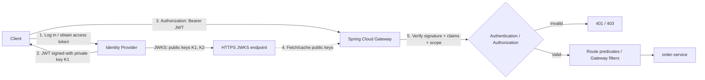
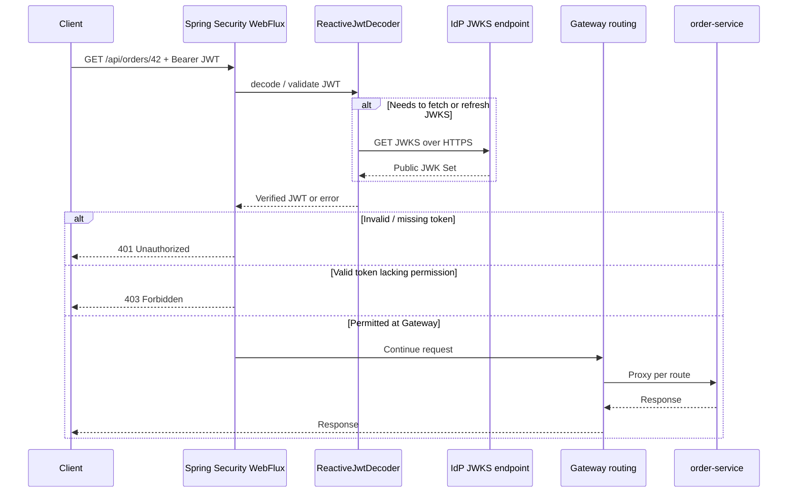
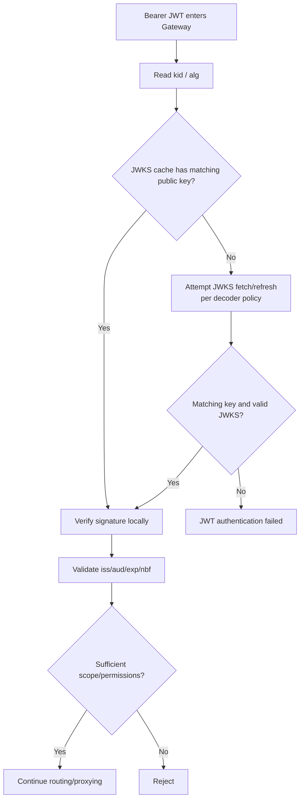
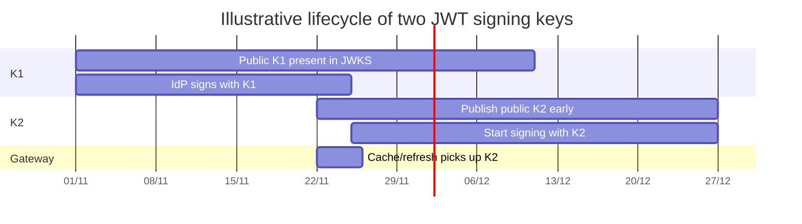
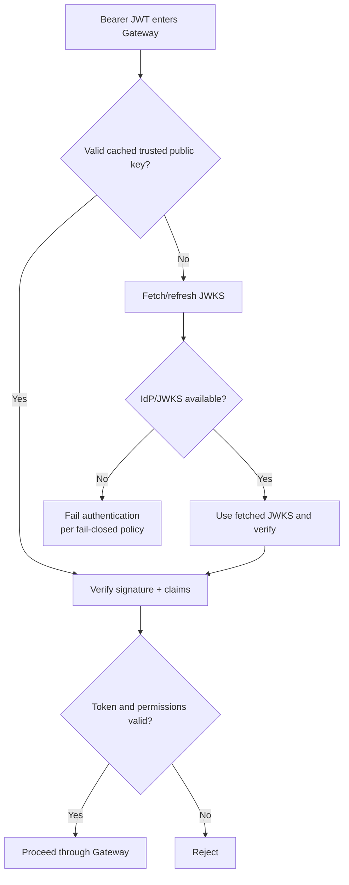

# Managing Verification Keys, JWK Caching, and Identity Provider Key Rotation

In a microservices architecture, **Spring Cloud Gateway** is typically the entry point accepting requests with `Authorization: Bearer ...` before routing to internal services. When tokens are **digitally signed JWTs**, the gateway must verify signatures using the **Identity Provider's (IdP)** public keys, while checking issuer, audience, lifetime, and access permissions. If the IdP rotates signing keys while the gateway still holds stale public keys, valid requests can suddenly fail with `401`. Conversely, if the gateway continues trusting a compromised key for too long, forged tokens may be accepted.

This lesson belongs to the **Authentication and Authorization** chapter of the **SPRING_CLOUD_GATEWAY** module, focusing on three operational capabilities: **verification key management**, **JSON Web Key (JWK) caching**, and **handling IdP key rotation**. It bridges Spring Security WebFlux Resource Server with shared API Gateway concerns such as route predicates, filter chains, path/header transforms, service discovery, rate limiting, circuit breakers, retries, TLS, and observability.

After this lesson, you will be able to:

1. Distinguish the IdP's private signing keys from public keys in `JWKS`, and understand the roles of `kid` and `alg` on JWTs.
2. Configure Spring Security Reactive Resource Server with `issuer-uri` and/or `jwk-set-uri`, checking `iss`, `aud`, `exp`, `nbf`, and trusted algorithm sets.
3. Understand how JWKS caching reduces IdP dependency while introducing lag when publishing, replacing, or revoking keys.
4. Plan a **zero-downtime** key rotation workflow by publishing the new key first, switching signing to the new key, keeping the old key long enough, and only then retiring it.
5. Handle IdP outages, suspected key compromise, multi-issuer setups, unknown key IDs, and TLS failures under the **fail-closed** principle.
6. Test authentication before/during/after key rotation and observe failures without exposing tokens or sensitive key material.

> **Scope:** Examples use **Spring Cloud Gateway Server WebFlux** and **Spring Security Reactive OAuth2 Resource Server JWT**. This is not Server MVC/Servlet: WebFlux uses `SecurityWebFilterChain`, `ServerHttpSecurity`, and `ReactiveJwtDecoder`, not synchronous `HttpSecurity` or `JwtDecoder` as direct substitutes. Details of JWKS caching, lazy initialization, and HTTP clients can vary across Spring Security 6.x/7.x, Nimbus JOSE+JWT versions, and application starters. Test empirically rather than hardcoding assumptions about TTLs, fetch counts, or refresh timing.

## 1. Context and Trust Boundaries Between IdP, Gateway, and Backend

Suppose an IdP issues access tokens so users can call `GET /api/orders/42`. The Gateway verifies the token before using a route to forward the request to `order-service`.



Different parties carry distinct responsibilities:

| Component | What Does It Hold? | Primary Responsibility |
| --- | --- | --- |
| **IdP / Authorization Server** | **Private signing keys**; identity store and token-issuance policies | Sign JWTs, manage key lifecycle, publish JWKS and issuer metadata |
| **JWKS endpoint** | List of **public verification keys** and corresponding metadata | Serve current verification keys to resource servers |
| **Gateway — Resource Server** | Trusted issuer/JWKS URIs and **public key cache** | Verify signatures/claims, enforce security policy, route valid requests |
| **Backend service** | Business contracts and domain data; may verify tokens itself or rely on a protected internal trust boundary | Check permissions on `orderId`, tenant, resources, and business rules |
| **Client** | IdP-issued access token | Send token when calling APIs; never chooses trusted keys for the Gateway |

**Important:** The Gateway does not need the IdP's private signing key to verify asymmetric signatures. A leaked public key normally does not let attackers forge tokens; a leaked **private key** is the emergency incident. Use asymmetric cryptography such as RSA/ECDSA matching the algorithms agreed between the IdP and resource servers.

A Resource Server configuration **does not turn the Gateway into an IdP**. It does not mint JWTs, rotate private keys, or grant user permissions merely because a signature is valid.

## 2. JWS, JWK, JWKS, and JWT Metadata

### 2.1. What Does a Signed JWT Contain?

A **JWS compact** JWT typically has three Base64URL-encoded parts:

```text
BASE64URL(header).BASE64URL(payload).BASE64URL(signature)
```

Example decoded header (illustrative, not a real token):

```json
{
  "typ": "JWT",
  "alg": "RS256",
  "kid": "sig-2026-11"
}
```

Example payload:

```json
{
  "iss": "https://idp.example.com/realms/shop",
  "sub": "user-42",
  "aud": ["orders-api"],
  "scope": "orders.read",
  "iat": 1793500000,
  "nbf": 1793500000,
  "exp": 1793503600
}
```

The timestamps here merely illustrate `NumericDate` structure, **not an active access token**.

| Field | Where? | Role |
| --- | --- | --- |
| `alg` | JWS protected header | Declared signing algorithm; verifier accepts only its **trusted configured algorithm set** |
| `kid` | JWS header | Hint to pick the matching verification key from the public key set |
| `iss` | Claims | Issuer that minted the JWT; must match the trusted issuer |
| `aud` | Claims | Target API/resource server the JWT was issued for |
| `exp` | Claims | Expiration timestamp; evaluate with reasonable clock skew |
| `nbf` | Claims | Reject token before this timestamp |
| `iat` | Claims | Issuance timestamp, usable in additional policies |
| `scope` / `scp` | Claims | Granted permissions/scopes; authority mapping depends on IdP and Spring Security config |

**Base64URL decoding is not signature verification.** Since clients can modify headers and claims before sending tokens, never trust `sub`, `scope`, `iss`, or `kid` until signature verification and claim validation succeed.

### 2.2. JWK and JWKS

A **JWK (JSON Web Key)** represents a cryptographic key in JSON. A **JWKS (JSON Web Key Set)** is a JSON object with a `keys` array containing multiple JWKs.

Illustrative public JWKS example for RSA keys:

```json
{
  "keys": [
    {
      "kty": "RSA",
      "use": "sig",
      "alg": "RS256",
      "kid": "sig-2026-11",
      "n": "<base64url-public-modulus-K1>",
      "e": "AQAB"
    },
    {
      "kty": "RSA",
      "use": "sig",
      "alg": "RS256",
      "kid": "sig-2026-12",
      "n": "<base64url-public-modulus-K2>",
      "e": "AQAB"
    }
  ]
}
```

**Note:** The `n` values are placeholders, not runnable RSA keys. A public RSA JWKS must publish only public key components like `n` and `e`; **never publish private RSA parameters** like `d`, `p`, or `q` on a public endpoint. A JWK may also include properties such as `key_ops` or `x5c` depending on purpose.

### 2.3. Practical Role of kid

Per **RFC 7517**, `kid` is a **key identifier** used to select a key within a JWK Set, especially helpful during key rollover. `kid` is a case-sensitive string; **it is neither a key nor proof of identity**.

Example:

```text
JWT header kid = sig-2026-12
            ↓
JWKS has multiple keys
            ↓
Select JWK matching kid, kty/alg/use
            ↓
Verify signature using matching public key
            ↓
Check iss, aud, exp, nbf, and policy
```

An attacker can **deliberately alter `kid`** because the header travels with the client-sent token. Verification libraries must look up keys strictly within the **trusted issuer's key set**, never fetching arbitrary URLs from `kid` or treating `kid` itself as a credential.

## 3. At Which Step Does Spring Security Reactive Resource Server Verify Tokens?

In Gateway WebFlux, Spring Security typically handles authentication in the **`WebFilter` chain**, before requests pass through Gateway route filters to backends. If a Bearer token is invalid, the Gateway can return `401` and **not proxy the request**.



**Distinguishing authentication and authorization errors:**

- **`401 Unauthorized`:** missing token, bad signature, untrusted issuer, expired token, malformed token, or rejected authentication.
- **`403 Forbidden`:** token authenticated, yet lacks permission under security rules; may also arise from another policy.
- **`5xx`:** unrecoverable infrastructure or authentication component error; some JWKS fetch errors may map differently depending on decoder/exception handling. **Do not claim every JWKS error always becomes 401.**

In Spring Security, a valid token with `scope: orders.read` typically maps to authority `SCOPE_orders.read`. The backend must still verify permission to view **specific order 42** for the actual user/tenant; scope is only a coarse condition.

## 4. Dependencies and Issuer/JWKS Configuration for Gateway WebFlux

### 4.1. Relevant Dependencies

With Maven and compatible Spring Cloud BOM / Spring Boot versions, JWT Resource Server typically requires:

```xml
<!-- Spring Security OAuth2 Resource Server -->
<dependency>
  <groupId>org.springframework.boot</groupId>
  <artifactId>spring-boot-starter-oauth2-resource-server</artifactId>
</dependency>

<!-- Gateway Server WebFlux matching project version -->
<dependency>
  <groupId>org.springframework.cloud</groupId>
  <artifactId>spring-cloud-starter-gateway-server-webflux</artifactId>
</dependency>
```

`spring-security-oauth2-resource-server` handles Resource Server integration, while `spring-security-oauth2-jose` provides JWT/JWS and Nimbus support. The Spring Boot starter normally pulls in required dependencies; if configuring manually, verify both Security modules. Never mix Spring Cloud/Spring Boot/Spring Security versions from incompatible release trains.

### 4.2. Using issuer-uri Alone for Discovery

```yaml
spring:
  security:
    oauth2:
      resourceserver:
        jwt:
          issuer-uri: https://idp.example.com/realms/shop
```

When using `issuer-uri`:

1. Resource Server knows the **trusted issuer**.
2. Spring Security can read **OIDC Provider Configuration** or **Authorization Server Metadata** to discover the public JWKS URL.
3. The decoder fetches public keys and verifies signatures.
4. Claims such as `iss`, `exp`, and `nbf` are checked by default validators.

When metadata/JWKS is fetched (at startup vs. first bearer request) **depends on version and how the decoder is initialized**. Newer reactive Spring Security lines use lazy initialization so startup is not forced to contact the IdP immediately; declaring a custom decoder bean can alter this behavior. Never assume the app operates completely independently of the IdP just by setting `issuer-uri`.

### 4.3. Configuring issuer-uri Together with jwk-set-uri

In environments wanting an explicit JWKS URL without metadata discovery at startup:

```yaml
spring:
  security:
    oauth2:
      resourceserver:
        jwt:
          issuer-uri: https://idp.example.com/realms/shop
          jwk-set-uri: https://idp.example.com/realms/shop/protocol/openid-connect/certs
```

Both URLs here are **hypothetical examples** and must be replaced with addresses published by your IdP. JWKS paths **have no single universal format** across all providers.

- `jwk-set-uri`: where public verification keys are fetched.
- `issuer-uri`: used to verify the token's `iss`.
- When `jwk-set-uri` is configured directly, the decoder skips metadata discovery just to find the JWKS URL at startup; fetching JWKS to verify tokens still occurs at runtime, subject to caching.

**Critical mistake:** setting only `jwk-set-uri` and assuming `iss` is automatically checked against the intended issuer. Keep `issuer-uri` or configure an explicit `iss` validator.

### 4.4. Validating Audience and Algorithms

One IdP public key may sign tokens issued for **multiple APIs**. The Gateway must not accept every token merely because its signature and issuer are valid. Constrain **audience** and scopes.

Spring Boot Resource Server example with audience config (verify property support on your Boot version):

```yaml
spring:
  security:
    oauth2:
      resourceserver:
        jwt:
          issuer-uri: https://idp.example.com/realms/shop
          jwk-set-uri: https://idp.example.com/realms/shop/protocol/openid-connect/certs
          audiences:
            - orders-api
          jws-algorithms:
            - RS256
```

`audiences` permits only access tokens targeting `orders-api` in the `aud` claim. `jws-algorithms` restricts signature algorithms; never widen that list simply because a token header declares another algorithm.

**Do not substitute OIDC ID tokens for access tokens** when calling APIs if the ID token was issued for a client application rather than a resource server. An ID token's `aud` is typically the OAuth2 client ID, not necessarily the API audience. Checking audience and token purpose reduces token-substitution risks.

### 4.5. SecurityWebFilterChain: Protecting Routes

Java example for Gateway **Server WebFlux**:

```java
import org.springframework.context.annotation.Bean;
import org.springframework.context.annotation.Configuration;
import org.springframework.http.HttpMethod;
import org.springframework.security.config.Customizer;
import org.springframework.security.config.annotation.web.reactive.EnableWebFluxSecurity;
import org.springframework.security.config.web.server.ServerHttpSecurity;
import org.springframework.security.web.server.SecurityWebFilterChain;

@Configuration(proxyBeanMethods = false)
@EnableWebFluxSecurity
public class GatewayResourceServerSecurity {

    @Bean
    SecurityWebFilterChain securityWebFilterChain(ServerHttpSecurity http) {
        return http
            .authorizeExchange(exchanges -> exchanges
                .pathMatchers("/health").permitAll()
                .pathMatchers(HttpMethod.GET, "/api/orders/**")
                    .hasAuthority("SCOPE_orders.read")
                .pathMatchers(HttpMethod.POST, "/api/orders/**")
                    .hasAuthority("SCOPE_orders.write")
                .anyExchange().authenticated()
            )
            .oauth2ResourceServer(oauth2 -> oauth2
                .jwt(Customizer.withDefaults()))
            .build();
    }
}
```

This configuration assumes the Gateway receives Bearer JWTs and API requests are protected by scopes. For browser systems using **cookies/sessions**, design CSRF and CORS appropriately; never disable CSRF by default across all apps. When backends sit behind `StripPrefix` or `RewritePath`, Gateway security rules should target the **public path seen by WebFlux WebFilters**, rather than assuming the post-rewrite path in GatewayFilters.

**Remember:** Gateway authentication config does not make `order-service` automatically able to trust internal requests. If backends read identity from client-sent headers, those can be spoofed. Backends should verify JWTs themselves or trust identity passed over an authenticated internal channel that strips/overwrites spoofed headers and enforces service-to-service protection.

## 5. Key Selection: kid Is a Lookup Hint, Not a Source of Trust

When a JWT has:

```json
{"alg":"RS256","kid":"sig-2026-12","typ":"JWT"}
```

The decoder uses `kid` alongside key type/algorithm constraints to pick the matching public key from the **configured issuer's JWKS**. If found, it verifies the signature and then runs remaining validations.

### Several Scenarios

| JWT Header / JWKS State | Right Behavior |
| --- | --- |
| `kid=K1`, JWKS has public K1, valid signature | Passes signature check; proceed to claim checks |
| New `kid=K2`, cache lacks K2 | Refresh JWKS via supported mechanism; if key still missing, reject token |
| `kid=K1` but invalid signature | Reject, even though `kid` matches |
| `alg=none` | Never accept unsigned tokens when policy requires signed JWS |
| Header requests `HS256` while gateway trusts only RS256 | Reject; never treat an RSA public key as an HMAC secret |
| `kid` is a URL or bizarre long string | Never turn it into an HTTP request to a client-specified address |
| JWT includes client-supplied `jku`/`x5u` | Never fetch keys from untrusted URLs inside token headers |
| Token signed by issuer B when config trusts only issuer A | Reject, even if `kid` values collide across issuers |

**Algorithm confusion risk:** Never trust a client-declared `alg` to switch algorithms dynamically. Resource Servers must maintain an **allowlist of verification algorithms** and matching key types. When using RSA, never enable HMAC or weak algorithms just to make a broken token "work."

**SSRF risk via key lookup:** Never build URLs from client-controlled `kid`, `jku`, `iss`, or claims and fetch keys over unrestricted networks. JWKS URLs and issuers must come solely from **trusted configuration** or an approved issuer allowlist.

## 6. Why Cache JWKs and How to Operate the Cache?

If every API request had to fetch JWKS from the IdP before verifying signatures, the Gateway would introduce a hot network dependency on every request: higher latency, heavy IdP load, and IdP slowdowns stalling the entire gateway. Therefore, decoders/Nimbus typically maintain a **public JWKS cache** to reuse verification keys.



This is a **logical diagram**. Actual refresh timing, cache TTL, refreshes on unknown `kid`, HTTP cache headers, retries/backoff, multi-request synchronization, and behavior during IdP outages **depend on implementation, version, and configuration**.

### Distinguishing Three Cache Types

| Cache Type | What Data Is Stored? | Managed By? |
| --- | --- | --- |
| **Decoder JWKS cache** | Public keys/JWK Set fetched from IdP | Spring Security/Nimbus or customized cache component |
| **HTTP cache along path to JWKS endpoint** | May cache HTTP responses per `Cache-Control`/`ETag` | HTTP client, proxy, or CDN if configured |
| **Token/session/revocation cache** | Validity metadata, token IDs, or revocation status | IdP, backend, or dedicated introspection/revocation layer |

**A JWKS cache is not a cache of already-authenticated access tokens.** Having public K1 cached only allows the gateway to keep **verifying signatures on tokens signed with K1**; tokens must still pass `exp`, `nbf`, `iss`, `aud`, and authorization at evaluation time.

### Cache Lifetime

Spring Security's **Servlet `NimbusJwtDecoder`** docs describe a default in-memory JWKS cache (citing a 5-minute example) and a `Cache` customization API for the Servlet branch. **Do not copy those numbers or `NimbusJwtDecoder.cache(...)` straight to `NimbusReactiveJwtDecoder`** without verifying your reactive implementation.

For **Gateway WebFlux**, verify:

1. Your actual Spring Security/Nimbus version and `ReactiveJwtDecoder` implementation.
2. Whether the cache lives per gateway instance or is shared via another layer.
3. How refreshes trigger on TTL, missing `kid`, or other signals.
4. Whether JWKS fetches enforce timeouts, bounded retries, TLS trust, and protection against concurrent stampedes.
5. Whether an operational **purge/refresh** mechanism exists for key incidents and has been tested prior to production.

Do not invent properties like `spring.security.oauth2.resourceserver.jwt.cache-ttl` if your application version does not publish them. When custom TTL/eviction is needed, use cache/JWK-source APIs **officially supported in your exact version** and verify with integration tests.

## 7. Planned Key Rotation: Publish First, Sign Second, Retire Last

When the IdP wants to transition from private key **K1** to **K2**, a safe plan includes an **overlap window**: JWKS publishes both public K1 and public K2 simultaneously for a period.



This chart is a **process illustration**, not a real IdP schedule or a prescription for specific day counts.

### Step A — Publish Public K2 Before Using Private K2

Initial JWKS:

```json
{"keys":[{"kid":"K1","kty":"RSA","n":"<public-K1>","e":"AQAB"}]}
```

JWKS during preparation phase:

```json
{
  "keys": [
    {"kid":"K1","kty":"RSA","n":"<public-K1>","e":"AQAB"},
    {"kid":"K2","kty":"RSA","n":"<public-K2>","e":"AQAB"}
  ]
}
```

These are illustrative RSA JWKs lacking real modulus values for signature checks. Crucially, **the IdP is still signing with K1**, while K2 is already published so resource server caches can pick it up.

Benefit: gateway pods holding older caches have time to receive K2 before tokens with `kid=K2` appear. The preparation window must account for TTL/refresh, intermediate CDNs/caches, transient network errors, and multi-cluster rollouts.

### Step B — Switch to Issuing Tokens Signed with Private K2

Once K2 has been published long enough, the IdP begins signing new tokens with K2. **Keep public K1** in JWKS because tokens signed with K1 prior to cutover **may still be unexpired**.

| Phase | Token | JWKS Contains | What Gateway Must Do |
| --- | --- | --- | --- |
| Before switch | `kid=K1` | K1 | Verify with public K1 |
| Preparation | `kid=K1` | K1 + K2 | Keep verifying K1; cache can pick up K2 |
| Right at cutover | `kid=K2` | K1 + K2 | Verify K2 if cached; otherwise refresh per decoder mechanism |
| During overlap | `kid=K1` or `K2` | K1 + K2 | Accept either if token/claims are valid |
| After K1 tokens expire | Mostly K2 | K1 may be retired per plan | Reject expired old tokens |

**Do not** remove public K1 the instant the IdP switches signing to K2, as unexpired K1 tokens would immediately fail even though users did nothing wrong.

### Step C — Retire Public K1 After a Safety Window

Conditions to retire K1 typically include:

- All issuer nodes have stopped issuing tokens with K1.
- The last K1-signed token has **passed its `exp`**, including reasonable clock skew and systems holding tokens.
- Verified that gateway/service caches across all clusters have picked up K2.
- No special client/backend still depends on an unscheduled legacy verification flow.

**Never treat K2's appearance in JWKS as meaning K1 is no longer needed.** Keep K1 long enough for legitimately issued tokens to verify throughout the overlap window, unless a security compromise demands emergency revocation.

### Choosing Overlap Durations

A practical rule of thumb:

```text
K2 pre-publish window before signing:
    greater than expected cache/refresh lag
    + margin for network / IdP rollout / CDN

K1 retention window after stopping signing:
    long enough to cover the last unexpired K1 access token
    + clock skew / operational buffer
```

This is a **design guideline**, not a mandatory RFC TTL. If access tokens live at most 15 minutes, K1 generally must stay published after the last signature for at least that lifetime plus reasonable clock skew; other artifacts like ID tokens/sessions have separate lifecycles per contract.

## 8. When the Cache Holds Old Keys Right After an IdP Key Switch

A common scenario:

1. Gateway pod A has a cached JWKS containing only K1.
2. IdP publishes K2 and starts signing new tokens.
3. A client sends a JWT with `kid=K2` to pod A.
4. The decoder cannot find public K2 in its current cache.

**Right behavior under security policy:** The Gateway **never skips signature checks** or waves tokens through just because the IdP might be rotating. It must refresh JWKS using its library-supported mechanism and authenticate only if a matching key is found and signature/claims validate. If refresh fails, the token is not authenticated.

### Why Can Tokens Fail Unevenly Across Pods?

| Pod | JWKS Cache State | K2 Token |
| --- | --- | --- |
| Pod A | Stale K1 cache | May fail or trigger refresh |
| Pod B | Cached K1 + K2 | Verifies immediately |
| Pod C | Cold cache, slow IdP | May block fetching JWKS and time out |
| Pod D | Freshly restarted, misconfigured JWKS URI | Fails all tokens |

This is why you must test **key rotation across multiple Gateway instances**, not just locally with an empty cache. With multiple instances, each pod can have a different cache state and refresh schedule; never assume pods share a single uniform cache.

### Does the Decoder Always Fetch Immediately on an Unknown kid?

Do not assume every `NimbusReactiveJwtDecoder` **immediately** calls the JWKS endpoint on every token carrying an unknown `kid`. Refresh/TTL/rate-limit policies vary by version and cache/JWK source. Unbounded fetching triggered by attackers sending random `kid` values can cause **JWKS fetch amplification** and DoS.

Therefore, acceptance testing should verify:

- New K2 token arrives while only K1 is cached.
- Many concurrent requests arrive using K2.
- An attacker sends bursts of random `kid`s.
- The IdP endpoint returns errors/timeouts during refresh.
- Multiple Gateway replicas operate with mixed warm/cold caches.

If cache tuning or warm-up is needed, use library-supported mechanisms—never wave JWTs through during transitions.

## 9. IdP/JWKS Endpoint Unreachable: Fail Closed with an Operational Plan

Losing connectivity to the IdP does not necessarily make **every** JWT request fail right away. The Gateway may hold matching public JWKs in cache and keep verifying **signatures locally**. However, requests needing a new key or a mandatory refresh can fail.



This is a logical flow. Whether an expired cache entry remains usable during endpoint failures depends on the implementation. **Never invent a rule like "allow offline for 15 minutes"** without verified cryptographic/claim guarantees and an approved security policy.

### Outage Principles

- **Never disable signature verification** to restore traffic quickly.
- **Never accept `alg=none`** or a hardcoded key outside trusted issuers.
- **Never return fake success** for sensitive endpoints when authentication fails.
- Configure connect/response timeouts for JWKS fetching **separately from backend proxy timeouts**. `spring.cloud.gateway...httpclient.response-timeout` for Netty routing does not automatically govern decoder HTTP calls.
- Configure proper TLS truststores, DNS, egress policies, and certificate validation so JWKS fetches remain reliable.
- Monitor HTTP errors, JWKS refresh latency, unknown `kid` rates, and failures from missing keys.
- Distinguish network/decoder failures from genuinely expired tokens or wrong audiences.

High-availability systems deploy reliable JWKS endpoints/CDNs, sensible caching, and monitoring upfront. **Never** treat "temporary IdP outage" as an excuse to accept unverified tokens.

## 10. Emergency Revocation When Private Signing Key Compromise Is Suspected

**Planned key rotation** and **compromised key revocation** are two completely different scenarios.

In planned rotation, K1 stays trusted so existing tokens work until `exp`. However, if **private K1 is leaked**, attackers can forge fresh JWTs signed with K1, and gateways caching public K1 will keep treating those signatures as valid.

### Emergency Playbook

1. **Scope the incident:** identify the affected issuer, `kid`, APIs, and environments using K1.
2. **Stop signing with K1**, switch to a securely generated and stored private K2, and block further use of private K1.
3. **Revoke K1 from the IdP's trusted key set** and coordinate **JWKS cache invalidation/refresh across all Gateways and other resource servers**. Removing K1 from public JWKS **is not immediately sufficient** if instances retain stale caches.
4. **Handle already-issued tokens:** apply session revocation, token blocklists/introspection, or appropriate policy controls. Self-contained JWTs can remain valid until `exp` if resource servers still trust the old key without extra revocation checks.
5. **Monitor and verify:** new/forged K1 tokens must be rejected across all pods; valid K2 tokens must be accepted without bypassing issuer/audience checks.
6. **Investigate root cause and harden:** secure private key storage (KMS/HSM/secret store) and audit logs and signing-authorized services.

**Intentional trade-off:** Emergency revocation can cause **unexpired K1 tokens belonging to legitimate users** to be rejected; this trade-off eliminates trust in a compromised key. Have workflows to force re-login or reissue tokens, never keeping K1 alive solely to preserve UX.

### Where Should Private Keys Be Managed?

- IdP/KMS/HSM or secret management systems with restricted read access and auditing.
- Never store private keys in Git, container images, public `application.yml` files, or logs.
- Never grant the Gateway access to private signing keys when its sole job is **verifying** asymmetric tokens.
- Key rotation, backup, and recovery must have strict ownership and access control.

If an algorithm/IdP uses **symmetric** keys (e.g., HMAC), verifiers must hold the shared secret, carrying completely different distribution risks than public JWKS; never mix the two models carelessly in one config.

## 11. Multi-Issuer and Multi-Tenant: Selecting the Right Key Set for the Right Issuer

One Gateway may serve multiple tenants or integrate multiple IdPs. **Never reuse issuer A's JWKS to verify issuer B's tokens** merely because two tokens share a `kid` or `alg`.

For example:

| Issuer | Trusted JWKS URI | Allowed Audience |
| --- | --- | --- |
| `https://idp-a.example.com/realms/shop` | `https://idp-a.example.com/keys` | `orders-api` |
| `https://idp-b.example.com/realms/partner` | `https://idp-b.example.com/keys` | `partner-api` |

In a multi-issuer architecture:

1. Maintain an approved **issuer allowlist**.
2. Map each issuer to its trusted JWKS URI, algorithm set, audience, and validators.
3. Resolve the right decoder per issuer using supported Spring Security reactive multi-tenancy mechanisms.
4. Use the token's `iss` as a **hint to select a trusted configuration**, then verify the JWT and issuer claim. Never dynamically fetch metadata from **arbitrary `iss` URLs placed in a client token**.
5. Partition JWKS caches by **issuer/JWKS URI**, not solely by `kid` (since `kid`s can collide across providers).
6. Have backends verify tenant/resource permissions directly rather than inferring tenant membership from subdomains or issuer names alone.

**Never** DIY multi-issuer support by reading an unverified `iss`, building a URL from it, and calling `WebClient.get()` without an allowlist. That invites **SSRF**, trust confusion, and forged issuers.

For systems with **a single IdP**, prefer simple `issuer-uri`/`jwk-set-uri` configuration. Add multi-issuer complexity only when genuinely needed, paired with issuer mix-up tests.

## 12. Relationship Between JWT Verification and API Gateway Filters

Spring Security Resource Server protects requests at the **WebFlux security chain** layer. Spring Cloud Gateway provides **GlobalFilter/GatewayFilter** for routing, header edits, rate limiting, circuit breakers, retries, and path transforms.

| Need | Responsible Component | Notes |
| --- | --- | --- |
| Verify JWT/JWKS/claims | **Spring Security Reactive Resource Server** | Never Base64-parse JWTs manually inside a `GlobalFilter` |
| Decide public/protected paths | `SecurityWebFilterChain` / authorization managers | Define against public paths and HTTP methods |
| Check specific resource permissions | Backend + security policy | `SCOPE_orders.read` does not prove permission to read order 42 |
| Strip client-supplied identity headers | Gateway header filter / edge policy | Never trust `X-User-Id` or `X-Tenant-Id` from the Internet |
| Pass access tokens to backends | Token forwarding / `TokenRelay` when appropriate | Resource Server JWT validation **does not imply** OAuth2 client `TokenRelay` is configured |
| Select `lb://...` service instances | Spring Cloud LoadBalancer | Never let `kid`/`iss` choose backend hosts |
| Retry / circuit breaker | Gateway resilience filters | Never retry auth errors; never let fallbacks pass forged tokens |
| Outbound TLS & HTTPS proxies | Reactor Netty / TLS client config | Separate from the HTTP client used by JWT decoder to fetch JWKS |
| Request observability | Micrometer / tracing / redacted logs | Never log raw JWTs, cookies, or key material |

### Protecting Backends from Header Spoofing

If a backend reads `X-User-Id` blindly without verifying its source, clients can inject that header through the Gateway or call the backend directly if the network allows. A sound design:

- Gateway **strips** untrusted identity headers before applying downstream policies.
- When passing identity, use **signed tokens** or an authenticated internal channel (mTLS/service mesh) attaching trusted metadata.
- Backends check per-resource authorization or verify JWTs independently.
- Never enable fallback/anonymous modes simply because the JWKS endpoint is slow.

**CORS** only governs whether browsers can read cross-origin responses; it never makes an invalidly signed Bearer token valid. For `OPTIONS` preflight, handle CORS properly before authentication without opening actual APIs to public access.

## 13. System Observability Without Leaking Secrets

To catch broken key rotations early, track both **security signals** and **network failures**.

| Signal | Useful to Detect | What to Avoid |
| --- | --- | --- |
| `401` rate by normalized route / issuer | Uncached new key, expired tokens, wrong issuer | Logging raw tokens |
| `403` rate | Missing scope/authorization despite valid token | Mixing permission errors with signature errors |
| JWKS fetch success/error/latency | IdP outage, TLS, DNS, HTTP 5xx, or rate limiting | Exposing sensitive internal URLs publicly |
| Cache hit/miss/refresh (if metrics exist) | Warm/cold cache state during rotation | Assuming every metric is exported by default |
| Unknown `kid` rate | Early rotation or random-kid attacks | Using raw `kid` as an unbounded metric label |
| Issuer/audience validation failures | Tokens sent to wrong resource server or environment | Logging unnecessary private claims |
| Decoder deployment/version | Pods with differing cache behavior | Changing TTLs in production without testing |
| Trace ID across Gateway/backend | Distinguish Gateway vs. backend auth failures | Logging `Authorization`, cookies, and personal data |

### Using HTTP Statuses Properly

- A `401` may occur **before route matching or backend invocation**.
- A `403` may come from either the Gateway or the backend.
- A `503` may come from LoadBalancer having no instances, upstream errors, or a circuit breaker—do not assume the IdP is down.
- If the JWKS HTTP client times out, exceptions may translate to different responses depending on configuration. Determine **root cause** from safe logs, traces, and metrics rather than final status codes alone.

With reactive Spring Security, enable appropriate log levels in **staging**, avoiding DEBUG dumps of full token contents in production. When investigating `kid`s, use bounded allowlists/aggregations or sanitized logs rather than turning arbitrary `kid` strings into unbounded metric labels.

## 14. Practice: Testing Rotation Across K1 and K2

**Goal:** prove the Gateway accepts tokens signed by K1 and K2 during the overlap window, rejects invalid tokens, and continues protecting routes when JWKS fails.

### 14.1. Preparing an Isolated Environment

Use:

- Gateway WebFlux configured with trusted issuer/JWKS from a **test IdP**.
- A mock JWKS HTTP endpoint capable of swapping public key sets step by step.
- **Two independent test RSA key pairs**: private K1/K2 to sign test JWSs, public K1/K2 published in JWKS.
- A safe echo backend behind the Gateway, e.g., `GET /orders/42`.
- Route requiring scope `orders.read`; test JWTs with valid `iss`, `aud`, `exp`, and `nbf`.

**Never use production private keys in tests**, never store production tokens/secrets in public fixture files, and never expose a JWKS endpoint capable of leaking private key material.

### 14.2. Test Matrix

| Step | Mock JWKS | Token Sent | Expectation |
| --- | --- | --- | --- |
| A | Public K1 only | K1, valid signature + claims | `200` or successful backend response |
| B | K1 + K2 | Valid K1 | Continues succeeding |
| C | K1 + K2 | Valid K2 | Succeeds once decoder has/refreshes K2 |
| D | K2 only, after appropriate cache refresh | Valid K2 | Succeeds |
| E | K2 only, after K1 evicted from cache | K1 even if unexpired | Rejected once K1 is no longer trusted |
| F | K1 + K2 | K1 JWT with tampered payload | `401` due to invalid signature |
| G | K1 + K2 | JWT with wrong `iss` or `aud` | Rejected |
| H | K1 + K2 | Expired JWT | Rejected |
| I | JWKS endpoint returns 503 | Token with validly cached key | Observe actual cache/decoder behavior |
| J | JWKS endpoint returns 503 | Token with new uncached `kid` | Denied access when unverifiable |
| K | K1 + K2 | Token missing `orders.read` scope | `403` when authenticated but missing authority |

The matrix lists **policy-level** expectations. Exact HTTP statuses during IdP outages or custom exception handling may differ; verify **no unauthenticated requests reach the backend**.

### 14.3. Testing from a Client

Assume tests minted valid access tokens stored in `ACCESS_TOKEN_K1` or `ACCESS_TOKEN_K2` environment variables. Never print token values to logs:

```bash
curl -i \
  -H "Authorization: Bearer <test-access-token>" \
  http://localhost:8080/api/orders/42
```

You can query the mock IdP's JWKS endpoint to verify **only public keys** are published:

```bash
curl -fsS https://idp-test.example.local/jwks
```

The command assumes valid DNS/TLS for the test hostname; this is not an Internet-facing endpoint. Never use `curl -k` to skip certificate verification, even when testing JWKS connectivity.

**Critical check:** The backend must record requests only when the JWT is verified and the caller is authorized. If the gateway returns `401` yet the backend still receives requests, check security chain order, matcher configuration, and route filters.

### 14.4. Testing Warm and Cold Caches

To avoid misunderstanding cache behavior:

1. **Warm K1:** send a valid K1 request so the decoder caches K1.
2. Update the mock JWKS to `[K1, K2]` **without restarting** the Gateway.
3. Send a K2 token and record JWKS fetch counts, wait times, and responses.
4. Restart **in the test environment only** and repeat the K2 step with a cold cache to compare.
5. With multiple replicas, send traffic to each pod to detect divergence.
6. Return JWKS 500/timeouts right when a K2 token arrives; verify fail-closed behavior.
7. Send 100 tokens with random `kid`s at a controlled low rate and observe whether fetch-storm protection exists.

Never infer fetch counts or default TTLs from a single run. Base acceptance criteria on **your exact decoder version and cache configuration**.

## 15. Common Key-Rotation Failures and Troubleshooting

| Symptom | Possible Cause | How to Check |
| --- | --- | --- |
| Entire system returns 401 after IdP key swap | Public K2 missing from cache/JWKS, wrong JWKS URI, untrusted `alg` | Compare `kid`, public JWKS, algorithm, and refresh |
| Only some Gateway pods return 401 | Pod caches out of sync or differing versions/configs | Inspect each replica, TTL/refresh, and deployment |
| Unexpired K1 tokens rejected right after cutover | IdP retired public K1 too early | Restore overlap process if K1 wasn't leaked; never restore a compromised key |
| Wrong-issuer tokens still pass | Configured only JWKS URI without issuer validator | Add `issuer-uri` or explicit `iss` validation |
| ID tokens work against APIs | Missing `aud`/token-purpose validation | Enforce audience and access-token policies |
| JWT with unexpected `alg` accepted | Overly broad algorithm allowlist or unsafe custom decoder | Restrict JWS algorithms and validate key types |
| 5xx/401 spikes when JWKS endpoint slows down | DNS/TLS/timeout/egress or issuer outage | Track JWKS fetch metrics and root cause |
| IdP removed K1 yet Gateway still accepts K1 | Stale cache not invalidated | Trigger synchronized revocation/invalidation across all replicas |
| Random `kid`s overload the IdP | Refresh/fetch amplification | Rate limit requests, tune cache/refresh policy, protect JWKS endpoint |
| Backend trusts client-sent `X-User-Id` | Header spoofing / broken trust boundary | Strip untrusted headers; verify tokens at service or via mTLS channel |
| Valid scope still reads another tenant's order | Backend checks scope without ownership | Enforce per-user tenant/resource authorization |
| JWKS HTTP request hits SSL handshake failure | Bad truststore, cert chain, SNI, or system clock | Fix TLS properly; never disable verification |
| Gateway caches JWKs yet startup still depends on IdP | Decoder/discovery initialized eagerly by version/custom bean | Check lazy init, issuer metadata lookups, and dependencies |
| Restarting Gateway temporarily fixes errors that later return | Broken cache/refresh policy or missing warm-up | Test rotation under load and fix root cause rather than relying on restarts |

## 16. Review Questions

**1. Does a Gateway verifying asymmetric JWTs need the IdP's private key?**

> No. The Gateway uses public verification keys from JWKS. Private keys belong strictly inside the token-issuing system/KMS/HSM.

**2. Does `kid` prove the issuer or user identity?**

> No. `kid` only helps select a key; signature, issuer, audience, lifetime, and policies must still be verified.

**3. When configuring both `issuer-uri` and `jwk-set-uri`, do you still need to check `iss`?**

> Yes. `jwk-set-uri` only specifies the public key source. `issuer-uri` binds tokens to the trusted issuer and must remain enforced.

**4. Why should an IdP publish K2 before signing tokens with private K2?**

> To give gateway caches time to fetch public K2, preventing valid tokens from being rejected en masse when `kid=K2` first appears.

**5. Why keep K1 published after switching signing to K2?**

> Older K1 tokens may still be valid. Removing public K1 immediately breaks verification for unexpired tokens before `exp`.

**6. If private K1 is compromised, should K1 stay published until all tokens expire?**

> Not under normal rotation rules. This is a security incident: stop signing, revoke trust and caches across all nodes, and accept rejecting valid K1 tokens if necessary to block forgery.

**7. Does JWKS caching replace `exp` checks or token-revocation blocklists?**

> No. The cache holds only public verification keys; it does not determine whether a token has expired or been revoked by application policy.

**8. If the IdP loses connectivity and a JWT carries a new uncached `kid`, how should the Gateway respond?**

> Never accept a token whose signature cannot be verified with a trusted key. Fail closed, monitor errors, and restore JWKS availability.

**9. Why must a token with a valid signature and issuer still check `aud`?**

> An IdP can issue tokens for multiple APIs. Audience ensures this specific token was issued to call the intended resource server/API.

**10. Why shouldn't you use `NimbusJwtDecoder.cache(...)` from Servlet examples in Gateway WebFlux without checking?**

> Gateway WebFlux requires `ReactiveJwtDecoder`; cache customization and reactive APIs differ. Consult the documentation and implementation for your exact Spring Security version.

## 17. Gateway JWT/JWKS Key Operations Checklist

- [ ] Resource Server uses **reactive Spring Security WebFlux**, not Servlet `JwtDecoder` or manual JWT parsing in a custom `GlobalFilter`.
- [ ] `issuer-uri` matches `iss` exactly, with `jwk-set-uri` from trusted metadata/IdP when needed.
- [ ] Validates API-specific `aud`, `exp`, `nbf`, `scope`/authorities, and token purpose.
- [ ] Restricts `jws-algorithms` and key types; never permits unsigned tokens or algorithm confusion.
- [ ] Never fetches JWKS from arbitrary URLs derived from `kid`, `jku`, `x5u`, or unverified `iss`.
- [ ] Private signing keys reside solely in IdP/KMS/HSM; public JWKS exposes no private fields.
- [ ] Actual JWKS cache lifetime/behavior of **each Gateway instance** is verified, rather than assuming another stack's TTL.
- [ ] JWKS HTTP client has its own timeout/TLS/egress policies independent of upstream proxy HTTP clients.
- [ ] Planned rotation follows **publish K2 → sign K2 → retain K1 → retire K1** with overlap covering TTL/token lifetime/skew.
- [ ] Tested K1/K2 tokens across warm/cold caches, refreshes, load, and multiple pods.
- [ ] Documented **emergency key compromise** playbook covering stopping signing, revoking trust, invalidating caches, and handling existing tokens.
- [ ] All signature verification failures **fail closed**; never fall back to anonymous access or skip JWT checks.
- [ ] Never treats valid signatures as business authorization: backends still enforce tenant, ownership, and resource permissions.
- [ ] Prevents header spoofing, governs `TokenRelay` and network trust/mTLS when passing identity downstream.
- [ ] Never logs raw JWTs, bearer tokens, cookies, private keys, or sensitive claim payloads.
- [ ] Metrics/tracing separate 401/403, invalid issuer/audience, unknown `kid`, JWKS fetch errors, and downstream 5xx.
- [ ] For multi-issuer setups, uses an issuer allowlist and partitions caches by issuer/JWKS URI, not by `kid` alone.
- [ ] Verified CORS preflight, rate limits, retries/circuit breakers, and TLS do not bypass the security chain.

## Conclusion

In **Spring Cloud Gateway Server WebFlux**, JWT verification is far more than grabbing `Authorization` and calling a decode helper. The Gateway must use **public keys from a trusted issuer's JWKS**, select the right key via `kid`/algorithm, verify signatures, and validate `iss`, `aud`, `exp`, `nbf`, and access rights. **JWKS caching** reduces load and enables local verification, yet introduces propagation delays during key publication and revocation—especially across multiple gateway instances with independent caches.

A **planned key rotation** publishes public K2 first, signs new tokens with private K2 afterward, keeps public K1 long enough for existing tokens, and only then retires K1. When a **private key is compromised**, switch immediately to emergency revocation and refresh trust across all resource servers instead of maintaining a normal overlap window. Combining proper caching and rotation with TLS, issuer/audience validation, Spring Security WebFlux, backend authorization, rate limiting, and observability protects your microservices entry point while minimizing disruption during IdP key changes.

## References

- [Spring Security — Reactive OAuth 2.0 Resource Server JWT](https://docs.spring.io/spring-security/reference/reactive/oauth2/resource-server/jwt.html)
- [Spring Security 6.5 — Reactive JWT Resource Server](https://docs.spring.io/spring-security/reference/6.5/reactive/oauth2/resource-server/jwt.html)
- [Spring Security — Servlet JWT and JWK Set Cache example (for reference only, do not apply verbatim to Reactive)](https://docs.spring.io/spring-security/reference/servlet/oauth2/resource-server/jwt.html)
- [Spring Cloud Gateway — Server WebFlux Reference](https://docs.spring.io/spring-cloud-gateway/reference/spring-cloud-gateway-server-webflux/index.html)
- [RFC 7517 — JSON Web Key (JWK)](https://www.rfc-editor.org/rfc/rfc7517)
- [RFC 7519 — JSON Web Token (JWT)](https://www.rfc-editor.org/rfc/rfc7519)
- [RFC 8725 — JSON Web Token Best Current Practices](https://www.rfc-editor.org/rfc/rfc8725)
- [OpenID Connect Discovery 1.0 — Provider Metadata / jwks_uri](https://openid.net/specs/openid-connect-discovery-1_0.html)
