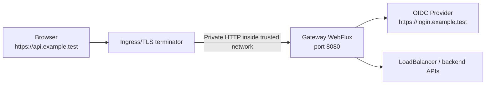

# Gateway as an OAuth 2.0 Client and OpenID Connect Login

**Chapter:** Sessions and Tokens  
**Module:** `SPRING_CLOUD_GATEWAY` — Spring Cloud Gateway

When building an API Gateway for microservices, the browser does not always carry an access token ready to send to each backend. For a web application using centralized login, **Spring Cloud Gateway Server WebFlux can act as an OAuth 2.0 Client**, directing users to an Identity Provider (IdP), handling callbacks, creating a login session at the Gateway, and using the appropriate credentials/tokens to access downstream APIs. When **OpenID Connect (OIDC)** is added, the Gateway can verify user identity based on the **ID Token** and standardized OIDC claims.

This topic sits at the boundary between **authentication**, **session management**, and **propagating access rights to microservices**. The fact that the Gateway identifies the user does not automatically mean the backend grants access to every API; having an ID Token also does not mean you can send the ID Token instead of an access token to the backend. To operate safely, you need to understand browser redirect flows, WebSession, OAuth 2.0 Authorized Client, TokenRelay, Resource Server, cookie/CSRF security, TLS, service discovery, retry, rate limiting, and observability.

> **Scope and assumptions:** This lesson uses **Spring Cloud Gateway Server WebFlux**, **Spring Security Reactive OAuth 2.0 Client**, and the **OIDC Authorization Code Flow**. Java examples use Spring Boot 3.x/Java 17+ and a compatible Spring Cloud BOM; for Spring Boot 4.x or other release trains, consult the official starter/configuration documentation. The IdP URIs and client IDs below are **illustrative values**, not a real deployed Identity Provider.

## 1. Learning Objectives

After this lesson, you will be able to:

1. Distinguish the roles of **OAuth 2.0 Client**, **Authorization Server/OIDC Provider**, **Resource Server**, and **Resource Owner** in a Gateway system.
2. Explain the **Authorization Code Flow**, state, redirect URI, PKCE, and when the OIDC ID Token is verified.
3. Distinguish between **ID Token**, **Access Token**, **Refresh Token**, and **session cookie**; know which credential is used at each leg.
4. Build a **Gateway WebFlux** application configured with `spring.security.oauth2.client.registration`, `issuer-uri`, and `oauth2Login`.
5. Configure `TokenRelay` for a Gateway route when the backend needs an appropriate access token and understand scope/audience limitations.
6. Design session protection, CSRF, logout, CORS, TLS, and secrets management when deploying multiple instances.
7. Diagnose common errors such as redirect loops, `invalid_redirect_uri`, callback errors, `401`/`403`, wrong token audience, or authorized client not found.

## 2. Distinguishing OAuth 2.0 and OIDC Roles

A typical system has:

| Role | Example | Responsibility |
|---|---|---|
| **Resource Owner / End User** | User in the browser | Logs in and grants appropriate access permissions |
| **User Agent** | Browser | Follows redirects, holds session cookies, calls Gateway URLs |
| **OAuth 2.0 Client** | **Gateway Server WebFlux** | Initiates authorization requests, receives codes, exchanges codes for tokens, manages authorized clients |
| **Authorization Server / OIDC Provider** | Keycloak, an enterprise OIDC IdP | Authenticates users, publishes metadata/JWKs, issues authorization codes and tokens |
| **Resource Server** | `orders-service`, `profile-service` | Validates access tokens/scopes/audiences and enforces authorization on incoming API requests |
| **API Gateway / Reverse Proxy** | Spring Cloud Gateway | Selects routes/predicates, applies filters, forwards HTTP, rate limits, and observes traffic |

The Gateway can hold **two roles simultaneously**: OAuth 2.0 Client during login and API Gateway during request routing. The backend Resource Server still holds the responsibility of protecting resources; it does not need to know the user's password and should not trust a client-supplied `X-User` header by default.

### 2.1. OAuth 2.0 is not identical to OIDC

**OAuth 2.0** is a resource access delegation framework: an access token allows a client to access an API on behalf of a subject within an appropriate scope. **OpenID Connect** is an identity layer built on top of OAuth 2.0, using `scope=openid` and an **ID Token** so the Client can verify information about the authentication event and user identity according to the OIDC protocol.

Examples:

- The Gateway needs to know who is logged in: OIDC login and the ID Token help build the `Authentication`.
- The Gateway wants to call `orders-service`: it may need an **Access Token intended for the orders API**, not the ID Token.
- The Gateway wants to maintain login across page clicks: it uses **WebSession** and a session reference cookie.
- The backend needs to be sure the user has permission to edit an order: the backend checks its own authorization policy, not just whether the Gateway let the request through.

### 2.2. Four very different information carriers

| Type | Issued/Created by | Used for | Should NOT be used to |
|---|---|---|---|
| **Authorization code** | Authorization Server | Client exchanges at the token endpoint; short-lived and single-use | Send directly to a Resource Server as an API credential |
| **ID Token** | OIDC Provider | Client verifies user identity/client audience, issuer, signature, timestamps | Replace an access token when calling backend APIs |
| **Access Token** | Authorization Server | Resource Server checks API access rights; token may be opaque or JWT | Assume it automatically proves every permission/correct audience |
| **Refresh Token** (if issued) | Authorization Server | Client requests new tokens per policy | Forward directly to browser/backends that do not need it |
| **Gateway session cookie** | Gateway/WebSession | Browser sends it back so the Gateway looks up the authenticated session | Send as a bearer token to APIs or treat as proof of backend permissions |

**Common point of confusion:** An ID Token has claims like `sub`, `name`, `email`..., but typically has an `aud` targeting the **OIDC Client**; backend APIs need an access token with their own audience/scope. Sending an ID Token to the backend just because "it is also a JWT" breaks the trust model.

## 3. How Does Authorization Code + OIDC Login Work?

```mermaid
sequenceDiagram
    autonumber
    actor U as Browser/User
    participant G as Gateway OAuth2 Client
    participant I as OIDC Provider
    participant A as Backend API
    U->>G: GET /api/profile (no session yet)
    G-->>U: 302 to authorization endpoint
    U->>I: GET /authorize?client_id...&state...&scope=openid...
    I->>U: Display login/MFA/consent if needed
    U->>I: Complete authentication
    I-->>U: Redirect to Gateway?code=...&state=...
    U->>G: GET /login/oauth2/code/gateway-oidc?code...&state...
    G->>I: POST /token (code, client authentication, PKCE if used)
    I-->>G: Access token + ID token (+ refresh token if issued)
    G->>G: Validate state/ID token, create Authentication + WebSession
    G-->>U: Set-Cookie for session and redirect to original resource
    U->>G: GET /api/profile with session cookie
    G->>G: Security checks session; route + TokenRelay
    G->>A: GET /profile + Authorization: Bearer access-token
    A-->>G: JSON (if token/authorization is valid)
    G-->>U: JSON response
```

The diagram illustrates **conceptual behavior**; the initial redirect may go through `/oauth2/authorization/{registrationId}`, a default login page, or an entry point chosen by Security. The OIDC parameters in authorization requests and token validation are managed by the library per version and must not be hardcoded arbitrarily.

### 3.1. What do state, nonce, and PKCE protect?

- **`state`** binds the authorization request to the callback to mitigate OAuth login CSRF/code injection risks. Spring Security manages authorization request correlation; do not write a custom "fixed state".
- **`nonce`** is an OIDC mechanism linking the ID Token to the authorization request, especially when required by a profile/flow. Let the OIDC Client library handle generating/verifying it per protocol rather than merely parsing the JWT.
- **PKCE** uses `code_challenge` and `code_verifier` to bind the authorization code to the client that initiated the transaction, helping reduce code interception/injection risks. Enable it according to modern recommendations and IdP requirements; how Spring Security applies PKCE may depend on client type/configuration/release.
- **Redirect URI** must match the registration policy at the IdP. Do not use arbitrary wildcard redirects or derive redirects from unverified headers/queries.
- **Client secret** is only suitable for server-side confidential clients; never send it to frontend JavaScript or commit it to a repository.

### 3.2. The browser does not need to hold the access token in the Gateway session model

In the model commonly called **Backend for Frontend (BFF)**:

```text
Browser -- session cookie --> Gateway OAuth2 Client
                             | manages tokens on the server
                             |
                             +-- access token --> orders-service
                             +-- access token --> profile-service
```

The browser uses a session cookie so the Gateway can look up the `SecurityContext` and authorized client; it does not need to store access tokens in `localStorage` to attach to every HTTP request. This model can reduce the risk of tokens being accessed by JavaScript, but it **does not eliminate XSS, CSRF, session theft, or direct calls to the backend**. Cookies and sessions must still be protected.

### 3.3. A successful Gateway login does not mean every route is accessible

After a successful callback, a request can still encounter:

- `401` if the session is missing/invalid or the backend rejects the token;
- `403` if the backend/authorization policy denies the scope, role, or resource;
- `404` if the route predicate/`StripPrefix` is wrong or the backend lacks the mapping;
- `502/503/504` or corresponding errors if the network/discovery/backend is unavailable.

Do not treat a completed OIDC redirect as an end-to-end test of downstream authorization.

## 4. Relevant Spring Security Components

In **WebFlux reactive**, common object types include:

| Component | Role |
|---|---|
| `SecurityWebFilterChain` / `ServerHttpSecurity` | Declares rules for HTTP Security, login, OAuth2 client, CSRF/logout |
| `ReactiveClientRegistrationRepository` | Holds metadata for OAuth 2.0/OIDC client registrations |
| `ClientRegistration` | Client ID, grant type, redirect URI, scopes, endpoints/provider |
| `ReactiveOAuth2AuthorizedClientService` or `ServerOAuth2AuthorizedClientRepository` | Manages `OAuth2AuthorizedClient` and tokens bound to the principal/session per configuration |
| `OAuth2AuthorizedClient` | Client registration together with issued access/refresh tokens |
| `Authentication` / `OidcUser` | Post-login principal and verified identity data |
| `WebSession` | Server-side reactive session, typically referenced by the browser via cookie |
| Gateway `TokenRelay` | Forwards the appropriate access token to the backend request when the route is matched |

**Do not confuse WebFlux and Servlet APIs:** in Gateway Server WebFlux, you do not use `HttpSecurity`, `SecurityFilterChain`, or `HttpSession` as the primary configuration as you would in a Gateway MVC/Servlet app. With WebFlux, use `ServerHttpSecurity` and `SecurityWebFilterChain`.

## 5. Preparing an OIDC Provider and Registering a Client

You need a **real OIDC Provider** supporting Authorization Code Flow—for example, an internally managed IdP or a Keycloak environment provisioned for the lab. You cannot run the Gateway alone, point it at the example URL `https://login.example.test`, and expect login to succeed.

Register a confidential web client with illustrative values:

| Property at the IdP | Example value |
|---|---|
| Issuer | `https://login.example.test/realms/demo` |
| Client ID | `gateway-bff` |
| Client secret | Issued in the IdP, stored via secret manager/environment variable |
| Grant type | Authorization Code |
| OIDC scopes | `openid profile email` |
| Redirect URI for lab | `http://localhost:8080/login/oauth2/code/gateway-oidc` |
| Redirect URI for production | `https://api.example.test/login/oauth2/code/gateway-oidc` |
| Allowed origins / web origins | Configured per frontends that actually need it, without uncontrolled wildcards |
| PKCE | Enabled/required per IdP policy and client capability |

The **Issuer URI** is a security-sensitive identifier, not just an arbitrary hostname. OIDC discovery typically publishes metadata at an address corresponding to `/.well-known/openid-configuration` per the spec, including the authorization endpoint, token endpoint, JWKS URI, and supported configurations. Spring Security can consume that metadata via `issuer-uri`.

Before configuring the Gateway, verify:

1. Both the browser and the Gateway can reach the exact IdP (DNS/TLS/port).
2. The issuer matches the `iss` value in the ID Token verbatim.
3. The Client ID, secret, and redirect URIs are approved in the IdP.
4. The IdP has a test user or working login/MFA mechanism.
5. The IdP issues an access token suitable for the **backend API** if you plan to use `TokenRelay`; a dedicated API audience/scope registration may be required.

Do not place real client secrets, refresh tokens, or access tokens into Markdown, commits, build logs, or public screenshots.

## 6. Building Gateway Server WebFlux with OAuth2 Client/OIDC Login

Create a **standalone Gateway application** at `http://localhost:8080`, for example in package `com.example.gateway`. Choose compatible Spring Boot and Spring Cloud release trains, managing versions through the Spring Cloud BOM. With Spring Cloud 2025.0+ and corresponding Gateway lines, Maven dependencies can be declared as:

```xml
<dependencies>
    <dependency>
        <groupId>org.springframework.cloud</groupId>
        <artifactId>spring-cloud-starter-gateway-server-webflux</artifactId>
    </dependency>
    <dependency>
        <groupId>org.springframework.boot</groupId>
        <artifactId>spring-boot-starter-security</artifactId>
    </dependency>
    <dependency>
        <groupId>org.springframework.boot</groupId>
        <artifactId>spring-boot-starter-oauth2-client</artifactId>
    </dependency>
</dependencies>
```

Do not add `spring-boot-starter-web` to Gateway WebFlux just to support login; it pulls in the Servlet/MVC stack and can alter the web application type, security configuration, or the Gateway variant you intend to run.

### 6.1. Registering the OAuth 2.0 Client in `application.yml`

Example for the Gateway on port `8080`:

```yaml
server:
  port: 8080

spring:
  application:
    name: oidc-gateway-lab

  security:
    oauth2:
      client:
        registration:
          gateway-oidc:
            provider: demo-idp
            client-id: gateway-bff
            client-secret: ${OIDC_CLIENT_SECRET}
            authorization-grant-type: authorization_code
            redirect-uri: "{baseUrl}/login/oauth2/code/{registrationId}"
            scope:
              - openid
              - profile
              - email
        provider:
          demo-idp:
            issuer-uri: https://login.example.test/realms/demo

  cloud:
    gateway:
      server:
        webflux:
          routes:
            - id: profile-api
              uri: http://localhost:8081
              predicates:
                - Path=/api/profile/**
              filters:
                - StripPrefix=2
                - TokenRelay
                - RemoveRequestHeader=Cookie

            - id: public-ping
              uri: http://localhost:8081
              predicates:
                - Path=/api/public/**
              filters:
                - StripPrefix=2
```

**Do not run this file as-is without an actual IdP and proper secret.** `login.example.test` is an example hostname; replace it with the real issuer published by your IdP. Set the `OIDC_CLIENT_SECRET` environment variable from a secret manager or runtime secure configuration, and never commit the secret as a literal.

Reading each section:

| Field | Meaning |
|---|---|
| `registration.gateway-oidc` | Internal ID of the client registration; appears in login initiation/callback URLs |
| `provider: demo-idp` | Links the registration to the provider configuration |
| `client-id` and `client-secret` | Identity/credentials of the confidential client at the IdP |
| `authorization-grant-type: authorization_code` | Uses the Authorization Code Flow |
| `redirect-uri` | Callback where the IdP redirects the code back; must match the IdP allowlist |
| `scope: openid` | Requests OIDC login and an ID Token, with additional scopes per policy |
| `issuer-uri` | Fetches OIDC metadata and serves as the baseline for issuer/token validation |
| `Path=/api/profile/**` | Public path for the API requiring login |
| `StripPrefix=2` | `/api/profile/me` → `/me` at the backend |
| `TokenRelay` | Retrieves the access token of the matching authorized client and places it on the downstream request |
| `RemoveRequestHeader=Cookie` | Strips the browser session cookie from the backend request in a bearer-only backend model |
| `public-ping` | Public connectivity test route, does not relay tokens |

When using older Spring Cloud Gateway versions, the route prefix may be `spring.cloud.gateway.routes` and the starter name may differ. Do not mix the new prefix with old versions; follow documentation matching the exact Gateway Server WebFlux version in your project.

### 6.2. Configuring SecurityWebFilterChain

Create `GatewaySecurityConfiguration.java`:

```java
package com.example.gateway;

import org.springframework.context.annotation.Bean;
import org.springframework.context.annotation.Configuration;
import org.springframework.security.config.Customizer;
import org.springframework.security.config.annotation.web.reactive.EnableWebFluxSecurity;
import org.springframework.security.config.web.server.ServerHttpSecurity;
import org.springframework.security.web.server.SecurityWebFilterChain;

@Configuration
@EnableWebFluxSecurity
public class GatewaySecurityConfiguration {

    @Bean
    SecurityWebFilterChain securityWebFilterChain(ServerHttpSecurity http) {
        return http
            .authorizeExchange(exchanges -> exchanges
                .pathMatchers("/", "/public/**", "/api/public/**")
                    .permitAll()
                .pathMatchers("/api/profile/**", "/me")
                    .authenticated()
                .anyExchange()
                    .authenticated())
            .oauth2Login(Customizer.withDefaults())
            .oauth2Client(Customizer.withDefaults())
            .build();
    }
}
```

Explanation:

- `@EnableWebFluxSecurity` and `ServerHttpSecurity` are for reactive security.
- `authorizeExchange` defines public paths and paths requiring authentication; this is **protection at the Gateway**, not a replacement for backend authorization.
- `oauth2Login` enables login via OAuth 2.0/OIDC redirect, callback, and `Authentication` creation.
- `oauth2Client` enables using OAuth 2.0 Authorized Clients from the reactive application.
- We **do not disable CSRF** in this example. Spring Security provides CSRF protection for state-changing requests when using cookies/sessions. The lab focuses on `GET` to avoid putting a form submission without a CSRF token into the walkthrough path.

If the application contains multiple `ClientRegistration` entries, selecting the provider/login entry point or default login page may require additional configuration. In this lab, only one provider is registered so the redirect path is easy to observe.

### 6.3. Adding a small controller to inspect the principal at the Gateway

In package `com.example.gateway`, create:

```java
package com.example.gateway;

import java.util.Map;
import org.springframework.security.core.annotation.AuthenticationPrincipal;
import org.springframework.security.oauth2.core.oidc.user.OidcUser;
import org.springframework.web.bind.annotation.GetMapping;
import org.springframework.web.bind.annotation.RestController;

@RestController
public class GatewaySessionController {

    @GetMapping("/")
    public Map<String, String> index() {
        return Map.of(
            "service", "oidc-gateway-lab",
            "login", "/oauth2/authorization/gateway-oidc",
            "protected", "/me");
    }

    @GetMapping("/me")
    public Map<String, String> me(@AuthenticationPrincipal OidcUser user) {
        return Map.of(
            "service", "gateway",
            "subject", user.getIdToken().getSubject(),
            "issuer", user.getIdToken().getIssuer().toString());
    }
}
```

For `/me`, Security requires authentication, so after a successful OIDC login the controller is invoked with `OidcUser`. Only return **illustrative subject and issuer** for observation; in a real system, `sub` is a user identifier, so review personal data policies and minimize information exposure.

Never return `user.getIdToken().getTokenValue()`, access tokens, refresh tokens, full claims, or session IDs to the browser just to "make debugging easier". Login and token validation are already handled server-side by the library; JSON output does not need to contain credentials.

### 6.4. Standard login URL and redirect URI

With registration ID `gateway-oidc`, Spring Security uses these common paths:

```text
Initiate authorization:
  GET http://localhost:8080/oauth2/authorization/gateway-oidc

OIDC Provider redirects back to:
  GET http://localhost:8080/login/oauth2/code/gateway-oidc?code=...&state=...

Protected URL:
  GET http://localhost:8080/me

Gateway route after login:
  GET http://localhost:8080/api/profile/me
```

These login/callback URLs belong to **Spring Security OAuth 2.0 Login** and do not need to be declared as Gateway routes to the backend. Only grant valid callback URIs to trusted IdPs, and do not log authorization codes/state or send them to other systems.

## 7. Backend Resource Server: receives Access Token, not session cookie

In the demo model, the `profile-service` backend at `http://localhost:8081` independently validates the bearer access token. It is a separate **Spring MVC** Spring Boot application (WebFlux could also be used, but MVC is chosen here to make the distinction clear), and does not share the Gateway's `SecurityWebFilterChain`.

### 7.1. Dependencies and backend configuration

Create the backend project with `Spring Web`, `Spring Security`, and `OAuth2 Resource Server`:

```xml
<dependencies>
    <dependency>
        <groupId>org.springframework.boot</groupId>
        <artifactId>spring-boot-starter-web</artifactId>
    </dependency>
    <dependency>
        <groupId>org.springframework.boot</groupId>
        <artifactId>spring-boot-starter-security</artifactId>
    </dependency>
    <dependency>
        <groupId>org.springframework.boot</groupId>
        <artifactId>spring-boot-starter-oauth2-resource-server</artifactId>
    </dependency>
</dependencies>
```

**Backend** `application.yml`:

```yaml
server:
  port: 8081

spring:
  application:
    name: profile-service
  security:
    oauth2:
      resourceserver:
        jwt:
          issuer-uri: https://login.example.test/realms/demo
```

The backend in this example expects a **JWT access token** issued by the IdP with a matching issuer. An IdP may issue an **opaque access token**, in which case the backend must use introspection or a corresponding validation mechanism rather than assuming all access tokens are JWTs. For JWTs, Spring Security uses issuer/JWKS to verify signatures, expiration, and standard conditions; **API audience validation should be added per policy** if not already configured.

### 7.2. Configuring SecurityFilterChain for the MVC backend

`ProfileBackendApplication.java`:

```java
package com.example.profile;

import org.springframework.boot.SpringApplication;
import org.springframework.boot.autoconfigure.SpringBootApplication;

@SpringBootApplication
public class ProfileBackendApplication {
    public static void main(String[] args) {
        SpringApplication.run(ProfileBackendApplication.class, args);
    }
}
```

`ResourceServerSecurityConfiguration.java`:

```java
package com.example.profile;

import org.springframework.context.annotation.Bean;
import org.springframework.context.annotation.Configuration;
import org.springframework.security.config.Customizer;
import org.springframework.security.config.annotation.web.builders.HttpSecurity;
import org.springframework.security.web.SecurityFilterChain;

@Configuration
public class ResourceServerSecurityConfiguration {

    @Bean
    SecurityFilterChain securityFilterChain(HttpSecurity http)
            throws Exception {
        return http
            .authorizeHttpRequests(auth -> auth
                .requestMatchers("/ping").permitAll()
                .anyRequest().authenticated())
            .oauth2ResourceServer(oauth2 ->
                oauth2.jwt(Customizer.withDefaults()))
            .build();
    }
}
```

In the MVC backend, use `HttpSecurity` and `SecurityFilterChain` — **unlike** the Gateway's reactive `ServerHttpSecurity` and `SecurityWebFilterChain`.

### 7.3. Controller distinguishing public and protected endpoints

`ProfileController.java`:

```java
package com.example.profile;

import java.util.Map;
import org.springframework.security.core.annotation.AuthenticationPrincipal;
import org.springframework.security.oauth2.jwt.Jwt;
import org.springframework.web.bind.annotation.GetMapping;
import org.springframework.web.bind.annotation.RestController;

@RestController
public class ProfileController {

    @GetMapping("/ping")
    public Map<String, String> ping() {
        return Map.of("service", "profile-backend", "status", "OK");
    }

    @GetMapping("/me")
    public Map<String, String> me(@AuthenticationPrincipal Jwt jwt) {
        return Map.of(
            "service", "profile-backend",
            "subject", jwt.getSubject(),
            "issuer", jwt.getIssuer().toString());
    }
}
```

The `/ping` path is public per backend configuration; `/me` is only handled when the access token has been verified by the backend and the request satisfies the configured permissions. This is a **minimal model** for observing the path. For production, add authorization based on scope/role/tenant, **especially backend-specific audience validation** and token lifetime/issuer policies.

### 7.4. Token audience is a security boundary

A successful OIDC login may provide an access token originally issued for a different resource, such as the userinfo endpoint or an IdP management API. If the backend accepts that token without verifying **`aud`** or the appropriate scope, a token meant for service A risks being misused on service B.

Therefore, configure the IdP to issue an access token **intended for the profile API**, require valid scopes, and enforce checks at the Resource Server. Configuring `issuer-uri` is important, but **not sufficient to guarantee every token from the same issuer is allowed to call every API**.

If the lab IdP does not issue tokens with the right audience, **do not disable production audience validation just to make the demo run**. Instead, register the appropriate resource/audience/scope in the IdP or use a well-designed token exchange.

## 8. End-to-End Walkthrough: Login at Gateway, Then Call Backend

To run the complete lab, you need **three processes/services**:

| Component | Example Address | Requirements |
|---|---|---|
| OIDC Provider | `https://login.example.test/realms/demo` (replace with real IdP) | Registered client, redirect URI, token scopes/audience |
| Gateway WebFlux | `http://localhost:8080` | OAuth2 Client registration, SecurityWebFilterChain, TokenRelay route |
| Backend Resource Server | `http://localhost:8081` | `/ping` and `/me` endpoints, validates access tokens |

Start the IdP or ensure the IdP environment is reachable from the Gateway; then start the backend and the Gateway. In some versions, configuring `issuer-uri` may require fetching OIDC discovery metadata at startup, so an unreachable IdP can prevent the application from **starting at all**, rather than failing only when a user clicks login.

### 8.1. Step 1 — Verify public backend endpoint

```bash
curl -i http://localhost:8081/ping
```

Expected backend JSON response:

```json
{"service":"profile-backend","status":"OK"}
```

Next, test the protected API **without a token**:

```bash
curl -i http://localhost:8081/me
```

The backend Resource Server should typically return `401 Unauthorized` due to the missing bearer token. If `/me` returns user details when the request has no credentials, check `SecurityFilterChain`: that is a configuration vulnerability, not a valid state to continue the lab.

### 8.2. Step 2 — Verify public route through the Gateway

```bash
curl -i http://localhost:8080/
curl -i http://localhost:8080/api/public/ping
```

The first command returns lab info from the Gateway's internal controller. The second is routed by `public-ping` to backend `/ping` because of `StripPrefix=2`. Neither URL requires login per the `authorizeExchange` configuration.

If the public ping already fails, do not debug OIDC yet: check ports `8080/8081`, route predicates, YAML prefixes, and networking first. A Gateway inside a Docker container cannot use `localhost:8081` to reach another backend container; use the service name in the Docker/Kubernetes network.

### 8.3. Step 3 — Observe redirect before a session exists

```bash
curl -i http://localhost:8080/me
curl -i http://localhost:8080/api/profile/me
```

In the browser-login model used in this lab, unauthenticated requests are typically redirected to the OAuth2 login step with a `3xx` status code. The exact `Location` depends on the entry point/login page and client registration; do not hardcode the expectation to a single URL across all versions.

**Do not run `curl -L` and expect OIDC login to complete automatically.** The Authorization Code Flow requires browser/IdP login, state, and correlating cookies; merely following HTTP redirects will not fill out forms, complete MFA, or handle consent.

### 8.4. Step 4 — Log in using a browser

1. Open `http://localhost:8080/me` in a browser.
2. The Gateway redirects to the IdP (possibly via a login selection page or authorization endpoint).
3. Log in with an **IdP test account**; complete MFA/consent if required by the environment.
4. The IdP returns code/state to `http://localhost:8080/login/oauth2/code/gateway-oidc` matching the registered redirect URI.
5. The Gateway exchanges the code for tokens, validates the OIDC login, and creates a session.
6. The browser returns to `/me`; the JSON contains `subject` and `issuer` (no tokens).

In DevTools Network, you may observe multiple redirect requests and responses containing `Set-Cookie` for the session. **Never screenshot or share raw code/state values, cookie/session IDs, token endpoint responses, or token values**.

If the callback fails, check the actual callback URL received, the session storing the authorization request, clock skew, issuer/JWKS, and HTTPS/host/port rather than only adjusting backend routes.

### 8.5. Step 5 — Call the backend via TokenRelay

In the **same browser holding the active session**, open:

```text
http://localhost:8080/api/profile/me
```

Expected flow:

```text
Browser GET /api/profile/me + session cookie
   -> Gateway: restores Authentication from WebSession
   -> Route profile-api: Path=/api/profile/**
   -> StripPrefix=2: /api/profile/me -> /me
   -> TokenRelay: retrieves OAuth2 authorized client's access token
   -> RemoveRequestHeader=Cookie: strips browser cookie from backend request
   -> Backend GET /me + Authorization: Bearer <access token>
   -> Backend validates issuer, signature, lifetime, audience/scope per policy
   -> Backend returns JSON; Gateway returns it to the browser
```

If the IdP issues an access token valid for the API and the Resource Server configuration matches, the response might look like:

```json
{
  "service": "profile-backend",
  "subject": "test-user-subject",
  "issuer": "https://login.example.test/realms/demo"
}
```

**The subject and issuer values in the JSON are only examples**, not a guarantee that every IdP formats them identically. In particular, `TokenRelay` forwards the **access token**, not the ID Token and not the browser session cookie.

If `/me` at the Gateway succeeds but `/api/profile/me` fails, isolate:

- **Session/OIDC login:** already proves the Gateway knows the user.
- **Authorized client/access token:** does the Gateway have a token to relay?
- **API token contract:** does the backend accept the issuer, signature, audience, and scope?
- **Route/network:** are `StripPrefix` and connectivity to `8081` correct?

### 8.6. Step 6 — Test without cookie or after logout

Open a private/incognito window with no session, or use `curl -i` without cookies to call `/api/profile/me`. The Gateway should require login per configuration. The older browser window with a valid cookie can continue accessing until the session expires or is invalidated.

To test logout, use a **Security-supported logout mechanism** with the proper CSRF policy; do not treat simply deleting a cookie in DevTools as full OIDC single logout or access/refresh token revocation.

## 9. TokenRelay: Which Token Is Relayed and When?

`TokenRelay` is a `GatewayFilter` factory in Spring Cloud Gateway Server WebFlux; it integrates with Spring Security's OAuth2 Client components to retrieve the access token issued to an authorized client and attach it to the downstream request.

### 9.1. Routes with and without TokenRelay

```yaml
spring:
  cloud:
    gateway:
      server:
        webflux:
          routes:
            - id: profile-protected
              uri: http://localhost:8081
              predicates:
                - Path=/api/profile/**
              filters:
                - StripPrefix=2
                - TokenRelay

            - id: static-public
              uri: http://localhost:8081
              predicates:
                - Path=/api/public/**
              filters:
                - StripPrefix=2
```

Do not enable `TokenRelay` by default on every route without intent. A route pointing to a third-party service or a backend outside the token's audience **should not receive the user's access token** merely because the Gateway holds one.

### 9.2. With or without clientRegistrationId

| Form | Conceptual Meaning |
|---|---|
| `TokenRelay` with no arguments | Finds the authorized client/access token tied to the authenticated user via Spring Security/Gateway mechanisms |
| `TokenRelay=some-client-registration` | Specifies a client registration to obtain a token via the appropriate authorized client manager, if supported by the version and configured grant |

The second form can fit machine-to-machine/client credentials use cases, but it **does not automatically** "convert a user login token into a service token". Grants, scopes, principals, repository/service beans, and authorization must be configured properly. A client credentials token represents the **client/service**, not a user identity as in the Authorization Code Flow.

### 9.3. What if there is no authorized client?

Do not assume every `Authentication` comes with a ready `OAuth2AuthorizedClient`. For example:

- The request was authenticated by a non-OAuth2 login mechanism;
- The authorized client was lost from the session/store;
- The token expired and refresh failed, or the IdP does not allow refresh;
- Multiple registrations exist and the filter looks up the wrong registration;
- The OAuth2 client manager/repository is unconfigured or unreachable.

The consequence may be a downstream request with no bearer token, or the filter/security layer throwing an error depending on version and scenario. A backend `401` does not necessarily mean the OIDC callback failed.

### 9.4. TokenRelay is not token exchange

**Token relay** typically forwards an existing access token to the backend. **Token exchange/on-behalf-of** is an operation requesting the Authorization Server to issue a new token for another resource/audience under its own policy. When an access token for client `gateway-bff` is not meant for `orders-service`, do not try to work around it by forwarding the ID Token or disabling audience checks; design proper scopes/audiences or integrate IdP-supported token exchange.

### 9.5. Do not let browser-supplied Authorization headers spoof identity

In the browser + WebSession model, the Gateway identifies the user via the logged-in session. If a client sends `Authorization: Bearer xyz` alongside a cookie, you must clarify which case the Security chain and downstream policy handle. Never create a situation where the backend trusts a client-supplied header while the Gateway assumes `TokenRelay` always overwrites it with a trusted value.

When you need to separate browser-session endpoints from machine-to-machine bearer endpoints, design explicit security chains/routes, test header forwarding, and avoid assuming a single auth mechanism fits all requests.

## 10. WebSession and Authorized Client: Where Are They Stored?

OIDC login creates an `Authentication` used on subsequent requests; in the stateful model, WebFlux uses `WebSession` and the browser typically keeps a **session ID cookie** to look up server-side session state.

```text
Browser
  Cookie: SESSION=<opaque-session-id>
             |
             v
Gateway WebSession store
  |- SecurityContext / authenticated principal
  |- OAuth2 authorization request state (during login phase)
  |- Authorized client / token storage per configuration
  +- Session metadata, expiration, CSRF state (per mechanism)
             |
             v
TokenRelay uses the appropriate access token to call the backend
```

Exactly what resides in `WebSession`, a repository, or a service depends on Spring Security/Spring Session and version configuration. **Do not assume tokens always sit directly inside the cookie or always inside the exact same object in `WebSession`.** A standard browser cookie holds a session ID, not raw plaintext tokens.

### 10.1. Why can one Gateway replica log in while subsequent requests fail?

In a single-instance lab, in-memory `WebSession` storage may suffice to observe the flow. When the Gateway scales horizontally:

1. The browser logs in via instance A; state/authorized client is stored in A's memory.
2. The callback or next request lands on instance B.
3. Without shared session storage or appropriate routing/sticky sessions, B cannot find the state/session, causing redirect loops or callback failures.

In production, consider **Spring Session with a shared store** (e.g., Redis) and an appropriate authorized client repository/service, designing TTL, serialization, encryption/secret management, HA, and session eviction. Sticky sessions may mask some symptoms, but they do not replace consistent state design or failover.

### 10.2. Protecting session cookies

| Attribute/Policy | Purpose |
|---|---|
| `Secure` | Sends the cookie only over HTTPS per browser policy |
| `HttpOnly` | Reduces the ability of JavaScript to directly read the cookie |
| `SameSite` | Controls how cookies travel with cross-site requests; balance with login redirects |
| `Path` / `Domain` | Limits the URLs/hosts to which the cookie is sent |
| TTL and idle timeout | Bounds session lifetime |
| Session ID rotation | Reduces session fixation risk upon authentication state transitions |
| CSRF protection | Protects state-changing operations that rely on cookie auth |

Do not assume every attribute defaults to optimal security values just because the app runs Spring Security. Inspect actual `Set-Cookie` headers over HTTPS/behind proxies and review framework/ingress cookie policies.

### 10.3. CSRF remains critical in the BFF/session model

A browser automatically sends session cookies to the Gateway within the allowed cookie scope; therefore, `POST/PUT/PATCH/DELETE` operations can be exploited via CSRF without proper protection. **CORS does not replace CSRF protection.** Even if the browser blocks JavaScript from reading the response, certain cross-site requests can still trigger side effects.

In the sample Gateway configuration, we leave CSRF at Spring Security's appropriate defaults. When building a SPA sending JSON POSTs, integrate CSRF token/cookie/header handling per **Reactive Spring Security** mechanisms or design a different stateless authentication flow matching the threat model; do not blindly disable `csrf()` to "fix a 403 error".

### 10.4. Ending WebSession differs from ending the IdP session

Logout at the Gateway typically clears the `SecurityContext` and invalidates the `WebSession`. However, the user may still hold an **SSO session at the IdP**: clicking login again may authenticate almost immediately without re-entering a password. Likewise, already-issued access tokens can remain valid until expiry or revocation per IdP policy.

If the product requires synchronized logout, explore **OIDC RP-Initiated Logout** and Spring Security Reactive's `OidcClientInitiatedServerLogoutSuccessHandler` (when supported by the provider), along with a valid post-logout redirect URI. Do not treat deleting a Gateway cookie as token revocation or full SSO logout across applications.

## 11. Gateway Behind a Reverse Proxy: Redirect URI, HTTPS, and Forwarded Headers

In production, the architecture may look like:



Problem: the browser visits `https://api.example.test`, yet the Gateway sees a local request with scheme `http`, an internal host, or port `8080`. If the Gateway builds a callback like:

```text
http://gateway-internal:8080/login/oauth2/code/gateway-oidc
```

instead of the URI registered at the IdP:

```text
https://api.example.test/login/oauth2/code/gateway-oidc
```

the IdP may reject it with `invalid_redirect_uri` or the browser may be unable to reach the callback.

### 11.1. Configuring a trusted base URL

Spring Security supports the redirect URI template `{baseUrl}/login/oauth2/code/{registrationId}`. `{baseUrl}` must reflect the URL **seen by the browser**. Some Spring Boot/WebFlux deployments behind a proxy use forwarded headers with matching configuration, for example:

```yaml
server:
  forward-headers-strategy: framework
```

**Warning:** Only enable forwarded headers when the upstream reverse proxy is **trusted** and enforces a policy to **strip/overwrite client-supplied `Forwarded` / `X-Forwarded-*` headers**. If arbitrary clients can send `X-Forwarded-Host` or `X-Forwarded-Proto`, trusting those headers to build redirect URIs can lead to open redirects, wrong hostnames, or configuration-dependent vulnerabilities.

In some environments, instead of inferring the URL from forwarded headers, you can configure a fixed external redirect URI matching the exact hostname/TLS contract. If a proxy path prefix is involved, also verify `X-Forwarded-Prefix`, base path, and the actual callback path reaching the Gateway.

### 11.2. Securing every TLS hop

- **Browser → Gateway/Ingress:** HTTPS is mandatory for production login/sessions; configure `Secure` cookies, HSTS, and policy-compliant domain/path.
- **Gateway → IdP:** verify TLS certificates/hostnames, truststore, and issuer/JWKS. Never disable certificate validation to bypass handshake errors.
- **Gateway → Backend:** use `https://...` or `lb://...` with secure instances/mTLS depending on your zero-trust model. Separate downstream HTTP protection from callback protection.
- **IdP → Browser:** redirects must be valid, IdP-allowlisted URLs; codes/states are sensitive data even though short-lived.

Choosing `uri: lb://profile-service` instead of `http://localhost:8081` only changes how instances are resolved; it does not automatically configure TLS, OAuth2 Client, login sessions, or token audience.

### 11.3. CORS when the frontend is on a different origin

If frontend JavaScript runs at `https://app.example.test` while the Gateway is at `https://api.example.test`, the browser performs **cross-origin** requests even if both hosts belong to the same organization. With session cookies:

1. The frontend uses fetch `credentials: "include"` when cookies must be sent.
2. The Gateway needs a CORS allowlist with **specific origins**, never `allowedOrigins: "*"` combined with `allowCredentials: true`.
3. The browser also enforces `SameSite`, `Secure`, domain/path, and privacy policies on cookies.
4. CORS preflight `OPTIONS` requests must be handled properly before mandatory auth if required by policy; a route-level `GatewayFilter` might not execute if preflight does not match a `Method` predicate.
5. Never trust an origin solely because a client sent an `Origin` header: non-browser HTTP clients can spoof it.

To reduce complexity, BFF architectures often serve the frontend and Gateway API on the **same origin** or behind the same reverse proxy path. Even then, CSRF/XSS protection and cookie controls remain necessary.

## 12. Designing Security Boundaries

OIDC login is only one part of a secure system:

| Boundary | Data/Action | Primary Controls |
|---|---|---|
| **Browser → Gateway** | Session cookie, API requests | HTTPS, Secure/HttpOnly/SameSite, CSRF, session timeout, XSS mitigation |
| **Gateway → IdP** | Authorization code, client secret, token exchange | Protocol PKCE/state/nonce, redirect URI allowlist, TLS, secrets protection |
| **Gateway → Backend** | Access token and routed requests | Audience/scope/token policy, TLS/mTLS, accurate Route/TokenRelay |
| **Backend → Resource** | Order/profile business logic | Backend authorization, tenant isolation, auditing and validation |
| **Logs/traces/metrics** | Route ID, status, principal/correlation metadata | Redaction, access controls, retention, cardinality limits |
| **Multiple Gateway replicas** | Session/auth request/token store | Appropriate distributed session store, availability, TTL, failover |

### 12.1. Gateway authentication does not allow the backend to skip checks

Even if a backend is only reachable by the Gateway over an internal network, permissions such as **reading user A's profile** or **editing user B's order** must still be enforced by the backend using trusted data. If the backend accepts bearer tokens, it should validate issuer, signature, audience, timestamps, scope/role, and tenant/access policy. If the backend relies on mTLS with internal claims, it still needs permission checks and protection against header spoofing or path bypass.

### 12.2. Rate limiting and login

`RequestRateLimiter` on business routes does not necessarily apply to OAuth2 login/callback endpoints handled by Spring Security. To protect against login spam, callback abuse, or DoS, combine IdP protections, ingress-level rate limits, and dedicated authentication endpoint monitoring. A user-ID-based key resolver only works after a principal exists; for pre-login requests, use a different rate-limit policy that avoids trusting client-spoofed `X-Forwarded-For` headers.

### 12.3. Circuit breakers and retries must not be misused in auth flows

Login and authorization-code exchange are stateful, single-use-code, multi-redirect operations. Do not blindly apply retry `GatewayFilter`s to `/login/oauth2/code/**` or IdP exchanges. Retrying business `POST` requests can duplicate side effects, especially with a request body; clear idempotency and retry conditions are required.

Circuit breakers are useful for protecting connections to unhealthy backends, but **they do not fix OIDC issuer, redirect URI, or token audience errors**. For a backend `401/403` caused by an invalid token, retrying will not magically make the token valid.

### 12.4. What data must never be logged?

Never log raw:

- `Authorization` headers, access tokens, ID Tokens, refresh tokens, client secrets;
- `Cookie` / `Set-Cookie` headers containing session IDs;
- Callback query strings containing `code` and `state`;
- Token response bodies, sensitive userinfo/claims;
- Passwords/MFA data or full HTTP wiretaps of login flows.

Prefer logging **route ID, request outcome, normalized path, correlation ID, latency, and issuer/endpoint errors as reason codes**, and never use tokens or session IDs as metric labels. If user identity auditing is required, store only permitted identifiers under privacy policies with restricted access and appropriate retention.

## 13. Distinguishing 3 API Protection Patterns Behind the Gateway

Multiple caller groups may coexist in the same system:

### 13.1. Browser session + Gateway OAuth2 Client

```text
Browser --cookie--> Gateway oauth2Login
  -> TokenRelay access token if API needs it
  -> Backend Resource Server
```

Suited for server-side web apps/BFF. The Gateway manages tokens; the browser interacts via sessions. Requires CSRF/session security, and do not overlook logout/expiration and multi-replica support.

### 13.2. Mobile/SPA sending bearer access tokens

```text
Mobile/SPA --Bearer access token--> Gateway Resource Server
  -> Gateway validates token and authorization
  -> Backend receives token/identity per contract
```

In this pattern, the Gateway can also be configured with `spring-boot-starter-oauth2-resource-server` and `oauth2ResourceServer`. **Enabling `oauth2Login` alone does not turn the Gateway into a JWT Resource Server** for all bearer tokens coming from mobile/SPA clients. Design explicit security chains and token validation per client type.

### 13.3. Service-to-service client credentials

```text
Scheduled job/service client --Client Credentials--> Authorization Server
  -> client/service access token
  -> Gateway API and backend per policy
```

This token may not represent an interactive end user. Do not inject usernames/roles from an OIDC session into machine-to-machine requests by default. With `TokenRelay=client-registration-id` for appropriate use cases, manage the client registration/authorized client manager and grant properly without reusing secrets or browser sessions for unrelated services.

### 13.4. Quick selection table

| Scenario | Typical Security Role at Gateway | Downstream Context Needed |
|---|---|---|
| Web app logging in and using sessions | OAuth2 Client + OIDC Login | Appropriate access token (if backend is Resource Server) or secure identity contract |
| Mobile/SPA already holding an access token | Resource Server | Validated token and/or identity context per contract |
| Automated job with no user | OAuth2 Client (client credentials) or Resource Server accepting tokens | Service identity, scopes/audience |
| Public endpoints such as health/info | Can be `permitAll` per policy | Do not forward unnecessary credentials |

One Gateway application can support multiple patterns, provided auth entry points, token precedence, session creation, CSRF, and routes are clearly separated; otherwise, API clients may easily receive HTML redirects instead of `401`, or backends may receive the wrong token type.

## 14. Step-by-Step OAuth 2.0/OIDC Troubleshooting

| Symptom | Likely Failing Layer | First Check |
|---|---|---|
| Gateway fails to start when `issuer-uri` is set | OIDC discovery/TLS/metadata | Real issuer, network, CA, metadata URL, Spring Security version |
| Clicking login returns `invalid_redirect_uri` | IdP client registration | Does the registered redirect URI match scheme/host/port/path exactly? |
| Redirect returns `http://gateway-internal:8080` instead of public HTTPS | Reverse proxy/forwarded headers | External baseUrl, trusted proxy headers, ingress config |
| Callback reports `invalid_state` or correlation failure | Authorization request/session | Cookies, WebSession TTL, multiple replicas, browser switch |
| Browser finishes login and loops back to login | Session not persisted | Cookie Secure/SameSite/Path, session store, proxy, Security chain |
| Login succeeds but `/me` returns 403 | Gateway Security/CSRF/authorization | HTTP method, authenticated principal, security rules |
| `/me` succeeds but `/api/profile/me` returns 401 | TokenRelay or backend Resource Server | Is access token sent? Backend issuer/JWT/audience |
| Backend returns 403 after TokenRelay | Scope/role/tenant authorization | Token scopes/claims and backend policy |
| Backend returns 404 | Route path transformation/backend mapping | `StripPrefix=2`, `/me` endpoint, route ID |
| Sometimes login works, sometimes callback fails when scaling Gateway | Inconsistent distributed session/state | Replica ID, session store, proxy routing |
| API requests fail once token expires | Access token refresh/expiry policy | Authorized client manager, refresh token policy, IdP availability |
| `TokenRelay` does not work on a public route | Missing authorized client/user | Check whether route actually requires login, `clientRegistrationId` |
| Frontend reports CORS error or login redirect blocked | Origin/cookie/CORS/Security | Browser DevTools, preflight, credentials, SameSite, CSRF |
| Login OK but backend call fails with TLS error | Outbound HTTPS/mTLS | Backend certificate, hostname/SNI, truststore |
| Gateway logout leaves IdP auto-logging back in | OIDC IdP logout not performed | RP-Initiated Logout, SSO session, `postLogoutRedirectUri` |
| GET works, POST returns 403 | CSRF or backend authorization | CSRF token, HTTP method, session/security policy |
| An access token works for API A but is rejected by API B | Different audience/resource scope | Token issued-for, scope, backend validators |

### 14.1. Reading status codes per leg

A browser might observe:

```text
302 (go to login) -> 302 (IdP redirect) -> 302 (Gateway callback complete)
 -> 200 (Gateway /me) -> 401 (backend /me due to wrong token audience)
```

**A 200 at Gateway `/me` does not guarantee a 200 at the backend.** Similarly, a 401 returned from the backend through the Gateway is not necessarily caused by the session cookie; it may stem from token issuer, signature, audience, or scope.

### 14.2. Recommended debugging sequence

1. **Verify the IdP:** issuer metadata/JWKS, client registration, and valid redirect URIs.
2. **Verify Gateway startup:** WebFlux + Security + OAuth2 Client starters, property prefixes, secrets present.
3. **Verify public route:** `GET /api/public/ping` reaching the backend.
4. **Verify redirect:** `GET /me` in a fresh window redirects to the right IdP/login URL.
5. **Verify callback:** state matches, ID Token is valid, and session cookie is saved by the browser.
6. **Verify Gateway Authentication:** `GET /me` returns the expected subject/issuer without exposing credentials.
7. **Verify TokenRelay:** downstream receives the right type of bearer access token, without forwarding cookies or ID tokens.
8. **Verify Resource Server:** backend issuer/JWKS/audience/scopes/permissions match; if failing, check reason codes/safe logs.
9. **Verify network and TLS:** test from the actual Gateway runtime environment to IdP/backend, not just from a laptop.
10. **Verify scale/timeout/logout:** multiple replicas, TTL, refresh, and revocation/session invalidation events.

Do not resolve errors by disabling TLS verification, dropping audience validation, permitting all paths, or logging raw tokens in production. Those workarounds may temporarily mask failures while breaking security boundaries.

## 15. Hands-On Exercises

Perform the following exercises in a **lab environment with a test IdP**; never use real accounts or production tokens. For each exercise, record **request/response metadata, matched route, and why it succeeded or failed**, but never put raw tokens, authorization codes, secrets, or cookie IDs in reports.

### Exercise 1 — Distinguish login from API authorization

1. Call `GET /api/public/ping` while unauthenticated, verifying the Gateway forwards to `/ping`.
2. Call `GET /me` while unauthenticated, observing the redirect to the OIDC Provider.
3. Log in with a lab account and call `GET /me` again.
4. Call `GET /api/profile/me` from the session-holding browser and inspect the backend response.
5. Why can step 3 succeed while step 4 still returns `401/403`?

**Expected explanation:** `/me` proves the Gateway holds an OIDC Authentication; `/api/profile/me` additionally requires an authorized client/access token and satisfying the separate Resource Server policy.

### Exercise 2 — Compare ID Token and Access Token

In the test IdP documentation/admin console—without printing raw tokens to logs—verify the claims defined by the IdP:

- The ID Token has `iss` and `aud` pointing to the OIDC Client per contract.
- The Access Token has an audience/scope intended for the resource API (if configured).
- The Refresh Token (if issued) is used only on the client side to request new access tokens.
- The browser session cookie is a session reference, not a JWT sent directly to the backend.

Discuss: why must an ID Token never replace an access token in `Authorization: Bearer` when the backend requires OAuth 2.0 API authorization?

### Exercise 3 — Test a route with and without TokenRelay

In the lab, keep `TokenRelay` on route `profile-api`. Temporarily remove this filter, reload the Gateway via a supported mechanism, and call `/api/profile/me` from the browser that still has a session. The Resource Server should reject it for lacking a bearer token. Restore the filter.

Compare three conditions:

| Condition | Does Gateway know the user? | Does backend receive the right access token? |
|---|---|---|
| Not logged in | No | No |
| Logged in, no TokenRelay | Yes | Not automatically |
| Logged in, with TokenRelay and valid policy | Yes | Potentially yes, if authorized client/token is valid |

If the backend still authenticates the request without `TokenRelay`, check whether another route/global filter is forwarding `Authorization` or whether the backend is unexpectedly permitting unauthenticated access.

### Exercise 4 — Controlled redirect URI mismatch

In a lab IdP, temporarily register the callback on port `8081` while the Gateway actually listens on `8080`; attempt login and observe the error at the IdP or callback. Restore the correct URI. Explain why the scheme/hostname/port/path of the redirect URI must stay consistent with the URL seen by the browser.

Never modify callback settings on a production IdP client currently used by real users.

### Exercise 5 — Refresh token and session expiry

With a lab account and IdP, configure short token/session TTLs **using settings allowed by the IdP**, then observe:

1. Access token expires while the Gateway session is still active.
2. Can the authorized client refresh automatically per Spring Security mechanisms and IdP policy?
3. If refresh fails, what error do the Gateway and backend return?
4. If the session expires while the token has not yet expired, how is the browser prompted to log in again?

Never assume "active session means token is always valid" or "valid token means browser session still exists". They have two distinct lifecycles.

### Exercise 6 — CSRF with session cookies

Create a protected test POST endpoint and submit to it from an authenticated frontend **without an appropriate CSRF token**, comparing it against a request with a valid token per reactive Spring Security rules. Do not disable CSRF just to make the test pass. Explain how a CORS origin allowlist differs from CSRF protection and authentication.

### Exercise 7 — Testing multiple Gateway replicas

If you have a container lab environment, run two Gateway replicas behind a load balancer and test login/callback and post-login requests. Using local in-memory sessions, distribute traffic across replicas to observe the issue; then compare with a Spring Session shared-store design with proper TTL and failover.

Never use real session IDs/cookies as log/metric labels; use a non-sensitive trace/correlation ID.

### Exercise 8 — Choosing Security patterns for three client types

Design diagrams for:

1. Browser using Gateway OIDC login + session cookie;
2. Mobile API client sending a JWT bearer token;
3. Background service using client credentials.

Specify in each diagram who is the OAuth2 Client, who is the Resource Server, which token reaches the backend, where audience/scope/authorization are enforced, and whether CSRF/sessions are needed.

## 16. Pre-Production Checklist for Gateway OIDC Login

- [ ] Selected the right **Gateway Server WebFlux** and compatible Spring Boot/Spring Cloud/Spring Security versions.
- [ ] OIDC issuer/JWKS/metadata are reachable over TLS with certificate validation enabled.
- [ ] IdP client registration uses **Authorization Code**, allowlisted redirect URIs, and PKCE per policy.
- [ ] Client secret is loaded from a secret manager/environment, never committed, with a rotation process.
- [ ] `oauth2Login`/`oauth2Client` are enabled on the required `SecurityWebFilterChain`, not confused with `oauth2ResourceServer`.
- [ ] Public routes and authenticated routes are explicitly listed; business routes are never accidentally `permitAll`.
- [ ] Session cookies are protected with HTTPS, appropriate Secure/HttpOnly/SameSite attributes, TTL, and CSRF protection.
- [ ] Multi-replica Gateways have a consistent session + authorized client storage strategy.
- [ ] Browsers do not receive access/refresh tokens merely for routing; debug endpoints do not expose credentials.
- [ ] `TokenRelay` is applied only to routes that truly need the access token and match its audience/scope.
- [ ] Backend Resource Servers validate JWT/opaque tokens appropriately, including issuer, lifetime, audience, scopes, and business permissions.
- [ ] Backends do not trust client-supplied identity headers; network isolation or mTLS/trust mechanisms are in place.
- [ ] Behind a reverse proxy, external base URL and forwarded headers are configured from **trusted proxies** only.
- [ ] Preflight/CORS/cookie policies are accurate when frontends use a different origin; CORS is never used in place of authentication or CSRF.
- [ ] Logout policy distinguishes Gateway `WebSession`, IdP SSO session, and token revocation/expiry.
- [ ] Retries/rate limits/circuit breakers are applied at appropriate layers, never arbitrarily retrying authorization code exchange.
- [ ] Logs/metrics/traces redact tokens, codes, states, and cookies; sensitive IDs are omitted from metric labels.
- [ ] Tested negative scenarios: wrong redirect, wrong issuer, wrong audience, expired token, session timeout, backend 401/403, and losing one Gateway replica.

## 17. Review Questions

**1. Does using the Gateway as an OAuth2 Client automatically turn every backend into a Resource Server?**  
No. The Gateway handles login and can relay access tokens; backends must verify tokens/authorization with their own configuration and contract.

**2. Why does Gateway OIDC login require `scope=openid`?**  
Because this scope activates OIDC semantics, in which the ID Token is used by the Client to verify login/identity details per the protocol.

**3. Must the browser store the Access Token in localStorage?**  
No. In a stateful Gateway/BFF model, the browser can use a session cookie while tokens are managed server-side.

**4. How do an ID Token and an Access Token differ?**  
An ID Token serves OIDC authentication at the Client; an Access Token serves authorization when calling a Resource Server with the right audience/scope. Never swap their roles just because both may be JWTs.

**5. What does `TokenRelay` do?**  
It lets the Gateway retrieve the appropriate OAuth2 Authorized Client access token and attach it to downstream requests. It does not automatically request new tokens for every audience or enforce backend business permissions.

**6. If login succeeds but the backend returns 401, what should you check?**  
Check whether the access token is forwarded, token type/issuer/JWKS/audience/expiry, route/path mapping, and Resource Server configuration; do not assume the Gateway session is broken.

**7. Why can redirect URIs fail when deploying the Gateway behind an HTTPS ingress?**  
The Gateway may infer an internal scheme/host instead of the external URL. Configure a trusted `baseUrl`/forwarded headers and the exact registered callback at the IdP.

**8. How does a session cookie differ from a Refresh Token?**  
A cookie helps the browser look up its Gateway session; a Refresh Token is used by the OAuth2 Client to obtain new access tokens per IdP policy. Never use cookies as API bearer credentials.

**9. Why do multi-replica Gateways require attention to the session store?**  
Callbacks and post-login requests may hit a different replica than the one holding authorization state/authorized clients; local memory is not shared automatically.

**10. Does logging out at the Gateway guarantee logging out of the IdP?**  
No. You must evaluate RP-Initiated Logout or IdP-supported SSO logout, and distinguish still-valid access tokens from invalidated sessions.

**11. Once the Gateway enables `oauth2Login`, does it accept and validate any Bearer JWT from mobile clients?**  
No. Accepting and validating bearer JWTs as a Resource Server requires a separate configuration and policy.

**12. Should CSRF be disabled if a SPA gets 403 on a POST after OIDC login?**  
Never do so mechanically. When using session cookies, inspect CSRF token integration, cookie `SameSite`, and Security policy; CORS success does not replace CSRF protection either.

**13. Does `lb://orders-service` automatically authenticate the target service with TLS?**  
No. `lb` resolves instances; downstream TLS protocols, truststores, service identity, and mTLS must be configured and verified separately.

**14. Why must OAuth2 callback query parameters never be logged?**  
Callbacks can contain the authorization code and `state`. Logging them can leak sensitive login-flow data and increase abuse risk.

## 18. Summary

**Spring Cloud Gateway Server WebFlux can serve as an OAuth 2.0 Client with OpenID Connect login** via Spring Security Reactive. Using the Authorization Code Flow, the Gateway sends users to the IdP, receives the code at the callback, exchanges it for tokens, verifies OIDC login, and creates `Authentication`/`WebSession`. Browsers typically use a session cookie to call the Gateway, while **`TokenRelay` forwards the appropriate access token** to backend Resource Servers when required by a route.

The core principle is **never equating ID Tokens, Access Tokens, Refresh Tokens, and session cookies**. OIDC login proves the Gateway has identified the user; permission to call each API still depends on Resource Server/authorization logic checking issuer, signature, audience, scopes, and business rules. For real deployments, address redirect URIs behind proxies, per-hop TLS, shared session stores across replicas, CSRF/CORS, logout/refresh lifecycles, and log redaction. Only when those boundaries align can the Gateway safely handle login and microservices routing.

## Official References

1. [Spring Security — Reactive OAuth2 Login](https://docs.spring.io/spring-security/reference/reactive/oauth2/login/index.html) — configuring `oauth2Login`, login redirect/callback, and OIDC.
2. [Spring Security — Reactive OAuth2 Client](https://docs.spring.io/spring-security/reference/reactive/oauth2/client/index.html) — `ClientRegistration` and `OAuth2AuthorizedClient`.
3. [Spring Security — Reactive OAuth2 Resource Server/JWT](https://docs.spring.io/spring-security/reference/reactive/oauth2/resource-server/jwt.html) — when the Gateway directly validates bearer JWTs.
4. [Spring Security — Servlet OAuth2 Resource Server/JWT](https://docs.spring.io/spring-security/reference/servlet/oauth2/resource-server/jwt.html) — MVC backend validating access tokens.
5. [Spring Cloud Gateway Server WebFlux — TokenRelay GatewayFilter](https://docs.spring.io/spring-cloud-gateway/reference/spring-cloud-gateway-server-webflux/gatewayfilter-factories/tokenrelay-factory.html).
6. [Spring Cloud Gateway Server WebFlux — Route Predicate Factories](https://docs.spring.io/spring-cloud-gateway/reference/spring-cloud-gateway-server-webflux/request-predicates-factories.html).
7. [Spring Security — Reactive CSRF](https://docs.spring.io/spring-security/reference/reactive/exploits/csrf.html).
8. [Spring Security — Reactive OIDC Logout](https://docs.spring.io/spring-security/reference/reactive/oauth2/login/logout.html).
9. [OpenID Connect Core 1.0](https://openid.net/specs/openid-connect-core-1_0.html) — ID Token, authorization flow, validation.
10. [RFC 6749 — OAuth 2.0 Authorization Framework](https://www.rfc-editor.org/rfc/rfc6749) and [RFC 7636 — PKCE](https://www.rfc-editor.org/rfc/rfc7636).
11. [OAuth 2.0 Security Best Current Practice (RFC 9700)](https://www.rfc-editor.org/rfc/rfc9700) — modern security recommendations.

> **Version and lab note:** Route configuration prefixes like `spring.cloud.gateway.server.webflux.routes`, starter names, and certain integration APIs may vary by Spring Cloud release train. `https://login.example.test/realms/demo`, client IDs, and JSON responses in this lesson are illustrative examples and do not replace a properly configured OIDC Provider. Completing this article does not mean the application has been OAuth2/OIDC tested against a specific IdP, nor does it constitute a STEP 6 academic QA result or a production security review.
