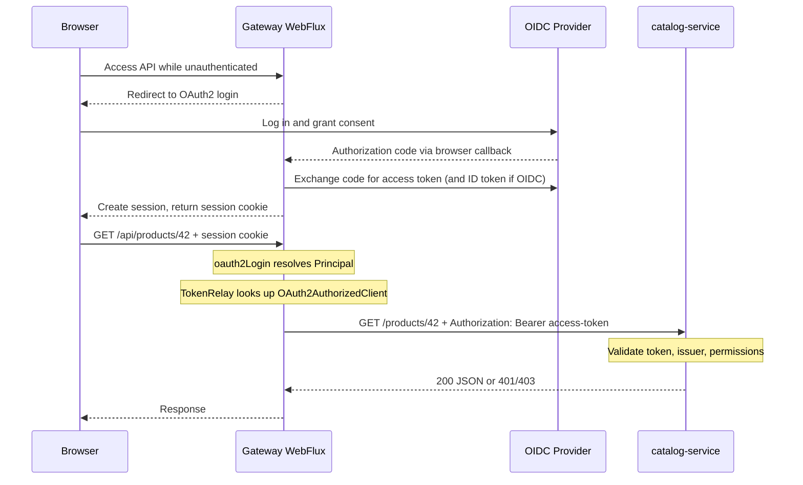
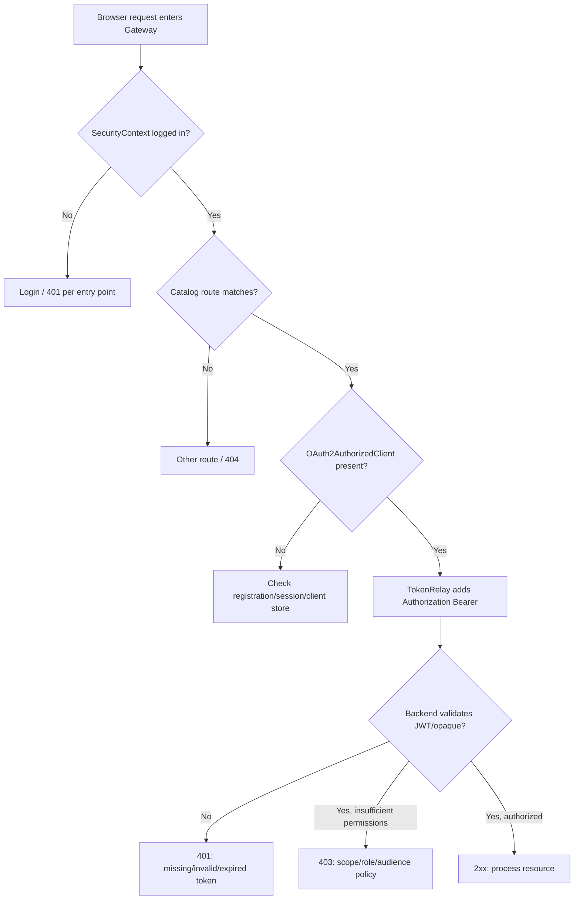

# TokenRelay and Forwarding Access Tokens to Downstream Services

## 1. Context: Logging In at the Gateway, Calling APIs on Microservices

In a microservices architecture, **Spring Cloud Gateway** is the shared entry point: route predicates select the path, filter chains modify requests/responses, service discovery resolves instances, and Spring Security, rate limiting, circuit breakers, retries, TLS, and observability protect the call flow. A common question is: **Once the user has logged in at the Gateway, how do downstream services know who this request represents and what permissions it holds?**

For example:

- A browser visits `https://app.example.test` and logs in via an **OpenID Connect (OIDC) Identity Provider**.
- The Gateway uses **OAuth2 Login** to complete the authorization-code flow and manage the browser login session.
- The frontend calls `GET /api/products/42` using the Gateway's session cookie.
- `catalog-service` is an **OAuth2 Resource Server** requiring a valid access token with scope `catalog.read`.
- The Gateway must send **`Authorization: Bearer <access-token>`** to `catalog-service`, rather than forcing the backend to trust the Gateway's session cookie.

The **`TokenRelay` GatewayFilter** supports this scenario: it looks up the access token from the **OAuth2 authorized client** context and attaches that access token to the request sent upstream.

Objectives for this lesson in the **Sessions and Tokens** chapter:

1. Distinguish between **session cookie**, **access token**, **ID token**, **refresh token**, and **client registration**.
2. Understand how TokenRelay works with `oauth2Login()` and when specifying a `clientRegistrationId`.
3. Configure **Spring Cloud Gateway Server WebFlux** using YAML or Java `RouteLocatorBuilder`.
4. Build a backend **Resource Server** that validates JWTs and scopes independently, without blindly trusting the Gateway.
5. Test the login flow, bearer token forwarding, `401/403`, token expiration, and error handling.
6. Design safe production setups: TLS, token audience, least-privilege scopes, preventing token leakage, and managing sessions/authorized clients across multiple instances.

> **Version scope:** Examples focus on **Spring Cloud Gateway Server WebFlux 5.0.x**, namespace `spring.cloud.gateway.server.webflux`, with compatible Spring Boot and Spring Security versions per the BOM. Gateway Server Web MVC also supports TokenRelay but uses a different Servlet API/Java DSL (section 10). The IdP endpoints, client IDs, domains, and permissions in examples are **illustrative values that must be configured with a real IdP** and cannot run as-is without an IdP.

## 2. Identities and Credentials That Must Not Be Confused

| Component | Who usually holds it? | What is it used for? | Is this what TokenRelay should forward? |
|---|---|---|---|
| Gateway **session cookie** | Browser, issued by the Gateway at login | Associates browser requests with the authenticated session at the Gateway | **No**; a cookie is not an OAuth2 access token |
| **Access token** | OAuth2 client/Gateway after authorization | Calls a **resource server** according to scope/audience | **Yes**, when retrieved from the authorized client |
| **ID token** (OIDC) | OAuth2/OIDC client | Communicates identity/authentication info to the **client** | **No**; do not use instead of an access token for APIs |
| **Refresh token** | Stored securely by the OAuth2 client, if issued by the IdP | Requests new access tokens per OAuth2 rules | **No**; never send to APIs as a bearer token |
| **Client ID/secret** | Gateway and Identity Provider | Identifies and authenticates the OAuth2 client in appropriate flows | **No**; never forward the client secret to the backend |
| **Scope** | Granted permissions inside the access token | Restricts actions such as `catalog.read` | Backend must check scopes; Gateway does not grant permissions on its own |
| **Audience (`aud`)** | Intended recipient claim/concept of the access token | Identifies the service/API the token is issued for | Must match the backend; never altered automatically during relay |

**JWT** and **opaque tokens** are two access token formats an authorization server may issue. For JWTs, a resource server typically verifies signatures via JWKS alongside `iss`, expiry, and custom policies; for opaque tokens, a resource server may introspect via the IdP. `TokenRelay` **does not convert opaque tokens into JWTs** and does not replace backend verification.

### 2.1. Two legs use two authentication mechanisms



Logging in at the Gateway does not automatically make the backend trust the user. The backend **must validate the bearer token** against its issuer and policy. Nor should you assume the browser's session cookie automatically stops at the Gateway: **stripping the Cookie header before proxying** may require an explicit filter (section 5), depending on the backend contract.

### 2.2. TokenRelay does not mean proxying every incoming Authorization header

The name TokenRelay suggests "forwarding the incoming request's token", but the **actual mechanism depends on the `Authentication` type**:

- With **`oauth2Login()`**, the Gateway has an **OAuth2 authorized client** bound to the user and holds an access token obtained from the IdP. Use `TokenRelay=` to relay that token to the backend.
- With **`TokenRelay=<clientRegistrationId>`**, the Gateway obtains a token for a **specific registration** per the OAuth2 client manager capabilities and configured grant.
- With **a request containing only `Authorization: Bearer ...`**, where the Gateway is configured purely as a **resource server**, the Principal may be a `JwtAuthenticationToken` and **does not necessarily have an `OAuth2AuthorizedClient`**. Do not assume `TokenRelay=` will automatically grab the bearer token in all cases. Verify Authorization proxying behavior or design explicit propagation per requirements (section 9).

**Specifically:** TokenRelay does not perform **OAuth 2.0 Token Exchange** (RFC 8693), does not rewrite audience/scope, does not re-sign tokens, and does not decide whether the backend has authority to accept the token.

## 3. What Does the TokenRelay GatewayFilter Do?

On Gateway Server WebFlux, `TokenRelayGatewayFilterFactory` supports one **optional** parameter: `clientRegistrationId`.

| Configuration | Token Source | When to Use |
|---|---|---|
| `TokenRelay=` (no ID) | Access token from the authorized client of the user logged in via `oauth2Login()` | Gateway acts as a **BFF/SSO gateway** using browser session cookies |
| `TokenRelay=gateway-oidc` | Access token tied to client registration `gateway-oidc` and current principal | Explicitly selecting a registration when multiple OAuth2 clients exist |
| `TokenRelay=catalog-machine` | Access token for registration `catalog-machine` and configured grant | Service-to-service flows where the Gateway itself holds the required grant |

In both forms, TokenRelay sets the bearer token in the **`Authorization`** header of the **downstream** request. It is a **route-specific GatewayFilter**, declared in the route's `filters`. It does not open the entire route to unauthenticated users: Spring Security still decides whether the request is permitted to reach the filter chain.

### 3.1. Prerequisites for the TokenRelay factory bean to exist

According to the Spring Cloud Gateway WebFlux 5.0.x documentation:

1. Include the **`org.springframework.boot:spring-boot-starter-oauth2-client`** dependency.
2. Configure `spring.security.oauth2.client.*` so a **`ReactiveClientRegistrationRepository`** bean is created.
3. Have an appropriate authentication/authorization mechanism (such as `oauth2Login()`) and proper authorized-client access configuration.
4. For protected backends, the token must be valid and accepted by the backend.

If the registration or dependency is missing, the `TokenRelayGatewayFilterFactory` bean may **not be created**; you cannot fix that situation merely by adding `- TokenRelay=` to YAML.

### 3.2. General processing flow

```text
Browser request + session cookie
        |
        v
Spring Security oauth2Login -> Authentication
        |
        v
Route predicate matches catalog route
        |
        v
TokenRelay GatewayFilter
        |
        +--> ReactiveOAuth2AuthorizedClientManager / authorized client
        |       └── access token issued by OAuth2 flow
        |
        v
Set Authorization: Bearer <access-token>
        |
        v
Gateway HTTP client -> catalog-service Resource Server
        |
        v
Resource Server validates JWT/opaque token, scope, audience
```

**Security note:** "Holding an access token" does not prove the user is authorized to access **every** resource on the backend. The backend must combine token claims, scopes, target resource ownership, and business rules.

## 4. Preparing the Lab Environment

### 4.1. Test architecture

Three components:

| Component | Illustrative Address | Role |
|---|---|---|
| OIDC Provider | `https://idp.example.test/realms/demo` | Authorization server issuing codes/tokens |
| Gateway Server WebFlux | `http://localhost:8080` (lab) | OAuth2 client, login session, TokenRelay |
| Catalog Resource Server | `http://localhost:8081` (lab) | Accepts bearer token and checks `catalog.read` permission |

**Required before running:** you must have a real OIDC provider or properly configured local IdP; register an OAuth2 client with a redirect URI pointing to the Gateway; and have the IdP issue an access token with scope `catalog.read` and an audience matching the catalog API. **`idp.example.test` is an example name, not a ready-made IdP.**

In real environments, use **HTTPS** for browser → Gateway and Gateway → backend (or managed mTLS). Local HTTP in these examples is suitable only for a **closed lab**.

### 4.2. Dependencies for Gateway WebFlux

Create a Spring Boot project compatible with Spring Cloud Gateway 5.0.x, import the Spring Cloud BOM for your release train, and add the following dependencies to the **Gateway**'s `pom.xml`:

```xml
<dependencies>
    <dependency>
        <groupId>org.springframework.cloud</groupId>
        <artifactId>spring-cloud-starter-gateway-server-webflux</artifactId>
    </dependency>
    <dependency>
        <groupId>org.springframework.boot</groupId>
        <artifactId>spring-boot-starter-security</artifactId>
    </dependency>
    <dependency>
        <groupId>org.springframework.boot</groupId>
        <artifactId>spring-boot-starter-oauth2-client</artifactId>
    </dependency>
</dependencies>
```

You do not need to configure the Gateway as an **OAuth2 Resource Server** just to run this **OAuth2 Login + TokenRelay** demo. OAuth2 client and resource server are **two distinct roles**; the Gateway can perform both in complex systems, but do not mix them when first learning.

**Starter names in Spring Boot 4:** Boot 4 introduces the recommended name `spring-boot-starter-security-oauth2-client` in place of `spring-boot-starter-oauth2-client` (the older name remains in some versions for compatibility). The example above keeps the name used in the Gateway TokenRelay documentation; when creating a new Boot 4 project, prefer the new starter name and pin the BOM to the exact version.

### 4.3. Registering the OAuth2 client in the IdP

Assume you have created a client with:

- **Registration ID** in Spring: `gateway-oidc`.
- **Client ID** at the IdP: `gateway-web`.
- **Client secret** stored only in a secret manager/environment variable.
- **Authorization grant:** `authorization_code`.
- **Redirect URI** in the lab: `http://localhost:8080/login/oauth2/code/gateway-oidc`.
- **Requested scopes:** `openid`, `profile`, and `catalog.read` if permitted by the IdP.

The Redirect URI must be registered at the IdP matching the exact scheme/host/port/path used. For a Gateway behind a TLS-terminating ingress, the public redirect URI must reflect the real HTTPS hostname; never use an internal localhost address as a production redirect URI.

## 5. Declaring Gateway OAuth2 Login + TokenRelay in YAML

Here is **`application.yml` for the Gateway application**, with two independent sections: OAuth2 client for Spring Security and the route with TokenRelay for Spring Cloud Gateway.

```yaml
server:
  port: 8080

spring:
  application:
    name: catalog-gateway
  security:
    oauth2:
      client:
        registration:
          gateway-oidc:
            provider: demo-idp
            client-id: gateway-web
            client-secret: ${OAUTH2_CLIENT_SECRET}
            authorization-grant-type: authorization_code
            redirect-uri: "{baseUrl}/login/oauth2/code/{registrationId}"
            scope:
              - openid
              - profile
              - catalog.read
        provider:
          demo-idp:
            issuer-uri: https://idp.example.test/realms/demo
  cloud:
    gateway:
      server:
        webflux:
          routes:
            - id: catalog-with-user-token
              uri: http://localhost:8081
              predicates:
                - Path=/api/products/**
                - Method=GET
              filters:
                - StripPrefix=1
                # Prevent the backend from receiving the Gateway session cookie.
                - RemoveRequestHeader=Cookie
                # No clientRegistrationId: use the logged-in user's token.
                - TokenRelay=
```

**Note on secrets:** `OAUTH2_CLIENT_SECRET` must be provided from a secure configuration source; never commit real secrets to Git. Never copy this configuration file into production without replacing the IdP, redirect URI, backend URLs, and TLS for the real environment.

### 5.1. Step-by-step explanation

| Element | Meaning |
|---|---|
| `registration.gateway-oidc` | Registers the OAuth2 client used by the Gateway to log in and obtain tokens |
| `provider.demo-idp.issuer-uri` | Allows Spring Security to discover the IdP's OIDC/OAuth2 metadata |
| `authorization-grant-type: authorization_code` | Browser logs in via authorization code; backend token exchange is performed by the Gateway's OAuth2 client |
| `scope` | Permissions **requested** from the IdP; does not guarantee the IdP grants all of them |
| `redirect-uri` | Spring Security callback when the IdP returns the authorization code |
| `Path=/api/products/**` | Route matching only product APIs |
| `Method=GET` | Routes GET requests only; POST is not routed in this demo |
| `StripPrefix=1` | `/api/products/42` → `/products/42` at the backend |
| `RemoveRequestHeader=Cookie` | Strips browser cookies before sending downstream in the lab |
| `TokenRelay=` | Retrieves the logged-in user's access token and attaches `Authorization: Bearer ...` when proxying |

The order of `RemoveRequestHeader=Cookie` in the filter list is chosen for clarity: Spring Security authenticates the session **before the Gateway route runs**, so stripping `Cookie` during the proxy stage does not make the Gateway forget the authenticated user. However, if your backend **actually needs another cookie**, do not strip all cookies without a clear contract.

**Do not add `TokenRelay` to `default-filters` for all routes without auditing:** tokens could be forwarded to upstreams that should never receive user credentials, such as admin services or third-party endpoints. Prefer allowlisting routes whose backends are trusted.

### 5.2. SecurityWebFilterChain for the Gateway

To enable OAuth2 Login sessions and manage OAuth2 clients on **WebFlux**, create `GatewaySecurityConfig.java`:

```java
package com.example.gateway;

import org.springframework.context.annotation.Bean;
import org.springframework.context.annotation.Configuration;
import org.springframework.security.config.Customizer;
import org.springframework.security.config.annotation.web.reactive.EnableWebFluxSecurity;
import org.springframework.security.config.web.server.ServerHttpSecurity;
import org.springframework.security.web.server.SecurityWebFilterChain;

@Configuration
@EnableWebFluxSecurity
public class GatewaySecurityConfig {

    @Bean
    SecurityWebFilterChain securityWebFilterChain(ServerHttpSecurity http) {
        return http
            .authorizeExchange(authorize -> authorize
                // Product paths and all other requests require login.
                .anyExchange().authenticated())
            .oauth2Login(Customizer.withDefaults())
            .oauth2Client(Customizer.withDefaults())
            .build();
    }
}
```

`oauth2Login()` sets up login via OAuth2/OIDC; `oauth2Client()` enables OAuth2 Client components for working with authorized clients. The example enforces **authentication for all requests**, except the OAuth2 handshake/callback endpoints handled by Security. For Actuator or health checks that must be public, configure explicit, controlled matchers.

**Do not unconditionally disable CSRF**: when browsers use session cookies for POST/PUT/DELETE requests, evaluate CSRF tokens and cookie `SameSite` policies. The lab proxies only **GET** requests to isolate token relay from CSRF. When deploying a SPA, design CORS, session cookies, CSRF, callback URLs, and reverse proxies together.

### 5.3. Java DSL alternative to YAML routes

If the application declares routes in Java, you can replace the **YAML route** with a `RouteLocator` bean; this is an independent declaration method—**do not run both simultaneously with the same route ID**:

```java
package com.example.gateway;

import org.springframework.cloud.gateway.route.RouteLocator;
import org.springframework.cloud.gateway.route.builder.RouteLocatorBuilder;
import org.springframework.context.annotation.Bean;
import org.springframework.context.annotation.Configuration;
import org.springframework.http.HttpMethod;

@Configuration
public class CatalogGatewayRoutes {

    @Bean
    RouteLocator catalogRoute(RouteLocatorBuilder builder) {
        return builder.routes()
            .route("catalog-with-user-token", r -> r
                .path("/api/products/**")
                .and()
                .method(HttpMethod.GET)
                .filters(f -> f
                    .stripPrefix(1)
                    .removeRequestHeader("Cookie")
                    .tokenRelay())
                .uri("http://localhost:8081"))
            .build();
    }
}
```

`tokenRelay()` with no arguments corresponds to `TokenRelay=`. Other routes can use `tokenRelay("registration-id")` when explicitly selecting a specific OAuth2 client registration.

## 6. Catalog Backend: Resource Server Must Validate Bearer Tokens Itself

### 6.1. Backend dependencies

The backend in this lesson uses a **Spring Boot Servlet/Web MVC** app running on port `8081`. Add:

```xml
<dependencies>
    <dependency>
        <groupId>org.springframework.boot</groupId>
        <artifactId>spring-boot-starter-webmvc</artifactId>
    </dependency>
    <dependency>
        <groupId>org.springframework.boot</groupId>
        <artifactId>spring-boot-starter-security</artifactId>
    </dependency>
    <dependency>
        <groupId>org.springframework.boot</groupId>
        <artifactId>spring-boot-starter-oauth2-resource-server</artifactId>
    </dependency>
</dependencies>
```

The `spring-boot-starter-webmvc` starter is for Spring Boot 4.x. On Spring Boot 3.x, the common equivalent starter is `spring-boot-starter-web`. Pick the dependency matching your application version; never include both at once.

### 6.2. Configuring issuer for JWT validation

```yaml
# catalog-service/src/main/resources/application.yml
server:
  port: 8081

spring:
  application:
    name: catalog-service
  security:
    oauth2:
      resourceserver:
        jwt:
          issuer-uri: https://idp.example.test/realms/demo
          audiences:
            - catalog-api
```

This is a **JWT Resource Server**: Spring Security uses the IdP's metadata/JWKS to verify signatures and standard claims. If the IdP issues **opaque access tokens**, you must use **introspection** instead of this JWT configuration. The Boot 4 `audiences` property requires the `aud` claim to contain `catalog-api`; the demo IdP **must be configured to issue this audience**. Having only `issuer-uri` is not enough to enforce audience. If using another version or token mechanism, configure an equivalent validator.

The `spring-boot-starter-oauth2-resource-server` starter in the example also has a new recommended name in Boot 4: `spring-boot-starter-security-oauth2-resource-server`. Use whichever name matches your Boot/BOM version.

### 6.3. Security policy enforcing the `catalog.read` scope

```java
package com.example.catalog;

import org.springframework.context.annotation.Bean;
import org.springframework.context.annotation.Configuration;
import org.springframework.http.HttpMethod;
import org.springframework.security.config.Customizer;
import org.springframework.security.config.annotation.web.configuration.EnableWebSecurity;
import org.springframework.security.config.annotation.web.builders.HttpSecurity;
import org.springframework.security.web.SecurityFilterChain;

@Configuration
@EnableWebSecurity
public class CatalogSecurityConfig {

    @Bean
    SecurityFilterChain filterChain(HttpSecurity http) throws Exception {
        return http
            .authorizeHttpRequests(authorize -> authorize
                .requestMatchers(HttpMethod.GET, "/products/**")
                    .hasAuthority("SCOPE_catalog.read")
                .anyRequest().denyAll())
            .oauth2ResourceServer(oauth2 ->
                oauth2.jwt(Customizer.withDefaults()))
            .build();
    }
}
```

By default, Spring Security Resource Server maps JWT scope `catalog.read` to authority `SCOPE_catalog.read`. Verify your IdP's actual scope claim format (`scope`, `scp`, or custom claims) and adjust the converter if needed. **Never accept any token solely because its signature is valid**: verify `iss`, `aud`, expiration, and granted permissions, then enforce resource-level/user-level authorization.

### 6.4. Controller does not echo token values

```java
package com.example.catalog;

import java.util.Map;
import org.springframework.boot.SpringApplication;
import org.springframework.boot.autoconfigure.SpringBootApplication;
import org.springframework.security.oauth2.server.resource.authentication.JwtAuthenticationToken;
import org.springframework.web.bind.annotation.GetMapping;
import org.springframework.web.bind.annotation.PathVariable;
import org.springframework.web.bind.annotation.RestController;

@SpringBootApplication
@RestController
public class CatalogApplication {

    public static void main(String[] args) {
        SpringApplication.run(CatalogApplication.class, args);
    }

    @GetMapping("/products/{id}")
    public Map<String, String> product(
            @PathVariable String id,
            JwtAuthenticationToken authentication) {
        return Map.of(
            "id", id,
            "requestedBy", authentication.getName(),
            "message", "authorized access"
        );
    }
}
```

The controller displays only a test identifier and confirmation message; **never return raw access tokens, refresh tokens, or client secrets**. In production, attributes like username/subject are also personal data; include them in responses only if required by the API contract and properly controlled.

### 6.5. Expected result

With a JWT having a valid signature/issuer/audience and authority `SCOPE_catalog.read`, a request to `GET /products/42` is permitted. If the token is missing or invalid, the Resource Server typically returns **401**; if the token is valid but lacks `catalog.read`, it typically returns **403**. Actual responses and status codes also depend on custom security exception handlers in the application.

**Note:** Even after a successful Gateway login, the backend will still reject the request if the IdP did not grant the right scope or the backend requires a different audience. That is proper enforcement, not proof that `TokenRelay` "failed to run".

## 7. Testing the Login and Token Relay Flow

### 7.1. Prerequisites

To test the complete flow:

1. **The IdP is running**, allowing client `gateway-web` to log in via the authorization-code flow with a valid redirect URI.
2. **The IdP issues an access token with `catalog.read` permission** and the catalog API audience; the bearer token can be verified by the backend via metadata/JWKS.
3. **Backend `catalog-service` is running on port 8081** with the resource server configuration from section 6.
4. **Gateway is running on port 8080** with Spring Security OAuth2 Login and the route from section 5.
5. The browser allows storing the **session cookie** for the Gateway; network connectivity from Gateway to IdP and backend works.

Without a real IdP, **simply running the YAML will not yield a token**. The outcomes below are **expected scenarios**, not outputs executed here.

### 7.2. Before login: Gateway requires authentication

Open a private browser window and navigate to:

```text
http://localhost:8080/api/products/42
```

With `oauth2Login()`, the Gateway will require login, potentially displaying a provider selection page or redirecting to:

```text
http://localhost:8080/oauth2/authorization/gateway-oidc
```

After successful authentication, the IdP redirects back to `/login/oauth2/code/gateway-oidc` so the Gateway exchanges the authorization code for tokens and saves the authorized client state. The browser receives a **Gateway session cookie** for subsequent requests.

Do not expect a cookieless `curl` request to complete the entire login flow by itself. It may receive a `302` redirect or another security response depending on entry point configuration; a real browser is needed to verify the authorization code flow.

### 7.3. After login: Gateway calls catalog-service

Visit again:

```text
http://localhost:8080/api/products/42
```

If the token and permissions are valid, an illustrative response is:

```http
HTTP/1.1 200 OK
Content-Type: application/json

{"id":"42","requestedBy":"user-123","message":"authorized access"}
```

`user-123` is just an **example principal name**, with no guarantee your IdP produces the same value. Key observations:

- **Frontend → Gateway:** the browser presents a **session cookie**, rather than fetching an OAuth2 access token itself to attach a bearer header.
- **Gateway → backend:** the request includes `Authorization: Bearer ...` placed by TokenRelay from the authorized client.
- **Backend:** validates the token successfully, derives authorities from scopes, and executes the controller.
- **Response:** the backend returns only necessary data, never echoing the token.

### 7.4. Direct backend control test

When sending **no** bearer token:

```bash
curl -i 'http://localhost:8081/products/42'
```

The backend resource server must **deny** access to protected data. With the example configuration, it typically returns `401 Unauthorized`.

Using a **valid test access token issued by a real IdP**, you can test safely from a terminal:

```bash
# TOKEN is an environment variable provisioned securely;
# never place raw access tokens directly in commands/history/docs.
curl -i \
  -H "Authorization: Bearer $TOKEN" \
  'http://localhost:8081/products/42'
```

Tokens that are **expired/badly signed/wrong issuer/wrong audience** must be rejected, and a valid token lacking `catalog.read` must not be allowed to read the API. Never hardcode real tokens in a lab or CI pipeline; mask sensitive values in logs and reports.

### 7.5. Comprehensive test matrix

| Case | Input | Main Expectation |
|---|---|---|
| T1 | Unauthenticated browser, GET through Gateway | Gateway prompts for login; does not send a valid user token to backend |
| T2 | Logged-in browser, token has `catalog.read` | Backend receives bearer token and returns 200 |
| T3 | Logged-in browser, token lacks required scope | Backend returns 403 (or equivalent denial policy) |
| T4 | Backend receives token with wrong issuer, expired, or invalid signature | Backend returns 401 |
| T5 | Valid signature but wrong audience | Backend rejects if audience validator is configured |
| T6 | Browser session expired / logged out | New request must re-authenticate; no token relayed from old session |
| T7 | Gateway calls wrong backend hostname/port | Connection/TLS/timeout error; not a TokenRelay failure |
| T8 | `POST /api/products/42` request | `Method=GET` route does not match; bearer token not forwarded to POST |
| T9 | Two browser sessions with two different users | Authorized clients stay isolated; backend sees each respective principal |
| T10 | Downstream proxy logs headers | Must **mask Authorization**; never expose tokens in logs/tracing |

**Fault isolation:** failed login (no authenticated principal yet), TokenRelay unable to resolve an authorized client, backend rejecting the token, and backend connectivity failure are **four separate failure layers** that must be observed independently.

## 8. Explicitly Choosing clientRegistrationId When Multiple OAuth2 Clients Exist

### 8.1. Using a token from a specific registration

If the Gateway defines multiple `ClientRegistration` entries, you can select a registration by ID:

```yaml
# Single route snippet, placed under
# spring.cloud.gateway.server.webflux.routes:
- id: catalog-registration-specific
  uri: http://localhost:8081
  predicates:
    - Path=/service/catalog/**
  filters:
    - StripPrefix=2
    - TokenRelay=catalog-machine
```

Corresponding Java DSL:

```java
@Bean
RouteLocator serviceRoutes(RouteLocatorBuilder builder) {
    return builder.routes()
        .route("catalog-registration-specific", r -> r
            .path("/service/catalog/**")
            .filters(f -> f
                .stripPrefix(2)
                .tokenRelay("catalog-machine"))
            .uri("http://localhost:8081"))
        .build();
}
```

The Java snippet above is a **`@Bean` method placed inside a `@Configuration` class** with `RouteLocator` and `RouteLocatorBuilder` imports as in section 5.3; it is not a standalone Java file.

### 8.2. OAuth2 `client_credentials` example

On the Gateway, add a separate registration under `spring.security.oauth2.client.registration`:

```yaml
# Excerpt from Gateway application.yml.
spring:
  security:
    oauth2:
      client:
        registration:
          catalog-machine:
            provider: demo-idp
            client-id: gateway-machine
            client-secret: ${CATALOG_MACHINE_SECRET}
            authorization-grant-type: client_credentials
            scope:
              - catalog.read
        provider:
          demo-idp:
            issuer-uri: https://idp.example.test/realms/demo
```

`client_credentials` is an **OAuth2 client grant**, used when the Gateway acts as a service-to-service client. The token represents the **Gateway/client**, not implicitly the user in the browser. To work in practice, the IdP must allow that grant and issue the right scope/audience; the Spring Security OAuth2 Client Manager must be configured to support the grant; and the security chain must still decide which requests are allowed to trigger the route.

**Do not confuse the two scenarios**:

| `TokenRelay=` with `oauth2Login` | `TokenRelay=catalog-machine` with `client_credentials` |
|---|---|
| Principal of the logged-in **user** | Principal of the **application/Gateway** |
| Permissions typically tied to consent/user/client | Permissions granted to the service client |
| Browser session exists at Gateway | No browser session needed to obtain machine token, though Gateway must still protect the route with a policy |
| Used when backend needs **user context** | Used when backend accepts **service identity** |

If the backend needs to know **who the end user is** and enforce per-user access control, **never swap a user's access token for a `client_credentials` token** and assume the two permission sets are equivalent. OAuth2 Token Exchange or a separately protected identity propagation architecture may be needed, which is distinct from basic TokenRelay.

### 8.3. Caution with multiple registrations

When a route uses `TokenRelay=` without a registration ID, it matches the access token of the **logged-in user**. When a route specifies an ID, the filter looks up/authorizes the client by **that ID**; it is not a command meaning "send whichever token the client happens to have".

If the registration does not exist, is unauthorized, the grant is rejected by the IdP, or the token is rejected by the backend, the request may fail at either the Gateway or the backend depending on the stage. When investigating, check the **actual registration ID**, grant type, token endpoint, granted scopes, and expected service identity.

## 9. When the Gateway Receives a Bearer Token Directly: Distinguishing from OAuth2 Login

### 9.1. Scenario where the Gateway is also a Resource Server

A SPA or mobile client might directly send:

```http
GET /api/products/42 HTTP/1.1
Host: gateway.example.test
Authorization: Bearer eyJ...redacted
```

This is **not the browser session + `oauth2Login` scenario**. Here, the Gateway can validate the **incoming bearer access token** using Spring Security Resource Server (JWT or opaque token). As an illustration, an **alternative** Security WebFlux configuration to section 5.2 is:

```java
@Bean
SecurityWebFilterChain apiSecurity(ServerHttpSecurity http) {
    return http
        .authorizeExchange(exchanges -> exchanges
            .anyExchange().authenticated())
        .oauth2ResourceServer(oauth2 ->
            oauth2.jwt(org.springframework.security.config.Customizer.withDefaults()))
        .build();
}
```

The snippet above must be placed in a `@Configuration` class importing `ServerHttpSecurity` and `SecurityWebFilterChain`; it requires `spring-boot-starter-oauth2-resource-server` and matching issuer/audience configuration on the Gateway. This is a **separate security chain**; do not paste another bean with overlapping matchers into the `oauth2Login` example to avoid conflicting chains.

### 9.2. Is `TokenRelay=` needed?

**Never assume "if a bearer token arrives, `TokenRelay=` automatically forwards it".** After `oauth2ResourceServer()`, the Security principal is typically a `JwtAuthenticationToken`, not an `OAuth2AuthenticationToken` carrying an authorized client from `oauth2Login()`. The OAuth2 Client `TokenRelay` filter is built to work with `OAuth2AuthorizedClient` per registration/principal.

In a simple reverse proxy, the **incoming `Authorization` header may already be forwarded** to the backend under the Gateway's default header-forwarding rules unless stripped or overwritten by another filter. However, that behavior **must be verified against your exact version/filter chain** and is not the login-session `TokenRelay=` mechanism.

Architectural options:

1. **Pass through the caller's bearer token** via reverse proxy while having **both** the Gateway and backend validate the token/scope/audience appropriately. Test header forwarding and restrict destination routes.
2. **Use OAuth2 Client/TokenRelay with an explicit registration** if the Gateway is issued a separate token to call services (section 8), accepting the corresponding client-identity semantics.
3. **Use Token Exchange** when the backend must receive a new token with its own audience/permissions rather than forwarding the original token across scope boundaries.
4. For **`WebClient` API calls** in code rather than proxy routes, Spring Security provides `ServerBearerExchangeFilterFunction` to extract bearer credentials from the Security context and attach them to WebClient requests; this is a **different mechanism** from `TokenRelayGatewayFilterFactory` and does not automatically refresh tokens.

Do not hand-roll `AddRequestHeader=Authorization,...` with raw tokens from unverified queries or cookies. If custom relay is required, explicitly control **token source, validation, target route, header overwrite behavior, TLS, and errors**.

### 9.3. An ID token is not an access token

In OpenID Connect, an ID token attests to an identity authentication event **at the client**. An ID token whose `aud` is OAuth2 client `gateway-web` is **not** an access token meant for `catalog-service`. Therefore:

- Never substitute an ID token for `Authorization: Bearer` when calling a backend.
- Never decode a JWT and rewrite `aud`/`scope`, or sign one with a Gateway secret to "fix" token errors.
- Never treat just any validly signed JWT as sufficient; token type, issuer, audience, and permissions must all align.
- When a backend requires a different audience, have the IdP issue a token for that audience or use a policy-compliant token exchange.

## 10. Gateway Server Web MVC Has Its Own TokenRelay

In **Spring Cloud Gateway Server Web MVC 5.0.x**, `TokenRelay` also exists, built on the **Servlet stack/WebMvc.fn**. YAML lives under `spring.cloud.gateway.server.webmvc.routes` rather than `server.webflux.routes`:

```yaml
# For Gateway Server Web MVC applications only.
spring:
  cloud:
    gateway:
      server:
        webmvc:
          routes:
            - id: catalog-mvc
              uri: http://localhost:8081
              predicates:
                - Path=/api/products/**
              filters:
                - StripPrefix=1
                - TokenRelay=
```

Spring Cloud Gateway Server Web MVC uses `OAuth2AuthorizedClientManager` and `OAuth2AuthorizedClientService` from **Servlet Security**; WebFlux uses `ReactiveOAuth2AuthorizedClientManager` / `ReactiveOAuth2AuthorizedClientService`. Never mix MVC `SecurityFilterChain` with WebFlux `SecurityWebFilterChain`, or copy WebFlux Java `RouteLocatorBuilder` into MVC.

The MVC documentation also supports `tokenRelay()` and `tokenRelay("registration-id")` in the Java `RouterFunction` DSL. When choosing MVC, use the MVC starter and matching OAuth2 Client/Security configuration, and run the same test matrix for bearer tokens, scopes, and sessions as with WebFlux.

## 11. Sessions, Refresh Tokens, and Scaling Out the Gateway

### 11.1. A browser session is distinct from an OAuth2AuthorizedClient

There are at least two states to manage:

| State | Purpose | Risk if stored only in RAM |
|---|---|---|
| **Web session / SecurityContext** | Remembers that the browser is logged in and which user it is | User loses session / must re-login on restart or when routed to another instance |
| **OAuth2AuthorizedClient** | Links OAuth2 client registration, principal, access token, and refresh token (if present) | Filter cannot find the authorized client on another instance; refreshes are unsynchronized |

Per the Spring Cloud Gateway documentation, `TokenRelayGatewayFilterFactory` in WebFlux uses a default `ReactiveOAuth2AuthorizedClientService` implementation backed by an **in-memory store**. This works for a lab, but is **insufficient** for multi-instance environments or recovery across restarts.

In production, decide on **centralized session storage** (such as Spring Session + Redis if appropriate), **secure/persistent authorized client storage** using a suitable implementation, and traffic routing across instances. **Merely enabling Spring Session does not guarantee `ReactiveOAuth2AuthorizedClientService` has switched to a persistent store** — verify each bean and flow separately.

### 11.2. Token expiration does not equal session expiration

A browser session can remain active after the access token expires. The OAuth2 authorized client manager can **refresh or reauthorize** the token if the grant, refresh token, provider, client, and policy support it. Do not assume every IdP issues refresh tokens or that token refresh always succeeds.

When a token expires or is revoked:

1. Check whether TokenRelay/the authorized client manager can locate a valid token and refresh it.
2. Check the IdP token endpoint, grant, consent, and refresh token rotation policy.
3. If authorization cannot be recovered, prompt for re-login/re-authorization or handle the error cleanly—**never continue sending an expired token**.
4. On logout, decide how to invalidate the **local session**, remove the authorized client, and, if supported, perform revocation/logout at the IdP. **Deleting the Gateway cookie does not automatically revoke all issued access tokens.**

Never log refresh tokens or send a refresh token as a bearer token to a service.

### 11.3. Limiting user token blast radius across the system

An access token is typically a **bearer credential**: anyone holding it can try to use it within its granted permissions and lifetime. When the Gateway relays tokens to many services, the **token leakage/lateral movement** surface increases.

Principles:

- Relay tokens only to **upstreams inside approved trust boundaries**, using outbound HTTPS/mTLS as appropriate.
- Grant least-privilege scopes; separate `catalog.read` from `admin.write`.
- Backends independently validate issuer, audience, and resource-level permissions; never accept tokens intended for unrelated services.
- Never forward user tokens to third-party endpoints just because a route predicate happens to match.
- Never let downstream URIs depend directly on client-supplied URLs (SSRF could leak the `Authorization` header).
- If service identity is needed instead of user identity, pick the right grant; if delegation across multiple APIs is required, design OAuth2 token exchange/identity propagation.

## 12. Securing Sessions, Cookies, and Transport Channels

### 12.1. Client → Gateway and Gateway → backend are two independent hops

`TokenRelay` places the bearer token on the **outbound HTTP request**, but **does not establish TLS**. Even if the frontend uses `https://app.example.test`, a route `uri: http://localhost:8081` in the lab still calls the backend over HTTP.

In production:

- Browser → Gateway/Ingress should use HTTPS; session cookies need `Secure`, `HttpOnly`, and flow-appropriate `SameSite`.
- Gateway → backend should use HTTPS or mTLS per security requirements, verifying the certificate chain and hostname.
- If TLS terminates at the ingress, control `Forwarded` / `X-Forwarded-*` headers from trusted proxies so redirect URLs and `Secure` cookie flags are computed accurately.
- Never enable an insecure trust manager or disable hostname verification just to "make OAuth2 work".

### 12.2. CSRF, CORS, logout, and session fixation

If the browser authenticates to the Gateway via a session cookie, state-changing requests require proper **CSRF protection**; CORS only governs whether the browser lets scripts read responses and **does not replace CSRF/authorization**. Spring Security provides built-in session/authentication protections, so whenever customizing the filter chain, test login/logout, redirects, session rotation, cookie attributes, and origin checks.

If the SPA runs on a different origin from the Gateway, configure **CORS credentials** only for allowed origins; use an exact `Access-Control-Allow-Origin` and `Access-Control-Allow-Credentials: true` only when truly required. Never combine wildcard `*` with credentials.

**Do not forward internal session cookies to backends** unless there is an explicit contract for them. Section 5 includes `RemoveRequestHeader=Cookie` to separate Gateway identification (session cookie) from backend identification (bearer token).

### 12.3. Never log bearer tokens

An `Authorization: Bearer ...` value is **not safe observability data**. Never print the raw string in:

- Gateway access logs, Netty wiretap/TRACE, or custom log filters.
- Backend access logs, application exception messages, or APM/tracing attributes.
- Message queues, URL query strings, browser `localStorage`, or analytics events.
- `curl -v` output pasted into support tickets or screenshots.

When investigating, log only **route ID**, request/trace ID, status, error category, latency, and controlled non-sensitive identifiers. If you need to know whether a token was attached in a lab, log a **boolean `tokenPresent`**, never the token value.

## 13. Mapping Configuration to Real Requests

### 13.1. Measuring signals at each layer without printing tokens



This diagram is a **reasoning model**, not a guarantee of exact status codes in every situation; custom exception handlers, OAuth2 entry points, retries, and circuit breakers can change the response.

In real applications, record the following signals:

| Location | Non-Sensitive Signal | Question Answered |
|---|---|---|
| Ingress/Gateway | Request ID, method/path, status, route ID | Did the request reach the Gateway and match the right route? |
| Spring Security | Authentication type, login success/failure category | Is it handling an OAuth2 Login session or a JWT bearer? |
| OAuth2 Client Manager | Registration ID, token availability, refresh outcome (**no token value**) | Does TokenRelay have a client/token to use? |
| Gateway HTTP client | Backend host/port, TLS result, latency, response status | Could it connect and proxy to the service? |
| Resource Server | Token validation result, issuer/audience/scope policy | Why did the backend return 401/403? |
| Observability | Trace ID, per-hop timing, sanitized error class | Is the error in security, routing, or downstream? |

### 13.2. Actuator for routes, not for reading tokens

If `spring-boot-starter-actuator` is added and access to the Gateway endpoint is permitted:

```yaml
management:
  endpoint:
    gateway:
      access: read-only
  endpoints:
    web:
      exposure:
        include: health,gateway
```

```bash
curl -sS 'http://localhost:8080/actuator/gateway/routes'
curl -sS 'http://localhost:8080/actuator/gateway/routes/catalog-with-user-token'
```

These help confirm the route and `TokenRelay` filter are wired up, **not that a user token was found or accepted by the backend**. Secure Actuator via network/Spring Security controls and never use configuration endpoints to dump tokens or secrets.

### 13.3. Symptom and root-cause table

| Symptom | Possible Cause | How to Verify |
|---|---|---|
| Gateway reports `TokenRelay` factory not found | Missing OAuth2 client dependency or `ReactiveClientRegistrationRepository` | Check BOM, `spring.security.oauth2.client.*`, startup beans, and filter factories |
| Requests loop back to the login page continuously | Cookie/session not persisted, wrong redirect URI/forwarded host, callback mismatch | Inspect browser cookies, OAuth2 state, redirect URI, and ingress |
| IdP returns `invalid_client` | Wrong Client ID/secret, token endpoint, or grant | Check registration at IdP, secret manager, and masked error logs |
| IdP returns `invalid_scope` or consent denied | `catalog.read` scope not permitted | Check scope/client/grant configuration on the IdP |
| Gateway login succeeds, backend returns 401 | Wrong token issuer/audience, expired, missing bearer header, or cert/JWKS error | Check header presence, safe token metadata, and backend Resource Server logs |
| Backend returns 403 for a valid token | Missing `SCOPE_catalog.read` or resource policy denial | Check claims/authority mapping and authorization logic |
| Gateway errors during token refresh | Refresh grant rejected, refresh token expired/rotation failure, client store lost state | Check refresh outcome, IdP policy, and authorized-client persistence |
| Token reaches the wrong backend | Overly broad route, dynamic URI, or misconfigured service discovery | Compare route ID/predicate/resolved instance URI and trust boundaries |
| Token relay works intermittently when scaling out | Gateway instances use inconsistent session/authorized-client stores | Check sticky sessions and both distinct stores |
| Inbound bearer requests are not handled by `TokenRelay=` as expected | Gateway acts as Resource Server, no `OAuth2AuthorizedClient` from login | Distinguish `JwtAuthenticationToken` vs `OAuth2AuthenticationToken`; see section 9 |
| Browser has a session, but SPA API calls fail with CORS/CSRF | Wrong origin/cookie `SameSite`/credentials/CSRF | Inspect preflight and actual requests in DevTools |
| Backend sees the Gateway cookie | Cookie-stripping filter missing or not attached to the route | Verify downstream request headers without logging cookie values |
| Client receives 5xx when backend disconnects | DNS, port, TLS trust, timeout, circuit breaker | Call backend from Gateway environment; check Netty/connection metrics |
| Old tokens still work after logout | Access token not expired or revoked; backend only validates JWT | Design revocation, short TTL, token exchange/authorization per requirements |
| Metrics/logs expose tokens | DEBUG/wiretap/custom filter logging `Authorization` | Disable/mask logging, rotate exposed credentials, and audit log pipelines |

**Diagnostic order:** verify instance/config → Security login → route matching → authorized client and token availability → outbound header presence → backend TLS/connectivity → backend JWT/scope/audience validation → response/metrics. Do not tweak CORS or `StripPrefix` when evidence points to an issuer/audience mismatch.

## 14. Production Checklist for TokenRelay

1. **Right flow:** browser session + `oauth2Login`, client bearer + resource server, or service-to-service `client_credentials`?
2. **Right registration:** `clientRegistrationId` matches the real OAuth2 client config; IdP grants the right grant/scopes.
3. **Right token type:** only the access token is sent to the backend; never send ID tokens, refresh tokens, or client secrets.
4. **Right audience:** backends accept only tokens issued for their own API; configure an audience validator.
5. **Right permissions:** backends enforce scopes/roles **and** resource-level permissions; the Gateway does not grant permissions merely by relaying.
6. **Right routes:** attach `TokenRelay` only to approved upstreams; guard against SSRF and redirects to untrusted hosts.
7. **Right transport:** TLS/mTLS on the Gateway → backend hop with certificate/hostname verification; never enable insecure trust.
8. **Right session handling:** protect cookies with `HttpOnly`/`Secure`/`SameSite`; test CSRF, CORS, and public redirect URIs.
9. **Right storage:** sessions and `OAuth2AuthorizedClient` records survive restarts/scale-out safely; encrypt secrets at rest.
10. **Right lifecycle:** refresh token rotation, logout, revocation, TTLs, and IdP errors are handled explicitly.
11. **Right observability:** route ID, request ID, minimal principal metadata, scope validation errors; never log bearer tokens.
12. **Right regression tests:** happy path, anonymous, invalid/expired token, wrong audience, missing scope, wrong route, multi-user/multi-instance.

## 15. Exercises and Self-Check Questions

**Exercise 1 — Distinguishing tokens.** A browser logs in to the Gateway and sends only a session cookie when calling `GET /api/products/42`. Where should `TokenRelay` retrieve the access token from? Why not send the session cookie or ID token instead of the access token?

**Exercise 2 — Scope and audience.** The IdP issues a JWT with a valid `iss` and `scope=catalog.read`, but `aud` does not contain `catalog-service`'s audience. Should the backend grant access or deny it? Can the Gateway rewrite `aud` itself?

**Exercise 3 — Without `clientRegistrationId`.** Write a WebFlux route configuration using `TokenRelay=` and `StripPrefix=1` to rewrite `/api/products/7` to `/products/7`.

**Exercise 4 — Selecting a registration.** When is `TokenRelay=catalog-machine` more appropriate than `TokenRelay=`? Is the end user's identity still preserved automatically if `catalog-machine` uses `client_credentials`?

**Exercise 5 — Gateway as Resource Server.** A SPA sends `Authorization: Bearer ...` directly to the Gateway, which only enables `oauth2ResourceServer().jwt()`. Can you assume adding `TokenRelay=` will forward the original token verbatim? Propose how to test this.

**Exercise 6 — Backend validation.** Why is `spring.security.oauth2.resourceserver.jwt.issuer-uri` alone insufficient to stop a JWT issued for a different application from being accepted? Write the additional policy configuration.

**Exercise 7 — Multi-instance.** A Gateway has two pods; pod A completes login, but pod B cannot find the authorized client. Which **two** categories of state must be inspected, and why does Spring Session alone not automatically solve everything?

**Exercise 8 — Security.** A catch-all route `Path=/**` with `TokenRelay=` proxies multiple upstreams, including a third-party URL. List three risks and redesign it.

**Exercise 9 — Logout.** A user logs out from the Gateway. Is the previously issued access token guaranteed to become invalid immediately at `catalog-service`? What mechanisms are needed for early revocation?

**Exercise 10 — Troubleshooting.** Browser login succeeds and the Gateway routes correctly, yet the backend returns 403. Give at least three possible causes and safe sources of evidence.

### Answer Hints

1. From the `OAuth2AuthorizedClient` tied to the current principal/login. The session cookie authenticates only with the Gateway; the ID token serves the OIDC client, whereas the backend needs an access token.
2. **Deny** if the backend properly enforces audience; `TokenRelay` does not transform audiences. Have the IdP issue a token with the right audience or use a protected token exchange solution.
3. Route with backend `uri`, `Path=/api/products/**`, and `filters: [StripPrefix=1, TokenRelay=]`. Real OAuth2 client registration/login must be enabled.
4. When the backend accepts the **service identity** issued for registration `catalog-machine`. `client_credentials` does not automatically carry user identity.
5. Not guaranteed. You must verify the Spring Security `Authentication` type and actual header-forwarding behavior; test with valid bearer requests, invalid tokens, route filters, and redacted backend HTTP logs.
6. The backend must validate **`aud`** (e.g., Boot JWT `audiences` or an equivalent validator), alongside `scope`/resource permissions.
7. **Web session/SecurityContext** and **OAuth2AuthorizedClient storage**. Spring Session handles sessions, but does not guarantee the OAuth2 authorized-client service is persistent/shared.
8. Risks of **leaking tokens** to untrusted hosts, overly broad access, and SSRF/open-redirect exposure; attach `TokenRelay` only to specific routes with an upstream allowlist, TLS, and least-privilege audiences/scopes.
9. Not guaranteed. A JWT can remain valid until `exp`; use token revocation/introspection, short TTLs, IdP-coordinated session logout, and policy-specific controls.
10. Missing `catalog.read` scope, authority-mapping mismatch, resource-level policy denial, or wrong token audience (if backend enforces a custom policy); check backend authorization logs, redacted claim metadata, and route ID/status.

## Official References

- [Spring Cloud Gateway Server WebFlux 5.0 — TokenRelay GatewayFilter Factory](https://docs.spring.io/spring-cloud-gateway/reference/5.0/spring-cloud-gateway-server-webflux/gatewayfilter-factories/tokenrelay-factory.html) — both forms `TokenRelay=` and `TokenRelay=registration-id`, dependencies, and authorized-client storage.
- [Spring Cloud Gateway Server WebFlux 5.0 — Spring Security Integration](https://docs.spring.io/spring-cloud-gateway/reference/5.0/spring-cloud-gateway-server-webflux/spring-security.html) — distinguishing OAuth2 client and resource server.
- [Spring Cloud Gateway Server Web MVC 5.0 — TokenRelay Filter](https://docs.spring.io/spring-cloud-gateway/reference/5.0/spring-cloud-gateway-server-webmvc/filters/tokenrelay.html) — API/token relay on the Servlet stack.
- [Spring Security — OAuth2 for Reactive Applications](https://docs.spring.io/spring-security/reference/reactive/oauth2/) — login, resource server, OAuth2 client, and authorization.
- [Spring Security — Reactive OAuth2 Login Core](https://docs.spring.io/spring-security/reference/reactive/oauth2/login/core.html) — `oauth2Login` and `SecurityWebFilterChain` configuration.
- [Spring Security — Authorized Client Features](https://docs.spring.io/spring-security/reference/reactive/oauth2/client/authorized-clients.html) — `OAuth2AuthorizedClientManager` and token usage authorization.
- [Spring Security — OAuth2 Resource Server Bearer Tokens](https://docs.spring.io/spring-security/reference/reactive/oauth2/resource-server/bearer-tokens.html) — distinguishing bearer token propagation via WebClient vs. OAuth2 client relay.
- [Spring Security — OAuth2 Resource Server JWT (Servlet)](https://docs.spring.io/spring-security/reference/servlet/oauth2/resource-server/jwt.html) — JWT validation, `issuer-uri`, scope/authority, and audience.
- [Spring Boot 4.0 — Spring Security](https://docs.spring.io/spring-boot/4.0/reference/web/spring-security.html) — JWT resource server and the `audiences` property.
- [RFC 6750 — OAuth 2.0 Bearer Token Usage](https://www.rfc-editor.org/rfc/rfc6750) — semantics of bearer tokens and the `Authorization` header.
- [RFC 8693 — OAuth 2.0 Token Exchange](https://www.rfc-editor.org/rfc/rfc8693) — token/audience exchange mechanism distinct from plain `TokenRelay`.
