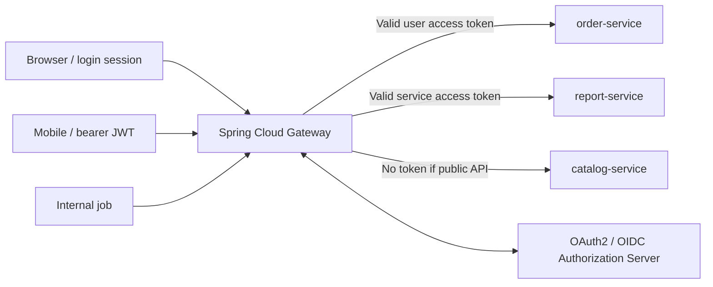
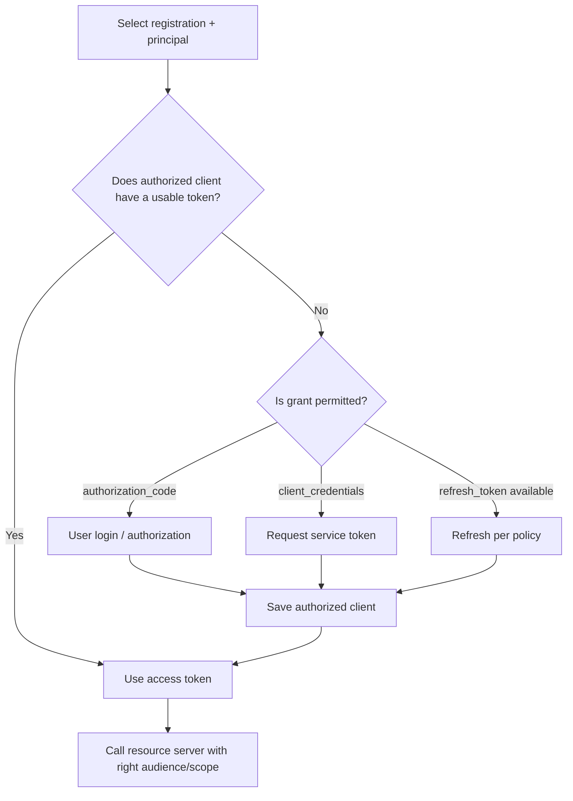
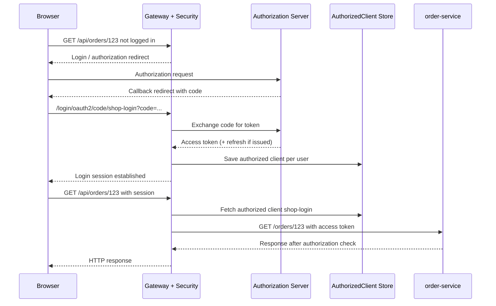
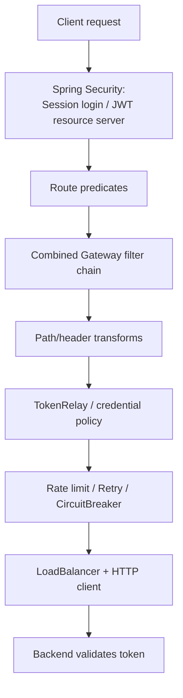
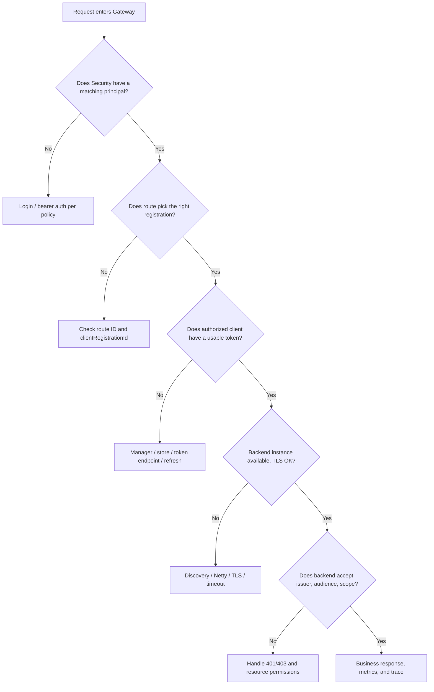

# OAuth2AuthorizedClient and Client Registration Selection

An API Gateway typically handles many responsibilities at once: receiving browser requests, selecting routes by path/method, checking authentication, rate limiting traffic, and forwarding to a microservice via `lb://service-id`. When downstream backends require an **OAuth 2.0 access token**, the Gateway must also answer: **is it calling under a user's identity or the application's own identity**, **which client registration is permitted**, **which access token was issued**, and **is that token intended for this backend**?

Suppose a logged-in customer wants to view `GET /api/orders/123`. The Gateway can hold the user's OAuth2 token server-side and forward a valid token to `order-service`. Meanwhile, an internal job wants to call `report-service` using the Gateway's own `client_credentials` grant. Both scenarios use OAuth 2.0, yet **they cannot blindly share the same `ClientRegistration`, `OAuth2AuthorizedClient`, or principal**: doing so risks losing user context, sending the wrong audience, triggering `401/403` errors, or inadvertently escalating privileges.

This lesson belongs to the **Sessions and Tokens** chapter of the **SPRING_CLOUD_GATEWAY** module. Its goal is to explain the `ClientRegistration` and `OAuth2AuthorizedClient` model in Spring Security, how registrations are chosen per route, managing authorized clients, using `TokenRelay`, and distinguishing login, resource server, and machine-to-machine flows. The content is framed within the microservices context of filter chains, path/header transformations, discovery/load balancing, authentication, rate limiting, retries, circuit breakers, TLS, and request observability.

> **Scope:** Examples use **Spring Cloud Gateway Server WebFlux** and **Spring Security Reactive OAuth2 Client**. Gateway Server Web MVC has its own servlet pipeline, route/filter APIs, and `SecurityFilterChain`; do not copy `ServerHttpSecurity` or WebFlux DSL code directly into MVC. Starter names and property prefixes vary across versions, so verify against the exact Spring Boot/Spring Cloud/Gateway/Spring Security versions you use.

## 1. Three API Call Flows to Distinguish

| Scenario | What Does the Gateway Receive? | Desired Outbound Identity | Example |
|---|---|---|---|
| **Logged-in BFF/browser** | Gateway session cookie | Access token bound to the user and login registration | `/api/orders/**` → `order-service` |
| **API receiving bearer from SPA/mobile** | `Authorization: Bearer ...` | Verified inbound token or exchanged token per policy | `/api/account/**` → `account-service` |
| **Machine-to-machine** | Internal job, possibly with no browser | `client_credentials` token of the service principal | Aggregation task → `report-service` |



**Never let every route share one maximally privileged token.** A service token does not automatically represent a user, a login token must not be sent to every backend, and a public route should not attach user credentials merely because the request carries a session.

## 2. Core Objects

| Object | Contents | Function |
|---|---|---|
| **`ClientRegistration`** | Registration ID, client ID, grant type, provider, redirect URI, scopes, and OAuth2 endpoints. | Configures **one OAuth2 client application**. |
| **`OAuth2AuthorizedClient`** | Reference to `ClientRegistration`, principal name, access token, and refresh token if issued. | Represents an **authorized client** within a principal context. |
| **`Authentication` / principal** | Current identity authenticated by Security. | Distinguishes user A, user B, and service principals. |
| **`ReactiveClientRegistrationRepository`** | Store/lookup source for `ClientRegistration`. | Looks up client configuration by registration ID. |
| **`ServerOAuth2AuthorizedClientRepository`** | Mechanism to save/find authorized clients in reactive web environments. | Associates an authorized client with the web exchange/session/principal per implementation. |
| **`ReactiveOAuth2AuthorizedClientService`** | Saves/finds authorized clients without necessarily requiring a web exchange. | Suited for managers/services and dedicated token stores. |
| **`ReactiveOAuth2AuthorizedClientManager`** | Orchestrates authorize/re-authorize flows per grant and provider. | Retrieves existing tokens, requests or refreshes tokens when supported. |

### Registration ID is not the OAuth2 client ID

Example:

```text
registrationId = shop-login
clientId       = gateway-web
provider       = company-idp
grant          = authorization_code

registrationId = reporting-client
clientId       = gateway-reporting
provider       = company-idp
grant          = client_credentials
```

`shop-login` is an internal name used by code/filters to pick a configuration; `gateway-web` is the client ID known to the authorization server. Two registrations can share an issuer while having **different client IDs, grants, scopes, and secrets**.

### One registration can have many authorized clients

```text
ClientRegistration("shop-login")
    |
    +-- OAuth2AuthorizedClient(user-a) -> access token A
    |
    +-- OAuth2AuthorizedClient(user-b) -> access token B

ClientRegistration("reporting-client")
    |
    +-- OAuth2AuthorizedClient("gateway-service")
        -> service access token
```

**Never store the most recent user's access token in a mutable field on a singleton `GlobalFilter`.** Concurrent requests can belong to different users; sharing tokens that way risks cross-account credential exposure.

## 3. What State Does OAuth2AuthorizedClient Manage?

Key APIs on `OAuth2AuthorizedClient`:

```java
import org.springframework.security.oauth2.client.OAuth2AuthorizedClient;
import org.springframework.security.oauth2.core.OAuth2AccessToken;
import org.springframework.security.oauth2.core.OAuth2RefreshToken;

public class AuthorizedClientInspector {
    void inspect(OAuth2AuthorizedClient authorizedClient) {
        String registrationId = authorizedClient
            .getClientRegistration().getRegistrationId();
        String principalName = authorizedClient.getPrincipalName();
        OAuth2AccessToken accessToken = authorizedClient.getAccessToken();
        OAuth2RefreshToken refreshToken = authorizedClient.getRefreshToken();

        // Use information only within required scope; never log tokenValue.
    }
}
```

The snippet above illustrates an **object already supplied to the method by a manager/repository**, does not show how it is obtained, and `accessToken.getTokenValue()` must never be logged. `refreshToken` may be `null` if the provider or grant does not issue refresh tokens.

| Data | What to Understand |
|---|---|
| `ClientRegistration` | Client configuration; does not hold any user's access token. |
| `principalName` | Which identity context the authorized client is bound to. |
| `accessToken` | Credential for calling a resource server, including issued-at/expiration times. |
| `refreshToken` | Used to obtain new access tokens when issued and supported by the manager/provider. |



This diagram shows the **conceptual workflow**. Automatic refresh, token reuse, token endpoint error handling, and state persistence depend on `ReactiveOAuth2AuthorizedClientManager`, the provider/grant, and the actual store. Simply defining a registration **does not obtain a token by itself**.

## 4. Distinguishing OAuth2 Login, OAuth2 Client, and Resource Server

| Gateway Role | Operation | Typical Spring Security Components |
|---|---|---|
| **OAuth2 Login / OIDC client** | Redirects browser to IdP, handles callback, authenticates user/session. | `oauth2Login()` with an `authorization_code` registration. |
| **OAuth2 Client** | Obtains and manages authorized clients/access tokens to call APIs. | `oauth2Client()`, manager, authorized-client repository/service, `TokenRelay`. |
| **OAuth2 Resource Server** | Validates bearer tokens **entering** the Gateway from callers. | `oauth2ResourceServer().jwt()` or opaque token introspection. |

### Three common misconceptions

1. **Having a JWT in `Authorization` does not mean an `OAuth2AuthorizedClient` exists.** A Resource Server validates inbound tokens; an OAuth2 Client manages tokens issued for a client registration.
2. **An OIDC ID token is not an API-calling token.** An ID token identifies the login session to the client; the backend needs an access token targeting the right audience/resource.
3. **`client_credentials` is not logging in on behalf of a user.** That token proves the application/client's permissions and does not inherently carry authorization for user A's order.

A **BFF** topology typically uses OAuth2 Login and a session cookie to keep tokens server-side. A **SPA/mobile bearer** topology may only need the Gateway as a Resource Server; relaying or exchanging tokens must be an explicit decision. **Machine-to-machine** workloads require a manager and the `client_credentials` grant.

## 5. Configuring Multiple ClientRegistrations in YAML

Example with a test IdP and two registrations:

```yaml
spring:
  security:
    oauth2:
      client:
        registration:
          shop-login:
            provider: company-idp
            client-id: gateway-web
            client-secret: ${SHOP_OAUTH_CLIENT_SECRET}
            authorization-grant-type: authorization_code
            redirect-uri: "{baseUrl}/login/oauth2/code/{registrationId}"
            scope:
              - openid
              - profile
              - orders.read

          reporting-client:
            provider: company-idp
            client-id: gateway-reporting
            client-secret: ${REPORTING_CLIENT_SECRET}
            authorization-grant-type: client_credentials
            scope:
              - reports.read

        provider:
          company-idp:
            issuer-uri: https://idp.example.org/realms/commerce
```

**This is an illustrative configuration**, not a verified real IdP. Register real clients with the issuer, redirect URIs, scopes, and grants supported by your IdP. Environment variables must be injected via a secret manager/deployment mechanism; **never commit client secrets to Git**.

| Field | Meaning | Pitfall to Avoid |
|---|---|---|
| `registration.shop-login` | Internal ID for the login client. | Confusing it with `client-id`. |
| `provider: company-idp` | Uses endpoints from the named provider. | Pointing to the wrong issuer or token/JWK endpoint. |
| `client-id`/`client-secret` | Identity and secret of the confidential client. | Sharing one high-privilege secret across every route. |
| `authorization-grant-type` | How the client obtains permissions/tokens. | Using a service grant while assuming a user principal exists. |
| `redirect-uri` | Callback for the authorization code. | Wrong public URL behind ingress or unregistered at the IdP. |
| `scope` | Requested permissions; not guaranteed to all be granted. | Requesting unnecessarily broad permissions. |
| `issuer-uri` | Provider metadata discovery when supported. | Untrusted host/CA or mismatched issuer. |

### When should registrations be split even on the same IdP?

Separating `shop-login` and `reporting-client` isolates **grants, scopes, credentials, auditing, and revocation**. A compromise or error in the reporting workload should not expose the browser-login client secret or cause the Gateway to substitute a service token for a user token.

## 6. ReactiveClientRegistrationRepository Does Not Hold User Tokens

In WebFlux, this repository lets you look up a `ClientRegistration` by ID:

```java
import org.springframework.security.oauth2.client.registration.ClientRegistration;
import org.springframework.security.oauth2.client.registration.ReactiveClientRegistrationRepository;
import reactor.core.publisher.Mono;

public class RegistrationLookup {
    private final ReactiveClientRegistrationRepository registrations;

    public RegistrationLookup(
            ReactiveClientRegistrationRepository registrations) {
        this.registrations = registrations;
    }

    public Mono<ClientRegistration> reporting() {
        return registrations.findByRegistrationId("reporting-client");
    }
}
```

Finding a registration only tells the app **how to request a token**, not that a token already exists. Obtaining an authorized client requires the repository/service/manager along with the right principal and grant.

### Policy-based registration selection

| Route/Caller | Registration | Principal | Target |
|---|---|---|---|
| `orders-user` | `shop-login` | Logged-in user | `order-service` |
| Internal reporting job | `reporting-client` | `gateway-service` | `report-service` |
| `catalog-public` | None needed | Anonymous | `catalog-service` |
| API receiving mobile bearer | Architecture-dependent; usually no `OAuth2AuthorizedClient` automatically | Verified bearer principal | Authorized backend |

**Never accept `X-Client-Registration: reporting-client` from a client and select that credential directly.** Registration selection is a server-side security decision; rely only on reviewed route/config definitions or verified tenant claims backed by an allowlist.

## 7. Where Are Authorized Clients Stored?

Two common abstractions in reactive Spring Security:

- **`ServerOAuth2AuthorizedClientRepository`:** saves/finds `OAuth2AuthorizedClient` per web exchange and authentication/session in WebFlux.
- **`ReactiveOAuth2AuthorizedClientService`:** saves/finds `OAuth2AuthorizedClient` by registration/principal without necessarily being tied to an HTTP request.

`ReactiveOAuth2AuthorizedClientManager` uses the appropriate components to **re-authorize, save tokens, and handle grants**. The repository may use the session or delegate to a service; the concrete implementation is determined by auto-configuration and bean wiring.

### Session cookie, authorized client, and backend access token

```text
Browser:
  Cookie SESSION -> identifies session with the Gateway

Gateway:
  SecurityContext -> user's Authentication
  Authorized client store -> access token/refresh token if present

Backend:
  Authorization: Bearer <valid access token for backend>
```

Never place `OAuth2AuthorizedClient`, refresh tokens, or client secrets into cookies, query strings, or debug responses. In a BFF, tokens stay server-side per policy and only the **needed access token** is sent to the right resource server.

### Multi-replica deployments

Suppose a user logs in on Gateway replica A and the next request lands on B. B must recover both **session/authentication and the authorized client** according to the topology. Spring Session or a shared session store solves part of this, but does not automatically make every `ReactiveOAuth2AuthorizedClientService` distributed.

Some Gateway WebFlux `TokenRelay` docs note that the default service uses **in-memory storage**. For HA, evaluate an implementation backed by a protected store, consistent session/token mechanisms, expiry, refresh concurrency, encryption, and separated read/write permissions. Never rely on sticky sessions alone as a durability guarantee across restarts.

## 8. OAuth2 Login Creates an Authorized Client for the User

With `shop-login` using authorization code:



Mandatory controls include `state`, registered redirect URIs, PKCE when needed/supported, issuer/claims validation, TLS, and cookie/session policies. If the browser frontend runs on a different origin from the Gateway, do not assume a `fetch` following an IdP redirect behaves like a top-level browser login navigation.

**Successful user login does not prove the backend accepts the token.** The backend must still validate issuer, audience, scope, and user permissions for the specific order.

## 9. TokenRelay GatewayFilter Factory

`TokenRelay` is a filter that can attach an OAuth2 authorized client's access token when calling a backend. In a WebFlux route:

```yaml
spring:
  cloud:
    gateway:
      server:
        webflux:
          routes:
            - id: orders-user
              uri: lb://order-service
              predicates:
                - Path=/api/orders/**
              filters:
                - StripPrefix=2
                - TokenRelay=shop-login
```

When the user is logged in and a matching authorized client exists:

1. The `Path` predicate matches `orders-user`.
2. `StripPrefix=2` rewrites `/api/orders/123` to `/orders/123`.
3. `TokenRelay=shop-login` directs the filter to registration `shop-login` to retrieve the matching authorized client/token via the principal and manager.
4. LoadBalancer resolves `lb://order-service` if the starter and a `ServiceInstance` source are present.
5. The backend receives the access token and **independently verifies** identity, audience/scope, and resource-level permissions.

Merely writing `TokenRelay=shop-login` **does not automatically create** OAuth2 Login, client registrations at the IdP, or an authorized-client store. You need the OAuth2 Client/Spring Security starters and a version-compatible flow.

### Omitting `clientRegistrationId`

```yaml
filters:
  - TokenRelay
```

When a user is authenticated via OAuth2 Login, the no-argument form can use the access token attached to the current authentication as described in the Gateway documentation. However, with multiple registrations, **explicitly specifying the registration per route** is usually easier to audit.

**Never assume** no-argument `TokenRelay` will relay every inbound bearer token on a Gateway configured only as a Resource Server. A request authenticated via an inbound JWT does not necessarily have a corresponding `OAuth2AuthorizedClient`.

### Token relay differs from token exchange

Relay forwards an existing access token; it **does not change audience, issuer, or scope**. If the backend requires a token issued for a different resource, use an authorization-server-supported token issuance/token exchange flow under approved policies. Never tamper with JWT claims and treat the result as a valid token.

## 10. Configuring Reactive Spring Security for a Gateway BFF

A Gateway sitting in front of browsers and holding user sessions can enable OAuth2 Login and OAuth2 Client via `SecurityWebFilterChain`:

```java
import org.springframework.context.annotation.Bean;
import org.springframework.context.annotation.Configuration;
import org.springframework.http.HttpMethod;
import org.springframework.security.config.Customizer;
import org.springframework.security.config.annotation.web.reactive.EnableWebFluxSecurity;
import org.springframework.security.config.web.server.ServerHttpSecurity;
import org.springframework.security.web.server.SecurityWebFilterChain;

@Configuration
@EnableWebFluxSecurity
public class GatewaySecurityConfiguration {

    @Bean
    SecurityWebFilterChain securityWebFilterChain(ServerHttpSecurity http) {
        return http
            .authorizeExchange(exchanges -> exchanges
                .pathMatchers("/login/**", "/oauth2/**").permitAll()
                .pathMatchers(HttpMethod.GET, "/api/catalog/**").permitAll()
                .pathMatchers("/api/orders/**").authenticated()
                .anyExchange().denyAll())
            .oauth2Login(Customizer.withDefaults())
            .oauth2Client(Customizer.withDefaults())
            .build();
    }
}
```

**Meaning:**

- `oauth2Login()` provides browser login via an `authorization_code` client registration.
- `oauth2Client()` enables OAuth2 Client integration at the Security layer to manage authorized clients.
- `authorizeExchange` requires an authenticated user for order routes; the backend must still verify permissions on individual orders.
- Gateway routes still need `TokenRelay` if you want access tokens attached to upstream calls.

**This is only a learning skeleton, not a complete production configuration.** You still need real issuer/JWKs, CORS and cookie policies, logout/revocation, session persistence, `401/403` handling, granular authorization policies, and observability.

### Never disable CSRF unconditionally

This example **does not disable CSRF by default**. With OAuth2 Login + session cookies, state-changing requests such as POST/PUT/PATCH/DELETE need appropriate CSRF protection. If the browser and Gateway sit on different origins, you also need CORS, cookie `SameSite`/`Secure` settings, and preflight handling.

A **bearer-only stateless Resource Server** Gateway has a different CSRF model, but never copy `csrf.disable()` from a bearer-only example into a cookie-based BFF merely for API convenience.

### OAuth2 Client is not yet a Resource Server

Enabling only:

```java
.oauth2Login(Customizer.withDefaults())
.oauth2Client(Customizer.withDefaults())
```

does not cause the Gateway to **validate arbitrary inbound bearer JWTs** like a Resource Server. Conversely, enabling only:

```java
.oauth2ResourceServer(oauth2 -> oauth2.jwt(Customizer.withDefaults()))
```

does not automatically establish a user login session or authorized client. If one application must support both, design separate security matchers/chains or clear entry points so bearer-only APIs are not unexpectedly redirected to login.

## 11. Machine-to-Machine: Using `client_credentials` in the Right Context

`reporting-client` uses the `client_credentials` grant to request an access token **on behalf of the application**. It involves no browser authorization code, does not refresh a user session, and typically receives no refresh token under the client credentials model.

### `ReactiveOAuth2AuthorizedClientManager` for non-web-exchange tasks

A scheduled job or internal HTTP client can be configured with:

```java
import org.springframework.context.annotation.Bean;
import org.springframework.context.annotation.Configuration;
import org.springframework.security.oauth2.client.AuthorizedClientServiceReactiveOAuth2AuthorizedClientManager;
import org.springframework.security.oauth2.client.ReactiveOAuth2AuthorizedClientManager;
import org.springframework.security.oauth2.client.ReactiveOAuth2AuthorizedClientProvider;
import org.springframework.security.oauth2.client.ReactiveOAuth2AuthorizedClientProviderBuilder;
import org.springframework.security.oauth2.client.ReactiveOAuth2AuthorizedClientService;
import org.springframework.security.oauth2.client.registration.ReactiveClientRegistrationRepository;

@Configuration
public class ServiceClientConfiguration {

    @Bean
    ReactiveOAuth2AuthorizedClientManager serviceClientManager(
            ReactiveClientRegistrationRepository registrations,
            ReactiveOAuth2AuthorizedClientService clients) {

        ReactiveOAuth2AuthorizedClientProvider provider =
            ReactiveOAuth2AuthorizedClientProviderBuilder.builder()
                .clientCredentials()
                .build();

        AuthorizedClientServiceReactiveOAuth2AuthorizedClientManager manager =
            new AuthorizedClientServiceReactiveOAuth2AuthorizedClientManager(
                registrations, clients);

        manager.setAuthorizedClientProvider(provider);
        return manager;
    }
}
```

This factory/manager only knows how to **authorize the client** using enabled grants; it does not replace `NettyRoutingFilter` or WebFlux routes. Use it within a caller authorized to access `report-service`, with a fixed registration selection.

### Selecting registration and principal for an internal call

```java
import org.springframework.security.oauth2.client.OAuth2AuthorizeRequest;
import org.springframework.security.oauth2.client.OAuth2AuthorizedClient;
import org.springframework.security.oauth2.client.ReactiveOAuth2AuthorizedClientManager;
import reactor.core.publisher.Mono;

public class ReportingAuthorization {

    private final ReactiveOAuth2AuthorizedClientManager manager;

    public ReportingAuthorization(
            ReactiveOAuth2AuthorizedClientManager manager) {
        this.manager = manager;
    }

    public Mono<OAuth2AuthorizedClient> authorizedClient() {
        OAuth2AuthorizeRequest request = OAuth2AuthorizeRequest
            .withClientRegistrationId("reporting-client")
            .principal("gateway-service")
            .build();

        return manager.authorize(request)
            .switchIfEmpty(Mono.error(
                new IllegalStateException("Reporting client not authorized")));
    }
}
```

`reporting-client` is a **server-selected** registration, never taken from an external client's request header; `gateway-service` is a stable service principal for managing the authorized client. To call `report-service`, a suitable reactive HTTP client attaches this authorized client's **access token** over a TLS-verified HTTPS connection.

**Never call `block()` on the Gateway WebFlux event loop** while waiting for a token; compose the `Mono` asynchronously into the reactive pipeline.

### Does TokenRelay with client credentials work automatically?

`TokenRelay` lets you specify a `clientRegistrationId`; depending on version and configuration, it may coordinate with an authorized client manager for the matching grant. Still, **do not assume** writing `TokenRelay=reporting-client` ensures every request without a user session succeeds in fetching a service token. Verify the manager, principal, authorized client service, and grant setup in your exact Gateway/Security version.

For machine-to-machine tasks **without a `ServerWebExchange`/browser**, configuring a dedicated manager and caller as above usually keeps responsibilities clearer. Never fall back to another user's token or a higher-privilege registration when authorization fails.

## 12. Building a Registration Selection Matrix Before Adding Filters

| Route/Caller | Token Type | Allowed Registration | Scope | Verification Mechanism |
|---|---|---|---|---|
| `orders-user` | User access token | `shop-login` | `orders.read` / `orders.write` per business rules | IdP, Gateway Security, and `order-service` |
| `report-job` | Application access token | `reporting-client` | `reports.read` | Client credentials + `report-service` |
| `catalog-public` | None | None | Public API only | Route/method and backend |
| `account-mobile` | Mobile inbound bearer | No `OAuth2AuthorizedClient` by default | `account.read` | Gateway/Backend Resource Server |

**Selection rules should rely on:**

1. **Route ID or identified internal caller**, never a registration name sent in a client header.
2. **Grant type matching** the principal context: authorization code for users or client credentials for services.
3. **Audience/resource** accepted by the backend; minimal scope for the operation.
4. **Approved issuer/provider**; never let clients specify arbitrary issuers or token endpoints.
5. **Fail closed:** lacking an eligible authorized client must return an error or trigger a deliberate login/authorization flow, never escalate privileges.

### Never pick a client registration from untrusted input

Never treat:

```http
X-Client-Registration: reporting-client
```

as an instruction for the Gateway to fetch the reporting secret and token. CORS `Origin`, `Host`, query parameters, route paths, or custom headers can all be controlled by clients. In multi-tenant systems, rely only on **authenticated** identity/tenant attributes, allowlisted mappings, and matching issuer/client/route constraints.

### Multi-tenant OAuth2

If a Gateway defines `tenant-a-login` and `tenant-b-login`:

- Never mix authorized clients across users/tenants A and B.
- Bind issuer, redirect URI, client ID, and target backend strictly per tenant.
- Validate `state`/callbacks to prevent login session fixation or callback confusion.
- Never build a `ClientRegistration` directly from a user-supplied issuer URL, preventing SSRF to untrusted token/JWK endpoints.
- Test concurrent requests, logout, and refresh across multiple replicas.

## 13. How Must the Backend Validate Access Tokens?

**The Gateway having a token does not mean the backend must accept it.** A resource server must verify:

| Check | Question |
|---|---|
| **Signature / introspection** | Does the JWT have a valid signature, or is the opaque token confirmed active by the IdP? |
| **Issuer (`iss`)** | Was the token issued by an issuer trusted by the backend? |
| **Audience/resource (`aud`)** | Is the token intended for `order-api` or `report-api`? |
| **Validity** | Is the token expired or not yet valid, accounting for clock skew? |
| **Scopes/roles** | Is it permitted to call the specific endpoint and HTTP method? |
| **Resource authorization** | Is this user allowed to view order `123` specifically? |

### A validly signed token can still have the wrong audience

An access token with `aud=catalog-api` must not be accepted by `order-api` merely because both share the same issuer. Likewise, an ID token with `aud=gateway-web` is meant for the OAuth2 client and **must not be used as a backend bearer token**.

### Client credentials do not equal user delegation

A `client_credentials` token for `gateway-service` represents the service's permissions. It does not convey customer A's identity. If an API requires acting **on behalf of user A**, use a proper delegation token/flow—potentially **OAuth 2.0 Token Exchange** (RFC 8693) when supported by the provider—rather than sending a service token alongside an unprotected `X-User-Id` header.

### Scopes do not replace business-level authorization

`orders.read` usually only indicates the caller may invoke order-reading functionality. The backend must still verify the user against the **specific order**, preventing IDOR/BOLA. The Gateway can enforce coarse controls, but cannot guarantee fine-grained business authorization without resource ownership data.

## 14. Access Token Expiry and Refresh / Re-Authorization

| Case | Behavior to Design |
|---|---|
| Access token still valid | Authorized client manager may reuse it per policy. |
| Access token expired, valid refresh token exists | The `refresh_token` provider can obtain a new token if configured. |
| No refresh token exists | User may need a new login/authorization. |
| Refresh token expired/revoked | Remove/do not reuse the broken authorized client; handle re-login. |
| Client credentials token expired | Request a new service token from the token endpoint, with bounded retries. |
| Token endpoint failing or overloaded | Fail closed; apply sensible timeouts/rate limits/circuit breakers; monitor root causes. |
| Backend returns `401 invalid_token` | Inspect token expiry/issuer/audience and refresh behavior; never retry infinitely. |
| Backend returns `403 insufficient_scope` | Check permissions/registration; never switch to a broader-privilege client automatically. |

### Refresh rotation and multiple replicas

Some IdPs **rotate refresh tokens** on every refresh. Two concurrent requests or two Gateway replicas reusing the same old refresh token can trigger a race condition, `invalid_grant`, or overwrite newer tokens in the store.

Across multiple replicas, store authorized clients safely, coordinate concurrent refreshes, and handle token failures according to your framework and IdP. Simply increasing cache TTLs is not a fix for refresh races.

### Logout does not automatically revoke every token

When a user logs out, the Gateway can clear the session/authorized client per configuration. However, **already-issued access tokens are not automatically revoked at all resource servers**. Depending on your model, combine OIDC logout, OAuth2 token revocation, refresh token cleanup, and short lifetimes. Avoid claiming "logout immediately invalidates all tokens" unless revocation or introspection supports it.

## 15. Token Storage, Secrets, and Session Security

| Data | Appropriate Management | Avoid |
|---|---|---|
| Client secret, private key | Secret manager/vault with ACLs and rotation. | Hardcoding in repo, startup logs, or YAML route metadata. |
| User's authorized client | Server-side store scoped by principal and session. | Keeping any user's token in a singleton field. |
| Refresh token | Protected, encrypted store with a rotation policy. | Forwarding unnecessarily to backends or browsers in a BFF. |
| Session cookie | `Secure`, `HttpOnly`, `SameSite`, suitable timeout. | Embedding session IDs in URLs, logs, or debug tokens. |
| Service credential | Dedicated identity/secret per workload, minimal scopes. | Sharing a single admin credential across multiple services. |

### CORS, cookies, and CSRF

If a frontend `https://shop.example.com` calls Gateway `https://api.example.com` using session cookies:

- The browser may send **preflight OPTIONS** requests; preflight requests differ from actual requests carrying tokens/cookies.
- Security's CORS processor must handle preflight properly before authentication filters block it.
- `Access-Control-Allow-Origin`/`Allow-Credentials` must match safely; never pair wildcard origins with credentialed CORS.
- Cookies need `Secure`, `SameSite`, and proper domain/path attributes.
- State-changing requests still require **CSRF protection** per the BFF topology.

Never treat CORS as an identity authentication mechanism or a replacement for CSRF protection.

### TLS on every hop

```text
Browser --> HTTPS --> Ingress/Gateway
Gateway --> HTTPS --> Authorization Server / JWKS / Token endpoint
Gateway --> HTTPS or mTLS --> Backend resource server
```

`lb://order-service` is a logical URI; the `lb://` prefix itself **does not guarantee outbound HTTPS**. Verify `ServiceInstance` metadata, HTTP client TLS trust, hostname/SNI, certificates, and egress policies. Never disable certificate verification to work around connection errors to the IdP or backends.

### Redirect URI and proxy headers

The Gateway often sits behind a TLS-terminating ingress. If `redirect-uri: "{baseUrl}/login/oauth2/code/{registrationId}"` is built from an incorrect base URL, the IdP may report a redirect URI mismatch or redirect callbacks to an internal hostname.

Configure forwarded-header processing safely per version; **only trust `Forwarded`/`X-Forwarded-*` headers generated by proxies inside a trusted network**. Clients must never be able to manipulate public callback URLs or force the Gateway to redirect to arbitrary hosts.

## 16. TokenRelay in the Filter Chain and When Backends Change

In Gateway Server WebFlux:

1. The Security WebFilter chain identifies the session or validates inbound bearer tokens.
2. `RoutePredicateHandlerMapping` selects a route by path/method/host.
3. `FilteringWebHandler` merges `GlobalFilter`s and `GatewayFilter`s in effective order.
4. `StripPrefix`/`RewritePath` adjusts the path, and `TokenRelay` resolves the token from the authorized client.
5. LoadBalancer selects an instance for `lb://service-id` and the HTTP routing filter forwards the request.



This diagram shows the **logical chain of responsibility**; actual filter ordering depends on `Ordered`, built-in filters, and the Gateway version. An early `GlobalFilter` will not necessarily see the final outbound token. If `Retry` re-invokes the downstream chain, verify that tokens are applied consistently and check whether the backend receives duplicate requests.

### Do not mix identity headers

| Header | Meaning | Risk |
|---|---|---|
| `Authorization: Bearer ...` | User or service access token for the backend. | Sent to the wrong audience or host. |
| `Cookie: SESSION=...` | Identifies the browser session at the Gateway. | Should not be forwarded straight to every backend. |
| `X-User-Id` | Custom header possibly carrying internal identity. | Easily spoofed if origin/value is not controlled. |

If the Gateway both receives inbound bearer tokens and injects a different authorized-client token, **explicitly decide which token source takes precedence**, strip/overwrite the header at the right point in the chain, and verify with a mock backend without logging tokens.

## 17. Rate Limiting, Retries, and Circuit Breakers Around the Token Lifecycle

| Mechanism | Relationship with Authorized Client | Caution |
|---|---|---|
| **RequestRateLimiter** | Throttles by principal/API key/route. | `KeyResolver` must use a trusted identity; quotas should align across replicas. |
| **Retry** | May resend requests on backend errors. | Never retry 401/403 infinitely; POST requires an idempotency key. |
| **CircuitBreaker** | Protects slow/failing backends. | Never fall back to a higher-privilege token to bypass errors. |
| **Timeout** | Bounds waiting on backends/token endpoints. | Authorization server calls also need dedicated budgets and error classification. |
| **Discovery/LoadBalancer** | Picks a backend instance via `lb://`. | All instances must enforce issuer/audience/scope consistently. |
| **Observability** | Tracks login, refresh, token failures, route latency. | Never record tokens/raw cookies/secrets in logs or metric tags. |

### Overloading the token endpoint during concurrent refreshes

If hundreds of requests simultaneously detect an expired token, an improperly configured manager/store can flood the token endpoint. Do not handle this with unbounded retries. Use caching/locking/concurrency policies, timeouts, backoff for transient failures, and separate `invalid_client`/`invalid_grant` from network errors.

### Never retry arbitrary write failures

A backend may complete `POST /api/orders` while the Gateway drops the response. Retrying on an access token or connection error without an **idempotency key** can create duplicate orders. The authorized client lifecycle does not alter this business rule.

## 18. Logging and Tracing Without Exposing Tokens

An illustrative log record **defined by the development team**:

```text
traceId:              [trace ID]
routeId:              orders-user
clientRegistrationId: shop-login
grantCategory:        authorization_code
principalCategory:    authenticated-user
authorizedClient:     available
tokenAction:          reused / renewed / failed
serviceId:            order-service
downstreamStatus:     [actual status]
elapsedMs:            [measured ms]
```

This is **not the default output** of TokenRelay. Favor route ID, registration ID, grant category, status/error class, and latency with bounded cardinality. **Strictly avoid** logging raw access tokens, refresh tokens, authorization codes, client secrets, `Authorization`, `Cookie`, PII, or sensitive query strings/bodies.

When diagnosing token failures, classify errors into:

- `oauth2_authorization_failed`, token endpoint timeout/5xx, `invalid_client`/`invalid_grant`.
- Missing authorized client or mismatch with the active principal.
- Backend `401 invalid_token`, `403 insufficient_scope`, or audience mismatch.
- Gateway routing/discovery/TLS timeouts independent of tokens.

Never blame every `401` on "the Gateway didn't relay" when the backend may have received the token and rejected its audience or permissions.

## 19. Lab A: Per-Route Login and TokenRelay

### 19.1. Preparing the test environment

Use:

- Gateway **Server WebFlux** at `http://localhost:8080` or an equivalent test HTTPS hostname.
- A dedicated test OIDC Authorization Server with client `gateway-web`, grant `authorization_code`, and registered redirect URI.
- A mock `order-service`/Resource Server capable of validating tokens.
- Spring Security OAuth2 Client, `shop-login` configuration, and the security chain from section 10.
- Route `orders-user` configured with `TokenRelay=shop-login`.
- If the route uses `lb://order-service`, configure Spring Cloud LoadBalancer and a `ServiceInstance` source; if you have not covered discovery yet, use a controlled mock backend HTTP URI to isolate errors.

Never use production accounts, tokens, secrets, or endpoints in labs.

### 19.2. Happy-path flow

1. Open a browser to an endpoint requiring user login or the authorization initiation path configured in Spring Security.
2. Verify the browser is redirected to the **right issuer and right OAuth2 client**.
3. Log in at the test IdP and complete the `/login/oauth2/code/shop-login` callback.
4. Confirm the Gateway holds the authenticated user and matching authorized client in its active store.
5. Send `GET /api/orders/123` from the browser using the same session.
6. Observe the Gateway selecting `orders-user`, rewriting the path to `/orders/123`, and forwarding the request.
7. Have the backend log only **bearer token presence (true/false)** and issuer/audience/scope validation results; **never echo the raw token** to the browser or logs.
8. Have the backend verify the user is allowed to view order 123 and return the appropriate HTTP response.

### 19.3. Checking session and callback behavior

For session cookies, verify:

- The cookie has `HttpOnly`/`Secure` and `SameSite` suited to the frontend/Gateway topology.
- The callback URI is accepted by the IdP; `{baseUrl}` is not built from an internal HTTP host behind ingress.
- `state`/PKCE/session data tied to the authorization flow are protected by the framework per configuration.
- After logout, sessions/authorized clients are not reused contrary to policy.
- When requests hit another Gateway replica, the store preserves state as designed.

### 19.4. User-flow test matrix

| Case | Scenario | What to Prove |
|---|---|---|
| U01 | No login session yet | Triggers login or returns policy error; never relays another user's token. |
| U02 | Login via `shop-login` succeeds | Authorized client is bound to the right principal and registration. |
| U03 | Calling the orders route | Backend receives the right access token and rewritten path. |
| U04 | User A then User B log in separately | User A's token is never used on User B's requests. |
| U05 | Valid signature but wrong audience | Backend rejects; Gateway does not rewrite audience. |
| U06 | Token lacks `orders.read` | Backend returns appropriate authorization error. |
| U07 | Token expired | Refresh/re-authorization or re-login occurs per provider/policy. |
| U08 | Refresh token revoked | Does not fall back to a service/admin token. |
| U09 | Logout | Session/authorized client lifecycle and revocation match design. |
| U10 | Two Gateway replicas | Session and authorized client remain consistent across load balancing/rollouts. |
| U11 | Frontend on different origin | CORS preflight/cookies/CSRF behave properly without masking 401/403. |
| U12 | Backend or registry temporarily down | Token issues are distinguished from `lb://`/TLS/connect timeouts. |

### 19.5. Verifying a route does not verify tokens

If Spring Cloud Gateway Actuator is enabled **and access-protected**, the endpoint:

```http
GET /actuator/gateway/routes
```

helps inspect runtime routes and filter lists. It **does not prove** an `OAuth2AuthorizedClient` exists for the logged-in user or that the backend will accept the token. To prove that, combine safe Security/authorized-client diagnostics with responses/traces from the mock backend.

## 20. Lab B: `client_credentials` for Internal Workloads

### Setup

Create client `gateway-reporting` in the test IdP with `client_credentials` and minimal permission `reports.read`. Use the `reporting-client` registration and `serviceClientManager` from section 11.

### Procedure

1. Call `ReportingAuthorization.authorizedClient()` from an internal job with principal `gateway-service`.
2. Attach the token to an outbound HTTP request **strictly to the mock `report-service`** using a reactive HTTP client with proper TLS.
3. Have the backend validate the service token's issuer/audience/scope without assuming it represents an end user.
4. Repeat before expiration to observe how the manager/store reuses the authorized client per policy.
5. Simulate token expiration to observe token re-issuance behavior.
6. Simulate a wrong secret, missing scope, and an unavailable token endpoint.
7. Confirm the workload **never** sends the service token to `orders-user` or public catalog routes.

| Case | Condition | Evidence to Record |
|---|---|---|
| M01 | Valid Client ID/secret/grant | Service token obtained and accepted by backend with right scope. |
| M02 | Wrong secret | Token endpoint rejects; backend is not called with a fallback token. |
| M03 | Missing `reports.read` | Backend rejects or reports insufficient permissions. |
| M04 | Token expired | Manager handles re-issuance per provider/grant. |
| M05 | Concurrent calls | No unbounded token storm against the token endpoint. |
| M06 | User route tries to pick reporting token | Policy detects and blocks scope misuse. |
| M07 | Gateway/worker restart | Authorized client store behaves as designed for deployment. |
| M08 | Invalid IdP/backend TLS | Certificate verification is never bypassed. |

### When to use `WebClient` instead of `TokenRelay`?

A **scheduled job not tied to an incoming Gateway request** is usually better served by `ReactiveOAuth2AuthorizedClientManager` and a controlled outbound `WebClient`. `TokenRelay` is a **`GatewayFilter`** in a route's filter chain; trying to use that filter to "fetch tokens for a cron job" is out of scope. If you want a Gateway route itself to obtain a service token, verify version support and design route/security/manager wiring explicitly.

## 21. Troubleshooting OAuth2AuthorizedClient and Registrations

| Symptom | Possible Cause | Where to Check |
|---|---|---|
| `TokenRelay` filter does not exist | Missing OAuth2 Client starter, wrong Gateway variant, or incompatible dependency. | Starter, auto-configuration, startup logs, and versioned reference docs. |
| `shop-login` not found | Wrong registration ID, YAML failed to bind, or missing provider config. | `ReactiveClientRegistrationRepository`, config properties, and IdP. |
| Browser login redirects to wrong URI | Wrong forwarded headers, public hostname, or redirect URI at IdP. | Ingress, HTTPS, `{baseUrl}`, and registered redirect URI. |
| Login succeeds, but backend receives no token | `TokenRelay` not attached, authorized client not saved/matched to principal, or filter short-circuited. | Route filters, Security authentication, manager/store, and mock request. |
| Backend receives token but returns `401` | Wrong issuer/audience, expired token, or unverified token. | Claims/introspection, resource server config, and grant. |
| Backend returns `403` | Insufficient scope or resource-level access denial. | Backend policy, user-role mapping, and scopes. |
| Fails only after a few minutes | Token expired, invalid refresh token, or inconsistent store. | Token lifecycle, refresh provider, clock skew, redacted token endpoint logs. |
| Fails only on replica B | Unshared session/authorized client or mismatched cookies/keys. | Shared session store, authorized-client persistence, and rollout state. |
| `client_credentials` fails to get a token | Wrong client secret/grant/scope/token endpoint. | IdP client registration, TLS/DNS, timeouts, and `invalid_client` errors. |
| Mobile bearer API gets redirected to login | Mixed OAuth2 Login entry point with bearer-only Resource Server. | Security matchers/chains and per-API entry points. |
| Browser reports CORS even when server returns 401 | Preflight or actual response missing CORS headers from Security/Gateway owner. | CORS processor and the layer generating the response. |
| User A's token appears on User B's request | Token cache not keyed by principal or mutable singleton state. | Isolate incident immediately, inspect store/keys, and audit. |
| `lb://order-service` API returns `503` | Discovery/LoadBalancer has no instances. | Registry/`ServiceInstance` and network, not just tokens. |
| Backend HTTPS reports handshake failure | CA/SNI/certificate issue, not necessarily OAuth2. | TLS trust/hostname and HTTP client config. |
| Raw token appears in logs/traces | Uncontrolled logging of request headers/claims. | Stop logging immediately, audit log access, and rotate/revoke if needed. |



## 22. Version Compatibility and Dependency Selection

| Item | What to Verify |
|---|---|
| JDK, Spring Boot, Spring Cloud | Use a supported release train; manage dependencies via the right BOM. |
| Gateway **Server WebFlux/MVC** | Right starter, route/filter APIs, and HTTP/security stack. |
| Route properties | Newer WebFlux may use `spring.cloud.gateway.server.webflux.routes`; older lines use `spring.cloud.gateway.routes`. |
| `TokenRelayGatewayFilterFactory` | OAuth2 Client dependency present, optional registration ID, behavior with auth/manager. |
| `ReactiveOAuth2AuthorizedClientManager` | APIs and providers supporting `authorization_code`, `refresh_token`, `client_credentials`. |
| Authorized-client storage | Default in-memory/session/service behavior, persistence, and replication. |
| OAuth2 Login endpoints | Authorization redirect, callback, cookies/CSRF, PKCE if applicable. |
| OAuth2 Resource Server | JWT/opaque introspection, audience/issuer, auth entry point. |
| Authorization server | Discovery endpoint, grants/scopes, refresh rotation, token exchange if used. |
| TLS and ingress | Trusted forwarded headers, callback hostname, secure cookies. |

**Never pin isolated versions** of Gateway, Reactor Netty, or Spring Security incompatible with the BOM just to follow a new snippet. During upgrades, test login, refresh, logout, `TokenRelay`, backend permissions, and multi-replica behavior; simply compiling and starting up does not prove OAuth2 flows work correctly.

## 23. Production Checklist

- [ ] Clearly defined whether the Gateway serves **BFF OAuth2 Login**, **bearer Resource Server**, **`client_credentials`**, or a per-route combination.
- [ ] Locked compatible JDK, Spring Boot, Spring Cloud release train, Gateway WebFlux/MVC, Spring Security, and OAuth2 Client starters.
- [ ] Built a **route/caller → registration → principal → grant → audience/scope → backend** matrix.
- [ ] Client registrations have matching client IDs, providers, redirect URIs, grants, and scopes; no single over-privileged client is shared everywhere.
- [ ] Client secrets and private keys reside in a secrets manager with rotation and tight ACLs.
- [ ] Untrusted client input can never arbitrarily select a registration or token endpoint.
- [ ] Verified `OAuth2AuthorizedClient` is bound and looked up by the right principal; no user token stored in singleton state.
- [ ] `TokenRelay` with/without registration ID is tested for the exact login type and version; never assume inbound JWTs automatically produce an authorized client.
- [ ] Backends validate issuer, audience, expiry, scope, and per-resource permissions; ID tokens are never used as access tokens.
- [ ] Token storage, refresh/rotation, logout/revocation, clock skew, and authorization failures have explicit procedures.
- [ ] Session cookies (`Secure`/`HttpOnly`/`SameSite`), CORS, and CSRF are properly designed for browser flows.
- [ ] Ingress forwarded headers/redirect URIs are controlled to prevent open redirects or wrong-host callbacks.
- [ ] Multi-replica Gateways use consistent session/authorized-client stores and handle refresh races.
- [ ] TLS/CA trust/hostname/SNI and egress policies are accurate for both IdP and backends; `lb://` has discovery/LoadBalancer.
- [ ] Rate limiters and resilience mechanisms do not leak tokens or escalate privileges; write retries require idempotency.
- [ ] Logs/metrics/traces exclude access tokens, refresh tokens, secrets, cookies, PII, and raw `Authorization` headers.
- [ ] Tested login, token expiry, refresh failure, client credentials, `401/403`, wrong audience, IdP outage, restarts/rollouts, and rollback.

## 24. Self-Check Questions

1. How does `ClientRegistration` differ from `OAuth2AuthorizedClient`? Why can one registration have many authorized clients?
2. How do `registrationId` and `client-id` differ?
3. When `TokenRelay=shop-login` executes, what conditions must hold for the Security principal, authorized client, and route?
4. Why does configuring `oauth2ResourceServer().jwt()` alone not guarantee an `OAuth2AuthorizedClient` exists?
5. Why should an OIDC ID token never be used to call `order-service`?
6. Does `client_credentials` represent a user identity or an application identity? Why should a stable service principal be used?
7. Why does `TokenRelay` not automatically convert a token with audience `catalog-api` into `order-api`?
8. When should `AuthorizedClientServiceReactiveOAuth2AuthorizedClientManager` be used for a scheduled job?
9. Why can `refresh_token` be null, and why should you not assume every client credential carries a refresh token?
10. What errors can happen when two replicas concurrently refresh a rotated refresh token?
11. Why must `403 insufficient_scope` never be "fixed" by switching to a higher-privilege registration?
12. Should clients be allowed to send `X-Client-Registration` to pick a credential? What policies are needed for multi-tenancy?
13. If the Gateway already terminates HTTPS from browsers, what TLS checks are still needed for backends over `lb://`?
14. For APIs using session cookies, why does CORS not replace CSRF?
15. Distinguish a `401` caused by wrong audience from a `503` caused by no `ServiceInstance`.
16. Which log/metric fields should you record to diagnose token failures without leaking credentials?

## 25. Version-Specific Reference Documentation

Consult the official docs for the **exact release train** and variant you deploy:

- [Spring Security Reactive — OAuth2 Client](https://docs.spring.io/spring-security/reference/reactive/oauth2/client/index.html)
- [Spring Security Reactive — OAuth2 Login](https://docs.spring.io/spring-security/reference/reactive/oauth2/login/index.html)
- [Spring Security Reactive — OAuth2 Resource Server](https://docs.spring.io/spring-security/reference/reactive/oauth2/resource-server/index.html)
- [Spring Security Reactive — OAuth2 Client Core APIs](https://docs.spring.io/spring-security/reference/reactive/oauth2/client/core.html)
- [Spring Cloud Gateway Server WebFlux — TokenRelay GatewayFilter Factory](https://docs.spring.io/spring-cloud-gateway/reference/spring-cloud-gateway-server-webflux/gatewayfilter-factories/tokenrelay-factory.html)
- [Spring Cloud Gateway — Configuration Properties](https://docs.spring.io/spring-cloud-gateway/reference/configprops.html)
- [Spring Cloud Gateway Server Web MVC — Reference](https://docs.spring.io/spring-cloud-gateway/reference/spring-cloud-gateway-server-webmvc/index.html)
- [OAuth 2.0 Authorization Framework — RFC 6749](https://www.rfc-editor.org/rfc/rfc6749)
- [OAuth 2.0 Token Exchange — RFC 8693](https://www.rfc-editor.org/rfc/rfc8693)

**Takeaway:** **`ClientRegistration` describes how an OAuth2 client is configured, `OAuth2AuthorizedClient` holds the issued state/tokens bound to a principal, and `TokenRelay` lets the Gateway forward the right access token to a resource server.** Registration selection must rely on **trusted routes, principals, and policies**, never arbitrary headers. To keep the microservices entry point secure, separate user tokens from service tokens, validate audience/scope at backends, protect sessions/secrets, manage refreshes, and coordinate TLS, discovery, rate limits, retries, and observability across Gateway replicas.
