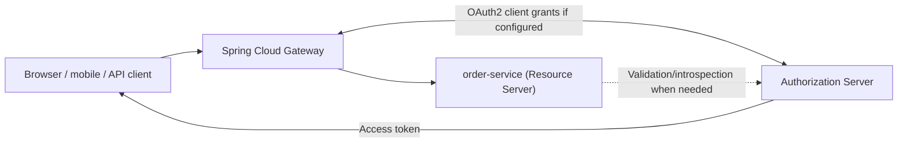
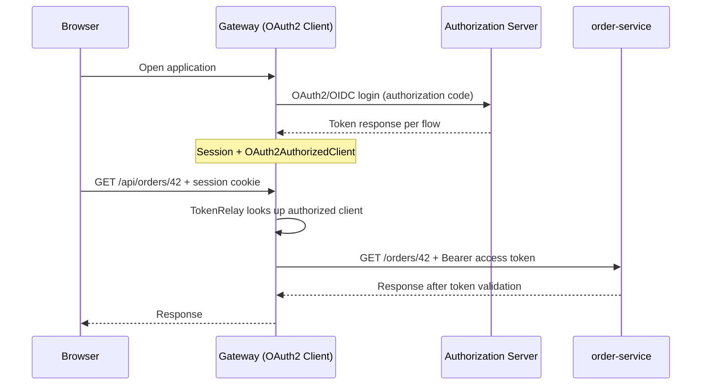
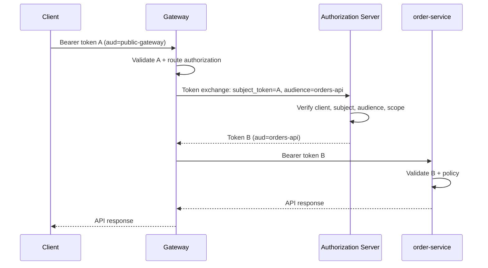
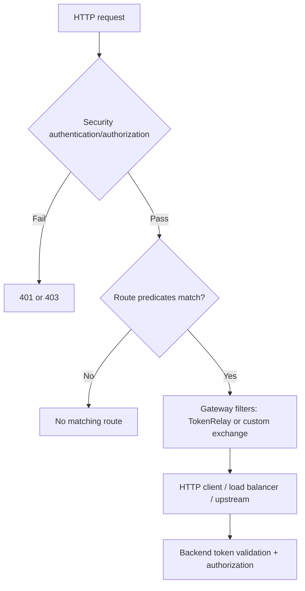

# Distinguishing Relaying Existing Tokens from Token Issuance or Token Exchange

When building **Spring Cloud Gateway**, an API request traveling from a client through the Gateway to a microservice usually must carry authentication credentials. How those credentials are propagated determines who is authorized to call the API, which services accept the token, and what responsibility the Gateway holds for login credentials. Three operations commonly confused are **relaying an existing token**, **requesting/refreshing a token**, and **exchanging a token for a different token**.

This lesson belongs to the **Sessions and Tokens** chapter. The focus is distinguishing Spring Cloud Gateway's `TokenRelay` role from OAuth 2.0/OIDC token issuance, refresh tokens, and **OAuth 2.0 Token Exchange (RFC 8693)**. The content connects with Spring Security WebFlux, route predicates/filter chains, service discovery, TLS, retries, rate limiting, and request observability to operate a microservices entry point safely.

> **Scope:** Examples primarily target **Spring Cloud Gateway Server WebFlux** and Spring Security OAuth2 Client/Resource Server. Gateway Server MVC has different configuration mechanisms and APIs; property/method names may vary by version. The Identity Provider/Authorization Server must genuinely support the grants and policies used by the application.

## 1. Distinguishing Four Roles in OAuth 2.0

| Component | Function | Example |
|---|---|---|
| **Client** | Requests access to resources; may be an OAuth2 client | Browser/BFF, mobile app, machine-to-machine |
| **Authorization Server (AS)** | Authenticates/authorizes per policy and issues access tokens | OIDC Identity Provider |
| **Resource Server** | Validates access tokens and decides whether to allow API access | `order-service`, `billing-service` |
| **Gateway** | Selects routes, filters requests, and may authenticate and forward tokens | `api.example.test` |

A single application can play **multiple roles simultaneously**. The Gateway can act as a Resource Server when receiving Bearer tokens from clients, and as an OAuth2 Client when using OAuth2 login, client credentials, or an AS-supported grant.

**The Gateway does not become an Authorization Server** merely by having `TokenRelay` or Spring Security OAuth2 Client. Issuing valid tokens belongs to the AS. The Gateway can **request** tokens from the AS and subsequently use or forward them.



## 2. Access Token, ID Token, Refresh Token, and Session Are Not Equivalent

| Artifact | Valid Purpose | Should Not Be Confused With |
|---|---|---|
| **Access token** | Authorizes calling a specific API/resource | Session cookie or ID token |
| **ID token** (OIDC) | Conveys user authentication result to an OIDC client | Access token for calling microservices |
| **Refresh token** | Requests a new access token from the AS per grant/policy | A token sent to every backend |
| **Session cookie** | Sent by the browser to identify a session with the session-managing app | Backend bearer token |
| **Client credentials** | Authenticates the application with the AS | End-user identity/authorization |
| **JWT** | A signed token format carrying claims | Every access token; tokens can also be opaque |

A JWT typically includes claims such as `iss` (issuer), `sub` (subject), `aud` (audience), `exp` (expiration), `nbf`, and scopes. Signature validity **does not automatically prove** a token fits every backend. Backends must check issuer, audience, lifetime, and permissions per contract.

An access token can also be an **opaque token**, verified via introspection or an equivalent integration; never assume every Bearer string is decodable as a JWT.

### Example of differing audiences

```json
{
  "iss": "https://idp.example.test",
  "sub": "user-42",
  "aud": "gateway-api",
  "scope": "orders.read",
  "exp": 1893456000
}
```

This is **illustrative payload data**, not a valid JWT. If `order-service` only accepts `aud=orders-api`, a token with `aud=gateway-api` may be rejected even if the Gateway verified its signature. You cannot edit `aud` in the payload to "convert" the token: altering the payload invalidates the original signature.

## 3. Comparison Table: Forwarding, Relay, Issuance, and Exchange

| Scenario | Token Source | What the Gateway Does | What Upstream Receives |
|---|---|---|---|
| **Forward incoming Bearer** | Client already holds an access token | Preserves and forwards the `Authorization` header per policy | The exact token from the client |
| **`TokenRelay` via OAuth2 login** | Access token bound to the user/session's `OAuth2AuthorizedClient` | Retrieves the token from OAuth2 Client infrastructure and sets downstream header | Access token of the authorized client |
| **Client credentials** | AS issues token to the OAuth2 client via grant | Requests a token under application identity | Token representing **app permissions**, not inherently a user |
| **Refresh token** | AS issues a new token using a valid refresh token | OAuth2 client manager may execute refresh | Refreshed access token |
| **RFC 8693 token exchange** | AS receives a subject token from an authorized client | Requests the AS to issue a **different token** for permitted audience/scope | New token per AS policy |

**Important nuance:** The purpose of `TokenRelay` is to **attach the appropriate access token to the downstream request**. While resolving the authorized client, a configured OAuth2 client manager may need to **obtain or refresh a token**. Therefore, you should not say `TokenRelay` "never calls the Authorization Server". However, `TokenRelay` **does not perform RFC 8693 by default**, does not grant new permissions itself, and does not rewrite audience based on route URIs.

## 4. Case A: Forwarding an Existing Access Token from the Client

Suppose a mobile app obtains a token from the AS and sends:

```http
GET /api/orders/42 HTTP/1.1
Host: api.example.test
Authorization: Bearer <access-token-A>
```

The Gateway can validate the token as an OAuth2 Resource Server and forward the request to `order-service`:

```yaml
spring:
  cloud:
    gateway:
      routes:
        - id: orders
          uri: lb://order-service
          predicates:
            - Path=/api/orders/**
          filters:
            - StripPrefix=1
```

If no filter or header policy strips or replaces `Authorization`, the Gateway's HTTP proxy can forward that header upstream. That is **Bearer header forwarding**, not necessarily using `TokenRelay`. Always inspect the request received by the backend to confirm, since security filters, HTTP header filters, or other proxy rules can alter headers.

### Gateway Resource Server does not automatically create an OAuth2AuthorizedClient

Example WebFlux JWT configuration:

```yaml
spring:
  security:
    oauth2:
      resourceserver:
        jwt:
          issuer-uri: https://idp.example.test/realms/demo
```

```java
@Bean
SecurityWebFilterChain apiSecurity(ServerHttpSecurity http) {
    return http
        .authorizeExchange(exchanges -> exchanges
            .pathMatchers(HttpMethod.GET, "/api/orders/**")
                .hasAuthority("SCOPE_orders.read")
            .pathMatchers(HttpMethod.POST, "/api/orders/**")
                .hasAuthority("SCOPE_orders.write")
            .anyExchange().authenticated())
        .oauth2ResourceServer(oauth2 ->
            oauth2.jwt(Customizer.withDefaults()))
        .build();
}
```

The example assumes scopes map to authorities of the form `SCOPE_...`. For production, add **audience validation**, per-route/method authorization boundaries, appropriate CORS/CSRF policies, and issuer/clock-skew checks. Resource Server validates incoming Bearer tokens, but **does not create an `OAuth2AuthorizedClient` for them by default**.

### Conditions for valid forwarding

- The token has an issuer/audience that **the backend actually trusts**.
- Scopes/roles match the operation; Gateway and backend enforce authorization per contract.
- The token is not expired or revoked under the corresponding verification mechanism.
- The Gateway → backend link is secured and does not leak the token.
- There is no requirement for downscoping, actor identity, or sender-constrained tokens that simple forwarding cannot satisfy.

If the backend requires a different audience, never skip validation to "save the request"; use an appropriately targeted token flow or an AS-supported exchange.

## 5. Case B: OAuth2 Login + `TokenRelay`

The Browser → Gateway (BFF) model works as follows:

1. The user logs in via OAuth2 Authorization Code / OIDC.
2. The AS issues an access token to the OAuth2 client, along with other tokens when permitted by grant/policy.
3. The Gateway maintains a **server-side session** and an `OAuth2AuthorizedClient` tied to the principal/client registration.
4. The browser calls APIs using a **session cookie**, without necessarily sending a Bearer token.
5. `TokenRelay` retrieves the access token from the authorized client and attaches `Authorization: Bearer ...` to the microservice request.
6. The microservice validates the access token and its own authorization rules.



### Illustrative configuration

```yaml
spring:
  security:
    oauth2:
      client:
        registration:
          gateway-login:
            provider: corp-idp
            client-id: <client-id-from-secret-store>
            client-secret: <client-secret-from-secret-store>
            authorization-grant-type: authorization_code
            redirect-uri: "{baseUrl}/login/oauth2/code/{registrationId}"
            scope:
              - openid
              - profile
              - orders.read
        provider:
          corp-idp:
            issuer-uri: https://idp.example.test/realms/demo

  cloud:
    gateway:
      routes:
        - id: orders-with-relay
          uri: lb://order-service
          predicates:
            - Path=/api/orders/**
          filters:
            - StripPrefix=1
            - TokenRelay=
```

**Never use literal secrets like the placeholders above in production.** Angle-bracket values are placeholders reminding you to load them from a protected secret manager/environment; replace them with your real secret management setup. You need the OAuth2 Client, Gateway WebFlux, and LoadBalancer/discovery dependencies if using `lb://`.

`TokenRelay=` without a client registration typically uses the authorized client attached to the logged-in user/principal. If no matching authorized client exists, the filter **does not turn an incoming user Bearer token** into an authorized client on its own. Exact error/skip behavior should be verified against your specific version and OAuth2 client manager setup.

Across Gateway generations, the route prefix may be `spring.cloud.gateway.routes` or `spring.cloud.gateway.server.webflux.routes`. Verify your starter/version prefix before concluding a filter is not working.

### Spring Security OAuth2 Login

```java
@Bean
SecurityWebFilterChain loginSecurity(ServerHttpSecurity http) {
    return http
        .authorizeExchange(exchanges -> exchanges
            .pathMatchers("/api/orders/**").authenticated()
            .anyExchange().permitAll())
        .oauth2Login(Customizer.withDefaults())
        .oauth2Client(Customizer.withDefaults())
        .build();
}
```

This snippet illustrates the login pipeline, **not a complete production policy**. A browser BFF requires CSRF protection for state-changing actions when relying on cookies/sessions; proper `Secure`, `HttpOnly`, and `SameSite` cookie attributes; verified public redirect URIs behind ingress; and secure storage of sessions and authorized clients across replicas.

### `TokenRelay=registrationId`

```yaml
filters:
  - TokenRelay=gateway-login
```

When a client registration ID is specified, the filter can ask `ReactiveOAuth2AuthorizedClientManager` to locate or acquire an authorized client for that registration. If the registration uses a grant such as `client_credentials`, this can involve **the AS issuing a token for that grant**, which does not automatically carry user permissions.

**Never infer "having a `registrationId` means user delegation".** The actual grant type and token claims determine whom the token represents. The backend must inspect the token it receives.

## 6. Case C: AS Issuing New Tokens via Grant Flows

### Authorization Code

The Authorization Code flow typically serves interactive user applications. The client redirects the user to the AS, receives an authorization code, and calls the token endpoint to exchange the code for tokens securely. **The AS issues tokens; the Gateway is the client requesting them.**

```text
Browser -> Gateway / OAuth2 client -> Authorization Server
        -> authorization code -> token endpoint
        -> access token (and ID token/refresh token when policy allows)
```

Afterward, `TokenRelay` can pull the access token from the authorized client to call downstream services if audience and scopes match.

### Client Credentials

This grant fits when the Gateway must call an API under **application identity**, not inherently representing an end user:

```http
POST /oauth2/token HTTP/1.1
Host: idp.example.test
Authorization: Basic <client-authentication>
Content-Type: application/x-www-form-urlencoded

grant_type=client_credentials&scope=inventory.read
```

The AS authenticates the client and decides which scopes to grant. If the Gateway uses client credentials to call `inventory-service`, the backend must treat this token as representing the client/app, **not a shopping user**. Never use an app token to bypass user-level authorization on sensitive APIs.

### Refresh Token

An OAuth2 client holding a valid refresh token can use it to request a new access token when the old one expires or nears expiration. Refresh behavior depends on the grant/policy, client manager, and AS:

```text
old access token -> expired/expiring
  -> if refresh token is valid and client is permitted
  -> AS token endpoint via refresh_token grant
  -> new access token per policy
```

**Refresh is not token exchange.** Refresh tokens must be guarded like secrets; never relay them to microservices or expose them in logs or responses. Refresh token rotation also introduces race conditions across concurrent requests/replicas if state is unsynchronized.

## 7. Case D: Token Exchange Under RFC 8693

**OAuth 2.0 Token Exchange** allows an OAuth2 client to present a `subject_token` to the token endpoint to ask the AS to issue a **different token** tailored to a target resource, scope, or delegation context accepted by the AS.

Example:

```text
Client token A:
  sub=user-42
  aud=public-gateway
  scope=orders.read

order-service only accepts:
  aud=orders-api
  scope=orders.read

Gateway authorized to exchange:
  token A -> Authorization Server -> token B (aud=orders-api)

Gateway sends:
  Authorization: Bearer token-B
```



### Illustrative token exchange request

```http
POST /oauth2/token HTTP/1.1
Host: idp.example.test
Authorization: Basic <client-authentication>
Content-Type: application/x-www-form-urlencoded

grant_type=urn:ietf:params:oauth:grant-type:token-exchange
&subject_token=<incoming-access-token>
&subject_token_type=urn:ietf:params:oauth:token-type:access_token
&requested_token_type=urn:ietf:params:oauth:token-type:access_token
&audience=orders-api
&scope=orders.read
```

The form body above is wrapped across lines for readability; when actually sending it, **URL-encode form data properly** without arbitrary raw line breaks.

The AS might respond:

```json
{
  "access_token": "<new-token-for-orders-api>",
  "issued_token_type": "urn:ietf:params:oauth:token-type:access_token",
  "token_type": "Bearer",
  "expires_in": 300,
  "scope": "orders.read"
}
```

Actual values vary by AS and profile. RFC 8693 can use `resource` or `audience`, include `actor_token`/`actor_token_type` for certain delegation contexts, and involve other token types when supported. **Not every IdP supports this grant** or accepts all parameters. Verify support and exchange issuance policies upfront.

### Exchange is not a right to widen scopes

If a user only holds `orders.read`, the Gateway requesting `orders.write` does not mean the AS should grant it. The exchanging client must be authorized for the target audience/resource, and the AS must constrain scopes/actor/subject per policy. The backend still validates token B and enforces its own authorization.

**Never modify JWT claims yourself.** Token B must be issued/signed by a trusted AS or an authoritative protocol. Never build a self-signed JWT via `SetRequestHeader` without a trust chain and call it token exchange.

### `TokenRelay` is not RFC 8693 by default

`TokenRelay` retrieves/acquires an access token via OAuth2 client infrastructure and attaches it to the downstream header. It **does not automatically invoke** `urn:ietf:params:oauth:grant-type:token-exchange`, derive `audience` per service ID, or guarantee downscoping. True token exchange requires an OAuth2 Client/AS integration supporting the protocol, or a dedicated filter/service designed and tested for it.

## 8. Choosing a Mechanism from Upstream Requirements

| Requirement | Approach | Security Conditions |
|---|---|---|
| Mobile holds a token issued for `orders-api` | Forward Bearer after validation | Backend accepts issuer/aud/scope |
| Browser uses session at Gateway | OAuth2 login + `TokenRelay` | Matching authorized client/token, secure session/CSRF |
| Backend requires only app identity | Client credentials | Scoped to client, never impersonating a user |
| Inbound token `aud=gateway-api`, backend needs `aud=orders-api` | Token exchange if AS supports | Exchanging client permitted and AS checks permissions |
| Access token expired, refresh token present | Refresh grant via client manager | Token rotation/storage, expiry, revocation |
| Public endpoint needing no identity | Do not relay tokens | Explicitly defined public route, public data controls |
| No valid token/grant | Reject or prompt login | Never bypass authentication or forge tokens |

Never choose a mechanism simply because "one filter is shorter". Start from **who is the subject, who is the actor, what audience/scopes the backend requires, whether a session exists, and which grant the AS used to issue the token**.

## 9. Route Matching Happens Before Token Filters Run

In WebFlux, the Security WebFilter chain typically runs before `RoutePredicateHandlerMapping`. Once a route matches, `GatewayFilter`s execute. `TokenRelay` belongs to the Gateway route filter chain.



Consequences:

- `TokenRelay` **does not run** on requests blocked by Security before route selection.
- If `Path`/`Method`/`Host` fails to match, that route's token filter never runs.
- Having `TokenRelay` on a route does not automatically guarantee a matching principal or authorized client exists.
- The backend must still validate the token; Gateway authentication does not replace per-resource authorization.
- Other filters can alter `Authorization` before or after relay, resulting in the wrong token.

### The `Authorization` header needs a single source of truth

If the client sends token A, `TokenRelay` sets token B, and another filter runs `AddRequestHeader=Authorization,...`, the backend may receive multiple values or the wrong credential. Never append multiple Bearer tokens onto one header.

Define **exactly one mechanism responsible for upstream `Authorization`** on each route. When policy dictates token B, **replace** the header rather than appending credentials. Strip spoofed client values at the proper trust boundary; never treat raw client headers as verified identity.

## 10. Design Skeleton for a Token Exchange Filter

A secure token exchange integration must:

1. Obtain the incoming token from a **verified** authentication; never blindly trust arbitrary raw headers.
2. Determine target audience/scope from **route configuration and permissions**; never let clients supply `X-Target-Audience` to obtain tokens for other resources.
3. Call the AS token endpoint with proper client authentication over HTTPS with certificate validation.
4. Handle token responses, expiry, denied exchanges, timeouts, cancellation, and concurrency limits.
5. Replace the downstream request's `Authorization` header with token B.
6. Never fall back to token A when the AS rejects token B due to audience/scope rules.
7. Never log or expose access/refresh tokens.

Illustrative WebFlux filter pseudocode:

```java
// Structural illustration only, NOT production-ready code.
// Underlying services must enforce validation, AS calls, and error handling.
GatewayFilter exchangeFilter = (exchange, chain) ->
    trustedTokenResolver.resolve(exchange)
        .flatMap(sourceToken ->
            tokenExchangeService.exchange(
                sourceToken, "orders-api", "orders.read"))
        .flatMap(newToken -> {
            ServerHttpRequest downstream = exchange.getRequest()
                .mutate()
                .headers(headers ->
                    headers.setBearerAuth(newToken.value()))
                .build();

            return chain.filter(
                exchange.mutate().request(downstream).build());
        });
```

`trustedTokenResolver` here is an abstraction that **only accepts authenticated, authorized tokens**, not a helper reading arbitrary raw headers. Production code must also handle missing principals, AS grant rejections, token expiry, committed responses, and cancellations; in practice, prefer built-in Spring Security APIs if **your library version natively supports** token exchange.

### Caching exchanged tokens

To avoid calling the AS on every request, token B can be cached in a bounded way, but the cache key must bind **principal/tenant, source token or relevant authorization attributes, audience, scope, client registration, and expiration**. Never cache token B solely by `orders-api`: otherwise, user A's token could leak onto user B's requests.

Never treat a token cache as permission to ignore revocation/policy. Set TTLs according to token lifetime and security requirements, and never include raw tokens in cache keys exposed in metrics/logs.

## 11. BFF Sessions and Multi-Replica Gateways

When browsers hold session cookies and Gateways hold authorized clients, Gateway replicas must share or synchronize state per architecture:

| Topic | Risk | Recommendation |
|---|---|---|
| Local-only sessions | User has a session on replica A, next request hits B and fails | Use a shared session store or consistent routing/state mechanism |
| Unsynchronized `OAuth2AuthorizedClient` | `TokenRelay` works on one replica but fails on another | Configure a shared/persistent authorized client service/repository |
| Refresh token rotation | Two concurrent refresh requests cause `invalid_grant` | Design synchronization/rotation and handle expired sessions |
| Missing `Secure`/`HttpOnly` cookies | Session leakage or theft | Enforce HTTPS and proper cookie policies |
| CSRF on POST actions | Browser auto-sends session cookies, risking exploitation | Apply model-appropriate CSRF protection |
| Wrong Redirect URI behind ingress | OAuth2 login callback mismatch | Use trusted public hostname/scheme |
| Logout/revocation | Session ends while authorized client/tokens persist | Design cleanup, revocation, and expiry |

Never assume Gateway replicas automatically share sessions just because backends use `lb://`. `lb://` resolves service instances; it does not manage `OAuth2AuthorizedClient` stores.

### Stateless Resource Server differs from BFF

In stateless APIs, the Gateway only validates incoming Bearer tokens and does not necessarily use `oauth2Login` or session cookies. In a BFF, the Gateway acts as an OAuth2 client and browsers may never see access tokens. If one app serves both, separate routes and `SecurityWebFilterChain`s so API clients do not receive `302` login redirects instead of `401`, and token relay never picks the wrong principal.

## 12. Additional Security Boundaries

### ID tokens and refresh tokens are not for upstream APIs

Never use an ID token (typically with audience set to the OAuth2 client) in place of an access token just because it is a JWT. Never send refresh tokens to backends that have no responsibility or authority to use refresh grants. Tokens may hold sensitive data and must be protected in transit, at rest, and in observability.

### Sender-constrained tokens

Some access tokens are bound to an **mTLS certificate** or **DPoP key**. Simply copying the Bearer string may **not suffice**: downstream may require proof of possession of the key/certificate. Relay/exchange architectures must account for sender binding, SNI/TLS client setup, and whether the AS can issue tokens in the right form.

### Client-supplied identity headers

Never trust `X-User-Id`, `X-Role`, or `X-Tenant` coming from the internet as verified claims. If the Gateway passes internal identity, the backend must be able to verify its integrity and authority—such as via an access token issued by a trusted AS.

### Never self-escalate permissions

The Gateway must never edit claims, add scopes, or rewrite audiences via header transforms to let an API exceed its permissions. Token exchange must be authorized by the AS, and the downstream Resource Server must still enforce per-resource/per-action authorization.

## 13. Classifying Errors by Processing Layer

| Outcome | Possible Cause | Verification Step |
|---|---|---|
| `302` to login | Browser lacks an OAuth2 login session | Is this meant to be BFF or stateless API? |
| `401` at Gateway | Missing/invalid incoming credential | JWT/opaque validation, issuer, aud, expiry |
| `403` at Gateway | Principal present, but lacks route permission | Scope, role, method policy |
| `401` at backend | Proxied, but token has wrong audience/issuer/expiry or is missing | Which token did the backend actually receive? |
| `403` at backend | Token valid, but lacks backend scope/resource permission | Backend authorization |
| `invalid_client` at AS | Wrong client authentication/registration | Credentials/certificates/AS config |
| `invalid_grant` on refresh | Refresh token rotation/revocation/expiry or race | Authorized client state |
| Token exchange denied by AS | Grant unsupported or audience/scope forbidden | AS exchange policy |
| `503` on `lb://` route | No service instances or backend temporarily unhealthy | Discovery/load balancing |
| Timeout | AS token endpoint or backend slow/unreachable | Two HTTP calls, timeout budgets |
| User A sees User B's data | Broken token/session/cache isolation | Security incident; inspect cache keys and principals |

**Distinguish two potential HTTP calls:** Gateway → AS to refresh/exchange tokens, and Gateway → backend for business logic. If the AS call fails, the backend may never have received a request. If the backend returns `401`, a request was forwarded, but the target token/policy check failed.

### Safe observability

Log route ID, method, HTTP status, **expected** issuer/audience, grant type, client registration ID, permitted token expiry metadata, attempt count, trace ID, and exception class. **Never log access tokens, refresh tokens, ID tokens, raw `Authorization` headers, session cookies, or client secrets.** Protect token exchange logs just as strictly as authentication logs.

## 14. Interactions with TLS, CORS, Retries, and Rate Limiting

- **TLS:** Protect client → Gateway, Gateway → AS, and Gateway → backend. TLS termination at ingress does not guarantee backend connections are encrypted. Verify hostnames/SANs, truststores, and mTLS if required; never disable certificate verification to make token relay easier.
- **CORS:** Browser preflight `OPTIONS` requests may omit the actual request's token. Process CORS early before Security blocks them; actual requests must still authenticate. CORS does not replace CSRF when using session cookies.
- **Retry:** A timeout after a POST does not prove the backend failed to process it. With refresh rotation, blindly retrying the token endpoint can also trigger `invalid_grant`. Separate retry policies for the AS and business APIs.
- **Circuit breaker:** Helps bound failures from the AS or backend, but fallbacks must never "bypass authentication". Configure deadlines, timeouts, and bounded attempts.
- **Rate limiting:** Prevent thousands of concurrent requests from triggering simultaneous refresh/exchange storms (thundering herd); bound concurrency and cache safely by principal. Rate keys should use verified identities.
- **Service discovery:** If `lb://order-service` has no instances, token relay may work perfectly while requests still fail to reach the backend. Check route IDs, service IDs, and instance resolution results.

## 15. Testing Token Relay, Issuance, and Exchange

Do not stop at verifying `HTTP 200`. Each mechanism must be verified against the **exact token received by an upstream test server**, while keeping real tokens out of test logs.

### Test A — Forward incoming Bearer

```bash
curl -i 'http://localhost:8080/api/orders/42' \
  -H 'Authorization: Bearer <test-access-token-for-orders-api>'
```

In the test fixture, the Gateway must validate the incoming token per security policy, match the route, and deliver the expected `Authorization` header upstream. If the token is invalid, the mock upstream must receive **0 requests**. The command above is illustrative only; a placeholder does not form a valid token.

### Test B — OAuth2 login + `TokenRelay`

```text
1. Create a valid OAuth2 login session / principal in the test.
2. Supply an OAuth2AuthorizedClient containing access token A.
3. Request /api/orders/42 with only the session cookie.
4. Mock upstream verifies it receives Bearer A.
5. Test missing session and missing authorized client.
6. Test near-expiry tokens, refresh, and logout/revocation via the manager.
```

Mocking `Authentication` alone does not prove an `OAuth2AuthorizedClient` exists. When using Spring Security test helpers, wire the authorized client/repository/manager identically to how `TokenRelay` resolves it in the running version.

### Test C — RFC 8693 exchange

```text
1. Client sends token A with aud=public-gateway.
2. Gateway validates A, checks method/scope, and matches orders route.
3. AS stub verifies exchange request with subject_token=A,
   audience=orders-api, scope=orders.read.
4. AS stub returns token B with aud=orders-api.
5. Mock upstream receives Authorization: Bearer B, NOT A.
6. AS denies exchange => upstream receives 0 requests.
7. Two users call concurrently => tokens/caches never cross over.
```

### Minimum test matrix

| Scenario | Expected Outcome |
|---|---|
| Token A valid for `orders-api` | Forwarded A is accepted |
| Missing token / invalid signature | Gateway returns `401`, upstream not called |
| Valid signature, wrong audience | Rejected per policy |
| Token has `orders.read`, POST needs `orders.write` | Appropriate `403`, no privilege escalation |
| Browser session + authorized client | `TokenRelay` uses authorized client's access token |
| Session present, no authorized client | Does not fabricate a user token |
| Token expired, valid refresh token | Manager refreshes when configured, maintaining safe rotation |
| Refresh token revoked | Does not fall back to expired token |
| Client credentials | Token reflects client/app rights, not implicitly a user |
| Exchange valid audience/scope | Upstream receives token B |
| Exchange audience not permitted | AS denies; upstream never receives mis-targeted token A |
| AS timeout/unavailable | Error per contract, authentication never bypassed |
| Two users and two Gateway replicas | No cross-user/cross-tenant token leakage |
| POST retried after timeout | Business idempotency preserved |
| CORS preflight OPTIONS | Does not demand actual request's Bearer token as an OPTIONS credential |

## 16. Runbook for "Token Doesn't Reach the Backend"

1. Identify whether the client sends **Bearer or cookie**, and whether the Gateway uses Resource Server, OAuth2 login, client credentials, or token exchange.
2. Check whether Spring Security authenticated the principal and authorized the route; `401`/`403` from the Gateway differs from upstream `401`/`403`.
3. Check that the route ID, predicates, and `TokenRelay`/custom exchange filter **are loaded** under the right configuration prefix.
4. If using `TokenRelay`, inspect OAuth2 client registration, `OAuth2AuthorizedClient`, principal/session, and token expiry/refresh.
5. If using exchange, verify the AS supports RFC 8693, the client is allowed to exchange tokens, and subject token plus audience/scope are valid.
6. If upstream returns `401`, compare **token type/A-vs-B**, issuer/audience/scope, and sender binding via safe telemetry/tests.
7. If no request hits upstream, inspect AS call failures, route mismatches, load balancer, DNS/TLS, and timeouts.
8. Across multiple Gateway replicas, inspect session/authorized-client stores, token cache keys, refresh rotation races, and clock skew.
9. Re-test the happy path, invalid tokens, wrong audience, revoked refresh, denied exchange, concurrent users, and retries.
10. Verify no secrets or tokens appear in access logs, tracing spans, error messages, or response headers.

### Common misconceptions

| Misconception | Reality |
|---|---|
| "Enabling `TokenRelay` makes the Gateway issue tokens" | The AS issues tokens; `TokenRelay` uses OAuth2 client infrastructure |
| "Resource Server authenticated, so an authorized client exists" | Bearer validation does not create an `OAuth2AuthorizedClient` by default |
| "`TokenRelay` always copies incoming `Authorization`" | With OAuth2 login, the token can come from the authorized client |
| "`TokenRelay` changes `aud` automatically per service ID" | It does not perform RFC 8693 exchange by default |
| "Client credentials is a user's token" | It grants OAuth2 client/app rights, not user delegation |
| "Refresh means exchanging a token for another audience" | Refresh and token exchange serve different purposes |
| "An ID token is a JWT so it can call any API" | An ID token is not an API access token |
| "Editing the JWT payload changes the audience" | Modifying the payload invalidates the signature |
| "If the AS denies exchange, just forward token A" | Wrong audience/policy; must fail per contract |
| "Downstream `401` proves Gateway didn't authenticate" | Gateway may have authenticated while the backend rejected the token |
| "Caching by audience alone is enough" | Must isolate subject/tenant/source authorization/scope |
| "Retrying the token endpoint is always safe" | Refresh rotation, state, and timeouts can be impacted |

## 17. Scenario Exercise

A Gateway serves a SPA at `https://app.example.test` with two routes:

- `/api/orders/**` → `lb://order-service`; backend requires a token with `aud=orders-api` and scope `orders.read` or `orders.write`.
- `/api/billing/**` → `lb://billing-service`; backend requires `aud=billing-api` and scope `billing.read`.
- Users log in via OIDC; the Gateway holds a browser session and an authorized client.
- The AS supports token exchange for selected authorized clients; the Gateway runs multiple replicas.

**Design answers for:**

1. Which route can use `TokenRelay` directly if the authorized client already holds an access token with the right audience/scope?
2. When holding only a token with `aud=public-gateway`, how do you obtain a token for `billing-api` without altering the JWT?
3. For `POST /api/orders`, why are both the `orders.write` authority and an idempotency key (if retried) required?
4. How must sessions and `OAuth2AuthorizedClient` records be stored/synchronized across replicas?
5. If the AS rejects the exchange or the refresh token is revoked, what error contract should the client receive, and should the backend be called?
6. Why can an OAuth2 client credentials token not replace user-level authorization for billing operations?
7. What testing strategy confirms upstream receives the right audience without logging raw tokens in production logs?

### Self-Check Questions

1. How do access tokens, ID tokens, refresh tokens, and session cookies differ in purpose?
2. Does forwarding an incoming Bearer token require enabling `TokenRelay`?
3. How does `OAuth2AuthorizedClient` differ from the authenticated principal in `SecurityContext`?
4. Which component actually issues tokens in authorization code, client credentials, and refresh flows?
5. With `TokenRelay=registrationId`, why is the token not guaranteed to represent a user?
6. In RFC 8693 token exchange, what are `subject_token`, `subject_token_type`, and `audience` used for?
7. Why is a properly signed token with the wrong `aud` still rejected downstream?
8. Does token exchange automatically allow broader scopes than the source grant?
9. Why can `SetRequestHeader` with a forged token never replace RFC 8693?
10. What constraints must a token cache enforce to prevent leaking credentials across users?
11. How do mTLS/DPoP sender-constrained tokens complicate relaying?
12. How do you distinguish a `401` from the Gateway, a `401` from upstream, and a grant error from the AS?
13. Why must browser sessions account for CSRF while stateless Bearer APIs follow a different model?
14. Why must POST retries evaluate both token validity and business idempotency?
15. What must be verified before forwarding tokens via `lb://service-id`?

**Takeaway:** **Relay** forwards an existing, suitable access token; **issuance/refresh** is an OAuth2 client asking the Authorization Server for a token via a grant; **RFC 8693 token exchange** asks the AS to issue a **different token** based on a subject token and permitted target. `TokenRelay` helps attach an authorized client's access token to upstream requests, but does not rewrite audiences or replace token exchange. Every route needs a clear token source, matching issuer/audience/scope, isolated sessions and caches, secure TLS, and verification of the actual token received by the backend.
