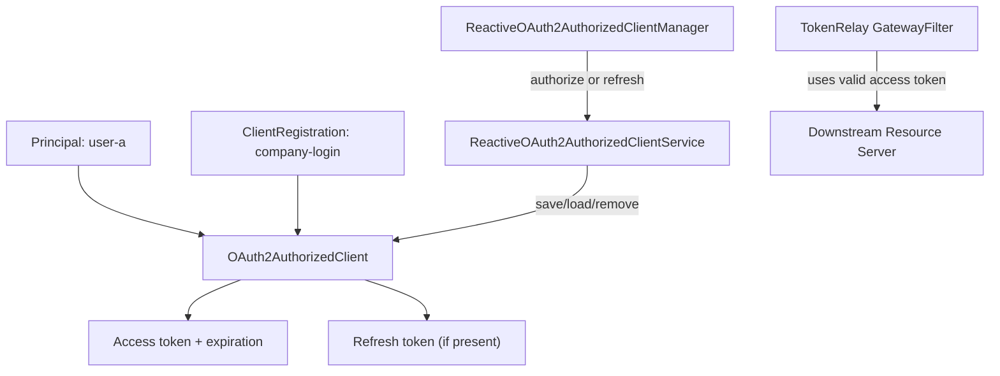
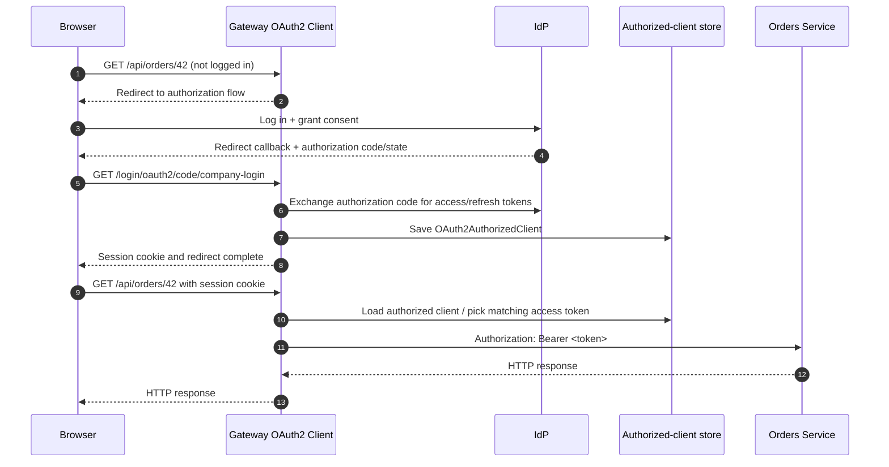

# Storing Authorized Client State and Limits of In-Memory Storage

## 1. Why Does an API Gateway Need to Store OAuth2 Authorized Client State?

When **SPRING_CLOUD_GATEWAY** serves as an entry point to microservices, it may simply validate JWTs sent by clients, or it may also act as an **OAuth2 Client**: directing users to an Identity Provider (IdP) to log in, receiving access tokens, and calling downstream services on the user's behalf via the `TokenRelay` filter.

In the second model, the Gateway must know **which OAuth2 client registration** the user authorized, **which access token** is active, and sometimes **which refresh token** can obtain a new token. Spring Security packages this state into `OAuth2AuthorizedClient`.

A problem arises under the default configuration: according to the reactive Spring Security documentation, `InMemoryReactiveOAuth2AuthorizedClientService` stores authorized clients **in the memory of a single process**. The Spring Cloud Gateway documentation likewise notes that `TokenRelay` relies on an in-memory authorized-client service model by default and requires a more durable implementation for serious production operation.

Consider a system with two Gateway replicas:

```text
Client --(SESSION cookie)--> Load Balancer
                                |
                         +------+------+
                         |             |
                      Gateway A     Gateway B
                      authorized     authorized
                      clients A      clients B
                         |             |
                         +---- Orders Service
```

A user logs in through **Gateway A**. If the authorized client lives only in A's heap, **Gateway B cannot automatically see tokens saved on A**. When A restarts, in-memory state is lost as well. Adding a Redis store for **`WebSession`** does not automatically mean the `ReactiveOAuth2AuthorizedClientService` store is shared either.

This lesson belongs to the **Sessions and Tokens** chapter. You will learn to distinguish session, client registration, and authorized client; observe limitations of in-memory storage; configure a Gateway with `oauth2Login` + `TokenRelay`; and select appropriate persistence for multi-instance deployments alongside refresh tokens, TLS, rate limiting, circuit breakers, retries, and tracing.

### Learning Objectives

After this lesson, you will be able to:

1. Explain the structure of `OAuth2AuthorizedClient` and why it is not equivalent to `WebSession` or a JWT access token.
2. Distinguish `ReactiveClientRegistrationRepository`, `ServerOAuth2AuthorizedClientRepository`, `ReactiveOAuth2AuthorizedClientService`, and `ReactiveOAuth2AuthorizedClientManager`.
3. Configure Gateway Server WebFlux as an **OAuth2 Client** for login and `TokenRelay` token propagation upstream.
4. Understand what data is kept in memory and its limits across restarts, horizontal scaling, and token refreshes.
5. Replace the in-memory implementation with a database-backed `R2dbcReactiveOAuth2AuthorizedClientService` when operational requirements call for persistence.
6. Know when Spring Session Redis fits **`WebSession`**, and why authorized-client storage still must be verified separately.
7. Design cleanup, logout, refresh token protection, and multi-instance testing.

> **Illustrative versions:** Spring Boot 3.5.x + Spring Cloud 2025.0.x (Gateway Server WebFlux 4.3.x, Spring Security 6.5.x). Starter `spring-cloud-starter-gateway-server-webflux`; route configuration under prefix `spring.cloud.gateway.server.webflux`. When applying to newer releases, verify the exact release train and APIs; `*.0` versions in examples indicate a compatible pair, not a recommendation to run unpatched minor releases in production.

## 2. What Is an Authorized Client — and What Is It Not?

In Spring Security, `OAuth2AuthorizedClient` associates:

- A **`ClientRegistration`**: configuration of the OAuth2 client registered at the IdP, such as `registrationId`, `clientId`, `authorizationGrantType`, token endpoint, and scopes.
- A **principal**: identity of the end user (*resource owner*) who granted authorization; for `client_credentials`, the principal may be a deliberately chosen technical identity.
- An **`OAuth2AccessToken`**: credential for one or more requests to a resource server.
- Depending on the grant, an **`OAuth2RefreshToken`**: sensitive credential used to request a new access token when refreshing is permitted.



Example logical relationship (the token strings below are **descriptive placeholders**, never real access tokens):

```text
registrationId: company-login
principalName:  user-a
accessToken:    <sensitive-credential>
accessExpires:  after an IdP-defined duration
refreshToken:   <sensitive-credential, if issued by grant>
```

**Never store access/refresh tokens as metric labels, print them to the console, or return them in HTTP bodies in real applications.** The `principalName` is also part of the storage lookup key; it must come from the verified authenticated identity rather than a client-supplied query parameter or header.

### Four similarly named objects

| Component | Holds / Handles | Is It an Authorized Client Store? |
|---|---|---|
| `ReactiveClientRegistrationRepository` | Looks up **OAuth2 client configuration** by `registrationId`; e.g., issuer/client ID/authorization grant. | **No**. It does not hold individual users' access tokens. |
| `OAuth2AuthorizedClient` | An authorization record pairing client registration, principal, and access/refresh tokens. | It is the **object being stored**. |
| `ServerOAuth2AuthorizedClientRepository` | Loads/saves/removes authorized clients **in the context of a web request** with `ServerWebExchange`. | **Yes**, though storage behavior depends on the implementation. |
| `ReactiveOAuth2AuthorizedClientService` | Loads/saves/removes authorized clients at the **application level**, by registration ID and principal. | **Yes**. Common default is in-memory. |
| `ReactiveOAuth2AuthorizedClientManager` | Coordinates authorize/re-authorize/refresh via providers, repository/service, and success/failure handlers. | **Not directly a store**, but governs when reads/writes/removals happen. |

Key point: `ReactiveClientRegistrationRepository` has "Repository" in its name, yet stores **client registration metadata**, not "every user's login session". To manage per-user tokens, look at the **authorized-client repository/service**.

## 3. WebSession, OAuth2 Login, and Authorized Client Are Three Separate Layers

These layers often appear together in **OAuth2 Login / Backend for Frontend (BFF)** applications, yet solve three distinct problems.

| State Type | Typical Contents | Purpose |
|---|---|---|
| **`WebSession`** | Session ID, `SecurityContext`, or web data persisted across requests, depending on configuration. | Lets the browser maintain a session with the Gateway. |
| **OAuth2 authorization request** | `state`, redirect/PKCE data, and transient data for the authorization code handshake, depending on configuration. | Binds the login initiation request to the callback, preventing CSRF/login mix-up. |
| **`OAuth2AuthorizedClient`** | Client registration + principal + access token + refresh token (if any). | Enables the Gateway to call resource servers on the principal's behalf and potentially refresh tokens. |

Lifecycle example:



This diagram shows the high-level model. Depending on configuration, Spring Security may manage authorized clients via `ServerOAuth2AuthorizedClientRepository` or `ReactiveOAuth2AuthorizedClientService`; a repository may delegate to a service for authenticated principals or store into `WebSession` in other contexts.

**Common mental trap:** "Putting sessions in Redis automatically puts all access tokens into Redis." That is **not true in every configuration**. Redis-backed `WebSession` lets sessions survive restarts/replicas, yet `InMemoryReactiveOAuth2AuthorizedClientService` may still live inside each JVM's heap. You must confirm the **actual implementation used for authorized clients**, not just the presence of a Spring Session dependency.

### Stateless Resource Server vs. OAuth2 Client

If the Gateway **only** accepts `Authorization: Bearer <JWT>` from clients and uses `spring-boot-starter-oauth2-resource-server` to validate signatures/issuer/audience/scopes, it can run **statelessly** without persisting users' `OAuth2AuthorizedClient` records like an `oauth2Login` app.

If the Gateway **logs users in via OAuth2 authorization code** and manages authorized clients for `TokenRelay` and refreshes, it acts as an **OAuth2 Client** with its own state-persistence requirements.

Do not install OAuth2 Client and store refresh tokens just to handle simple JWT validation. Nor should you confuse **`TokenRelay`** with automatic token verification: downstream services must still validate audience, signature, expiry, and resource permissions.

## 4. Who Manages Persistence in Reactive Spring Security?

### 4.1. `ServerOAuth2AuthorizedClientRepository`

This interface provides load, save, and remove operations for `OAuth2AuthorizedClient` in a web context:

```java
Mono<T> loadAuthorizedClient(
    String clientRegistrationId,
    Authentication principal,
    ServerWebExchange exchange);

Mono<Void> saveAuthorizedClient(
    OAuth2AuthorizedClient authorizedClient,
    Authentication principal,
    ServerWebExchange exchange);

Mono<Void> removeAuthorizedClient(
    String clientRegistrationId,
    Authentication principal,
    ServerWebExchange exchange);
```

These are **conceptual signatures** for study; consult the official Javadoc when implementing, as generic bounds and exact return types may differ from this shorthand.

Important implementations:

- `AuthenticatedPrincipalServerOAuth2AuthorizedClientRepository`: for authenticated principals, it can delegate saving authorized clients to a `ReactiveOAuth2AuthorizedClientService`; for anonymous principals, the default setup may use a `WebSession`-based repository.
- `WebSessionServerOAuth2AuthorizedClientRepository`: stores authorized clients inside `WebSession`. **Durability depends on the `WebSession` store**; an in-memory `WebSession` is lost on process restart, whereas a Redis-backed `WebSession` can be shared across replicas.

Subtle detail: if the user is authenticated and the active repository is `AuthenticatedPrincipalServerOAuth2AuthorizedClientRepository`, adding Redis-backed `WebSession` **does not turn the underlying in-memory service it delegates to into a database**.

### 4.2. `ReactiveOAuth2AuthorizedClientService`

An application-level interface with three core operations:

```java
Mono<T> loadAuthorizedClient(
    String clientRegistrationId, String principalName);

Mono<Void> saveAuthorizedClient(
    OAuth2AuthorizedClient authorizedClient, Authentication principal);

Mono<Void> removeAuthorizedClient(
    String clientRegistrationId, String principalName);
```

Lookup key semantics: the combination **`clientRegistrationId` + `principalName`**. If a user has multiple OAuth2 client registrations or logs into multiple accounts, keys and storage rules must be designed carefully. In multi-tenant systems, a principal name repeated across tenants can cause collisions unless mapped to a stable, unique identifier within a clear trust boundary.

Spring Security provides:

- `InMemoryReactiveOAuth2AuthorizedClientService`: keeps authorized clients in-process; simple for learning and experiments.
- `R2dbcReactiveOAuth2AuthorizedClientService`: uses Spring R2DBC's `DatabaseClient` to persist into a database using the OAuth2 Client schema documented by Spring Security.
- You can also implement a custom `ReactiveOAuth2AuthorizedClientService` when custom encryption/partitioning/TTL/policies are required, ensuring full load/save/remove semantics, concurrency safety, and error handling.

### 4.3. `ReactiveOAuth2AuthorizedClientManager`

The manager coordinates authorization/re-authorization through `ReactiveOAuth2AuthorizedClientProvider`. For example, when an access token expires:

1. The manager looks up the matching authorized client.
2. If a provider supports `refresh_token` and the client holds a valid refresh token, the manager can request a new access token.
3. Upon successful authorization, the updated state is persisted via the success handler and storage.
4. If refresh fails (e.g., `invalid_grant`), the failure handler can remove the broken authorized client according to the manager's policy.

Two commonly referenced managers:

| Manager | When Appropriate |
|---|---|
| `DefaultReactiveOAuth2AuthorizedClientManager` | Authorize/re-authorize **within a WebFlux request context** with `ServerWebExchange`, typically paired with `ServerOAuth2AuthorizedClientRepository`. |
| `AuthorizedClientServiceReactiveOAuth2AuthorizedClientManager` | Authorize/re-authorize **outside a web request** (such as service-tier/background jobs with an explicit logical principal), using `ReactiveOAuth2AuthorizedClientService`. |

Never write custom filters that parse `exp` and call the token endpoint with blocking HTTP to refresh. Use the OAuth2 Client manager/providers for the right grant, controlled error/retry handling, and let Spring Security manage the authorized client lifecycle.

## 5. Limitations of `InMemoryReactiveOAuth2AuthorizedClientService`

This is the simplest implementation; its advantage is **requiring no external infrastructure**. However, to operate a Gateway safely, you must understand its real limits.

| Scenario | What Happens with In-Memory Authorized Clients |
|---|---|
| Gateway process restart/crash | Records in the heap are **lost**; principals may need to re-authorize. |
| Instance replacement during rolling deployment | Authorized clients on old instances are **not transferred** to new instances. |
| Two or three Gateway replicas | Each JVM has an isolated store; other replicas cannot see newly saved records. |
| Redis Session deployed | **Does not guarantee** the in-memory authorized-client service is shared. |
| Growing user and registration counts | Heap records/tokens grow; lifecycle and memory must be bounded. |
| Access token expires | Manager can refresh when a provider/refresh token is present; storage alone does not guarantee refresh succeeds. |
| Logout or revocation | Never assume every authorized client was removed everywhere without an explicit cleanup flow. |
| Concurrent requests refreshing the same token | Races can occur; the in-memory repository **does not** replace IdP/store concurrency controls. |

**Do not mistake in-memory storage for a self-bounding cache.** Do not assume the default implementation offers configuration properties like `max-size`, LRU eviction, or automatic TTL cleanup for all authorized clients. Check the source/Javadoc of your exact version and implement lifecycle controls or swap storage if bounded capacity is required.

### Illustrating a two-replica Gateway failure

```text
T0: Browser logs in via Pod A
    -> OAuth2AuthorizedClient(user-a, company-login) saved in A's heap

T1: Browser calls /api/orders/42; load balancer picks Pod B
    -> Pod B cannot see the authorized client in A's heap
    -> TokenRelay may fail to retrieve a token / require re-authorization
       (exact HTTP behavior depends on security/manager config)

T2: Pod A restarts
    -> A's authorized clients are lost
    -> even if WebSession is kept in Redis, the browser may still have a session,
       while the authorized-client store still lacks the data needed for relay
```

**Sticky sessions** reduce pod-hopping, but do not preserve tokens when a pod dies and are not durable persistence. When sessions and authorized clients live in different stores, test both lifecycles.

### Security risks of "RAM-only storage"

In-memory is **not automatically safe** merely because nothing is written to disk. Tokens can still appear in heap dumps, crash dumps, debug tooling, or logs if misconfigured. Conversely, putting tokens in a database is not automatically safe either: you need TLS, least-privilege access, encryption, backup policies, retention, and auditing. **Choose storage based on both durability and security.**

## 6. Example: Gateway OAuth2 Login and TokenRelay

This example clearly demonstrates the **OAuth2 Client + authorized client** mechanism. It **cannot run immediately without a real Identity Provider**, since `idp.example.test` is only an illustrative hostname. To run login hands-on, you need a client registration configured in an IdP you control, an accurate redirect URI, and an access token whose audience/scope the backend accepts.

Architecture:

```text
Browser
  |
  | WebSession cookie
  v
Gateway :8080
  |-- Spring Security oauth2Login()
  |-- AuthorizedClient store (demo: memory)
  |-- TokenRelay GatewayFilter
  |
  | Authorization: Bearer <access-token>
  v
Orders Service :9001
  |-- Resource Server independently validates token and resource permissions
  +-- HTTP response
```

### 6.1. Minimal `pom.xml`

Use **JDK 17+**, Maven, Spring Boot 3.5.x + Spring Cloud 2025.0.x. Values `3.5.0` and `2025.0.0` are examples of a compatible release train; for production, use supported patch releases.

```xml
<?xml version="1.0" encoding="UTF-8"?>
<project xmlns="http://maven.apache.org/POM/4.0.0"
         xmlns:xsi="http://www.w3.org/2001/XMLSchema-instance"
         xsi:schemaLocation="http://maven.apache.org/POM/4.0.0
                             https://maven.apache.org/xsd/maven-4.0.0.xsd">
    <modelVersion>4.0.0</modelVersion>

    <parent>
        <groupId>org.springframework.boot</groupId>
        <artifactId>spring-boot-starter-parent</artifactId>
        <version>3.5.0</version>
        <relativePath/>
    </parent>

    <groupId>com.example</groupId>
    <artifactId>oauth2-session-gateway</artifactId>
    <version>0.0.1-SNAPSHOT</version>

    <properties>
        <java.version>17</java.version>
    </properties>

    <dependencyManagement>
        <dependencies>
            <dependency>
                <groupId>org.springframework.cloud</groupId>
                <artifactId>spring-cloud-dependencies</artifactId>
                <version>2025.0.0</version>
                <type>pom</type>
                <scope>import</scope>
            </dependency>
        </dependencies>
    </dependencyManagement>

    <dependencies>
        <dependency>
            <groupId>org.springframework.cloud</groupId>
            <artifactId>spring-cloud-starter-gateway-server-webflux</artifactId>
        </dependency>
        <dependency>
            <groupId>org.springframework.boot</groupId>
            <artifactId>spring-boot-starter-oauth2-client</artifactId>
        </dependency>
    </dependencies>

    <build>
        <plugins>
            <plugin>
                <groupId>org.springframework.boot</groupId>
                <artifactId>spring-boot-maven-plugin</artifactId>
            </plugin>
        </plugins>
    </build>
</project>
```

`spring-boot-starter-oauth2-client` is a key requirement for configuring OAuth2 Client and enabling `TokenRelay`. Do not add the servlet stack `spring-boot-starter-web` to this WebFlux Gateway. Starter versions are managed by the Boot/Cloud BOMs rather than pinned manually.

### 6.2. `application.yml`: registering the OAuth2 Client and route

```yaml
server:
  port: 8080

spring:
  application:
    name: oauth2-session-gateway

  security:
    oauth2:
      client:
        provider:
          company-idp:
            issuer-uri: https://idp.example.test/realms/lab
        registration:
          company-login:
            provider: company-idp
            client-id: gateway-bff
            client-secret: "${OAUTH2_CLIENT_SECRET}"
            authorization-grant-type: authorization_code
            redirect-uri: "{baseUrl}/login/oauth2/code/{registrationId}"
            scope:
              - openid
              - profile
              - orders.read

  cloud:
    gateway:
      server:
        webflux:
          routes:
            - id: orders-route
              uri: http://127.0.0.1:9001
              predicates:
                - Path=/api/orders/**
              filters:
                - StripPrefix=1
                - TokenRelay=
```

Details:

- `provider.company-idp.issuer-uri` must be replaced with a real issuer **exposing metadata/JWKS** trusted by the Gateway over TLS.
- `client-id` and `client-secret` are OAuth2 client credentials, **not** user access tokens. Load secrets from environment/secret managers; never commit them to repositories.
- `redirect-uri` must be explicitly permitted by the IdP; if the Gateway sits behind a reverse proxy, configure trusted forwarded headers/proxies and the right external base URL.
- `TokenRelay=` omits a registration ID, so in this scenario it relays **the access token bound to the principal logged in via `oauth2Login()`**.
- To select a specific registration, configure `TokenRelay=company-login`; ensure the registration/authorized client aligns with the principal/request context.
- The access token is sent upstream via `Authorization: Bearer ...`. The backend **must validate** the token, issuer, audience, expiry, and permissions itself; passing through the Gateway is not sufficient.
- Never substitute `spring.security.oauth2.resourceserver.jwt.*` for `spring.security.oauth2.client.*`: they belong to two different roles.

### 6.3. Entry point and security

`src/main/java/com/example/gateway/GatewayApplication.java`:

```java
package com.example.gateway;

import org.springframework.boot.SpringApplication;
import org.springframework.boot.autoconfigure.SpringBootApplication;

@SpringBootApplication
public class GatewayApplication {
    public static void main(String[] args) {
        SpringApplication.run(GatewayApplication.class, args);
    }
}
```

`src/main/java/com/example/gateway/GatewaySecurity.java`:

```java
package com.example.gateway;

import org.springframework.context.annotation.Bean;
import org.springframework.context.annotation.Configuration;
import org.springframework.security.config.Customizer;
import org.springframework.security.config.annotation.web.reactive.EnableWebFluxSecurity;
import org.springframework.security.config.web.server.ServerHttpSecurity;
import org.springframework.security.web.server.SecurityWebFilterChain;

@Configuration
@EnableWebFluxSecurity
public class GatewaySecurity {

    @Bean
    SecurityWebFilterChain security(ServerHttpSecurity http) {
        return http
                .authorizeExchange(exchanges -> exchanges
                        .pathMatchers("/login", "/oauth2/**", "/login/oauth2/**")
                            .permitAll()
                        .pathMatchers("/api/orders/**")
                            .authenticated()
                        .anyExchange().denyAll()
                )
                .oauth2Login(Customizer.withDefaults())
                .oauth2Client(Customizer.withDefaults())
                .build();
    }
}
```

**Do not disable CSRF in this example.** This is an OAuth2 Login application using browser sessions and session cookies, not a pure bearer-stateless API. If you add write endpoints, evaluate CSRF requirements for the BFF architecture case by case.

Spring Security handles OAuth2 authorization redirects, callbacks, login sessions, and authorized client lifecycles. Never write custom code storing access tokens in cookies or response bodies for frontend scripts to read. Session cookies need `HttpOnly`, `Secure` when using HTTPS, appropriate `SameSite`, and managed lifetimes.

### 6.4. Prerequisites for the example to run

You must have a real, configured IdP:

1. Register OAuth2 client `gateway-bff` with grant `authorization_code`; add a valid redirect URI such as `http://localhost:8080/login/oauth2/code/company-login` for dev.
2. Grant scopes `openid`, `profile`, `orders.read` per policy. If your IdP uses different scope names, update accordingly.
3. Provide `OAUTH2_CLIENT_SECRET` via environment/secret manager; never store it in source code or logs.
4. Ensure Orders Service enforces resource-server validation and the matching **audience**. Not every access token issued during OIDC login is authorized to call the Orders API.
5. Ensure the Gateway connects over verified TLS to the issuer/token endpoint and backends; `http://127.0.0.1:9001` in the demo is loopback-only.

**You cannot fake a successful login with `curl` alone without a valid IdP, user account, and authorization code.** This lesson provides no mock tokens to bypass security checks.

### 6.5. Observing via browser and HTTP

Run the Gateway from the project containing `pom.xml`:

```bash
mvn spring-boot:run
```

In a browser, open `http://localhost:8080/api/orders/O-100`. Before authentication, depending on the security entry point, the client is redirected to log in. After authenticating with the real IdP and returning to the callback, the Gateway holds an authorized client bound to the principal.

You can check unauthenticated behavior with:

```bash
curl -i -H "Accept: text/html" \
  http://127.0.0.1:8080/api/orders/O-100
```

Requests accepting HTML typically receive a `302` redirect to the login/authorization flow, though exact status codes depend on security entry points and configuration. Do not treat a single fixed status code as the sole pass criterion.

After logging in via the browser, inspect **token-free backend access logs** to confirm the request arrived with the right security principal. Never paste session cookies or access tokens into tickets, chats, or logs during testing.

## 7. Example: Verifying the In-Memory Service Without an IdP

To demonstrate that an authorized client is keyed by **principal + registration ID**, you can write an isolated **unit test** for `InMemoryReactiveOAuth2AuthorizedClientService`. The test does not execute an `authorization_code` flow, makes no HTTP calls, and **creates no real-value credentials**.

Add test dependencies in your project:

```xml
<dependency>
    <groupId>org.springframework.boot</groupId>
    <artifactId>spring-boot-starter-test</artifactId>
    <scope>test</scope>
</dependency>
<dependency>
    <groupId>io.projectreactor</groupId>
    <artifactId>reactor-test</artifactId>
    <scope>test</scope>
</dependency>
```

Create `src/test/java/com/example/gateway/AuthorizedClientMemoryTest.java`:

```java
package com.example.gateway;

import java.time.Instant;
import java.util.Set;

import org.junit.jupiter.api.Test;
import org.springframework.security.authentication.TestingAuthenticationToken;
import org.springframework.security.oauth2.client.InMemoryReactiveOAuth2AuthorizedClientService;
import org.springframework.security.oauth2.client.OAuth2AuthorizedClient;
import org.springframework.security.oauth2.client.registration.ClientRegistration;
import org.springframework.security.oauth2.client.registration.InMemoryReactiveClientRegistrationRepository;
import org.springframework.security.oauth2.core.AuthorizationGrantType;
import org.springframework.security.oauth2.core.OAuth2AccessToken;

import reactor.core.publisher.Mono;
import reactor.test.StepVerifier;

import static org.assertj.core.api.Assertions.assertThat;

class AuthorizedClientMemoryTest {

    @Test
    void saveLoadAndRemoveAreScopedToPrincipal() {

        ClientRegistration registration =
                ClientRegistration.withRegistrationId("company-login")
                        .clientId("test-client")
                        .clientSecret("test-only-not-a-real-secret")
                        .clientName("Lab client")
                        .authorizationGrantType(
                                AuthorizationGrantType.AUTHORIZATION_CODE)
                        .authorizationUri("https://idp.example.test/authorize")
                        .tokenUri("https://idp.example.test/token")
                        .redirectUri(
                                "{baseUrl}/login/oauth2/code/{registrationId}")
                        .build();

        var registrations =
                new InMemoryReactiveClientRegistrationRepository(registration);

        var storage =
                new InMemoryReactiveOAuth2AuthorizedClientService(registrations);

        Instant now = Instant.now();
        OAuth2AccessToken fakeToken = new OAuth2AccessToken(
                OAuth2AccessToken.TokenType.BEARER,
                "inert-unit-test-token",
                now,
                now.plusSeconds(120),
                Set.of("orders.read")
        );

        OAuth2AuthorizedClient authorizedClient =
                new OAuth2AuthorizedClient(
                        registration, "user-a", fakeToken);

        var principal = new TestingAuthenticationToken("user-a", "unused");

        Mono<Void> scenario = storage
                .saveAuthorizedClient(authorizedClient, principal)
                .then(storage.loadAuthorizedClient("company-login", "user-a")
                        .doOnNext(loaded ->
                                assertThat(loaded.getPrincipalName())
                                        .isEqualTo("user-a"))
                        .then())
                .then(storage.loadAuthorizedClient("company-login", "user-b")
                        .doOnNext(unexpected -> {
                            throw new AssertionError("Cross-principal leakage");
                        })
                        .then())
                .then(storage.removeAuthorizedClient(
                        "company-login", "user-a"))
                .then(storage.loadAuthorizedClient("company-login", "user-a")
                        .doOnNext(unexpected -> {
                            throw new AssertionError("Expected removal");
                        })
                        .then());

        StepVerifier.create(scenario).verifyComplete();
    }
}
```

This test exercises save/load/remove on the **service API**; it does not prove OAuth2 login/refresh occurred or that the dummy token is valid. `fakeToken` is inert data strictly for unit testing and **must never be relayed to a real resource server**.

Run from your project:

```bash
mvn -Dtest=AuthorizedClientMemoryTest test
```

You can extend the test by creating a **second service instance** in the same JVM and verifying it cannot see records from the first instance, illustrating **per-instance locality**. Never inspect private implementation fields to read token contents.

## 8. When Should In-Memory Be Replaced with Persistent Storage?

The decision depends on availability, replica count, and data policies:

| Model | Authorized-Client Storage | Advantages | Limitations |
|---|---|---|---|
| Single dev/test Gateway, manual login | In-memory | Minimal config, no database needed. | Lost on restart, not shared. |
| Multi-replica OAuth2 BFF | Shared store (R2DBC or suitable implementation) | All instances access authorized clients; survives restarts. | Must secure tokens in DB and handle cleanup/refresh concurrency. |
| App storing authorized clients *inside `WebSession`* | `WebSessionServerOAuth2AuthorizedClientRepository` + Redis-backed `WebSession` (if designed that way) | Can share **session-bound authorized clients** across replicas. | Does not mean the service-level store moved to Redis; verify active routing/repository. |
| Machine-to-machine `client_credentials` | Authorized-client service keyed by service principal, optionally shared store/cache | Manages system token lifecycle. | Not a user login session; avoid sharing overly broad tokens. |
| Stateless JWT Resource Server | Usually **needs no** user authorized-client store | Simple horizontal scaling, validates tokens only. | Switching to OAuth2 Client login/refresh/`TokenRelay` changes the architecture. |

**No single persistence setup fits every flow.** In a Gateway BFF, decide explicitly **where sessions live**, **where authorized clients live**, how **logout/revocation** works, and how both stores stay consistent during rolling restarts.

### 8.1. Spring Security's `R2dbcReactiveOAuth2AuthorizedClientService`

Spring Security provides an R2DBC implementation using `DatabaseClient`; it is a concrete option for decoupling the authorized-client store from a single pod's memory.

In a project configured with R2DBC and a `DatabaseClient` bean, register `ReactiveOAuth2AuthorizedClientService`:

```java
package com.example.gateway;

import org.springframework.context.annotation.Bean;
import org.springframework.context.annotation.Configuration;
import org.springframework.r2dbc.core.DatabaseClient;
import org.springframework.security.oauth2.client.R2dbcReactiveOAuth2AuthorizedClientService;
import org.springframework.security.oauth2.client.ReactiveOAuth2AuthorizedClientService;
import org.springframework.security.oauth2.client.registration.ReactiveClientRegistrationRepository;

@Configuration
public class AuthorizedClientPersistenceConfig {

    @Bean
    ReactiveOAuth2AuthorizedClientService authorizedClientService(
            DatabaseClient databaseClient,
            ReactiveClientRegistrationRepository registrations) {

        return new R2dbcReactiveOAuth2AuthorizedClientService(
                databaseClient, registrations);
    }
}
```

This code **works once R2DBC dependencies, driver, database connection, and schema are all provided**. It does not create the database or tables automatically.

Add dependencies matching your database, e.g., PostgreSQL:

```xml
<dependency>
    <groupId>org.springframework.boot</groupId>
    <artifactId>spring-boot-starter-data-r2dbc</artifactId>
</dependency>
<dependency>
    <groupId>org.postgresql</groupId>
    <artifactId>r2dbc-postgresql</artifactId>
    <scope>runtime</scope>
</dependency>
```

Example R2DBC connection config using environment variables/secrets:

```yaml
spring:
  r2dbc:
    url: r2dbc:postgresql://db.internal.example:5432/gateway_auth
    username: "${GATEWAY_DB_USER}"
    password: "${GATEWAY_DB_PASSWORD}"
```

**Critical prerequisite:** `R2dbcReactiveOAuth2AuthorizedClientService` expects the table from Spring Security's OAuth2 Client schema (see `org/springframework/security/oauth2/client/oauth2-client-schema.sql`). Create/migrate a compatible table for your database and test column/BLOB types for your dialect. **Never** assume a sample SQL file runs unmodified across every PostgreSQL/MySQL/H2 setup or that Boot creates the table automatically.

When registering a custom bean, Spring Boot auto-configuration may back off its default implementation; verify which bean the manager/repository/`TokenRelay` actually uses via an integration test. Do not assume adding one bean swaps every storage path if the app also manually configures another repository or manager.

### 8.2. Why does R2DBC fit WebFlux?

Spring Cloud Gateway Server WebFlux runs on a Reactor/Netty event loop. `R2dbcReactiveOAuth2AuthorizedClientService` uses reactive APIs to query the database. Avoid calling blocking JDBC directly on the Netty event loop or invoking `block()` inside `GlobalFilter`, `GatewayFilter`, or `SecurityWebFilterChain`.

However, **reactive does not equal durable**. Durability relies on database HA, backups, replication, migrations, failover, and consistency policies. When the database is unreachable, **fail closed** for tokens that cannot be loaded or verified; never substitute another token or forward unauthenticated traffic to backends.

### 8.3. Spring Session Redis manages `WebSession`, not every authorized-client service

For Gateway OAuth2 Login using session cookies, Spring Boot 3.5 supports Spring Session Redis for **reactive `WebSession`**. Dependency:

```xml
<dependency>
    <groupId>org.springframework.boot</groupId>
    <artifactId>spring-boot-starter-session-data-redis</artifactId>
</dependency>
```

Example configuration with an internal Redis instance:

```yaml
spring:
  data:
    redis:
      host: redis.internal.example
      port: 6379
  session:
    timeout: 30m
```

This example is **not production-hardened**: add Redis TLS, authentication, ACLs, network policies, secret management, HA, and environment-appropriate key TTL policies. Spring Session replaces in-memory `WebSession` with Redis-backed `WebSession`; it **does not automatically prove `ReactiveOAuth2AuthorizedClientService` uses R2DBC or Redis**.

One design is using `WebSessionServerOAuth2AuthorizedClientRepository` so authorized clients actually live inside `WebSession`, **and** managing `WebSession` in Redis via Spring Session. Another is pairing `AuthenticatedPrincipalServerOAuth2AuthorizedClientRepository` with a **shared authorized-client service** such as R2DBC. Choose intentionally and test the active configuration's load/save/remove paths.

**Avoid duplicating the same token across multiple stores without a synchronized deletion strategy.** For instance, if a session expires while the database still retains the refresh token, a separate cleanup/revocation process is required.

## 9. Storage Limits: Capacity, TTL, Retention, and Cleanup

When moving to a database, the question is not just keeping tokens longer, but **how long keeping tokens is reasonable and how storage is bounded**.

### 9.1. Lifecycle policies

| State | Desired Handling |
|---|---|
| User logs in / grants consent | Authorized client saved after successful authorization. |
| Access token still valid | Manager may reuse it per policy and scope. |
| Access token expired, valid refresh token exists | Manager/provider may refresh and save the new token. |
| Refresh rejected by IdP with `invalid_grant` | Remove the invalid authorized client and require re-authorization per policy. |
| User logs out | Clear `WebSession`; if required, **remove authorized clients** and revoke access/refresh tokens at the IdP. |
| Account locked / tenant revoked | Enforce token revocation policies and delete associated authorized clients. |
| Stored record past retention window | Bounded, audited cleanup/batch job; never run ad-hoc deletes by username. |

**Do not confuse access token expiry with refresh token retention.** If an access token expires in 5 minutes, the authorized client may still retain a refresh token to request a new one; that does not mean keeping records **indefinitely**. Retention must align with user consent, refresh token TTL, and organizational compliance requirements.

### 9.2. Capacity limits

With an in-memory store, entry counts grow with principals and registrations. Never rely on undocumented configuration properties expecting automatic memory bounds. If you build a custom cache:

- Enforce **maximum size** and TTL per policy.
- Eviction may force users to log in again; factor in UX impact.
- Never log tokens in cache metrics or eviction logs.
- Synchronize cleanup on logout/revocation; account for stale entries and concurrency.
- Verify no leaks occur from synthetic/duplicate principals or stray client registrations.

With a database, enforce a **retention policy** and cleanup job; index `clientRegistrationId` and `principalName` appropriately; monitor record counts over time without exposing token details on dashboards.

### 9.3. Encryption and access control

An authorized client may contain a **refresh token** valid much longer than an access token. Therefore:

1. Enable **TLS** between the Gateway and the database or store.
2. Enable **encryption at rest** and, if required by your threat model, application/field-level token encryption with keys managed by KMS/a secret manager.
3. Grant least-privilege DB permissions to the Gateway, separating schemas/stores where needed.
4. Restrict debug dumps, DB backups, and snapshots; control backup permissions and retention.
5. Do not copy tokens into Redis/sessions/logs unnecessarily.
6. Never let one client registration hold overly broad scopes for all downstream services.
7. Plan key rotation and how encrypted token records are handled when keys rotate.

**Storing tokens in a database does not automatically encrypt them.** Verify how data is stored in tables; never mistake R2DBC for an encryption solution.

### 9.4. Concurrency during token refresh

With some IdPs, refresh tokens **rotate** and the old token is invalidated upon first use. If two Gateway replicas refresh the same authorized client concurrently:

```text
Pod A reads refresh-token-R1 ----> requests new token, gets R2
Pod B reads refresh-token-R1 ----> sends rotated R1 -> invalid_grant
Pod A writes new token R2
Pod B may process the failure and delete state if lacking concurrency guards
```

Implement **single-flight/locking, optimistic versioning, or compare-and-set** when storage/IdP semantics require it. A shared database allowing concurrent access **does not solve races automatically**. Test refresh token rotation, `invalid_grant` errors, and ensure stale attempts cannot overwrite or delete newer state.

## 10. Designing Tests: Single Instance, Restart, Multi-Replica

Separate **storage unit tests** from **integration tests with a real or controlled test IdP**. Never send real access/refresh tokens to public mocks or logs.

| Test | Setup | Pass Criteria |
|---|---|---|
| Basic in-memory | Unit test `save/load/remove` | User A loads client A, User B sees nothing; remove succeeds. |
| Process restart with in-memory | Log in then restart Gateway; keep IdP running | Do not expect authorized client to survive; verify configured re-login UX. |
| Two in-memory replicas | Log in via A, send request to B | Observe that B cannot see A's in-memory token. |
| Redis `WebSession` + memory authorized clients | Session survives across replicas | Confirm shared session does not imply shared authorized clients. |
| Shared R2DBC service | A saves client, B loads same registration/principal | B loads the exact record; no cross-principal leakage. |
| Logout/revocation | Log out and revisit protected route | Session destroyed; authorized client removed/revoked per policy. |
| Refresh rotation | Two concurrent requests near token expiry | Newer token not lost to races; deterministic behavior. |
| IdP unavailable | Login/refresh when token endpoint or JWKS unreachable | Fails closed with timeouts; security checks never bypassed. |
| DB/Redis unavailable | Authorized-client load/save fails | Never continues with fake credentials; proper response/alerting. |
| Token expiry | Access token expired | Refreshes or re-authorizes per policy; never blindly relays expired tokens. |
| Cross-tenant | Two tenants share a username | Non-ambiguous keys prevent cross-tenant token mix-ups. |
| Performance/load | Many users/authorized clients | Memory and database records remain bounded; healthy metrics. |

### Troubleshooting with low-sensitivity observability

Track signals such as:

- `registrationId` and **grant type**, provided internal config is not over-exposed.
- Active storage type (in-memory/R2DBC/`WebSession`) and replica/pod ID.
- Load/save/remove outcomes (**success, not-found, error**) without logging tokens or secrets.
- Refresh counts, `invalid_grant` errors, IdP connection timeouts, and database operation latency.
- Active sessions, expired sessions, and authorized-client entry counts as aggregates.
- Gateway and downstream HTTP status codes, route IDs, and sanitized trace IDs.

Never attach `principalName` or refresh tokens as **metric labels** due to PII exposure and high cardinality. When per-user auditing is required, write to an access-controlled, retention-bound, masked audit store.

## 11. Common Errors and Remediation

| Symptom | Likely Root Cause | Remediation |
|---|---|---|
| `TokenRelay` missing / filter factory not created | Missing `spring-boot-starter-oauth2-client` or invalid client registration. | Verify dependencies, `spring.security.oauth2.client.*`, and `ReactiveClientRegistrationRepository`. |
| Browser logged in, yet `TokenRelay` has no access token | Authorized client missing on current replica; wrong manager/repository; invalid scope/audience. | Verify actual storage, principal key, grant, and network paths. |
| Gateway restart forces users to log in again | In-memory `WebSession` and/or authorized-client state lost. | Choose session and authorized-client stores matching SLA; test restarts. |
| Redis Session configured, yet `TokenRelay` still fails on other pods | `ReactiveOAuth2AuthorizedClientService` is still in-memory or repository does not store in Redis-backed `WebSession`. | Inspect service/repository wiring rather than checking Redis session alone. |
| Access token expires and refresh does not run | Provider/manager lacks grant support; no refresh token; IdP disallows refresh. | Check `ReactiveOAuth2AuthorizedClientProvider`, grant, lifetimes, and IdP responses. |
| Refresh token lost after switching pods | Shared storage not active or state save failed. | Use durable shared storage and test cross-replica reads/writes. |
| DB reports missing authorized-client table | OAuth2 Client schema not migrated or dialect mismatch. | Create/migrate schema per Spring Security; check column types and privileges. |
| DB stores tokens, yet records remain after logout | Session cleanup and authorized-client cleanup out of sync. | Implement explicit removal/revocation and verify across all registrations. |
| Some refreshes return `invalid_grant` under concurrent load | Refresh token rotation race. | Review optimistic locking/distributed coordination and failure semantics. |
| `401`/`403` from backend despite successful relay | Token not intended for downstream, missing scope/role, or resource denial. | Check token audience and backend policy; `TokenRelay` grants no permissions. |
| Heap grows with user count | In-memory store retains unbounded entries without sufficient cleanup/expiry. | Enforce lifecycle/capacity policies or switch to persistent storage with retention. |
| Access token appears in access logs/traces | Misconfigured logging of `Authorization` headers/bodies/tokens. | Redact immediately, restrict logging, and rotate/revoke exposed credentials. |

## 12. Self-Check Questions

**1. Do `ReactiveClientRegistrationRepository` and `ReactiveOAuth2AuthorizedClientService` store the same kind of data?**

No. The first stores/looks up **OAuth2 client configurations**; the second stores a **principal's authorized clients**, including access tokens and potentially refresh tokens.

**2. When adding Spring Session Redis, do authorized clients in `InMemoryReactiveOAuth2AuthorizedClientService` automatically move to Redis?**

No. Inspect the active `ServerOAuth2AuthorizedClientRepository`/`ReactiveOAuth2AuthorizedClientService` implementations and explicit persistence configuration.

**3. Why is an in-memory store insufficient for rolling deployments with multiple Gateway replicas?**

Each JVM holds isolated state that vanishes on restart and is not shared with other instances. Sticky sessions cannot rescue state when a pod is lost.

**4. Does `TokenRelay` automatically make the backend trust the access token and allow all resources?**

No. It forwards the appropriate access token downstream; the backend must still verify signature, issuer, audience, expiry, and resource-level permissions.

**5. What is the difference between `WebSession` and `OAuth2AuthorizedClient`?**

`WebSession` maintains web/cookie session state; `OAuth2AuthorizedClient` is an OAuth2 record for a principal and client registration, holding access/refresh tokens for API calls.

**6. Why is a shared database alone not enough to solve refresh token rotation?**

Two replicas can still read the same old refresh token simultaneously and race. Locking/versioning and concurrency error handling are required.

**7. Does R2DBC persistence automatically encrypt refresh tokens?**

Never assume so. Inspect the stored data and apply TLS, encryption at rest, key management, DB permissions, and retention per your threat model.

**8. On logout, does deleting `WebSession` guarantee revoking access and refresh tokens at the IdP?**

No. Invalidating the session, removing the authorized client, and revoking tokens at the IdP are related but separate steps needing an explicit workflow.

**9. Does a Gateway that only validates inbound client bearer JWTs necessarily need an Authorized Client store?**

Not necessarily. A **stateless Resource Server** model can validate JWTs without OAuth2 Client login/refresh token storage.

**10. Should the authorized-client lookup key come from `?username=user-a` sent by the client?**

No. Use the verified authenticated identity/principal, registration ID, and necessary tenant boundaries; never trust client input to pick another user's token.

## Conclusion

In **Spring Cloud Gateway Server WebFlux**, `OAuth2AuthorizedClient` represents OAuth2 authorization granted to a client registration and principal, along with the associated access/refresh tokens. `TokenRelay` can leverage this state to forward access tokens to microservices, yet **it does not solve storage durability on its own**. `InMemoryReactiveOAuth2AuthorizedClientService` suits demos or scenarios where losing state is acceptable; for multi-replica BFFs, restarts, refresh token rotation, and security compliance, explicitly design **authorized-client persistence**, **`WebSession` storage**, **retention/cleanup**, **token revocation**, and **concurrency controls**.

Understanding where authorized clients are stored prevents both operational outages (unexpected user logouts or broken `TokenRelay` across pods) and security flaws (leaked refresh tokens, accepting wrong-audience tokens, or cross-principal/cross-tenant state leakage). A secure Gateway still relies on downstream authentication/authorization, TLS, rate limiting, circuit breakers, retries, and bounded observability.

### Official References

- [Spring Cloud Gateway Server WebFlux 4.3 — TokenRelay GatewayFilter Factory](https://docs.spring.io/spring-cloud-gateway/reference/4.3/spring-cloud-gateway-server-webflux/gatewayfilter-factories/tokenrelay-factory.html)
- [Spring Security 6.5 — Reactive OAuth2 Client Core Interfaces](https://docs.spring.io/spring-security/reference/6.5/reactive/oauth2/client/core.html)
- [Spring Security 6.5 — Reactive OAuth2 Login Core Configuration](https://docs.spring.io/spring-security/reference/6.5/reactive/oauth2/login/core.html)
- [Spring Security 6.5 — Reactive OAuth2 Authorized Client Features](https://docs.spring.io/spring-security/reference/6.5/reactive/oauth2/client/authorized-clients.html)
- [Spring Security 6.5 API — R2dbcReactiveOAuth2AuthorizedClientService](https://docs.spring.io/spring-security/reference/6.5/api/java/org/springframework/security/oauth2/client/R2dbcReactiveOAuth2AuthorizedClientService.html)
- [Spring Security 6.5 API — ServerOAuth2AuthorizedClientRepository](https://docs.spring.io/spring-security/reference/6.5/api/java/org/springframework/security/oauth2/client/web/server/ServerOAuth2AuthorizedClientRepository.html)
- [Spring Session — Reactive WebSession Integration](https://docs.spring.io/spring-session/reference/web-session.html)
- [Spring Boot — Spring Session auto-configuration](https://docs.spring.io/spring-boot/reference/web/spring-session.html)
- [Spring Cloud — choosing a release train compatible with Spring Boot](https://spring.io/projects/spring-cloud/)
