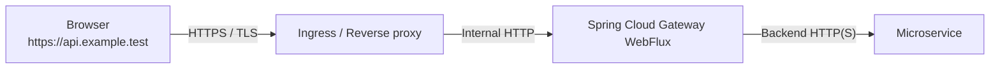

# Session Cookies, SameSite, Secure, and Paths Behind a Proxy

## 1. Context: Login Succeeds, Yet the Next Request Loses the Session

In a microservices architecture, **Spring Cloud Gateway** is the shared entry point for web, mobile, or partner clients. The Gateway uses **route predicates** to select routes, runs **filter chains**, transforms paths/headers, discovers services, and forwards requests to backends. Many applications also use the Gateway as a **Backend for Frontend (BFF)**: users log in via Spring Security, the Gateway keeps login state on the server, and issues a **session cookie** to the browser.

A common failure when deploying behind an ingress/reverse proxy:

- The browser logs in at `https://api.example.test/portal/api/auth/login` and receives `200` or `302`.
- The backend actually receives `/auth/login` after the Gateway strips the `/portal/api` prefix.
- The response returns `Set-Cookie: SESSION=...; Path=/auth`.
- The browser then calls `https://api.example.test/portal/api/orders`, **but omits the cookie** because the external path does not match `Path=/auth`.
- The Gateway or backend treats the request as unauthenticated, causing `401`, a `302` back to login, or a redirect loop.

Another failure occurs when TLS terminates at the ingress: users hit the Gateway over **HTTPS**, yet the internal app sees an **HTTP** connection and issues a cookie missing `Secure`, or builds redirects pointing to `http://...`.

To resolve this properly, distinguish **three layers**: (1) the URL seen by the **browser**, (2) the URL received and transformed by the **Gateway**, and (3) the URL actually handled by the **microservice**. Cookie attributes are evaluated by browsers against the **public URL**, not internal container paths.

This lesson belongs to the **Sessions and Tokens** chapter in **SPRING_CLOUD_GATEWAY**. Its goal is explaining `Set-Cookie`, `Cookie`, `SameSite`, `Secure`, `HttpOnly`, `Domain`, `Path`, configuring session cookies in **Spring WebFlux**, handling TLS termination/forwarded headers, and testing browsers across route rewrites, OAuth2 login, CORS, CSRF, and service discovery.

> **Scope:** focuses on **Spring Cloud Gateway Server WebFlux**, Spring Boot, and reactive Spring Security. Never copy Servlet/MVC `server.servlet.session.cookie.*` properties directly into WebFlux. Examples may need adaptation for your Spring Boot/Spring Cloud versions, project session setup, and the exact component issuing cookies.

## 2. How Do Session Cookies Work?

A **server-side session** model typically follows this flow:

1. The user logs in to the app or BFF.
2. The server authenticates and generates an unpredictable session ID, e.g., `s_abc123...`.
3. The server stores session state (in-memory, Redis, or another suitable store) and returns a `Set-Cookie` header.
4. The browser stores the cookie keyed by **host/domain, path, expiry, SameSite, Secure**.
5. On matching subsequent requests, the browser automatically attaches the `Cookie` header.
6. The server looks up the session ID, verifies it is still valid, and authorizes the operation.

```mermaid
sequenceDiagram
    autonumber
    participant B as Browser
    participant G as Gateway / WebFlux
    participant S as Session store
    participant U as Upstream service
    B->>G: Login request over HTTPS
    G->>S: Create new session
    S-->>G: Session ID and state
    G-->>B: Set-Cookie: SESSION=...; Secure; HttpOnly; SameSite=Lax; Path=/
    B->>G: Next request + Cookie: SESSION=...
    G->>S: Look up session ID
    S-->>G: Valid principal / attributes
    G->>U: Authorized route to service
    U-->>G: Response
    G-->>B: HTTP response
```

This diagram shows only the **case where the Gateway owns the session**. If a **backend** creates the session, that backend/its store looks up the session; the Gateway may merely proxy `Cookie` and `Set-Cookie` per policy. Determine which layer owns the cookie before changing configurations.

### 2.1. Distinguishing session cookies from tokens

| Artifact | Typical Contents | Where Is It Managed? |
|---|---|---|
| **Session cookie** | Reference ID to server-side login state | Browser holds the ID; server holds the session |
| **Opaque access token** | Opaque access token value | Resource server verifies via introspection when needed |
| **JWT access token** | Signed string carrying claims | Resource server validates JWT and claims |
| **CSRF token** | Value proving a state-changing request is legitimate | Framework/client coordinate per CSRF mechanism |
| **Refresh token** | Credential used to request new access tokens | Protected/rotated; never conflated with session IDs |

An application may use OAuth2/OIDC externally while using a **session cookie** for the browser at the BFF; the Gateway stores the authorized client's access token server-side. Still, `TokenRelay` does not imply a session cookie exists, and `Cookie` does not imply a JWT is inside it. Decide explicitly **which token lives where** and which backends may receive it.

**Never store passwords, raw access tokens, or sensitive user data inside a session cookie.** Cookies can be copied or leaked; for server-side sessions, IDs must be sufficiently random, generated and managed by the framework.

## 3. How Browsers Process Set-Cookie and Cookie

Response:

```http
HTTP/1.1 200 OK
Set-Cookie: SESSION=demo-id; Path=/; Secure; HttpOnly; SameSite=Lax
Content-Type: application/json

{"authenticated":true}
```

Subsequent request:

```http
GET /portal/api/orders/42 HTTP/1.1
Host: api.example.test
Cookie: SESSION=demo-id
```

The `demo-id` string here is purely illustrative. In real systems, session IDs are secrets and must **never** be logged verbatim in docs, logs, traces, analytics, or URLs.

| `Set-Cookie` Attribute | Browser Interpretation | Notes |
|---|---|---|
| `Secure` | Sends cookie only over HTTPS connections (with localhost exceptions depending on browser) | Required for production sessions |
| `HttpOnly` | JavaScript cannot read the cookie via `document.cookie` | **Does not** stop the browser from attaching the cookie to requests |
| `SameSite=Strict` | Sends cookie only in same-site contexts | Can break logins/navigations starting from another site |
| `SameSite=Lax` | Allows same-site and certain top-level cross-site navigations using safe methods | Usually sensible for GET-redirect login flows |
| `SameSite=None` | Allows sending in cross-site contexts per browser rules | **Requires `Secure`**; third-party cookie policies may still block it |
| `Path=/portal/api` | Sent only for matching public paths | Does not protect cookies from same-origin JavaScript without `HttpOnly` |
| `Domain=example.test` | Sent to that domain and its subdomains | Broadens scope; evaluate carefully |
| Omitted `Domain` | Host-only cookie, sent only to the exact host that set it | Usually safer for Gateway sessions |
| `Max-Age`/`Expires` | When the browser expires the cookie | Does not replace server-side session TTL |

A cookie is not sent solely because two URLs share a host; browsers evaluate `Path`, `Secure`, `SameSite`, expiry, domain, and privacy policies. Conversely, an HTTP client like **curl** does not enforce browser SameSite/CORS rules, so curl succeeding does not prove a web app works in browsers.

### 3.1. Why HttpOnly alone is not enough

`HttpOnly` prevents JavaScript from reading the cookie value directly, yet under XSS, malicious scripts can still **issue same-origin requests acting under that session**. Defenses must combine output escaping/sanitization, CSP, least privilege, CSRF protection, and business-level authorization.

`Secure` governs only the browser's HTTPS transport; it does not encrypt session IDs in databases, create TLS on the Gateway → backend hop, or stop privileged insiders from misusing improperly stored cookies.

## 4. SameSite: Site Differs from Origin and Includes Scheme

### 4.1. Distinguishing origin and site

**Origin** consists of scheme, host, and port. **Site** in modern SameSite semantics is based on **scheme** and **registrable domain** (eTLD+1), not hostname alone.

| URL A | URL B | Same-Origin? | Same-Site? |
|---|---|---|---|
| `https://app.example.test` | `https://api.example.test` | No | Typically **yes** |
| `https://api.example.test` | `https://api.example.test:8443` | No, different port | Typically **yes** |
| `http://api.example.test` | `https://api.example.test` | No | **No** under schemeful same-site |
| `https://app.example.test` | `https://api.other.test` | No | No |

In the table above, `example.test` is an example domain; exact registrable domain rules depend on the Public Suffix List. Crucially, **CORS operates by origin**, whereas **SameSite operates by site**: two subdomains can be same-site yet still require CORS when using cross-origin `fetch`.

### 4.2. When to use Strict, Lax, or None

| Scenario | Common Choice | Warning |
|---|---|---|
| Internal app, same-site only, no external login redirects | `Strict` | Cross-site navigations may lack the session |
| BFF with OAuth2/OIDC GET redirects to callback | `Lax` | Verify cookies arrive at callback and other flows |
| SPA on another site calling API with credentials | `None; Secure` when truly needed | CORS + CSRF + third-party cookie policies |
| Form POST callback from an external login site | `Lax` may block the cookie | Evaluate callback architecture and appropriate SameSite |
| Cookie used only on API host, subdomains not needed | Omit `Domain` | Reduces shared surface area |

For `SameSite=Lax`: a top-level **GET** navigation from an IdP back to the Gateway callback generally carries eligible cookies; however, a **cross-site POST** or cross-site `fetch` **cannot** send a `Lax` cookie merely because the Gateway endpoint exists.

`SameSite=None` **does not guarantee third-party cookies are always sent**: browsers may block or partition cookies under privacy policies. When integrating cross-site iframes, widgets, or SPAs, test across target browsers and topologies rather than merely flipping `None` on.

### 4.3. SameSite does not replace CSRF protection

Session cookies are **ambient credentials** attached automatically whenever browser rules allow. Consequently, a malicious page can trigger state-changing requests to your app without CSRF defenses.

`SameSite=Lax`/`Strict` mitigates some attacks, yet **is insufficient** in all scenarios—especially across same-site subdomains or specific navigation flows. On a Gateway with **Spring Security session/cookie login**, keep proper CSRF protection enabled and verify `Origin`/`Referer` on sensitive endpoints if required by your architecture.

Disable CSRF only in **genuinely stateless** apps authenticated by Bearer tokens explicitly attached by client code, never relying on browser cookies/sessions as credentials. Never copy `.csrf(...disable)` from a Bearer Resource Server example into a cookie-based BFF without assessing the threat model.

## 5. Secure and TLS Termination at Ingress / Reverse Proxy

Many deployments follow this topology:



The browser sees only the public **HTTPS** URL. If the session cookie carries `Secure`, the browser sends it on subsequent HTTPS requests. Even when the Gateway receives internal HTTP from the ingress, the cookie should still have **`Secure`** to protect the client → ingress leg.

Risks when the application infers the wrong scheme:

- Gateway/backend thinks public requests are HTTP because it sees an internal HTTP connection.
- Redirect responses `Location: http://api.example.test/login` downgrade browsers to HTTP or cause HTTP ↔ HTTPS loops.
- A default session resolver might omit `Secure` if it inspects only the incoming hop's scheme; verify by inspecting actual `Set-Cookie` headers.
- OAuth2 redirect URIs get constructed with the wrong scheme/host, causing `invalid_redirect_uri` or lost state/session.

**Recommendation:** in HTTPS production, explicitly set `Secure=true` for Gateway-issued cookies, and configure forwarded-header handling so URLs and redirects reflect the external host and scheme.

### 5.1. What do `Forwarded` and `X-Forwarded-*` say?

A trusted ingress may send to the Gateway:

```http
GET /portal/api/auth/login HTTP/1.1
Host: api-gateway.internal:8080
Forwarded: proto=https;host=api.example.test
X-Forwarded-Proto: https
X-Forwarded-Host: api.example.test
X-Forwarded-Port: 443
```

These headers are **supplied by a trusted proxy**, not something that turns an internal HTTP link into HTTPS. They tell the framework the original client-facing scheme/host when building redirect URLs, absolute links, or applying scheme-dependent policies.

Spring Boot 3.x with WebFlux can use:

```yaml
server:
  forward-headers-strategy: framework
```

This configuration enables **`ForwardedHeaderTransformer`** in the reactive stack to adapt requests from forwarded headers. With Spring Boot 4.x or native proxy modes, **property names/details may differ**: consult docs for your exact version and ingress infrastructure.

**Trust boundaries are mandatory.** Never let internet clients send `Forwarded`, `X-Forwarded-Proto`, `X-Forwarded-Host`, or `X-Forwarded-Prefix` and have the Gateway treat them as truth. The ingress must **strip/overwrite spoofed client headers**, and the Gateway must accept them only from trusted networks/hops; apply trusted-proxy rules supported by your Gateway version when forwarding headers downstream. Trusting unverified headers enables open redirects, host-header poisoning, and broken URL/cookie policies.

### 5.2. Does inbound HTTPS at the Gateway automatically create outbound HTTPS?

No. TLS across client → ingress, ingress → Gateway, and Gateway → backend are **independent hops**. If your system requires TLS to microservices, configure `https://...`, `lb://` with appropriate `ServiceInstance.isSecure`, or a service mesh/mTLS. A browser cookie's `Secure` flag **never** encrypts the backend hop.

## 6. Cookie Path: Browsers Evaluate Public Paths

**`Path` is the most frequently overlooked cause when the Gateway rewrites URLs.** Browsers evaluate the request URL they send, unaware of server-side `StripPrefix` or `RewritePath`.

Example:

```text
Browser calls:     https://api.example.test/portal/api/auth/login
Gateway predicate: Path=/portal/api/**
Gateway filter:    StripPrefix=2
Backend receives:  /auth/login

Backend returns:
Set-Cookie: SESSION=demo-id; Path=/auth; Secure; HttpOnly; SameSite=Lax

Browser next calls: https://api.example.test/portal/api/orders
Browser checks:     /portal/api/orders does NOT match Path=/auth
Result:             SESSION cookie is not attached
```

How to fix depends on who owns the session:

- If the **backend** owns the session and cookie-requiring endpoints live under **public path `/portal/api/**`**, the backend should issue `Path=/portal/api` (or a path covering all flows needing that session).
- If the **Gateway** owns the session including OAuth2 login/callback endpoints like `/oauth2/authorization/**` and `/login/oauth2/code/**`, the session cookie may need `Path=/` so it is sent on login endpoints **and** APIs.
- Never assume adding `StripPrefix=2` automatically rewrites `Set-Cookie: Path=` in responses. A `GatewayFilter` rewriting request paths **does not rewrite response cookie attributes**.

### 6.1. Path matching in browsers

Suppose:

```http
Set-Cookie: SESSION=demo-id; Path=/portal/api; Secure; HttpOnly; SameSite=Lax
```

| Browser Calls | Does Cookie Satisfy Path? |
|---|---|
| `/portal/api` | Yes |
| `/portal/api/` | Yes |
| `/portal/api/orders/42` | Yes |
| `/portal/api/auth/logout` | Yes |
| `/portal/apis` | No, lacks matching slash boundary |
| `/login/oauth2/code/customer` | **No** |
| `/` | No |

This table checks **Path** only; the cookie must still satisfy domain, `Secure`, `SameSite`, expiry, and browser policies.

**OAuth2 login trap:** `Path=/portal/api` may cover all business APIs while **missing** the default callback `/login/oauth2/code/{registrationId}`. If Spring Security stores the OAuth2 authorization request/state in session, the browser withholds the cookie on callback and login fails. Audit the full list of **login → callback → API → logout** endpoints before narrowing `Path`.

### 6.2. Domain must also be the public domain

Suppose a backend runs at internal host `orders.default.svc.cluster.local`, while clients always hit `api.example.test`. If the backend returns:

```http
Set-Cookie: SESSION=demo-id; Domain=orders.default.svc.cluster.local; Path=/portal/api
```

The browser receives the response **from `api.example.test`** and will **reject the cookie** because `Domain` is not valid for the public host. A backend's internal hostname cannot be placed in `Domain` merely because the backend generated the cookie.

Most apps should **omit `Domain` entirely** to issue host-only cookies. Share cookies across subdomains only when architecturally necessary and after evaluating session fixation/cookie-tossing risks.

### 6.3. When the ingress also strips a prefix

A more complex topology:

```text
Public:  https://api.example.test/portal/api/orders/42
Ingress: strips /portal -> Gateway receives /api/orders/42
Gateway: StripPrefix=1 -> Backend receives /orders/42
```

**Browsers still evaluate Cookie Path against `/portal/api/orders/42`.** `X-Forwarded-Prefix: /portal` (if sent by ingress and trusted by the framework) can help reconstruct public URLs for links/redirects, yet **must not be assumed to automatically rewrite `Set-Cookie Path` from every backend**.

For multi-layer path rewrites, draw a table:

| Layer | Observed Scheme/Host/Path |
|---|---|
| Browser | `https://api.example.test/portal/api/orders/42` |
| Ingress | Public URL; may strip `/portal` |
| Gateway | `http://gateway:8080/api/orders/42` |
| Backend | `http://orders:8081/orders/42` |

Then pick the cookie `Path` based on the **browser-facing URL**, not an arbitrary intermediate hop's path.

## 7. Configuring Session Cookies for Spring WebFlux with Spring Boot

### 7.1. When the Gateway owns the session

If the **Gateway** uses WebFlux sessions for OAuth2 Login or BFF, configure Spring Boot:

```yaml
server:
  reactive:
    session:
      timeout: 30m
      cookie:
        name: SESSION
        path: /
        http-only: true
        secure: true
        same-site: lax
```

The keys `server.reactive.session.cookie.name`, `path`, `http-only`, `secure`, and `same-site` exist in Spring Boot versions supporting reactive session cookies. `Path=/` is chosen assuming the app also serves **OAuth2 login/callbacks outside `/portal/api`**. In an app using sessions strictly under one prefix with no external callbacks, a narrower path may be considered.

An expected `Set-Cookie` output when the app **creates or modifies a session** is:

```http
Set-Cookie: SESSION=<opaque-session-id>; Path=/; Secure; HttpOnly; SameSite=Lax
```

`timeout: 30m` defines the **server-side `WebSession` TTL/idle timeout**, not that the browser automatically purges the cookie after exactly 30 minutes. Cookie expiration, `Max-Age`, and server-side session timeout are distinct concepts. Design logout, invalidation, and session lifetimes explicitly.

**Property scope warning:** this YAML configures **cookies for the WebFlux session issued by the Gateway app itself**. It **does not modify** `Set-Cookie` headers returned by an upstream HTTP service when proxying. To fix backend cookies, configure the backend itself; otherwise implement and test dedicated response cookie rewriting.

### 7.2. Customizing via `CookieWebSessionIdResolver`

With Spring Session/WebFlux, or when finer control over the session cookie is needed, register a `WebSessionIdResolver`:

```java
import org.springframework.context.annotation.Bean;
import org.springframework.context.annotation.Configuration;
import org.springframework.web.server.session.CookieWebSessionIdResolver;
import org.springframework.web.server.session.WebSessionIdResolver;

@Configuration
class SessionCookieConfig {

    @Bean
    WebSessionIdResolver webSessionIdResolver() {
        CookieWebSessionIdResolver resolver =
                new CookieWebSessionIdResolver();

        resolver.setCookieName("__Host-SESSION");

        resolver.addCookieInitializer(builder ->
                builder.path("/")
                       .secure(true)
                       .httpOnly(true)
                       .sameSite("Lax"));

        return resolver;
    }
}
```

Here:

- `CookieWebSessionIdResolver` is the WebFlux/Spring Session mechanism managing the cookie holding the **session ID**.
- `addCookieInitializer` applies cookie attributes whenever the cookie is issued.
- `__Host-SESSION` illustrates the `__Host-` prefix rules: requires `Secure`, **`Path=/`**, **no `Domain`**, and must be set from a secure origin per browser rules.
- If a path narrower than `/` is required, do **not** use the `__Host-` prefix; choose a suitable name such as `SESSION` or `__Secure-SESSION` with `Secure`.
- The resolver controls reading/writing the **session ID**, **not the session store**. Across multiple Gateway replicas, pair with Spring Session + Redis or a shared store per architecture.
- When declaring your own `WebSessionIdResolver` bean, do not assume `server.reactive.session.cookie.*` auto-configuration properties still merge into your bean automatically. Pick one explicit mechanism and test it.

**Never run two different cookie names across Gateway replicas** unless intentionally executing a session migration: browsers may hold both cookies with unpredictable results.

### 7.3. Session cookies vs. Servlet `JSESSIONID`

In **Gateway Server WebFlux**, cookies are built on `WebSession` and `WebSessionIdResolver`. Do not look for `JSESSIONID` defaults or `server.servlet.session.cookie.*` properties from Spring MVC and treat them as WebFlux settings.

If a downstream service is **Servlet/MVC**, it may issue its own **`JSESSIONID`**. The Gateway does not turn that cookie into a Gateway session. If multiple backends issue cookies with the same name under the same public host/path, collisions occur. Standardize cookie names, paths, host-only behavior, and session ownership.

## 8. How Does the Gateway Handle Upstream-Issued Cookies?

Two models to distinguish:

| Model | Who Issues the Cookie? | Primary Place to Configure |
|---|---|---|
| BFF/Gateway logs in and holds session | Gateway/Spring WebFlux session resolver | `server.reactive.session.cookie.*` or `CookieWebSessionIdResolver` |
| Backend login creates its own session | Upstream service; Gateway proxies response | Configure cookie at the backend; Gateway intervenes only if needed |

When a backend emits:

```http
Set-Cookie: BACKEND_SESSION=demo-id; Path=/internal/auth; HttpOnly; Secure; SameSite=Lax
```

The Gateway can forward `Set-Cookie` to the browser. However, the browser applies attributes against the **public host/path** through the Gateway, not the internal host. If the backend's `Path` is wrong, fix it at the cookie issuer or build dedicated response cookie rewriting.

### 8.1. Do not apply arbitrary filters to `Set-Cookie`

`Set-Cookie` **can appear multiple times** because each cookie has its own name, `Path`, `Domain`, or `Max-Age`. Valid multi-valued headers must remain intact. Therefore:

- Do not use `DedupeResponseHeader` on `Set-Cookie` just to "keep one value": you may drop session, CSRF, or preference cookies.
- Do not use `SetResponseHeader` to overwrite a list of multiple `Set-Cookie` headers unless intentionally replacing all cookies.
- Never fold multiple `Set-Cookie` headers into one comma-separated string; `Set-Cookie` does not follow standard list-header comma semantics (dates like `Expires=Wed, ...` contain commas).
- Avoid broad regex rewrites that accidentally strip `Secure`, `HttpOnly`, `SameSite`, `Expires`, or corrupt `Domain`.
- If rewriting cookies at the Gateway is unavoidable, parse and emit **individual `ResponseCookie` instances** preserving all `Set-Cookie` lines before response commit.

Spring Cloud Gateway includes response-header filters, yet `StripPrefix`/`RewritePath` are **request-path transforms** and do not adjust cookies. Likewise, `RewriteLocationResponseHeader` modifies the **`Location`** redirect header, not `Set-Cookie`.

### 8.2. Cookies and service discovery / load balancing

If sessions reside in memory on a single backend instance, a `lb://orders-service` route may pick another instance on the next request. The browser sends the cookie faithfully, yet the chosen instance **cannot find the session ID**.

Deployment options:

1. Use a shared session store such as Redis via Spring Session or an equivalent mechanism.
2. Design stateless services using backend-validated access tokens where appropriate.
3. Consider session affinity if truly necessary, while understanding its limits during autoscaling and restarts.

**A correct cookie `Path` cannot fix state trapped on individual instances.** Nor does stickiness replace session rotation, invalidation, or resilience when an instance dies.

## 9. Cookie Path, Domain, and Security Prefixes

### 9.1. Host-only vs. broad Domain

A response from `https://api.example.test`:

```http
Set-Cookie: SESSION=demo-id; Path=/; Secure; HttpOnly; SameSite=Lax
```

Omitting `Domain` makes the cookie **host-only**: sent to `api.example.test` when other rules match, and **not** sent to `app.example.test` merely for sharing `example.test`. This suits most BFFs isolating cookies to the API host.

By contrast:

```http
Set-Cookie: SESSION=demo-id; Domain=example.test; Path=/; Secure; HttpOnly; SameSite=Lax
```

Allows sending the cookie to subdomains under `example.test`, widening the credential's blast radius. Enable `Domain` only when architecturally required and after assessing cookie-tossing/session-fixation risks from less-trusted subdomains.

### 9.2. Naming with `__Host-` and `__Secure-` prefixes

| Name | Browser-Enforced Rules | When to Use |
|---|---|---|
| `SESSION` | No prefix-mandated constraints | Fine when you manage attributes explicitly |
| `__Secure-SESSION` | Must be set from a secure origin with `Secure` | Can use narrower `Path`, or `Domain` if deliberate |
| `__Host-SESSION` | `Secure`, `Path=/`, **no `Domain`** | When binding the session strictly to one host |

Never combine `__Host-SESSION` with `Path=/portal/api`: prefix-compliant browsers will **reject the cookie**. Prefix naming is defense-in-depth, never a substitute for HTTPS, `HttpOnly`, CSRF defenses, or protecting the session store.

### 9.3. Logout and cookie deletion must match scope

On logout, the server must **invalidate the server-side session** and emit a deletion cookie matching the exact **name, `Path`, and `Domain`** stored by the browser. For example, if the original cookie had `Path=/portal/api`, sending an expired cookie with `Path=/` may **fail to delete** the old cookie because the scope differs.

Deleting cookies can use `Max-Age=0` or a past `Expires`, verified in browser DevTools alongside server-side invalidation. Merely deleting a cookie in the browser **never** invalidates a previously copied session ID.

## 10. CORS, `fetch` Credentials, and Cross-Origin Sessions

Suppose the frontend is served from `https://app.example.test` and the API Gateway is at `https://api.example.test`. They have different **origins**, even though typically same-**site**. JavaScript calling cookie-authenticated APIs must note:

```javascript
const response = await fetch(
  "https://api.example.test/portal/api/orders/42",
  {
    method: "GET",
    credentials: "include"
  }
);
```

The Gateway (or managed CORS layer) must allow the **exact origin**, and when credentials are needed:

```http
Access-Control-Allow-Origin: https://app.example.test
Access-Control-Allow-Credentials: true
Vary: Origin
```

**Never** combine `Access-Control-Allow-Origin: *` with credentials. When requests trigger preflight, handle `OPTIONS` and `Access-Control-Allow-Methods`/`Access-Control-Allow-Headers` appropriately.

Independent checks to verify:

- **SameSite:** does the browser allow sending the cookie in the current site context?
- **Secure:** is the browser-facing URL HTTPS?
- **Cookie Domain/Path:** does the target API URL fall within cookie scope?
- **`fetch` credentials:** did the frontend ask the browser to send cross-origin credentials?
- **CORS:** do response headers allow JavaScript to read the response?
- **CSRF:** do state-changing requests carry valid anti-forgery tokens/policies?
- **Third-party cookie policies:** is the browser blocking cookies under privacy rules?

`Set-Cookie` is a forbidden response header unreadable from JavaScript via `response.headers.get("Set-Cookie")`, even when sent by the server. Inspect it in **Network/Storage/Application DevTools**. On CORS requests, browsers may also ignore `Set-Cookie` if credentials are misconfigured.

**Never assume** "the browser reported a CORS error" means the server never received the request. The service may have executed a write while the browser blocked JavaScript from reading the response. Never blindly retry non-idempotent requests on CORS errors.

## 11. OAuth2 Login: Special Paths You Must Not Forget

A Gateway BFF using Spring Security `oauth2Login()` can involve these endpoints:

| Role | Common Example Path | Needs Session Cookie? |
|---|---|---|
| Start OAuth2 login | `/oauth2/authorization/customer` | May use session to store authorization request/state |
| IdP callback redirect | `/login/oauth2/code/customer` | May need to retrieve saved session/state |
| Post-login API | `/portal/api/orders/42` | Needs session if using BFF cookies |
| Logout | `/logout` or custom app path | Needs session or proper invalidation mechanism |
| Login/public page | `/login` or custom URL | Depends on UI and flow |

If the session cookie sets `Path=/portal/api`, the browser withholds the cookie on `/login/oauth2/code/customer`. The typical result is **lost state**, failed login, or infinite auth loops.

For default IdP GET callbacks, `SameSite=Lax` is usually a sound starting point. If the IdP uses `form_post` callbacks or runs inside an iframe/cross-site context, test specifically: `SameSite=Lax` and browser policies may block the cookie. Never turn on `SameSite=None` system-wide just to "fix" one login case without evaluating CSRF, tracking policies, and browser support.

**Session fixation:** after successful login, rotate/change the session ID using Spring Security's built-in strategy or equivalent. On logout, invalidate the server-side session and delete the cookie with matching `Path`/`Domain`. Never keep the exact same session ID before and after authentication if doing so increases session fixation risk.

## 12. Error Scenarios and Layer-by-Layer Diagnostics

| Symptom | Likely Cause | What to Check |
|---|---|---|
| Login succeeds, next API returns 401 | Cookie withheld due to `Path`/`Domain`/`SameSite`/`Secure` | DevTools Request Cookies, `Set-Cookie`, public URL |
| Browser reports cookie rejected | `SameSite=None` missing `Secure`, bad `Domain`, invalid `__Host-` prefix | DevTools blocked reason and cookie attributes |
| Local HTTP works; prod behind ingress hits redirect loop | TLS termination at proxy, app emits HTTP URLs | `Forwarded`/`X-Forwarded` headers, trusted proxy, `Location` |
| OAuth2 callback reports state mismatch | Cookie `Path` excludes callback or `SameSite` blocks it | Callback path, `SameSite`, domain, browser request |
| Backend receives request with no session | Cookie omitted or backend lacks shared session store | Cookie header at backend hop (redacted), session store |
| `lb://` route intermittently loses session | Sessions stored in per-instance memory | Shared store/affinity, instance health |
| Only certain browsers/iframes drop cookie | Third-party cookie policies or `SameSite` | Test specific browsers, site context, partitioning |
| `fetch` fails while cURL gets 200 | Misconfigured CORS/credentials | `Origin`, `Allow-Credentials`, preflight, DevTools |
| Cookie lacks `Secure` on public HTTPS | Resolver thinks request is HTTP or `Secure` not set explicitly | `Set-Cookie` header, Boot WebFlux properties |
| Cookie carries internal Kubernetes `Domain` | Backend sets `Domain` from wrong hostname | Omit `Domain` or set valid public scope |
| Cookie disappears after header rewrite | Filter merges/overwrites `Set-Cookie` or drops it | Response filters, multiple `Set-Cookie` lines |
| Session survives after logout | Deleted cookie on wrong `Path`/`Domain`, server store not invalidated | Cookie jar, session invalidation, logout handler |
| Session expires prematurely | Server TTL, eviction, Redis timeout differs from browser cookie | Session store/timeout/`Max-Age` |
| Cookie arrives properly, yet API returns 403 | User authenticated, lacks business permissions | Security authorization, route policy, and backend |

### 12.1. Do not inspect HTTP status alone

A `302` back to login can be a **symptom** of a lost session, not the root cause. A `200` from an OAuth callback does not guarantee the browser saved the cookie; the browser may have **rejected `Set-Cookie`** for invalid attributes.

When debugging, trace along a single request ID:

```text
Client-facing URL / scheme / host / path
→ Cookie attributes emitted by server
→ Did the browser store the cookie? Why or why not?
→ Did the browser send Cookie on the next request?
→ Did the Gateway forward Cookie upstream (if intended)?
→ Did the session store find the session ID?
→ Does the principal have permissions on the route and resource?
```

Observe only cookie names, attributes, and a **safe hash/redacted identifier**. Never write raw session IDs, JWTs, `Authorization`, `Cookie`, or `Set-Cookie` headers into public logs.

## 13. Testing with curl and Browser DevTools

### 13.1. Confirming `Set-Cookie` through the Gateway

Suppose you have a test endpoint `GET /portal/api/session-demo` that actually starts a session on a valid HTTPS host:

```bash
# Use only a test endpoint you control.
curl -i \
  --cookie-jar cookies.txt \
  https://api.example.test/portal/api/session-demo
```

Observe `Set-Cookie`:

```http
Set-Cookie: SESSION=<demo-id>; Path=/; Secure; HttpOnly; SameSite=Lax
```

This is an **illustrative expected output**, not automatic for every endpoint. If an endpoint does not create or mutate a session, no `Set-Cookie` is emitted. Use test fixtures or dedicated test endpoints for cookie verification; never deploy unnecessary session-creating debug endpoints to production.

The cookie jar `cookies.txt` is **sensitive data** if it holds real sessions. Never commit, share, or log it in public CI output; delete it securely after testing.

### 13.2. Sending the follow-up request with the cookie

```bash
curl -i \
  --cookie cookies.txt \
  https://api.example.test/portal/api/orders/42
```

If the backend requires a session and the cookie is in scope, the request can authenticate. Still, a curl cookie jar **does not replace browser `SameSite`/CORS testing**. If you get `401`, check routing, the session store, authorization, and whether the cookie was actually sent to that URL.

### 13.3. Testing in a browser

In DevTools → **Network** and **Application/Storage → Cookies**:

1. Open the login request and inspect `Set-Cookie` plus any **Blocked Reason**.
2. Record `Domain`, `Path`, `Secure`, `HttpOnly`, `SameSite`, and expiration.
3. Open the next request and verify the `Cookie` header sent by the browser (test in a staging environment and redact values before sharing).
4. Inspect the external URL, `302` `Location` headers, and redirect chain.
5. For cross-origin frontends, inspect `OPTIONS` preflight, `Origin`, and CORS response headers.
6. Repeat through the actual staging/production ingress and TLS terminator rather than calling the Gateway directly over HTTP.
7. Test another browser/device if third-party cookie restrictions are suspected.
8. Test OAuth login callbacks and logout, not just post-login API calls.

**Note:** frontend JavaScript cannot read `Set-Cookie` via the Fetch Headers API; that is not proof that the response lacked a cookie.

### 13.4. Expected test matrix

| Case | Context | Expectation |
|---|---|---|
| C1 | Public HTTPS, cookie `Secure; HttpOnly; SameSite=Lax; Path=/` | Browser stores and sends it on matching host/path URLs |
| C2 | Public path `/portal/api/**`, cookie `Path=/auth` | Browser omits cookie on `/portal/api/orders` |
| C3 | Cookie `Path=/portal/api`, callback `/login/oauth2/code/customer` | Cookie is omitted on callback |
| C4 | Cookie `SameSite=None` without `Secure` | Modern browsers reject the cookie |
| C5 | Response through `api.example.test` with `Domain=orders.svc.cluster.local` | Browser rejects invalid domain |
| C6 | HTTPS at ingress, internal HTTP | Cookie still carries `Secure` on public HTTPS; app emits right redirect URL |
| C7 | Cross-origin SPA with `credentials: include`, explicit CORS origin | Browser sends/receives cookie if `SameSite` and privacy policies allow |
| C8 | Cross-site SPA sending POST via `fetch` with `SameSite=Lax` | Cookie typically withheld per `SameSite` |
| C9 | Multiple `Set-Cookie` headers for session and CSRF | Every cookie preserved; none merged or dropped |
| C10 | Logout followed by replaying old session cookie | Server session invalidated; request treated as unauthenticated |
| C11 | Switching backend instances via `lb://` | Session continues working with a shared store/session strategy |
| C12 | Client directly spoofs `X-Forwarded-Proto` | Gateway ignores headers outside trusted proxy boundaries |

This matrix is a **behavioral test specification**, not a claim that these illustrative setups were executed. For `401`/`403` cases, distinguish missing sessions from missing scopes or service-level business permissions.

## 14. Interaction with Other Spring Cloud Gateway Features

Cookies and sessions do not operate in isolation from the rest of the Gateway architecture:

| Component | Relevance to Session Cookies |
|---|---|
| **Route predicates** | Match browser URLs by Path/Host; do not govern cookie scope |
| **`StripPrefix`/`RewritePath`** | Rewrite upstream paths; do not alter browser-facing cookie `Path` |
| **Set/Rewrite response headers** | Can touch `Set-Cookie`; avoid dropping or merging cookies |
| **Service discovery `lb://`** | Chosen instance can vary; session store needs a sharing strategy |
| **Spring Security/`WebFilter`** | Authentication, OAuth2 login, CSRF, logout, authorization |
| **`RequestRateLimiter`** | If rate limiting per user, key on verified principals, never spoofable cookies/headers |
| **Circuit breaker and retry** | Retrying cookie-authenticated requests can repeat side effects, especially POSTs |
| **TLS and forwarded headers** | Control public scheme/host in login redirects and `Secure` cookies |
| **Observability** | Measure `401`/`403`, login loops, session timeouts, and redirects without exposing IDs |
| **CORS** | Controls whether cross-origin JS can send/read credentialed responses |

**Cookie `Path` is not an authorization boundary.** Omitting a cookie on `/public` does not protect `/public` from attackers; other URLs, domains, or non-browser clients can craft arbitrary requests. Always enforce Spring Security/authorization at the proper layer and check resource permissions in microservices.

**Never let CORS substitute for authentication.** CORS is a browser restriction on JavaScript; `curl` and server-to-server clients are unaffected. Likewise, `SameSite` does not constrain non-browser HTTP clients.

## 15. Practical Scenario: BFF Login Through a Gateway Behind Ingress

**Sample architecture:**

- Browser: `https://api.example.test`.
- Ingress terminates TLS and sends internal HTTP to Gateway WebFlux.
- Gateway runs Spring Security OAuth2 login with callback `/login/oauth2/code/customer`.
- Gateway proxies `/portal/api/orders/**` to `lb://ORDER-SERVICE` with `StripPrefix=2`.
- Gateway manages sessions and can use a shared store when running multiple replicas.

Goals:

1. `Secure=true` and `HttpOnly=true` on the session cookie.
2. `SameSite=Lax` when login callbacks use top-level GETs fitting the context.
3. `Path=/` so the browser sends the session to the OAuth2 callback, logout, and APIs.
4. Omit `Domain` if the cookie is needed only on `api.example.test`.
5. Ingress provides trusted forwarded headers so the Gateway constructs public HTTPS URLs.
6. Enforce session fixation protection, invalidation, CSRF, logout, and API permissions.
7. Backend requests neither drop required cookies nor leak tokens; backends receive only the credentials they genuinely need.

Illustrative **Spring Boot 3.x WebFlux** configuration:

```yaml
server:
  forward-headers-strategy: framework
  reactive:
    session:
      timeout: 30m
      cookie:
        name: SESSION
        path: /
        secure: true
        http-only: true
        same-site: lax

spring:
  cloud:
    gateway:
      routes:
        - id: orders-api
          uri: lb://ORDER-SERVICE
          predicates:
            - Path=/portal/api/orders/**
          filters:
            - StripPrefix=2
```

This snippet does **not** yet declare full OAuth2 client, Spring Security, service discovery, or session store settings; those are independent parts needed in a real project. Use the Gateway configuration namespace matching your WebFlux version; the route above follows the common Gateway 4.x style.

Path translation result:

```text
Browser: GET https://api.example.test/portal/api/orders/42
Gateway: path /portal/api/orders/42
Filter:  StripPrefix=2
Backend: GET /orders/42
Cookie:  SESSION sent by browser because Path=/
```

**Mandatory checks:**

- Log in first: response carries `Set-Cookie` with the right attributes and no internal `Domain`.
- IdP redirects to `/login/oauth2/code/customer`: cookie is sent and OAuth state matches.
- Call `/portal/api/orders/42`: cookie is present, Gateway finds the session, backend authorizes access.
- Log out: session invalidated and browser can no longer reuse the old session ID.
- Switch Gateway replica/service instance: cookies keep working via the designed session store.
- Hit ingress via HTTPS: no `http://` `Location` header causes redirect loops.
- Send spoofed forwarded headers from the internet: ingress strips/overwrites them.
- State-changing APIs: CSRF and authorization work properly without relying solely on `SameSite`.

## 16. Recurring Misconfigurations and Production Checklist

| Mistake | Consequence | Prevention |
|---|---|---|
| Setting cookie `Path` to backend path after `StripPrefix` | Browser omits cookie on public URL | Base `Path` on the browser-visible URL |
| Narrowing OAuth2 session `Path` without callback/login/logout | OAuth state lost, login loops | List every endpoint needing the session |
| Setting `Domain` to an internal hostname | Browser rejects cookie | Host-only or valid public domain |
| `SameSite=None` without `Secure` | Browser rejects cookie | Enable `Secure` and HTTPS |
| Enabling `SameSite=Strict` everywhere | Callbacks from IdP/other sites lose cookies | Test OAuth2 GET/POST flows and pick right policy |
| Trusting `X-Forwarded-Proto` from arbitrary clients | Wrong redirect/cookie URLs, header spoofing | Trust boundaries + ingress sanitization |
| Applying `server.servlet.session.cookie.*` to WebFlux | Properties do not take desired effect | Use `server.reactive.session.cookie.*` or WebFlux resolver |
| Using `DedupeResponseHeader` on `Set-Cookie` | Drops valid cookies | Preserve multiple `Set-Cookie` lines |
| Deleting cookie at logout without invalidating server session | Old session can be replayed | Invalidate server-side and delete matching scope |
| Cookie arrives fine, yet session vanishes across LB instances | Per-instance in-memory sessions | Shared session store or stateless design |
| Disabling CSRF "because SameSite is set" | Potential CSRF vulnerability | Defense in depth matching auth type |
| Testing only with `curl` and assuming CORS/SameSite work | Browsers enforce stricter rules | Test in DevTools/browsers with preflight |
| Logging full `Cookie`/`Set-Cookie` headers | Exposes session IDs/secrets | Redact and reduce verbose header logs |
| Testing `Secure` over HTTP locally then dropping `Secure` in prod | Environment drift, security risk | Test over HTTPS or use clean profiles without weakening prod |

### Deployment checklist

- [ ] Clarified whether the **Gateway** or **backend** owns the session cookie.
- [ ] Cookie sets `Secure`, `HttpOnly`, and `SameSite` matching real requirements.
- [ ] Reviewed `Path` against **public URLs**, including login, OAuth callbacks, APIs, and logout.
- [ ] Reviewed `Domain`; prefer host-only when subdomain sharing is unnecessary.
- [ ] `__Host-` cookies (if used) enforce `Path=/`, `Secure`, and **no `Domain`**.
- [ ] Verified scheme/host/redirects behind ingress TLS termination.
- [ ] Ingress sanitizes forwarded headers and Gateway trusts only trusted proxies.
- [ ] Upstream-issued cookies are never deduplicated or overwritten into losing multiple `Set-Cookie` headers.
- [ ] Spring Boot WebFlux cookie settings or `CookieWebSessionIdResolver` are configured properly.
- [ ] Distinguished cookie lifetime from session store TTL.
- [ ] Sessions rotate on login and invalidate on logout; verified cookie deletion scope.
- [ ] Multi-replica Gateway/backends have a working session store or state-sharing strategy.
- [ ] CSRF defenses and explicit origin/credentials CORS configured when serving browsers cross-origin.
- [ ] Verified `SameSite` behavior in real browsers, not just `curl`.
- [ ] Zero session IDs, bearer tokens, or sensitive secrets in logs.
- [ ] Verified interactions with route predicates/filter chains, retries, and service discovery.

## 17. Summary and References

In **Spring Cloud Gateway Server WebFlux**, browsers govern session cookies according to the **public URL**. `SameSite` controls cross-site sending, `Secure` restricts transport to HTTPS, `HttpOnly` blocks direct JavaScript reads, and `Path`/`Domain` define which URLs receive the cookie. Together, these rules explain why login can succeed while subsequent requests appear unauthenticated.

**Key takeaway behind a reverse proxy:** `StripPrefix` and `RewritePath` alter only the request forwarded to the backend; **they do not rewrite `Set-Cookie Path`**. Cookies must declare a `Path` matching what the browser sends. For a BFF whose OAuth2 login, callbacks, and logout sit outside the API prefix, `Path=/` is often necessary; for backend-owned sessions, fix cookie settings at the backend itself.

When an ingress terminates TLS, enforce `Secure` on cookies for public HTTPS and process forwarded headers **within a trusted boundary** so redirects and URLs stay accurate. Finally, cookies never replace Spring Security, CSRF protection, business authorization, shared session stores, rate limiting, retries, circuit breakers, backend TLS, or request observability.

Official docs and specifications for reference:

- [Spring Boot — Common Application Properties: `server.reactive.session.cookie.*`](https://docs.spring.io/spring-boot/appendix/application-properties/).
- [Spring Boot 3.5 — Running Behind a Front-end Proxy Server](https://docs.spring.io/spring-boot/3.5/how-to/webserver.html).
- [Spring Session — WebFlux Custom Cookie](https://docs.spring.io/spring-session/reference/configuration/common.html).
- [Spring Framework — CookieWebSessionIdResolver](https://docs.spring.io/spring-framework/docs/current/javadoc-api/org/springframework/web/server/session/CookieWebSessionIdResolver.html).
- [Spring Cloud Gateway Server WebFlux — HttpHeadersFilters](https://docs.spring.io/spring-cloud-gateway/reference/spring-cloud-gateway-server-webflux/httpheadersfilters.html).
- [MDN — Set-Cookie Header](https://developer.mozilla.org/en-US/docs/Web/HTTP/Reference/Headers/Set-Cookie).
- [MDN — Using HTTP Cookies](https://developer.mozilla.org/en-US/docs/Web/HTTP/Guides/Cookies).
