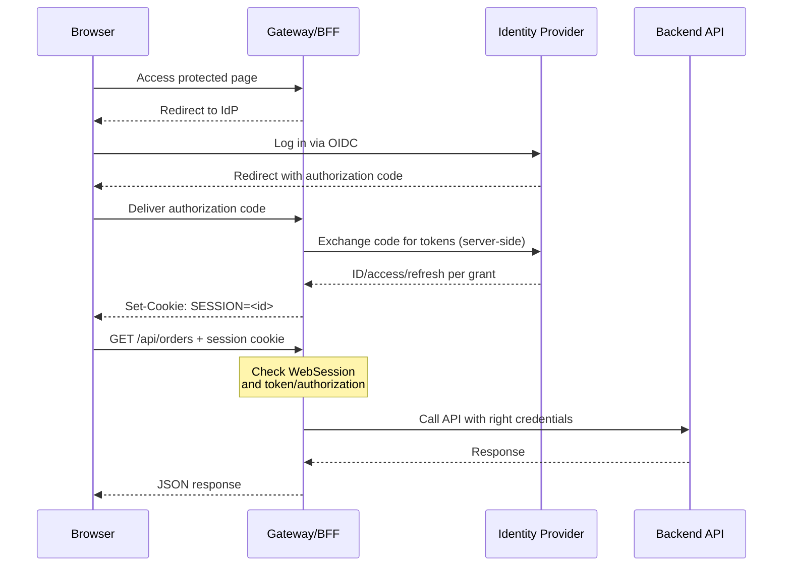
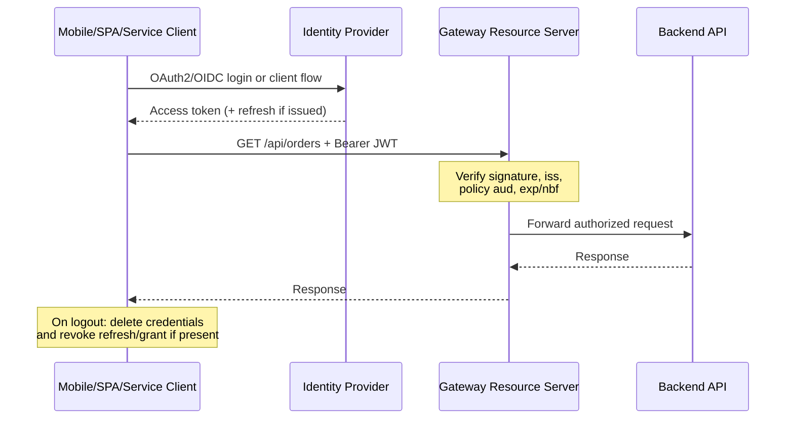
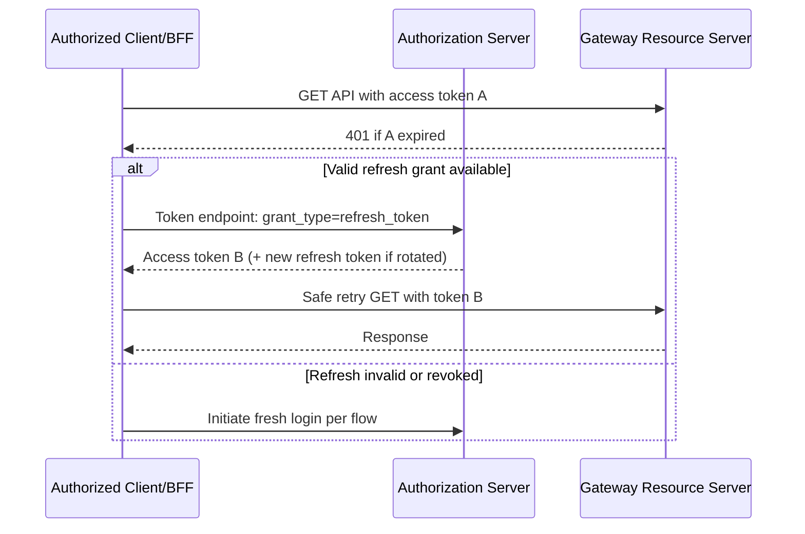

# Logout, Token Expiration, and User Session Lifecycle

A user logs into an application, calls APIs through Spring Cloud Gateway, leaves the browser idle for a while, and returns. When must they log in again? If the user clicks **Log out**, can a previously issued access token still call APIs? If a session expires on one Gateway replica while another still holds stale data, how does the system behave?

These questions cannot be answered by a single `timeout` property. In a microservices architecture, **login sessions**, **access tokens**, **refresh tokens**, and **login sessions at the Identity Provider (IdP / OIDC Provider)** are distinct entities. They each have separate lifetimes, revocation states, and responsibility boundaries.

The **Sessions and Tokens** chapter of the **SPRING_CLOUD_GATEWAY** module focuses on managing **logout, token expiration, and user session lifecycles** when the Gateway fronts microservices. This lesson connects route predicates, filter chains, path/header modifications, service discovery, authentication/authorization, rate limiting, circuit breakers, retries, TLS, and observability to avoid the "logged out in the UI yet APIs still accept old tokens" failure mode.

> **Scope:** Examples use **Spring Cloud Gateway Server WebFlux** and **Spring Security Reactive**. Distinguish between a Gateway acting as an **OAuth2 Resource Server** (validating incoming access tokens) and an **OAuth2/OIDC Client** (orchestrating login and holding authorized clients/web sessions). Some OIDC logout features depend on the Spring Security version and Identity Provider capabilities. Never copy Servlet `HttpSession`/`HttpSecurity` code into WebFlux assuming identical behavior.

## 1. Four Things That Often Get Called "Session"

| Entity | Where Is It Created and Stored? | What Does It Hold or Reference? | When Does It End? |
|---|---|---|---|
| **Gateway/BFF `WebSession`** | WebFlux `WebSession`; state may reside in memory or Redis via Spring Session | Security context, session attributes, or configured OAuth2 client state | Idle expiration, invalidation, or policy-based eviction |
| **Access token** | Issued by Authorization Server/Identity Provider; sent by client or BFF in `Authorization: Bearer` | API access rights, lifetime, issuer/audience/scope; JWT or opaque token | Reaches `exp`, policy rejection, or revocation if supported |
| **Refresh token** | Issued by Authorization Server to eligible clients; typically stored securely | Allows requesting new access tokens; never sent directly as a resource API bearer token | Expiration, revocation, rotation, or grant cancellation |
| **SSO/OIDC session at IdP** | Managed by the Identity Provider | Login state at the identity system | User logs out at IdP, IdP session expires, or admin revokes it |

**A single user can hold multiple concurrent sessions across multiple devices.** Logging out of one tab, one browser, or one app does not automatically log out everywhere. "Log out this device" and "log out all devices" must be designed explicitly.

### 1.1. A session cookie is not an access token

In a session-based login model, the browser may receive a cookie like:

```http
Set-Cookie: SESSION=<random-session-id>; Path=/; Secure; HttpOnly; SameSite=Lax
```

The cookie value **is only a session identifier** in a typical server-side session model. Actual authentication data lives server-side in the session store. Once the session is invalidated, keeping the cookie with the old session ID cannot revive the session.

Conversely, in a Bearer JWT API:

```http
GET /api/orders/42 HTTP/1.1
Host: api.example.test
Authorization: Bearer <access-token>
```

An issued JWT typically has its signature and claims verified by the Gateway **without looking up a server-side session per request**. Merely deleting the token in one browser leaves copies on other devices usable until expiration or revocation rejection.

### 1.2. Resource Server and OAuth2 Client are two distinct roles

- **Gateway Resource Server:** uses Spring Security OAuth2 Resource Server to validate Bearer tokens—checking issuer, signature, `exp`/`nbf`, configured audience, and authorities/scopes. It **does not log the user out at the IdP** and **does not refresh tokens** merely because an incoming token expired.
- **Gateway OAuth2/OIDC Client or BFF:** coordinates Authorization Code flow/PKCE as appropriate, stores authorized clients/tokens per design, and may support local logout or initiate OIDC logout at the IdP. Session and token storage must be protected.
- **Backend Resource Server:** validates access tokens or uses a trusted identity mechanism; the backend must still check resource-level permissions.

**Never equate `TokenRelay` with a JWT refresh/revocation mechanism.** `TokenRelay` in Spring Cloud Gateway relates to authorized OAuth2 clients when the Gateway is configured in an OAuth2 Client role; a resource server validating inbound Bearer tokens does not automatically create an authorized client and refresh token to relay.

## 2. Lifecycle of a Single Login

A common lifecycle:

```mermaid
stateDiagram-v2
    [*] --> LoggedOut
    LoggedOut --> LoggingIn: Authentication succeeds
    LoggingIn --> Active: Create session / issue access token
    Active --> Active: Call API; extend idle timer when applicable
    Active --> AccessExpired: Access token expires
    AccessExpired --> Active: Refresh succeeds while session remains valid
    AccessExpired --> ReauthRequired: Cannot refresh
    Active --> ReauthRequired: WebSession timeout or session revoked
    Active --> LoggedOutState: Valid logout
    AccessExpired --> LoggedOutState: Logout / session revocation
    LoggedOutState --> LoggedOut
    ReauthRequired --> LoggedOut
```



This diagram is conceptual: **`WebSession` state** and **access token state** can evolve in parallel. For instance, `WebSession` may remain valid after the backend access token expires; a BFF can refresh if a valid refresh token exists. Conversely, an access JWT can remain valid after `WebSession` or the IdP session ends if Resource Servers validate JWTs offline.

### 2.1. Three timeouts that must be configured independently

| Timeout | Meaning | Illustrative Example |
|---|---|---|
| **Session idle timeout** | Session expires after a period without qualifying activity. | 20 minutes of inactivity |
| **Session absolute lifetime** | Maximum age of a session from a fixed event, even if still active. | Force re-login after 12 hours |
| **Access token TTL** | Window during which the access token is accepted per claims/policy. | 5–15 minutes, depending on threat model |
| **Refresh token TTL / rotation policy** | Bounds how long new tokens can be obtained and how reuse of old tokens is detected. | Expires after several days or per inactivity/rotation |
| **IdP SSO session lifetime** | How long the user stays logged in at the identity provider. | Governed by the IdP |

Numbers in this table are **illustrative only**, not defaults or mandatory standards. Proper values depend on risk, UX, MFA, data sensitivity, device types, and IdP policy.

**Idle timeout differs from absolute timeout.** A system configuring only `maxIdleTime` on `WebSession` can keep a session alive indefinitely if activity continues steadily. If policy requires "re-login after N hours regardless of activity", add an **absolute expiry** in the trusted session/grant manager.

## 3. How Are Expired Tokens Evaluated?

JWT access tokens typically include time-related claims:

```json
{
  "iss": "https://identity.example.test/issuer",
  "sub": "user-123",
  "aud": ["orders-api"],
  "iat": 1999995000,
  "nbf": 1999995000,
  "exp": 1999995900,
  "scope": "orders.read"
}
```

This is an **illustrative payload**, not a signed JWT or real credential.

- **`iat` — issued at:** when the token was issued; never replaces signature or `exp` checks.
- **`nbf` — not before:** token must not be accepted before this timestamp, subject to clock skew policy.
- **`exp` — expiration:** token is invalid after this timestamp, subject to validator/clock skew policy.
- **`iss` — issuer:** accepted issuer.
- **`aud` — audience:** API/Resource Server the token was issued for; verify per Gateway/backend policy.
- **`scope`/`scp`:** permission scopes, used only after token verification and authority mapping.

Spring Security Resource Server for **Reactive JWT** validates signatures, `iss`, and `exp`/`nbf` under standard config. **Audience validation must be verified or added with a matching validator**—never assume `issuer-uri` alone binds tokens to a specific API.

### 3.1. Clock skew: why can a freshly expired token still be accepted?

Machines across infrastructure zones can exhibit slight clock drift. JWT validators usually allow a **clock skew (leeway)** to tolerate minor drift, so outcomes right near `exp`/`nbf` may not align to the exact second seen on a client device.

Across Spring Security versions, `JwtTimestampValidator` allows configuring skew; current docs describe a **60-second default** for Resource Server. This is a **tolerance**, not a guarantee of "one extra minute of access". Verify your version's defaults and effective config, synchronize NTP across Gateway/IdP/backends, and avoid inflating skew to mask clock bugs.

### 3.2. What should the user experience when an access token expires?

For Bearer APIs:

1. Client calls the API with an access token.
2. Gateway Resource Server validates the token and detects expiration.
3. The request is rejected at the authentication layer, typically **`401 Unauthorized`**, without reaching the backend route.
4. If the client/BFF **is allowed to refresh**, it requests a new access token from the IdP and retries **in a controlled manner**.
5. If refresh fails, or the session/grant expired or was revoked, the client transitions to **re-login**.

**Never loop refresh calls infinitely on `401`.** A `401` can also stem from wrong issuer, wrong audience, revoked token, bad signature, or other policies. Refreshing only makes sense when the cause is understood and a valid session/refresh token remains.

## 4. What Must Logout Actually Invalidate?

"Logout" is a **security lifecycle action**, not just toggling a UI button label. Depending on architecture, logout may involve:

1. Clearing local application/Gateway session state if present.
2. Invalidating `WebSession` in the server-side store, not just deleting the client cookie.
3. Clearing the session cookie with matching attributes and purging client state/tokens per policy.
4. Revoking the refresh token/authorized grant at the Authorization Server if permitted and supported.
5. Initiating **OIDC logout at the IdP** if SSO session termination is required and supported by the provider.
6. If **immediate** access token cutoff is required, applying a suitable revocation check: opaque token introspection, revocation/denylist/permission versioning, checked consistently across all resource servers.
7. Auditing the logout event without logging sensitive tokens or cookies.

**No single built-in logout method performs all of these automatically by default.**

### 4.1. Impact matrix of each action

| Action | Gateway/BFF `WebSession` | Refresh Token | Already-Issued JWT Access Token | IdP SSO Session |
|---|---|---|---|---|
| Hiding UI / switching UI state to "signed out" | Not guaranteed to invalidate | No | No | No |
| Deleting session cookie in browser | Browser stops sending ID; server session may still exist | No | No | No |
| Invalidating `WebSession` server-side | That session becomes invalid | Not automatic | Not automatic | Not automatic |
| Calling OAuth2 revocation endpoint for refresh token | Not automatic | Can be revoked, per IdP | Does not reliably reject live tokens offline | Not automatic |
| OIDC RP-initiated logout | Depends on app's local handling | Depends on provider & setup | Not by default | Can end the IdP session |
| Denylist / token status checks | Not directly | Design-dependent | Depends on validator rules & check points | Not directly |

**Revoking a refresh token does not immediately invalidate already-signed access JWTs.** If Resource Servers check only signatures/`exp` without revocation state, JWTs remain accepted until expiration even after browser logout.

## 5. Two Common Architectural Patterns

### 5.1. Pattern A — BFF/Gateway holding server-side sessions

In **Backend For Frontend (BFF)**, the browser holds a **secure session cookie**, while the Gateway/BFF holds required OAuth2 credentials server-side per policy.



**Advantages:** browser JavaScript never holds access/refresh tokens; sessions can be invalidated server-side; fits when web app and BFF share a trust boundary.

**Trade-offs:** must manage `WebSession`, CSRF/cookies, synchronization across Gateway replicas, refresh token lifecycle, and consistency between local logout and IdP logout.

### 5.2. Pattern B — API Gateway Resource Server accepting Bearer tokens



**Advantages:** resource servers verify JWTs independently, reducing per-request reliance on a session store.

**Trade-offs:** there is no "server-side session" to invalidate issued JWTs by default. If **immediate** access cutoff is required, extra revocation strategies and checks are needed, trading off latency, distributed state, or identity-system availability.

### 5.3. Never mix both patterns without clear boundaries

One Gateway configuring both `oauth2Login()` and `oauth2ResourceServer().jwt()` can serve distinct URL groups/clients, yet needs clear rules for:

- Which requests use cookies/sessions vs. Bearer tokens?
- Can a request carry both a cookie and an `Authorization` header; which identity wins?
- Which cookie-authenticated routes require CSRF?
- Does logout purge both local `WebSession` and authorized clients?
- Does the backend receive identity via token or another trusted channel?

Never write two overlapping security chains expecting them to merge cleanly on their own. **`SecurityWebFilterChain` ordering and `securityMatcher` determine which chain handles each request**; test the boundary between path regions explicitly.

## 6. WebSession Logout in Spring Security WebFlux

Per the Spring Security Reactive docs, after logging in, the default logout endpoint may present a confirmation page on `GET /logout` and execute logout on `POST /logout`. Exact logout behavior/matchers depend on configuration and enabled CSRF protection.

Spring Security docs note that default logout clears CSRF/security context state, yet when **`WebSession` invalidation** is needed, explicitly configure **`WebSessionServerLogoutHandler`** alongside the security context logout handler.

### 6.1. Example: local logout invalidating `WebSession`

**Spring Security Reactive** example for a Gateway/BFF using OIDC login with an existing OAuth2 Client config:

```java
package com.example.gateway.security;

import org.springframework.context.annotation.Bean;
import org.springframework.context.annotation.Configuration;
import org.springframework.security.config.annotation.web.reactive.EnableWebFluxSecurity;
import org.springframework.security.config.web.server.ServerHttpSecurity;
import org.springframework.security.web.server.SecurityWebFilterChain;
import org.springframework.security.web.server.authentication.logout.DelegatingServerLogoutHandler;
import org.springframework.security.web.server.authentication.logout.SecurityContextServerLogoutHandler;
import org.springframework.security.web.server.authentication.logout.WebSessionServerLogoutHandler;

import static org.springframework.security.config.Customizer.withDefaults;

@Configuration
@EnableWebFluxSecurity
public class BrowserSessionSecurityConfig {

    @Bean
    SecurityWebFilterChain browserSecurity(ServerHttpSecurity http) {
        var logoutHandler = new DelegatingServerLogoutHandler(
            new SecurityContextServerLogoutHandler(),
            new WebSessionServerLogoutHandler()
        );

        return http
            // Never disable CSRF for browser cookie-authenticated apps.
            .authorizeExchange(exchanges -> exchanges
                .pathMatchers("/login", "/assets/**").permitAll()
                .anyExchange().authenticated()
            )
            .oauth2Login(withDefaults())
            .logout(logout -> logout.logoutHandler(logoutHandler))
            .build();
    }
}
```

**Conditions for this example:**

1. The app already defines an **OAuth2 Client registration** with a reachable IdP. Adding this class alone does not create an OIDC login system.
2. The handler is configured to **clear `SecurityContext`** and **invalidate `WebSession`**. It does not automatically call a revocation endpoint or OIDC Provider logout.
3. Spring Security may use a CSRF token repository per configuration. When customizing logout handlers/CSRF repositories, verify that related CSRF state is also cleared/invalidated per policy.
4. `GET /logout` typically renders a confirmation page; state-changing logout must use a CSRF-protected method/matcher when using cookies.
5. Place `/logout` on **the exact Gateway/BFF owning `WebSession`**. Accidentally routing logout to a backend service will not clear the Gateway's session.

### 6.2. Why not simply call `WebSession.invalidate()` ad-hoc?

WebFlux provides `WebSession.invalidate()`, yet **logout is a security lifecycle operation**, not merely clearing an attribute map:

- Security context/repository state must be cleared properly.
- Logout must only be reachable via protected endpoints/methods/CSRF policies.
- Authorized clients, session cookies, and IdP linkage may also need cleanup.
- Repeated logout calls or mid-flight network drops must behave cleanly.

Using Spring Security's logout handlers keeps the lifecycle consistent rather than writing a custom `GatewayFilter` that calls `invalidate()` and returns `200`. If customizing further, understand every side effect you are replacing.

### 6.3. Deleting a cookie and invalidating a session are two separate steps

After successful logout, the client should stop sending the session cookie. Cookie deletion must match the exact **name/path/domain**; `Secure`, `HttpOnly`, and `SameSite` must fit HTTPS and origin boundaries.

Illustrative cookie-deletion header:

```http
Set-Cookie: SESSION=; Max-Age=0; Path=/; Secure; HttpOnly; SameSite=Lax
```

**Deleting the browser cookie does not automatically remove the server-side session.** Conversely, server-side session invalidation must ensure the old session ID becomes unusable even if the browser fails to process cookie deletion due to a network error.

## 7. Session Timeout and Spring Session with Multiple Gateway Replicas

With multiple Gateway instances behind a load balancer, local **in-memory `WebSession`** loses sessions or behaves inconsistently whenever a follow-up request hits another replica. Common options:

- **Shared session store**, e.g., Spring Session Redis for WebFlux.
- **Session affinity/stickiness** at the front load balancer, while still accounting for restarts/failover and recognizing it does not replace consistent session management.
- **Stateless Bearer JWT** if suited to the architecture and paired with an explicit revocation model.

Spring Session provides **Reactive `WebSession`** integration backed by Redis, letting all Gateway instances access sessions through a shared store instead of isolated per-node memory.

### 7.1. Spring Boot and Spring Session Redis with WebFlux

In supported Spring Boot versions, add the Spring Session Redis starter/dependency:

```xml
<dependency>
    <groupId>org.springframework.boot</groupId>
    <artifactId>spring-boot-starter-session-data-redis</artifactId>
</dependency>
```

**Illustrative** configuration example:

```yaml
spring:
  session:
    timeout: 20m
  data:
    redis:
      host: redis.internal.example.test
      port: 6379
```

In real deployments, configure Redis DNS, credentials, and TLS per security policy. Never commit Redis passwords to Git or print them in logs; manage secrets via infrastructure secret managers.

Spring Boot provides auto-configuration for **Spring Session reactive Redis** when the right starter/stack is present. Spring Session docs also allow advanced setup via `@EnableRedisWebSession`; **do not add duplicate annotations when auto-configuration already satisfies your needs**.

### 7.2. Idle timeout does not equal token timeout

Suppose:

- `WebSession` idle timeout: 20 minutes.
- Access token expires after 10 minutes.
- Refresh token remains valid for a longer period.

If the user calls APIs steadily, `WebSession` stays alive when the access token expires. A proper BFF can request a new token if a valid refresh token exists; a Resource Server receiving an expired Bearer token returns `401` and does not refresh it itself.

Conversely, if the user stays idle beyond 20 minutes, the session may be purged even if the access token has not expired yet. **This is not a contradiction:** the two artifacts have independent lifecycles.

### 7.3. Absolute timeout and revoking all sessions

Security requirements sometimes include:

- Forcing re-login after N hours even during continuous activity.
- Terminating all sessions for a user upon password change or account compromise.
- Logging out only one specific device.

Supporting these requires a **trusted session registry or user ↔ sessions mapping**, re-authentication workflows, and consistent policy enforcement across all Gateway replicas. **No simple idle-timeout setting can replace "log out all devices".**

When deleting sessions in Redis, account for replication propagation, in-flight requests, and sessions cached in other services. Invalidating a Gateway session does not automatically erase sessions held independently by backends or the IdP.

## 8. Logout When the Gateway Is Purely a JWT Resource Server

For a Gateway accepting only Bearer JWTs, there is no `WebSession` to destroy. A baseline configuration:

```yaml
spring:
  security:
    oauth2:
      resourceserver:
        jwt:
          issuer-uri: https://identity.example.test/issuer
```

```java
package com.example.gateway.security;

import org.springframework.context.annotation.Bean;
import org.springframework.context.annotation.Configuration;
import org.springframework.security.config.annotation.web.reactive.EnableWebFluxSecurity;
import org.springframework.security.config.web.server.ServerHttpSecurity;
import org.springframework.security.web.server.SecurityWebFilterChain;
import org.springframework.security.web.server.context.NoOpServerSecurityContextRepository;

import static org.springframework.security.config.Customizer.withDefaults;

@Configuration
@EnableWebFluxSecurity
public class BearerApiSecurityConfig {

    @Bean
    SecurityWebFilterChain apiSecurity(ServerHttpSecurity http) {
        return http
            // Suitable ONLY when APIs authenticate via Authorization: Bearer,
            // never relying on auto-sent browser cookies for auth.
            .csrf(ServerHttpSecurity.CsrfSpec::disable)
            .securityContextRepository(
                NoOpServerSecurityContextRepository.getInstance())
            .authorizeExchange(exchanges -> exchanges
                .pathMatchers("/public/health").permitAll()
                .pathMatchers("/api/**").authenticated()
                .anyExchange().denyAll()
            )
            .oauth2ResourceServer(resourceServer ->
                resourceServer.jwt(withDefaults()))
            .build();
    }
}
```

This illustrates a **stateless JWT pattern**; do not enable it alongside the browser-session config in section 6 within the same app without designing separate security chains/matchers. In real systems, configure JWT validators for audience and issuer/tenant rules, and enforce method/role/scope authorization rather than `authenticated()` alone.

### 8.1. What does "logout" mean in the JWT model?

In this model, logout is typically initiated by the **client** and backed by the identity system:

1. The client stops using and **deletes the access token** from its local storage.
2. If holding a refresh token, the client sends a **revocation** request to the Authorization Server's revocation endpoint per OAuth2 contract after proper client authentication.
3. The Authorization Server revokes the refresh token/grant per policy.
4. If unexpired access tokens must be blocked immediately, Resource Servers/Gateways need **additional revocation checks** or short token lifetimes matching acceptable risk.
5. If logged in via OIDC and SSO must end too, perform OIDC logout separately when supported by the provider.

**Never create a `GET /logout` API expecting it to erase every issued JWT.** With immutable signed JWTs validated offline, a stolen token can still be used until expiration unless a revocation check exists.

### 8.2. Why never let clients send refresh tokens to every backend?

A refresh token is a high-value credential capable of minting fresh access tokens. It belongs solely between the **Authorization Server and authorized client**, never as business data sent to all downstream services.

- Never pass refresh tokens via client-supplied `X-Refresh-Token` headers.
- Never write refresh tokens into logs, URLs, or query strings.
- Never forward refresh tokens to resource servers not explicitly designed for token exchange/refresh.
- In a BFF, keep refresh tokens in a protected server-side store; the browser receives only a securely configured session cookie.

## 9. OAuth2 Token Revocation and Limits of Self-Contained JWT Validation

**RFC 7009 — OAuth 2.0 Token Revocation** defines how an OAuth2 client asks the Authorization Server to revoke a token. Obtain the exact IdP endpoint and client auth method from trusted docs/discovery; never assume every IdP uses `/oauth2/revoke`.

Illustrative **HTTP frame** for a confidential client:

```http
POST /oauth2/revoke HTTP/1.1
Host: identity.example.test
Content-Type: application/x-www-form-urlencoded
Authorization: Basic <client-credentials-encoded>

token=<refresh-token>&token_type_hint=refresh_token
```

Token and client credential values are **placeholders**; never put real tokens in examples or send them unencrypted. Real endpoints must use **HTTPS**, secrets must be managed securely, and only authorized clients may invoke them per IdP policy.

**Key takeaways from RFC 7009:**

- Authorization Servers must support revoking **refresh tokens** and are recommended to support revoking **access tokens**.
- Revoking a refresh token may also revoke related access tokens or grants **depending on IdP capabilities and policy**.
- A `200` response to revocation **does not prove every Resource Server validating JWTs offline immediately knows about the revocation**.
- **Propagation delay** may exist across components when enforcing revocation.

### 9.1. Three ways to handle "logout must cut off access immediately"

| Strategy | How It Works | Trade-Off |
|---|---|---|
| **Short-lived access JWT** | Shrinks the window during which a JWT stays accepted after logout. | Cannot guarantee cutoff before `exp`; requires safe refresh handling. |
| **Opaque access token + introspection** | Resource Server queries the Authorization Server for token status per cache policy. | Adds network dependency/latency; caching delays visibility of revocation. |
| **JWT + revocation/denylist/session-version check** | Requests or checkpoints compare `jti`/session ID/version against server-side state. | Requires storage, sync, TTLs, network error handling, and clear fail-closed rules. |

Pick one or combine them based on risk tolerance, latency budgets, and operational needs. **Never call JWTs "completely stateless" if every request consults a denylist**: at that point, state has been reintroduced onto the auth path in exchange for early revocation.

### 9.2. How to use a denylist without introducing new bugs

If blocking JWTs by `jti` or session identifier:

1. Trust claims only after verifying **signature/issuer/audience/timestamps**.
2. Record a safe identifier key with a TTL matching the token's remaining lifetime.
3. For "log out all devices", maintain a trusted user/grant-level mapping or permission version.
4. Ensure every Gateway/Resource Server checks revocation state consistently; no node may silently skip checks.
5. Define behavior when the revocation store is **unavailable**: fail closed on sensitive APIs, or use explicitly bounded graceful degradation.
6. Avoid error messages that leak account state or act as token-probing oracles.

Never build a denylist by storing raw Bearer tokens in logs or unprotected caches; use structured identifiers or keyed hashes with strict store access controls.

## 10. Refresh Tokens: Refreshing, Rotation, and Reuse Detection

**Refresh tokens** let authorized clients acquire new access tokens without prompting users for passwords on every expiry. They are not issued automatically in every OAuth2 grant.



A BFF can proactively refresh **before** the access token expires using a threshold, rather than waiting for an API `401`. Even then, never trust client clocks alone to skip access token validation at resource servers.

### 10.1. Refresh token rotation

With rotation, each use of a refresh token causes the Authorization Server to issue a **new refresh token** and invalidate the prior one per policy. **Reuse detection** on an old token can signal token theft to the IdP and revoke the entire token family.

Implementation pitfalls to guard against:

- **Persist the new refresh token atomically and safely** per session/authorized client.
- **Prevent concurrent refreshes:** two simultaneous HTTP requests seeing a near-expiry access token may send the old refresh token twice, triggering false-positive reuse detection or storage overwrites.
- When refresh fails, **never retry indefinitely**; transition the session to re-login required.
- If the IdP reports the grant/token was revoked, never fall back to an older cached refresh token to "retry".
- Define recovery when a client crashes after the IdP issues a new token but before the BFF persists it.

### 10.2. Refresh token valid while session expired

If `WebSession` expired and the BFF no longer holds the user's authorized client, **do not auto-resurrect the session merely because a refresh token lingers in some cache**. Re-establishing a session must respect authentication boundaries, session binding, and re-login policies.

Conversely, if a legitimate native/SPA client holds a refresh token under its own grant, it can obtain new access tokens without a Gateway `WebSession`. That is a different architecture: API access remains governed by the newly issued access token.

## 11. OIDC Logout: Local Logout Is Not Provider Logout

For applications using **OpenID Connect**, a user may hold both a **BFF/Gateway session** and an **SSO session at the IdP**.

With local-only logout, reopening the app sends the user into OIDC login where an active IdP SSO session logs them right back in without a password prompt. This often looks like "logout is broken", when in reality only **one of the two sessions** was ended.

### 11.1. RP-Initiated Logout

When the OIDC Provider supports an end-session endpoint, the app can trigger **RP-initiated logout**, redirecting the user-agent through the IdP to terminate the SSO session.

Spring Security WebFlux provides **`OidcClientInitiatedServerLogoutSuccessHandler`** using **`ReactiveClientRegistrationRepository`**. Example handler configuration:

```java
import org.springframework.security.oauth2.client.registration.ReactiveClientRegistrationRepository;
import org.springframework.security.oauth2.client.oidc.web.server.logout.OidcClientInitiatedServerLogoutSuccessHandler;
import org.springframework.security.web.server.authentication.logout.ServerLogoutSuccessHandler;

@Bean
ServerLogoutSuccessHandler oidcLogoutSuccessHandler(
        ReactiveClientRegistrationRepository registrations) {
    var handler = new OidcClientInitiatedServerLogoutSuccessHandler(
        registrations);
    handler.setPostLogoutRedirectUri("{baseUrl}/signed-out");
    return handler;
}
```

When wiring this into a `SecurityWebFilterChain` using `oauth2Login()`, register the logout success handler per the Spring Security docs for your version. **Do not declare the `@Bean` and assume the framework wires it automatically.**

**Verify carefully:**

- The IdP publishes/supports an OIDC end-session endpoint via discovery or trusted configuration.
- Client ID and post-logout redirect URI are allowlisted at the IdP.
- Local logout still invalidates `WebSession` and security context per policy.
- `{baseUrl}` derives from a hostname/scheme verified through trusted reverse proxies to prevent open redirects and host-header injection.
- Provider logout does not automatically revoke every live access JWT cached at resource servers.

### 11.2. Back-channel logout

Some providers and Spring Security versions support **OIDC Back-Channel Logout**, where the IdP sends a logout token directly to the app to terminate matching sessions. Because this is not a normal browser request, it requires verifying the logout token and mapping provider sessions ↔ local sessions.

In WebFlux, Spring Security docs may provide `OidcBackChannelServerLogoutHandler` and a dedicated endpoint; exact wiring depends on version and cookie/session naming. **Never copy snippets from another version without testing**, as mismatched endpoints or cookie names can prevent back-channel logout from finding the `WebSession` to destroy.

Across multiple Gateway replicas, the IdP-session-to-local-session mapping also needs a shared store; keeping mappings in single-node memory cannot deliver cluster-wide logout.

## 12. CSRF, Cookies, and Security Requirements for Logout

With **browser cookie authentication**, browsers automatically attach cookies to requests. A malicious site could forge requests on a user's behalf against an active session unless CSRF protections are in place.

**Never disable CSRF just to make the logout endpoint easier to call.** For OIDC login/BFF cookies, configure Spring Security CSRF properly (token repository, same-origin checks, and client submission on state-changing requests). A logout handler on `POST /logout` must only accept policy-compliant requests.

### 12.1. Cookie flags

| Attribute | Benefit or Meaning | Caveats |
|---|---|---|
| **`Secure`** | Cookie sent only over HTTPS per browser rules. | Mandatory for session cookies in public HTTPS deployments. |
| **`HttpOnly`** | JavaScript cannot read the cookie directly. | Reduces session ID theft via JS; does not stop all XSS impact. |
| **`SameSite=Lax/Strict/None`** | Governs cookies in cross-site contexts. | `None` requires `Secure`; choice depends on OIDC redirects, embedding, and UX. |
| **`Path`, `Domain`** | Constrains cookie scope. | Must match on cookie deletion; avoid overly broad `Domain` values. |
| **Cookie rotation/session ID renewal** | Reduces session fixation/reuse risk across transitions. | Apply via framework mechanisms and auth policy; never use predictable IDs. |

Note that **CSRF differs from CORS**. CORS governs when browsers let JavaScript read cross-origin responses; it never replaces CSRF protection on cookie-authenticated endpoints. A valid CSRF token also does not make arbitrary Origins trustworthy.

### 12.2. Never use GET for state-changing logout

`GET` URLs can be triggered unexpectedly by browser preloading, crawlers, link prefetchers, or security scanners. Therefore, session-destroying logout should be a **POST** action with CSRF protection suitable for cookie auth. If `GET /logout` exists in the UI, it should only render a confirmation page, never destroy sessions as a side effect.

## 13. Dividing Responsibilities Across Gateway, Backend, and IdP

| Layer | Core Responsibilities in Session Lifecycle |
|---|---|
| **Browser/mobile client** | Protect credentials appropriately, stop sending tokens after logout, prompt re-login when needed. |
| **Gateway/BFF** | Manage `WebSession` if stateful, enforce edge auth/authz, handle local logout, and run IdP/token flows per assigned role. |
| **Authorization Server/IdP** | Issue/refresh/revoke tokens, manage SSO sessions, enforce MFA and token rotation policies. |
| **Backend Resource Server** | Validate tokens/identities or trust boundaries; enforce resource and data-level authorization. |
| **Spring Session/Redis** | Persist shared server-side sessions when required by architecture. |
| **Reverse proxy/Ingress** | TLS, hostnames, trusted forwarded headers, and edge access restrictions. |

### 13.1. Logout does not automatically abort in-flight requests

If a user logs out while an earlier request has already cleared authentication/authorization and is executing on a backend, invalidating the session **does not necessarily abort the in-flight request immediately**. Define explicit policies for side-effecting operations:

- Are permissions re-checked at business commit time?
- Are idempotency keys used for payments/orders?
- Must session/grant revocation propagate across other network boundaries?
- What is the propagation delay across components when a logout event occurs?

Never promise users "every running request stops immediately" unless the system explicitly implements and tests that guarantee.

### 13.2. Retries, circuit breakers, and refresh

Some refresh logic lives in HTTP clients/BFFs and reacts to `401`. Meanwhile, the Gateway may run a **`Retry` GatewayFilter** or circuit breaker toward downstream. Mixing both without boundaries can create loops:

1. Access token expires → API returns `401`.
2. Client refreshes and retries.
3. Gateway/HTTP client also retries downstream.
4. The same POST can fire multiple times without idempotency.

Separate **authentication/refresh retries** from **network/downstream retries**. Never enable generic retries on side-effecting writes without idempotency keys and timeout budgets.

### 13.3. TLS and token forwarding

A leaked Bearer token can be replayed by anyone within its lifetime/scope unless constrained by mechanisms like sender-constrained token binding. Therefore:

- Enforce HTTPS for client → Gateway.
- Protect Gateway → backend via TLS/mTLS/network policies and clear trust boundaries.
- Never pass tokens in query strings, redirect URLs, `Referer` headers, or logs.
- Restrict which backends receive access tokens; validate audience and scopes where resources are handled.
- Never trust client-supplied `X-User-Id`/`X-Role` headers, even after passing route predicates.

## 14. Error Handling and Client Responses on Session/Token Expiry

| Scenario | Typical Response | What Should Client/BFF Do? |
|---|---|---|
| Bearer token missing or expired | `401 Unauthorized`, optionally with `WWW-Authenticate: Bearer` | If a valid refresh exists, refresh in a controlled way; otherwise re-login. |
| Bearer token valid, missing scope | `403 Forbidden` | Do not retry refresh infinitely hoping for new rights; display forbidden and check grants. |
| Browser `WebSession` expired | Redirect to login or `401`, per chain/handler | Distinguish UI navigation from JSON APIs; keep app state consistent. |
| Refresh token revoked/expired | Token endpoint error, often OAuth2 `invalid_grant` | Purge old token state and require fresh login. |
| OIDC local logout succeeded, IdP SSO remains | User logs back in without password | Evaluate RP-initiated logout and IdP session policy. |
| Redis session store error | 5xx or unauthenticated failure per design | Never fail open on sensitive APIs; monitor store and SLAs. |
| Backend instance missing | Gateway reports upstream error, not token error | Check discovery/load balancing; do not refresh tokens. |
| Rate limiter rejects request | `429 Too Many Requests` | Back off per policy; never log users out unnecessarily. |

**Never return `401` for every error.** Doing so traps clients in refresh or re-login loops when the real fault is Redis, downstream failure, route mismatch, or rate limiting.

### 14.1. Distinguishing API responses from browser redirects

Top-level UI navigations can receive `302` to a login page. However, a SPA calling `fetch('/api/orders')` expects JSON/status codes—not its HTTP client silently following redirects to parse a `200` HTML login page as JSON.

Design deliberately:

- UI endpoints: redirect to the login page per UX.
- API endpoints: typically return `401` with a machine-readable error code, avoiding redirect loops.
- Logout endpoints: return `204` or a post-logout redirect per client type, paired with session/cookie cleanup.

This is an API/UX design choice, not a single universal Spring Security default.

## 15. Testing Session and Token Lifecycles

Testing login success is not enough. A test suite must verify that **logout genuinely revokes access according to the chosen model**.

### 15.1. Test matrix

| Test Case | Scenario | What Must Be Verified |
|---|---|---|
| A | Unauthenticated call to protected API | `401` or policy-matching redirect; backend never called improperly |
| B | Logged in, call protected API | Valid session/token and permissions; backend still checks ownership |
| C | Local `WebSession` logout | Old session ID rejected; cookie/CSRF state handled properly |
| D | Cookie deleted while server session remains | Never treat client-side deletion as revocation; verify server-side state |
| E | Expired access JWT | Resource Server returns `401`; request never reaches backend |
| F | Live JWT after client logout | Verify behavior matches chosen revocation strategy; never assume JWT auto-expires |
| G | Valid refresh token | Mints new access token cleanly; refresh token never leaked |
| H | Revoked refresh token | Refresh fails; client breaks loop and prompts login |
| I | Two concurrent refreshes | New refresh token not lost; no false-positive reuse alert |
| J | `WebSession` idle timeout | Expires per policy; client receives re-login signal |
| K | Absolute lifetime reached | Forces re-login even after recent activity |
| L | Two Gateway replicas sharing session store | Logout on replica A blocks old session on replica B |
| M | Logout one device while another remains active | Matches local-logout requirement without revoking other devices accidentally |
| N | Logout all devices | All targeted sessions/grants revoked per design |
| O | OIDC logout at IdP | Provider session ends if supported; test SSO re-login behavior |
| P | CSRF attack on logout endpoint | Blocked when using cookie auth and CSRF policy |
| Q | Redis/IdP/network outage | Fails safely without opening access; errors classified and alerted |

### 15.2. Testing `WebSession` with `WebTestClient`

In WebFlux apps, use `WebTestClient` against a protected test endpoint to verify post-logout `WebSession` behavior. Ensure the test boots the real **`SecurityWebFilterChain`**, session store, and CSRF policy:

```java
// Structural skeleton only, not a complete test class.
// 1) Log in the test client via real mechanism (form/OIDC mock).
// 2) Capture the SESSION cookie and CSRF token properly.
// 3) Send POST /logout with valid cookie + CSRF token.
// 4) Replay the old session cookie:
webTestClient.get()
    .uri("/api/orders/42")
    .cookie("SESSION", oldSessionId)
    .exchange()
    .expectStatus()
    .isUnauthorized(); // Holds only if API chain returns 401 rather than redirecting.
```

Never hardcode `isUnauthorized()` if the app uses form login redirecting to a login page by default; verify status/location per policy. What matters is **the old session is no longer authenticated**, not that every architecture returns the exact same HTTP code.

**Never test logout merely by checking whether the browser cookie expired.** Replay the old session ID and confirm server-side state was invalidated in the actual session store.

### 15.3. Testing real JWT expiration

Spring Security Test's `mockJwt()` is great for testing authorization rules, yet it **bypasses actual token verification**. To test `exp`, `nbf`, `iss`, and `aud`, mint JWTs signed with a **test key**, configure a test decoder, and send them over HTTP:

```text
Token A: valid signature, exp in the past          -> 401
Token B: valid signature, nbf in the future        -> 401
Token C: invalid signature                         -> 401
Token D: wrong iss                                 -> 401
Token E: wrong aud per policy                      -> 401
Token F: unexpired token with right issuer/aud     -> passes authentication
```

Separate **authorization tests** (missing scope/role → `403`) from **authentication tests** (invalid token → `401`). Control test clocks or `clockSkew` when asserting time boundaries to avoid flaky tests.

### 15.4. Testing JWT logout against business requirements

Suppose policy states "logged-out JWT access tokens must be rejected immediately":

1. Log in and obtain an unexpired access token.
2. Call the API → succeeds.
3. Log out / revoke grant or record in denylist per design.
4. Replay the **exact same old access token** across **all Gateway replicas/backend resource servers**.
5. Confirm requests are rejected per **actual SLA/contract** and never reach backends unexpectedly.

If the JWT remains accepted after step 3 when the system only promised "logout stops refreshes, access JWTs expire naturally", that behavior **matches that weaker policy** but fails immediate-revocation requirements. Distinguish **missing capability** from **implementation bug**.

## 16. Observability and Incident Troubleshooting

To diagnose "users randomly logged out" or "logged out yet API calls still succeed", correlate signals across client, Gateway, session store, and IdP without exposing credentials.

| Signal | Causes to Check | Safe Telemetry to Inspect |
|---|---|---|
| Spike in `401` right after deploy | Issuer/audience/clock skew/key rotation/config mismatch | Config version, error code category, route ID, timestamps |
| `401` after an idle period | `WebSession` idle timeout or access expiry | Session/token category, normalized idle duration |
| User logs out then immediately logs back in | IdP SSO session still active | Local logout event, provider logout flow |
| Continuous token refreshes | Clock skew, buggy expiry check, or missing concurrency guard | Refresh count, refresh outcome, anonymized client ID |
| Cookie works on replica A, fails on B | Unshared session store or key/cookie mismatch | Gateway instance, session store health, cookie name |
| Old JWT still works after logout | Offline validation without revocation check | Token TTL policy, revocation lag, JWT validator status |
| Elevated `5xx` post-login | Redis/IdP/JWKS/network/downstream unavailable | Dependency health, latency, status origin |
| Logout endpoint called from external page | Broken CSRF/cookie/`SameSite` policy | Sanitized `Origin`, CSRF denial count |

### 16.1. Never log tokens, cookies, or refresh secrets

Never log raw:

- `Authorization` and `Cookie` headers.
- Access tokens, refresh tokens, ID tokens, or client secrets.
- Authorization codes, session IDs, or callback URLs carrying sensitive codes/values.
- Full request/response bodies from the token endpoint.

Instead, log **correlation IDs**, route IDs, event types like `session_expired`, `jwt_expired`, `refresh_failed`, `logout_completed`, and non-secret error codes. If correlating events to a token without exposing it, use a keyed cryptographic fingerprint/hash per security design.

### 16.2. Behavior when IdP or session store fails

A sound design must answer:

- If Redis disconnects, should already-authenticated sessions continue?
- Can offline JWT verifiers keep running during brief IdP outages? How do caches react when JWKS rotates?
- If the revocation store is unreachable, should sensitive APIs keep running without revocation checks?
- How aggressively do clients retry refreshes, and can rate limiters/circuit breakers trip?
- Do alerts fire when requests arrive referencing logged-out sessions/tokens?

**Never default to fail-open** at critical auth/authz boundaries. Some systems use caching, timeouts, and backoff for availability, yet must document the exact risk when revocation state cannot be verified.

## 17. Common Mistakes

### 17.1. "JWTs are stateless, so logout only needs deleting the token from localStorage"

Insufficient if stolen tokens must be stopped. Clearing local state affects only that client; other JWTs or copied unexpired tokens keep working. Match token TTLs and revocation strategy to your threat model.

### 17.2. "Spring Security logout automatically revokes all refresh tokens"

False by default. Local WebFlux logout clears the security context and `WebSession` per config. Revoking OAuth2 grants/tokens requires calling the Authorization Server using supported endpoints and client credentials; OIDC logout at the IdP is yet another step.

### 17.3. "When a JWT expires, the Gateway automatically uses a refresh token to mint a new one"

An **OAuth2 Resource Server** validates access tokens and holds neither client authorization nor refresh tokens. If a BFF or OAuth2 Client exists, that component handles refreshes per its authorized flow.

### 17.4. "If `WebSession` expires, the JWT access token definitely expired too"

False. Their lifetimes are independent. An unexpired access token can still pass offline Resource Server validation without explicit binding or revocation checks.

### 17.5. "OIDC logout at the IdP makes all backends reject JWTs immediately"

There is no general guarantee of that. Check token revocation policies and how downstream validates tokens. A pre-signed JWT does not mutate just because an SSO session closed.

### 17.6. "Return HTTP 403 to tell clients to refresh their token"

Wrong under nearly all standards. `403` means credentials were authenticated yet permissions are insufficient; clients should show an access-denied message rather than looping refreshes. `401` signals invalid/expired credentials, though its root cause still needs analysis.

### 17.7. "Deleting the cookie equals deleting the session"

False. Browsers stop sending the cookie, while state in the session store persists. Logout must perform server-side invalidation for server-side sessions.

### 17.8. "Adding Redis automatically logs out all devices"

Redis is a session store, not a "log out all devices" policy. You need explicit user-to-session indexing and deletion workflows, plus IdP/grant sync if required by policy.

### 17.9. "Disabling CSRF makes logout work smoother"

With cookie-based auth, disabling CSRF opens a vulnerability. Configure endpoints/methods and CSRF tokens properly; distinguish CORS from CSRF. Disable CSRF only on pure Bearer-only APIs where appropriate.

### 17.10. "Retrying a POST after 401 or 504 is always safe"

False. If the request reached the backend and caused side effects before the client received a response, retrying duplicates the action. Enforce idempotency keys, replay policies, and distinguish auth refreshes from network retries.

## 18. Operational Checklist

1. **Choose the auth model:** browser session/BFF, OAuth2 Client, Bearer JWT Resource Server, or a combination with cleanly separated security chains.
2. **Identify token ownership:** who holds access/refresh tokens, who calls the token endpoint, and which backends may receive access tokens?
3. **Define all three lifetimes:** `WebSession` idle timeout, session absolute lifetime, and access/refresh token TTLs.
4. **Define logout semantics:** local-only, single-device, all-devices, IdP logout, refresh revocation, and immediate cutoff for live access JWTs.
5. **Wire proper logout handlers:** in WebFlux, protect the endpoint and invalidate `WebSession`; verify security context and CSRF state cleanup.
6. **Protect cookies and CSRF:** `Secure`, `HttpOnly`, appropriate `SameSite`; never perform side-effecting logout via GET.
7. **Synchronize Gateway replicas:** shared session store if stateful; verify propagation and consistent route/security configs.
8. **Validate JWTs safely:** signature, `iss`, `aud`, `exp`, `nbf`, clock skew, and key rotation.
9. **Controlled refreshes:** rotation, concurrency guards, `invalid_grant` handling, never dumping tokens in logs or insecure browser storage.
10. **Enforce backend authorization:** API scopes do not replace resource ownership checks; define policies for in-flight requests.
11. **Negative testing:** expired/revoked tokens, replaying cookies/JWTs after logout, Redis/IdP outages, multiple devices/replicas.
12. **Post-deploy monitoring:** `401`/`403`, logout/refresh events, session store latency, IdP/JWKS errors, zero credential leaks.

## 19. Self-Study Questions and Scenarios

### Scenario A — JWT still works after logout

A user clicks log out and the app deletes the token from the browser, yet a copied unexpired JWT access token still passes the Gateway.

**Explanation:** Expected behavior for a resource server validating JWTs offline. To enforce immediate cutoff, implement revocation/denylist/introspection; clearing client-side storage does not invalidate copies.

### Scenario B — `WebSession` and access token expire differently

Session idle timeout is 20 minutes; JWT expires after 10 minutes. The user remains continuously active for 15 minutes.

**Question:** Must the user log in again?

**Explanation:** Not determinable from these two numbers alone. If the Gateway acts as a BFF/OAuth2 Client holding a valid refresh token, it can obtain a new access token. If a client sends only the expired JWT without refreshing, a Gateway Resource Server typically returns `401`.

### Scenario C — Local logout done, yet SSO persists

After logging out, the user reopens the app and is re-authenticated at the IdP with no password prompt.

**Explanation:** Local `WebSession` was invalidated while the IdP SSO session remained active. To log out of the IdP too, implement OIDC RP-initiated logout per provider capabilities.

### Scenario D — Two Gateway replicas

User logs out on Gateway A, yet requests hitting Gateway B still authenticate using the old cookie.

**Explanation:** Inspect the shared session store, ID/cookie settings, caches, and invalidation mechanics. If each replica keeps an isolated session store, state falls out of sync.

### Scenario E — Refresh rotation reuse collision

Two concurrent requests detect an expiring access token and both submit the same old refresh token.

**Explanation:** Lacking a concurrency guard or atomic persistence of the new token collides with rotation/reuse detection. Coordinate refreshes per session/authorized client.

### Scenario F — Valid signature, wrong audience

A JWT is unexpired and validly signed by the IdP, yet `aud` targets a different API.

**Explanation:** Reject via an explicit audience validator; a valid signature never implies a token is valid for every resource server.

### Scenario G — CSRF targeting `POST /logout`

Another website submits a hidden POST form to the Gateway leveraging the user's session cookie.

**Explanation:** Under cookie auth, logout endpoints require CSRF protection and appropriate cookie `SameSite` policies. Never disable CSRF to accept cross-site POSTs.

### Scenario H — `401` confusion when backend loses instances

Clients report "login errors" when calling an API, yet the Gateway actually returned `503` because `lb://order-service` had no instances.

**Explanation:** This is a discovery/load-balancing outage, not an expired access token. Clients should not trigger refreshes or logouts for arbitrary HTTP errors.

## 20. Key Takeaways

1. **`WebSession`, access token, refresh token, and IdP SSO session are four distinct artifacts**; their lifetimes and invalidation do not synchronize automatically.
2. **Local logout ≠ token revocation ≠ IdP logout.** Combine steps deliberately to satisfy "log out this device", "log out all devices", and "immediate JWT cutoff".
3. **Spring Security WebFlux** provides session logout flows; when `WebSession` invalidation is needed, pair `WebSessionServerLogoutHandler` with proper security context cleanup.
4. **Resource Server JWT** validates signatures/issuer/`exp`/`nbf` and policy audience, but does not automatically refresh or revoke issued JWTs.
5. **Refresh tokens** require protection, rotation/concurrency guards, and Authorization Server revocation; never forward them casually through Gateways or backends.
6. **CSRF/cookies and TLS** are vital for browser sessions; never implement side-effecting logout over GET.
7. **Multi-replica session stores** must stay consistent; Spring Session Reactive/Redis is one option, though it does not solve "log out all devices" on its own.
8. **Test real lifecycles:** login, expiry, refresh, logout, replaying old cookies/tokens, OIDC logout, and IdP/Redis failure modes.

**Practical conclusion:** Designing logout and session lifecycles starts by establishing **who holds state, who mints tokens, and who has authority to revoke them**. Spring Cloud Gateway enforces edge access, manages `WebSession`, or validates JWTs, yet does not magically synchronize sessions across client, IdP, and backends. Combining proper session invalidation with token TTLs, refresh/revocation, CSRF, TLS, authorization, rate limiting, and observability lets your system deliver accurate, testable, risk-aligned logout guarantees.

### References

- [Spring Security Reactive — Logout](https://docs.spring.io/spring-security/reference/reactive/authentication/logout.html): local logout, `SecurityContextServerLogoutHandler`, and `WebSessionServerLogoutHandler`.
- [Spring Security Reactive — OAuth2 Resource Server JWT](https://docs.spring.io/spring-security/reference/reactive/oauth2/resource-server/jwt.html): validating JWTs, `iss`, `exp`, `nbf`, authorities, and clock skew.
- [Spring Security Reactive — OIDC Logout](https://docs.spring.io/spring-security/reference/reactive/oauth2/login/logout.html): local logout, RP-initiated logout, and version-dependent back-channel support.
- [Spring Session — WebSession Integration](https://docs.spring.io/spring-session/reference/web-session.html): integrating WebFlux `WebSession` with reactive session repositories.
- [Spring Boot — Spring Session](https://docs.spring.io/spring-boot/reference/web/spring-session.html): reactive Redis Spring Session auto-configuration and session timeout properties.
- [RFC 7009 — OAuth 2.0 Token Revocation](https://www.rfc-editor.org/rfc/rfc7009.html): access/refresh token revocation endpoint and semantics.
- [RFC 7662 — OAuth 2.0 Token Introspection](https://www.rfc-editor.org/rfc/rfc7662.html): inspecting token status via the authorization server.
