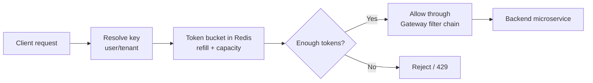
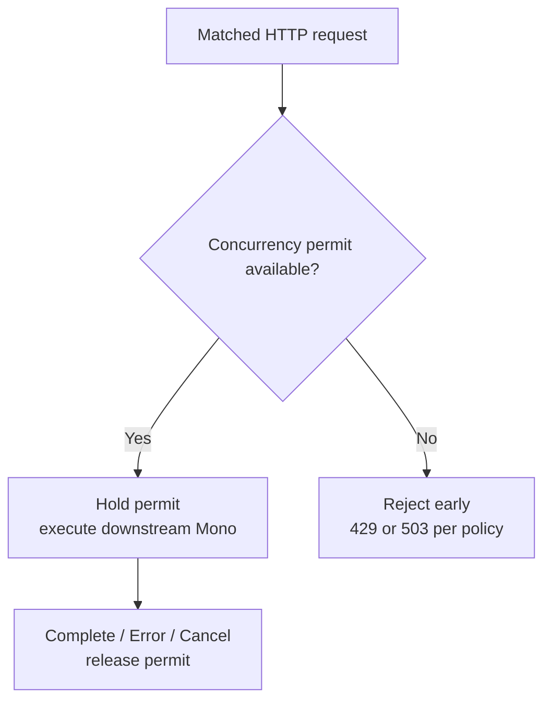
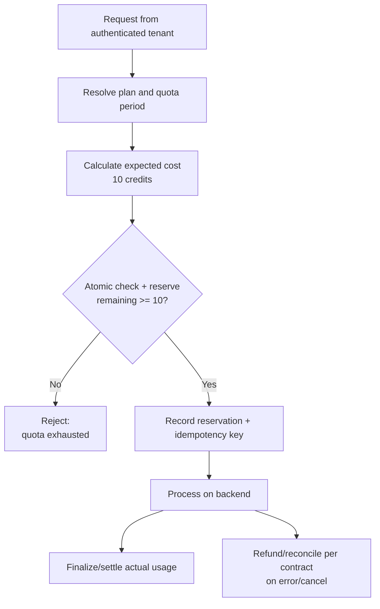

# Rate Limiting, Concurrency Limiting, and Usage Quotas

## Lesson Objectives

In the **Traffic Limiting** chapter of **Spring Cloud Gateway**, we distinguish three mechanisms that are often lumped together as "rate limit" but control **three different quantities**:

1. **Rate limiting:** how many requests an actor can send per unit of time; may allow a short burst.
2. **Concurrency limiting:** how many requests or tasks can be actively processed at a single point in time.
3. **Usage quota:** how many requests or resource units a user, tenant, or service plan can consume within a billing or calculation period.

These three layers complement one another to protect the microservices entry point during traffic spikes, slow backends, overly chatty clients, or customers exhausting their service plan. However, they do not by themselves replace **authentication, authorization, TLS, circuit breakers, retries, timeouts, service discovery**, or internal safeguards inside each microservice.

After this lesson, you will be able to:

- Choose rate, concurrency, and quota controls suited to each operational problem.
- Understand token bucket, fixed/sliding window, burst capacity, cost per request, and the difference between incoming requests and in-flight tasks.
- Configure `RequestRateLimiter` and `RedisRateLimiter` in **Spring Cloud Gateway Server WebFlux**.
- Create a `KeyResolver` based on an authenticated identity, avoiding trusting client-supplied headers directly.
- Understand why `RequestRateLimiter` is **not automatically** a concurrency limiter or a monthly usage quota.
- Build a **non-blocking** concurrency limiter on a single Gateway instance and understand its limitations when scaling.
- Outline a distributed quota system using atomic counters, reset schedules, retry handling, and idempotency.
- Test HTTP 429/503 responses, fairness, high load, Redis failures, and systems with multiple Gateway replicas.

> The examples use Spring Cloud Gateway **Server WebFlux**, Project Reactor, Spring Cloud LoadBalancer, and, in the distributed rate limiting example, Spring Data Redis Reactive. Newer Gateway versions may use the `spring.cloud.gateway.server.webflux.*` namespace instead of `spring.cloud.gateway.*`; verify against your exact project version. Do not copy a configuration example across product generations without verifying that the route/filter is actually loaded.

## 1. Three Limits Answer Three Different Questions

Suppose a system exposes the API:

```http
GET /api/reports/42 HTTP/1.1
Host: api.example.com
Authorization: Bearer <access-token>
```

Customer A has the policy:

```text
Rate: average max 20 requests/second, max burst 40 requests.
Concurrency: max 10 report-generation tasks running at once.
Quota: max 100,000 reports per billing period.
```

| Mechanism | Controlled Unit | Question | When Exceeded |
| --- | --- | --- | --- |
| **Rate limit** | Requests/tokens per second or minute | "Is the client sending too fast?" | Delay or reject new requests, typically `429 Too Many Requests` |
| **Concurrency limit** | Number of requests/tasks currently being processed | "Is too much work occupying resources at the same time?" | Reject or apply bounded queuing; status depends on policy |
| **Usage quota** | Requests, credits, bytes, tokens, or business units per period | "Has the customer used up their plan allowance?" | Reject or require plan upgrade/renewal; may use `429` or a business error code |

Real-world examples:

- A client firing **1,000 requests in a single second** is a rate problem, even if each request responds very quickly.
- A client sending only **20 requests/second** where each request takes **10 seconds** can result in about **200 concurrent requests** in steady state. That is concurrency pressure, even though the rate looks low.
- A client sending a steady **1 request/second** for days may never cross the instantaneous rate limit yet still exhaust its monthly quota.

**No single "requests per second" parameter solves all three scenarios at once.**

### 1.1. Relationship with Latency

Following the intuition of Little's Law in a stable system:

\[
L \approx \lambda W
\]

Where:

- \(L\) is the average number of requests/tasks in flight.
- \(\lambda\) is the average completion/arrival rate (requests/second), when the system is stable.
- \(W\) is the processing time or time a request spends in the system (seconds).

For example, if throughput reaches about **20 requests/second** and each request spends an average of **0.5 seconds** in the system, the average number of in-flight requests may be around **10**. When the backend slows down to **5 seconds**, that same arrival rate can push concurrency up to around **100**.

This is an approximate relationship for capacity planning, **not a formula guaranteeing** that a Gateway will always have that exact number of connections. Queueing, retries, streaming, backpressure, timeouts, and traffic fluctuations affect the actual outcome.

## 2. Rate Limiting: When to Use Token Bucket?

**Rate limiting** seeks to control the request rate per key, such as user ID, tenant ID, verified API key, or a group of endpoints.

Common algorithms:

| Algorithm | Idea | Pros | Considerations |
| --- | --- | --- | --- |
| **Fixed window counter** | Count requests in a fixed window, e.g. every minute | Easy to understand, easy to store | Two large bursts can occur right around the boundary between two windows |
| **Sliding window log** | Store the timestamp of each request in a sliding window | Accurate control over the window | High data/memory usage under heavy traffic |
| **Sliding window counter** | Estimate using counters from multiple windows | Less memory than log | Result is approximate depending on the algorithm |
| **Token bucket** | Tokens are replenished steadily; requests consume tokens | Supports controlled bursts and a sustained rate | Need to choose burst and token cost appropriately |
| **Leaky bucket/queue** | Smooths out the processing/forwarding rate | Reduces outbound traffic fluctuations | If queued, queue length and wait time must be bounded |

**Spring Cloud Gateway's `RedisRateLimiter` uses the token bucket idea**: it has a token replenishment rate, a maximum capacity, and the number of tokens a request must consume. Storing state in Redis allows multiple Gateway replicas to see the same budget for a key, rather than each replica maintaining its own separate counter.

### 2.1. Token Bucket by Concrete Example

Suppose:

```text
replenishRate  = 20 tokens/second
burstCapacity  = 40 tokens
requestedTokens = 1 token/request
```

If the bucket is currently full:

1. Over a very short interval, up to roughly **40 requests** can be accepted, each consuming one token, assuming negligible new tokens are replenished in the meantime.
2. Over the long run, tokens are replenished at **20 tokens/second**, so the sustained rate is approximately **20 requests/second**.
3. When the bucket runs out of tokens, incoming requests are rejected according to the filter policy.
4. When no requests arrive, the bucket accumulates tokens again, **never exceeding `burstCapacity`**.



Do not interpret `burstCapacity: 40` as "allows 40 requests every second." It is the **maximum accumulated tokens**. The request rate over any given interval also depends on tokens replenished, prior bucket state, and how many tokens each request consumes.

### 2.2. A Single Request Can Consume Multiple Tokens

If:

```text
replenishRate  = 20
burstCapacity  = 40
requestedTokens = 5
```

Each request needs 5 tokens, so the sustained rate is close to **4 requests/second** under steady conditions; a full bucket accepts roughly **8 consecutive requests** before running out of tokens, ignoring replenishment during that burst.

`requestedTokens` is a tool to control the **quantified cost per request** within a given policy. If `/api/reports/export` is heavier than `/api/reports/summary`, you can apply different rate policies per route or design a cost-aware KeyResolver/RateLimiter, rather than treating every request as costing the same.

**However, token cost does not automatically measure CPU, bandwidth, or actual billing.** It is a value defined by an explicit policy.

### 2.3. One Request per Minute with RedisRateLimiter

To keep a key to an average of no more than roughly **one request/minute** with a token bucket, a configuration commonly shown in Gateway documentation is:

```yaml
redis-rate-limiter.replenishRate: 1
redis-rate-limiter.burstCapacity: 60
redis-rate-limiter.requestedTokens: 60
```

The bucket replenishes **1 token/second**, and one request requires **60 tokens**. This is a specific average-rate and burst policy, **not equivalent** to a fixed schedule that "resets exactly at the start of every minute." If the requirement is strictly one request per 60-second calendar window, design a fixed/sliding window with the desired semantics.

## 3. Configuring RequestRateLimiter in Spring Cloud Gateway

In **Spring Cloud Gateway Server WebFlux**, `RequestRateLimiter` is a **GatewayFilter Factory**, meaning it is attached to a route or `default-filters` and references a `RateLimiter`. A common implementation is **`RedisRateLimiter`**.

### 3.1. Required Dependencies and Infrastructure

For the Redis example to work, the project needs:

- Spring Cloud Gateway **Server WebFlux** and dependencies compatible with the running Spring Boot version.
- **Spring Data Redis Reactive** and connectivity to Redis, such as the corresponding reactive Redis starter.
- A Redis endpoint that Gateway replicas are permitted to reach, with network/TLS/credentials securely configured.
- A **`KeyResolver`** bean that returns the key used to partition budgets.
- Instances of `order-service` if the route uses `lb://order-service`, or switch to a static HTTP URI when studying the filter in isolation.

Do not commit Redis passwords into the repository. Redis used for rate limiting is also an infrastructure component with its own latency, availability, security, and cost; it is not free just because the filter uses a short YAML configuration.

### 3.2. `KeyResolver` Based on Authenticated Principal

Example:

```java
import org.springframework.cloud.gateway.filter.ratelimit.KeyResolver;
import org.springframework.context.annotation.Bean;
import org.springframework.context.annotation.Configuration;

@Configuration
public class RateLimitKeyConfiguration {

    @Bean
    KeyResolver authenticatedUserKeyResolver() {
        return exchange -> exchange.getPrincipal()
            .map(principal -> principal.getName());
    }
}
```

Explanation:

- `KeyResolver` returns `Mono<String>`, fitting Spring WebFlux/Project Reactor.
- `exchange.getPrincipal()` reflects the **authenticated Principal** when the security chain is configured properly.
- When there is no Principal, the publisher may be empty. The policy for handling an **empty key** must be explicitly defined.
- With a JWT resource server, the principal name may correspond to the token subject, depending on configuration. If you need a key **per tenant** or per service plan, extract it from a **verified** and controlled claim; do not blindly trust `X-Tenant-ID` from the client.

Do not use passwords, access tokens, session IDs, or sensitive personal data such as email addresses directly as Redis keys unless necessary. Consider using a stable internal identifier with clear scoping that can be safely protected in logging/metrics.

### 3.3. Configuring a Route with RedisRateLimiter

```yaml
spring:
  cloud:
    gateway:
      routes:
        - id: orders-api
          uri: lb://order-service
          predicates:
            - Path=/api/orders/**
          filters:
            - name: RequestRateLimiter
              args:
                key-resolver: "#{@authenticatedUserKeyResolver}"
                redis-rate-limiter.replenishRate: 20
                redis-rate-limiter.burstCapacity: 40
                redis-rate-limiter.requestedTokens: 1
```

If there are multiple Gateway instances all sharing **the same Redis policy store**, rate limiting for **the same key and same route scope** can be coordinated via Redis. Redis executing the check-and-consume operation atomically prevents two replicas from simultaneously seeing "one token left" and both admitting a request.

**Understand the exact scope:** in common configurations, the bucket policy is also tied to the **route ID**. The same user calling two independent routes may consume from two separate budgets. If the goal is **one shared limit across the entire product**, you must design how keys/scopes are consolidated and use an appropriate mechanism; do not assume all routes automatically share one bucket just because they share the same Principal.

### 3.4. Empty State and HTTP 429

Typically, a request denied by `RateLimiter` receives **`429 Too Many Requests`**, unless the application customizes that behavior. Some versions/configs allow tuning the empty-key policy via properties related to:

```text
deny-empty-key
empty-key-status-code
```

Check the exact property/namespace names for your Gateway version. In many WebFlux configurations, **empty keys are denied by default**. This can be a safe default for routes requiring authentication; however, on public routes, if `KeyResolver` only reads the Principal, all anonymous requests may get rejected.

The right fix is not to arbitrarily set `deny-empty-key: false` on a protected API. Design a **key policy for anonymous traffic**, such as limiting by edge identity or client IP derived from a trusted proxy, combined with WAF/ingress and appropriate distributed controls.

### 3.5. Headers Reflecting Rate Limits

Depending on the version/configuration, RedisRateLimiter may emit headers indicating budget status, such as:

```text
X-RateLimit-Remaining
X-RateLimit-Replenish-Rate
X-RateLimit-Burst-Capacity
X-RateLimit-Requested-Tokens
```

Do not treat the names, count, or guaranteed presence of these headers as an **immutable API contract**. If clients need a backoff mechanism, design an explicit error contract and `Retry-After` at an appropriate layer; with `429`, `Retry-After` can communicate wait time, **but not every Gateway filter emits this header automatically**.

Do not let budget headers or key names leak customer identities, tenants, Redis keys, or infrastructure layouts.

### 3.6. Configuration Namespaces by Version

The examples use:

```text
spring.cloud.gateway.routes
```

This is the familiar namespace across many Spring Cloud Gateway Server WebFlux releases. Some newer releases use:

```text
spring.cloud.gateway.server.webflux.routes
```

Route fields and factory capabilities may move or change across versions. To avoid configuration **silently having no effect**, check the documentation matching your exact dependency, inspect the routes loaded at runtime, and run HTTP integration tests including cases rejected for exceeding the limit.

## 4. Choosing the Right Key Is a Security Decision

A rate limiter without a trustworthy key is easy to bypass or can accidentally break legitimate users.

| Key Type | Suitable For | Risks to Address |
| --- | --- | --- |
| **Authenticated User ID** | Per-account limits | Users sharing tokens, multiple accounts, permission changes |
| **Verified Tenant ID** | Per-enterprise-customer limits | Must come from verified security context/claims |
| **Authenticated API key** | B2B service clients | Do not log raw API keys in logs/metrics/Redis keys |
| **Client IP from trusted edge** | Throttling anonymous traffic as an additional layer | NAT, shared proxies, IPv6 rotation, forwarded-header spoofing |
| **Route ID + authenticated subject** | Per-API policies | Does not automatically share budget across multiple routes |
| **Plan/organization scope** | Overall usage quota and commercial contracts | Requires identity → plan mapping and updates on plan upgrades |

### 4.1. Why You Should Not Trust `X-Forwarded-For` Directly

A client can send on its own:

```http
X-Forwarded-For: 198.51.100.42
```

If the Gateway uses this header directly as the key, an attacker can spoof different IPs to create unlimited buckets. When behind an ingress or L7 load balancer, you must enforce a **trusted proxy policy**, block direct traffic bypassing the proxy, and configure the ingress to **strip/overwrite untrusted values** before the Gateway interprets the client address.

Even a real IP address does not equal a single user: many users may share one NAT; a single customer may have many IPs. Therefore, IP-based limiting is useful against **anonymous abuse**, but does not replace account/tenant quotas.

### 4.2. Authentication Before or After Rate Limiting?

Both layers can coexist:

```text
Ingress/WAF: cheap anonymous protection
    ↓
TLS + HTTP request
    ↓
Spring Security WebFilterChain: authenticate Principal
    ↓
Gateway route matching
    ↓
RequestRateLimiter: key by verified user/tenant
    ↓
Gateway filters → routing → backend
```

An **edge limit before authentication** helps stop raw traffic before it consumes token-verification resources. A **per-user limit after authentication** uses a trustworthy identity to enforce fairness among customers.

In Spring Cloud Gateway Server WebFlux, Spring Security `WebFilter` typically runs before the route's `GlobalFilter`/`GatewayFilter` chain; requests rejected by Security/ingress may not be counted by the route's `RequestRateLimiter`. Do not assume a single Gateway rate filter can strictly limit **all traffic before route matching**.

## 5. Concurrency Limiting: Protecting Resources Under Active Use

A backend might only stably handle **50 concurrent tasks**. When processing time rises from 100 ms to 5 seconds, throughput gets overwhelmed by accumulating requests. Inbound rate limiting **does not directly control the number of open in-flight tasks**.

**Concurrency limiting** controls the number of permits held while a request/task is actively executing.



### 5.1. Why 20 RPS Does Not Mean at Most 20 Concurrent?

Suppose a route allows **20 requests/second**, and each backend call averages 4 seconds due to a slow query. In steady state, the system can accumulate roughly:

\[
20\ \text{requests/second} \times 4\ \text{seconds}
= 80\ \text{concurrent requests}
\]

If the backend's connection pool, CPU, or memory can only sustain 30 tasks, **a rate of 20 RPS can still overload it**. You need concurrency limits, lower backend latency, timeouts, bulkheads, or explicitly designed queue/backpressure policies.

### 5.2. Concurrency Limiter on a Single Gateway Instance

Spring Cloud Gateway should not be misunderstood as **offering a cluster-wide `maxConcurrentRequests` configuration built into `RequestRateLimiter`**. To illustrate, we can write a non-blocking `GlobalFilter` using an atomic counter:

```java
import java.util.concurrent.atomic.AtomicInteger;

import org.springframework.cloud.gateway.filter.GatewayFilterChain;
import org.springframework.cloud.gateway.filter.GlobalFilter;
import org.springframework.core.Ordered;
import org.springframework.http.HttpStatus;
import org.springframework.stereotype.Component;
import org.springframework.web.server.ServerWebExchange;
import reactor.core.publisher.Mono;

@Component
public final class LocalInFlightLimitFilter
        implements GlobalFilter, Ordered {

    private static final int MAX_IN_FLIGHT = 50;
    private final AtomicInteger inFlight = new AtomicInteger();

    @Override
    public int getOrder() {
        return -50;
    }

    @Override
    public Mono<Void> filter(
            ServerWebExchange exchange,
            GatewayFilterChain chain) {

        return Mono.defer(() -> {
            // Atomic CAS: prevents two subscriptions from taking the last permit.
            while (true) {
                int current = inFlight.get();
                if (current >= MAX_IN_FLIGHT) {
                    exchange.getResponse()
                        .setStatusCode(HttpStatus.SERVICE_UNAVAILABLE);
                    return exchange.getResponse().setComplete();
                }
                if (inFlight.compareAndSet(current, current + 1)) {
                    break;
                }
            }

            // Release on complete, error, or cancellation.
            return Mono.defer(() -> chain.filter(exchange))
                .doFinally(signal -> inFlight.decrementAndGet());
        });
    }
}
```

Analysis:

- `AtomicInteger.compareAndSet` grants permits in a thread-safe way **without blocking the event loop**.
- `Mono.defer` ensures permit acquisition happens **when subscription actually executes**, not merely when the filter constructs the publisher.
- `doFinally` releases the permit when the downstream publisher **completes, errors, or is cancelled**; failed requests must not hold permits forever.
- `503 Service Unavailable` in this example reflects a **server capacity limit**. A product with per-customer concurrency/quota policies might also use `429`, as long as the HTTP contract is consistent.
- The sample code does not create a queue; when permits are full, requests are rejected immediately. If queuing is desired, it must have bounded size, wait timeouts, fairness, and safe cancellation.

**Major limitation of the example:** this is **one bean inside one JVM** and counts all **route-matched** requests passing through the Gateway chain on that replica. If there are three Gateway pods, each with `MAX_IN_FLIGHT = 50`, total potential work could reach about **150** rather than 50.

To limit **per route** or **per tenant**, you need a key and must manage a counter/bulkhead per key, along with release and lifecycle policies. To limit **cluster-wide**, you must use a distributed coordination mechanism (such as TTL-based leases/permits with handling for dead processes) or split budgets across replicas; you cannot sum local counters and call that a hard system-wide limit.

### 5.3. Pitfalls of Concurrency Limiters

| Pitfall | Consequence | Design Approach |
| --- | --- | --- |
| Using blocking `Semaphore.acquire()` on the event loop | Blocks I/O threads and degrades throughput | Use non-blocking structures or reactive bulkheads |
| Forgetting to release on error/cancel | Permit leak; the system eventually rejects all requests | Place cleanup in the proper lifecycle hook such as `doFinally` |
| No timeout | Hanging requests hold permits indefinitely | Configure appropriate timeouts; observe cancellation and backend state |
| Unbounded queues | Latency/memory spikes | Bounded queue, deadlines, and explicit backpressure |
| Applying a general limit to long-lived SSE/WebSocket | Connections hold permits for a very long time | Use separate policies for streaming/connections |
| Each pod keeps its own counter when a shared quota is needed | Scale-out loosens the system-wide limit | Use a coordinator/lease or per-replica budgeting |
| Retries inside a single permit | One inbound request can generate multiple outbound attempts | Separate request limits from outbound concurrency limits |

Resilience4j **Bulkhead** or a queue/service-worker model may be more suitable than a custom filter, depending on the control goal. However, do not assume Gateway's `CircuitBreaker` implies a semaphore bulkhead is present: a circuit breaker tracks **failure states and opens/closes the circuit**, and does not by itself cap concurrent tasks.

## 6. Daily, Monthly, or Plan-Based Usage Quotas

Usage quotas are typically tied to **product contracts**, not just backend health:

```text
Basic Plan:
  10,000 API calls / month
  100 report exports / month

Pro Plan:
  500,000 API calls / month
  5,000 report exports / month
```

In this model, a client can stay below per-second rate limits and keep concurrency low, yet still **exhaust its monthly allowance**.

### 6.1. Usage Quotas Require Precisely Defined Units

| Question | Example Decision to Codify as Contract |
| --- | --- |
| **What is counted?** | HTTP requests, successful reports, bytes, processed tokens, credits, or a transaction? |
| **When is it counted?** | Upon accepting the request, starting the task, or upon successful completion? |
| **What period?** | UTC day, calendar month, rolling 30 days, or tenant billing cycle? |
| **What scope?** | Per user, API key, tenant, organization, or entire plan? |
| **Variable costs?** | `/summary` costs 1 credit, `/export` costs 10 credits |
| **Failures and cancellations?** | Do 4xx/5xx requests, timeouts, or partial completions count? |
| **Retries?** | Count one logical request or multiple backend attempts? |
| **Resets?** | Exact cutoff timestamp, and how are timezone changes or plan upgrades handled? |

Incrementing a Redis counter without answering these questions leads to customer disputes and billing discrepancies.

### 6.2. Why Token Bucket Does Not Replace Monthly Quotas

A token bucket has **replenishRate** and **burstCapacity**. It is suited to managing **speed and bursts**; monthly quotas often require:

- Accurate per-period counters or ledger records.
- Hard caps on total consumed units.
- Reset/carry-over rules, plan upgrades, and prepaid balances.
- Idempotency mechanisms so one logical transaction is not billed multiple times.
- Auditable data for reconciliation, not merely ephemeral Redis TTLs.

Redis can be used as a **fast-path admission** layer for quotas, but consider a durable data store/ledger for billing or reconciliation workflows. Lost Redis cache data or misconfigured TTLs can corrupt usage accounting.

### 6.3. Period Quota Model with Atomic Checks

Suppose tenant `org-42` has a quota of **1,000 credits** for period `2026-11`, and an export request costs 10 credits.

Logical flow:



**Atomic check-and-reserve** is critical. Reading `used=990`, checking that 10 remain, and then running `used += 10` across two concurrent requests can let both pass if the update is not atomic.

Illustrative pseudo-code (not literal Redis syntax):

```text
reserveQuota(tenantId, period, requestId, cost):
    if requestId already reserved/finalized:
        return previous decision  // idempotency

    atomically:
        remaining = limit(tenantId, period) - usedOrReserved(...)
        if remaining < cost:
            return DENIED

        reserve cost
        store requestId and reservation state
        return ALLOWED

after operation:
    finalize actual usage, or refund according to explicit policy
```

For critical quotas, **atomicity** must span all required state transitions; a handful of separate Redis commands do not automatically form a safe transaction. Use an appropriate Redis script/transaction or a database with transactional/concurrency control, depending on the durability required.

### 6.4. Calendar Periods and Reset Timestamps

Example:

```text
quotaPeriod = 2026-11 (UTC)
resetAt = 2026-12-01T00:00:00Z
```

Do not assume "one month = 30 × 24 hours" if the contract specifies a **calendar month**. If tenants have custom timezones, specify timezone handling and DST behavior. Clocks across services, period resolution, TTLs, and plan-change timestamps must stay consistent.

If returning `Retry-After` for an exhausted quota, use a reopening timestamp valid **per the contract**; do not promise the request will succeed after N seconds if the tenant still has not upgraded its plan or other conditions apply.

## 7. Combining All Three Policies in One Request

An architecture might use:

```text
Client
  │
  ▼
Ingress: anonymous rate / bot protection / TLS
  │
  ▼
Spring Security: authenticate + route-level authorization
  │
  ▼
Gateway rate limit per user/tenant (Redis)
  │
  ▼
Quota check / reserve credits per period
  │
  ▼
Concurrency bulkhead (bounded in-flight)
  │
  ▼
RewritePath / Service discovery / Load balancing
  │
  ▼
Retry / Circuit breaker / Routing
  │
  ▼
Backend: business authorization, idempotency
```

This is an **illustrative policy ordering**, not a built-in default filter chain in a single Spring Cloud Gateway distribution. `Quota check` and the concurrency bulkhead in this example require custom components; the actual execution order of `GlobalFilter` and `GatewayFilter` instances is governed by `Ordered`, route configuration, and how Reactor publishers wrap each other.

### 7.1. Why Ordering with Retry Matters?

A `Retry` GatewayFilter can **resubscribe downstream** when an HTTP status/exception matches its policy. Depending on placement:

```text
RateLimiter → Quota → Concurrency → Retry → Routing
```

can enforce limits on **one inbound request** before it triggers multiple attempts, whereas:

```text
Retry → RateLimiter → Quota → Concurrency → Routing
```

can cause limits inside the retry scope **to be executed again** per attempt. Goals may differ:

- **Per-client rate/quota:** usually intends to count **one logical request** at the edge, avoiding internal retries deducting quota multiple times.
- **Per-upstream attempt budget:** may want to limit each attempt so the backend is not hit by request amplification during an outage.
- **Concurrency:** must decide whether the permit wraps the entire request or each outbound attempt, and whether backoff wait time should hold a permit.

Do not deduce the exact execution count of each filter solely from YAML line order. Verify **effective filter order**, backend attempt counts, rate/quota logs, signal lifecycles, and how Retry constructs publishers in your application version.

### 7.2. Rate Limiting, Circuit Breaker, and Timeout

| Mechanism | Primarily Protects Against | Cannot Replace |
| --- | --- | --- |
| Rate limiting | Inbound request volume over a time window | Concurrency and period quotas |
| Concurrency limit/bulkhead | Number of tasks holding resources simultaneously | Long-term rate limits or monthly usage rights |
| Usage quota | User/tenant product budget | Real-time backend load capacity |
| Circuit breaker | Continuing to call an upstream failing past threshold | Rate/quota/concurrency limits |
| Timeout | Tasks waiting indefinitely and leaking resources | Overall traffic control |
| Retry + backoff | Recovering from transient errors when safe | Idempotency or overload prevention during backend failure |

For example, when a backend throws widespread 503 errors: **excessive retries** can overload infrastructure even further. Use bounded attempts, jittered backoff where appropriate, circuit breakers, timeouts, bulkheads, and do not retry POST payment operations without idempotency protection.

### 7.3. Gateway Does Not Replace Backend Authorization

A KeyResolver using an authenticated tenant ID does not mean that tenant has permission to access every resource:

```http
GET /api/orders/42
Authorization: Bearer <valid-token>
```

RateLimiter may let the request through, but **Order Service must still verify** that order 42 belongs to the corresponding principal/tenant. Do not treat remaining rate/quota or the presence of `X-Tenant-ID` as authorization proof.

## 8. HTTP Statuses, Error Responses, and Client Guidance

When rejecting a request, the status code should accurately reflect the type of limit:

| Scenario | Typically Appropriate Status | Notes |
| --- | --- | --- |
| Client exceeds published rate | **429 Too Many Requests** | May include `Retry-After` when calculable |
| Tenant exhausts period quota | 429 or consistent business error code | Response body clearly states quota exhausted and reset period; never leak other customers' data |
| Server runs out of concurrency permits due to overload | **503 Service Unavailable** or 429 per API contract | Distinguishes infrastructure overload from a client sending too fast |
| Missing/invalid authentication token | **401 Unauthorized** | Rate limiter does not replace authentication |
| Authenticated but lacks permission | **403 Forbidden** | Having quota does not imply sufficient permissions |
| Redis/quota store unavailable | Pre-defined fail-closed/fail-open policy | Do not blindly treat all infrastructure errors as quota exhaustion |
| Backend timeout | 504 or Gateway-mapped error | Not a rate limit error if the rate filter did not reject |

**`Retry-After`** may contain seconds or an HTTP-date:

```http
HTTP/1.1 429 Too Many Requests
Retry-After: 10
Content-Type: application/json

{"code":"RATE_LIMITED","message":"Try again later"}
```

This is a **sample response**, not a guarantee that `RequestRateLimiter` emits JSON or `Retry-After` automatically. If clients expect a stable contract, design an appropriate error handler/filter so responses from the rate limiter do not diverge unintentionally from the quota or concurrency layers.

### 8.1. Client Retries Can Trigger Traffic Storms

If all clients receive 429 and retry at the exact same moment, the system can suffer a **thundering herd**. Recommendations for clients:

- Respect `Retry-After` when present and valid.
- Use exponential backoff with jitter within appropriate bounds.
- Never retry infinitely; apply deadlines, attempt caps, and client circuit breakers as needed.
- Never blindly retry non-idempotent POST requests.
- For monthly quotas, stop retrying repeatedly until the reset period arrives or the plan is upgraded.

### 8.2. Returning CORS Headers on Rejected Responses

Browsers making cross-origin API calls may be unable to read 429/503 bodies if responses lack the required CORS headers. Gateway design should test **OPTIONS preflight**, actual requests, and **early rejections** by rate/concurrency/quota/Security. Handle CORS at the appropriate layer before filters return early; do not loosen `Access-Control-Allow-Origin: *` as a "quick fix" for a rate limit error.

## 9. When the Redis/Quota Store Fails

A distributed rate limiter introduces a **new point of dependency**. If Redis slows down or loses connectivity, Gateway instances need a clear policy:

| Strategy | Pros | Risks |
| --- | --- | --- |
| **Fail closed** | Avoids accidentally dropping strict limits when the store fails | Can make the API unavailable even when the backend is healthy |
| **Controlled fail open** | Preserves availability for less sensitive APIs | Clients can exceed their budget; requires fallback protection |
| **Local emergency limit** | Provides a safeguard during Redis outages | Does not enforce a cluster-wide budget; scale-out skews limits |
| **Queue/degrade service** | Can prevent backend overload | Requires bounded queues, timeouts, and recovery planning |

**Do not assert that RedisRateLimiter is fail-open or fail-closed by default across all versions.** Behavior on cache/script/connection errors depends on filter code, exception handling, application policy, and deployment; verify by actively simulating Redis unavailability in a test environment.

Usage limits with financial impact typically require stronger durability than "let everything through if Redis fails." Conversely, for a read-only public endpoint, fail-open backed by a WAF/ingress emergency limit may be an acceptable trade-off. The decision must be codified as an SLO/security policy.

## 10. Observability and Measuring Effectiveness

When rate limiting is active, many requests never reach the backend. Thus, **backend-only metrics** no longer represent the full traffic seen by the Gateway.

Separate at least three layers:

1. **Inbound requests:** all HTTP requests at ingress/Gateway, including both allowed and rejected requests.
2. **Admitted requests:** requests that pass security/rate/quota/concurrency and enter routing.
3. **Outbound attempts:** actual HTTP calls sent to backends, including retries.

| Metric | Question Answered |
| --- | --- |
| Inbound requests per route | How much traffic are users sending? |
| Rate rejected count (429) | How many requests exceeded the token bucket/window? |
| Quota remaining/consumed (aggregate) | Is usage per plan/period exceeding expectations? |
| In-flight requests / permits | Is concurrency approaching capacity? |
| Limiter decision latency | Is checking Redis/quota slowing down the gateway? |
| Redis errors/timeout | Is the rate limit store a source of errors? |
| Upstream attempts/retry count | Is one inbound request generating multiple calls? |
| Backend latency p95/p99 | Is backend slowness driving up in-flight counts? |
| HTTP 429/503/5xx per route | Are errors caused by policy or infrastructure/backend? |

Do not put raw **user IDs, tenant IDs, tokens, IPs, or arbitrary request headers** into high-cardinality metric labels. Use route IDs, policy names, outcomes, and normalized tiers; per-tenant usage data for billing should live in an access-controlled store.

### 10.1. Appropriate Logging

Example of a safe structured log line:

```text
route=orders-api policy=per-user-bucket outcome=denied
reason=rate-exceeded status=429 traceId=<trace-id>
```

Do not log tokens, cookies, request bodies, Redis keys containing sensitive identifiers, or full query strings. If tracing across microservices is needed, use standard HTTP context propagation according to your configured observability policy.

### 10.2. Setting Dedicated SLOs for the Limiter Layer

A rate limiter can become a bottleneck when Redis repeatedly times out. Measure:

- Decision time (allow/deny) of rate/quota filters.
- Error budget of the Redis/quota store.
- Ratio of **legitimate policy rejections** versus rejections caused by infrastructure failures.
- Impact on p95/p99 latency of successful requests.
- Rate of retries, cancellations, response commit errors, and discrepancy between ingress count and backend count.

Do not set a goal that "429s must always be 0" if the system intentionally uses rate limiting to prevent abuse. What matters is verifying the policy is accurate, fair, and does not falsely reject legitimate users.

## 11. Testing Rate Limits

Suppose a route uses:

```yaml
filters:
  - name: RequestRateLimiter
    args:
      key-resolver: "#{@authenticatedUserKeyResolver}"
      redis-rate-limiter.replenishRate: 2
      redis-rate-limiter.burstCapacity: 2
      redis-rate-limiter.requestedTokens: 1
```

For a dedicated key and an initialized bucket as expected:

1. Two requests arriving very close together can be accepted.
2. A third request arriving immediately afterward can receive 429 if tokens have not yet replenished.
3. After sufficient time elapses, tokens replenish and requests can be accepted again.

This is the **expected behavior of a token bucket**, not a deterministic integration test simply by pressing Enter three times: clocks, Redis state, spacing between requests, and test-tool execution timing can produce different results.

### 11.1. Manual Testing with curl

```bash
for i in 1 2 3 4 5; do
  curl -s -o /dev/null -w "%{http_code}\n" \
    -H "Authorization: Bearer <test-token>" \
    "http://localhost:8080/api/orders/42"
done
```

This test requires:

- Gateway running with a valid route and RedisRateLimiter.
- Appropriate JWT/session or authentication so `KeyResolver` can extract a Principal.
- An isolated test bucket, not shared with production users.
- A backend stub returning an easily recognizable status.

If the token is invalid, the response may be **401**, unrelated to rate limiting. If the request does not match a route, it may be 404. Do not see those statuses and conclude RedisRateLimiter is working.

### 11.2. Verifying Key Isolation

Create two test principals:

```text
user-A
user-B
```

Send enough requests as user-A to exhaust its bucket, then send a request as user-B. With a per-principal policy:

- user-A may receive 429.
- user-B uses **a different bucket** and may still be accepted.

With a per-tenant policy, two users in the same tenant may have to share a budget; that must be an **intentional design goal**, not an accidental bug.

### 11.3. Testing Multiple Gateway Replicas

Start two Gateway instances connected to the same Redis:

```text
Client → Gateway A ↘
                    Redis rate limiter
Client → Gateway B ↗
```

Alternate sending requests with the same key across both replicas. Total allowed requests must follow the **shared** bucket policy, rather than doubling just because there are two instances. Also test Redis failures and key/state recreation.

## 12. Testing Concurrency and Quotas

### 12.1. Concurrency

With the example filter `MAX_IN_FLIGHT = 50`, create a backend stub that holds responses for a few seconds and send more than 50 near-simultaneous requests to **the same Gateway replica**. Verify:

| Check | Expected Result |
| --- | --- |
| Admitted requests actively running | Never exceeds 50 on the tested replica |
| Requests when permits are full | Rejected early per policy (e.g., 503) |
| Requests after a task finishes | Can acquire a newly freed permit |
| Backend returns an error | Permit is released |
| Client cancels/times out | Permit is released when the pipeline receives cancellation |
| Multiple Gateway replicas | Total limit is per-replica unless a coordinator is present |
| Very long streaming | Evaluate whether permits stay held for the entire stream |

Sending requests **sequentially** one at a time makes a concurrency test meaningless. Use a load-testing tool or integration test capable of holding responses open and firing parallel requests while observing `inFlight`.

### 12.2. Usage Quota

With a quota of `100 credits` where each export costs `10 credits`:

| Scenario | Correct Result per Illustrative Contract |
| --- | --- |
| 10 valid exports, each costing 10 | Total usage reaches 100 |
| 11th export in the same period | Rejected due to quota |
| Two concurrent exports when 10 credits remain | Only one request reserves successfully if cost is 10 and overdraft is disallowed |
| Client resends with the same idempotency key | Not charged twice for the same transaction |
| Backend fails before generating the report | Refunded or kept debited **per published policy** |
| Next period reset boundary arrives | Uses the new quota accurately without corrupting billing history |
| User upgrades plan mid-period | Applies updated limit policy consistently |
| Quota store unavailable | Behaves fail-open/closed as defined |

### 12.3. Summary Matrix

| Test | Rate | Concurrency | Quota | Assessment |
| --- | --- | --- | --- | --- |
| Burst of 50 calls in first second | May reject once bucket drains | May stay low if backend is very fast | May still have plenty left | Do not treat 429 alone as a concurrency metric |
| 10 requests taking 20 seconds each | May stay below RPS | May saturate permits | Small number of usage units | Requires bulkhead/timeout |
| Steady 1 RPS all month | May always be allowed | May stay low | May run out | Quota must enforce period caps |
| Internal retries on backend 503 | Depends on retry scope | Can increase outbound attempts | Must not double-charge a logical request | Check lifecycle/ordering |
| Two pods for one user | Redis bucket should be shared | Local counters stack | Quota must be distributed and atomic | Scale-out must not inflate financial budgets |

## 13. Troubleshooting Common Issues

### Scenario A — All anonymous requests receive 429

**Likely cause:** `KeyResolver` returns `Mono.empty()` because there is no Principal, and the empty-key policy rejects it.

**Resolution:** check the security chain, route matching, key policy, and `deny-empty-key` setting. For public endpoints, design an anonymous budget based on trusted edge/identity; do not recklessly disable key checks on authorized endpoints.

### Scenario B — Rate limit multiplies by the number of replicas

**Likely cause:** each Gateway instance keeps buckets in local memory, or keys/route scopes differ across instances.

**Resolution:** verify the shared store, Redis connection, and key format; send the same subject across replicas. A distributed rate limiter is not the same as a local concurrency counter.

### Scenario C — Redis fails and APIs suddenly return 5xx

**Likely cause:** Redis connectivity/scripts/authentication fail and the exception path lacks an appropriate degradation policy.

**Resolution:** inspect Redis latency/errors, network/TLS, resource limits, and limiter state; test controlled fail-open/fail-closed behavior per environment and assess backend overload risks.

### Scenario D — Backend remains overloaded despite low rate

**Cause:** slow backend responses inflate requests-in-flight, or retries generate multiple outbound attempts per inbound request.

**Resolution:** measure W/p95/p99, in-flight counts, queues, and retries; add concurrency bulkheads/timeouts, reduce retries, and adjust capacity.

### Scenario E — Monthly quota is deducted multiple times for one request

**Cause:** quota check sits inside the retry loop, one request is processed across replicas without atomic/idempotent reservation, or the client retries after a timeout.

**Resolution:** design request IDs/idempotency, atomic reserve/finalize, inspect filter order, and reconcile against the usage ledger.

### Scenario F — One tenant exhausts another tenant's budget

**Cause:** KeyResolver falls back to a shared key like `"anonymous"`, client IP behind NAT, or a claim lacking tenant namespacing.

**Resolution:** define identity keys clearly, verify claims, enforce tenant segregation, and test with two independent accounts. Never log raw tokens/secrets just to debug key resolution.

### Scenario G — Client cannot read 429 errors in the browser

**Cause:** early rate/quota responses lack CORS headers, causing the browser to surface only a CORS error.

**Resolution:** verify preflight handling, CORS ownership, Security WebFilter, route matching, and response headers on rejections. Never open wildcard origins just to expose error responses.

## 14. Designing Policies for a Production API Gateway

Suppose an organization operates:

```text
GET  /api/catalog/**       Lightweight read API, many anonymous clients
GET  /api/reports/**       Heavy per-tenant read API
POST /api/reports/export   Report generation, consumes credits
POST /api/payments/**      Sensitive operation, requires idempotency
```

One design approach:

| API | Rate Limiting | Concurrency | Usage Quota | Additional Notes |
| --- | --- | --- | --- | --- |
| Catalog | Edge/IP budget and route bucket | Soft limit per backend when needed | Usually no paid quota | Caching, WAF, prevent XFF spoofing |
| Reports read | Per-user/tenant Redis bucket | Bulkhead for heavy queries | May limit calls/credits | Enforce report authorization per tenant |
| Reports export | Lower rate, high cost | Limit active export tasks | Reserve/settle credits | Bounded queue, idempotency |
| Payments write | Rate per authenticated credential | Protect backend | Quota may follow separate policy | Never blindly retry POST; fraud controls |

Before going to production, align with backend, product, and operations teams on:

- **Who owns keys and tenant identity:** Security WebFilter, API key verifier, or BFF.
- **Who owns 429/503 responses:** Gateway, quota service, or ingress.
- **How budgets are allocated across routes:** per route, per endpoint group, or per tenant overall.
- **Required accuracy:** best-effort rate vs. exact billable quota.
- **Degradation strategy when Redis is lost:** controlled fail-open/closed and emergency local limits.
- **Observability:** safe metric labels, isolated billing data storage, no personal data in logs.
- **Testing:** bursts, concurrency, multi-pod, Redis outages, retries, CSRF/CORS/Authorization/TLS, and sustained load.

## 15. Practice Exercises with Answers

An enterprise runs Spring Cloud Gateway with two replicas and these policies:

```text
Per user: RedisRateLimiter
  replenishRate = 10 tokens/second
  burstCapacity = 30 tokens
  requestedTokens = 1 token/request

Per Gateway replica:
  maxInFlight = 25

Per tenant:
  1,000 API credits/month
```

**Questions:**

1. Can a user send up to 30 requests immediately when the bucket is full without waiting for replenishment?
2. Does `burstCapacity: 30` mean a sustained rate of 30 RPS?
3. Do two Gateway replicas double the Redis bucket budget for the same key if they share the same store and route scope?
4. Do two replicas guarantee a cluster-wide concurrency cap of at most 25?
5. Can a user sending only 1 RPS over a long period exhaust the monthly quota?
6. Why shouldn't raw client-sent `X-Tenant-ID` be used as the quota key?
7. When retrying a backend 503, should quota automatically deduct another unit for each attempt?
8. When Redis is unavailable, is fail-open or fail-closed always right?
9. If a request gets a 429, does that mean the backend processed the request?
10. With local `MAX_IN_FLIGHT`, why must permits also be released on client cancellation?
11. If a report costs 10 credits, what mechanism is needed when two parallel requests arrive with 10 credits remaining?
12. Does a valid CSRF token or JWT allow a client to bypass rate/quota limits?

**Explained Answers:**

1. **In principle yes**, if the bucket is genuinely full, each request costs one token, and no other limit blocks them; this does not guarantee all 30 concurrent requests will succeed end-to-end across the entire pipeline.
2. **No.** The long-term sustained rate is roughly 10 tokens/second, corresponding to 10 RPS when `requestedTokens=1`.
3. **No**, per the goal of a distributed limiter: Redis coordinates token state for the same key/route, though this must still be verified in tests.
4. **No.** With 25 permits per replica, total concurrency can reach about 50 when both replicas receive traffic.
5. **Yes.** Per-second rate and monthly quota are two separate policies.
6. Client-sent headers can be spoofed; the quota key must come from a verified identity/tenant.
7. **Not by default.** A contract is required: one logical request is normally billed once; outbound attempts are measured separately.
8. **There is no single answer.** It depends on risk tolerance and availability needs; define a policy and test outage behavior.
9. **Not necessarily.** A Gateway rate filter can reject before routing; inspect backend logs or outbound attempt metrics.
10. Because cancellation still terminates resource holding; failing to release leaks permits and permanently shrinks capacity.
11. **Atomic check-and-reserve**, along with idempotency and settlement/refund per contract.
12. **No.** Authentication/CSRF are separate checks; a valid caller must still obey rate limits, quotas, and business permissions.

## Summary

**Rate limiting** controls incoming request volume over time; **concurrency limiting** controls actively executing work holding resources; **usage quotas** control service units consumed by a user or tenant within a period. They solve distinct problems, even though all three can result in rejection responses when thresholds are crossed.

In **Spring Cloud Gateway Server WebFlux**, `RequestRateLimiter` combined with `RedisRateLimiter` and a trustworthy `KeyResolver` provides a solid starting point for **route-scoped distributed rate limiting**. Concurrency requires bulkheads/permits released cleanly along the reactive lifecycle; periodic quotas require explicit decisions on **counting units, atomicity, idempotency, resets, and data durability**. When combined with route predicates, filter ordering, service discovery, security, TLS, retry/circuit breakers, and request observability, measure inbound requests, admitted requests, and outbound attempts separately so microservices are protected in a way that is explainable, testable, and safe to operate.
