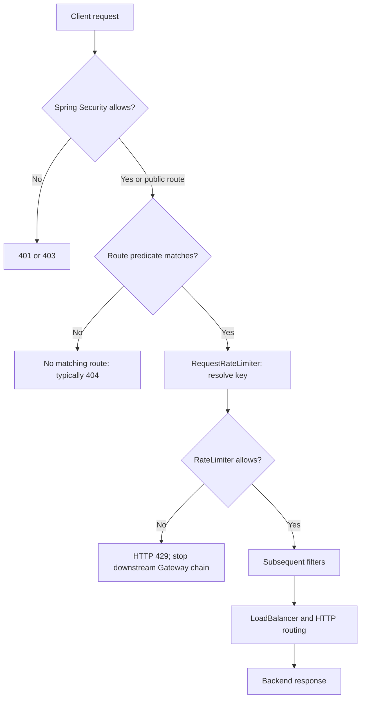
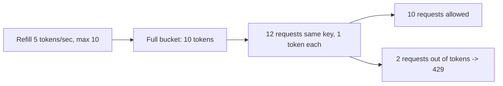
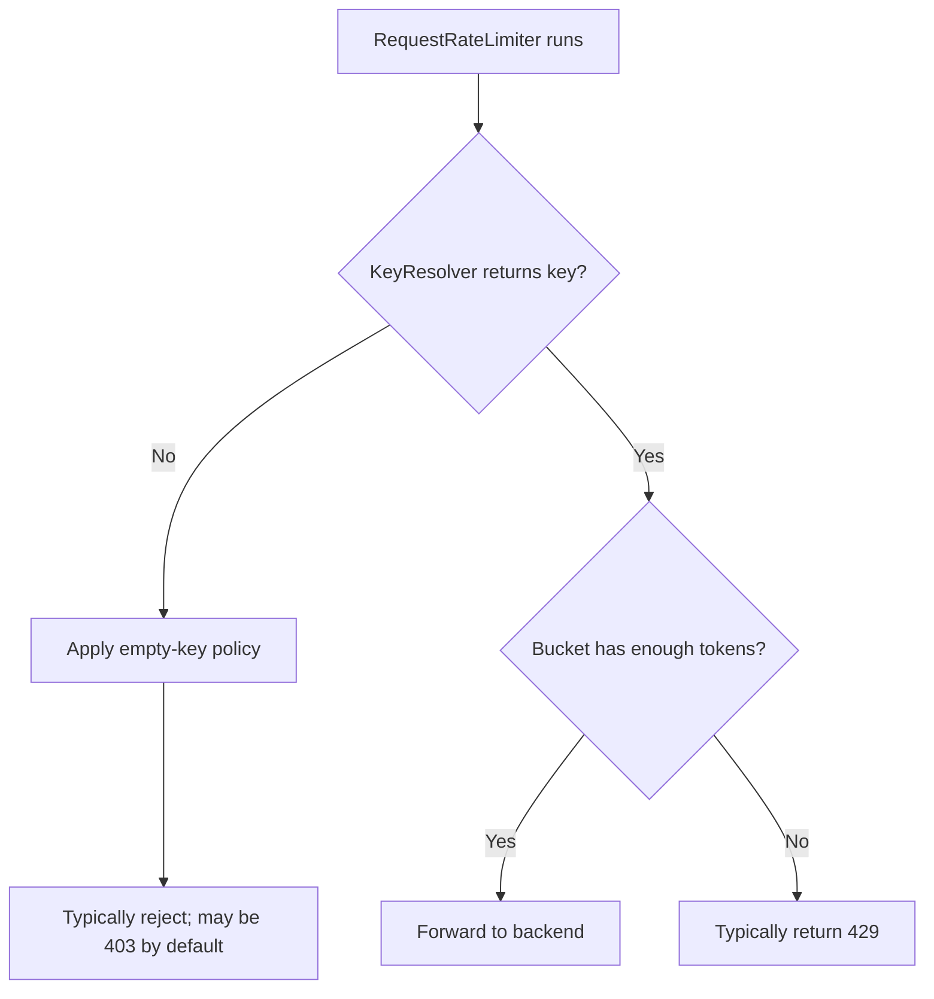
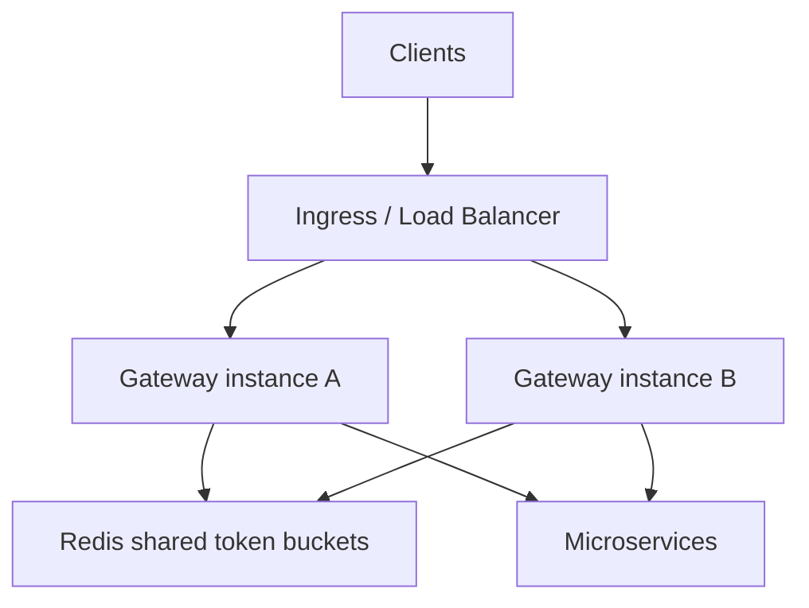
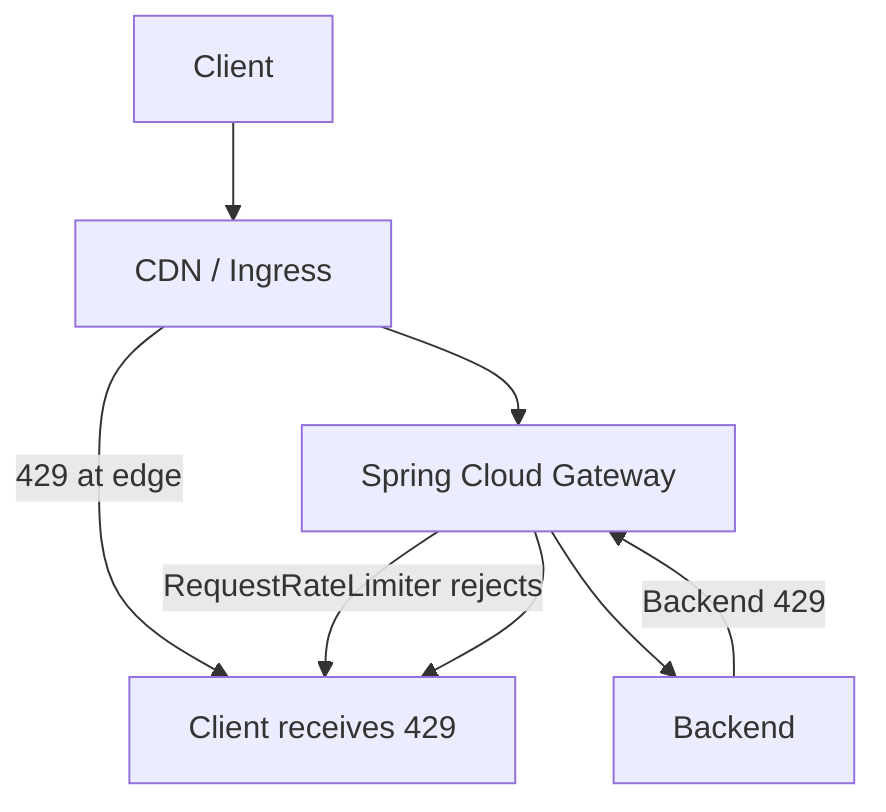

# RequestRateLimiter and HTTP 429 Responses in Spring Cloud Gateway

An API Gateway can route requests accurately to Product Service, Order Service, or Payment Service, yet still become overloaded if a client sends thousands of requests in a short period. In that case, authenticating users and resolving the right `lb://service-id` is not enough: the system needs **rate limiting** to allocate resources fairly, reduce abuse, and protect downstream microservices.

In **Spring Cloud Gateway Server WebFlux**, `RequestRateLimiter` is a **GatewayFilter Factory** that evaluates requests against an **identifying key** and a **rate policy**. When a request exceeds the limit, the Gateway typically returns **HTTP 429 Too Many Requests** without forwarding the rejected request to the backend. A common implementation pairs `KeyResolver` with `RedisRateLimiter` using the **token bucket** algorithm.

This lesson belongs to the **Traffic Limiting** chapter of the `SPRING_CLOUD_GATEWAY` module. The concepts connect with route predicates, filter chains, path/header transformations, service discovery, authentication/authorization, circuit breakers, retries, TLS, and observability to operate the microservices entry point safely.

**After this lesson, you should be able to answer:** Who the Gateway limits, on *which routes*, with *what limits*; what happens when tokens run out; why 429 differs from 401/403/503; and how to test, monitor, and operate the policy across multiple Gateway instances.

> **Scope:** Examples use **Spring Cloud Gateway Server WebFlux**, not Gateway Server MVC. Starter names and property namespaces change across Spring Boot/Spring Cloud generations. Verify against the specific version you are using before copying configuration. Limit values here are for practice only, not recommended defaults for every system.

## 1. What Problem Does Rate Limiting Solve?

Suppose an e-commerce application exposes three APIs:

- `GET /api/catalog/**`: catalog reads, high traffic volume, relatively low processing cost.
- `POST /api/orders`: order creation, touches the database and has side effects.
- `POST /api/payments`: sensitive operation requiring strict authentication and idempotency.

A client sending 10,000 requests in a few seconds can drive up CPU, connection counts, database queries, and latency even when every request carries a valid token. **Rate limiting** imposes usage limits along an identity dimension, such as an authenticated user, a verified API key, a tenant, or a client IP at a controlled network boundary.

Primary goals:

1. **Protect serving capacity:** prevent a single traffic source from exhausting everyone's connections/CPU/database.
2. **Fairness:** each user/tenant receives an allowance according to their service plan or contract.
3. **Stability during traffic spikes:** permit controlled bursts while capping the sustained average rate.
4. **Abuse mitigation:** slow down excessive automation, though it does not replace a WAF or infrastructure DDoS protection.
5. **Observability and client experience management:** return a clear 429 so clients know to back off.

Rate limiting is not a single mechanism: limits can live at the CDN/edge, reverse proxy, Gateway, backend, or network layer. This lesson focuses on **`RequestRateLimiter` at the Spring Cloud Gateway route layer**.

### 1.1. Rate Limiting vs. Concurrency Limiting

| Mechanism | What Does It Limit? | Example |
| --- | --- | --- |
| **Rate limiting** | Rate/number of requests accepted over a time interval. | Each user averages 5 requests/second, max burst 10 tokens. |
| **Concurrency limiting** | Number of requests actively executing at the same time. | Each service allows at most 100 in-flight tasks. |
| **Connection limiting** | Number of TCP/HTTP connections or connection pool size. | Cap connections to a backend. |
| **Request size limiting** | Body size of a single request. | Max upload 10 MiB. |
| **Timeout** | Wait time for processing or establishing a connection. | Upstream connect timeout 2 seconds. |
| **Circuit breaker** | Temporarily stop calling upstream when failures cross a threshold. | Open the circuit when error rate is too high. |

An endpoint taking 30 seconds to respond can still exhaust resources even at just a few requests/second; in that case, combine concurrency limits, timeouts, backpressure, and capacity planning. Conversely, many very fast requests do not automatically deserve rejection if the API's capacity allows them.

## 2. Where Does `RequestRateLimiter` Sit in the Processing Pipeline?

Gateway Server WebFlux typically progresses through these stages:

1. **WebFlux/Spring Security:** may authenticate and authorize before the Gateway routing layer.
2. **Route predicate:** selects a route via `Path`, `Method`, `Host`, and other predicates.
3. **Gateway filter chain:** combines `GlobalFilter`s and the route's `GatewayFilter`s, sorted by order.
4. **RequestRateLimiter:** resolves the key and asks `RateLimiter` whether the request is permitted.
5. **If permitted:** invokes the remainder of the chain to rewrite URLs, select an instance, and forward upstream.
6. **If denied:** returns the configured status (typically `429`), terminates the request at the Gateway, and skips subsequent filters.



**Scope limitation:** `RequestRateLimiter` is a **GatewayFilter**, so it is attached to a route or `default-filters`; it does not automatically intercept every HTTP request hitting the server. If a request is rejected early by Spring Security or matches no route, the route's rate limiter may not run at all.

A filter ordered *before* `RequestRateLimiter` can execute its pre-phase and observe completion signals; filters placed *after* it are not invoked when the limiter rejects. This matters if you expect 429 responses to also carry correlation IDs, security headers, or logs.

### 2.1. RateLimiter vs. KeyResolver

The two components play distinct roles:

| Component | Question Answered | Example |
| --- | --- | --- |
| **`KeyResolver`** | "**Whose / which group's** bucket does this request belong to?" | `user-123`, `tenant-77`, or a public API key. |
| **`RateLimiter`** | "Does that bucket have enough allowance to let this request proceed?" | `RedisRateLimiter` using a Redis token bucket. |
| **`RequestRateLimiter`** | "How are the key and limiter decision wired into the route pipeline?" | Allow through, or return 429 and stop. |
| **Route predicate** | "Which requests are subject to this policy?" | `Path=/api/orders/**`, `Method=POST`. |

Do not use `KeyResolver` to emit 429 responses directly or call blocking APIs; the resolver should only determine a trustworthy key reactively.

## 3. What Does HTTP 429 Too Many Requests Mean?

**HTTP 429 Too Many Requests** signals that the client has sent too many requests relative to the server's policy over a given period. The response may include `Retry-After` to suggest when to try again.

Illustrative example:

```http
HTTP/1.1 429 Too Many Requests
Content-Type: application/problem+json
Retry-After: 3
Cache-Control: no-store

{
  "type": "https://api.example.com/problems/rate-limit",
  "title": "Too Many Requests",
  "status": 429,
  "detail": "Please reduce your request rate."
}
```

**This is an application-designed response**, not a guarantee that the default `RequestRateLimiter` filter returns JSON or automatically adds `Retry-After` as shown. With standard built-in configuration, the Gateway may return only the status code and certain limit headers; the exact body depends on configured error-handling logic.

### 3.1. How 429 Differs from Other Status Codes

| Status | Typical Scenario | How to Respond |
| --- | --- | --- |
| **401 Unauthorized** | Missing valid credentials or invalid JWT. | Handle authentication; do not blindly retry forever. |
| **403 Forbidden** | User lacks permissions, or request had no accepted key under a specific policy. | Check authorization/identity; do not assume quota exhaustion. |
| **404 Not Found** | No matching route/resource, or a specific policy uses 404. | Check route/resource. |
| **413 Content Too Large** | Request body exceeds size limit. | Reduce payload size. |
| **429 Too Many Requests** | Rate limit exceeded. | Slow down; if a valid `Retry-After` is present, consider waiting. |
| **503 Service Unavailable** | Service temporarily unavailable, possibly due to no instances or overload. | Investigate upstream; back off appropriately. |

Distinguish between **429 generated by the Gateway** and **429 intentionally returned by a backend**. Looking only at the final status code does not identify which layer enforced the policy. Use route IDs, tracing, and controlled upstream logging to classify the source.

### 3.2. `Retry-After` Is a Hint, Not a Command to Retry

The `Retry-After` header can carry **a number of seconds** or an **HTTP-date** per the HTTP standard. In a system with multiple quota layers, computing an exact safe wait time can be hard; do not invent an arbitrary fixed value without basis.

Clients should:

- Respect `Retry-After` when present and valid.
- If absent, use bounded backoff with jitter per the API contract.
- Never retry simultaneously, infinitely, or immediately upon receiving 429.
- **Never automatically resend payment/order-creation POSTs** without idempotency rules and knowledge of whether the prior request was processed.

## 4. The Redis Token Bucket Mechanism

`RedisRateLimiter` is the standard implementation for `RequestRateLimiter`. It uses Redis to store bucket state and executes token-granting decisions atomically (typically via Lua scripts), making it suitable for multiple Gateway instances sharing limits.

Picture a **token bucket** as a container with a maximum token capacity:

- Each permitted request must consume a configured number of tokens.
- Tokens are replenished at a fixed rate, never exceeding capacity.
- When insufficient tokens remain, the request is rejected.
- An idle period lets the bucket refill for a subsequent burst.

Three core parameters:

| `RedisRateLimiter` Parameter | Meaning | Example |
| --- | --- | --- |
| `replenishRate` | Number of **tokens added per second**. | `5` tokens/second. |
| `burstCapacity` | Maximum number of tokens the bucket can hold. | `10` tokens. |
| `requestedTokens` | Number of tokens **each request** requires. | `1` token/request. |

### 4.1. Example: 5 Requests/Second, Burst 10 Requests

Suppose:

```yaml
redis-rate-limiter.replenishRate: 5
redis-rate-limiter.burstCapacity: 10
redis-rate-limiter.requestedTokens: 1
```

If the bucket is full and 12 requests for **the same key** arrive nearly simultaneously, roughly the first 10 requests may be allowed, while the remaining 2 are rejected **if not enough time passes to replenish tokens**. As it recovers, the bucket receives an average of 5 new tokens per second, capped at 10 tokens.



This is an **illustrative model**, not a strict ordering guarantee under concurrency, network latency, and internal timestamp discretization. Redis atomicity prevents two Gateway instances from reading the same token count and over-allocating the bucket.

### 4.2. Mental Formula

For a given key, you can reason roughly as:

```text
tokens_now ≈ min(
    burstCapacity,
    tokens_before + replenishRate * elapsed_seconds
)

allowed = tokens_now >= requestedTokens

if allowed:
    tokens_after = tokens_now - requestedTokens
else:
    tokens_after = tokens_now
```

The Redis implementation may use discrete timestamps or internal clamping to compute tokens; this formula conveys the semantics, not the exact code of a specific version.

### 4.3. Why `burstCapacity` Is Not "Requests per Second"

`burstCapacity` is **token capacity**, not a fixed 1-second window. With `replenishRate=5` and `burstCapacity=10`, a user can send 10 requests immediately after an idle period, but cannot sustain 10 requests/second indefinitely at 1 token per request.

To enforce strictly "never more than N requests in any 1-second window," consider a window-based algorithm. Token bucket optimizes for **average rate plus controlled bursts**.

## 5. Configuring `RequestRateLimiter` with Redis

### 5.1. Dependencies and Infrastructure

With Spring Cloud Gateway Server WebFlux, you typically need:

1. A matching version of the Gateway Server WebFlux starter.
2. **Spring Boot Reactive Redis** starter, commonly `spring-boot-starter-data-redis-reactive`.
3. A Redis instance/cluster securely reachable by the Gateway to store bucket state.
4. A `KeyResolver` and rate-limit configuration for protected routes.
5. Spring Cloud LoadBalancer/discovery if route URIs use `lb://...`; this is independent of Redis rate limiting.

Do not assume `uri: lb://order-service` uses Redis to locate instances. Redis for `RedisRateLimiter` stores **token bucket state**, whereas discovery/load balancer handles **backend selection**.

Example Maven dependency snippet (version managed by the Spring Boot BOM):

```xml
<dependency>
    <groupId>org.springframework.boot</groupId>
    <artifactId>spring-boot-starter-data-redis-reactive</artifactId>
</dependency>
```

A Redis connection configuration for modern Spring Boot typically looks like:

```yaml
spring:
  data:
    redis:
      host: localhost
      port: 6379
```

On older Boot branches, the Redis property namespace may differ. When running in Docker/Kubernetes, `localhost` refers to the Gateway's own container/pod, **not** another Redis pod/container. Use proper DNS, TLS, authentication, and network policies for the environment. Do not commit Redis passwords into public Git/YAML files.

### 5.2. `KeyResolver` Bean Based on Authenticated Principal

Use the user identity authenticated by Spring Security:

```java
import java.security.Principal;

import org.springframework.cloud.gateway.filter.ratelimit.KeyResolver;
import org.springframework.context.annotation.Bean;
import org.springframework.context.annotation.Configuration;

@Configuration
public class GatewayRateLimitKeys {

    @Bean
    KeyResolver authenticatedUserKeyResolver() {
        return exchange ->
            exchange.getPrincipal()
                .map(Principal::getName);
    }
}
```

For a JWT Resource Server, `Principal.getName()` typically maps to `sub` in common setups, though this varies depending on the converter/`Authentication` implementation. If limits must be **per tenant** rather than per individual user, the key resolver must extract the tenant ID from a **verified claim** or trusted identity system, not from a client-supplied query parameter.

Important point: for unauthenticated requests, `getPrincipal()` may return an **empty** publisher. Do not fabricate a dummy key like `admin` or grant default privileges. Empty-key handling must be deliberately chosen via `RequestRateLimiter` policies and properties.

### 5.3. Complete Route YAML

Example limiting an Order Service route for authenticated users:

```yaml
spring:
  cloud:
    gateway:
      server:
        webflux:
          routes:
            - id: orders-api
              uri: lb://order-service
              predicates:
                - Path=/api/orders/**
              filters:
                - StripPrefix=1
                - name: RequestRateLimiter
                  args:
                    key-resolver: "#{@authenticatedUserKeyResolver}"
                    redis-rate-limiter.replenishRate: 5
                    redis-rate-limiter.burstCapacity: 10
                    redis-rate-limiter.requestedTokens: 1
```

Explanation:

- `Path=/api/orders/**` selects the Order Service endpoints.
- `StripPrefix=1` rewrites a public path like `/api/orders/42` to `/orders/42` before routing.
- `name: RequestRateLimiter` declares the GatewayFilter Factory.
- `key-resolver: "#{@authenticatedUserKeyResolver}"` references the bean via a SpEL expression; it is **not** an arbitrary bean name sent over HTTP.
- `replenishRate=5`, `burstCapacity=10`, `requestedTokens=1` establish the limit from section 4.
- `lb://order-service` requires a valid `ServiceInstance` source; requests rejected with 429 **never reach** the load balancer or downstream routing.

**Note:** `RequestRateLimiter` typically requires the **expanded `name` and `args`** form; do not arbitrarily write `RequestRateLimiter=5,10` expecting arguments to bind. Verify the factory syntax in your exact Gateway version.

In older WebFlux releases, routes are usually under `spring.cloud.gateway.routes`; newer releases use `spring.cloud.gateway.server.webflux.routes`. Do not mix both arbitrarily.

### 5.4. Choosing Policies per Route

Do not assume every API needs the same limit:

```yaml
routes:
  - id: catalog-read
    uri: lb://catalog-service
    predicates:
      - Path=/api/catalog/**
      - Method=GET
    filters:
      - StripPrefix=1
      - name: RequestRateLimiter
        args:
          key-resolver: "#{@authenticatedUserKeyResolver}"
          redis-rate-limiter.replenishRate: 20
          redis-rate-limiter.burstCapacity: 40
          redis-rate-limiter.requestedTokens: 1

  - id: order-create
    uri: lb://order-service
    predicates:
      - Path=/api/orders
      - Method=POST
    filters:
      - StripPrefix=1
      - name: RequestRateLimiter
        args:
          key-resolver: "#{@authenticatedUserKeyResolver}"
          redis-rate-limiter.replenishRate: 2
          redis-rate-limiter.burstCapacity: 4
          redis-rate-limiter.requestedTokens: 1
```

This is a **YAML snippet** placed under the corresponding `routes` namespace, not a complete `application.yml`. The two routes have different limits because catalog GETs and order-creation POSTs carry different costs and risks.

With the built-in `RedisRateLimiter`, the route ID typically participates in bucket key identification to isolate limits per route; if you replace it with a custom `RateLimiter`, verify how storage keys are formed. Do not assume from the username alone that all routes share one system-wide quota.

## 6. Customizing `requestedTokens` to Represent Request Cost

Not every request has to cost one token. For instance, on a route serving a heavy reporting API, you can set:

```yaml
filters:
  - name: RequestRateLimiter
    args:
      key-resolver: "#{@authenticatedUserKeyResolver}"
      redis-rate-limiter.replenishRate: 6
      redis-rate-limiter.burstCapacity: 12
      redis-rate-limiter.requestedTokens: 3
```

In this model:

- A full bucket of 12 tokens permits up to **4 consecutive requests** costing 3 tokens each, assuming negligible refill.
- Replenishing 6 tokens/second with 3 tokens per request yields an average rate of **2 requests/second**.
- This is a **uniform configured cost** for every request matching that route, not a dynamic cost computed from per-request CPU usage.

### 6.1. Limits Lower Than One Request per Second

A common pattern for "roughly one request/minute" in `RedisRateLimiter` is:

```yaml
redis-rate-limiter.replenishRate: 1
redis-rate-limiter.burstCapacity: 60
redis-rate-limiter.requestedTokens: 60
```

Tokens replenish at 1/second; each request needs 60 tokens. After one request consumes 60, the bucket takes roughly 60 seconds to refill, all else equal. This is **not a fixed schedule resetting at the top of each minute**, but token-bucket behavior.

Do not confuse this with `replenishRate: 1`, `burstCapacity: 1`, `requestedTokens: 1`: that second configuration grants roughly one request/second, not one request/minute.

### 6.2. Units and Limits Must Be Published Precisely

A service plan promising "60 requests/minute" is not strictly identical to a token bucket averaging 1 request/second with burst 60: the permitted traffic shapes differ. Document clearly:

- Refill rate and burst size.
- Key used for rate calculation.
- Routes governed by the policy.
- Whether limits are shared across multiple APIs/tenants.
- Wait behavior or response mechanism when quota is exceeded.

If the contract requires **daily/monthly** quotas or billing credits, build a dedicated durable quota system; a Redis token bucket serves short-term rate smoothing and does not replace an accounting ledger.

## 7. `KeyResolver` Determines Fairness and Security

Limiting by the wrong key can create **bypasses** or **block innocent users**. Common options:

| Identity Approach | Pros | Risks / Considerations |
| --- | --- | --- |
| Authenticated user principal | Close to fair per-user limiting. | Requires valid JWT/session; shared accounts share one quota. |
| Tenant ID from trusted claim | Fits plan-based contracts. | All users in a tenant share one bucket; tenant claim must be verified. |
| Authenticated API key | Fits machine-to-machine clients. | Never use raw API keys as Redis keys/logs; keys must be validated and safely transformed. |
| Client IP at trusted edge | Can limit anonymous endpoints. | NAT, mobile networks, and proxies group many users under one IP; spoofable if forwarded headers are blindly trusted. |
| Static key for entire route | Protects total route traffic. | One bad client can exhaust the budget for everyone. |
| Key from unvalidated header/query | Easy to code. | **Insecure**: clients rotate keys to evade limits or inflate cardinality. |

### 7.1. IP-Based Resolver: Only Accurate When Proxies Are Understood

Technical example reading the connection address observed by the application:

```java
import java.net.InetAddress;
import java.net.InetSocketAddress;

import org.springframework.cloud.gateway.filter.ratelimit.KeyResolver;
import org.springframework.context.annotation.Bean;
import reactor.core.publisher.Mono;

@Bean
KeyResolver remoteAddressKeyResolver() {
    return exchange -> {
        InetSocketAddress remote =
            exchange.getRequest().getRemoteAddress();

        InetAddress address =
            remote == null ? null : remote.getAddress();

        return Mono.justOrEmpty(address)
            .map(InetAddress::getHostAddress);
    };
}
```

This snippet **does not automatically find the original client IP** if the Gateway runs behind an ingress/reverse proxy. `getRemoteAddress()` may simply return the proxy's IP.

To limit by the real client IP, define a trust boundary for `Forwarded`/`X-Forwarded-For` with a **trusted proxies list**, IPv4/IPv6 canonicalization, and an appropriate NAT policy. Never take the first value from an arbitrary client-supplied `X-Forwarded-For` header and treat it as real identity.

### 7.2. Is a User Resolver Appropriate for Anonymous Endpoints?

With `authenticatedUserKeyResolver` from section 5, anonymous requests have no principal and return `Mono.empty()`. In many Gateway versions, `deny-empty-key` defaults to **rejecting requests when no key resolves**; the default status code for that case may be **403 Forbidden**, **not 429**.

Therefore, if testing an anonymous request yields 403, do not assume the bucket is "out of tokens." The request may simply **have no key to evaluate**.

To support public APIs, **choose an explicit policy**: a bucket by trusted-proxy IP, a global route bucket, or rate limiting at the CDN/WAF. Do not blindly set `deny-empty-key: false` and skip anonymous limiting without understanding the impact.

### 7.3. Static Key for a Public Route

To cap **total** traffic for a public API, you can use a fixed key:

```java
@Bean
KeyResolver publicRouteKeyResolver() {
    return exchange -> Mono.just("public-route");
}
```

With the built-in `RedisRateLimiter`, route ID and key typically form the bucket identifier. However, a static key has a drawback: one abusive traffic source can trigger 429 for every user on that route. It is better suited for a **global cap/load shedding** than fair per-user limiting.

If you need both a **global cap** and **per-user limits**, you may need multiple layers or independently designed limiters; a single bucket generally cannot satisfy both goals.

## 8. Empty Keys, 403 Rejections, and Customizing Status Codes

An important but easily overlooked detail is **failing to resolve a key**.

The decision flow has two separate branches:



Common WebFlux Gateway versions expose properties on `RequestRateLimiterGatewayFilterFactory` corresponding to:

- `deny-empty-key`: whether to reject when the resolver emits no key.
- `empty-key-status-code`: status returned on an empty key.
- `status-code`: status returned when the rate limiter denies the request.

**Exact property names depend on version/namespace** (older branches typically use `spring.cloud.gateway.filter.request-rate-limiter`, while newer branches may use `spring.cloud.gateway.server.webflux.filter.request-rate-limiter`). Check the configuration metadata for your exact version before declaring them. Do not assume every 403 is authorization-related or every 429 comes from the token bucket.

### 8.1. Should Every Rejection Be Changed to 429?

Not necessarily. When a user is unauthenticated and the key policy requires a principal, **401/403** at the security layer is more accurate. When a client has a valid identity and exceeds its quota, **429** is clearer.

If the key resolver fails due to a malformed claim or identity system issue, returning 429 can mask authentication/configuration bugs. Distinguish root causes before choosing status codes.

## 9. 429 Responses and Rate-Limit Headers

`RedisRateLimiter` in common Gateway branches can attach headers reflecting rate/bucket state, for example:

```http
HTTP/1.1 429 Too Many Requests
X-RateLimit-Remaining: 0
X-RateLimit-Replenish-Rate: 5
X-RateLimit-Burst-Capacity: 10
X-RateLimit-Requested-Tokens: 1
```

**This is an illustrative example**: header presence, names, and values depend on implementation/version/configuration. `X-RateLimit-*` headers are implementation-specific and **do not constitute** a standardized HTTP RateLimit contract that clients can assume across every Gateway.

`Retry-After` is not guaranteed to appear just because `RequestRateLimiter` rejects a request. If your API requires controlled client retries, design how that header is computed and emitted in a layer that has full context, before the response is committed.

### 9.1. Does 429 Automatically Include a JSON Body?

Not by default. The `GatewayFilter` may simply set the status and complete the response. If the frontend expects `application/problem+json` or a uniform error schema:

- Identify **the layer responsible for building the response** (custom filter, error handler, or version-supported Gateway hook).
- Do not attempt to write a body too late after `response.setComplete()` or once the response is committed.
- Ensure `Content-Type`, status, body, and correlation ID are consistent.
- Test CORS, authorization, rate-limit, and upstream branches rather than testing only 200 OK.

Do not force every `429` across the entire system into an identical body if that hides distinct quota types. You can include a **stable error code** without leaking sensitive details, such as `RATE_LIMIT_EXCEEDED`, and document client handling guidance.

### 9.2. Be Careful with Caching

HTTP 429 indicates a rate-limit rejection, often scoped to a user/tenant key. Intermediate caches must never accidentally serve user A's 429 response to user B. Enforce appropriate cache-control policies—such as not caching per-user rate-limit responses where appropriate—and audit CDNs/proxies around the Gateway.

Do not expose quota headers containing identities, raw API keys, or internal details as public debugging aids.

## 10. Multiple Gateway Instances Sharing Redis

In production, the entry point typically runs multiple instances:



If each Gateway instance keeps rate-limit counters **solely in local memory**, the same client can effectively receive its limit multiplied by the number of instances. With `RedisRateLimiter`, Gateway instances check **shared bucket state** in Redis.

For example, two Gateway instances both serving `GET /api/catalog` for user `u1` with a full 10-token bucket. Total requests accepted in a near-simultaneous burst are coordinated by the shared bucket, **not 10 requests per instance**.

### 10.1. Redis Is Not Free in Latency or Availability

Every decision can incur network I/O to Redis, making Redis a dependency on the request path. Plan for:

- Redis provisioned with sufficient throughput and connection capacity.
- Appropriate timeouts and pool settings; never block the event loop.
- TLS, authentication, network policies, and least-privilege access.
- Monitoring for latency, Redis errors, memory, and eviction/capacity.
- A failure-handling strategy when Redis is unavailable, aligned with risk appetite.

### 10.2. Fail-Open or Fail-Closed?

This is an architectural decision with no universal answer:

| Policy When Limiter Store Fails | Consequence | When to Consider |
| --- | --- | --- |
| **Fail-closed**: reject requests when quota cannot be checked. | Protects resources but causes an outage for legitimate users. | High-abuse-risk APIs or where limits are a mandatory safety control. |
| **Fail-open**: allow requests when limiter store fails. | Preserves availability but risks overload and unthrottled usage. | Read APIs with other protective layers where risk policy permits. |
| **Bounded fallback**: fall back temporarily to a secondary limiter with separate limits. | Complex; must avoid each Gateway granting overly generous quotas. | High-SLO systems with well-designed and tested fallbacks. |

**Do not assume `RedisRateLimiter` always defaults to fail-open or fail-closed as you desire.** When Redis fails, behavior depends on the implementation, exception handling, and filter chain of the specific version; test deliberately by severing Redis in a test environment.

### 10.3. Redis Outage vs. Empty Token Bucket

If Redis is unreachable or a script fails, the Gateway may return 5xx or another status depending on configuration. Do not immediately treat every 429/503 as a Redis outage. Track separately:

- "Valid key, quota exhausted";
- "Key could not be resolved";
- "Redis/RateLimiter error";
- "Backend has no instances or timed out".

Proper classification prevents teams from tweaking rate-limit numbers when the root cause is actually networking or Redis availability.

## 11. Combining RequestRateLimiter with Spring Security

To enforce limits per **authenticated user**, Spring Security WebFlux typically validates `Authorization: Bearer ...` before the Gateway filter chain. `KeyResolver` can then rely on a trustworthy principal instead of trusting a client-sent `X-User-Id`.

Example flow:

```text
Client sends valid JWT, sub = user-123
Spring Security verifies issuer/signature/audience/exp
GET /api/orders/42 allowed by SCOPE_orders.read
RequestRateLimiter resolves principal key = user-123
RedisRateLimiter checks bucket for route + user-123
If out of tokens: 429, Order Service is not called
```

**Order of decisions matters:**

- Invalid JWT → typically 401 before reaching `RequestRateLimiter`.
- Valid JWT lacking scope → typically 403 before entering the route.
- Valid JWT with sufficient scope, empty bucket → typically 429.
- Valid JWT, remaining quota, but Order Service has no instances → possibly 503.
- Valid JWT, remaining quota, backend reports missing resource → possibly 404.

In some applications, security matchers or filter order may differ; verify with real tests rather than assuming an ideal diagram.

### 11.1. API Keys and Access Control

If an API uses API keys, **verify the key first** (e.g., via a trusted authentication component) and then use the client's stable verified identifier as the rate-limit key. Do not use the raw API key string as a Redis key or metric label, as that can expose credentials.

A `KeyResolver` is not meant to "authenticate" an API key by trusting whatever `X-Api-Key` header a client sends. If a caller can switch headers to switch buckets, the rate limit can be bypassed.

### 11.2. TokenRelay Is Not Rate Limiting

`TokenRelay` forwards access tokens in appropriate OAuth2 Client flows; `RequestRateLimiter` enforces quotas. The two filters do not replace each other. When backends also enforce their own rate limits, avoid uncoordinated overlapping quotas that create unpredictable client behavior; if both are needed, document which layer owns which limit and the source of 429s.

## 12. CORS Preflight and 429: Do Not Blame the Wrong Layer

A frontend at `https://app.example.com` calling an API through the Gateway at `https://api.example.com` with a Bearer token typically triggers an `OPTIONS` preflight.

```http
OPTIONS /api/orders HTTP/1.1
Origin: https://app.example.com
Access-Control-Request-Method: POST
Access-Control-Request-Headers: authorization, content-type
```

Preflight requests may be handled by **CORS handling at the WebFlux/Gateway mapping layer** before route `GatewayFilter`s run. Do not assume preflight requests necessarily consume a Redis token on the POST route.

When the actual POST request exceeds its quota, the Gateway returns `429`. If the 429 response lacks the required `Access-Control-Allow-Origin` header, the browser may surface only a **CORS error**, masking the 429 status. Therefore, test **rate-limited responses** as well, not just successful ones.

Specifically:

- CORS is neither authentication nor rate limiting.
- Preflight requests do not carry the real POST request's bearer token.
- Route-level `RequestRateLimiter` does not replace pre-routing protections or edge abuse controls.
- Never use `Access-Control-Allow-Origin: *` with credentialed cross-origin requests.
- If Spring Security blocks `OPTIONS` before CORS runs, fix the CORS/Security integration directly rather than adding rate-limit filters.

## 13. Combining Rate Limits, Retries, and Circuit Breakers

A reliable design considers how these mechanisms interact.

### 13.1. Retries Can Cause One Client Request to Make Multiple Upstream Calls

Suppose a client sends one request to the Gateway, the quota allows it, and the `Retry` filter makes two backend calls due to a timeout. Depending on filter order and how `Retry` re-executes the downstream chain, **one client request** can produce multiple upstream attempts.

This affects:

- Actual backend resource consumption.
- Client-request quotas vs. upstream-attempt quotas.
- Throughput and success-rate metrics.
- Idempotency of POST/PUT operations and request-body replayability.

Do not assume every retry deducts another token—or deducts none—**without verifying filter ordering**. Whether you want quotas counted per client request or per upstream attempt, place the limiter accordingly and test it.

### 13.2. Do Not Retry 429 Infinitely

If a client receives 429 and retries immediately, it can create an amplifying overload loop:

```text
Client -> Gateway: quota exhausted -> 429
Client retries immediately -> Gateway: quota still exhausted -> 429
Client retries immediately -> ...
```

A better approach is returning clear guidance while clients use backoff/jitter and retry only when justified. For requests with side effects, enforce idempotency keys per contract.

Do not configure `Retry` by default across all 429s or all POSTs. If there is a specific reason to retry upstream 429s, enforce a controlled retry budget and distinguish them from Gateway-generated 429s.

### 13.3. Circuit Breakers Do Not Replenish Quotas

A circuit breaker protects the backend from errors/timeouts; a request rate limiter protects against excessive traffic. When a circuit breaker opens, requests may return a fallback or fail fast, which does not mean the token bucket should be reset.

Conversely, increasing `burstCapacity` to "fix" 503 errors caused by missing instances only sends more traffic toward the failing path. Address service discovery, readiness, and backend health separately.

## 14. 429 Responses Before and After the Gateway: Identifying the Source

An HTTP 429 can originate from multiple places:



On the same route, the three rejection points may enforce different quotas/keys. A frontend cannot reliably tell them apart from status 429 alone. If disambiguation is needed, use **stable error codes, controlled headers, or internal telemetry** without exposing sensitive internals.

Observability tips:

| Source | Observable Signals |
| --- | --- |
| Edge/CDN | Request never reaches the Gateway; edge metrics/status or edge-owned headers. |
| Gateway limiter | Route matched; limiter decision was deny; upstream never received the request. |
| Backend quota | Gateway permitted the request; upstream span/request exists; backend returned 429. |

Avoid relying solely on `X-RateLimit-Remaining`, because the backend or edge may emit headers with the same name, creating duplicates or conflicts.

## 15. Observability: Measure Both Rejections and Impact

A good `RequestRateLimiter` dashboard should answer:

1. Which routes are receiving the most 429s?
2. Are rejection rates rising by hour, region, or deployment version?
3. Are Redis latency/errors rising at the same time?
4. Did backend 5xx/timeout errors drop after enabling the limiter?
5. Are legitimate clients getting over-rejected due to poor key grouping?

Metrics to consider:

- Inbound Gateway requests by **route ID** and outcome.
- **429 ratio over total requests** per route, broken down by source where instrumented.
- Redis rate-limit decision latency.
- `KeyResolver`/empty-key error counts.
- Rate/burst configuration change events.
- Backend 5xx, queue depth, latency, and health under the active rate policy.
- If tiered quotas exist, measure by normalized tier/tenant group with bounded cardinality.

Never create per-request metric labels containing raw user IDs, tokens, or API keys when cardinality is unbounded; that can overload the metrics backend. Per-user logs used for investigations must follow proper access controls, retention, and data-protection rules.

### 15.1. Why Not Log Only Inside a GlobalFilter?

A `GlobalFilter` only participates once the Gateway selects a route and builds the chain. Requests rejected earlier by Spring Security or matching no route may never reach that filter. To observe **all** requests and all failure modes, instrument at the proper layers—WebFlux, Spring Security, and ingress—in addition to Gateway metrics.

For 429 responses, an observation filter ordered **before** `RequestRateLimiter` can record latency and status. Filters **after** the limiter generally do not run once rejected; do not expect downstream custom filter headers or metrics to appear on 429 responses.

### 15.2. Do Not Parse Request Bodies for Rate Limiting Unnecessarily

Reading JSON/multipart bodies just to compute a key increases memory usage, breaks streaming, and risks leaking data. Prefer authenticated principals, tenants, or API keys; if a quota must track "business cost," the backend or a dedicated quota service typically knows true cost far better than a `GatewayFilter` arbitrarily buffering bodies.

## 16. Practical Testing Workflow with curl

Assumptions:

- Gateway runs at `http://localhost:8080` in a test environment.
- Route `GET /api/catalog/**` uses `RequestRateLimiter` and Redis.
- Catalog Service backend is running, avoiding confusion between 429 and 503.
- Your key resolver produces the **same stable key** for test requests.
- Test limits are `replenishRate=1`, `burstCapacity=2`, `requestedTokens=1` for easy observation.

### 16.1. Verify One Valid Request

```bash
curl -i "http://localhost:8080/api/catalog/products/42"
```

Without proper authentication, you may get 401/403 **before** testing 429. Use a safe test profile with an appropriate key resolver; never disable production auth just to test the limiter.

### 16.2. Send a Small Burst

```bash
for i in 1 2 3 4 5; do
  curl -sS -o /dev/null \
    -w "request=$i status=%{http_code}\n" \
    "http://localhost:8080/api/catalog/products/42"
done
```

If requests execute tightly together against a full bucket, roughly the first two requests may succeed and subsequent ones receive 429. Actual results depend on inter-request timing, preexisting Redis state, auth, backend status, and test execution speed. Also check **how many requests the backend actually received**; a 200 or 404 from the backend still proves the quota allowed that request through.

For precise burst testing, use an HTTP load generator in an isolated environment within permitted load levels; never run high-load tests against production.

### 16.3. Wait for Tokens to Replenish

At 1 token/second, after waiting long enough, a new request can be permitted again. This is token-bucket behavior. Do not confuse gradual token refill with a hard quota reset at the start of every minute.

### 16.4. Test Two Different Keys

Use two distinct test principals/identities, such as `user-A` and `user-B`, each mapped to its own bucket by the resolver. When `user-A` runs out of tokens, `user-B` can still call the API as long as its bucket has tokens.

If both receive 429, check whether the resolver returned the same key, used a static key, or partitioned Redis keys unexpectedly.

### 16.5. Test Without a Key

If the route uses `authenticatedUserKeyResolver` and a request has no principal:

```bash
curl -i "http://localhost:8080/api/catalog/products/42"
```

Possible expectations:

- 401/403 from Spring Security if the route requires authentication.
- 403 or the configured **empty-key** status if the request reaches `RequestRateLimiter` without a resolved key.
- Do not automatically interpret these outcomes as 429 out-of-tokens.

### 16.6. Test a Redis Outage

In a **dedicated test environment**, temporarily disconnect Redis or point to an unavailable test Redis instance. Observe status codes, error handling, latency, and whether requests reach the backend. Document whether your system fails open, fails closed, or returns 5xx.

Never take down production Redis just to demonstrate an exercise.

## 17. Integration Testing: Cases You Cannot Skip

In CI or staging, verify the following cases:

| Test Case | Input Condition | Outcome to Verify |
| --- | --- | --- |
| Unmatched route | `GET /unknown` | Route limiter does not run; status comes from route mapping. |
| Missing token | Route requires Bearer JWT | 401 or appropriate security status; not confused with 429. |
| Token lacking scope | Valid JWT lacking permission | 403; not forwarded upstream. |
| Empty key | Request passes security but resolver returns empty | `deny-empty-key` behavior matches contract. |
| Bucket has tokens | Valid key, requests below threshold | Request reaches backend with expected path/headers/body. |
| Bucket empty | Burst exceeds capacity for same key | 429 from Gateway; backend receives zero denied requests. |
| Two different keys | User A and B | Budgets remain isolated unless intentionally shared. |
| Two Gateway replicas | Same key sent across A and B | Shared Redis bucket; total allowance does not double. |
| Redis disconnected | Controlled outage | Error/fallback behavior follows policy without hanging requests. |
| POST request | Rate limit on operation with side effects | Client and retries do not cause duplicate side effects. |
| Frontend CORS | OPTIONS + rate-limited POST | Preflight and 429 response include proper CORS headers. |
| Backend returns 429 | Gateway quota still available | Telemetry distinguishes upstream 429 from Gateway 429. |
| Backend has no instances | Quota remains but `lb://` fails | 503/404 from load balancer; do not tweak quota randomly. |
| High Redis key cardinality | Many users/API keys | Memory, TTL, and metrics stay within operational bounds. |

### 17.1. Avoiding Flaky Tests Caused by Token Bucket Timing

A test asserting "the third request is **always** 429" can flake depending on inter-request timing and token refill. To write reliable tests:

- Isolate test keys/namespaces and clear test bucket state through approved mechanisms.
- Send near-concurrent bursts when testing capacity, or inject a mock clock/limiter in unit tests.
- Assert **acceptable ranges** and invariants such as "denied requests never invoke the backend," rather than brittle sequential ordering.
- Never let tests share random Redis keys.
- In load tests, report concurrency, request count, key distribution, and test duration.

### 17.2. Is `WebTestClient` Alone Enough?

A test using `WebTestClient` with a mocked Security principal validates route and filter policies, but does not prove the **Redis Lua token bucket** works across multiple Gateway instances. Run integration tests against a real test Redis instance and, where needed, multiple Gateway replicas to verify actual distributed quota behavior.

Conversely, merely seeing 429 in curl does not prove keys are correct or Redis is safe under high concurrency; verify Redis metrics and backend request counts as well.

## 18. Common Mistakes When Using RequestRateLimiter

| Symptom | Likely Cause | Fix |
| --- | --- | --- |
| Never see 429. | Filter not attached to route, wrong namespace, limit too high, or key changes on every request. | Check route loading, filter list, Redis values, and key resolver. |
| All anonymous requests get 403. | `KeyResolver` returns empty; `deny-empty-key` rejects them. | Check security policy and design a resolver for public routes. |
| All users share one quota. | Resolver uses a static key or proxy IP. | Use authenticated principal/tenant or trusted client IP. |
| Client changes `X-User-Id` to bypass limits. | Resolver trusts self-declared header. | Never use untrusted headers as rate-limit identity. |
| Multiple Gateway replicas allow exceeding quota. | Each node uses a local limiter or fails to share Redis properly. | Verify `RedisRateLimiter` points to shared Redis and consistent key partitioning. |
| Redis failure causes 5xx/timeouts. | Connection loss, Lua script failure, or pool/timeout errors. | Inspect Redis metrics, TLS, capacity, and failure-policy handling. |
| Route matches but backend receives nothing. | Rejected by 429/empty-key or short-circuited by another filter. | Check route ID, limiter decision, and upstream spans. |
| Backend returns 429 while Gateway quota remains. | Backend enforces its own limiter. | Separate 429 sources via tracing/internal headers. |
| Browser reports CORS instead of 429. | Denied response lacks valid CORS headers. | Check WebFlux/Gateway CORS config and filter order. |
| Average rate is fine but bursts are huge. | `burstCapacity` set too high. | Tune token bucket and backend capacity to match SLOs. |
| Wanted 1 request/min, configured refill 1 and capacity 1. | Misunderstood `replenishRate` units. | Use the appropriate `requestedTokens` pattern and verify in tests. |
| 429s spike suddenly after deploy. | `KeyResolver` semantics changed, quota lowered, or stale Redis state. | Compare configs/versions/keys and traffic. |
| Redis key count and memory grow rapidly. | High-cardinality keys or improper retention. | Use stable keys, review TTL/capacity, and prevent key spoofing. |
| Retries make backend receive more calls than quota. | Retries execute after the limiter and generate multiple attempts. | Review filter order, upstream retry policy, and idempotency. |
| 503 appears and team only increases `burstCapacity`. | Root cause is discovery/backend/Redis, not token shortage. | Classify errors before changing limits. |

## 19. Design Scenario: Public Catalog and Authenticated Orders

Suppose a Gateway serves two routes:

- **Catalog API:** allows anonymous users, high traffic, cacheable data.
- **Order API:** restricted to clients with valid JWTs; rate limits tracked per user/tenant.

A possible design:

| Component | Catalog | Order |
| --- | --- | --- |
| Route predicate | `Path=/api/catalog/**`, `Method=GET` | `Path=/api/orders/**`, method per action |
| Key | IP from trusted edge or aggregate key with NAT caveats | `Principal.getName()` or verified tenant claim |
| Limits | Higher, paired with CDN/caching | Lower, protecting DB and side effects |
| Anonymous | Allowed, with an explicit limit policy | Spring Security rejects if JWT is missing |
| 429 | Client slows down, checks cache/`Retry-After` if supplied | Client backs off and avoids blind POST retries |
| Backend | Cache/catalog service | Order service enforces resource-level authorization and idempotency |
| Observability | 429 by route/edge IP group | 429 by route and tier, no raw user IDs in metric labels |

The system still requires timeouts, circuit breakers, a Redis availability strategy, and TLS. If Order Service loses all instances, `RequestRateLimiter` may still admit requests from the bucket before the load balancer returns 503; that does not mean the limiter failed. They handle **different failure modes**.

### 19.1. Decisions to Align with the Product Team

Before granting customer quotas, answer:

- Is quota tracked per **user, tenant, API key, route, or service plan**?
- Do multiple frontends/apps for the same user share one quota?
- Do internal or admin clients get exemptions, and how are exemptions authenticated?
- Do 400/401/403 requests count against quota?
- How are clients instructed to handle 429 retries?
- During a Redis outage, is availability or strict quota enforcement prioritized?
- Do policies change during peak hours or by request type?

If these rules are unclear, even syntactically valid YAML can produce unfair behavior or break SLOs.

## 20. Practice Exercises with Answers

### Exercise 1 — Calculating Burst and Average Rate

Configured with `replenishRate=4`, `burstCapacity=8`, `requestedTokens=1`. A user has been idle, so the bucket is full, and then sends 12 requests almost simultaneously.

**Answer:** Roughly the first 8 requests can be allowed and the remaining 4 rejected if the interval is too short for significant replenishment. The sustained long-term rate is roughly 4 requests/second. This is a token bucket, not a rigid 1-second fixed window.

### Exercise 2 — 1 Request/Minute Limit

To achieve roughly one request per minute, why is `replenishRate=1` and `burstCapacity=1` incorrect?

**Answer:** With `requestedTokens=1`, refilling 1 token/second permits roughly one request/second. One valid pattern is `replenishRate=1`, `burstCapacity=60`, `requestedTokens=60`: it takes 60 seconds to accumulate 60 tokens.

### Exercise 3 — Valid JWT Lacking Scope

A route requires `SCOPE_orders.write`, and the client presents a valid token with only `orders.read`. Should the Gateway return 429 if the rate limiter still has tokens?

**Answer:** No. Spring Security typically rejects with **403** before reaching `RequestRateLimiter`. 429 applies only when the rate policy rejects a request that reached the limiter step.

### Exercise 4 — Anonymous Requests Receive 403 Instead of 429

A route uses `authenticatedUserKeyResolver` without requiring login. Anonymous callers receive 403 even though Redis is not out of tokens. Why?

**Answer:** The resolver returns `Mono.empty()`; the `deny-empty-key` policy can reject before calling the Redis limiter, typically defaulting to status 403. Design an intentional resolver/policy for public routes.

### Exercise 5 — IP Behind a Proxy

The Gateway runs in Kubernetes behind an ingress. Every request gets grouped into a single IP quota even though callers come from many internet users. What is the likely cause?

**Answer:** `getRemoteAddress()` may be returning the ingress IP. Configure trusted proxy forwarding, safely resolve the client IP, or key off an authenticated principal/tenant. Never trust client-supplied `X-Forwarded-For`.

### Exercise 6 — Multiple Gateway Instances

A user sends 20 requests across two Gateway instances, each using an in-memory bucket allowing a burst of 10. Is the total burst guaranteed not to exceed 10?

**Answer:** No. Two independent counters can each admit up to 10. Use a shared store/distributed limiter like `RedisRateLimiter` to coordinate limits across replicas.

### Exercise 7 — Backend Has No Instances

A request passes the rate limiter, then the load balancer reports no available instances and the Gateway returns 503. Will increasing `burstCapacity` fix this?

**Answer:** No. The rate limiter already allowed the request; the failure is in service discovery/load balancing. Inspect service IDs, readiness, registry state, and upstream connectivity.

### Exercise 8 — Retries and 429

A client receives 429 and automatically retries an order-creation POST 100 times in one second. Is this proper behavior?

**Answer:** No. Clients need bounded backoff with jitter and should retry only when semantics are safe. For POSTs with side effects, enforce idempotency and handle uncertain outcomes properly.

### Exercise 9 — Key Design with API Keys

A client sends `X-Api-Key: customerA` and can switch to `customerB` for a fresh quota because API keys are not verified. What is wrong?

**Answer:** The `KeyResolver` relies on untrusted input. Verify the API key first and use the verified stable identifier; never store or log raw secrets.

### Exercise 10 — Browser Reports CORS When Quota Runs Out

`curl` shows status 429, while the browser reports only a CORS error when the same route exceeds quota. Does this mean the Gateway isn't rate limiting?

**Answer:** No. The 429 response likely lacks valid CORS headers on the short-circuit branch. Verify `Access-Control-Allow-Origin` and WebFlux/Gateway CORS configuration for rejected responses.

### Exercise 11 — Redis Outage

Redis disconnects. The team proposes allowing all requests through by default to avoid downtime. Is that always safe?

**Answer:** No. Fail-open may fit certain read APIs with secondary protections, but it drops limits and risks overload; sensitive APIs may need fail-closed or a bounded fallback. Base the decision on risk, test it, and wire operational alerts.

## 21. Pre-Production Checklist

- [ ] Distinguished **rate**, **burst**, **request cost**, **concurrency**, and body-size limits.
- [ ] Applied `RequestRateLimiter` only to routes needing rate limits; route predicates match accurate `Path`/`Method`.
- [ ] Selected a `KeyResolver` based on **authenticated** principal, tenant, or API key.
- [ ] Public/anonymous endpoints have an explicit key policy; no accidental mass 403s from empty keys.
- [ ] Never trust raw `X-User-Id`, unverified `X-Api-Key`, or uncontrolled `X-Forwarded-For`.
- [ ] Tested `replenishRate`, `burstCapacity`, and `requestedTokens` under both burst and steady traffic.
- [ ] `RedisRateLimiter` shares one store across Gateway replicas; key partitioning and route IDs behave as intended.
- [ ] Redis has TLS/credentials/network policies, timeouts, capacity planning, and monitoring.
- [ ] Redis outage / fail-open / fail-closed policy is chosen and explicitly tested.
- [ ] Gateway 429s are distinguishable from edge/backend 429s.
- [ ] 429 responses match contract status/headers/body without leaking secrets or internal details.
- [ ] `Retry-After` is emitted only when validly computed; clients implement backoff/jitter and retry budgets.
- [ ] POST/PUT/PATCH operations with side effects are never blindly retried; idempotency is designed.
- [ ] CORS works for both preflight and 429 responses; Spring Security still authenticates real requests.
- [ ] 401/403/404/413/429/503 are classified by source rather than tweaking limits to mask unrelated errors.
- [ ] Other filters execute before/after the limiter in the right order; denied requests never hit the backend.
- [ ] Metrics by route/status/decision have low cardinality; logs never record tokens or raw API keys.
- [ ] Tested independent keys, multiple replicas, Redis outages, load-balancer no-instance cases, and bursts.
- [ ] Quota changes follow a rollout process with impact monitoring and controlled rollback.
- [ ] Rate-limit policies are documented for clients/API consumers.

## 22. Summary

**`RequestRateLimiter`** in **Spring Cloud Gateway Server WebFlux** pairs a **`KeyResolver`** to identify who is being limited with a **`RateLimiter`** to decide whether a request may proceed. With **`RedisRateLimiter`**, the three parameters `replenishRate`, `burstCapacity`, and `requestedTokens` create a **token bucket** capable of coordinating quotas across multiple Gateway instances. When the bucket lacks enough tokens, requests typically receive **HTTP 429 Too Many Requests** without being forwarded upstream.

However, **429 is not the only outcome**: empty keys can yield 403 depending on policy, invalid JWTs yield 401, unmatched routes yield 404, and Redis or backend failures can yield 5xx. To operate reliably, verify trustworthy keys, design fair quotas, protect Redis, manage retries/idempotency, and ensure CORS/headers/metrics work properly on rejected paths.

When the roles of **rate limiting, authentication, route matching, load balancing, circuit breakers, and observability** are cleanly separated, `SPRING_CLOUD_GATEWAY` can shield microservices from traffic spikes while preserving clear HTTP contracts and safe resilience.
