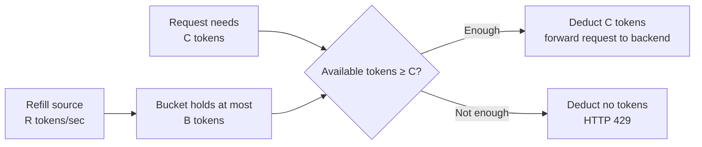
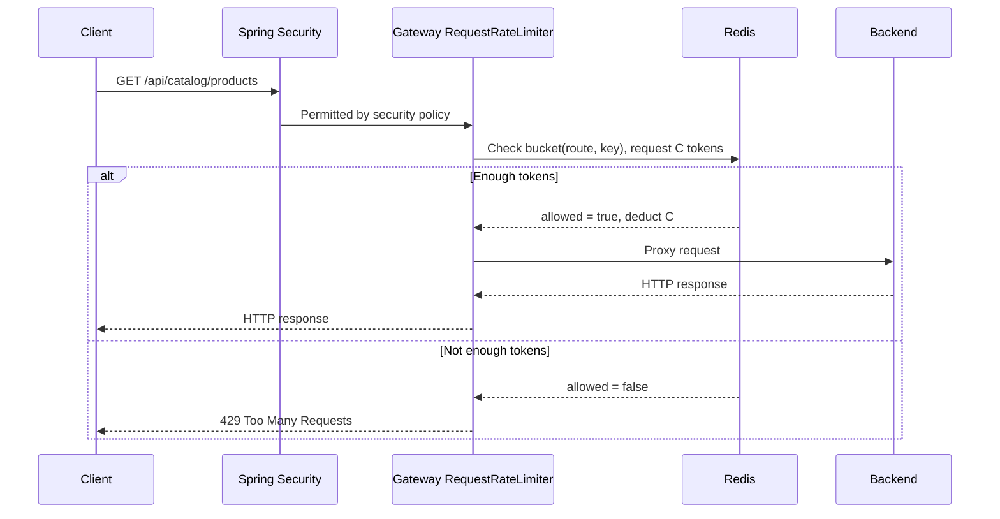
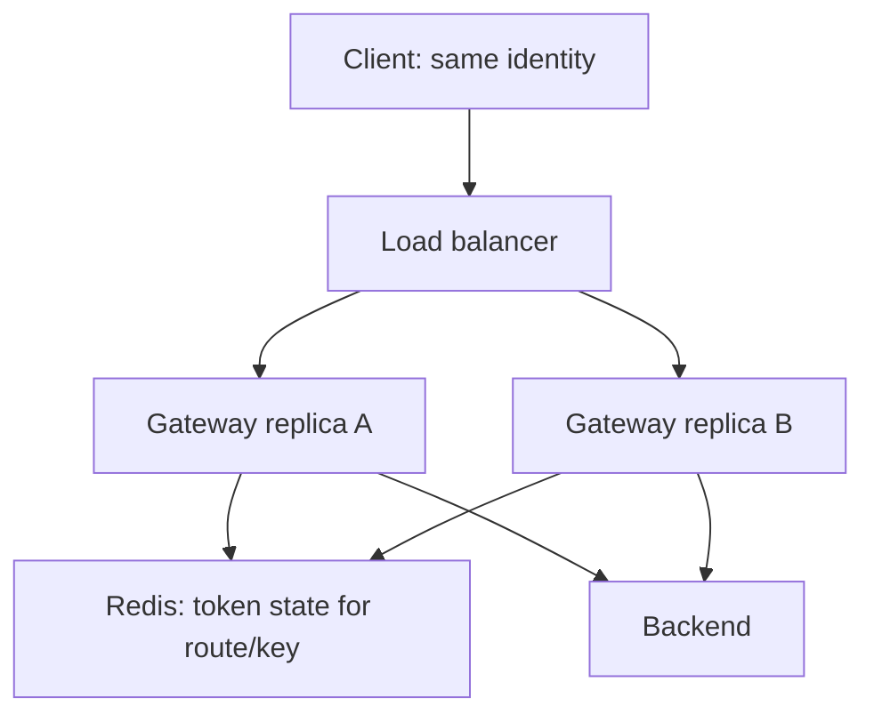

# Token Bucket: Replenish Rate, Burst Capacity, and Cost per Request in Spring Cloud Gateway

An API Gateway does more than select routes by `Path` and `Method`, run a filter chain, and forward requests to microservices. It must also **limit traffic** so a single user or application cannot exhaust connections, CPU, backend resources, and overall serving capacity. Spring Cloud Gateway provides the `RequestRateLimiter` filter; when using the Redis implementation `RedisRateLimiter`, the allow/deny decision relies on the **token bucket** algorithm.

The three parameters in this lesson are:

- **`replenishRate` (R):** the rate at which tokens are **added to the bucket**, measured in tokens/second.
- **`burstCapacity` (B):** the **maximum capacity** the bucket can hold, measured in tokens.
- **`requestedTokens` (C):** how many tokens **one request consumes**, defaulting to `1`.

If the bucket has at least `C` tokens, the request is permitted to proceed and `C` tokens are deducted. If insufficient tokens remain, the request is rejected, defaulting to **HTTP 429 Too Many Requests**. When no traffic arrives, tokens accumulate at rate `R` without exceeding `B`.

This lesson belongs to the **Traffic Limiting** chapter of the `SPRING_CLOUD_GATEWAY` module. It focuses on token bucket mathematics, configuring Spring Cloud Gateway **Server WebFlux**, testing with Redis, and security considerations that must align with authentication, identity-based rate limiting, circuit breakers, retries, TLS, and tracing.

> **Version scope:** Configuration examples use **Spring Cloud Gateway Server WebFlux 5.0.x**, Spring Cloud 2025.1.x, and Spring Boot 4.x, with the `spring.cloud.gateway.server.webflux.routes` route prefix. In Server Web MVC, `RateLimiter` has its own API and Bucket4j implementation; do not apply Redis/WebFlux examples verbatim to MVC. Articles targeting Gateway 4.x may use the older `spring.cloud.gateway.routes` prefix.

## 1. Learning Objectives

After this lesson, you will be able to:

1. Calculate token counts before and after each request for given `R`, `B`, and `C`.
2. Distinguish **replenish rate** from **burst capacity** and **token cost**; explain why `burstCapacity` does not always equal the number of requests that can be sent.
3. Estimate **initial burst**, **long-term sustained throughput**, **recovery time**, and the effect when `C > R`.
4. Declare `RequestRateLimiter` in `application.yml` with `redis-rate-limiter.replenishRate`, `burstCapacity`, and `requestedTokens`.
5. Choose a `KeyResolver` based on a trusted principal/tenant rather than client-modifiable query parameters, cookies, or headers.
6. Set up a Redis + Gateway + backend lab, observe HTTP 429s, and inspect test response headers.
7. Separate Redis errors from backend errors, and distinguish quotas from timeouts, retries, and request-size limits.

## 2. Visualizing the Token Bucket

Imagine each user has **their own token bucket**, like an allowance letting them send requests:



The three quantities have **different units**:

| Symbol | Redis Property | Unit | Question Answered |
|---|---|---|---|
| `R` | `replenishRate` | tokens/second | How much "budget" is added each second? |
| `B` | `burstCapacity` | tokens | When completely refilled, how many tokens can the bucket hold at most? |
| `C` | `requestedTokens` | tokens/request | How much budget does each request cost? |
| `T` | Bucket state | tokens | Does the bucket currently have enough for the next request? |

For example, `R=5, B=20, C=1`: a full bucket can accept **up to 20 consecutive requests in a very short span**, then over the long run refills enough for roughly **5 requests/second** on average. A burst that drains all 20 tokens cannot immediately repeat without waiting for the bucket to replenish.

**Important:** `burstCapacity` is the **maximum number of tokens**, not necessarily the maximum number of requests. When `C=2`, a 20-token bucket supports at most 10 concurrent requests when full; when `C=5`, only 4 requests.

### 2.1. How Does It Differ from Fixed Window and Sliding Window?

| Algorithm | Idea | Consequence |
|---|---|---|
| Fixed window | Count requests in a fixed window, e.g. minute 10:00–10:01 | Large bursts can occur right across the boundary between two windows |
| Sliding window | Check count over a rolling window, e.g. the last 60 seconds | Controls quota over a moving interval; stores/estimates history |
| **Token bucket** | Add tokens continuously/in steps; deduct tokens per request | Permits temporary bursts while capping long-term throughput |
| Leaky bucket / queue | Queue and drain at a controlled rate | Can smooth processing rate by holding/waiting on requests |

Spring Cloud Gateway's `RedisRateLimiter` is **not** a fixed-window "N requests per calendar minute" counter. Configuring `R, B, C` describes **recovery speed and burst budget**. If you need exact daily/monthly quotas for billing, you typically need an additional dedicated quota/usage-counter mechanism.

## 3. Token Update Formula

Consider an ideal token bucket holding `T_old` tokens after the previous update, with `Δt` seconds elapsed at `R` tokens/second. Before evaluating a new request:

\[
T_{\text{before}} = \min(B,\; T_{\text{old}} + R \times \Delta t)
\]

Decision:

\[
\text{allowed} =
\begin{cases}
\text{true}, & T_{\text{before}} \ge C\\
\text{false}, & T_{\text{before}} < C
\end{cases}
\]

And token count after the decision:

\[
T_{\text{after}} =
\begin{cases}
T_{\text{before}} - C, & \text{if allowed}\\
T_{\text{before}}, & \text{if rejected}
\end{cases}
\]

Three easy-to-remember steps:

1. **Refill:** add tokens based on elapsed time.
2. **Cap:** if above `B`, clamp to `B`.
3. **Charge:** if at least `C` tokens exist, subtract `C` and let the request proceed; otherwise reject.

This formula is for **reasoning**; the concrete Redis implementation uses a Lua script, integer timestamps/values, and TTL policies, so token counts and HTTP statuses right on boundaries can differ from the continuous simulation below. Do not use the idealized table to assert microsecond-exact timing in live tests.

### 3.1. Simulation Table: `R=2, B=7, C=3`

Assume the bucket is **initially full**, one request arrives at each timestamp in the table, and no other requests intervene:

| Time (seconds) | Tokens After Refill | Decision | Remaining Tokens |
|---|---:|---|---:|
| `t=0` — request A | 7 | Allow, deduct 3 | 4 |
| `t=0` — request B | 4 | Allow, deduct 3 | 1 |
| `t=0` — request C | 1 | Reject (`1 < 3`) | 1 |
| `t=1` — request D | 3 (`1 + 2`) | Allow, deduct 3 | 0 |
| `t=2` — request E | 2 (`0 + 2`) | Reject | 2 |
| `t=3` — request F | 4 (`2 + 2`) | Allow, deduct 3 | 1 |
| `t=10` — request G | 7 (`min(7,1+14)`) | Allow, deduct 3 | 4 |

From this table we observe:

- A full bucket `B=7` with each request costing `C=3` allows at most `⌊7/3⌋ = 2` simultaneous successes.
- `replenishRate=2` only adds 2 tokens per second, **not enough to sustain one `C=3` request every second** forever.
- When a request is rejected, the model deducts no tokens; existing tokens remain for later.
- After a sufficiently long quiet period, the bucket refills, **never exceeding 7 tokens**.

### 3.2. Burst and Long-Term Throughput

If every request costs the same `C > 0` and the bucket is full, the **number of requests accepted immediately** is approximately:

\[
N_{\text{burst}} = \left\lfloor \frac{B}{C} \right\rfloor
\]

And the **maximum long-term average rate** can be estimated as:

\[
\lambda_{\text{sustain}} \approx \frac{R}{C}\;\text{requests/second}
\]

Examples:

| `R` tokens/s | `B` tokens | `C` tokens/request | Initial Burst | Long-Term Throughput |
|---:|---:|---:|---:|---:|
| 10 | 20 | 1 | 20 requests | ~10 requests/s |
| 10 | 20 | 2 | 10 requests | ~5 requests/s |
| 2 | 7 | 3 | 2 requests | ~0.67 requests/s |
| 1 | 60 | 60 | 1 request | ~1 request/60 seconds |
| 100 | 100 | 5 | 20 requests | ~20 requests/s |

These are **estimates** when enough traffic arrives to consume the budget; request timing, integer token quantization, key partitioning, backend latency, and distribution affect actual measurements.

### 3.3. Recovery Time

An empty bucket takes approximately:

\[
t_{\text{fill}} \approx \frac{B}{R} \;\text{seconds},\quad R>0
\]

to become full again in the continuous model, **if no requests consume tokens** during that interval. With `B=20, R=5`, it takes about 4 seconds from empty to full. To serve a request costing `C=2` from an empty bucket takes about `C/R=0.4` seconds in the ideal model, though the Redis implementation may refill at whole-second resolution, so real-world timing need not be exactly `0.4s`.

If `C > B`, **even a full bucket cannot pay for a single request**. That is a configuration bug worth checking for. If `B=0`, Gateway documentation notes this blocks all requests; do not use it for a normal limit unintentionally.

## 4. The Three Parameters in `RedisRateLimiter`

In Spring Cloud Gateway Server WebFlux, `RequestRateLimiter` invokes a `RateLimiter` implementation to decide whether a request is allowed. With Redis, the token bucket algorithm typically maintains a bucket per **route and resolved key**; Gateway instances using the same Redis can coordinate token consumption in one place rather than keeping separate per-JVM counters.

| Parameter in `args` | Exact Meaning | Default / Notes |
|---|---|---|
| `redis-rate-limiter.replenishRate` | Rate tokens are added to the bucket, in tokens/second | Choose based on target throughput and `requestedTokens` |
| `redis-rate-limiter.burstCapacity` | Maximum bucket capacity, in tokens | Allows a burst when tokens accumulate; `0` per docs blocks all requests |
| `redis-rate-limiter.requestedTokens` | Tokens consumed **per request** on the route | Default `1` |
| `key-resolver` | Bean producing the bucket identifier key | Different key names get independent budgets; do not use client-editable values for critical quotas |
| `rate-limiter` | Custom `RateLimiter` bean if needed | Not required in standard examples when `RedisRateLimiter` is available via auto-configuration |

**Never swap the meaning of the three parameters**: `replenishRate` is not retained tokens, `burstCapacity` is not refill speed, and `requestedTokens` is not a user count cap.

Basic example from the Spring documentation:

```yaml
filters:
  - name: RequestRateLimiter
    args:
      redis-rate-limiter.replenishRate: 10
      redis-rate-limiter.burstCapacity: 20
      redis-rate-limiter.requestedTokens: 1
```

This is a **filter snippet** and must be placed inside a route with appropriate `id`, `uri`, and `predicates`. With a full bucket and a single key, up to roughly 20 simultaneous requests can initially be admitted; afterward the budget recovers at 10 tokens/second, i.e., roughly 10 requests/second when `C=1`.

### 4.1. Limits Lower Than One Request/Second

Spring Cloud Gateway `RedisRateLimiter` expresses its three parameters in tokens/second and tokens/request. When wanting **1 request per minute**, you cannot simply write `replenishRate=0.0167` if the implementation expects integer configuration. The documented approach is to "scale up token units":

```yaml
filters:
  - name: RequestRateLimiter
    args:
      redis-rate-limiter.replenishRate: 1
      redis-rate-limiter.burstCapacity: 60
      redis-rate-limiter.requestedTokens: 60
```

Analysis:

- A full bucket holds `60` tokens.
- One request costs `60` tokens, so initially only **one** request is allowed.
- The bucket refills `1` token/second; roughly `60` seconds later enough budget exists for the next request starting from empty.
- Long-term throughput `R/C = 1/60` requests/second.

This is a **token bucket**, not a fixed-window "strictly one request per clock minute" rule. A request passing in one minute could sit near a minute boundary; eligibility depends on token level and the algorithm's time granularity.

Similarly, "2 requests per minute, allowing a burst of up to 2" can use `R=2, B=120, C=60`. When full, two consecutive requests drain all 120 tokens; afterward each request needs 60 more tokens, taking roughly 30 seconds at `R=2`. If the policy strictly requires **never more than 2 requests in any rolling 60 seconds**, such a token bucket **does not replace** an exact sliding-window quota.

### 4.2. Increasing Cost per Request

Two different routes can have different token costs:

| Operation Type | `R` | `B` | `C` | Meaning |
|---|---:|---:|---:|---|
| GET data lookup | 20 | 40 | 1 | Burst 40; long-term ~20 GET/s per bucket |
| Heavy report query | 20 | 40 | 5 | Burst 8; long-term ~4 reports/s per bucket |
| Very heavy report generation | 20 | 40 | 10 | Burst 4; long-term ~2 requests/s per bucket |

There is a crucial caveat: **routes can use separate buckets if `RedisRateLimiter` keys buckets by route ID and key**. Setting `R=20` across all three routes **does not automatically make them share one 20-tokens/second budget**. When you need a **shared budget across all APIs of a tenant**, design a shared key/scope, an intentionally shared limiter, or a unified quota policy; do not assume changing `requestedTokens` alone draws all routes from one bucket.

With standard Redis `RequestRateLimiter`, `requestedTokens` is a **static filter/route configuration**, not a parameter that dynamically scales with body length, actual CPU time, or per-request billing. To charge dynamically based on processing outcomes, build a custom limiter/quota preserving atomicity and lifecycle safety.

## 5. Hands-On Lab: Redis + Gateway + Backend

The lab goal is to observe an initial burst allowed, subsequent requests returning `429`, and the bucket recovering gradually. The lab uses **one shared key** to test the algorithm without standing up an IdP; **never use a single key for everyone as a production policy**.

### 5.1. Maven Dependencies

Use Spring Initializr to generate a Spring Boot 4.x application compatible with Spring Cloud 2025.1.x, enabling **Spring Cloud Gateway Server WebFlux**. If editing Maven directly, you need at least these starters:

```xml
<dependencies>
    <dependency>
        <groupId>org.springframework.cloud</groupId>
        <artifactId>spring-cloud-starter-gateway-server-webflux</artifactId>
    </dependency>
    <dependency>
        <groupId>org.springframework.boot</groupId>
        <artifactId>spring-boot-starter-data-redis-reactive</artifactId>
    </dependency>
</dependencies>
```

This is **not a complete `pom.xml`**: the project must include a compatible Spring Boot parent/plugin and **Spring Cloud BOM**. Reactive Redis is the dependency specified by Gateway docs for `RedisRateLimiter`; you do not need to write Lua scripts yourself for standard usage.

Minimal application class:

```java
import org.springframework.boot.SpringApplication;
import org.springframework.boot.autoconfigure.SpringBootApplication;

@SpringBootApplication
public class RateLimitGatewayApplication {
    public static void main(String[] args) {
        SpringApplication.run(RateLimitGatewayApplication.class, args);
    }
}
```

### 5.2. Running Redis for the Lab Environment

If your machine already has Redis on a test network, use the existing host/port. With Docker, run in a terminal:

```bash
docker run --rm --name gateway-redis-lab -p 6379:6379 redis:7-alpine
```

This is a **local lab Redis** without authentication/TLS—**never run this command as-is on a public server**. When using Docker Desktop, the Redis container must be running before starting the Gateway. Never expose Redis port `6379` to the public internet.

Verify Redis readiness from another terminal:

```bash
docker exec gateway-redis-lab redis-cli ping
# Expected: PONG
```

If the Gateway runs **inside another container**, `localhost:6379` points to the Gateway container itself, not the Redis container. In that case, configure a Docker network and service DNS.

### 5.3. Shared Lab `KeyResolver` Bean

Create `RateLimitKeyConfiguration.java` in a package scanned by Spring Boot:

```java
import org.springframework.cloud.gateway.filter.ratelimit.KeyResolver;
import org.springframework.context.annotation.Bean;
import org.springframework.context.annotation.Configuration;
import reactor.core.publisher.Mono;

@Configuration
public class RateLimitKeyConfiguration {

    @Bean
    KeyResolver labSharedKeyResolver() {
        // For lab testing only: all requests share one logical bucket.
        return exchange -> Mono.just("lab-shared-bucket");
    }
}
```

Benefit: every call draws from the same bucket, making it easy to observe 429 within a few requests.

**Limitation:** Two different users compete for the same budget. Unsuitable for per-customer/tenant limits; section 8 (and section 6) covers safer key selection.

### 5.4. Complete `application.yml` for Server WebFlux 5.0.x

```yaml
server:
  port: 8080

spring:
  application:
    name: token-bucket-gateway

  data:
    redis:
      host: localhost
      port: 6379

  cloud:
    gateway:
      server:
        webflux:
          routes:
            - id: catalog-lab
              uri: http://localhost:9001
              predicates:
                - Path=/api/catalog/**
                - Method=GET
              filters:
                - name: RequestRateLimiter
                  args:
                    key-resolver: "#{@labSharedKeyResolver}"
                    redis-rate-limiter.replenishRate: 2
                    redis-rate-limiter.burstCapacity: 6
                    redis-rate-limiter.requestedTokens: 2
                - StripPrefix=2
```

Example breakdown:

| Part | Role |
|---|---|
| `Path=/api/catalog/**` and `Method=GET` | Matches requests for the route |
| `uri: http://localhost:9001` | Proxies to the lab backend |
| `key-resolver: "#{@labSharedKeyResolver}"` | References the Spring bean via SpEL; returns static key `lab-shared-bucket` |
| `replenishRate: 2` | Adds 2 tokens per second |
| `burstCapacity: 6` | Holds at most 6 tokens |
| `requestedTokens: 2` | Each request costs 2 tokens |
| `StripPrefix=2` | `/api/catalog/products/42` → `/products/42` |

When the bucket is full and requests arrive closely together, the initial burst allows **3 requests**, since `⌊6/2⌋ = 3`. Once depleted, the long-term average is roughly **1 request/second** because `R/C = 2/2 = 1`.

**Do not configure `RequestRateLimiter` using shortcut syntax like `RequestRateLimiter=2,6,2`.** Gateway documentation explicitly notes this filter **does not support shortcut notation** for the above parameters. Use the `name` and `args` structure so parameters bind properly.

**Note when combining examples:** This `application.yml` is a standalone example; do not merge it verbatim with another demo route using the same ID. For production, remove the static key resolver, enable authentication, and design keys/limits per policy.

### 5.5. Echo Backend to Observe Admitted Requests

Create `CatalogBackend.java` in a lab folder. The backend on port `9001` increments a counter whenever it **actually receives** a request:

```java
import com.sun.net.httpserver.HttpServer;
import java.net.InetSocketAddress;
import java.nio.charset.StandardCharsets;
import java.util.concurrent.atomic.AtomicLong;

public class CatalogBackend {
    public static void main(String[] args) throws Exception {
        HttpServer server = HttpServer.create(
                new InetSocketAddress("127.0.0.1", 9001), 0);
        AtomicLong count = new AtomicLong();

        server.createContext("/", exchange -> {
            long received = count.incrementAndGet();
            String body =
                    "received=" + received + "\n" +
                    "method=" + exchange.getRequestMethod() + "\n" +
                    "path=" + exchange.getRequestURI().getRawPath() + "\n";

            byte[] bytes = body.getBytes(StandardCharsets.UTF_8);
            exchange.getResponseHeaders().set(
                    "Content-Type", "text/plain; charset=utf-8");
            exchange.sendResponseHeaders(200, bytes.length);
            try (var output = exchange.getResponseBody()) {
                output.write(bytes);
            }
        });

        server.start();
        System.out.println("Backend listening on localhost:9001");
    }
}
```

Run the backend with JDK 17+ in one terminal:

```bash
java --add-modules jdk.httpserver CatalogBackend.java
```

Redis must be running in another terminal. Start the Gateway project with Maven wrapper:

```bash
# Linux/macOS
./mvnw spring-boot:run

# Windows PowerShell
.\mvnw.cmd spring-boot:run
```

Send a request:

```bash
curl -i http://localhost:8080/api/catalog/products/42
```

When tokens remain, sample response:

```text
HTTP/1.1 200 OK
Content-Type: text/plain; charset=utf-8

received=1
method=GET
path=/products/42
```

`received` counts only requests that reached the backend; it does not increment when the Gateway rejects a request with `429`. The path `/products/42` confirms `StripPrefix=2` stripped the two segments `api` and `catalog`.

### 5.6. Sending Consecutive Requests to Test Bursts

On Bash:

```bash
for i in $(seq 1 10); do
  curl -s -o /dev/null -w "%{http_code}\n" "http://localhost:8080/api/catalog/products/42"
done
```

On PowerShell 5.1:

```powershell
1..10 | ForEach-Object {
    curl.exe -s -o NUL -w "%{http_code}\n" "http://localhost:8080/api/catalog/products/42"
}
```

With `R=2, B=6, C=2` and a freshly full bucket, up to **3 closely spaced requests** are admitted before more tokens are needed; afterward multiple `429 Too Many Requests` responses may appear.

**Do not assert** that running the loop will always yield exactly three `200`s followed by seven `429`s: while the loop runs, tokens can refill; the bucket may not be full from a prior run; and the Redis implementation uses discrete time resolution. This is why the lab observes **trends**, rather than asserting exact counts without controlling time.

Call a single request to inspect response headers as well:

```bash
curl -i http://localhost:8080/api/catalog/products/42
```

When the limiter rejects, the Gateway defaults to returning `HTTP 429` without forwarding to the backend. Backend `500` errors or an unstarted backend produce `5xx`, which has a different cause from 429.

### 5.7. Observing Bucket Recovery

Stop sending requests for a few seconds, then call again. In the ideal model, `R=2, C=2` needs roughly **1 second** from empty to accumulate enough tokens for one request; it needs about `B/R=3` quiet seconds from empty to refill completely. The real Redis implementation may use integer time/TTL, so do not treat these values as millisecond-exact guarantees.

### 5.8. Response Headers of `RedisRateLimiter`

Per the Gateway 5.0 configuration table, `include-headers` defaults to `true`. Common headers:

| Header | Meaning |
|---|---|
| `X-RateLimit-Remaining` | Remaining tokens per limiter state at evaluation time |
| `X-RateLimit-Replenish-Rate` | Configured `replenishRate` value |
| `X-RateLimit-Burst-Capacity` | Configured `burstCapacity` value |
| `X-RateLimit-Requested-Tokens` | Configured `requestedTokens` value |

Illustrative response for route `R=2, B=6, C=2`:

```http
HTTP/1.1 200 OK
X-RateLimit-Remaining: 4
X-RateLimit-Replenish-Rate: 2
X-RateLimit-Burst-Capacity: 6
X-RateLimit-Requested-Tokens: 2
```

`X-RateLimit-Remaining` reflects **tokens**, not necessarily remaining allowed requests when `requestedTokens > 1`. Concurrent requests or newly added tokens can change subsequent results. Depending on configuration, headers may be suppressed or renamed; do not assume every `429` response includes `Retry-After`. If clients need a retry time, design an explicit contract/backoff schedule rather than guessing.

## 6. `KeyResolver`: Who Gets Their Own Bucket?

Spring Cloud Gateway uses `KeyResolver` to determine the **key** for limiting. A key can represent a user, tenant, application, or workload. WebFlux interface:

```java
public interface KeyResolver {
    Mono<String> resolve(ServerWebExchange exchange);
}
```

If each user gets a distinct key, each has an independent budget. If all requests return `lab-shared-bucket` as in the lab, they all compete for one bucket.

### 6.1. Production: Deriving the Key from Authenticated Principal

Replace `labSharedKeyResolver` with the following bean once Spring Security is configured appropriately:

```java
import java.security.Principal;
import org.springframework.cloud.gateway.filter.ratelimit.KeyResolver;
import org.springframework.context.annotation.Bean;
import org.springframework.context.annotation.Configuration;

@Configuration
public class ProductionRateLimitKeys {

    @Bean
    KeyResolver authenticatedUserKeyResolver() {
        return exchange -> exchange.getPrincipal()
                .map(Principal::getName)
                .filter(name -> !name.isBlank());
    }
}
```

Reference in the route filter:

```yaml
filters:
  - name: RequestRateLimiter
    args:
      key-resolver: "#{@authenticatedUserKeyResolver}"
      redis-rate-limiter.replenishRate: 10
      redis-rate-limiter.burstCapacity: 20
      redis-rate-limiter.requestedTokens: 1
```

This is only a route's `filters` block, not a standalone YAML file. `exchange.getPrincipal()` must be populated by Spring Security from **verified** credentials, such as a valid JWT. For APIs requiring login, Security should return `401` on missing tokens **before** the limiter resolves a key.

If no principal exists, the `KeyResolver` above emits `Mono.empty()`. Gateway docs note that **empty keys are denied by default**; that status is not necessarily HTTP 429. Some versions expose `deny-empty-key` and `empty-key-status-code`; check the exact property prefix for your Gateway version before changing them, and test 401/403/429 separately.

### 6.2. Do Not Use Arbitrary Query Params, Headers, or Cookies for Quotas

The following example is **strictly an anti-pattern illustration**:

```java
@Bean
KeyResolver insecureQueryKeyResolver() {
    return exchange -> Mono.justOrEmpty(
        exchange.getRequest().getQueryParams().getFirst("user"));
}
```

If a client sends `?user=alice` and then switches to `?user=bob`, it tricks the limiter into using a different key and bypassing the previous quota. Likewise, `X-User-Id`, `X-Tenant-Id`, a `role` cookie, or `X-Forwarded-For` are **untrusted identities** if a client can supply those values directly.

**`KeyResolver` decides who shares a budget; `RateLimiter` decides whether budget remains.** An insecure `KeyResolver` renders the token bucket policy useless even if `R, B, C` are calculated accurately.

### 6.3. Keys by Tenant and Multiple Issuers

If business rules require **per-tenant** quotas:

1. Authenticate the user, app, or workload via token/mTLS identity.
2. Verify the user has access to the selected tenant.
3. Canonicalize the tenant ID with character and length constraints to prevent unbounded key cardinality.
4. Use a safe namespace like `prod:tenant:abc`. With users across multiple issuers, consider `issuer + subject` to avoid ID collisions.
5. Clarify whether quotas should be **per route** or **shared across multiple routes**.

The standard `RedisRateLimiter` implementation scopes keys by **route ID and key**. Two routes both resolving key `tenant-a` do not automatically share one bucket. If you want a single quota shared across catalog, orders, and payments, design a limiter/quota with a shared namespace or build a custom `RateLimiter` as needed rather than just increasing `requestedTokens` on individual routes.

### 6.4. Public APIs Without a Principal

You can limit by:

- An API key **verified** by the system and bound to an application.
- A shared bucket for anonymous traffic with an appropriate overall cap.
- IP normalized by a trusted ingress (accepting NAT/shared-network trade-offs).
- WAF/edge rate limiting paired with Gateway quotas.

Never blindly trust `X-Forwarded-For` from the public internet. Clients can spoof this header if the ingress fails to strip/overwrite it and trusted proxies are not properly configured.

## 7. Using Token Cost to Prioritize API Classes

`requestedTokens` is the **token cost per request**. A heavy API can demand more tokens than a simple GET:

| Request Type | `R` | `B` | `C` | Full-Bucket Burst | Max Sustained Average |
|---|---:|---:|---:|---:|---:|
| GET lookup | 20 | 40 | 1 | 40 GETs | ~20 GET/s |
| Heavy report fetch | 20 | 40 | 5 | 8 reports | ~4/s |
| Report export | 20 | 40 | 10 | 4 exports | ~2/s |

**These are three independent sample buckets/routes**, not an implicit 40-token pool shared across routes. If costs of 1, 5, and 10 tokens must deduct from **the same tenant budget**, you must design a shared state/quota source; never assume identical parameter configs link together automatically.

### 7.1. Overlapping Routes Need Explicit Ordering

For example, two routes could both match `GET /api/reports/exports/42`:

```yaml
spring:
  cloud:
    gateway:
      server:
        webflux:
          routes:
            - id: heavy-export
              uri: http://localhost:9002
              order: -10
              predicates:
                - Path=/api/reports/exports/**
                - Method=GET
              filters:
                - name: RequestRateLimiter
                  args:
                    key-resolver: "#{@authenticatedUserKeyResolver}"
                    redis-rate-limiter.replenishRate: 20
                    redis-rate-limiter.burstCapacity: 40
                    redis-rate-limiter.requestedTokens: 10

            - id: reports-general
              uri: http://localhost:9002
              order: 0
              predicates:
                - Path=/api/reports/**
                - Method=GET
              filters:
                - name: RequestRateLimiter
                  args:
                    key-resolver: "#{@authenticatedUserKeyResolver}"
                    redis-rate-limiter.replenishRate: 20
                    redis-rate-limiter.burstCapacity: 40
                    redis-rate-limiter.requestedTokens: 5
```

A smaller `order` gives higher **route-matching priority**, so `heavy-export` matches before `reports-general` can. If the `heavy-export` bucket rejects with 429, the Gateway **does not** fall back to the other route to bypass the limit: route selection already happened before the limiter filter ran.

Note that neither route includes `StripPrefix`; upstream receives the original path `/api/reports/...`. If the backend expects a different path, add an appropriate path-rewriting filter.

### 7.2. `requestedTokens` Is Not Automatically Measured Cost

If `requestedTokens: 5` is configured, each request costs 5 tokens **regardless** of whether upstream runs fast or slow and returns 200, 404, or 500 after admission. The filter normally decides and deducts tokens **before** the backend executes, without waiting for CPU or billing outcomes.

To charge by bytes processed, report rows exported, or real currency, build a dedicated quota/billing mechanism with reservation, settlement, refund rules if applicable, and retry idempotency. Never let a client send `?cost=1` to choose its own production quota cost.

## 8. Placing the Limiter Properly in the Filter Chain

`RequestRateLimiter` is a `GatewayFilter`. Once the Gateway matches a route, the filter executes within the combined chain of route filters, default filters, and `GlobalFilter`s. If the limiter decides to **reject**, it returns a response without proxying the request through the HTTP client.



**Key behaviors:**

- If a request matches no route, the route's filters do not run.
- If Spring Security blocks with `401`/`403` before the Gateway route, no tokens are consumed in that route's `RequestRateLimiter`.
- Once admitted by the limiter, a backend `500` does not automatically refund tokens.
- If rejected with 429, the route's backend is normally not invoked.
- `route.order` only governs **route matching priority**; it is not the filter's `getOrder()` and does not affect token refill rates.

### 8.1. Do Not Use 429 to Mask Authentication Errors

| Outcome | Typical Source | Meaning |
|---|---|---|
| `401 Unauthorized` | Spring Security | Missing valid credentials |
| `403 Forbidden` | Spring Security or empty-key policy | Authenticated but lacks permission, or another blocking policy that must be distinguished |
| `429 Too Many Requests` | `RequestRateLimiter` when tokens are insufficient | Traffic limit exceeded |
| `502`/`503`/`504` | Gateway/backend or infrastructure | Upstream/connection/timeout error depending on case |

API clients should handle `429` with backoff and quota guidance rather than repeatedly refreshing JWTs as they would for `401`. Conversely, adding a Redis limiter does not replace JWT validation, OAuth scopes, or backend resource-ownership checks.

### 8.2. Retries Can Make Load Worse

When a client receives 429 and immediately retries 10 times, it stays out of tokens while generating extra Gateway and Redis traffic. When using the `Retry` filter, verify whether status `429` is configured for retry; retrying without backoff worsens overload.

**Token bucket is primarily admission control**, not a queue: requests lacking tokens are rejected rather than queued automatically. If your system runs heavy jobs needing serialized execution, use a dedicated queue/background worker with its own quota rather than turning an HTTP Gateway into a worker queue.

## 9. Sizing Quotas for Microservices

Do not start by asking "how big should `burstCapacity` be?"; start from backend capacity, SLOs, and client distribution.

A design workflow:

1. **Estimate backend capacity:** sustainable throughput, p95/p99 latency, connection counts, CPU/DB; use load measurements, not guesses.
2. **Choose allocation unit:** per user, tenant, API key, paid tier, or global quota.
3. **Choose `C`:** start at 1 token/request for uniform routes; raise for measurably heavier operations with clear justification.
4. **Choose `R`:** for fixed `C`, set `R ≈ target throughput × C`.
5. **Choose `B`:** `B ≥ C` so at least one request can succeed; higher values permit bursts the backend must be able to absorb.
6. **Test mixed load:** multiple keys, concurrent routes, short/long requests, slow Redis, backend 503s, client retries, and traffic spikes.
7. **Tune across layers:** system-wide edge limits, Gateway limits per tenant/user, and backend limits on specific resources.

### 9.1. Parameter Sizing Example

Suppose a catalog read API targets roughly **8 requests/second long-term** per **user**, while allowing a **24-request** burst when a user loads a page:

```yaml
redis-rate-limiter.replenishRate: 8
redis-rate-limiter.burstCapacity: 24
redis-rate-limiter.requestedTokens: 1
```

After draining all 24 tokens rapidly, about `24/8 = 3` quiet seconds are needed to refill the bucket. If each request costs `2` tokens while still wanting 8 requests/second and a 24-request burst, scale accordingly:

```yaml
redis-rate-limiter.replenishRate: 16
redis-rate-limiter.burstCapacity: 48
redis-rate-limiter.requestedTokens: 2
```

Changing `C` without adjusting `R` and `B` alters both burst and throughput. That is a common configuration mistake when introducing "higher-cost requests."

### 9.2. Per-User Limits Do Not Necessarily Protect Total Backend Capacity

With 300 users each allowed `8 requests/second`, the Gateway can theoretically admit up to **2,400 requests/second** when all users are active, before even counting bursts. If the backend only handles 500/s, per-user limiting alone is insufficient.

Therefore:

- Add **global/tenant-wide quotas** or concurrency controls when protecting total capacity.
- Enforce connection limits, timeouts, and bulkheads for critical upstreams.
- Use circuit breakers when upstreams fail to curb futile requests.
- Monitor total load across Redis, Gateway, connection pools, backends, and downstream databases.

**`RedisRateLimiter` is not by default a global concurrency limiter**, nor does it guarantee concurrent requests remain below a cap. It governs **tokens over time**, not slots held until request completion.

## 10. Distribution, Redis, and Failure Modes

### 10.1. Why Use Redis?

When running multiple Gateway instances behind a load balancer, if each instance keeps a local bucket, a client can multiply its effective quota by spreading requests across instances. Redis lets all Gateway instances read and update bucket state under shared keys. Gateway's Redis implementation uses Lua scripts to compute and update tokens, providing atomic concurrency control per decision in Redis.



In operations:

- All instances must connect to **the same Redis/cluster and state namespace** required by the policy.
- Route IDs, key canonicalization, and R/B/C values must roll out consistently; one stale instance makes quotas unpredictable.
- Redis still incurs network latency, connection pooling, resource bounds, and disconnect risks.
- Redis stores bucket state using expiring keys; when state expires after quiet periods, new requests start fresh like a new bucket. **Never treat a Redis token bucket as a permanent billing ledger.**
- With Redis Cluster or Redis proxies, verify Lua script execution and whether related keys map to the same hash slot in your deployment.

### 10.2. What Does the Gateway Do When Redis Is Down?

Do not promise that every Redis failure will **automatically fail-open** or **automatically fail-closed** as desired. Behavior depends on the implementation, reactive Redis client error handling, and custom filters/policies; a Redis exception may surface as a Gateway `5xx` error if unhandled.

Recommended policy matrix:

| Route Type | When Redis Is Unavailable | Explicit Decision Needed |
|---|---|---|
| Payment APIs or expensive operations | Consider fail-closed to protect backend/prevent abuse | Impact on availability and user experience |
| Low-risk public catalog APIs | Consider a cautious local-limit fallback | Avoid letting unlimited traffic through during Redis outage |
| Authentication/login APIs | Coordinate limiters at ingress/WAF and server | Do not lose brute-force protection |
| Internal APIs from verified workloads | Follow per-service SLOs and reliability targets | Balance availability vs. overload risk |

If implementing custom fail-open/fail-closed behavior, **test it explicitly**, measure outage impact, emit metrics, put circuit breakers/timeouts on Redis calls, and ensure fallbacks never open the Gateway to unbounded traffic. Never present custom fallbacks as guaranteed default behavior.

### 10.3. Distinguishing 429 from Redis Errors

- `429` from the limiter: the key has a valid bucket that **lacks tokens**; the backend is not dead.
- `5xx` or exceptions: may stem from Redis, `filter`/`keyResolver` configuration, backend, timeouts, or gateway faults; inspect stacktraces and correlation IDs.
- HTTP `401`/`403`: inspect authentication/authorization policies, which may execute before the limiter.
- Unmatched route: may return `404`, which does not mean the limiter rejected it.

**Never add infinite retries to Redis** when using a limiter to prevent overload; hammering Redis with retries only worsens a Redis overload.

## 11. Observability, Actuator, and Testing

If the project includes `spring-boot-starter-actuator`, Gateway Server WebFlux 5.0.x can expose read-only management endpoints:

```yaml
management:
  endpoint:
    gateway:
      access: read-only
  endpoints:
    web:
      exposure:
        include: health,info,gateway
```

Place `management` at the YAML root and verify:

```bash
curl -i http://localhost:8080/actuator/gateway/routes
curl -i http://localhost:8080/actuator/gateway/routes/catalog-lab
```

Actuator helps verify loaded routes and filters, **but does not report remaining tokens for every key**. Never expose management endpoints to the public internet uncontrolled; they can leak route names, backend URIs, and policies.

### 11.1. Metrics and Logs to Track

| Signal | Meaning |
|---|---|
| Allowed/rejected request counts per route | Assesses quota sizing and burst impact |
| HTTP 429 rate | Separates true rate limiting from 401/403/5xx errors |
| Redis latency, connection failures, and script errors | Detects limiter unavailability |
| Backend throughput/p95/p99/5xx | Confirms the limiter actually protects backends |
| Active key count / cardinality | Detects unbounded client-generated keys or misconfigured keys |
| Client/Gateway retry behavior | Prevents 429s from triggering overload retry loops |
| Request size and processing time distribution | Checks whether token costs still reflect real load |

Logs should include `requestId`, route ID, result `allowed/denied`, HTTP status, and latency. **Never log raw `Authorization` headers, cookies, personal identifier keys, or PII** in high-cardinality metric tags. When lookup keys are truly needed, use hashed/pseudonymized IDs with proper access control.

### 11.2. Minimum Test Matrix

| Test Case | Expectation |
|---|---|
| Fresh full bucket, sent faster than `R/C` | Burst allowed up to capacity, followed by 429s |
| Wait long enough to refill | Requests are allowed again |
| Two different authenticated users | Buckets isolated per policy key |
| Same user across two Gateway replicas | Shares quota state when Redis/namespace match |
| Client alters `?user=...` | Cannot evade quota when key uses verified principal |
| Routes A and B with same user key | Not assumed shared if route ID isolates buckets |
| `C > B` | Not enough tokens for even one request from a full bucket |
| Missing/expired JWT | Returns 401 from Security policy, not rate limiter |
| Redis unavailable | Behaves per tested failure policy, not assumed 429 |
| Backend returns HTTP 500 after admission | Does not automatically refund tokens or convert to 429 |
| Request does not match route | `RequestRateLimiter` does not apply to that request |
| Multiple clients behind one NAT IP | Do not equate IP with user when using per-user policy |

In CI, isolate the Redis test database/namespace so test cases never share keys. For refill-timing assertions, use tolerances and state observations rather than millisecond-exact comparisons.

## 12. Common Errors and Troubleshooting

| Symptom | Possible Cause | Check / Fix |
|---|---|---|
| `RequestRateLimiter` configured, yet all requests pass | Filter not loaded, wrong route ID/config prefix, or request doesn't match route | Check `/actuator/gateway/routes` and send matching `Path`/`Method` |
| `RequestRateLimiter` fails to read parameters | Used shortcut syntax or invalid `args` structure | Use `name: RequestRateLimiter` with `redis-rate-limiter.*` keys |
| No HTTP 429 despite many requests | Each request generates a new key or bucket refills between slow requests | Log normalized key type, use a fixed lab key, verify R/B/C |
| 429 appears after just a few requests | Large `requestedTokens`, small `burstCapacity`, or bucket already drained earlier | Compute `⌊B/C⌋`, inspect Redis state and recovery time |
| Every request returns 429 | `burstCapacity=0`, `C>B`, or blocking policy | Check configuration; do not blindly raise `R` |
| `KeyResolver` never gets called | Route mismatch, blocked earlier by Security, or filter not initialized | Verify route matching and processing lifecycle |
| Anonymous requests rejected, but not with 429 | No principal, key resolver returns empty | Separate empty-key policy from depleted bucket; design anonymous policy |
| Client changes `user` query param for more calls | `KeyResolver` reads untrusted client data | Switch to authenticated principal or verified tenant ID |
| Two routes "for the same tenant" do not share a budget | Buckets partitioned by route ID/key | Build custom shared quota or allocate per route explicitly |
| Gateway replicas A and B grant different quotas | Different Redis/namespace, config/version drift, or inconsistent key canonicalization | Check topology, rollout state, and Redis keys |
| Redis fails and clients see `5xx` instead of 429 | Connection/timeout/script error, not token exhaustion | Inspect Redis and Gateway errors; define an explicit failure policy |
| Backend returns 429, not Gateway limiter | Upstream enforces its own rate limiter | Disambiguate source with tracing and backend logs |
| Page refresh triggers 429 even though quota looks sufficient | One UI action fires multiple HTTP requests, retries, or preflights | Count logical vs. HTTP requests; inspect network waterfall |
| HTTP 429 causes a retry storm | Clients retry immediately without backoff | Add bounded retries, jitter, and valid `Retry-After` if provided |
| Gateway/Redis CPU climbs despite light backend load | Limiter processes too many rejected requests or huge key count | Add edge rate limiting, bot/DDoS protection, and cap key cardinality |
| `X-RateLimit-Remaining` doesn't match remaining requests | It counts **tokens**, `C` may exceed 1, and state changes over time | Compute `⌊remaining/C⌋` instantaneously; never treat it as a future guarantee |

### 12.1. Quick Investigation Checklist

1. **Check route matching:** verify URL/method and inspect Actuator.
2. **Check key resolution:** is the `KeyResolver` bean registered, returning stable, trustworthy keys?
3. **Check Redis:** is it reachable, are Lua scripts succeeding, and do all Gateways share the same Redis?
4. **Check the math:** `B≥C`, `R` matches throughput target, and was `C` raised without updating `R`/`B`?
5. **Check timing:** did the bucket have time to refill, or did the test loop fire too quickly?
6. **Check HTTP status origin:** Security 401/403, limiter 429, backend 5xx, or Redis error?
7. **Check retries and observability:** are clients retrying continuously and amplifying traffic and 429s?

## 13. Self-Check Questions

**Question 1.** Does `replenishRate=10` mean strictly 10 requests per second immediately?

**Answer:** Not strictly. It means the bucket refills 10 **tokens/second**. Actual requests also depend on `requestedTokens`, `burstCapacity`, and currently available tokens. An initial burst can exceed the refill rate.

**Question 2.** With `R=5, B=20, C=2`, how many back-to-back requests does a full bucket allow?

**Answer:** `⌊20/2⌋=10` requests before needing refill, assuming zero elapsed time between requests.

**Question 3.** What is the long-term throughput of the configuration in Question 2?

**Answer:** Approximately `R/C=5/2=2.5` requests/second per bucket under continuous traffic.

**Question 4.** With `R=1, B=60, C=60`, why can it represent roughly one request/minute?

**Answer:** A full bucket holds 60 tokens, one request spends all 60, and then it refills at 1 token/second, taking about 60 seconds for the next request. This is not a fixed-window one-minute calendar quota.

**Question 5.** Does `burstCapacity=10` always mean 10 consecutive requests can be sent?

**Answer:** No. If `requestedTokens=5`, at most `⌊10/5⌋=2` requests can succeed from a full bucket.

**Question 6.** What happens if `requestedTokens=8` while `burstCapacity=6`?

**Answer:** Even a full bucket never holds 8 tokens for one request, so requests are denied under the standard algorithm.

**Question 7.** Why shouldn't `?user=alice` be used as the quota key?

**Answer:** Clients can change `user` to switch buckets and evade limits; only an authenticated identity is trustworthy.

**Question 8.** Do two routes whose `KeyResolver` both return `tenant-a` definitely share one bucket?

**Answer:** No. Standard `RedisRateLimiter` also isolates state by route; build an explicit shared quota if that is required.

**Question 9.** When Redis is unreachable, can you assume HTTP 429 will definitely be returned?

**Answer:** No. That is an infrastructure failure, distinct from an empty bucket. Check exception handling and failure policy on the real deployment.

**Question 10.** Why shouldn't HTTP 429 be retried immediately and continuously?

**Answer:** Tokens have not recovered yet, and a retry storm increases load on Gateway and Redis; use backoff, jitter, attempt caps, and honor `Retry-After` if provided by policy.

**Question 11.** When a `GET` is admitted by the Gateway and the backend returns HTTP 500, are tokens automatically refunded?

**Answer:** Not by default. `RequestRateLimiter` charges tokens upon admission, and does not refund tokens based on upstream business outcomes.

**Question 12.** Does `RequestRateLimiter` replace `RequestSize`, `CircuitBreaker`, or Spring Security?

**Answer:** No. Each solves a different problem: inbound rate, payload size, resilience, or authentication/authorization.

### Extended Practice Exercises

1. Starting from the `R=2, B=6, C=2` lab, predict burst size and long-term throughput.
2. Change only `requestedTokens: 1` while keeping `R`/`B` fixed; explain why maximum requests increase.
3. Change to `R=1, B=10, C=5`; run a `curl` loop, wait a few seconds, and compare 429 vs. 200 responses.
4. Replace the static key with `authenticatedUserKeyResolver`, configure a Spring Security Resource Server with a real test issuer, and send requests from two accounts; confirm quotas stay isolated per user.
5. Run two Gateway replicas against the same Redis and test the same key; verify they do not get two separate buckets when route IDs and configs match.
6. Shut down Redis in the lab environment to observe failures, then draft a **controlled fail-open/fail-closed plan**. Never run this test in production.

## 14. References

- [Spring Cloud Gateway Server WebFlux 5.0 — RequestRateLimiter GatewayFilter Factory](https://docs.spring.io/spring-cloud-gateway/reference/5.0/spring-cloud-gateway-server-webflux/gatewayfilter-factories/requestratelimiter-factory.html). Official source for `replenishRate`, `burstCapacity`, `requestedTokens`, `KeyResolver`, and HTTP 429.
- [Spring Cloud Gateway 5.0 — Common Application Properties](https://docs.spring.io/spring-cloud-gateway/reference/5.0/appendix.html). WebFlux property prefixes and `RedisRateLimiter` response headers.
- [Spring Cloud Gateway 5.0 — How It Works](https://docs.spring.io/spring-cloud-gateway/reference/5.0/spring-cloud-gateway-server-webflux/how-it-works.html). Route matching and filter chain.
- [Spring Cloud Gateway 5.0 — Actuator API](https://docs.spring.io/spring-cloud-gateway/reference/5.0/spring-cloud-gateway-server-webflux/actuator-api.html). Inspecting routes and filter configuration.
- [Spring Boot 4.0 — Working with NoSQL Technologies / Redis](https://docs.spring.io/spring-boot/4.0/reference/data/nosql.html). Reactive Redis starter and `spring.data.redis.*`.
- [Spring Security 7 — Reactive OAuth2 Resource Server JWT](https://docs.spring.io/spring-security/reference/7.0/reactive/oauth2/resource-server/jwt.html). Basis for verifying principals for per-user rate limiting.
- [RFC 6585 — Additional HTTP Status Codes (429)](https://www.rfc-editor.org/rfc/rfc6585). Meaning of HTTP 429.
- [RFC 9331 — RateLimit Fields for HTTP](https://www.rfc-editor.org/rfc/rfc9331). Semantics of standard RateLimit fields; **do not equate** them with Gateway's implementation-specific `X-RateLimit-*` names.

**Key takeaway:** Token bucket has **three independent axes**: `R` tokens refilled per second, `B` maximum tokens held, and `C` tokens spent per request. Per bucket, initial burst is roughly `⌊B/C⌋` and sustained throughput is roughly `R/C`. In Spring Cloud Gateway, apply them via `RequestRateLimiter`, derive keys from authenticated identities, monitor HTTP 429/Redis behavior, and layer global quotas, resilience, and authorization to protect real microservices.
