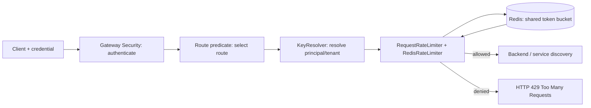
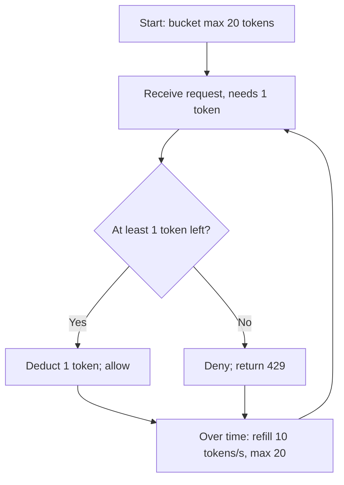
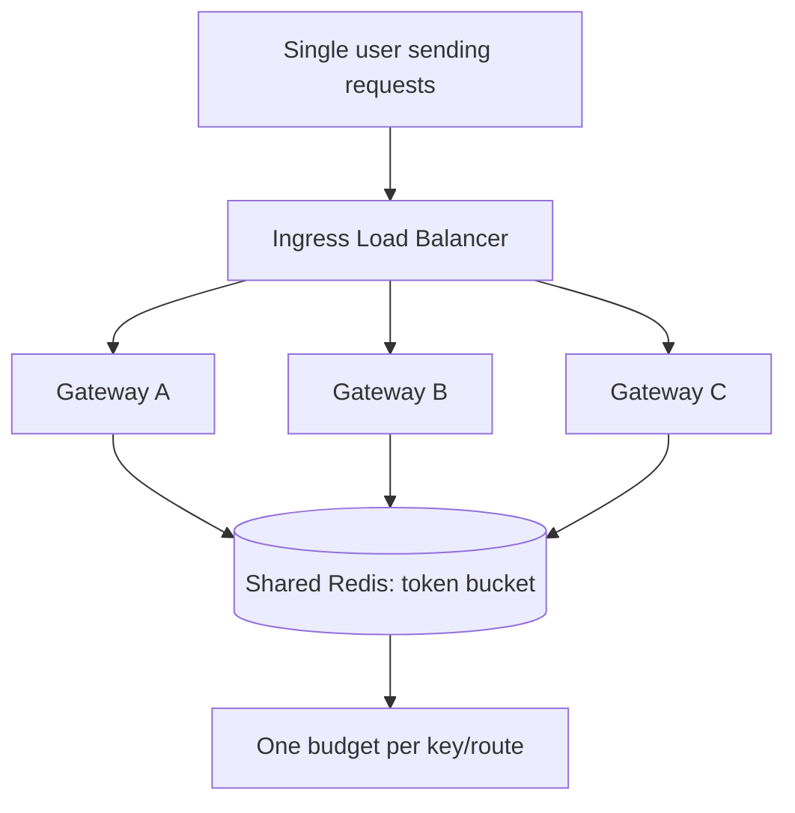

# RedisRateLimiter and the Reactive Redis Dependency in Spring Cloud Gateway

## 1. Why Does an API Gateway Need RedisRateLimiter?

In a microservices system, **Spring Cloud Gateway** is the HTTP entry point: evaluating **route predicates**, running the **filter chain**, rewriting paths/headers, performing service discovery, and proxying requests to backends. Beyond authentication, TLS, retries, circuit breakers, and request observability, the system also needs **rate limiting** to prevent a single client or workload from overloading downstream services.

Suppose `orders-api` can only stably process a few hundred requests per second. If one user sends thousands of requests simultaneously, adding more Gateway instances does not fix backend overload. To enforce limits fairly across multiple Gateway replicas, instances must use **a shared quota state**, rather than each instance counting locally in RAM.

**`RedisRateLimiter`** is Spring Cloud Gateway Server WebFlux's `RateLimiter` implementation that uses Redis to coordinate quotas via a **token bucket**. It is configured through the **`RequestRateLimiter` GatewayFilter**, and requires the **`spring-boot-starter-data-redis-reactive` dependency**.

After this lesson, you will be able to:

- Distinguish **`RequestRateLimiter` GatewayFilter**, **`RedisRateLimiter`**, **`KeyResolver`**, and the **reactive Redis client**.
- Calculate `replenishRate`, `burstCapacity`, and `requestedTokens` for specific quotas.
- Configure Maven/Gradle, Redis, YAML routes, and Java `KeyResolver` for the right version.
- Avoid deriving quota keys from client-modifiable headers or query parameters.
- Test `HTTP 429`, response headers, multiple Gateway replicas, Redis outages, and security boundaries.

> **Scope:** this lesson uses **Spring Cloud Gateway Server WebFlux 4.3+/5.x** with `spring.cloud.gateway.server.webflux.routes`. WebFlux 4.2 and earlier commonly use `spring.cloud.gateway.routes`. Gateway Server Web MVC has its own filter mechanism and dependencies; do not copy WebFlux configuration/Java code into MVC.

## 2. Collaborating Components



| Component | Responsibility | Do Not Misunderstand |
|---|---|---|
`RequestRateLimiter` | GatewayFilter deciding whether to continue the chain for a matched request | Does not authenticate users itself |
`RedisRateLimiter` | Applies the token bucket algorithm and stores quota state via Redis | Not a business database repository |
`KeyResolver` | Produces the **key string** identifying the rate-limited subject | Cannot trust client-supplied queries/headers |
`spring-boot-starter-data-redis-reactive` | Provides reactive Redis infrastructure for the Gateway | Cannot be substituted equivalently with JDBC or blocking Redis |
`spring.data.redis.*` | Configures Redis host, TLS, credentials, timeouts, Sentinel/Cluster | Not a backend `lb://` address |
Spring Security / JWT | Verifies identity and permissions to produce trustworthy quota keys | Quota 429 does not replace 401/403 |
Redis shared state | Lets Gateway replicas view the same bucket per key/route | If each replica uses its own Redis, quotas are no longer global |

**Processing flow:** The Gateway authenticates the client at the appropriate Spring Security layer; after route matching, `RequestRateLimiter` calls `KeyResolver`, then asks `RedisRateLimiter` whether the request has enough tokens. If so, the filter lets the request proceed; otherwise, it returns **429** by default without proxying to the backend.

Requests that **match no route** or are blocked by Security **before the route chain** do not consume tokens in that route's limiter. Placing the filter on one route only protects requests traversing **that specific route**, not every URL the Gateway receives.

## 3. Token Bucket: Calculating Rate and Burst

`RedisRateLimiter` relies on the **token bucket** algorithm, with three primary parameters:

| Parameter | Meaning | Unit |
|---|---|---|
`redis-rate-limiter.replenishRate` | Rate at which **tokens are added** to the bucket | Tokens per second |
`redis-rate-limiter.burstCapacity` | **Maximum number of tokens** the bucket can hold | Tokens |
`redis-rate-limiter.requestedTokens` | **Number of tokens consumed** per request | Tokens/request, default `1` |

A request is accepted when the bucket holds **at least `requestedTokens`**. Tokens are deducted when the request is allowed; the bucket refills over time without exceeding `burstCapacity`.

Example:

```yaml
redis-rate-limiter.replenishRate: 10
redis-rate-limiter.burstCapacity: 20
redis-rate-limiter.requestedTokens: 1
```

Meaning: the bucket holds up to 20 tokens, refills at roughly 10 tokens/second, and each request spends 1 token. **After an idle period allowing the bucket to fill**, a burst of up to 20 near-simultaneous requests can pass; over the long run, the sustained rate stays around **10 requests/second per bucket**.

**Do not interpret** "`burstCapacity=20` means any given second always allows exactly 20 requests": available tokens depend on prior requests and recovery time.

### 3.1. Visualizing One Bucket



### 3.2. Sample Quota Configurations

| Requirement | `replenishRate` | `burstCapacity` | `requestedTokens` | Explanation |
|---|---:|---:|---:|---|
5 requests/second, no large burst | 5 | 5 | 1 | Bucket holds max 5 tokens |
10 requests/second, short burst up to 20 | 10 | 20 | 1 | Burst capacity only exists after accumulating enough tokens |
1 request/minute | 1 | 60 | 60 | Refills 1 token/second, each call spends 60 tokens |
2 requests/minute | 2 | 60 | 60 | When full, at most one immediate request at 60 tokens; averages 2/min by refill rate |
5 requests/second, each request costs 2 | 10 | 20 | 2 | Long-term max roughly 5 requests/second |

**Calculation note:** to configure **2 requests/minute**, a more common fit is `replenishRate=2`, `requestedTokens=60`, `burstCapacity=120` if you want to allow accumulating up to two back-to-back calls. In the table row above, `burstCapacity=60` intentionally disallows bursting two simultaneous requests. Numbers illustrate concepts only; explicitly define **average quota** and **acceptable burst** in the API contract.

### 3.3. Quick-Reference Formulas

When `replenishRate` is in **tokens/second** and `requestedTokens` is in **tokens/request**:

```text
Sustained requests/s ≈ replenishRate / requestedTokens
Max requests when bucket is full ≈ floor(burstCapacity / requestedTokens)
```

Both formulas are estimates for a single **key/route** and do not capture exact per-request behavior under network latency, Redis server clocks, concurrency limits, or multiple buckets. `burstCapacity` should be **greater than or equal to `requestedTokens`** so at least one request can acquire enough tokens. If `burstCapacity=0`, Gateway documentation notes that all requests are blocked.

## 4. Mandatory Dependency: **Reactive** Redis

### 4.1. Maven

With modern Gateway Server WebFlux, example dependencies:

```xml
<!-- Use compatible Spring Boot BOM/Parent and Spring Cloud BOM;
     do not pin individual versions for Spring starters manually. -->
<dependency>
    <groupId>org.springframework.cloud</groupId>
    <artifactId>spring-cloud-starter-gateway-server-webflux</artifactId>
</dependency>
<dependency>
    <groupId>org.springframework.boot</groupId>
    <artifactId>spring-boot-starter-data-redis-reactive</artifactId>
</dependency>
<dependency>
    <groupId>org.springframework.boot</groupId>
    <artifactId>spring-boot-starter-oauth2-resource-server</artifactId>
</dependency>
```

In this lesson, `oauth2-resource-server` supports the example of limiting by **authenticated principal**. If your system uses OAuth2 login, verified API keys, or mTLS workloads, swap in the matching authentication mechanism; JWT is not always mandatory.

### 4.2. Gradle

```groovy
dependencies {
    implementation 'org.springframework.cloud:spring-cloud-starter-gateway-server-webflux'
    implementation 'org.springframework.boot:spring-boot-starter-data-redis-reactive'
    implementation 'org.springframework.boot:spring-boot-starter-oauth2-resource-server'
}
```

`spring-boot-starter-data-redis-reactive` brings in Spring Data Redis Reactive and a compatible Redis driver (typically **Lettuce**) so the Gateway executes Redis commands asynchronously via Reactor.

**Distinguishing dependencies:**

| Dependency / Client Type | Used for WebFlux RedisRateLimiter? | Notes |
|---|---|---|
`spring-boot-starter-data-redis-reactive` | **Yes; required by Gateway docs** | Reactive Redis integration |
`spring-boot-starter-data-redis` | Not listed in docs as the required dependency | Can serve other sync tasks, not an automatic substitute for reactive APIs |
Blocking `RedisTemplate` | **Do not use** on the Gateway event loop | Risks blocking non-blocking threads |
`ReactiveStringRedisTemplate` / `ReactiveRedisTemplate` | Reactive application APIs | `RedisRateLimiter` uses reactive Redis infrastructure without requiring custom templates |
`spring-cloud-starter-loadbalancer` | Not a Redis dependency | Add only when routes use `lb://` |

**Do not mix `spring-boot-starter-web` into a Gateway Server WebFlux project** without a clear architectural reason and stack understanding. WebFlux Gateway runs on Reactor Netty; adding the REST/Web MVC starter can cause the runtime to pick an unintended web application type.

### 4.3. Why Not Use Blocking Redis?

`RequestRateLimiter` can execute on the **Netty event loop**. If each request waits on a **blocking** Redis call, an event-loop thread can stall on network I/O or slow Redis, impacting huge numbers of unrelated requests.

The reactive Redis client returns publishers like `Mono`/`Flux`; while awaiting Redis I/O, the pipeline **does not block** the event loop. Still, being reactive **does not make Redis fast or immune to overload**. You must still set timeouts, pool/network limits, monitor latency, and plan for Redis outages.

## 5. Connecting to Redis via Spring Boot

### 5.1. Local Redis for Learning

For a local Redis running at `127.0.0.1:6379` (local/dev environments only), use:

```yaml
spring:
  data:
    redis:
      host: localhost
      port: 6379
      connect-timeout: 2s
      timeout: 2s
```

In current Spring Boot versions, the Redis prefix is **`spring.data.redis.*`**. Many older tutorials use `spring.redis.*`; do not copy that verbatim into Boot 3.5/4.x without checking application properties.

If Redis is running locally, verify:

```bash
redis-cli -h 127.0.0.1 -p 6379 PING
# Expected: PONG if Redis is running and requires no auth.
```

`PONG` only confirms a simple command succeeded from your local shell; **it does not prove the Gateway shares the same host/network, TLS, ACLs, and permission to run Lua scripts**. In Docker/Kubernetes, `localhost` inside the Gateway container does not point to Redis in another container.

### 5.2. Redis with Authentication and TLS

An example for an environment using an internal Redis server, DNS, and TLS:

```yaml
spring:
  data:
    redis:
      host: redis.internal.example
      port: 6380
      username: ${REDIS_USERNAME}
      password: ${REDIS_PASSWORD}
      ssl:
        enabled: true
      connect-timeout: 2s
      timeout: 2s
```

This is a **sample configuration**: port 6380 is not universally standard for every Redis service. Environment variables must come from a secret manager or protected volume. The Gateway must trust Redis's CA/server certificate and verify the hostname; with an internal CA, configure an SSL bundle/truststore compatible with your Spring Boot/Lettuce version. Never disable certificate verification to bypass TLS errors.

**Separate quota Redis from Redis storing sensitive data** in terms of credentials, namespaces/ACLs, and load isolation if architecture requires it. Redis ACLs must allow the commands the limiter needs to update quotas atomically, without granting unnecessary server-wide admin privileges.

### 5.3. Redis Sentinel and Cluster

For high availability, Spring Boot supports configuring Redis via Sentinel or Cluster—for example, **illustrating only the keys**:

```yaml
# Sentinel example; do not combine with Cluster in the same environment.
spring:
  data:
    redis:
      sentinel:
        master: redis-master
        nodes:
          - sentinel-1.internal:26379
          - sentinel-2.internal:26379
          - sentinel-3.internal:26379
```

With Redis Cluster:

```yaml
spring:
  data:
    redis:
      cluster:
        nodes:
          - redis-1.internal:6379
          - redis-2.internal:6379
          - redis-3.internal:6379
```

**Do not combine both blocks** in one active file; pick one topology matching your actual deployment. Beyond discovery nodes, configure credentials, TLS, failover timeouts, network policies, and observability. `RedisRateLimiter` updates buckets via Redis Lua scripts to coordinate state; in Redis Cluster, keys used by a script must hash to an appropriate node/slot. Rely on the Gateway/Redis client mechanisms rather than modifying key names or scripts without verification.

## 6. Configuring `RequestRateLimiter` on a WebFlux Route

Suppose the Gateway runs on port `8080`, backend `orders-service` on `8081`, and Redis on `6379`. You want each **authenticated principal** to call the Orders API steadily at roughly 5 requests/second, with bursts up to 10 requests once the bucket accumulates enough tokens.

### 6.1. Complete `application.yml`

```yaml
# Spring Cloud Gateway Server WebFlux 4.3+/5.x
server:
  port: 8080

spring:
  application:
    name: edge-gateway
  data:
    redis:
      host: localhost
      port: 6379
      connect-timeout: 2s
      timeout: 2s
  security:
    oauth2:
      resourceserver:
        jwt:
          issuer-uri: https://idp.example.test/realms/shop
          audiences:
            - orders-api
  cloud:
    gateway:
      server:
        webflux:
          redis-rate-limiter:
            include-headers: true
          routes:
            - id: orders-limited
              uri: http://localhost:8081
              predicates:
                - Path=/api/orders/**
                - Method=GET,POST
              filters:
                - name: RequestRateLimiter
                  args:
                    key-resolver: "#{@authenticatedUserKeyResolver}"
                    redis-rate-limiter.replenishRate: 5
                    redis-rate-limiter.burstCapacity: 10
                    redis-rate-limiter.requestedTokens: 1
                - StripPrefix=1
```

**Logical order:**

1. Spring Security validates the Bearer JWT (requires the security chain in section 7), then route predicates select `orders-limited`.
2. `RequestRateLimiter` invokes `authenticatedUserKeyResolver` to obtain a quota key from the trusted principal.
3. `RedisRateLimiter` queries Redis for bucket state and attempts to consume tokens.
4. When **allowed**, the chain continues, `StripPrefix=1` drops the `api` segment, and the backend receives `/orders/...`.
5. When **rate-limited**, the Gateway returns `HTTP 429` by default, and the request never reaches the backend via that route.

`issuer-uri`/`audiences` are illustrative values; replace them with your real IdP and audience. Redis and the backend must be running for the end-to-end exercise to succeed.

**Required syntax:** do not write `RequestRateLimiter=5, 10, 1`. The `RequestRateLimiter` factory **does not support shortcut notation**; you must use `- name: RequestRateLimiter` with explicit named keys under `args`.

### 6.2. Java `KeyResolver` for an Authenticated Principal

```java
package com.example.gateway.config;

import java.security.Principal;
import org.springframework.cloud.gateway.filter.ratelimit.KeyResolver;
import org.springframework.context.annotation.Bean;
import org.springframework.context.annotation.Configuration;

@Configuration(proxyBeanMethods = false)
public class RateLimitKeyConfig {
    @Bean
    KeyResolver authenticatedUserKeyResolver() {
        return exchange -> exchange.getPrincipal()
            .map(Principal::getName)
            .filter(name -> !name.isBlank());
    }
}
```

`KeyResolver` returns `Mono<String>`. `getPrincipal()` carries a trustworthy identity only when the application has **configured authentication properly**. With a JWT Resource Server, the principal name typically comes from the `sub` claim; if using a custom authentication converter, verify the actual mapping. Avoid empty keys or a single fixed name for all users.

**Never use this key-extraction approach in production:**

```java
// INSECURE example: clients can change ?user=abc to evade quotas.
@Bean
KeyResolver insecureQueryKeyResolver() {
    return exchange -> reactor.core.publisher.Mono.justOrEmpty(
        exchange.getRequest().getQueryParams().getFirst("user"));
}
```

Clients can also set headers like `X-User-Id` or `X-Tenant-Id` themselves. Using those headers as keys **without verification** lets clients change identities to mint new buckets, evade limits, or affect another user's quota. API keys should only drive quotas **after verification and mapping to an internal client ID**—never put raw secrets into Redis keys.

### 6.3. Referencing Beans via SpEL

In YAML, `"#{@authenticatedUserKeyResolver}"` is a Spring expression referencing the bean named `authenticatedUserKeyResolver`. The name must match the bean registered in the Spring context.

```yaml
filters:
  - name: RequestRateLimiter
    args:
      key-resolver: "#{@authenticatedUserKeyResolver}"
      redis-rate-limiter.replenishRate: 5
      redis-rate-limiter.burstCapacity: 10
      redis-rate-limiter.requestedTokens: 1
```

When an application has multiple `RateLimiter` implementations, you may need to specify the limiter bean explicitly:

```yaml
# Reference if the Spring context actually defines a redisRateLimiter bean:
filters:
  - name: RequestRateLimiter
    args:
      rate-limiter: "#{@redisRateLimiter}"
      key-resolver: "#{@authenticatedUserKeyResolver}"
```

Do not attach both `RequestRateLimiter` configurations to the same route when only one quota is needed; verify bean names and config loading for your version.

## 7. Ensuring Authentication Runs Before Quotas

A `KeyResolver` reading a principal is **not an authentication filter**. For protected APIs, require a valid JWT and matching scopes in Spring Security WebFlux before requests enter the Gateway filter chain.

```java
package com.example.gateway.security;

import org.springframework.context.annotation.Bean;
import org.springframework.context.annotation.Configuration;
import org.springframework.http.HttpMethod;
import org.springframework.security.config.Customizer;
import org.springframework.security.config.web.server.ServerHttpSecurity;
import org.springframework.security.web.server.SecurityWebFilterChain;

@Configuration(proxyBeanMethods = false)
public class ApiSecurityConfig {
    @Bean
    SecurityWebFilterChain apiSecurity(ServerHttpSecurity http) {
        return http
            // Appropriate only for stateless Bearer-only APIs without session cookies.
            .csrf(csrf -> csrf.disable())
            .authorizeExchange(ex -> ex
                .pathMatchers(HttpMethod.GET, "/api/orders/**")
                    .hasAuthority("SCOPE_orders.read")
                .pathMatchers(HttpMethod.POST, "/api/orders/**")
                    .hasAuthority("SCOPE_orders.write")
                .anyExchange().denyAll())
            .oauth2ResourceServer(oauth2 ->
                oauth2.jwt(Customizer.withDefaults()))
            .build();
    }
}
```

In this setup, requests without a JWT or with an invalid JWT typically receive **401**, those lacking required scopes receive **403**, and only authenticated, authorized requests reach `RequestRateLimiter` where they may receive **429**. Backends **must still verify audience, scopes, and resource ownership**; rate limiting never grants permission to read someone else's order.

`csrf.disable()` is only appropriate for **stateless Bearer-only** APIs like this example. Never copy it blindly to browser apps using sessions/cookies without a CSRF analysis.

### 7.1. When There Is No Quota Key

Gateway documentation describes `PrincipalNameKeyResolver` as the default resolver, extracting `Principal.getName()`. When the resolver emits no key, the default behavior is to **reject the request**; the status code can differ from `429` and is configurable by version.

- Never emit `Mono.just(null)`: Reactor forbids null values.
- When no principal exists, return `Mono.empty()`/`Mono.justOrEmpty(...)` and **explicitly choose the missing-key policy**.
- Never fall back to a shared fixed key like `admin` or another user's key for anonymous requests.
- For public APIs needing anonymous IP quotas, design a resolver using the address from a **trusted proxy chain**. Shared NAT IPs and IPv6 rotation affect fairness; client-supplied `X-Forwarded-For` headers are untrusted.

Gateway 5.0 documentation mentions `deny-empty-key` and `empty-key-status-code`. Because namespaces can shift across release trains, check the **configprops/metadata of your running dependency** before setting those properties.

## 8. Quotas by User, Route, Tenant, or Client?

`RedisRateLimiter` pairs the **quota key** with the route/policy context. Two separate routes do not automatically share one global Gateway-wide budget just because they reference the same `KeyResolver`.

| Goal | Suitable Key / Policy | Risk |
|---|---|---|
Per user per route | Authenticated principal | User consumes independent buckets across multiple routes |
Per tenant per route | Tenant ID verified during authentication | Trusting self-declared `X-Tenant-Id` breaks isolation |
Per partner API key | Client ID looked up after API key verification | Never place raw keys/secrets into Redis or logs |
Anonymous by IP | Source address via trusted proxy | NAT, IPv6 rotation, forged forwarding headers |
Shared quota across routes | Design a dedicated shared quota namespace | Do not assume reusing one limiter bean merges routes |
Quota for heavy operations | Policy per method/route, tuned token cost | Token cost does not automatically track real CPU/DB cost |

### 8.1. Two Routes, Two Policies

```yaml
spring:
  cloud:
    gateway:
      server:
        webflux:
          routes:
            - id: read-catalog
              uri: http://localhost:8081
              predicates:
                - Path=/api/catalog/**
                - Method=GET
              filters:
                - name: RequestRateLimiter
                  args:
                    key-resolver: "#{@authenticatedUserKeyResolver}"
                    redis-rate-limiter.replenishRate: 20
                    redis-rate-limiter.burstCapacity: 30
                    redis-rate-limiter.requestedTokens: 1

            - id: write-orders
              uri: http://localhost:8082
              predicates:
                - Path=/api/orders/**
                - Method=POST
              filters:
                - name: RequestRateLimiter
                  args:
                    key-resolver: "#{@authenticatedUserKeyResolver}"
                    redis-rate-limiter.replenishRate: 2
                    redis-rate-limiter.burstCapacity: 4
                    redis-rate-limiter.requestedTokens: 1
```

Catalog GET has a larger burst than Orders POST. These are **two independent routes**, with no automatic global per-user quota. There is no `StripPrefix` in this example, so backends must handle `/api/...` paths; if internal paths differ, add an appropriate rewrite/strip filter.

**Business note:** order-creation `POST`s still need idempotency keys. One request admitted by the limiter can turn into **multiple downstream attempts** if retries are configured; the limiter does not guarantee exactly-once execution.

## 9. Shared Redis Across Multiple Gateway Instances

If three Gateway pods each enforce 5 requests/second using in-RAM counters, a client can distribute requests across pods to exceed the quota. `RedisRateLimiter` uses a shared bucket:



`RedisRateLimiter` uses Redis scripting to update buckets **atomically** and avoid simple races when multiple Gateway pods request tokens concurrently. Requirements for correctness:

1. All pods connect to **the same Redis deployment/namespace** designated for quotas.
2. Route IDs and `KeyResolver` mappings are identical across pods.
3. Principal/tenant IDs are authenticated and consistent across all Gateway replicas.
4. Redis failover/partition and policy consistency are tested; never claim zero overshoot across multi-region active-active setups without verification.

**Key cardinality:** keys built from timestamps, random request IDs, or URLs containing random IDs almost never run out of tokens while inflating Redis key counts. Use stable keys, protect PII, and monitor memory and evictions.

## 10. HTTP 429 and Response Headers

When the bucket runs out of tokens, `RequestRateLimiter` returns **`429 Too Many Requests` by default** without proxying via that route. The Redis limiter can attach informational headers:

| Header | Meaning |
|---|---|
`X-RateLimit-Replenish-Rate` | Tokens replenished per second |
`X-RateLimit-Burst-Capacity` | Maximum tokens in the bucket |
`X-RateLimit-Requested-Tokens` | Token cost of the request |
`X-RateLimit-Remaining` | Remaining tokens reported at evaluation time |

Gateway Server WebFlux 5.x allows customizing header output:

```yaml
spring:
  cloud:
    gateway:
      server:
        webflux:
          redis-rate-limiter:
            include-headers: true
            remaining-header: X-RateLimit-Remaining
            replenish-rate-header: X-RateLimit-Replenish-Rate
            burst-capacity-header: X-RateLimit-Burst-Capacity
            requested-tokens-header: X-RateLimit-Requested-Tokens
```

`include-headers` is documented in Gateway 5.x as defaulting to `true`. These are **Gateway-implementation headers**, not a daily quota promise or a standard `Retry-After` value. Under concurrent traffic, remaining tokens can be consumed immediately after the response.

**Do not assume** `Retry-After` is generated automatically from these headers. If a public API needs clients to wait a clear duration, design an explicit response/error contract and encourage jittered backoff instead of immediate retries.

## 11. Redis Outages: Choose a Policy Instead of Guessing

Redis sits on the **quota decision path**. When Redis is unreachable, DNS/TLS fails, ACLs reject scripts, timeouts occur, or Redis overloads, `RequestRateLimiter` can error out. The final response depends on Gateway version, exception handling, and surrounding infrastructure.

**Never conclude that `RedisRateLimiter` always defaults to fail-open or fail-closed across every version.** Test Redis outages and define boundaries per API class:

| Policy When Quota Cannot Be Evaluated | Benefit | Trade-Off |
|---|---|---|
**Fail-closed** | Avoids opening extra traffic to sensitive backends | Redis outage impacts API availability |
**Controlled fail-open** | Keeps serving some requests when Redis fails | Can overload backends; requires fallback ingress/edge limits |
**Local fallback limiter** | Keeps a coarse cap when Redis is lost | Cannot enforce global quotas across multiple Gateway pods |
**Emergency operational route/policy toggle** | Can isolate expensive APIs | Requires approval workflow, auditing, and fast rollback |

Supporting practices: appropriate Redis HA/Sentinel/Cluster, TLS/ACLs, reasonably short timeouts, monitoring p95/p99 Redis latency, queue-depth alerts, and Redis health checks. **Never retry Redis operations infinitely** inside the request pipeline: that spikes latency and builds backlogs on Netty/Gateway.

### 11.1. Rate Limits Differ from Concurrency Limits

A token bucket caps **request arrival rate over time**, not the exact count of actively executing tasks. A user sending 10 admitted requests simultaneously can still force the backend to run 10 queries lasting 30 seconds each.

For heavy APIs, add **bulkheads/concurrency limits**, timeouts, circuit breakers, backpressure/queue policies, DB pool bounds, and request-size limits. Especially for SSE and large uploads/downloads, open connection count can matter more than requests/second.

## 12. Hands-On Testing with `curl`

### 12.1. Prepare the Three Components

1. **Redis** at `localhost:6379` or the Redis deployment configured in section 5.
2. **Gateway Server WebFlux** at `localhost:8080` with `orders-limited` from section 6, Java `KeyResolver` from section 6.2, and `SecurityWebFilterChain` from section 7.
3. **Orders backend** at `localhost:8081` exposing `GET /orders/42`. `StripPrefix=1` turns external `/api/orders/42` into backend path `/orders/42`.

You need a **real test token from an appropriate IdP** (matching issuer, audience, and scopes). YAML samples do not spin up an IdP or mint JWTs; do not pass `fake.jwt.token` and mistake `401` for a Redis error.

### 12.2. Send Multiple Rapid Requests from the Same Principal

In Bash, after obtaining `TOKEN_VALID` via your test login/tooling:

```bash
# Never hardcode raw bearer tokens in examples or write them to logs.
for i in $(seq 1 15); do
  curl -sS -o /dev/null \
    -w "request=$i status=%{http_code}\n" \
    -H "Authorization: Bearer $TOKEN_VALID" \
    http://localhost:8080/api/orders/42
done
```

With `replenishRate=5`, `burstCapacity=10`, `requestedTokens=1`, and an initially full bucket, sending 15 requests fast enough **will yield some 429 responses**. Do not assert there must be *exact* 5 `429` responses: tokens replenish over time, tests incur latency, and prior requests affect state.

To inspect response headers:

```bash
curl -i \
  -H "Authorization: Bearer $TOKEN_VALID" \
  http://localhost:8080/api/orders/42
```

If the backend is down, requests admitted by the limiter still fail with connection errors or 5xx. **A request getting 502/503 after the limiter may still have consumed tokens**, because quotas govern admission rather than only counting successful responses.

### 12.3. Verify Key Isolation

Use two test tokens with different principals, `user-A` and `user-B`, both carrying scope `orders.read`. Send the same request sequence:

- If the resolver returns two distinct principal names, **the two users get separate buckets** on the same route.
- If a converter maps all users to one fixed name, they **share a quota**. Check `JwtAuthenticationToken.getName()` mapping or custom converters.
- If changing `?user=admin`, `X-User-Id`, or `X-Tenant-Id` alters quotas, the resolver is relying on **untrusted data**.

### 12.4. Test Two Gateway Instances Sharing Redis

Start Gateway A on `8080` and Gateway B on `8083`, sharing **the same Redis**, **same route ID**, **same principal/key resolver**, and **same quota**. Alternate requests:

```bash
curl -i -H "Authorization: Bearer $TOKEN_VALID" \
  http://localhost:8080/api/orders/42

curl -i -H "Authorization: Bearer $TOKEN_VALID" \
  http://localhost:8083/api/orders/42
```

Once the bucket is exhausted via Gateway A, Gateway B must not grant a fresh quota for the same key/route. If behavior differs, inspect Redis endpoint/database, Spring profiles, route IDs, key derivation, and whether `RequestRateLimiter` is active on both instances.

### 12.5. Test a Redis Outage in an Isolated Environment

In a **test environment**, temporarily block Gateway → Redis traffic or simulate a Redis timeout, then send valid requests. Record HTTP status codes, wait times, error logs, whether backends receive requests, and recovery once Redis returns.

**Never run `FLUSHALL`/`FLUSHDB` on a Redis shared with other apps** to "reset quotas." For fresh test buckets, use dedicated test principals/routes or an isolated Redis database/instance.

### 12.6. Result Matrix to Verify

| Test | Expected Result to Verify |
|---|---|
Valid JWT, tokens remaining | Gateway forwards, backend receives |
Valid JWT, burst exceeded | `429` returned; backend receives **zero** blocked requests |
Two distinct principals | Separate quotas if resolver differentiates keys |
Missing bearer token | `401` before route with example security chain |
Valid token lacking scope | `403` before limiter |
Client spoofs `X-User-Id: admin` | Does not alter the principal's quota key |
Two Gateway replicas, same Redis | Share the same quota state |
Redis outage | Matches designed failure policy and triggers alerts |
Backend returns `500` after admission | Request may still have consumed tokens |
Request matches no route | Consumes zero tokens from that route's limiter |

## 13. Troubleshooting Common Errors

| Symptom | Possible Cause | Resolution |
|---|---|---|
Cannot instantiate Redis rate limiter | Missing reactive starter, wrong stack, or invalid bean/config | Check `spring-boot-starter-data-redis-reactive` and WebFlux starter |
`RequestRateLimiter=5,10` fails to work | Unsupported shorthand syntax used | Switch to `name: RequestRateLimiter` and `args` |
Redis connection refused | Wrong host/port, container misusing `localhost`, Redis not running | Check `spring.data.redis.*` and networking |
Redis ACL / Lua script error | Credentials lack permissions or Cluster/script incompatibility | Inspect ACLs, TLS, and Redis logs per version |
Never see `429` | Bucket never drains, requests spaced too far apart, route mismatch, or limiter not loaded | Check route, token math, and traces |
Always receive `401`/`403` | Security blocks before the rate limiter | Check token, issuer, audience, and scopes |
Always rejected despite valid JWT | `KeyResolver` returns empty key or invalid authentication name | Inspect principal mapping and empty-key policy |
All users share one quota | Resolver emits a static key or shared proxy header | Derive verified, stable identities |
Quota gets bypassed | Key has randomness or reads client `?user`/header | Use verified identity and bound cardinality |
Gateway A blocks, B allows | Two separate Redis stores or different route IDs | Align Redis, route IDs, and resolver |
Redis memory grows | Excessive keys/cardinality, improper policy/TTL | Monitor keys/memory and key-generation sources |
Redis outage hangs many requests | Timeout/failover/exception policy untested | Run fault injection and define clear fail-open/closed behavior |
Discovery-created routes lack limiter | Filter attached only to another YAML route | Audit all routes; do not assume `default-filters` covers every source |
Retries overload backend | Admission limit does not cap downstream attempts | Configure idempotency, retry/backoff, circuit breakers, and bulkheads |

## 14. Production Operating Principles

1. **Authenticate before quotas:** derive keys from verified principal/tenant/client IDs, never raw headers or arbitrary queries.
2. **Design fair budgets:** distinguish per-user, per-tenant, per-route, anonymous traffic, and global quotas.
3. **Define rate and burst:** back `429` behavior with calculations, tests, and dashboards.
4. **Isolate heavy endpoints:** order-creation POSTs, data exports, and large reports need stricter caps than lightweight GETs.
5. **Harden Redis:** private network, ACL/authentication, proper TLS/CA, secrets management, and appropriate HA/failover.
6. **Keep the pipeline reactive:** never run blocking `RedisTemplate` on the Netty event loop; bound connect/command timeouts.
7. **Test multi-replica behavior:** share Redis and keep key/route mappings consistent, including during rolling deployments.
8. **Define a Redis outage policy:** choose fail-closed/open/fallback based on API sensitivity, with alerts and rollback plans.
9. **Defense in depth:** layer CDN/ingress/WAF rate limits, request-size limits, concurrency caps, and backend resource quotas.
10. **Safe observability:** log route ID, allowed/denied, status, and latency without recording tokens, PII, or raw API keys.
11. **Protect Actuator/Redis admin:** never expose management endpoints or Redis control planes to the internet.
12. **Bound retries:** clients should apply jittered backoff on `429`; server retries must not create unbounded downstream attempts.

## 15. Exercises and Answers

**Exercise 1 — Dependencies.** A WebFlux Gateway declares `RequestRateLimiter` but only includes a blocking Redis client. What must you check?

**Answer:** `RedisRateLimiter` documentation requires `spring-boot-starter-data-redis-reactive`. Add that starter and verify the reactive Redis connection factory; never use blocking Redis on the event loop.

**Exercise 2 — Token bucket.** With `replenishRate=10`, `burstCapacity=20`, `requestedTokens=1`, does every single second always allow 20 requests?

**Answer:** No. A burst of 20 is only possible when the bucket has accumulated enough tokens; it refills around 10 tokens/second and sustains roughly 10 requests/second long-term.

**Exercise 3 — One request per minute.** Which configuration is shown in the docs?

**Answer:** `replenishRate=1`, `burstCapacity=60`, `requestedTokens=60`. Each request spends 60 tokens; once drained, it takes roughly 60 seconds to refill.

**Exercise 4 — Spoofed key.** Why shouldn't `?user=bob` be used to key buckets?

**Answer:** Clients can change it to `?user=alice` to evade quotas or affect another user. Derive identity from verified authentication/JWT claims.

**Exercise 5 — Shortcut.** Is `RequestRateLimiter=5,10,1` valid?

**Answer:** No. The filter does not support shorthand syntax; use explicit `name` and `args`.

**Exercise 6 — Multi-instance.** Two Gateway pods point to two independent Redis instances with the same 5 requests/s policy. Is the quota global?

**Answer:** Not yet. Each Redis holds an independent bucket; use a shared Redis deployment and consistent key mapping.

**Exercise 7 — HTTP 401.** A request missing a token receives `401` even though Redis quota is not exhausted. Is Redis broken?

**Answer:** Not enough evidence; Spring Security likely rejected the request before the route limiter, as expected for JWT-protected APIs.

**Exercise 8 — Slow tasks.** Each backend request takes 30 seconds. Does a 5/s rate limit guarantee at most 5 concurrent requests?

**Answer:** No. Rate limiting differs from concurrency limiting. Add bulkheads, timeouts, and connection/queue controls.

**Exercise 9 — Redis outage.** Can you assume every Redis error returns HTTP 429?

**Answer:** No. Behavior depends on version and exception handling; design and test fail-open/fail-closed/fallback behavior.

**Exercise 10 — Remaining header.** When a client sees `X-RateLimit-Remaining: 3`, is it guaranteed three more immediate requests?

**Answer:** No. Concurrent requests or other Gateway replicas may consume tokens; it only reflects state at evaluation time.

## 16. Official References

- [Spring Cloud Gateway 5.0 – RequestRateLimiter GatewayFilter](https://docs.spring.io/spring-cloud-gateway/reference/5.0/spring-cloud-gateway-server-webflux/gatewayfilter-factories/requestratelimiter-factory.html): `RedisRateLimiter`, reactive Redis dependency, token bucket, `KeyResolver`, 429, and `args` syntax.
- [Spring Cloud Gateway 4.2 – RequestRateLimiter](https://docs.spring.io/spring-cloud-gateway/reference/4.2/spring-cloud-gateway/gatewayfilter-factories/requestratelimiter-factory.html): comparing older config prefixes.
- [Spring Cloud Gateway 5.1 – Configuration Properties](https://docs.spring.io/spring-cloud-gateway/reference/5.1/configprops.html): Redis limiter header configuration and WebFlux namespaces.
- [Spring Boot 4.0 – Common Application Properties](https://docs.spring.io/spring-boot/4.0/appendix/application-properties/): `spring.data.redis.*`, TLS, Sentinel, Cluster, timeouts.
- [Spring Data Redis – Reference Documentation](https://docs.spring.io/spring-data/redis/reference/): reactive Redis/Lettuce, connection factories, and connection management.
- [Spring Security – Reactive OAuth2 Resource Server JWT](https://docs.spring.io/spring-security/reference/reactive/oauth2/resource-server/jwt.html): verifying principals/scopes for `KeyResolver`.
- [Redis – Lua Scripting](https://redis.io/docs/latest/develop/programmability/eval-intro/): atomic script execution and Redis Cluster considerations.

**Key takeaway:** `RequestRateLimiter` decides **allow or reject**; `RedisRateLimiter` maintains the **distributed token bucket**; `KeyResolver` identifies **who owns the quota**; `spring-boot-starter-data-redis-reactive` provides the non-blocking Redis client for WebFlux Gateway. Configure `replenishRate`/`burstCapacity`/`requestedTokens` properly, use verified keys, share Redis across replicas, and test both `429` responses and Redis outages to operate your Gateway safely.
