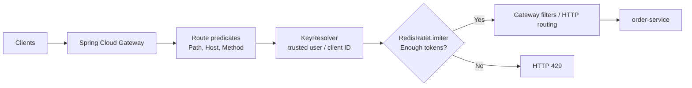
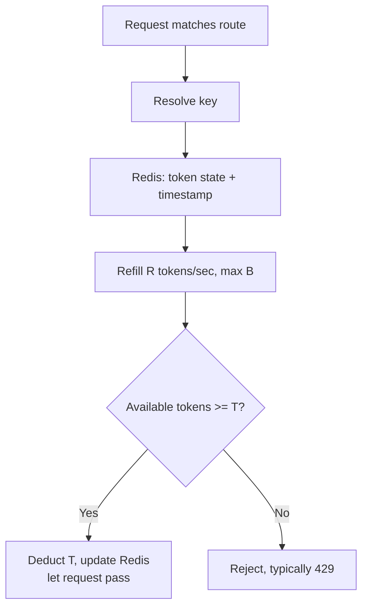
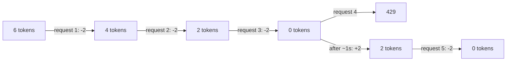
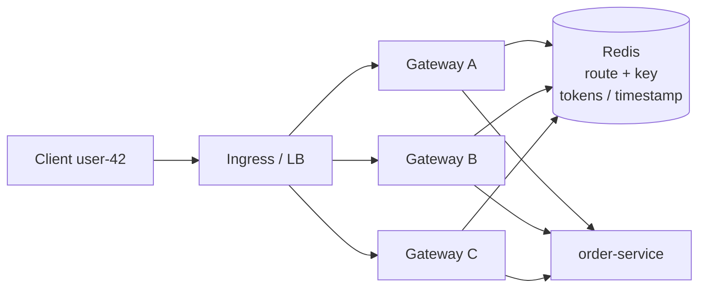

# replenishRate, burstCapacity, and requestedTokens

In a microservices system, a single client can generate hundreds of requests to `order-service` within seconds, even when the backend can only sustain an average load of a few dozen requests per second. Relying solely on timeouts or circuit breakers still lets excess requests consume upstream connections and CPU. **Spring Cloud Gateway Server WebFlux** can block over-budget requests early using the **`RequestRateLimiter` GatewayFilter Factory**, typically paired with **`RedisRateLimiter`**.

`RedisRateLimiter` is built on the **token bucket** algorithm. Three parameters govern the policy: **`replenishRate`** (tokens added per second), **`burstCapacity`** (maximum token capacity), and **`requestedTokens`** (tokens required to admit one request). They interact directly: `replenishRate=10` does not necessarily mean 10 requests/second if each request costs more than one token.

This lesson belongs to the **Traffic Limiting** chapter in the **SPRING_CLOUD_GATEWAY** module. It helps combine rate limiting with route predicates, filter chains, path/header transformations, service discovery, authentication and authorization, circuit breakers, retries, TLS, and observability to operate the microservices entry point safely.

**Objectives:**

1. Understand the token bucket mechanism and approximate long-term throughput alongside burst capacity.
2. Configure `replenishRate`, `burstCapacity`, and `requestedTokens` via YAML/Java DSL and understand their exact units.
3. Build a `KeyResolver` based on an authenticated identity, distinguishing `429` due to exhausted tokens from `403` due to empty keys.
4. Design limits below 1 request/second, per-route/per-user limits, and protection policies across multiple Gateway replicas.
5. Test Redis, request bursts, disconnect scenarios, retries, concurrency, and security.

> **Scope:** Examples use **Spring Cloud Gateway Server WebFlux** with Spring WebFlux, Reactor Netty, and reactive Redis. Gateway WebFlux 4.3.x YAML routes typically live under `spring.cloud.gateway.routes`; Gateway WebFlux 5.x uses `spring.cloud.gateway.server.webflux.routes`. Verify your exact version/starters before applying. Server MVC does not share the WebFlux filter API or lifecycle verbatim.

## 1. What Does Rate Limiting Protect?

Rate limiting reduces the number of requests **forwarded** to a route/backend according to a predefined budget. For instance, each user gets 5 requests/second with a burst of 10 requests. When over limit, the Gateway can return **HTTP 429 Too Many Requests** instead of calling upstream.



Rate limiting is useful to:

- Reduce the risk of one client or tenant consuming excessive backend capacity.
- Enforce technical limits per user, client ID, route, or service-plan tier.
- Smooth sudden traffic spikes with an intentional burst allowance.
- Reduce pressure on databases, HTTP connection pools, and expensive internal services.

However, it **does not authenticate** users itself, check permissions on `orderId`, directly cap **concurrently executing** requests, guarantee how long a request takes to finish, or replace circuit breakers and timeouts.

## 2. The Token Bucket Model

Picture a "bucket" of tokens for each `key` identity on a route. Tokens replenish over time up to a maximum capacity. Each request seeking admission must "pay" the required number of tokens.

Notation:

| Symbol | Parameter | Unit |
| --- | --- | --- |
| `R` | `replenishRate` | tokens/second |
| `B` | `burstCapacity` | max tokens |
| `T` | `requestedTokens` | tokens/request |
| `Δt` | Time elapsed since last state update | seconds |

Idealized model:

```text
tokensAfterRefill = min(B, tokensBefore + R * deltaSeconds)

if tokensAfterRefill >= T:
    allowed = true
    tokensAfterRequest = tokensAfterRefill - T
else:
    allowed = false
    tokensAfterRequest = tokensAfterRefill
```



**Note:** This is an explanatory model, not a line-by-line replica of the Lua script across every Gateway version. Implementations have their own time resolution and state storage; test results right at second boundaries may vary slightly.

### Two Formulas to Remember

When the bucket is full and requests arrive nearly instantaneously:

```text
Burst request count ≈ floor(B / T)
```

For long-term sustained load:

```text
Sustained throughput ≈ R / T requests/second
```

These are **average estimates**, not guarantees of exact `N` requests in *every* 1-second interval or calendar minute. Token bucket differs from fixed-window and sliding-window algorithms.

## 3. replenishRate: Token Replenishment Speed

`replenishRate` is the rate at which tokens "flow into the bucket." For example:

```yaml
redis-rate-limiter.replenishRate: 10
```

This means the bucket can receive **10 tokens** per second, not automatically 10 requests. With `requestedTokens=1`, long-term throughput is roughly 10 requests/second; with `requestedTokens=2`, it drops to roughly 5 requests/second.

Two configurations sharing `replenishRate=10` can behave very differently:

| R | B | T | Approx. Long-Term | Max Burst When Full |
| ---: | ---: | ---: | ---: | ---: |
| 10 | 10 | 1 | 10 req/s | 10 requests |
| 10 | 100 | 1 | 10 req/s | 100 requests |
| 10 | 100 | 5 | 2 req/s | 20 requests |

If `order-service` only tolerates 15 concurrent requests, `B=100` can allow an overwhelming spike even though `R=10` looks reasonable on average.

**Value constraint:** use valid positive integers supported by your running `RedisRateLimiter`. Never set `replenishRate=0` hoping for "one request per minute"; use `requestedTokens` for that instead.

## 4. burstCapacity: Token Capacity and Spike Tolerance

`burstCapacity` sets the ceiling on tokens that can accumulate in a bucket. When a client stops calling the API for a while, the bucket typically fills up to `B`. Subsequent back-to-back requests draw down those accumulated tokens.

Example:

```yaml
redis-rate-limiter.replenishRate: 5
redis-rate-limiter.burstCapacity: 20
redis-rate-limiter.requestedTokens: 1
```

When full, roughly **20 requests** can pass closely together before waiting for refill. If one request consumes 4 tokens, the same `B=20` only allows roughly **5 requests** when full.

**Setting B too high:** permits bursts strong enough to choke DBs and connection pools, especially if many users burst together.

**Setting B too low:** triggers excessive `429`s even when the backend can absorb brief spikes; hurts UX when web apps fire multiple endpoints in parallel.

**Setting B smaller than T:** the bucket can never accumulate enough tokens for even a single request. With `B=5, T=10`, requests will always lack tokens under the token bucket model. Ensure **`B >= T > 0`**.

## 5. requestedTokens: Cost of One Request

`requestedTokens` is **how many tokens each request pays**. Many examples default to `T=1`, making it easy to mistake tokens and requests for the same unit. They are equivalent only when `T=1`.

Example:

```yaml
redis-rate-limiter.replenishRate: 6
redis-rate-limiter.burstCapacity: 30
redis-rate-limiter.requestedTokens: 3
```

- Refills **6 tokens** per second.
- Bucket holds at most **30 tokens**.
- Each request costs **3 tokens**.
- Long-term throughput is roughly `6/3 = 2 requests/second`.
- Full-bucket burst is roughly `floor(30/3) = 10 requests`.

### Common Combinations

| R (tokens/s) | B (tokens) | T (tokens/request) | Approx. Long-Term | Full-Bucket Burst |
| ---: | ---: | ---: | --- | ---: |
| 10 | 20 | 1 | 10 req/s | 20 |
| 5 | 20 | 1 | 5 req/s | 20 |
| 6 | 30 | 3 | 2 req/s | 10 |
| 1 | 60 | 60 | 1 req/60 seconds | 1 |
| 1 | 60 | 30 | 1 req/30 seconds | 2 |
| 2 | 20 | 4 | 0.5 req/s | 5 |
| 3 | 15 | 5 | 0.6 req/s | 3 |

**Common mistake:** Setting `replenishRate=60` and `requestedTokens=1` intending 60 requests/minute. That actually grants roughly **60 requests/second**—60 times faster than intended.

## 6. Limits Lower Than One Request/Second

A frequent requirement is "each account may export a report **once per minute**." `RedisRateLimiter` typically takes integer tokens/second for `replenishRate`, so `0.0167` should not be used.

Illustrative configuration:

```yaml
redis-rate-limiter.replenishRate: 1
redis-rate-limiter.burstCapacity: 60
redis-rate-limiter.requestedTokens: 60
```

Explanation:

1. A full bucket holds 60 tokens.
2. One report export consumes all 60 tokens.
3. The bucket refills 1 token/second.
4. After roughly 60 seconds without spending more tokens, another request can pass.

**This is not a 60-second fixed window.** A token bucket does not reset on calendar minutes. It adds tokens over elapsed time, and the Redis script has its own time resolution.

### Three Different Problems

**Want average 60 requests/minute, burst 5:**

```yaml
redis-rate-limiter.replenishRate: 1
redis-rate-limiter.burstCapacity: 5
redis-rate-limiter.requestedTokens: 1
```

**Want average 30 requests/minute, burst 3:**

```yaml
redis-rate-limiter.replenishRate: 1
redis-rate-limiter.burstCapacity: 6
redis-rate-limiter.requestedTokens: 2
```

**Want roughly one request every 20 seconds, no burst above one:**

```yaml
redis-rate-limiter.replenishRate: 1
redis-rate-limiter.burstCapacity: 20
redis-rate-limiter.requestedTokens: 20
```

If legal or billing contracts require **strictly no more than 100 requests in any rolling 60-second window**, a token bucket is not equivalent; choose a suitable window/quota algorithm.

## 7. Timeline: Why 429 Appears and Then Requests Succeed Again?

Given `R=2, B=6, T=2` and a full bucket at `t=0`:

```text
t≈0 s    request #1   6 -> 4 tokens   ALLOW
t≈0 s    request #2   4 -> 2 tokens   ALLOW
t≈0 s    request #3   2 -> 0 tokens   ALLOW
t≈0 s    request #4   0 tokens        DENY (429)
t≈1 s    refill       0 -> 2 tokens
t≈1 s    request #5   2 -> 0 tokens   ALLOW
t≈2 s    refill       0 -> 2 tokens
```



This is a conceptual timeline. Do not use it to assert millisecond precision in benchmarks. If a test spans refill ticks, admitted request counts can differ from an idealized "all sent simultaneously" calculation.

## 8. RequestRateLimiter, RedisRateLimiter, and KeyResolver

The three components have distinct responsibilities:

| Component | Role |
| --- | --- |
| **`RequestRateLimiter`** | GatewayFilter deciding whether to let the request continue or return a rejection response |
| **`RedisRateLimiter`** | Implements the token bucket and updates state in Redis |
| **`KeyResolver`** | Identifies **who** spends budget, e.g. an authenticated principal |
| **Route ID** | Separates routes/quotas in the limiter's key namespace |
| **Redis** | Stores tokens/timestamps, letting multiple Gateway pods share state |

If `KeyResolver` returns an authenticated real user ID, two users get two separate buckets. If the resolver always returns a constant string, all users unintentionally **share one bucket**.

### Principal-Based KeyResolver Bean

```java
import java.security.Principal;

import org.springframework.cloud.gateway.filter.ratelimit.KeyResolver;
import org.springframework.context.annotation.Bean;
import org.springframework.context.annotation.Configuration;

@Configuration(proxyBeanMethods = false)
public class RateLimitKeyConfiguration {

    @Bean
    KeyResolver authenticatedUserKeyResolver() {
        return exchange -> exchange.getPrincipal()
            .map(Principal::getName);
    }
}
```

This configuration requires Spring Security to authenticate requests before the filter resolves keys. In WebFlux, `getPrincipal()` returns a reactive publisher, so never call `block()` to read the identity.

If there is no principal, `Mono.empty()` may be emitted. Under Spring Cloud Gateway's common default, **`RequestRateLimiter` denies empty keys** with a status typically set to **`403 Forbidden`**, distinct from `429 Too Many Requests` when tokens run out. Options like `deny-empty-key` and `empty-key-status-code` exist, but verify their exact property namespace for your Gateway version.

**Never use a client-set `X-User-Id` header as a trusted key.** Clients can swap headers on every call to get fresh buckets. For API keys, validate the key first and use the verified client ID; for IPs, enforce a trusted proxy policy and accept NAT/IPv6 trade-offs.

## 9. Complete YAML Configuration for WebFlux Gateway

Example for Gateway WebFlux **5.x**:

- Redis at `localhost:6379`, for test environments only.
- Gateway at `localhost:8080`.
- Orders backend at `localhost:8081`.
- Route already has an authentication policy and the `authenticatedUserKeyResolver` bean.
- Each user gets roughly 5 requests/second, burst 10.

```yaml
spring:
  data:
    redis:
      host: localhost
      port: 6379

  cloud:
    gateway:
      server:
        webflux:
          routes:
            - id: orders-api
              uri: http://localhost:8081
              predicates:
                - Path=/api/orders/**
              filters:
                - StripPrefix=1
                - name: RequestRateLimiter
                  args:
                    key-resolver: "#{@authenticatedUserKeyResolver}"
                    redis-rate-limiter.replenishRate: 5
                    redis-rate-limiter.burstCapacity: 10
                    redis-rate-limiter.requestedTokens: 1
```

**Explanation:**

1. The `Path` predicate matches public path `/api/orders/**`.
2. `StripPrefix=1` removes `/api`, so the backend receives `/orders/42`.
3. `key-resolver` references the Spring bean via SpEL `#{@authenticatedUserKeyResolver}`.
4. `RedisRateLimiter` uses `R=5, B=10, T=1`.
5. When tokens run out, `RequestRateLimiter` returns a rejection without proxying to `order-service`.

For Gateway WebFlux **4.3.x**, use the `spring.cloud.gateway.routes` prefix instead of `spring.cloud.gateway.server.webflux.routes`. Never copy configuration namespaces from another version without verifying your starters and configuration properties.

### Dependencies

```xml
<!-- Gateway Server WebFlux per compatible Spring Cloud BOM -->
<dependency>
  <groupId>org.springframework.cloud</groupId>
  <artifactId>spring-cloud-starter-gateway-server-webflux</artifactId>
</dependency>

<!-- Reactive Redis for RedisRateLimiter -->
<dependency>
  <groupId>org.springframework.boot</groupId>
  <artifactId>spring-boot-starter-data-redis-reactive</artifactId>
</dependency>
```

If the route URI is `lb://order-service`, also add Spring Cloud LoadBalancer and discovery/service instance sources. `RedisRateLimiter` does **not** replace service discovery or load balancing.

### Why Avoid Shortcut Filter Syntax?

Spring Cloud Gateway docs recommend configuring `RequestRateLimiter` using the full `name` and `args` form. Do not assume shorthand like below is supported:

```yaml
# Do not use as standard RequestRateLimiter config
filters:
  - RequestRateLimiter=5,10,1
```

Declare the exact arg names and resolver bean; otherwise, the route may fail to load or the limiter may behave unexpectedly.

## 10. Java DSL for the Same Policy

You can define routes and limiters in Java, for example:

```java
import org.springframework.beans.factory.annotation.Qualifier;
import org.springframework.cloud.gateway.filter.ratelimit.KeyResolver;
import org.springframework.cloud.gateway.filter.ratelimit.RedisRateLimiter;
import org.springframework.cloud.gateway.route.RouteLocator;
import org.springframework.cloud.gateway.route.builder.RouteLocatorBuilder;
import org.springframework.context.annotation.Bean;
import org.springframework.context.annotation.Configuration;
import org.springframework.http.HttpStatus;

@Configuration(proxyBeanMethods = false)
public class GatewayRateLimitRoutes {

    @Bean
    RedisRateLimiter orderRateLimiter() {
        // R=5 tokens/second, B=10 tokens, T=1 token/request
        return new RedisRateLimiter(5, 10, 1);
    }

    @Bean
    RouteLocator ordersRoutes(
            RouteLocatorBuilder builder,
            RedisRateLimiter orderRateLimiter,
            @Qualifier("authenticatedUserKeyResolver")
            KeyResolver userKeyResolver) {

        return builder.routes()
            .route("orders-api", r -> r
                .path("/api/orders/**")
                .filters(f -> f
                    .stripPrefix(1)
                    .requestRateLimiter(config -> {
                        config.setRateLimiter(orderRateLimiter);
                        config.setKeyResolver(userKeyResolver);
                        config.setStatusCode(
                            HttpStatus.TOO_MANY_REQUESTS);
                    }))
                .uri("http://localhost:8081"))
            .build();
    }
}
```

The `authenticatedUserKeyResolver` bean is from section 8. **Do not** accidentally leave a duplicate YAML route with the same ID `orders-api` when using Java DSL; two routes with matching predicates or IDs cause unpredictable selection.

Some Java DSL overloads/setters vary across Spring Cloud Gateway versions; verify against your dependency's API. The arguments passed to `RedisRateLimiter(5, 10, 1)` remain **tokens/second**, **token bucket capacity**, and **tokens/request**.

## 11. KeyResolver: Quota Scope and Design Pitfalls

A rate limiter is only as good as **a trustworthy, stable key**.

| Key Source | When Appropriate | Notes |
| --- | --- | --- |
| Principal from verified JWT/session | User APIs | Same user may hold multiple access tokens; prefer a stable principal |
| Client ID from verified API key | B2B APIs | Never use raw API secrets as keys or in logs |
| Verified Tenant ID | Organization limits | A tenant may have many users; backend still checks permissions |
| IP from connection/trusted proxy | Some anonymous endpoints | NAT, proxies, and IPv6 affect fairness |
| `X-Forwarded-For` normalized by ingress | Behind a trusted reverse proxy | Never trust header if clients can supply raw values |
| Self-declared `X-User-Id` header | Demos without security needs only | Easily bypassed by rotating values |

**Empty keys:** when there is no principal, do not silently substitute a fixed key like `anonymous` for all public requests without documenting it, because all clients will share one bucket. For login endpoints, security has no principal yet; design an independent anti-abuse rate limit resistant to spoofing.

**Key cardinality:** if clients can generate unlimited distinct values, Redis retains huge numbers of bucket entries and the limiter fails to stop abuse. Bound key counts, set TTLs, prevent mass account/API-key creation, and rely on verified identities.

### Do Two Routes Automatically Share a Quota?

Normally `RedisRateLimiter` partitions buckets by **route ID + key**. If a user calls `catalog-api` and `reports-api`, the same principal `user-42` still consumes **two separate buckets**.

If you need "every endpoint draws from one single user token budget," reusing the same `KeyResolver` is **not enough**. Design a shared quota using an appropriate `RateLimiter`/policy or explicitly unify bucket scoping. Similarly, renaming a route ID during deployment changes its bucket namespace.

## 12. Different Token Costs for Cheap vs. Expensive Endpoints

A common requirement:

- `GET /api/catalog/**` is cheap: 1 token/request.
- `POST /api/reports/**` is expensive: 5 or 10 tokens/request.
- Long-term limits must reflect actual CPU/database cost.

You can define two separate routes:

```yaml
# Snippet illustrating policy, placed inside the routes list
- id: catalog-api
  uri: http://localhost:8081
  predicates:
    - Path=/api/catalog/**
  filters:
    - name: RequestRateLimiter
      args:
        key-resolver: "#{@authenticatedUserKeyResolver}"
        redis-rate-limiter.replenishRate: 10
        redis-rate-limiter.burstCapacity: 20
        redis-rate-limiter.requestedTokens: 1

- id: reports-api
  uri: http://localhost:8082
  predicates:
    - Path=/api/reports/**
  filters:
    - name: RequestRateLimiter
      args:
        key-resolver: "#{@authenticatedUserKeyResolver}"
        redis-rate-limiter.replenishRate: 10
        redis-rate-limiter.burstCapacity: 20
        redis-rate-limiter.requestedTokens: 5
```

Thus catalog achieves roughly 10 req/s, reports roughly 2 req/s, and report bursts roughly 4 requests.

**Note:** These two routes **do not automatically share a 20-token budget** for the same user. They are two separate limiters/buckets keyed by route ID. Sharing a combined budget across catalog and reports requires custom implementation, not just setting `requestedTokens`.

If two routes overlap on Path/Method, route `order` determines which matches. Check actual matched route IDs, not only HTTP status codes.

## 13. Redis and Multiple Gateway Replicas

Gateways typically run multiple replicas behind an ingress. If each pod keeps an in-memory counter, clients can spread requests across pods to exceed intended limits. `RedisRateLimiter` lets pods **share state** for the same bucket via Redis.



To enforce limits accurately, Gateway replicas must share:

- The same Redis state or properly configured shared Redis topology.
- Identical route IDs, key resolvers, and `R`/`B`/`T` values.
- Consistent policies when identities change, tokens expire, or tenants switch plans.
- Coordinated timing and cache state; monitor clock skew, Redis latency, and connection errors.
- The atomic Redis update mechanism used by the limiter implementation.

Redis scripts typically update tokens/timestamps atomically to prevent races across pods. Still, **do not rely on Redis as a guarantee of everything** if clients can rotate keys, routes overlap, Redis errors occur, or replica configs drift.

### What Does the Limiter Do When Redis Disconnects?

Do not assume a Redis outage always returns `429`. Some `RedisRateLimiter` implementations/versions **fail open** on Redis errors (letting requests through to preserve availability), whereas other apps apply custom **fail closed** policies.

Test against your exact dependency:

1. Normal Redis: depleted bucket returns `429`.
2. Slow or disconnected Redis in a test environment.
3. Observe whether requests are allowed, rejected, or return `5xx`.
4. Inspect metrics and logs for Redis connections/scripts.
5. Protect upstreams with ingress/WAF/bulkheads if fail-open is unavoidable.

Never disable Redis authentication or TLS to work around network issues. Production Redis requires network isolation, credentials, and TLS per architecture.

## 14. Status 429, Response Headers, and Retries

When tokens are insufficient, the filter typically returns `429 Too Many Requests` and **does not proxy upstream**. Do not confuse this with:

- `401 Unauthorized`: missing valid authentication.
- `403 Forbidden`: insufficient permissions, or empty key per resolver policy.
- `503 Service Unavailable`: possibly no upstream instances or circuit breaker/backend failure.
- `504 Gateway Timeout`: may stem from timeouts per error-handler mapping.

Sample response:

```http
HTTP/1.1 429 Too Many Requests
Content-Length: 0
```

Depending on version and config, `RedisRateLimiter` may include headers describing burst, refill, or remaining tokens. **Do not assume** every `429` response includes `Retry-After` or specific `X-RateLimit-*` headers; verify the actual contract if frontends depend on them.

### Retries Can Make Things Worse

If clients immediately retry in lockstep upon receiving `429`, they keep tying up connections to the Gateway and Redis, adding useless load. Clients should use **backoff + jitter**, cap attempts, and respect `Retry-After` when present.

With Gateway's `Retry` filter, how many times tokens are deducted also depends on filter ordering and how retries resubscribe publishers. **Do not assume every backend attempt always deducts `T` tokens** without inspecting the chain. Write operations like `POST /orders` require idempotency when retried.

## 15. Rate Limiting, Concurrency, Timeouts, and Circuit Breakers

**Rate limiting is not concurrency limiting.** With `burstCapacity=100`, a full bucket allows 100 near-simultaneous requests through. If each request takes 30 seconds, in-flight requests can climb very high despite a 5 req/s sustained rate.

| Mechanism | Goal | Example |
| --- | --- | --- |
| Token bucket | Limit average rate and burst | 5 req/s, burst 10 |
| Bulkhead / concurrency limit | Limit actively processing requests | Max 20 in-flight |
| Connection pool | Limit connections and acquisition waits | Active/pending connections |
| Timeout | Bound HTTP client/upstream wait time | 2s response timeout |
| Circuit breaker | Stop/reduce calls when backend keeps failing | Open state |
| Retry | Retry permitted failures | Bounded backoff |
| Long-term quota | Total calls/cost per day/month | 100,000 calls/month |

Thus, a report-export route might need:

- Higher `requestedTokens` than catalog routes.
- Small burst so many heavy reports do not start simultaneously.
- A bulkhead capping concurrent jobs.
- Timeouts and circuit breakers tuned to the backend.
- Edge rate limits at ingress for anonymous traffic before reaching the Gateway.
- Authentication and resource-level authorization in the service.

These policies complement one another; `RequestRateLimiter` does not replace them.

## 16. Hands-On: Testing the Token Bucket with curl

### 16.1. Preparation

- Gateway Server WebFlux at `localhost:8080`.
- Test Redis at `localhost:6379`.
- Simple echo backend at `localhost:8081` serving `GET /orders/42`.
- Security populating a valid principal from a test Bearer token.
- `authenticatedUserKeyResolver` bean registered as in section 8.

Create **a dedicated route** to observe bursts and 429s:

```yaml
spring:
  cloud:
    gateway:
      server:
        webflux:
          routes:
            - id: orders-rate-test
              uri: http://localhost:8081
              predicates:
                - Path=/api/orders/**
              filters:
                - StripPrefix=1
                - name: RequestRateLimiter
                  args:
                    key-resolver: "#{@authenticatedUserKeyResolver}"
                    redis-rate-limiter.replenishRate: 1
                    redis-rate-limiter.burstCapacity: 3
                    redis-rate-limiter.requestedTokens: 1
```

Do not leave another `orders-api` route matching `/api/orders/**` without verifying route order and IDs; otherwise you may test the wrong route.

### 16.2. Send Rapid Burst Requests

Assuming `ACCESS_TOKEN` holds a valid test token (never print tokens to logs):

```bash
for i in 1 2 3 4 5; do
  curl -s -o /dev/null \
    -w "request=$i status=%{http_code}\n" \
    -H "Authorization: Bearer $ACCESS_TOKEN" \
    http://localhost:8080/api/orders/42
done
```

From a full bucket, the first requests pass until the three tokens run out, followed by `429`. **Do not assert strictly three 200s and two 429s** if the loop spans a refill tick, an older bucket still exists, other traffic runs, auth fails, or Redis is down.

If you get `401`, check the token. If you get `403`, check principal/scopes or empty-key policy. Never jump to blaming `replenishRate`.

### 16.3. Wait for Refill

```bash
sleep 4

curl -i \
  -H "Authorization: Bearer $ACCESS_TOKEN" \
  http://localhost:8080/api/orders/42
```

With `R=1, B=3, T=1`, a few quiet seconds can refill the bucket back to full. Outcomes still depend on auth, backend, routing, and Redis state.

### 16.4. Test Two Users and Multiple Gateway Pods

Use test tokens for `user-A` and `user-B`; drain A's bucket and then call as B. If the resolver separates principals, B must not be blocked **just because** A ran out of tokens on the same route.

Next, run two Gateway replicas sharing the route ID and Redis. Alternate traffic across them; verify A does not receive **double the quota** across two pods. Also test Redis errors, restarting one pod, and changing the route ID in a test environment to observe bucket namespace separation.

### 16.5. Acceptance Checklist Table

| Scenario | Outcome to Verify |
| --- | --- |
| Valid user, sufficient tokens | Request passes and backend receives the expected path |
| Same user sends burst > B/T | Subsequent requests receive `429` |
| Wait enough time for refill | Requests pass again |
| Different user on same route | Gets an isolated bucket when key resolver is correct |
| Missing principal | Auth/empty-key policy handles intentionally |
| `T > B` | Misconfiguration caught before production |
| Redis outage | Fail-open/closed behavior and monitoring verified |
| Two Gateway replicas sharing Redis | Do not grant independent quotas unintentionally |
| Route ID changed | Impact on quota state understood |
| Backend down | Upstream failures distinguished from rate-limiting denials |

## 17. Common Troubleshooting Guide

| Symptom | Likely Cause to Check | Resolution |
| --- | --- | --- |
| Expected 1 req/min, got 1 req/sec | `R=1, B=1, T=1` | Use `R=1, B=60, T=60` for ~1/min average |
| Zero requests ever allowed | `requestedTokens > burstCapacity` | Ensure `B >= T` |
| Too many burst requests pass | `burstCapacity` too large | Size B to backend tolerance |
| Never see 429 | Wrong route, changing key, Redis fail-open, or missing filter | Check route ID, `KeyResolver`, Redis errors |
| Receive 403 instead of 429 | `KeyResolver` returns empty or security lacks permission | Inspect principal and empty-key policy |
| All users share one quota | `KeyResolver` returns a constant key or ingress IP | Use verified identity |
| Client bypasses by changing header | Key derived from unauthenticated input | Verify API key/identity first |
| Two routes don't share quota | Buckets usually scoped by route ID + key | Design explicit shared quota |
| Two Gateway pods allow double throughput | Not sharing Redis, route ID, or resolver | Align configs across all replicas |
| Redis fails yet Gateway passes requests | Implementation may fail open | Test and add fallback layers |
| `RequestRateLimiter` fails to bind config | Shorthand or wrong bean/arg names | Use full `name` + `args` syntax |
| Backend overloaded despite low 429 rate | Many keys bursting together, no bulkhead | Limit concurrency and total load |
| Retries amplify traffic | Clients retry 429 without backoff | Use jitter/backoff and cap attempts |
| Gateway latency spikes | Redis latency or blocking custom resolver | Inspect event loop and Redis metrics |

**Debug sequence:** identify route ID → principal/key → effective R/B/T values → Redis connection/scripts → burst test with same key → multi-pod test → separate 429 from security/upstream errors.

## 18. Production Observability and Security

Monitor:

- Total requests, `429`, `401`, `403` by **route ID** and policy group.
- Redis latency, script/connection errors, and fail-open/closed rates per version.
- Gateway and backend `p95/p99` latencies, retry counts, and circuit breaker states.
- Bucket key count, TTLs, Redis memory, and abnormal key-cardinality spikes.
- In-flight request counts, pending connection pool acquisitions, and upstream CPU/DB pressure.

**Never** place raw JWTs, API secrets, arbitrary user IDs, raw IPs, or unbounded `kid` values into metric labels; unbounded label cardinality overwhelms monitoring systems. Log only redacted metadata and trace IDs.

Security rules:

1. Rate limiting does not verify JWTs or replace backend authorization.
2. Use verified keys; never trust `X-User-Id`, `X-Tenant-Id`, or `X-Forwarded-For` unnormalized by a trusted proxy.
3. Harden Redis with network segmentation, auth/TLS, and protected credentials.
4. During Redis failures, never assume quotas are still enforced. Know your fallback policy before production.
5. CORS `OPTIONS` preflights may be handled before route filters run, so do not assume preflights spend tokens; protect the HTTP edge against abuse separately.
6. Retries and circuit breakers add fault tolerance but must never create duplicate side effects on payments or orders.

## 19. Review Questions

**1. Does `replenishRate=10` always mean 10 requests/second?**

> No. It means 10 tokens/second; requests/second depends on `requestedTokens`.

**2. Does `burstCapacity=100` mean "at most 100 requests per minute"?**

> No. It is a maximum of 100 tokens in the bucket; at T=1, 100 closely spaced requests can pass when full, then it refills.

**3. Why can `R=1, B=60, T=60` represent 1 request/minute?**

> One request spends 60 tokens and the bucket refills only 1 token/second, taking roughly 60 seconds to accumulate enough tokens for the next request.

**4. Will `B=5, T=10` work as intended?**

> No. The bucket holds at most 5 tokens while each request needs 10, so it never has enough.

**5. Do two routes with the same user key automatically share one quota?**

> Do not assume so. `RedisRateLimiter` typically separates buckets by route ID and key; sharing a budget requires an explicit policy.

**6. Why can unverified IPs or `X-User-Id` headers make a limiter ineffective?**

> An IP behind NAT does not map 1:1 to a user, and self-declared client headers can be rotated continuously to mint fresh buckets.

**7. Does a Redis disconnect guarantee returning 429?**

> No. Failure behavior depends on implementation/configuration and may fail open; test it directly.

**8. Does the rate limiter guarantee at most 10 concurrent requests if B=10, T=1?**

> No. It caps token bursts and refill speed, not directly the number of in-flight requests.

## 20. RedisRateLimiter Operations Checklist

- [ ] Units understood accurately: **R = tokens/sec, B = max tokens, T = tokens/request**.
- [ ] Verified `B >= T > 0` and R is a valid positive value.
- [ ] Used `R/T` for long-term throughput and `floor(B/T)` for ideal burst.
- [ ] Did not confuse token bucket with fixed minute/hour calendar window quotas.
- [ ] Verified `KeyResolver` uses trusted identity, never arbitrary client headers.
- [ ] Distinguished empty-key `403` from depleted-bucket `429` and auth `401`.
- [ ] Used matching WebFlux Gateway / reactive Redis versions; YAML `RequestRateLimiter` uses `name`/`args`.
- [ ] Shared the same Redis, route IDs, key resolver, and parameters across replicas.
- [ ] Assessed whether route IDs belong to the quota namespace before deploying new versions.
- [ ] Tested Redis outage / fail-open / fail-closed behavior and fallback edge protections where needed.
- [ ] Secured Redis networking/auth/TLS and monitored latency, errors, memory, and key cardinality.
- [ ] Sized bursts to real backend capacity; paired with bulkheads/concurrency limits.
- [ ] Enforced backoff + jitter for 429s and idempotency when retrying write requests.
- [ ] Did not substitute the limiter for authentication, authorization, timeouts, circuit breakers, or TLS.
- [ ] Tested burst/refill, same key, different keys, multi-pod, and actual status codes.
- [ ] Recorded metrics by route ID without logging secrets, tokens, or raw identities.

## Conclusion

In **Spring Cloud Gateway Server WebFlux**, **`RedisRateLimiter`** enforces token-bucket traffic limits via three parameters: **`replenishRate`** adds tokens per second, **`burstCapacity`** caps accumulated tokens, and **`requestedTokens`** sets the cost per request. The approximations **`R/T` requests/second** and **`floor(B/T)` burst requests** let you sanity-check settings quickly before testing.

For example, `R=1, B=60, T=60` yields an average of roughly **one request per minute**, whereas `R=1, B=1, T=1` yields roughly **one request per second**. For policies to hold up in production, use trustworthy keys, consistent Redis state across Gateway replicas, deliberate Redis outage handling, and combine rate limiting with authentication, edge limiting, circuit breakers, retries, timeouts, TLS, and observability.

## References

- [Spring Cloud Gateway Server WebFlux — RequestRateLimiter GatewayFilter Factory](https://docs.spring.io/spring-cloud-gateway/reference/spring-cloud-gateway-server-webflux/gatewayfilter-factories/requestratelimiter-factory.html)
- [Spring Cloud Gateway Server WebFlux 4.3.x — RequestRateLimiter GatewayFilter Factory](https://docs.spring.io/spring-cloud-gateway/reference/4.3/spring-cloud-gateway-server-webflux/gatewayfilter-factories/requestratelimiter-factory.html)
- [Spring Cloud Gateway — Configuration Properties](https://docs.spring.io/spring-cloud-gateway/reference/configprops.html)
- [Spring Framework — WebFlux](https://docs.spring.io/spring-framework/reference/web/webflux.html)
- [RFC 6585 — HTTP 429 Too Many Requests](https://www.rfc-editor.org/rfc/rfc6585#section-4)
