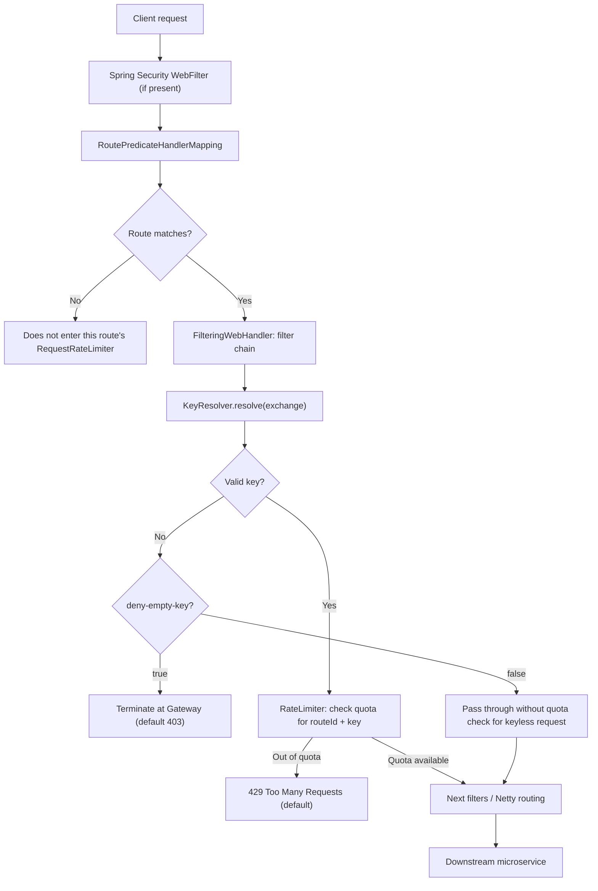

# Empty Keys, `deny-empty-key`, and the Risk of Choosing Untrusted Keys

## 1. Why Does a Rate Limiter Need a Trustworthy Key?

In **SPRING_CLOUD_GATEWAY**, a route can run `RequestRateLimiter` to stop a client from sending too many requests before the Gateway forwards traffic to a microservice. Spring Cloud Gateway combines **route predicates**, **filter chains**, path/header transformations, service discovery (`lb://`), and authentication, circuit breakers, retries, TLS, and observability to serve as a secure entry point. The rate limiter is one part of that defense.

However, a rate limiter needs more than the number "5 requests/second." It must also answer:

> **Whose 5 requests per second are those?**

The answer is represented by the **rate-limit key**—the key that groups requests into the same budget (bucket). For example:

```text
Route: /api/orders/**

Request from user-a -> key = user-a -> bucket A
Request from user-b -> key = user-b -> bucket B
Request with no user -> no key -> must decide whether to deny or allow
```

If the key is read from an HTTP header arbitrarily set by the client, an attacker can **change the header on every request** to obtain a fresh bucket and evade quotas. Conversely, if no key can be extracted, a "let pass when key is missing" setting can disable the limiter right when the system needs protection most.

This lesson belongs to the **Traffic Limiting** chapter and focuses on three issues:

1. **Empty key:** `KeyResolver` fails to find an identity/identifier for the request.
2. **`deny-empty-key`:** Does the Gateway block requests without a key or let them continue?
3. **Untrusted key:** a key exists, but the caller can pick, spoof, or rotate it at will.

By the end of this lesson, you will be able to configure `RequestRateLimiter` for Gateway Server WebFlux, write a `KeyResolver` that handles `Mono.empty()` properly, test `403` and `429` scenarios, and choose keys from authenticated identities or trusted proxy policies.

> **Scope:** this lesson uses **Spring Cloud Gateway Server WebFlux 4.3.x** from Spring Cloud 2025.0.x and Spring Boot 3.5.x. The starter is `spring-cloud-starter-gateway-server-webflux`, and YAML routes live under `spring.cloud.gateway.server.webflux.routes`. **Gateway Server MVC** has a different rate-limiting filter, `KeyResolver` type, and configuration; do not apply this lesson verbatim to MVC.

## 2. Where Does RequestRateLimiter Run in the Filter Chain?

Typical flow:



`RequestRateLimiter` is a route **GatewayFilterFactory**. It uses:

- `KeyResolver` to resolve the request into a **key string**.
- `RateLimiter` to check whether the request for that key still has quota.
- `GatewayFilterChain` to continue when allowed, or terminate the response itself if blocked.

The `KeyResolver` signature in Gateway Server WebFlux:

```java
public interface KeyResolver {
    Mono<String> resolve(ServerWebExchange exchange);
}
```

`Mono<String>` is a reactive publisher: it may emit one key or complete **without emitting any value** (`Mono.empty()`). Never return `null` instead of `Mono<String>`, and never construct `Mono.just(null)`.

Per Spring Cloud Gateway documentation, the default `KeyResolver` is `PrincipalNameKeyResolver`: it retrieves the `Principal` from `ServerWebExchange` and calls `Principal.getName()`. If the request has no valid principal, no key can be resolved. **The `Principal` must originate from a trustworthy authentication mechanism**; a `username` string sent by the client in a query param or header is not automatically equivalent to a principal.

### Two Rejection Branches Return Different Statuses

| Case | Has Key? | Did Limiter Check Quota? | Typical Default Response |
| --- | --- | --- | --- |
| `KeyResolver` emits no key, `deny-empty-key=true` | No | Bucket not evaluated | **403 Forbidden** (status can be customized). |
| Has key, quota exhausted | Yes | Yes | **429 Too Many Requests**. |
| Has key, quota available | Yes | Yes | Request continues; status depends on upstream. |
| No key, `deny-empty-key=false` | No | May **skip rate limiting** for this request | Request continues; status depends on upstream. |
| No route match | Not applicable | No | Typically 404 unless another handler applies. |
| Limiter backend (Redis) fails | Possibly yes | Cannot infer from status alone | Depends on implementation/error policy; must test. |

**Do not confuse 403 due to a missing key with 429 due to quota exhaustion.** Both can be returned by the Gateway **without calling the backend**, yet their root causes and fixes differ. Likewise, `429` does not mean the user is unauthenticated; `403` from a missing key is not necessarily a Spring Security authorization decision.

## 3. What Cases Actually Count as an "Empty Key"?

Common technical scenarios:

```text
A. Header completely absent:
   X-Demo-User: <missing>
   -> Mono.empty()  [if resolver handles properly]

B. Header has empty string:
   X-Demo-User:
   -> ""            [must normalize before returning key]

C. Header contains only spaces:
   X-Demo-User: "   "
   -> "   "         [must trim and check blank]

D. Principal does not exist:
   exchange.getPrincipal() -> Mono.empty()

E. Client sends literal "unknown" or "anonymous":
   -> this is NOT automatically a "missing key"
   -> often becomes a real key if the resolver accepts it!
```

**Crucial boundary:** `Mono.empty()` is a publisher with zero items. It is not the same as `Mono.just("")` or `Mono.just("anonymous")`. Some versions/frameworks have special checks for empty strings, but **do not rely on guesswork** to protect your API.

A safer approach is normalizing before returning:

```java
return Mono.justOrEmpty(header)
        .map(String::trim)
        .filter(value -> !value.isBlank());
```

If `header == null`, `Mono.justOrEmpty(header)` completes empty. If the header is whitespace-only, `filter` drops it and produces `Mono.empty()`.

Conversely, the snippet below is **unsafe** if the literal `unknown` behaves like a real user bucket:

```java
return Mono.justOrEmpty(header)
        .defaultIfEmpty("unknown");
```

It creates **one shared key** for every keyless request. It is no longer a "missing key" branch for `deny-empty-key` to handle. Legitimate users end up competing with attackers for one bucket, or the system accidentally admits requests that should have been rejected.

### Never Use Fallback Keys to Paper Over Design Flaws

| Fallback | Risk |
| --- | --- |
| `anonymous` for everyone | Unintentionally shares one global quota; trivial to drain and cause denial of service for others. |
| `UUID.randomUUID()` per request | Every request gets a brand-new bucket, essentially **disabling rate limiting**. |
| `?user=<client-input>` | Clients rotate `user` continuously to get fresh keys. |
| Raw `X-Forwarded-For` | Clients can spoof IPs if proxy trust is misconfigured. |
| Unverified `X-API-Key` | Callers can invent arbitrary strings to switch buckets. |
| `getRemoteAddress()` behind a reverse proxy | Always returns the proxy IP; all clients share one quota. |

Define an explicit **anonymous traffic policy** instead of accidentally falling back to a dummy string. A public route can use an IP bucket **verified at a trusted network boundary** or an intentional shared cap; login-required routes must require a valid principal.

## 4. `deny-empty-key` and `empty-key-status-code`

Per `RequestRateLimiter` documentation, **requests failing to resolve a key are rejected by default**. The `deny-empty-key` property controls that behavior.

| Setting | Meaning | Assessment for User-Rate-Limited APIs |
| --- | --- | --- |
| `deny-empty-key=true` | No key → block request. | **Recommended** when no trustworthy identity can be resolved. |
| `deny-empty-key=false` | No key → let request proceed via keyless branch. | **Quota bypass** risk; use only when intentionally allowing anonymous traffic via other protections. |
| `empty-key-status-code=FORBIDDEN` | Returns 403 when key is missing and deny is enabled. | Distinguishes missing key from 429 quota exhaustion. |
| `empty-key-status-code=UNAUTHORIZED` | Returns 401 instead of 403 if supported/configured properly. | Appropriate only with an auth policy; handle `WWW-Authenticate` at the auth layer if needed. |

### Very Important Note on Property Names Across Versions

Factory docs in some **4.3.x** pages still show legacy names:

```properties
# Name in the RequestRateLimiter description of older docs:
spring.cloud.gateway.filter.request-rate-limiter.deny-empty-key=true
spring.cloud.gateway.filter.request-rate-limiter.empty-key-status-code=FORBIDDEN
```

In Gateway **Server WebFlux** releases using the newer namespace, filter factory configuration uses:

```yaml
# Illustrates the newer WebFlux config group; verify binding on your exact patch version.
spring:
  cloud:
    gateway:
      server:
        webflux:
          filter:
            request-rate-limiter:
              deny-empty-key: true
              empty-key-status-code: FORBIDDEN
```

**Do not blindly copy old property prefixes into a 2025.0.x app.** Gateway WebFlux `routes` moved under `spring.cloud.gateway.server.webflux`, yet parts of the factory docs still display legacy snippets. The 4.3 `Configuration Properties` appendix lists `spring.cloud.gateway.server.webflux.filter.request-rate-limiter` (including `enabled` and default resolver/limiter) but **does not explicitly list both empty-key properties on every patch/page**. Therefore:

1. Keep **`deny-empty-key=true`** as the protective baseline in examples.
2. Verify the **actual version/namespace/binding** of your running artifact.
3. Test with a **keyless** request before and after changing properties, rather than trusting startup success alone.
4. For security-critical routes, add an independent **fail-closed** authentication layer so keyless callers never reach the API regardless of factory property binding.

> **Never treat `deny-empty-key=false` as a fix for mass 403 errors** during initial rollout. A 403 can be a signal that `KeyResolver` is reading from the wrong source (e.g., no principal yet); fix the resolver or auth/filter ordering first.

## 5. Choosing Rate-Limit Keys by Order of Trust

There is a fundamental difference between "**having a key**" and "**having a trustworthy key**." `RequestRateLimiter` can rate-limit very accurately on a client-invented string, yet that behavior does nothing to enforce an identity-based quota policy.

### 5.1. Preferred Key Sources

| Key Source | Default Trust Level | When to Use? |
| --- | --- | --- |
| **Verified `JwtAuthenticationToken`** | High if issuer, signature, audience, expiry, and policy are valid | Per-user/account/tenant rate limiting on resource servers. |
| **Session-authenticated Principal** | High if session/authentication is properly secured | OAuth2 Login/BFF, session-backed Gateways. |
| **Validated API key mapped to client registration** | High after true verification | Machine-to-machine APIs; limiter key should be a stable client ID, not the raw API secret. |
| **mTLS service identity** | High when cert chain/SAN/identity mapping is valid | Per-workload/service quotas. |
| Client IP resolved by **trusted proxy chain** | Conditional | Public/anonymous endpoints; must account for NAT, IPv6, IP rotation. |
| Client-sent raw `X-User-Id`, `X-Api-Key`, `X-Forwarded-For` | **Untrusted by default** | Never use directly for user/service-bound quotas. |
| Query `?user=user-a` | Untrusted | Only for illustrating APIs and bypass risks; never in production. |

With JWTs, never just decode the three-part payload. The Gateway or Spring Security must **verify signature, `iss`, `aud`, `exp`, `nbf`** before reading claims such as `sub`. With multiple issuers/tenants, the key may need **issuer + tenant + subject** so two users from different identity providers sharing a `sub` do not collide in one bucket. Never use raw JWT strings as keys.

### 5.2. Why Using IP Addresses Is Not Simple

If the Gateway sits behind a load balancer or ingress:

```text
Client 203.0.113.10
    |
  Ingress 10.0.0.8  --(TCP)--> Gateway
                               remoteAddress = 10.0.0.8
```

`exchange.getRequest().getRemoteAddress()` may return the **ingress IP**, not the client IP. If the Gateway blindly trusts `X-Forwarded-For: 203.0.113.10` from the request without a trusted-proxy policy, an attacker can spoof a new address on every request:

```bash
curl -H "X-Forwarded-For: 203.0.113.10" http://gateway.example.test/api/public
curl -H "X-Forwarded-For: 203.0.113.11" http://gateway.example.test/api/public
```

A proper design requires:

- Restricting the Gateway to accept traffic only from **trusted ingress/proxies** where architecture calls for it.
- Having the ingress **strip/overwrite** client-supplied forwarded headers per system policy.
- Using a client-IP resolver that is **proxy-chain aware**, configured with trusted hop counts/proxies.
- Protecting the network path so clients cannot bypass the ingress.
- Testing with client-injected `X-Forwarded-For`, multi-IP headers, IPv6, and missing headers.
- Not confusing properties for **writing** `Forwarded`/`X-Forwarded-*` upstream with **reading** and trusting header addresses as rate-limit keys.

Even with a verified IP, NAT/CGNAT causes many users to share an IP, and mobile roaming rotates IPs frequently. IP-based rate limiting is an anti-abuse signal, **not a substitute for authenticated account quotas**.

### 5.3. API Keys and Tenants

A syntactically valid API key sent by a client is not necessarily a real issued credential. Before using it for quotas:

1. Verify the credential using a trustworthy method (hashed lookup or appropriate verification mechanism).
2. Map it to a **stable client/account ID**.
3. Use that ID as the rate-limit key; avoid storing raw API keys in Redis keys or metrics.
4. Derive tenant ID from verified data, not merely `Host` or query parameters.
5. Support API key rotation/revocation without unintentionally resetting or shifting quotas.

All of these matter whenever the Gateway authenticates, rate-limits, authorizes, and routes by identity.

## 6. Safe KeyResolver: Extracting an Authenticated Identity

In a Gateway acting as an **OAuth2 Resource Server (JWT)**, you can read the `JwtAuthenticationToken` populated by Spring Security after verification:

```java
package com.example.gateway;

import org.springframework.cloud.gateway.filter.ratelimit.KeyResolver;
import org.springframework.context.annotation.Bean;
import org.springframework.context.annotation.Configuration;
import org.springframework.security.oauth2.server.resource.authentication.JwtAuthenticationToken;

import reactor.core.publisher.Mono;

@Configuration
public class RateLimitIdentityConfig {

    @Bean
    KeyResolver authenticatedUserKeyResolver() {
        return exchange -> exchange.getPrincipal()
                .ofType(JwtAuthenticationToken.class)
                .map(JwtAuthenticationToken::getToken)
                .filter(jwt -> jwt.getIssuer() != null
                        && jwt.getSubject() != null
                        && !jwt.getSubject().isBlank())
                .map(jwt -> jwt.getIssuer().toString()
                        + "|" + jwt.getSubject());
    }
}
```

**Prerequisite:** the Gateway must actually configure Spring Security WebFlux Resource Server to validate JWTs against issuer, signature, audience, timestamps, and scopes. Otherwise `exchange.getPrincipal()` will not supply a trustworthy `JwtAuthenticationToken`.

- If the principal is not a verified JWT, `ofType(...)` emits empty.
- If issuer/subject is missing or subject is blank, `filter` drops it, yielding `Mono.empty()` so the missing-key policy can block it.
- Combining issuer avoids subject collisions across token issuers; production setups can add verified tenant/account IDs per policy.
- **Never log key values if they contain personally identifiable info** and never use raw tokens as Redis keys.

The code above only handles **key derivation**, not authentication. Gateway security configuration should enforce auth before routing:

```java
@Bean
SecurityWebFilterChain gatewaySecurity(ServerHttpSecurity http) {
    return http
            .csrf(ServerHttpSecurity.CsrfSpec::disable)
            .authorizeExchange(exchanges -> exchanges
                    .pathMatchers("/api/orders/**")
                        .hasAuthority("SCOPE_orders.read")
                    .anyExchange().denyAll()
            )
            .oauth2ResourceServer(oauth2 -> oauth2
                    .jwt(Customizer.withDefaults())
            )
            .build();
}
```

This snippet lives inside a `@Configuration` class with the corresponding Spring Security WebFlux imports. Disabling CSRF is **only suitable for stateless bearer-token APIs**; never copy it to apps using session cookies/OAuth2 Login without CSRF protection. Backends must still enforce permissions on **specific resources** (owner/tenant), because per-user quotas do not replace authorization.

### A Subtle Pitfall with Anonymous Principals

Never simply write:

```java
return exchange.getPrincipal()
        .map(Principal::getName);
```

and assume every request has an authenticated identity. Systems allowing anonymous access or special principal types can produce names like `anonymousUser`. Also understand `Authentication.isAuthenticated()`: in Spring Security, `AnonymousAuthenticationToken` can report authenticated at the token-object level, yet **is not an actual logged-in account**.

For user-quota APIs, filter by the appropriate **authentication type and authorization policy**, such as verified `JwtAuthenticationToken` above. If multiple login methods exist, normalize them into a policy-defined identity rather than merging them into an uncontrolled key.

## 7. Hands-On: Observing Empty Keys and Spoofed Keys

This lab intentionally uses a **client-set demo header** so you can observe both problems firsthand: missing keys getting blocked and headers being swapped to evade quotas.

**Safety boundary:** `X-Demo-User` is **not an authentication credential**. Run this example only on localhost—never deploy it to real environments or attach it to APIs holding sensitive data. Afterward, replace the resolver with `authenticatedUserKeyResolver` from section 6 when integrating real Spring Security.

Architecture:

```text
Client --curl--> Gateway :8080
                  |
                  +-- KeyResolver: reads X-Demo-User
                  +-- RequestRateLimiter (Redis token bucket)
                  |
                  +--> Backend Echo :9001 (only when allowed)
                              |
                              +--> response 200
```

### 7.1. Prepare Maven and Dependencies

Requirements: Java 17+, Maven, local Redis, `curl`. The sample `pom.xml` uses Spring Boot `3.5.0` and Spring Cloud `2025.0.0` to illustrate the release train—**not** a claim that these are the latest patches for production deployment.

```xml
<?xml version="1.0" encoding="UTF-8"?>
<project xmlns="http://maven.apache.org/POM/4.0.0"
         xmlns:xsi="http://www.w3.org/2001/XMLSchema-instance"
         xsi:schemaLocation="http://maven.apache.org/POM/4.0.0
                             https://maven.apache.org/xsd/maven-4.0.0.xsd">
    <modelVersion>4.0.0</modelVersion>

    <parent>
        <groupId>org.springframework.boot</groupId>
        <artifactId>spring-boot-starter-parent</artifactId>
        <version>3.5.0</version>
        <relativePath/>
    </parent>

    <groupId>com.example</groupId>
    <artifactId>gateway-rate-key-lab</artifactId>
    <version>0.0.1-SNAPSHOT</version>

    <properties>
        <java.version>17</java.version>
    </properties>

    <dependencyManagement>
        <dependencies>
            <dependency>
                <groupId>org.springframework.cloud</groupId>
                <artifactId>spring-cloud-dependencies</artifactId>
                <version>2025.0.0</version>
                <type>pom</type>
                <scope>import</scope>
            </dependency>
        </dependencies>
    </dependencyManagement>

    <dependencies>
        <dependency>
            <groupId>org.springframework.cloud</groupId>
            <artifactId>spring-cloud-starter-gateway-server-webflux</artifactId>
        </dependency>
        <dependency>
            <groupId>org.springframework.boot</groupId>
            <artifactId>spring-boot-starter-data-redis-reactive</artifactId>
        </dependency>
    </dependencies>

    <build>
        <plugins>
            <plugin>
                <groupId>org.springframework.boot</groupId>
                <artifactId>spring-boot-maven-plugin</artifactId>
            </plugin>
        </plugins>
    </build>
</project>
```

The Spring Cloud BOM manages Cloud dependencies; do not pin an explicit version on the Gateway starter. The Redis **reactive** starter is required by Spring Cloud Gateway docs for `RedisRateLimiter`. Do not include `spring-boot-starter-web` in this WebFlux example.

### 7.2. Create the Application and Demo KeyResolver

`src/main/java/com/example/gateway/GatewayApplication.java`:

```java
package com.example.gateway;

import org.springframework.boot.SpringApplication;
import org.springframework.boot.autoconfigure.SpringBootApplication;

@SpringBootApplication
public class GatewayApplication {
    public static void main(String[] args) {
        SpringApplication.run(GatewayApplication.class, args);
    }
}
```

`src/main/java/com/example/gateway/DemoKeyConfig.java`:

```java
package com.example.gateway;

import org.springframework.cloud.gateway.filter.ratelimit.KeyResolver;
import org.springframework.context.annotation.Bean;
import org.springframework.context.annotation.Configuration;

import reactor.core.publisher.Mono;

@Configuration
public class DemoKeyConfig {

    @Bean
    KeyResolver demoHeaderKeyResolver() {
        return exchange -> Mono.justOrEmpty(exchange.getRequest()
                    .getHeaders()
                    .getFirst("X-Demo-User"))
                .map(String::trim)
                .filter(value -> !value.isBlank())
                .filter(value -> value.length() <= 40)
                .filter(value -> value.matches("[a-zA-Z0-9_-]+"));
    }
}
```

Illustrative resolver behavior:

1. Missing header → `Mono.empty()`.
2. Whitespace-only header → after `trim` and `filter`, becomes `Mono.empty()`.
3. Header longer than 40 characters or containing characters outside the demo allowlist → `Mono.empty()`.
4. Valid header like `alice` → returns key `alice`.

**Important:** regex/length validation **does not authenticate the sender**. Any client can still send `X-Demo-User: alice` or `X-Demo-User: bob`. That exact weakness is what the test steps will expose.

### 7.3. Configure the Route and Rate Limiter

Create `src/main/resources/application.yml`:

```yaml
server:
  port: 8080

spring:
  application:
    name: rate-key-lab

  data:
    redis:
      host: 127.0.0.1
      port: 6379

  cloud:
    gateway:
      server:
        webflux:
          filter:
            request-rate-limiter:
              deny-empty-key: true
              empty-key-status-code: FORBIDDEN

          routes:
            - id: echo-limited
              uri: http://127.0.0.1:9001
              predicates:
                - Path=/api/echo/**
              filters:
                - StripPrefix=2
                - name: RequestRateLimiter
                  args:
                    key-resolver: "#{@demoHeaderKeyResolver}"
                    redis-rate-limiter.replenishRate: 2
                    redis-rate-limiter.burstCapacity: 3
                    redis-rate-limiter.requestedTokens: 1
```

Explanation:

| Part | Meaning |
| --- | --- |
| `Path=/api/echo/**` | Selects the route by path. |
| `StripPrefix=2` | Backend receives the path after stripping `/api/echo`. |
| `RequestRateLimiter` | Applies the limiter to requests matching the route. |
| `key-resolver: "#{@demoHeaderKeyResolver}"` | References the Spring bean via SpEL, **not** a literal key. |
| `replenishRate: 2` | Refills roughly 2 tokens/second per bucket in the token bucket model. |
| `burstCapacity: 3` | Bucket holds at most 3 tokens; tolerates short bursts. |
| `requestedTokens: 1` | Each allowed request consumes 1 token. |
| `deny-empty-key: true` | Rejects when no key resolves, before evaluating quota. |
| `empty-key-status-code: FORBIDDEN` | Returns 403 for missing keys, distinct from 429 when quota runs out. |

**Never use shortcut syntax** like `RequestRateLimiter=2,3,...`: official documentation requires the named filter with `args` for `RequestRateLimiter`.

`replenishRate=2` and `burstCapacity=3` merely make 429s easy to trigger in the demo. Real values must be chosen from backend capacity, account usage, bursts, retries, and SLAs. If Redis still holds buckets from an earlier run, wait long enough for tokens to refill or test with a fresh demo key; **never wipe production Redis data** to "reset" a lab.

### 7.4. Start Local Redis

If your learning machine has Docker, run an isolated Redis bound only to loopback:

```bash
docker run --rm --name scg-lab-redis \
  -p 127.0.0.1:6379:6379 \
  redis:7.4-alpine
```

Keep the Redis terminal running. This is an **unauthenticated/no-TLS configuration for local use only**; never expose the Redis port to external networks. If you already have a securely configured local Redis on `127.0.0.1:6379`, use it instead of launching a second container. Never touch a Redis instance serving real workloads during labs.

### 7.5. Create a Simple Echo Backend

Create `EchoBackend.java` in a separate test folder outside the Gateway project:

```java
import com.sun.net.httpserver.HttpServer;
import java.net.InetSocketAddress;
import java.nio.charset.StandardCharsets;

public class EchoBackend {
    public static void main(String[] args) throws Exception {
        HttpServer server = HttpServer.create(
                new InetSocketAddress("127.0.0.1", 9001), 0);

        server.createContext("/", exchange -> {
            String path = exchange.getRequestURI().getRawPath();
            System.out.println("UPSTREAM RECEIVED " + path);

            byte[] bytes = ("backend-path=" + path + "\n")
                    .getBytes(StandardCharsets.UTF_8);

            exchange.getResponseHeaders().set(
                    "Content-Type", "text/plain; charset=UTF-8");
            exchange.sendResponseHeaders(200, bytes.length);

            try (var body = exchange.getResponseBody()) {
                body.write(bytes);
            }
        });

        server.start();
        System.out.println("Echo backend ready at 127.0.0.1:9001");
    }
}
```

Run the backend:

```bash
java EchoBackend.java
```

Run the Gateway from the directory containing `pom.xml`:

```bash
mvn spring-boot:run
```

If the project includes the Maven Wrapper: `./mvnw spring-boot:run` on Linux/macOS, or `mvnw.cmd spring-boot:run` on Windows.

### 7.6. Test Missing Key

```bash
curl -i "http://127.0.0.1:8080/api/echo/42"
```

Without `X-Demo-User`, `KeyResolver` returns `Mono.empty()`. With the default deny-empty-key policy, the Gateway is expected to return:

```http
HTTP/1.1 403 Forbidden
```

In the backend terminal, **no** `UPSTREAM RECEIVED /42` line appears. That confirms the request terminated at the Gateway.

### 7.7. Test Empty and Whitespace Headers

```bash
curl -i -H "X-Demo-User:" \
  "http://127.0.0.1:8080/api/echo/42"

curl -i -H "X-Demo-User:   " \
  "http://127.0.0.1:8080/api/echo/42"
```

Expected after resolver `trim`/filtering: no key, returns 403. Note that on the empty-header command, some versions of `curl` treat `-H "X-Demo-User:"` by **omitting the header**; that still exercises the missing-key path. To actually send an empty header, check curl's `X-Demo-User;` syntax and inspect bytes/headers on a test server.

### 7.8. Test Valid Key and Quota Exhaustion

Send one request:

```bash
curl -i -H "X-Demo-User: alice" \
  "http://127.0.0.1:8080/api/echo/42"
```

If Redis is running and the bucket has tokens, the backend returns:

```http
HTTP/1.1 200 OK
Content-Type: text/plain; charset=UTF-8

backend-path=/42
```

Send rapid requests with the same key, e.g. (Bash):

```bash
for i in 1 2 3 4 5 6 7 8 9 10; do
  curl -s -o /dev/null -w "alice status=%{http_code}\n" \
    -H "X-Demo-User: alice" \
    "http://127.0.0.1:8080/api/echo/42"
done
```

Because `replenishRate=2`, `burstCapacity=3`, in a fast-enough burst **some requests will return 429**. Never write tests asserting "strictly the fourth request is 429" across all environments: tokens can refill between requests, and machine/network speed affects timing.

In the backend terminal, the number of `UPSTREAM RECEIVED` lines must match the requests **admitted by the limiter**, not every request sent by the client.

### 7.9. Test Changing Keys to Evade Quota

Try:

```bash
curl -i -H "X-Demo-User: alice" \
  "http://127.0.0.1:8080/api/echo/42"

curl -i -H "X-Demo-User: bob" \
  "http://127.0.0.1:8080/api/echo/42"

curl -i -H "X-Demo-User: charlie" \
  "http://127.0.0.1:8080/api/echo/42"
```

Each new key gets its own quota. That is correct **only if** the keys represent three **verified** distinct identities. In this demo, a client can swap headers arbitrarily, making the limiter trivial to bypass: **the rate limiter works mathematically, but the key-selection policy is insecure**.

Do not "fix" this flaw by raising quotas or setting `deny-empty-key=false`. Replace the key source with an **authenticated** principal/token/API key, or a controlled anonymous/IP policy.

### 7.10. Controlled Test of `deny-empty-key=false`

Locally only, temporarily switch:

```yaml
spring:
  cloud:
    gateway:
      server:
        webflux:
          filter:
            request-rate-limiter:
              deny-empty-key: false
```

After restarting the Gateway, send a request **without `X-Demo-User`**. Under this setting, the keyless request can pass through **without being charged to any bucket**, and the backend returns 200. After testing, **restore `true`**.

If changing it does not alter behavior, do not assume `false` is safe or that the factory bound the property: check namespace, artifact version, property binding, and logs; refer to section 4. **Never leave a fail-open config in place just because tests returned 403 on missing keys.**

## 8. Redis Token Bucket Does Not Solve Key Selection on Its Own

`RedisRateLimiter` implements token bucket logic and stores distributed state, which helps when multiple Gateway replicas share quotas. Yet Redis **does not verify the identity** behind a key.

```text
Gateway A ---+
             +-- Redis: bucket(routeId, key) --> allow / deny
Gateway B ---+

If key = verified JWT subject: quota binds to an account.
If key = self-declared header: client can mint unlimited buckets.
If key is empty and fail-open: request may skip quota checks altogether.
```

When keys vary wildly, an attacker can trigger **key-cardinality explosion**: huge numbers of buckets stored in Redis, consuming memory and CPU. Regex/length filters only mitigate part of the risk; you need source authentication, caps on issued identities, TTL/capacity controls, ingress protection, and rate-limiter observability.

### Route ID Matters Too

In many `RateLimiter` implementations, `routeId` is combined with the key to separate budgets. Thus the same user `alice` can have separate quotas for `orders-read` and `orders-write` when configured across separate routes/buckets. **Do not assume** a user has a single system-wide quota just from returning the same string key; verify your actual limiter implementation and route IDs.

### What Happens When Redis Disconnects?

If Redis is down, that is **not** a "missing key." `KeyResolver` may return a valid key, yet `RateLimiter` cannot check the bucket. Error/fail-open/fail-closed behavior varies across implementations, versions, and exception-handling policies; run a **Redis-disconnect integration test**. Never claim a Redis outage always produces 403, 429, or 503 across every version.

For strictly protected services, implement fail-closed or a bounded fallback limiter per approved policy; for availability-prioritized systems, understand fail-open's impact on backends and control load at other layers. **`deny-empty-key` is not a switch for handling Redis outages.**

## 9. Combining with Auth, Header Filters, TLS, Circuit Breakers, and Retries

### 9.1. Authentication Before Key Resolution

For login-required routes, the preferred model is:

```text
Spring Security WebFilter:
  - Verify JWT/session/API key
  - Authorize identity, scopes
       |
       v
Gateway RequestRateLimiter:
  - Derive key from authenticated principal
  - Check quota
       |
       v
GatewayFilter transforms / LoadBalancer / Netty proxy
       |
       v
Downstream:
  - Enforce resource-level authorization itself
```

If Spring Security blocks unauthenticated requests, clients see **401** before `RequestRateLimiter` runs; that is good behavior. Never expect every tokenless request to hit Gateway's `deny-empty-key` branch. A keyless request that reaches the limiter typically receives **403** under default limiter policy.

### 9.2. Header Transforms and Forwarded Trust

If forwarding `X-Authenticated-User` downstream, the Gateway must attach it only after authentication, strip any client-sent header of the same name, and enforce a trust boundary to the backend. Even then, **rate-limit keys should come directly from the security principal** rather than reading headers clients might manipulate.

When behind a proxy, never use raw `X-Forwarded-For` as a key without **trusted proxy configuration, network policies, and header sanitization**. DNS, TLS, and mTLS help authenticate proxies/backends, but never turn an arbitrary client header into trustworthy data.

### 9.3. Retries and Circuit Breakers

- Place the rate limiter **before proxying**, so blocked requests never load microservices.
- Retries can send one request to the backend **multiple times** depending on filter placement and config; decide whether quotas count **per client request** or **per downstream attempt**.
- Never blindly retry `429` responses; that can trigger a **retry storm**. Clients should use backoff and honor `Retry-After` when appropriately supplied.
- Circuit breakers protect against backend errors/failures; they do not replace identity-based rate limiting. Fallbacks must never leak sensitive data when auth/quota checks fail.
- For `POST`/`PATCH`, enforce idempotency if retries are enabled to avoid duplicate side effects.

### 9.4. Multi-Instance, Observability, and TLS

Across multiple Gateway replicas, a Redis-backed limiter shares state; however, configure timeouts, network-partition handling, connection pools, Redis HA, and protect Redis credentials/TLS. Never expose Redis ports publicly; never log Redis keys containing sensitive user IDs, tokens, or full IP addresses.

Monitor:

- Route ID, `403` rate from missing keys, and `429` rate from exhausted quotas.
- Count of empty key-resolver results and format-rejected keys.
- Redis error rate, limiter call latency, and admitted vs. denied request counts.
- Upstream HTTP status/latency and retry attempt counts.
- Filter-chain state to distinguish **proxied requests vs. early rejections**.

**Never add key values to metric labels** when they have high cardinality or contain personal data. Use hashed or aggregated analytics governed by data-protection and log-access policies.

## 10. Troubleshooting Table

| Symptom | Cause to Check | How to Investigate |
| --- | --- | --- |
| Every request returns 403 | No principal, resolver returns `Mono.empty()`, or deny property is active. | Safely log missing-key counts; inspect auth, resolver bean, and route args. |
| 403 on requests omitting demo header | Resolver finds no key; expected lab behavior. | Send a valid key to test the quota branch; do not rush to enable fail-open. |
| 429 triggers very early | Low burst/replenish, depleted bucket, many calls sharing a key, client retries. | Check `routeId`, key policy, burst/`requestedTokens`, and request rate. |
| Many requests sent, never see 429 | Each request creates a new key, missing-key bypass, or filter config has no effect. | Fix a static test key and send a burst; verify Redis and route config. |
| Empty header shares a `""` bucket | Resolver emits `Mono.just("")` instead of `Mono.empty()`. | Trim and filter blanks before emitting keys. |
| Changing `X-User-Id` gives fresh quota | Key comes from a client-controlled header. | Derive from authenticated principal or trusted identity mapping. |
| All clients share one quota | Using `anonymous` or proxy IP as key. | Inspect identity source and reverse-proxy topology. |
| Spoofing `X-Forwarded-For` changes quota | Header is spoofable or parser trusts the wrong hop. | Use trusted proxy chain, ingress overwrite, and network controls. |
| `deny-empty-key=false` changes nothing | Wrong prefix or property not bound in this version. | Check release train, actual factory properties, and test keyless requests. |
| `RequestRateLimiter` missing at startup | Wrong Gateway starter (WebFlux/MVC), missing dependency, or invalid route config. | Verify `spring-cloud-starter-gateway-server-webflux` and named filter syntax. |
| Redis fails and clients get 5xx/429 | RateLimiter cannot evaluate bucket; behavior varies by version/exception handler. | Simulate Redis outage and trace root cause; do not confuse with missing key. |
| Post-processing logs appear despite backend getting no request | Outer filters still run `doFinally` callbacks. | Use backend counters/tracing to confirm short-circuiting. |

## 11. Policy Protection Test Matrix

| Test Group | Input | Expectation |
| --- | --- | --- |
| Missing key | No `X-Demo-User` header | `Mono.empty()`, default 403, backend receives zero requests. |
| Whitespace key | `X-Demo-User:   ` | Normalized to missing key. |
| Valid key | `X-Demo-User: alice` | When quota remains, proxied to backend. |
| Burst | 10 rapid requests with same `alice` | Initial requests pass, subsequent ones can return 429. |
| Different keys | `alice`, `bob` | Separate buckets per key; demonstrates spoofing if untrusted. |
| Invalid characters | `X-Demo-User: a/b` | Demo resolver rejects as missing key. |
| Toggle deny | `deny-empty-key=false` locally | Keyless requests bypass quota; restore `true` afterward. |
| Authenticated key | Verified JWT `sub` | Key derived from principal; missing token rejected by auth. |
| Proxy bypass | Client-forged `X-Forwarded-For` | Cannot create extra buckets under a trusted-identity policy. |
| Scale Gateway | Two replicas + shared Redis | Same key shares quota per policy. |
| Redis outage | Disconnect test Redis | Deterministic failure behavior with metrics, no unintended bypass. |
| Backend outage | Echo backend stopped | Key/quota valid, routing fails; distinguish from 403/429. |
| Route miss | `GET /no-route` | Does not run `echo-limited` limiter; typically 404. |

For automated tests, use a mock backend **with a request counter** to prove that missing-key or rate-limited requests **never hit downstream**. Never assert status codes alone: verify which route matched, what key the resolver emitted (without logging sensitive values), and that the token bucket behaves as designed.

### Self-Check Questions

**1. Do `deny-empty-key=true` and quota exhaustion share the same default HTTP status code?**

No. Missing keys typically return **403**; valid keys out of quota typically return **429** from `RequestRateLimiter`.

**2. Is `Mono.empty()` the same as `Mono.just("")`?**

No. `Mono.empty()` emits no value; `Mono.just("")` emits an empty string. Normalize blanks to `Mono.empty()` before returning to the limiter.

**3. Why is `defaultIfEmpty("anonymous")` not equivalent to `deny-empty-key`?**

Because it **creates a real key**; the limiter no longer sees a missing-key case. All unauthenticated callers end up sharing the `anonymous` bucket.

**4. Why is `?user=alice` dangerous in an API with per-account quotas?**

Because clients can change the query parameter to `bob`, `charlie`, … to mint new buckets or drain another user's quota.

**5. Why is raw `X-Forwarded-For` not a trustworthy IP source?**

Clients can forge the header if the ingress does not sanitize it. You need a trusted proxy chain, network isolation, and proper forwarded-header rules.

**6. Does `deny-empty-key=false` solve Redis unavailability?**

No. That setting governs **key resolution failure**, not rate-limiter storage failures.

**7. Why might a client with a verified JWT still be able to read another user's data?**

Rate limiting only checks quotas; downstream services must still enforce resource-level permissions (owner, tenant, scope), alongside Gateway auth/authz.

**8. If an app uses `lb://` with multiple backend replicas, is `RedisRateLimiter` always required?**

Not every architecture requires Redis, but if you want **shared quotas across multiple Gateway replicas**, you need a shared-state limiter implementation. `lb://` only selects backend instances and does not coordinate quotas.

**9. Why should keys include both issuer and subject in multi-issuer systems?**

Because two issuers can assign the same `sub` value to two different identities. Combining verified namespaces avoids bucket collisions.

**10. When getting 403 for missing keys, should you disable `deny-empty-key` first or inspect `KeyResolver` first?**

Inspect the resolver, authentication, trust model, and route config first. Switching to fail-open can turn a config mistake into a quota-bypass vulnerability.

## Conclusion

Spring Cloud Gateway Server WebFlux's `RequestRateLimiter` only truly protects microservices when **the limiter key represents a trustworthy identity or scope**. `deny-empty-key` prevents keyless requests from slipping through accidentally, yet cannot stop clients from **spoofing another key** if `KeyResolver` reads unverified input. Normalize missing/blank keys to `Mono.empty()`, deny keyless traffic where identity is required, derive keys from verified JWT principals/sessions/API keys or controlled proxy chains, and explicitly test `403` missing-key, `429` quota-exhausted, Redis-outage, and backend-down scenarios.

Rate limiting is a complementary layer alongside **authentication, authorization, TLS, circuit breakers, retries, and observability**—never a replacement for them. For multi-instance routes or production workloads, always verify key-spoofing resistance and key-cardinality bounds before exposing the Gateway.

### Official References

- [Spring Cloud Gateway Server WebFlux 4.3 — RequestRateLimiter GatewayFilter Factory](https://docs.spring.io/spring-cloud-gateway/reference/4.3/spring-cloud-gateway-server-webflux/gatewayfilter-factories/requestratelimiter-factory.html)
- [Spring Cloud Gateway 4.3 — Configuration Properties](https://docs.spring.io/spring-cloud-gateway/reference/4.3/configprops.html)
- [Spring Cloud Gateway Server WebFlux 4.3 — How It Works](https://docs.spring.io/spring-cloud-gateway/reference/4.3/spring-cloud-gateway-server-webflux/how-it-works.html)
- [Spring Cloud Gateway Server WebFlux 4.3 — Global Filters](https://docs.spring.io/spring-cloud-gateway/reference/4.3/spring-cloud-gateway-server-webflux/global-filters.html)
- [Spring Security — Reactive OAuth2 Resource Server JWT](https://docs.spring.io/spring-security/reference/reactive/oauth2/resource-server/jwt.html)
- [Spring Cloud Gateway — API Rate Limiting, Spring Blog](https://spring.io/blog/2021/04/05/api-rate-limiting-with-spring-cloud-gateway/)
- [Spring Cloud — release trains and Spring Boot compatibility](https://spring.io/projects/spring-cloud/)
