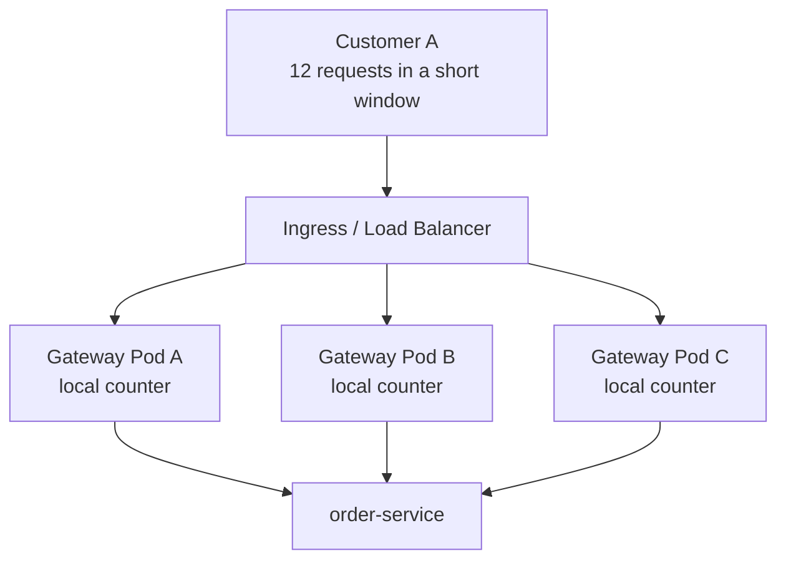
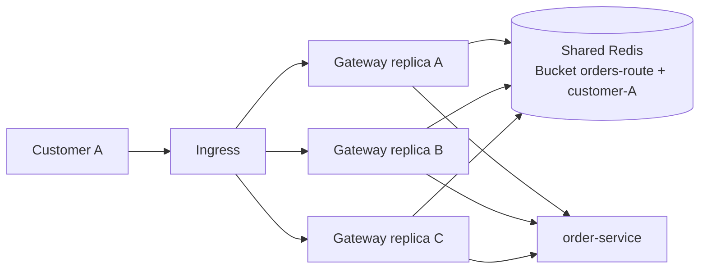
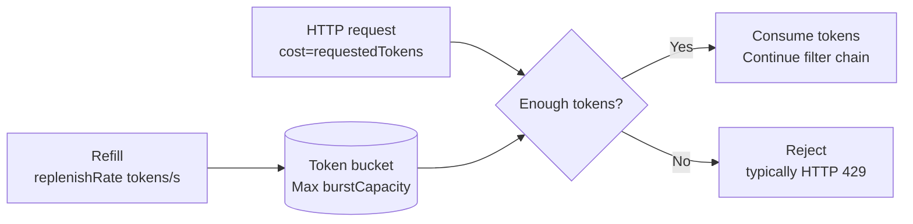
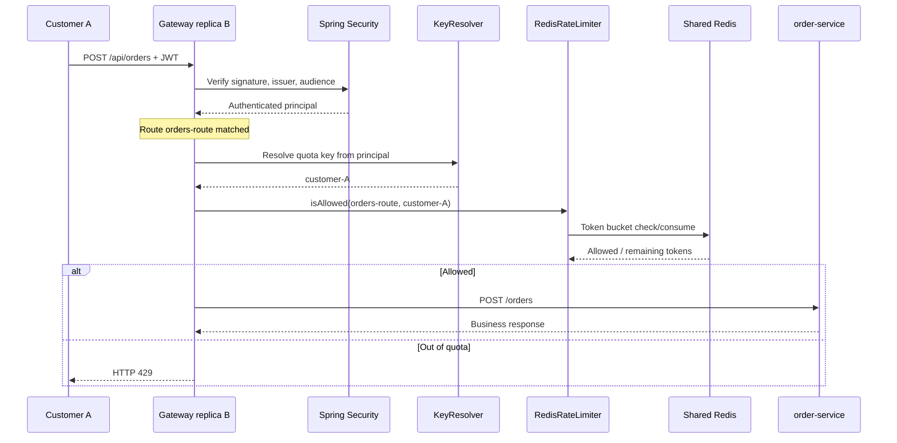
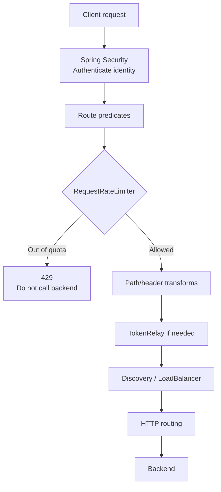
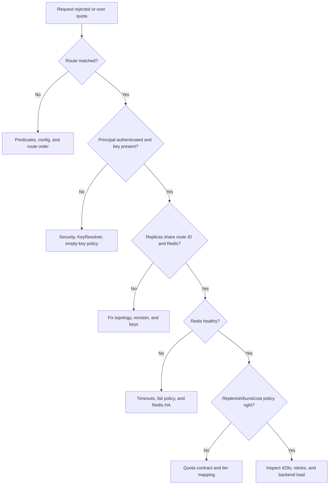

# Per-Route and Per-Customer Limits in a Multi-Replica System

In a microservices entry point, rate limiting is only effective when **limits are attributed to the right actor** and **remain consistent across multiple Gateway replicas**. Suppose Customer A may call the order-creation API up to a set number of requests per second. If there are three Spring Cloud Gateway replicas and each replica only counts requests in its own local memory, the customer can spread requests across all three replicas and consume far more than intended.

**Spring Cloud Gateway** provides `RequestRateLimiter` to decide whether a request may proceed. With **`RedisRateLimiter`** and **`KeyResolver`**, the Gateway can enforce **token buckets per route and per customer identity**, using Redis to coordinate state across Gateway replicas. However, this setup does not automatically solve every quota requirement: a customer's shared budget across multiple routes, daily/monthly quotas, service plans (subscription tiers), unauthenticated abuse protection, and fault tolerance when Redis disconnects all require explicit design.

This lesson belongs to the **Traffic Limiting** chapter of the **SPRING_CLOUD_GATEWAY** module. We will build a practical configuration integrating route predicates, filter chains, Spring Security identity, Redis, service discovery, timeouts/TLS, retries, circuit breakers, and observability—specifically verifying **behavior when multiple Gateway replicas receive requests from the same customer**.

> **Scope:** `RequestRateLimiterGatewayFilterFactory`, `RedisRateLimiter`, `KeyResolver`, and YAML/Java route samples use **Spring Cloud Gateway Server WebFlux**. The **Server Web MVC** variant has its own APIs and rate-limiter types in certain versions. Starters, property namespaces, and specific behaviors must be checked against your running Spring Boot/Spring Cloud/Gateway, Spring Security, and Spring Data Redis versions.

## 1. Distinguishing Per-Route, Per-Customer, and System-Wide Limits

Consider two public routes:

```text
GET  /api/catalog/products/42
POST /api/orders
```

Suppose we want to enforce illustrative policies:

| Policy | Limited Subject | Idea |
| --- | --- | --- |
| **Per-route** | Individual route ID | Order-creation route is stricter than catalog-read route. |
| **Per-customer** | Authenticated user/account/API key | Two requests from the same account share that account's quota. |
| **Per-route *and* per-customer** | `(routeId, customerId)` pair | Each customer gets a separate limit on each route. |
| **Customer-wide across all APIs** | `customerId` across **all** selected routes | Requires a shared budget rather than independent per-route limits. |
| **System-wide** | All requests to the Gateway or a backend group | Protects infrastructure capacity; typically pairs ingress, concurrency limits, and backends. |

**Key point:** Gateway's built-in `RedisRateLimiter` typically organizes buckets by **route ID + key from `KeyResolver`**. When the same user calls two different routes, the two route buckets are normally **independent**, even if both point to the same Redis.

For example:

```text
Customer A:
  catalog-route | customer-A  -> A's catalog bucket
  orders-route  | customer-A  -> A's orders bucket

Customer B:
  catalog-route | customer-B  -> B's catalog bucket
  orders-route  | customer-B  -> B's orders bucket
```

Therefore, **"shared Redis" does not automatically mean "one account-wide quota across all APIs."** Choosing key structure and quota scope is a product/engineering decision that must be made before selecting filters.

## 2. Why Local Limiters Fail in a Multi-Replica Environment?

Suppose a policy allows **5 requests/second per customer** on the order-creation route, and there are three Gateway pods:



If each pod keeps an independent counter capped at 5 requests/second, total admitted requests can far exceed **5 across the cluster**. Request distribution across pods also shifts on pod restarts, rollouts, or sticky sessions; you cannot rely on it for accurate quotas.

With shared Redis:



Each replica still handles HTTP requests independently, yet **token-consumption decisions** for the same route/customer pair coordinate through shared state. `RedisRateLimiter` uses token-bucket logic and appropriate Redis operations to prevent replicas from both seeing "tokens available" and over-admitting due to local counter races.

**Prerequisite:** all replicas must point to the **same Redis data domain**, share the same key/route-ID policy, and use identical rate/burst parameters. If each pod hits its own Redis, or route IDs differ across pods, limits will no longer align as expected.

## 3. The Token Bucket Mechanism of RedisRateLimiter

**Token bucket** is a rate-limiting model capable of allowing controlled bursts:

- The bucket has a maximum capacity of `burstCapacity` tokens.
- Tokens replenish at `replenishRate` tokens/second.
- Each request consumes `requestedTokens` tokens.
- A request is admitted if the bucket holds enough tokens at check time; otherwise the rate limiter can reject it before forwarding to the backend.



### Calculating Ideal-State Request Volume

When every request has a fixed cost:

```text
R = replenishRate   (tokens / second)
B = burstCapacity   (tokens)
T = requestedTokens (tokens / request)

Sustained rate approximately  R / T  requests / second
Max instantaneous burst when bucket is full ≈ floor(B / T) requests
```

With `replenishRate=5`, `burstCapacity=10`, `requestedTokens=1`, an account can burst up to roughly 10 requests **if the bucket is full and negligible refill happens during the burst**; afterward tokens replenish at an average of 5 tokens/second. Actual observed numbers also depend on timing, concurrency, and token-bucket implementation details.

| Replenish rate | Burst capacity | Requested tokens | Approximate Meaning |
| --- | --- | --- | --- |
| `5` | `10` | `1` | Sustained rate 5 requests/s, initial burst up to 10. |
| `20` | `40` | `1` | Suited for read routes with higher usage. |
| `10` | `20` | `2` | Each request costs 2 tokens; averages 5 requests/s. |
| `1` | `60` | `60` | Averages 1 request/minute, max burst of one request when full. |

The last example shows how to represent an **average rate lower than one request/second** using a larger `requestedTokens`. Still, this remains a **continuous token bucket**, **not** an exact counter per "calendar minute," "calendar day," or billing cycle.

### What Token Bucket Does Not Do

- Does not cap **concurrently executing** requests like a semaphore/concurrency limiter.
- Does not define billing, plan, or monthly usage quotas on its own.
- Does not replace connection limits, request body size limits, response timeouts, or circuit breakers.
- Does not detect spoofed accounts if keys are read from an untrusted header.
- Does not guarantee fairness among individual users if many are grouped under an overly broad key.

## 4. Components in Spring Cloud Gateway

| Component | Role |
| --- | --- |
| **`RequestRateLimiterGatewayFilterFactory`** | Gateway filter deciding allow/reject via a `RateLimiter`. |
| **`RedisRateLimiter`** | Redis-backed token-bucket rate limiter implementation. |
| **`KeyResolver`** | Extracts the quota key from `ServerWebExchange`, e.g. authenticated user identity. |
| **Redis** | Shared state store across replicas. |
| **Route ID** | Defines the default bucket scope per route. |
| **Spring Security** | Authenticates principal/JWT/session before `KeyResolver` reads identity info. |
| **FilteringWebHandler** | Executes the filter chain once a route is selected. |
| **Actuator/metrics/tracing** | Observes allowed/rejected requests, Redis errors, and latency. |



The diagram does not imply `KeyResolver` validates tokens itself; **Spring Security must authenticate the request first**. Token relay (if used) is also a separate concern: the key is resolved to rate-limit requests, while outbound access tokens must be forwarded according to backend authentication/authorization policies.

## 5. Required Dependencies and Environment

A POC for **Gateway Server WebFlux + RedisRateLimiter** requires:

| Category | Illustrative Dependency / Config |
| --- | --- |
| Gateway WebFlux | `spring-cloud-starter-gateway-server-webflux` in branches with this starter. |
| Reactive Redis | `spring-boot-starter-data-redis-reactive`. |
| JWT Auth at Gateway | `spring-boot-starter-oauth2-resource-server` when using bearer JWTs. |
| Observability | `spring-boot-starter-actuator` and your project's metrics/tracing stack. |
| Service discovery if using `lb://` | `spring-cloud-starter-loadbalancer` and a `ServiceInstance` source. |
| Redis Server | A Redis service with properly configured networking/TLS/auth. |

Older Spring Cloud Gateway lines may use `spring-cloud-starter-gateway`. Align your Spring Boot/Spring Cloud release train and let the BOM manage compatible versions; never mix WebFlux and MVC starters blindly.

Example Redis configuration for a test environment on Spring Boot supporting this namespace:

```yaml
spring:
  data:
    redis:
      host: localhost
      port: 6379
```

Redis properties in Spring Boot vary across generations. In production, use dedicated endpoints, secrets/credentials, TLS, pools, timeouts, ACLs, and Sentinel/Cluster/managed Redis topologies per version guidance; **never expose unauthenticated public Redis**.

`host: localhost` only works when Redis shares the Gateway's local network view. In containers/Kubernetes, `localhost` points to the Gateway's own pod/container, not the cluster's Redis service.

## 6. Configuring Per-Route and Per-Customer Limits

**Server WebFlux** example using `spring.cloud.gateway.server.webflux.routes` on supported lines:

```yaml
spring:
  cloud:
    gateway:
      server:
        webflux:
          routes:
            - id: orders-route
              uri: lb://order-service
              predicates:
                - Path=/api/orders/**
              filters:
                - StripPrefix=2
                - name: RequestRateLimiter
                  args:
                    key-resolver: "#{@jwtCustomerKeyResolver}"
                    redis-rate-limiter.replenishRate: 5
                    redis-rate-limiter.burstCapacity: 10
                    redis-rate-limiter.requestedTokens: 1

            - id: catalog-route
              uri: lb://catalog-service
              predicates:
                - Path=/api/catalog/**
              filters:
                - StripPrefix=2
                - name: RequestRateLimiter
                  args:
                    key-resolver: "#{@jwtCustomerKeyResolver}"
                    redis-rate-limiter.replenishRate: 20
                    redis-rate-limiter.burstCapacity: 40
                    redis-rate-limiter.requestedTokens: 1
```

Explanation:

1. Each route has a stable **route ID**, such as `orders-route` and `catalog-route`.
2. `Path` matches the public URL before `StripPrefix` rewrites the forwarded path.
3. `RequestRateLimiter` invokes `jwtCustomerKeyResolver` to obtain the quota key.
4. `RedisRateLimiter` consumes tokens per the **matched route's** policy.
5. `lb://...` selects a backend service via LoadBalancer/discovery **after** earlier route steps according to actual filter order.
6. Denied requests stop at the Gateway, typically with **`429 Too Many Requests`**, without reaching the backend.

**Version note:** `redis-rate-limiter.replenishRate`, `burstCapacity`, and `requestedTokens` must match the filter factory/`RedisRateLimiter` of your Gateway line. Older WebFlux branches commonly declare `spring.cloud.gateway.routes` instead of `spring.cloud.gateway.server.webflux.routes`.

### Do Not Use Arbitrary Shorthand

`RequestRateLimiter` should not be written as a nameless shorthand filter if the version requires `name/args`. Explicit syntax confirms `key-resolver` is a bean SpEL expression rather than a header name or literal URL.

### `requestedTokens` Is the Cost per Request

In `orders-route`, each request deducts 1 token. If business rules treat report-creation requests as heavier than report-read requests, you can configure separate routes with different `requestedTokens`. However, per-route token buckets **do not automatically share one balance across multiple routes**; design a shared quota domain if endpoints must draw from one common budget.

## 7. KeyResolver: Pick Verified Identity, Not Spoofable Input

**KeyResolver** decides "whose request" the limiter is charging. If the wrong key is chosen, the token bucket math still runs accurately while the business/security policy fails.

Common candidates:

| Key Type | Pros | Risks |
| --- | --- | --- |
| **Authenticated User/Account ID** | Ties quota to an account across IPs/devices. | Must ensure issuer/tenant scoping, stable ID, and no PII leaks. |
| **Verified API key ID** | Suits B2B or service clients. | Never use raw API keys as Redis keys/logs; handle rotation. |
| **Client-credentials principal** | Suits M2M workloads. | If all workloads share one client ID, they share one quota. |
| **Source IP** | Can provide a coarse pre-login defense layer. | NAT/proxies/CDNs, IPv6, and header spoofing skew fairness. |
| **Unverified `X-Customer-ID` header** | Easy to code. | **Insecure:** clients can swap IDs to bypass limits or exhaust others' quotas. |

### Java KeyResolver Based on Verified JWT

In a **Spring Security Resource Server** Gateway validating bearer JWTs, define a bean:

```java
import java.net.URI;

import org.springframework.cloud.gateway.filter.ratelimit.KeyResolver;
import org.springframework.context.annotation.Bean;
import org.springframework.context.annotation.Configuration;
import org.springframework.security.oauth2.server.resource.authentication.JwtAuthenticationToken;
import reactor.core.publisher.Mono;

@Configuration
public class QuotaKeyConfiguration {

    @Bean
    KeyResolver jwtCustomerKeyResolver() {
        return exchange -> exchange.getPrincipal()
            .ofType(JwtAuthenticationToken.class)
            .flatMap(authentication -> {
                var jwt = authentication.getToken();
                URI issuer = jwt.getIssuer();
                String subject = jwt.getSubject();
                String tenant = jwt.getClaimAsString("tenant_id");

                if (issuer == null || subject == null
                        || subject.isBlank()
                        || tenant == null || tenant.isBlank()) {
                    return Mono.empty();
                }

                // Illustrates key by issuer + tenant + subject.
                // Production: prefer an opaque identifier or keyed HMAC.
                String key = issuer + "|tenant:" + tenant + "|sub:" + subject;
                return Mono.just(key);
            });
    }
}
```

**Prerequisite:** `JwtAuthenticationToken` exists only when Security Resource Server validates the JWT and produces this principal type. If the Gateway uses `oauth2Login` with sessions (typically yielding a different principal type), this bean **will not** produce a key; write a resolver suited to that login principal. When users are unauthenticated, never invent a "user ID" from request JSON or arbitrary headers.

### Keys Must Be Both Stable and Secure

Combining `issuer + tenant + subject` prevents two IdPs/tenants sharing a `sub` string from colliding in one quota. Still, **Redis keys are operational data**—never embed raw emails, phone numbers, or sensitive IDs directly. In production, prefer an **opaque customer identifier** or an **HMAC using a securely managed server-side secret**; do not rely on an unsalted hash of an easily guessable email as "guaranteed anonymization."

If tenant claims could be untrusted in multi-issuer setups, **verify issuer, audience, and tenant membership** before using them. Quota keys never replace authorization.

### Never Create an Overly Broad Default Key

A resolver like:

```java
return exchange -> Mono.just("anonymous");
```

groups **every request on that route** into one bucket. While that can be intentional for a global route cap, it is **not per-customer limiting**. On public traffic, one noisy client can exhaust the shared quota and block legitimate users.

### How to Handle Missing Keys?

`KeyResolver` can return `Mono.empty()` when no matching principal exists. In Gateway WebFlux releases with `RequestRateLimiter`, the default is typically to **reject keyless requests** (documented default response code is **403**), with version-specific properties governing empty-key handling.

Therefore:

- APIs requiring user login should have **Spring Security return 401/login redirect per policy** before reaching the limiter.
- Never let keyless requests fall into a bucket meant for logged-in users.
- If public APIs need IP/anonymous quotas, design a **separate resolver and policy layer**.
- Test the exact status code of your deployed version; do not assume every keyless request returns 429.

## 8. In Multi-Replica Systems, Route ID Is Part of the Policy

Imagine two Gateway pods running identical rate numbers but different route IDs:

```text
Pod A: route id = orders-route
Pod B: route id = order-create

KeyResolver on both: customer-A
Redis on both: same Redis instance
```

Because the limiter typically pairs route ID with the key to identify buckets, the two pods end up tracking quotas **in two separate buckets**. This can happen during rollouts when a new version renames a route ID while old pods still serve traffic.

**Operational rules:**

- Keep route IDs stable across replicas and upgrades unless intentionally changing quotas.
- Ensure all pods run identical replenish/burst/requested-token values.
- When changing limits or key formatting, plan how **existing buckets** are handled, rollout timing, and user impact.
- Across multi-region deployments, decide whether Redis is centralized or each region has independent quotas. **Separate per-region Redis stores do not create one global quota.**
- Inspect route IDs, quota policy revisions, and rate-limit outcomes when debugging "same user, pod A allows while pod B rejects."

## 9. One Shared Quota Across Routes Is Harder Than Per-Route Limiters

Suppose product requirements give Basic-plan customers **at most 100 API calls/minute across all APIs**, spanning catalog, orders, and reports.

If you configure:

```text
catalog-route: 100/min for customer-A
orders-route:  100/min for customer-A
reports-route: 100/min for customer-A
```

the customer gets **three separate budgets**, not 100/min total. Default `RedisRateLimiter` with distinct route IDs does not merge them into a single bucket.

### Three Quota Layers to Distinguish

1. **Customer-wide budget:** total customer API usage across all routes, tracked in one shared quota domain.
2. **Route-specific budget:** `POST /payments` tighter than `GET /catalog`.
3. **Infrastructure guardrail:** overall request/concurrency cap when backends or Redis overload.

### Design Options

| Approach | Description | When Appropriate |
| --- | --- | --- |
| **Standard per-route `RedisRateLimiter`** | `(routeId, key)` bucket per route. | Each API has independent quotas. |
| **Custom `RateLimiter` with shared namespace** | Uses one quota-domain key across routes with atomic scripts/counters. | Need a single shared budget across routes. |
| **Centralized quota service** | Gateway calls a controlled quota service managing accounts/tiers/periods. | Complex quotas, multiple products, billing, or auditing. |
| **Edge/ingress + Gateway limiters** | Edge enforces coarse shared quotas; Gateway enforces fine-grained quotas. | Infrastructure already has API management/edge policies. |

If **both a shared quota and a per-route quota** must be checked per request, explicitly design **token consumption/refund when either check fails**, ordering, and atomicity. Never chain two independent limiters assuming they form an atomic transaction: the first limiter can deduct tokens before the second limiter rejects.

### Token Bucket Does Not Replace Billing-Period Quotas

Basic plan "100 requests per minute on average" differs from "100 requests per calendar minute" or "100,000 requests per month." `replenishRate`/`burstCapacity` govern a **continuous/refilling token stream**, not a midnight reset or account billing close.

Daily/monthly quotas often need **fixed/sliding-window counters**, usage events, durable persistence, and timezone/period handling. For revenue/billing, maintain a dedicated **usage ledger** rather than inferring charges from ephemeral token buckets in Redis.

## 10. Plan-Based Limits: Basic, Pro, and Enterprise

A commercial API platform might offer plans like:

| Sample Plan | Catalog Limit | Order-Create Limit | Purpose |
| --- | --- | --- | --- |
| Basic | `10 requests/s`, burst `20` | `2 requests/s`, burst `4` | Protects backends when small customers spike. |
| Pro | `50 requests/s`, burst `100` | `10 requests/s`, burst `20` | Supports higher-volume customers. |
| Enterprise | Per contract | Per contract | May require custom SLAs, dedicated capacity, or a quota service. |

These numbers merely **illustrate policy modeling**, not universal defaults or recommendations.

### Limitation of Static Route Parameters

```yaml
filters:
  - name: RequestRateLimiter
    args:
      key-resolver: "#{@jwtCustomerKeyResolver}"
      redis-rate-limiter.replenishRate: 10
      redis-rate-limiter.burstCapacity: 20
      redis-rate-limiter.requestedTokens: 1
```

These numbers apply uniformly to **every key on that route**; returning `customer-Basic` vs. `customer-Pro` from `KeyResolver` **does not dynamically change `replenishRate` by plan**.

To enforce dynamic plan limits, you can:

1. Build a custom `RateLimiter` that looks up policies by **verified account/tier** and performs atomic check/consume in a shared store.
2. Segregate customers across controlled routes/policies **only if** routing is trustworthy and avoids route explosion.
3. Use an edge API management/quota service backed by a centralized policy source.

Never let clients send `X-Plan: Enterprise` to claim higher limits. Plans must be resolved from a trusted data store, verified claims, or a managed policy cache with update/revocation workflows.

### Plan Changes While Traffic Is Flowing

When an account upgrades from Basic to Pro:

- Define when the new policy takes effect across all replicas.
- Ensure policy versions/revisions propagate consistently.
- Decide whether to preserve existing token balances, reset buckets, or migrate state.
- Avoid granting elevated privileges unevenly because one replica holds stale tier caches or old JWT claims.
- Keep an audit trail for plan changes and a rollback path on misconfiguration.

Never assume an already-issued JWT instantly reflects a "new tier" claim when a database updates. If using tier claims, account for caches and token lifetimes; if querying a policy service, account for its latency and availability.

## 11. IP Limiting and Unauthenticated Callers

A public catalog API may allow anonymous access. With only `jwtCustomerKeyResolver`, requests lacking a `JwtAuthenticationToken` have no quota key and can be rejected by the empty-key policy.

### Should You Use IP Address as the Key?

Treat IP addresses strictly as a **bounded anti-abuse signal**:

- Many users share one public IP via NAT or mobile carrier networks.
- One user can change IPs or switch between IPv4 and IPv6.
- A Gateway behind an ingress often sees **the ingress IP**, not the end client.
- `X-Forwarded-For` is trivially spoofed unless proxies strip/overwrite incoming headers.
- Distributed attacks span many IPs, making per-IP limiters insufficient alone.

When using IPs, define a **trusted proxy chain** and use ingress/framework-supported client-IP resolution. Trust forwarded headers only from controlled proxies/networks—never parse arbitrary client-supplied `X-Forwarded-For` values from the internet.

### Multi-Layer Design for Anonymous APIs

| Layer | Limit | Goal |
| --- | --- | --- |
| CDN/Ingress | Per-IP or bot/connection policies | Drop abusive traffic before reaching the app. |
| Gateway | Route-level quota by trusted key or intentional shared cap | Protect public APIs and backends. |
| Backend | Concurrency/DB/query/resource limits | Guard against heavy workloads even at modest request rates. |

Never lump everyone into one `anonymous` bucket and call it a per-customer quota. That is a **global anonymous budget** and can be exhausted by a single bad actor.

## 12. Redis Is Both a Coordinator and an Operational Dependency

Redis lets multiple replicas reference shared limit state, while becoming a **runtime dependency on the request path**.

### What to Prepare For

| Aspect | Operational Question |
| --- | --- |
| **Availability** | When Redis fails, how do all Gateway replicas behave? |
| **Latency** | How long does each limit check take if Redis is in another network zone? |
| **TLS/auth** | Which credentials/ACLs does the Gateway use, and are permissions least-privilege? |
| **Capacity** | How many keys exist across routes × customers × quota dimensions? |
| **Persistence/TTL** | How do keys expire/evict, and does the system require durable long-term usage history? |
| **Failover** | What happens when Sentinel/Redis Cluster/managed Redis promotes a new primary? |
| **Multi-region** | True global quota or per-region budgets? |
| **Security** | Is Redis shielded from the internet and free of sensitive raw identifiers? |

### Fail-Open or Fail-Closed When Redis Errors?

Two common policies:

- **Fail-closed:** reject/restrict requests when quotas cannot be checked. Shields backends from floods at the cost of API availability.
- **Fail-open:** temporarily admit requests when the limiter is unavailable. Preserves availability at the risk of exceeding quotas, overload, or lost enforcement.

**Never assume `RedisRateLimiter` always defaults to fail-open or always returns 429 when Redis dies.** Redis connection errors can become exceptions/error responses depending on filter chain and version error handling. **Test real Redis outages in your POC**, document the desired policy, and build controlled fallbacks if needed.

For order/payment APIs or high-abuse endpoints, fail-open must undergo security and backend-capacity review. For graceful degradation, you can add a **very tight local emergency limiter** as a secondary guardrail, though it **does not provide an accurate cluster-wide quota** while Redis is down.

### Reliability of Quota State

Redis replication/failover does not guarantee every counted operation survives all failure modes. Review the consistency/durability guarantees of your Redis deployment and acceptable product error margins. When quotas tie directly to billing or legal contracts, maintain a dedicated **usage ledger**; Redis token buckets are real-time traffic shields, not a system of record.

### Redis Cluster and Key Layout

`RedisRateLimiter` uses server-side Redis logic (such as atomic Lua scripts) to update bucket state. In Redis Cluster, keys involved in a single atomic operation must follow the hash-slot layout expected by the implementation. Rely on the official version integration rather than changing key prefixes/TTLs/scripts manually or replacing them with separate `GET`/`SET` commands.

## 13. HTTP 429, Limit Headers, and Client Experience

When the Gateway rejects due to quota exhaustion, the response is typically:

```http
HTTP/1.1 429 Too Many Requests
Content-Type: application/json

{"error":"rate_limit_exceeded"}
```

This is an **illustrative application-customized response**, not a body guaranteed out of the box by `RequestRateLimiter`. Rejection status `429` is configurable in supported Gateway branches.

### Headers That May Appear

`RedisRateLimiter` versions can emit quota headers such as:

- `X-RateLimit-Remaining`.
- `X-RateLimit-Replenish-Rate`.
- `X-RateLimit-Burst-Capacity`.
- `X-RateLimit-Requested-Tokens`.

**Verify header names, toggle properties, and semantics in your running version.** Some configs or reverse proxies alter or strip these headers. Never assume every `429` includes `Retry-After` or that these headers reflect combined limits across multiple routes.

### Should You Add `Retry-After`?

`Retry-After` helps clients know when to try again **if** the system can compute a sensible wait time. In a token bucket, however, when enough tokens return depends on refill rate, `requestedTokens`, concurrent calls, and bucket state. Do not hardcode `Retry-After: 1` as a "guarantee" if the policy cannot compute it accurately.

In frontend/mobile/client SDKs:

1. Recognize `429` as a **quota rejection**, not a connectivity failure.
2. Honor `Retry-After` when validly supplied.
3. Apply jittered backoff; never fire concurrent retries immediately upon rejection.
4. Never rotate API keys/accounts to evade quotas.
5. For write operations, check idempotency and prior request outcome before retrying.

### CORS with 429

Browsers making cross-origin calls need proper CORS headers to read a `429` status from JavaScript. If `RequestRateLimiter` returns early while CORS headers are added only by the backend, browsers may report a "CORS error" instead of the real status.

Ensure an early layer (Spring Security/WebFlux CORS or properly integrated Gateway CORS) applies CORS headers to rejected responses as well, and test `OPTIONS` preflights. Never require the actual request's bearer JWT on preflight requests just to resolve a user quota.

## 14. Filter Ordering: Check Quotas Before Expensive Work

A request can flow through:



This diagram shows the **intended order of responsibilities**, not a claim that every built-in filter runs at those exact positions automatically. `GlobalFilter`, `GatewayFilter`, and factories carry their own `Ordered` values; verify actual runtime ordering whenever adding custom filters.

**Why reject early?** A request already over quota should not:

- Buffer/cache large JSON bodies or uploads unnecessarily.
- Invoke service discovery or open TLS connections to backends.
- Trigger downstream retries or circuit breakers.
- Execute microservice database queries.

Yet a per-user `KeyResolver` still needs **trusted Authentication** before running. Never optimize "rate-limit before everything" by skipping authentication and trusting a client-sent user ID.

### Does a Blocked Request Affect Retries?

`RequestRateLimiter` only counts how many times **the filter executes**, which may differ from how many requests reach the backend. If an upstream `Retry` filter re-invokes a filter subchain containing the limiter, one incoming request can be charged multiple times. If the limiter sits outside the retry chain, it may only charge once per incoming request in typical setups.

Define your **billing/counting unit**:

| Unit | Interpretation |
| --- | --- |
| Client HTTP request | One external request counted once, regardless of downstream retries. |
| Backend attempt | Each backend call counts toward resource budgets. |
| Business operation | One accepted business action, which may differ from HTTP attempt count. |

Never assume "1 client request = 1 token = 1 backend execution" across configs involving retries, redirects, or async processing.

## 15. Combining Rate Limiting with Security, TLS, and Resilience

| Mechanism | Relationship with Traffic Limiting | Notes |
| --- | --- | --- |
| **Spring Security OAuth2/JWT** | Supplies trusted identity to `KeyResolver`. | Validate issuer/audience, tenant, and API key ownership. |
| **TokenRelay** | Forwards matching access tokens to backends. | Quota key is not the token; never store bearer tokens in Redis keys. |
| **Path rewrite / StripPrefix** | Transforms paths after route matching. | Quota scope usually binds to route ID, independent of backend path. |
| **CORS** | Browser permission check to read responses. | Preflights and 429s must carry valid CORS policy. |
| **Discovery/LoadBalancer** | Selects backend instances. | Shared Redis quota is independent of backend/gateway replica counts. |
| **Retry** | Retries permitted failures. | Avoid unintended attempt amplification or double-charging quotas. |
| **CircuitBreaker** | Reduces pressure when backends fail/slow down. | Not a rate limiter; align with explicit budgets. |
| **Connect/response timeout** | Bounds network/HTTP wait times. | Does not limit request rate; Redis also needs its own timeouts. |
| **TLS/mTLS** | Secures Gateway↔Redis/IdP/backend links. | Do not assume `lb://` or Redis clients enable TLS automatically. |
| **Backend concurrency** | Caps tasks executing simultaneously. | Token buckets can admit bursts higher than backend concurrency capacity. |

### A "Thundering Herd" Example

Suppose 1,000 customers each have a burst of 20 requests. Every bucket stays within its own quota, yet **20,000 near-simultaneous requests** can still overwhelm backends. Add:

- Load shedding at ingress or Gateway.
- Concurrency and connection-pool limits.
- Bounded queues or backpressure.
- Circuit breakers, timeouts, and capacity planning.

**Per-customer quotas do not replace system-wide limits**; the two layers solve different problems.

## 16. Observing Limits in Production

To operate multiple Gateway replicas, you need visibility into **how much traffic the quota blocked**, **how much it admitted**, **by which route/policy**, and **whether Redis is healthy**.

### Metrics and Events to Capture

| Category | Metrics / Events to Include |
| --- | --- |
| Requests | Total requests per route, `2xx`/`4xx`/`5xx` statuses, `429` count. |
| Limiter | Allowed/denied counts, check latency, Redis errors. |
| Policy | Route ID, quota group/tier name, config revision. |
| Redis | Latency, connections, timeouts, saturation, memory/evictions, failovers. |
| Backend | Received requests/s, concurrency, retry attempts, p95/p99 latency. |
| Identity | Principal class: user, API key, service, anonymous; **never use raw subjects as metric tags**. |

Sample log event:

```text
traceId:      [trace ID]
gatewayPod:   gateway-b
routeId:      orders-route
quotaTier:    basic
principalType: jwt-user
rateLimit:    denied
status:       429
elapsedMs:    [measured value]
```

This is a **sample developer-instrumented event**, not default output from `RedisRateLimiter`. Micrometer, Spring Boot Actuator, and Gateway metrics filters provide many HTTP metrics, though exact meter names, tags, and scope depend on version and config. Tracking allowed/denied counts per quota tier typically requires custom instrumentation.

### Avoid High-Cardinality Metric Labels

Never use **customerId, tokens, emails, raw IPs, URIs containing order IDs, or API keys** as per-request metric tags. That creates massive time-series cardinality and risks leaking sensitive data. Prefer bounded dimensions like route ID, quota plan, outcome, status, and region.

### Operational Alerts

Configure alerts for:

- Unusual `429` spikes on a route or tier.
- Rising Redis latency, timeouts, or errors.
- Rising backend p95/p99 latency while admitted RPS stays flat.
- One Gateway replica showing a starkly different 429 rate due to config/key/Redis drift.
- Rate limits unexpectedly dropping to zero after a rollout or Redis failover.

Note: high `429` counts are not always an outage; they may reflect clients exceeding their contracts. Distinguish **accurate quotas protecting the system** from **misconfigured or overly tight policies**.

## 17. Hands-On Lab A: One Route, One Redis, Two Gateway Replicas

### 17.1. POC Goal

Prove that **the same customer does not receive two independent quotas just because traffic hits two Gateway replicas**. Run in an **isolated local network**:

| Component | Assumed Address | Role |
| --- | --- | --- |
| Gateway replica A | `http://localhost:8080` | First Spring Cloud Gateway WebFlux instance. |
| Gateway replica B | `http://localhost:8083` | Second instance with identical route config and key resolver. |
| Shared Redis | `localhost:6379` | Token bucket store for both replicas. |
| Mock order-service | `http://localhost:8081` | Receives admitted requests and returns a short payload. |
| Test client | Terminal/script | Alternates or concurrently calls both Gateway ports. |

To stay focused on rate limiting, the POC can temporarily use `uri: http://localhost:8081` instead of `lb://order-service`. Once the limiter is proven, switch back to `lb://` to test discovery/load balancing independently.

### 17.2. Align Configuration

Both Gateway replicas must run:

```yaml
routes:
  - id: orders-route
    uri: http://localhost:8081
    predicates:
      - Path=/api/orders/**
    filters:
      - StripPrefix=2
      - name: RequestRateLimiter
        args:
          key-resolver: "#{@jwtCustomerKeyResolver}"
          redis-rate-limiter.replenishRate: 5
          redis-rate-limiter.burstCapacity: 10
          redis-rate-limiter.requestedTokens: 1
```

This is a **condensed `routes` snippet**—place it under `spring.cloud.gateway.server.webflux.routes` or your version's matching prefix. Redis and Security must be configured separately as shown earlier.

To POC the token bucket before standing up an IdP/JWT issuer, **strictly inside a non-public test profile**, you can define a fixed `KeyResolver`:

```java
import org.springframework.cloud.gateway.filter.ratelimit.KeyResolver;
import org.springframework.context.annotation.Bean;
import org.springframework.context.annotation.Configuration;
import org.springframework.context.annotation.Profile;
import reactor.core.publisher.Mono;

@Configuration
@Profile("ratelimit-lab")
public class RateLimitLabConfiguration {

    @Bean
    KeyResolver labKeyResolver() {
        return exchange -> Mono.just("lab-customer");
    }
}
```

When using this profile, temporarily switch `key-resolver` to `"#{@labKeyResolver}"` **in the lab config**. Since every request emits the same key, it proves only a **shared bucket for one hypothetical customer**, not authentication or real customer isolation.

**Never deploy `labKeyResolver` to production**: every customer would share one bucket. After the POC, restore the trusted-identity resolver and verify authentication/authorization.

### 17.3. What Should the Mock Backend Show?

A mock backend exposes `GET /orders/123` and returns:

```json
{
  "instance": "orders-mock",
  "path": "/orders/123",
  "accepted": true
}
```

This response is a mock-generated example, not a default Gateway response. The mock only needs to log method/path and request count; it does not need to inspect bearer tokens.

### 17.4. Alternating Calls Across Two Gateway Replicas

With the lab profile active, run a Bash loop:

```bash
for i in $(seq 1 25); do
  port=8080
  if [ $((i % 2)) -eq 0 ]; then
    port=8083
  fi

  curl -s -o /dev/null \
    -w "gateway=$port status=%{http_code}\n" \
    "http://localhost:$port/api/orders/123"
done
```

**What to observe:** within the same window, requests via 8080 and 8083 draw down the same `orders-route + lab-customer` budget. When sent rapidly enough, `429` responses appear once tokens deplete.

Do not assert **the first 10 always succeed and request 11 is always 429**: a sequential script takes time during which tokens refill; latency and load affect timing. For tighter comparisons, use a controlled load generator, timestamps, concurrent bursts, a fresh bucket or refill pause, and compare combined allowed/denied totals across both replicas.

### 17.5. Control Experiment: Each Replica Pointing to a Different Redis

In an isolated POC environment, try pointing A and B to **two separate Redis instances** while keeping route ID, key, and config identical. Each Redis holds an independent bucket and total quota doubles. This **demonstrates an architectural flaw**, not a recommended deployment pattern.

Restore both replicas to **one shared Redis** immediately afterward and record:

| Metric | Shared Redis | Separate Redis |
| --- | --- | --- |
| Admitted requests on A/B | Measured | Measured |
| Total allowed A + B | Measured | Measured |
| Total 429s | Measured | Measured |
| Same Route ID and key? | Yes | Yes |
| Single cluster-wide bucket? | Yes, by design | No |

## 18. Hands-On Lab B: Two Customers and Two Routes

After restoring shared Redis, re-enable `jwtCustomerKeyResolver` and configure Spring Security Resource Server with **valid test JWTs** issued by a test IdP.

### 18.1. Separating Customer A and Customer B

Prepare two test tokens with Gateway-verified issuer/audience, distinct subjects for the two customers, valid tenant claims, and route permissions. Do not hand-craft fake JWTs and disable signature validation. Use the lab profile to study buckets first; to prove true "per customer" isolation, use **authenticated principals**.

### 18.2. Sending Requests

Assuming `ACCESS_TOKEN_A`/`ACCESS_TOKEN_B` are securely provided to your test shell (never paste tokens into docs or logs):

```bash
curl -i \
  -H "Authorization: Bearer $ACCESS_TOKEN_A" \
  "http://localhost:8080/api/orders/123"

curl -i \
  -H "Authorization: Bearer $ACCESS_TOKEN_B" \
  "http://localhost:8083/api/orders/123"
```

Expectations:

1. Both authenticate successfully.
2. Quota keys for A and B **differ**; neither account drains the other's bucket.
3. With token A, regardless of which Gateway port handles the request, the `orders-route + customer-A` bucket remains **one single bucket**.
4. When A runs out of tokens, B still has quota, unless blocked by another shared cap.

### 18.3. Calling Two Routes as the Same Customer

Send requests:

```text
GET /api/catalog/products/42
GET /api/orders/123
```

If each route has its own `RedisRateLimiter` as in section 6, observe **two separate quota buckets** for the same customer. That is **correct per-route behavior**, not Redis inconsistency.

To enforce "Customer A gets at most 100 calls/minute across the entire API," implement a shared quota-domain solution from section 9 and test combined cross-route traffic.

## 19. Hands-On Lab C: Redis Failures, Rolling Deployments, and Retries

### C01. Simulating a Redis Outage

In a lab environment:

1. Record baseline allowed/denied counts and p95 latency.
2. Sever connectivity to the test Redis in a controlled manner.
3. Call APIs through both Gateway replicas.
4. Observe exceptions, status codes, timeouts, backend request counts, and recovery behavior.
5. Restore Redis and measure how quickly the system returns to normal.

Do not infer fail-open or fail-closed merely from seeing `500` or `503`. Pinpoint where errors originate; if business requirements demand a specific degradation mode, implement and test it deliberately.

### C02. Renaming Route IDs During a Rolling Deployment

In the lab, run pod A with `orders-route` and pod B with `orders-route-v2` sharing the same Redis and user. Observe that quota buckets split and lose consistency. Then restore **the exact same route ID** on both.

This demonstrates **route naming is part of quota stability**, not just a display label in metrics.

### C03. Redis Failover

If your lab uses Redis Sentinel/Cluster or managed Redis, run a controlled failover test. Measure limiter errors, reconnect times, token-state changes, backend traffic, and recovery across all Gateway replicas.

Never kill or fail over production Redis to run a lab exercise.

### C04. Retries and Idempotency

On a test GET API, configure bounded `Retry` and make the backend return transient errors. Record:

- How many backend attempts did one client request generate?
- How many tokens did the limiter deduct?
- Did `Retry` vs. `RequestRateLimiter` order change the number of limiter evaluations?
- How did total latency and error rate change?

Never enable automatic retries on `POST /payments` or `POST /orders` without idempotency keys and duplicate-processing protection.

### Multi-Replica Acceptance Matrix

| ID | Scenario | Evidence to Collect |
| --- | --- | --- |
| R01 | Single Gateway, one route, fixed key | Token bucket blocks over time when exceeded. |
| R02 | Two Gateway replicas, one Redis | Combined allowed/429 totals reflect **one shared bucket**. |
| R03 | Two Gateway replicas, two independent Redis | Demonstrates quota multiplication risk; never use for global quotas. |
| R04 | Two customers with valid JWTs | Each customer gets a separate bucket per route. |
| R05 | Same customer across two routes | Two separate route buckets by default. |
| R06 | Missing principal/key | Security or empty-key policy rejects per configuration. |
| R07 | KeyResolver with spoofed header | Policy ignores raw headers; cannot bypass quotas. |
| R08 | A/B running different route IDs | Catches bucket splitting during rolling deploys. |
| R09 | Redis disconnected | Status, fail policy, and backend load match operational design. |
| R10 | Redis failover | Measures impact on quotas, latency, and availability. |
| R11 | API returns `429` to browser | CORS headers and client backoff follow policy. |
| R12 | GET retry | Compares incoming requests vs. backend attempts vs. token usage. |
| R13 | Route with `lb://` | Distinguishes discovery failures from rate-limit rejections. |
| R14 | Expired JWT / wrong audience | Security rejects; never keys off unverified tokens. |
| R15 | Basic/Pro tier clients | Tier policies enforce distinct limits per custom design. |
| R16 | Heavy concurrent load | Backends, Redis, Gateway pools/memory, and p95/p99 stay safe. |

## 20. Runbook: Why Are 429s Spiking or Quotas Inconsistent?

| Symptom | Possible Cause | Investigation Steps |
| --- | --- | --- |
| One customer frequently receives 429 | Policy too low, client bursts, retries, or high token cost. | Check route ID, key, replenish/burst, and traffic over time. |
| Customer exceeds quota across pods | Separate Redis, differing route IDs, unstable `KeyResolver`, local limiter. | Audit Redis topology, policy revision, and key generation per pod. |
| Many customers blocked as one user | Resolver returns a static key or ingress IP. | Check principal and proxy trust; do not log PII. |
| A gets 429 while B still has quota | Different keys due to tenant/issuer or route ID. | Compare key construction, route names, and auth source. |
| Tokenless request returns 403 instead of 429 | Empty key or Security policy. | Inspect `KeyResolver` output, Security, and error path. |
| Slow Redis slows down the API | Remote Redis, saturation, or connection issues. | Inspect Redis latency/connection metrics and filter timings. |
| Redis dies and clients get 5xx | Redis error unhandled by fail policy. | Inspect exceptions, retry/backoff, and resilience design. |
| Frontend reports CORS instead of 429 | Rate-limit response missing CORS headers. | Check Security/global CORS and preflight handling. |
| Backend overloaded despite intact per-user quotas | Many users bursting together or high concurrency. | Add global and concurrency capacity limits. |
| Upgrading customer plan doesn't change limits | Static limiter or cached tier policy/claims. | Inspect tier mapping and token/policy lifecycles. |
| Quotas reset or diverge after rollout | Route ID, Redis DB/key prefix, or policy changed. | Compare deployment revisions and limiter state. |
| Backend returns 401/403 | Invalid JWT/scope/audience, not the limiter. | Check Security and backend authorization policies. |
| `lb://service` returns 503 | No backend instances available. | Check DiscoveryClient/LoadBalancer; do not confuse with 429. |



## 21. Production Deployment Checklist

- [ ] Defined whether quotas are per **route**, **customer**, **API key**, **subscription tier**, **API-wide**, or **system-wide**.
- [ ] Distinguished continuous token buckets from per-minute/day/month quotas or billing ledgers.
- [ ] Selected the right Server WebFlux/MVC version with compatible Gateway and reactive Redis release trains/starters.
- [ ] `RedisRateLimiter` uses `replenishRate`, `burstCapacity`, and `requestedTokens` aligned with SLOs and backend capacity.
- [ ] `KeyResolver` uses authenticated identity; never trusts raw client-sent customer IDs, API keys, or `X-Forwarded-For`.
- [ ] Quota keys include proper issuer/tenant/account scoping without exposing PII in Redis or logs.
- [ ] Avoided `Mono.just("anonymous")` for all customers when per-customer quotas are intended.
- [ ] All Gateway replicas point to the same Redis quota domain, route IDs, and policy versions.
- [ ] Across regions, explicitly decided between a **global quota** or per-region quotas and acceptable drift.
- [ ] For cross-route quotas, used a shared quota domain or custom limiter rather than expecting per-route buckets to merge automatically.
- [ ] If Basic/Pro plans differ, tier policies come from a trusted source and update consistently.
- [ ] Redis has auth/ACLs, TLS, firewalls, HA/failover, timeouts, and appropriate metrics.
- [ ] Simulated Redis outages and documented fail-open/fail-closed behavior without guessing defaults.
- [ ] Verified 429s and response headers; clients use backoff rather than aggressive retries.
- [ ] CORS preflights and 429 responses work properly; never require actual-request bearer tokens on `OPTIONS`.
- [ ] Filter ordering avoids buffering bodies or calling upstreams before rejecting, and `Retry` does not distort quota units.
- [ ] Combined with concurrency limits, timeouts, circuit breakers, and backend protections rather than relying solely on per-user quotas.
- [ ] With `lb://`, discovery/TLS are verified independently; backends still enforce authorization.
- [ ] Metrics/traces capture route ID, quota tier, allowed/denied, Redis errors/latency, and status—**with no tokens or PII**.
- [ ] Tested single/multi-replica setups, two customers, two routes, Redis failover, rolling deploys, and burst traffic.
- [ ] Maintained runbooks for quota updates, rollbacks, Redis outages, and quota disputes.

## 22. Self-Check Questions

1. Why can a 5 requests/second limit in each Gateway pod's memory become roughly 15 requests/second with three replicas?
2. What distinct responsibilities do `RedisRateLimiter` and `KeyResolver` handle?
3. How do `replenishRate=5`, `burstCapacity=10`, and `requestedTokens=1` govern bursts? Why might the 11th request not always get 429 in a slow sequential test?
4. Why does the same customer crossing two route IDs use two separate buckets even with a shared Redis?
5. How do you enforce **one customer-wide quota across all APIs** without multiplying by the number of routes?
6. Does changing only the key string in `KeyResolver` automatically adjust `replenishRate` for Basic vs. Pro plans?
7. Why shouldn't raw `X-Customer-ID` be used as the key?
8. Why might a `JwtAuthenticationToken`-only resolver reject users authenticated via session-based `oauth2Login`?
9. When two pods share Redis but have different route IDs, how are quotas affected?
10. Does separate Redis per region automatically create a global quota?
11. How does a Redis outage differ from "customer out of tokens"? Should both return 429?
12. Why isn't a browser guaranteed to read a 429 response if CORS lives at the wrong layer?
13. Are client requests, backend attempts, and consumed tokens always equal when `Retry` is enabled?
14. Why can per-customer quotas still let backends overload when thousands of customers burst together?
15. What should you measure to detect a Gateway replica running a different key/Redis/policy from peers without logging customer IDs?
16. Why shouldn't a Redis token bucket serve as an exact monthly billing ledger?

## 23. Version-Specific References

Consult the reference matching your running release train and Gateway variant:

- [Spring Cloud Gateway Server WebFlux — RequestRateLimiter GatewayFilter Factory](https://docs.spring.io/spring-cloud-gateway/reference/spring-cloud-gateway-server-webflux/gatewayfilter-factories/requestratelimiter-factory.html)
- [Spring Cloud Gateway Server WebFlux — GatewayFilter Factories](https://docs.spring.io/spring-cloud-gateway/reference/spring-cloud-gateway-server-webflux/gatewayfilter-factories.html)
- [Spring Cloud Gateway Server WebFlux — Global Filters](https://docs.spring.io/spring-cloud-gateway/reference/spring-cloud-gateway-server-webflux/global-filters.html)
- [Spring Cloud Gateway — Configuration Properties](https://docs.spring.io/spring-cloud-gateway/reference/configprops.html)
- [Spring Cloud Gateway Server Web MVC — Reference](https://docs.spring.io/spring-cloud-gateway/reference/spring-cloud-gateway-server-webmvc/index.html)
- [Spring Security Reactive — OAuth2 Resource Server](https://docs.spring.io/spring-security/reference/reactive/oauth2/resource-server/index.html)
- [Spring Data Redis — Reference](https://docs.spring.io/spring-data/redis/reference/)
- [Redis — Rate limiting patterns](https://redis.io/learn/howtos/ratelimiting)
- [HTTP 429 Too Many Requests — RFC 6585](https://www.rfc-editor.org/rfc/rfc6585#section-4)

**Key takeaway:** In Spring Cloud Gateway, **`RequestRateLimiter` decides allow/reject, `KeyResolver` identifies the customer, and `RedisRateLimiter` coordinates token buckets across Gateway replicas**. Per-route and per-customer limits normally produce a bucket keyed by **route ID + identity key**; they do not automatically provide cross-route shared quotas, monthly quotas, or concurrency limits. Operating a microservices entry point safely requires protecting identity sources, keeping route IDs and Redis consistent across replicas, defining Redis failure policies, and coordinating CORS, TLS, retries, circuit breakers, discovery, and live observability.
