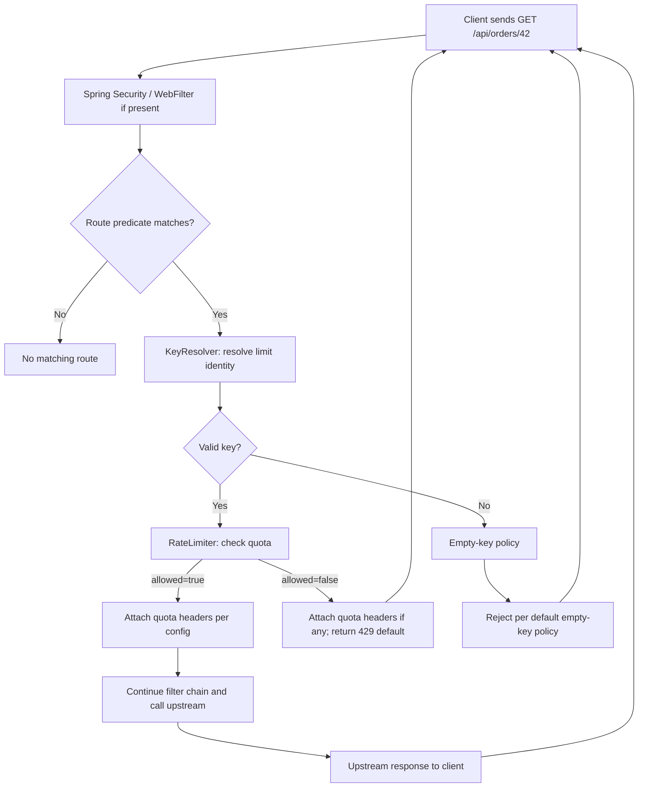
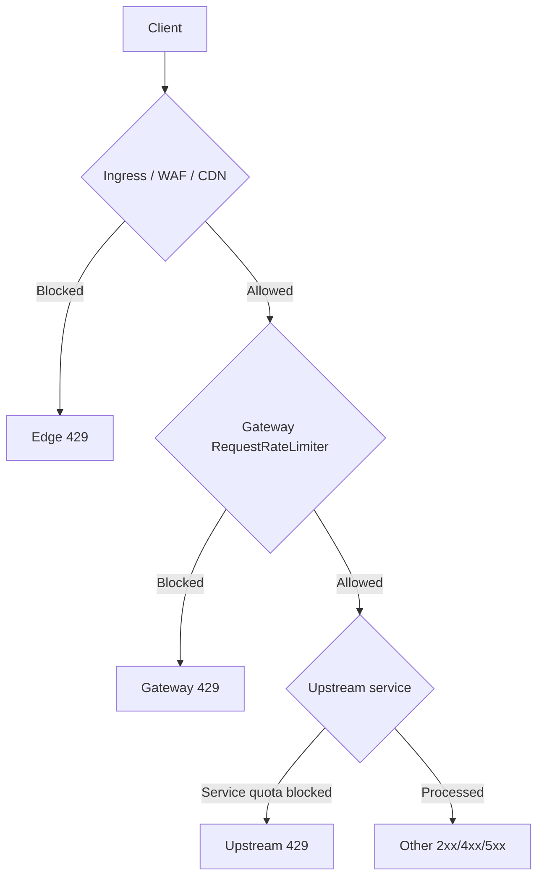

# Rate Limit Headers and Rejection Responses

## 1. Why Do Clients Need to Know They Were Rate-Limited?

In **Spring Cloud Gateway**, the API Gateway is the shared entry point for microservices: requests match via route predicates, traverse the filter chain, may undergo path/header rewrites, resolve instances via service discovery, and get forwarded to backends. Alongside authentication, TLS, retries, circuit breakers, and request observability, the Gateway typically enforces **rate limiting** to prevent one client or user group from consuming excessive resources in a short window.

For example, an order-management application lets a user send at most a set number of requests to `GET /api/orders/**` over a period. Once the allowance runs out, the Gateway must **reject in a controlled manner** instead of continuing to forward every request to `order-service`.

From the client's perspective, knowing merely that "the request failed" is not enough. Clients need to distinguish:

- **HTTP 429 Too Many Requests:** rejected because a limit was exceeded; may retry later if policy allows.
- **HTTP 401 Unauthorized:** unauthenticated or invalid token.
- **HTTP 403 Forbidden:** authenticated but lacking permission, or a dedicated policy denying requests without a rate-limit key.
- **HTTP 503 Service Unavailable:** a layer is unavailable; must not be treated as "out of quota."
- **Other HTTP 5xx:** technical or upstream errors, not necessarily related to quotas.

This lesson belongs to the **Traffic Limiting** chapter of the **SPRING_CLOUD_GATEWAY** module, focusing on **rate-limit status headers** and **responses when the Gateway rejects requests**. After this lesson, you will be able to:

1. Explain `RequestRateLimiter`, `RedisRateLimiter`, `KeyResolver`, and HTTP **429** status.
2. Read `X-RateLimit-Remaining`, `X-RateLimit-Replenish-Rate`, `X-RateLimit-Burst-Capacity`, and `X-RateLimit-Requested-Tokens` accurately.
3. Enable, disable, or rename rate-limit headers in Gateway Server WebFlux configuration.
4. Distinguish a `Retry-After` header **actually emitted by the system** from wait times guessed by the client.
5. Design a response contract and safe client 429 handling without triggering retry storms.
6. Test 429s, headers, missing-key cases, Redis errors, and interactions with security/microservices.

> **Scope:** examples use **Spring Cloud Gateway Server WebFlux** with Redis-backed `RequestRateLimiter`. Configuration namespaces are shown for newer WebFlux (`spring.cloud.gateway.server.webflux`) and common 4.x projects (`spring.cloud.gateway`). Server MVC has a different rate-limiter API and header behavior; never apply WebFlux examples mechanically to MVC.

## 2. Request Path When Exceeding Limits

`RequestRateLimiter` is a **`GatewayFilter`**. It calls the configured `RateLimiter` to ask whether a request is allowed to proceed. With the common Redis implementation, the underlying mechanism is a **token bucket**.



The crucial point is that **`RequestRateLimiter`'s rejection branch normally completes the response early**, skipping `chain.filter(exchange)` and **sending nothing upstream**.

Consequently:

- A 429 from the Gateway may carry no HTTP body or custom backend headers.
- `SetStatus`, `AddResponseHeader`, or filters ordered **after** the short-circuit point do not automatically execute.
- A Gateway 429, a backend 429, and a CDN/ingress 429 **do not necessarily share the same headers or body**.
- If Spring Security blocks the request in a `WebFilter` before Gateway routing runs, that route's `RequestRateLimiter` may never execute either.

### 2.1. Token Bucket Illustration

Suppose:

```text
replenishRate  = 2 tokens/second
burstCapacity  = 4 tokens
requestedTokens = 1 token/request
```

If the bucket is full and four requests arrive nearly simultaneously, the system can admit all four; the fifth can be rejected. Over time, tokens replenish, though **they do not "reset all at once at the top of every second"** like a fixed-window counter.

```text
Initial bucket: 4 tokens
Request 1: admitted, 3 left
Request 2: admitted, 2 left
Request 3: admitted, 1 left
Request 4: admitted, 0 left
Request 5: rejected, less than 1 token available
Tokens replenish per bucket's replenishRate
```

This is a conceptual illustration, not a live execution trace. `RedisRateLimiter` manages state per key/route, and timestamps/token counts can shift across concurrent requests.

### 2.2. Do Not Equate Tokens with Requests

When `requestedTokens=1`, one token corresponds to one request under that configuration. If `requestedTokens=5`, each request costs **5 tokens**. Hence `X-RateLimit-Remaining: 3` cannot always be read as "3 requests remaining."

## 3. HTTP 429 Too Many Requests: The Primary Rejection Signal

Spring Cloud Gateway Server WebFlux's `RequestRateLimiter` **defaults to returning HTTP 429 Too Many Requests** when the limiter denies the request.

Sample response:

```http
HTTP/1.1 429 Too Many Requests
X-RateLimit-Remaining: 0
X-RateLimit-Replenish-Rate: 2
X-RateLimit-Burst-Capacity: 4
X-RateLimit-Requested-Tokens: 1
Content-Length: 0
```

**This illustrates one `RedisRateLimiter` configuration with headers enabled**, not a guarantee that every Gateway build emits these exact four headers, in that order, with `Content-Length: 0`, or with identical values. The HTTP stack, filter chain, implementation, and intermediate infrastructure can alter responses.

### 3.1. What 429 Is — and What It Is Not

- **429** means the server or limiting layer rejected the request for sending too fast under the current policy.
- **429 is not 401**: resending the same valid token can still be rate-limited.
- **429 is not an authorization 403**: the user may have full permissions yet still be out of quota.
- **429 does not guarantee `Retry-After`**: the header is helpful, but never assume it is added automatically.
- **429 does not automatically include a JSON error body**: when the Gateway completes the response before calling upstream, the backend has no chance to write a body.
- **429 does not prove Redis behaved normally**: distinguish genuine limiter rejections from Redis error-handling policies or 429s emitted by another gateway layer.

When a route configures a non-default `status-code` or multiple defense layers interact, status codes can differ. Still, **keeping 429 for standard rate limiting** helps clients and monitoring tools interpret intent cleanly.

### 3.2. Never Automatically Retry Every 429

`429` is a signal to slow down or wait, not an instruction to retry immediately. If thousands of clients retry instantly together, the system suffers a **retry storm**: traffic surges right when overloaded.

Clients should honor `Retry-After` if the response **actually carries** a valid one, or use jittered backoff with retry budgets and deadlines. For state-mutating requests like `POST /payments`, evaluate **idempotency** before retrying.

## 4. Common `RedisRateLimiter` Headers

When using **`RedisRateLimiter`** with `include-headers` enabled, the default header names published in Spring Cloud Gateway configuration properties are:

| Header | Contents | Proper Interpretation |
| --- | --- | --- |
| `X-RateLimit-Remaining` | Remaining tokens reported by the limiter | Point-in-time estimate at check time; **does not guarantee** future requests will be admitted |
| `X-RateLimit-Replenish-Rate` | Configured `replenishRate` value | Token refill speed in config, not automatically "quota per minute" |
| `X-RateLimit-Burst-Capacity` | Configured `burstCapacity` value | Maximum bucket capacity |
| `X-RateLimit-Requested-Tokens` | Configured `requestedTokens` value | Number of tokens **this request** requires |
| `Retry-After` | Suggested wait time for client, if emitted | **Do not assume it is one of RedisRateLimiter's four default headers** |

You can view **Remaining**, **Replenish Rate**, **Burst Capacity**, and **Requested Tokens** as a metadata set useful for debugging and helping clients pace API calls.

These `X-RateLimit-*` names are **headers provided by Spring Cloud Gateway's `RedisRateLimiter` implementation**, not a mandatory HTTP standard across every proxy or framework. If upstreams emit a different header set or standardize on `RateLimit-*`, define compatibility rules and a single source of truth.

### 4.1. Analyzing an Allowed Response

Suppose a bucket has `replenishRate=2`, `burstCapacity=4`, `requestedTokens=1`, and currently 3 tokens remain:

```http
HTTP/1.1 200 OK
X-RateLimit-Remaining: 3
X-RateLimit-Replenish-Rate: 2
X-RateLimit-Burst-Capacity: 4
X-RateLimit-Requested-Tokens: 1
Content-Type: application/json

{"orderId":42,"state":"CREATED"}
```

This is a **simulated response**: status and body come from `order-service`, while quota headers are attached by Gateway's `RedisRateLimiter`. `Remaining=3` is a snapshot at decision time; if the client immediately fires 20 parallel requests, there is no guarantee any three of them will succeed.

### 4.2. Analyzing a Rejected Response

```http
HTTP/1.1 429 Too Many Requests
X-RateLimit-Remaining: 0
X-RateLimit-Replenish-Rate: 2
X-RateLimit-Burst-Capacity: 4
X-RateLimit-Requested-Tokens: 1
```

If `include-headers=false` or another `RateLimiter` implementation omits metadata, you may see only `429`. Missing-key cases may also follow a separate branch without the four quota headers.

### 4.3. Be Careful with Headers and "Time Remaining" Math

Never calculate:

```text
X-RateLimit-Remaining = 0
=> Retry-After must equal 1 second
```

Because `requestedTokens`, refill rate, actual bucket state, concurrent traffic, and multi-layer limits all influence when the next request can pass. Nor does `Remaining=0` mean a fixed "60-second window" has expired as in a fixed-window limiter.

If you want to publish a wait duration, derive it from **trustworthy limiter state/policy**, rather than slapping an arbitrary fixed number onto every 429.

## 5. Configuring HTTP Headers in Spring Cloud Gateway WebFlux

### 5.1. Newer Server WebFlux Namespace

Example configuring the Redis rate limiter and returned headers in Spring Cloud Gateway Server WebFlux using the newer prefix:

```yaml
spring:
  cloud:
    gateway:
      server:
        webflux:
          redis-rate-limiter:
            include-headers: true
            remaining-header: X-RateLimit-Remaining
            replenish-rate-header: X-RateLimit-Replenish-Rate
            burst-capacity-header: X-RateLimit-Burst-Capacity
            requested-tokens-header: X-RateLimit-Requested-Tokens
```

Explanation:

- `include-headers` defaults to **`true`** in published `RedisRateLimiter` configuration docs. Declaring it explicitly keeps policies readable.
- `*-header` properties specify **response header names**, not quota numbers.
- Default names can be customized to match an API contract, though renaming does not change limiting logic.
- These properties belong to **`RedisRateLimiter`**, not automatically to Bucket4j or custom `RateLimiter`s.
- This is an **application-wide `RedisRateLimiter` configuration group** on the Gateway, not an `HttpClient` setting, and it does not emit quota headers on endpoints that bypass `RequestRateLimiter`.

To hide quota metadata:

```yaml
spring:
  cloud:
    gateway:
      server:
        webflux:
          redis-rate-limiter:
            include-headers: false
```

When headers are disabled, **rate limiting still operates normally**. Clients still rely on the HTTP status code and API contract to detect rejections.

### 5.2. Common Namespace in WebFlux 4.x

For projects on Spring Cloud Gateway WebFlux 4.x using the older prefix:

```yaml
spring:
  cloud:
    gateway:
      redis-rate-limiter:
        include-headers: true
        remaining-header: X-RateLimit-Remaining
        replenish-rate-header: X-RateLimit-Replenish-Rate
        burst-capacity-header: X-RateLimit-Burst-Capacity
        requested-tokens-header: X-RateLimit-Requested-Tokens
```

**Sections 5.1 and 5.2 are version-specific alternatives**, not two blocks to declare together. Before concluding headers are broken, confirm your Gateway version actually bound the matching namespace; an ignored property leaves default names in place or omits expected headers.

### 5.3. Controlled Header Renaming Example

An API contract might require custom header names:

```yaml
# Place under redis-rate-limiter in the appropriate namespace:
include-headers: true
remaining-header: X-Quota-Remaining
replenish-rate-header: X-Quota-Refill-Rate
burst-capacity-header: X-Quota-Burst
requested-tokens-header: X-Quota-Request-Cost
```

These names apply only to responses receiving headers from `RedisRateLimiter`. When renaming, update API docs, SDKs, dashboards, tests, and CDN/CORS policies; avoid emitting two conflicting sets of rate-limit headers on the same response.

**CORS:** for cross-origin JavaScript, having `X-RateLimit-Remaining` on the wire does not mean frontend code can read it via `fetch().headers`. Expose the desired headers via `Access-Control-Expose-Headers` alongside a valid CORS policy that protects tokens/cookies.

## 6. Complete Route Example: RequestRateLimiter + KeyResolver + Redis

### 6.1. Dependencies and Infrastructure

To use `RedisRateLimiter` in Gateway Server WebFlux, the project needs:

- **Spring Cloud Gateway Server WebFlux** starter matching your release train.
- `spring-boot-starter-data-redis-reactive` dependency.
- A reachable Redis server/cluster with environment-appropriate connection settings.
- A `KeyResolver` partitioning quotas by trusted principal/user/client.
- Spring Security policies when quotas rely on authenticated users.

This lesson's goal is **observing response headers and 429s**. The example below uses `/api/orders/**` with `replenishRate=2`, `burstCapacity=4`, `requestedTokens=1`.

### 6.2. Java: Deriving the Key from Authenticated Principal

```java
package example.gateway;

import java.security.Principal;
import org.springframework.cloud.gateway.filter.ratelimit.KeyResolver;
import org.springframework.context.annotation.Bean;
import org.springframework.context.annotation.Configuration;

@Configuration
public class RateLimitKeyConfig {

    @Bean
    KeyResolver principalKeyResolver() {
        return exchange -> exchange.getPrincipal()
                .map(Principal::getName);
    }
}
```

`exchange.getPrincipal()` returns a `Mono`; when a principal exists, its name becomes the key. When absent, the publisher is normally empty and `RequestRateLimiter` applies the **empty-key** policy.

**Critical prerequisite:** when keying by user, configure **Spring Security** to genuinely authenticate requests before using the principal as a key. Never take keys from unverified client-supplied `?user=alice`, `X-User-Id`, or `X-API-Key`: attackers can rotate keys to evade quotas or exhaust another user's budget.

A multi-tenant system may need keys combining verified tenant ID + user ID. Avoid putting emails, tokens, or unnecessary identifiers into Redis keys, access logs, or metric labels.

### 6.3. Newer Server WebFlux Route YAML

```yaml
spring:
  data:
    redis:
      host: localhost
      port: 6379

  cloud:
    gateway:
      server:
        webflux:
          routes:
            - id: orders-api
              uri: http://localhost:8081
              predicates:
                - Path=/api/orders/**
              filters:
                - name: RequestRateLimiter
                  args:
                    key-resolver: "#{@principalKeyResolver}"
                    redis-rate-limiter.replenishRate: 2
                    redis-rate-limiter.burstCapacity: 4
                    redis-rate-limiter.requestedTokens: 1
                - StripPrefix=1

          redis-rate-limiter:
            include-headers: true
```

With this configuration:

1. `Path=/api/orders/**` selects route `orders-api`.
2. `RequestRateLimiter` resolves the key via the `principalKeyResolver` bean.
3. The bucket holds at most **4 tokens**, replenishes at **2 tokens/second**, and each request spends **1 token**.
4. When allowed, `StripPrefix=1` turns `/api/orders/42` into `/orders/42` and the Gateway calls the backend.
5. When denied by the limiter, the default response is **429**, without calling the backend.
6. `include-headers: true` instructs `RedisRateLimiter` to emit configured metadata headers.

`localhost` for Redis/upstream is a **local test address when processes share one host**. In Kubernetes/Docker, `localhost` inside the Gateway container does not point to Redis or services in other containers; use proper service DNS, secrets, and environment configs.

### 6.4. WebFlux 4.x Route YAML

An equivalent configuration using the WebFlux 4.x prefix:

```yaml
spring:
  cloud:
    gateway:
      routes:
        - id: orders-api
          uri: http://localhost:8081
          predicates:
            - Path=/api/orders/**
          filters:
            - name: RequestRateLimiter
              args:
                key-resolver: "#{@principalKeyResolver}"
                redis-rate-limiter.replenishRate: 2
                redis-rate-limiter.burstCapacity: 4
                redis-rate-limiter.requestedTokens: 1
            - StripPrefix=1

      redis-rate-limiter:
        include-headers: true
```

Keep the `spring.data.redis.*` connection settings from the prior example in a real app, or supply deployment-provided Redis config. These snippets are **version variants**, not blocks to copy both at once.

### 6.5. Avoid Invalid Shortcut Notation

`RequestRateLimiter` **cannot** be configured via shortcut notation like:

```yaml
# INVALID: do not use for RequestRateLimiter.
filters:
  - RequestRateLimiter=2, 4, 1
```

Use `name: RequestRateLimiter` with `args` as in the official examples. The bean name `principalKeyResolver` in SpEL must match the registered `@Bean`.

## 7. When a Key Is Missing: Never Confuse 403 with 429

An important edge case: a route has `RequestRateLimiter`, yet `KeyResolver` returns no key.

Per Spring Cloud Gateway WebFlux docs, **requests without a key are rejected by default**, typically with **403 Forbidden** under the default empty-key policy—**not necessarily 429**.

Example:

```text
GET /api/orders/42
Authorization: (missing)
KeyResolver: no principal
Result: may be blocked with 401 by Security first,
        or rejected by RequestRateLimiter empty-key policy.
```

Because `SecurityWebFilterChain` can inspect requests before Gateway routing, an anonymous request may get **401** before reaching `KeyResolver`. When writing tests, identify **which layer emitted the status**.

Empty-key settings across many versions include:

- `deny-empty-key`: whether to reject requests when no key resolves.
- `empty-key-status-code`: status code returned on missing keys.
- `statusCode`/`status-code` on `RequestRateLimiter`: status when the limiter **evaluates and denies quota**, defaulting to 429.

> **Version caveat:** property namespaces on `RequestRateLimiterGatewayFilterFactory` shifted across releases. Some doc pages show the older `spring.cloud.gateway.filter.request-rate-limiter.*` prefix even when routes live under `spring.cloud.gateway.server.webflux`. Inspect the **configuration properties and code of your exact running version** before configuring, rather than copying an old prefix and assuming the policy changed.

**Security recommendation:** never set `deny-empty-key=false` just to "make the site work." Doing so lets keyless requests **skip quotas** and disables limits for anonymous callers. If an endpoint is public, pick a trustworthy alternative key and dedicated limit, such as a trusted-proxy-verified IP or a verified API key.

## 8. `Retry-After`: Never Assume the Gateway Added It

The HTTP `Retry-After` header tells clients **how long to wait** before retrying. Common formats:

```http
HTTP/1.1 429 Too Many Requests
Retry-After: 5
```

Meaning: the server **suggests** waiting at least 5 seconds (delta-seconds) before trying again. Another format is an HTTP-date:

```http
Retry-After: Wed, 25 Nov 2026 08:00:00 GMT
```

**Never assert that `RedisRateLimiter` emits `Retry-After` by default** just because it returns 429. Official `RedisRateLimiter` properties document the four `X-RateLimit-*` headers and `include-headers`, not a retry duration. If your product requires `Retry-After`, verify your version or implement an **accurate extension mechanism**, and test real responses.

### 8.1. Computing Wait Time Is Not Just Reading Remaining

Consider a bucket with:

```text
replenishRate   = 2 tokens/second
requestedTokens = 5 tokens/request
Remaining       = 0 tokens
```

One request needs 5 tokens, not 1. Waiting **one second** is still not enough. When a retry can succeed also depends on concurrent traffic, multi-layer quotas, Redis/script granularity, and token math.

`Retry-After` should be a **best-effort recommendation** derived from known limiter state, rounded and bounded sensibly. It **does not promise** the next attempt will succeed if other clients are also spending quota.

### 8.2. Where to Extend If You Need `Retry-After` or an Error Body

Appropriate design options:

1. **A custom/decorated `RateLimiter`** returning metadata including a `Retry-After` header computed accurately from the algorithm for that decision; verify how `RequestRateLimiter` copies `RateLimiter.Response.getHeaders()` onto the response in your version.
2. **An intentional `GatewayFilter`/`GlobalFilter`**, registering a response hook before commit; it needs real limiter info and proper ordering. Filters ordered after the short-circuit point may **never run**.
3. **A centralized error response writer** scoped specifically to rate-limit rejections without conflating them with upstream 429s. Maintain proper status, headers, response lifecycle, and backpressure.

**Do not** place `AddResponseHeader=Retry-After,1` after `RequestRateLimiter` expecting it to run when rejected. Nor should you slap a fixed `Retry-After` onto every endpoint when it does not match the algorithm or quota.

If using `throwOnLimit` in versions supporting it, behavior shifts from **setting status directly** to **throwing an exception** for another handler. That alters reactive flow and error handling; test end-to-end rather than treating it as an automatic JSON-429 or `Retry-After` switch.

## 9. 429 Response Contract for Public APIs

Products often want clients to receive a clear status, limit metadata, and readable message. You can define an explicit **API contract**:

```http
HTTP/1.1 429 Too Many Requests
Content-Type: application/problem+json
Retry-After: 5
X-RateLimit-Remaining: 0
Cache-Control: no-store

{
  "type": "https://api.example.test/problems/rate-limit-exceeded",
  "title": "API rate limit exceeded",
  "status": 429,
  "detail": "Please try again later."
}
```

This is an **illustrative designed response**, **not a default body produced by `RequestRateLimiter`**. To produce it, the app must implement a writer/handler for the rejection path or extend the limiter. Only emit `Retry-After` when the system computes a meaningful value.

A practical contract should answer:

| Question | Design Decision |
| --- | --- |
| Return a body on 429? | Either JSON Problem Details or empty body; stay consistent with SDKs |
| Which headers are required? | 429 is the primary signal; document quota headers explicitly |
| Include `Retry-After`? | Only when accurately computed/emitted |
| Who is keyed by the limit? | Authenticated user/tenant/client, or trusted-proxy IP per policy |
| Could keys leak in responses? | Never return raw tokens, Redis keys, PII, or internal IDs |
| Difference between Gateway 429 and upstream 429? | If distinct, identify source and define interaction |
| Is 429 cacheable? | Usually apply strict no-cache rules; never let a CDN serve one user's 429 to another |
| Logging/auditing? | Log route ID, status, policy ID, and sanitized key class—never secrets |

### 9.1. Why Can a Default 429 Have No Body?

On the `allowed=false` branch, `RequestRateLimiter` can set the HTTP status and **complete the response immediately**. Upstream has not been called, so the backend service has no opportunity to produce JSON.

Therefore, editing error handlers **in the backend** does not change 429s generated by the Gateway. Implement the contract at the layer generating the rejection, or in an outer wrapper that safely observes/mutates the response before commit.

### 9.2. Distinguishing 429s from Different Layers



Maintain a consistent **client-facing contract** where feasible, though not every layer supports identical headers. When debugging, pinpoint which layer returned 429 using route metrics, proxy logs, and upstream request counters; avoid letting clients depend on unstable internal headers.

## 10. How Should Clients Handle 429?

### 10.1. Core Rules

Upon receiving 429, clients should:

1. Check whether the request is **eligible for retry** based on business semantics and idempotency.
2. If a valid `Retry-After` is present, wait until the delta-seconds or HTTP-date elapses.
3. Otherwise, use **exponential backoff with jitter**, bounded by a max delay and total retry budget.
4. Cap concurrent requests instead of queuing infinitely inside the client app.
5. Never rotate IPs/users/tokens to evade quotas; that violates API policy.
6. Once retry budget is exhausted, surface a clear message to the user rather than retrying forever.
7. Avoid thousands of clients waking up at the exact second `Retry-After` expires; jitter still helps.

**Illustrative** strategy (not a mandatory algorithm):

```text
Attempt 1: HTTP 429, no Retry-After
Delay = random(0, 500 ms)
Attempt 2: HTTP 429
Delay = random(0, 1000 ms)
Attempt 3: HTTP 429
Delay = random(0, 2000 ms)
Attempt 4: stop and notify user

Overall budget / timeout must still be enforced.
```

Never code clients to blindly retry `POST /payments` or `POST /orders`. For operations with side effects, require an **idempotency key** or transaction status check before retrying.

### 10.2. Do Quota Headers Let Clients "Know for Sure" How Many Requests Remain?

No. When multiple clients share an account, requests hit multiple Gateway replicas updating the bucket in Redis concurrently. `X-RateLimit-Remaining` is evaluated at one point in time, **not a reservation for the next request**.

Clients may use it to display usage or pace requests, but whenever a 429 arrives, the **status code** and server policy remain authoritative.

### 10.3. CORS with Frontends

If a web app at `https://app.example.test` calls an API at `https://api.example.test`, `X-RateLimit-*` headers may appear in the browser Network tab yet remain unreadable to JavaScript without:

```http
Access-Control-Expose-Headers: X-RateLimit-Remaining, X-RateLimit-Replenish-Rate, X-RateLimit-Burst-Capacity, X-RateLimit-Requested-Tokens, Retry-After
```

This is an **example CORS policy response header**, not something `RequestRateLimiter` adds automatically. With browser credentials, set an explicit `Access-Control-Allow-Origin` and `Access-Control-Allow-Credentials`; never use `*` arbitrarily.

Browsers enforce CORS; **`curl` does not**. Testing rate limits with curl shows raw HTTP responses, while DevTools confirms whether the frontend can actually read quota headers.

## 11. Key Security and Ordering with Other Filters

### 11.1. KeyResolver Must Use Verified Sources

Options:

| Key | When Appropriate | Risks to Avoid |
| --- | --- | --- |
| Authenticated principal name | Login / Resource Server APIs | Principal absent on anonymous endpoints |
| Tenant ID + user ID from authenticated principal | Multi-tenant quotas | Tenant must be verified, never taken from a client header |
| Verified API key | Public developer APIs | Never store raw API keys in logs or Redis keys unnecessarily |
| Real IP behind trusted proxies | Anonymous APIs | NAT shared IPs, IPv6 rotation, `X-Forwarded-For` spoofing |
| Client-supplied `?user=` query param | Almost never in production | Trivial to change values and evade quotas |

For IPs, **never** take the first entry in `X-Forwarded-For` as truth unless the ingress strips/overwrites incoming internet headers. Configure a proper trusted proxy chain, IPv4/IPv6 handling, and network edge controls.

### 11.2. Rate Limiting and Authentication Are Separate Mechanisms

`RequestRateLimiter` does not verify JWTs or opaque tokens. A `KeyResolver` calling `Principal::getName` is meaningful only after `SecurityWebFilterChain` authenticates the request.

If Security rejects a revoked token with 401, the route's `RequestRateLimiter` may **not run** and will not add `X-RateLimit-Remaining`. Never conclude "quota headers disappeared due to a bug" when the request was blocked by another layer.

For anonymous APIs needing pre-auth abuse protection, combine WAF/ingress rate limits by trusted IP with a separate limiter on auth attempts. Avoid expecting one quota to replace every defense.

### 11.3. Filter Order and Short-Circuiting

```text
Gateway routes request:
  -> RequestRateLimiter
     allowed: true  -> StripPrefix / headers / lb:// / upstream
     allowed: false -> status 429 / complete response
```

If you put a custom `AddResponseHeader` filter **after** `RequestRateLimiter`, rejected requests will never reach it. To attach metadata on rejections, place logic **around the denied path** or inject metadata via `RateLimiter.Response` per API before the response commits.

In Gateway Server WebFlux, `GlobalFilter`s and route `GatewayFilter`s share the ordered filter chain; a Spring Security `WebFilter` lives in an outer layer and does not share the same order space directly. Tweaking Gateway filter orders will not modify 401/403 responses emitted earlier by Security.

### 11.4. Interactions with Retries and Circuit Breakers

If upstream errors after the Gateway admits quota, tokens have already been deducted. Gateway retry/circuit-breaker configs can issue multiple upstream calls for one client request; **deducted tokens do not automatically equal backend HTTP attempts**. It depends on filter ordering, retry resubscription behavior, and limiter placement.

With **client-side** retries after 429, each retry is checked against the quota again and may keep getting blocked. Never build retry logic assuming a 429 refunds tokens or resets counters.

## 12. Testing 429s and Response Headers with curl

### 12.1. Environment Setup

Assumptions:

- Gateway runs at `http://localhost:8080`.
- Demo backend runs at `http://localhost:8081`, serving `GET /orders/42`.
- Reactive Redis is reachable and `RedisRateLimiter` is initialized.
- Route `orders-api` uses `replenishRate=2`, `burstCapacity=4`, `requestedTokens=1`.
- Test requests are **permitted by Spring Security** and `principalKeyResolver` emits a stable key.

If you run the Gateway with a principal-based `KeyResolver` **without auth configured**, requests may get rejected for an **empty key** before quota checks. In that case, 403 **does not prove** `RedisRateLimiter` ran out of tokens. Use mock Security/test principals or a local-only test `KeyResolver`; never ship a shared static key to production.

### 12.2. Sending Multiple Rapid Requests

```bash
curl -i http://localhost:8080/api/orders/42
curl -i http://localhost:8080/api/orders/42
curl -i http://localhost:8080/api/orders/42
curl -i http://localhost:8080/api/orders/42
curl -i http://localhost:8080/api/orders/42
curl -i http://localhost:8080/api/orders/42
```

These commands are **illustrative only**. With authentication active, pass **test** credentials or use a test client injecting an appropriate principal. Never share real access tokens in shell histories or screenshots.

Because `RedisRateLimiter` refills tokens over time, running commands slowly may **not** trigger 429. For deterministic reproduction, use an integration test sending a rapid burst with the same key, verify starting Redis state/timing, and never overload external services.

### 12.3. Inspecting Status and Headers

Example using curl locally to print headers and status only:

```bash
curl -sS -D - -o /dev/null \
  -w "HTTP status: %{http_code}\n" \
  http://localhost:8080/api/orders/42
```

Analysis:

- On 2xx: check `X-RateLimit-Remaining` and bucket parameters.
- On 429: inspect whether all four `X-RateLimit-*` headers appear, whether `Retry-After` exists, and whether the body is empty or custom-written.
- On 401/403: check Security and empty-key policies before assuming quota issues.
- On 5xx: check Redis/discovery/network/upstream; never treat all 5xxs as rate limiting.
- If headers are missing: verify `RedisRateLimiter` implementation, `include-headers`, route match, property namespace, and filter order.

To confirm a request stopped at the Gateway, verify **upstream logs/request counters do not increment** on the 429 call. If upstream also runs a limiter, it can return its own 429 that the Gateway simply proxies.

### 12.4. Test Scenario Table

| Case | Setup | Verification Expectation |
| --- | --- | --- |
| T1 | Valid key, bucket has tokens | Request reaches upstream; quota metadata may appear |
| T2 | Valid key, burst exceeds bucket | Gateway returns default 429; upstream is not called |
| T3 | No key and Security lets it through | Empty-key policy may return 403, distinct from 429 |
| T4 | Security missing/invalid Bearer token | Likely 401 before Gateway filters |
| T5 | `include-headers=false` | Limiting still works; Redis headers disappear |
| T6 | Rename `remaining-header` | Response uses the new header name per config binding |
| T7 | `requestedTokens=2` | Remaining counts tokens, not requests |
| T8 | Client sends 20 parallel requests for same user | Remaining is not guaranteed to decrement sequentially in client logs |
| T9 | Redis unavailable | Observe failure policy of your exact implementation/version |
| T10 | Backend returns its own 429 | Distinguish source and emitted header sets |
| T11 | Wait briefly then resend | Bucket refills tokens per `replenishRate` |
| T12 | Cross-origin frontend | Check `Access-Control-Expose-Headers` |
| T13 | Multiple Gateway replicas sharing Redis | Verify same key/route shares quota |
| T14 | `Retry-After` absent | Client applies SDK backoff policy; not treated as a mandatory bug |

**Never use real user IPs or real tokens in test reports.** Keep Redis test state in isolated test keys/namespaces so production data stays clean.

## 13. When Redis Fails: Detect It, Do Not Mislabel as 429

`RedisRateLimiter` relies on Redis and Lua script / token bucket state. On Redis timeouts, broken connections, or restricted Redis permissions, applications can behave differently depending on version, policy, and custom `RateLimiter` logic.

Never assume:

- "Redis error always makes the Gateway return 429."
- "Redis error always makes the Gateway allow everything through."
- "Every 429 means the user exhausted their quota."

Your design must **explicitly define** fail-open vs. fail-closed based on risk:

| Policy | Benefit | Risk |
| --- | --- | --- |
| **Fail closed** when quota cannot be verified | Blocks abuse when the limiter backend fails | Can disrupt legitimate API traffic |
| **Controlled fail open** | Preserves availability during Redis outage | Loses rate enforcement and risks overload |
| **Local fallback quota** | Provides temporary protection | Quotas may diverge across Gateway replicas |
| **Supplementary ingress/WAF limit** | Protects the edge when Gateway limiter fails | Different keys, precision, and policy |

Never treat `Retry-After: 1` as a "fix" for an extended Redis outage. Emit dedicated metrics for errors, Redis latency, response statuses, health, and policy-level allow/deny counts.

A 429 response showing "remaining 0" metadata is still **insufficient** to tell real quota exhaustion apart from limiter errors if an implementation maps both to the same output. Observability must inspect **Redis health, limiter logs/metrics, and network layers**.

## 14. Common Pitfalls

| Symptom | Possible Cause | Fix |
| --- | --- | --- |
| HTTP 429 lacks `Retry-After` | Gateway does not necessarily emit this header by default | Rely on it only if present; implement accurate retry metadata when required |
| `X-RateLimit-Remaining` missing | Route lacks limiter, `include-headers=false`, or wrong implementation/namespace | Check route/filters, configprops, and which layer answered |
| Remaining header says 3, yet next request gets 429 | Concurrent requests, token cost > 1, or shared key across clients | Treat Remaining as a snapshot, not a guarantee |
| Seeing 403 instead of 429 | Empty `KeyResolver` or missing permissions | Inspect Security 401/403 and empty-key policy |
| Keying off `?user=` query param | Clients alter identity/quota at will | Use verified principal, API key, or trusted IP |
| Redis timeouts break many requests | Limiter dependency unhealthy | Define fail-open/closed, Redis HA, alerts, and timeouts |
| Rate limit works on one replica but differs on others | Separate Redis, differing route ID/key, local limiter, or config drift | Align configs/policies and shared Redis |
| Client gets 200 yet web JS cannot read `X-RateLimit` | Missing `Access-Control-Expose-Headers` | Update CORS policy |
| Backend 429 JSON body differs from Gateway 429 | Gateway short-circuits before calling backend | Standardize error contract at the layer emitting the response |
| Custom header filter after limiter misses 429 | Downstream filters skip when `RequestRateLimiter` rejects | Put metadata in `RateLimiter.Response` or hook before commit |
| `AddResponseHeader=Retry-After,1` still missing on 429 | Short-circuit occurs before `AddResponseHeader` | Build custom response in the proper phase |
| Only seeing 429s from CDN | Edge blocks before requests reach Gateway | Check CDN/WAF/ingress metrics and policies |
| Six sequential requests never hit 429 | Bucket refills between calls | Send bursts rapidly enough and control timing |
| `RequestRateLimiter=2,4` fails to work | Shortcut notation unsupported | Use `name`/`args` format |
| Infinite 429 retries | Client lacks retry/backoff caps | Cap attempts and duration; add jitter and idempotency |
| Wrong user rate-limited via spoofed `X-Forwarded-For` | Trusting client-controlled proxy headers | Configure trusted proxies and IP policies |
| Changing 429 to 200 to "hide errors" | Tricks clients into thinking requests succeeded | Keep proper HTTP semantics; document 429s |

## 15. Practice Exercise: Designing a 429 Response Contract for `order-service`

**Context:** Gateway exposes `/api/orders/**`, backed via `lb://ORDER-SERVICE`, with Spring Security validating Bearer tokens and `RedisRateLimiter` limiting per principal.

Requirements:

1. Choose `replenishRate=5`, `burstCapacity=10`, `requestedTokens=1`.
2. Emit the four `X-RateLimit-*` headers using default Gateway WebFlux names and confirm they appear via `RedisRateLimiter`.
3. Keep **HTTP 429** when quota is denied; do not map it to backend 500 errors.
4. Prevent rejected requests from passing through `StripPrefix`/LoadBalancer/HTTP client to `order-service`.
5. Design the SDK to read `Retry-After` **only when present**, falling back to exponential backoff + jitter.
6. Define an `application/problem+json` error body if the API contract requires it, without assuming built-in `RequestRateLimiter` generates it automatically.
7. Ensure `KeyResolver` uses the authenticated principal; keyless requests must never silently bypass quotas.
8. Test multiple Gateway replicas with shared Redis; note that `Remaining` makes no guarantee for future requests.
9. Simulate Redis failures and confirm your system's **actual** fail-open/fail-closed behavior.
10. Emit metrics by route, status, policy, and limiter outcome without logging tokens or unnecessary identifying details.

Example route for **newer Gateway Server WebFlux**:

```yaml
spring:
  cloud:
    gateway:
      server:
        webflux:
          routes:
            - id: orders-api
              uri: lb://ORDER-SERVICE
              predicates:
                - Path=/api/orders/**
              filters:
                - name: RequestRateLimiter
                  args:
                    key-resolver: "#{@principalKeyResolver}"
                    redis-rate-limiter.replenishRate: 5
                    redis-rate-limiter.burstCapacity: 10
                    redis-rate-limiter.requestedTokens: 1
                - StripPrefix=1
          redis-rate-limiter:
            include-headers: true
```

In an integration test, substitute test dependencies for Redis/upstream and verify:

```text
given: valid token/principal, bucket has tokens
when:  GET /api/orders/42
then:  Gateway forwards /orders/42 upstream
       client receives response and X-RateLimit-* if limiter emits metadata

given: valid token/principal, bucket empty
when:  GET /api/orders/42
then:  Gateway returns 429
       upstream request count does not increase
       response is not required to carry Retry-After or JSON body

given: principal absent
when:  GET /api/orders/42
then:  Security or empty-key policy rejects as designed
       limiter is not silently bypassed
```

### Checklist Before Enabling Rate-Limit Headers in Production

- [ ] Identified the **rate-limit owner**: Gateway, ingress, WAF, upstream, or multiple layers.
- [ ] HTTP 429 has clear semantics, never disguised as fake 200 or unnecessary 500.
- [ ] If using `RedisRateLimiter`, verified `include-headers` and the four default header names.
- [ ] Distinguished **tokens remaining** from **requests remaining** when `requestedTokens` != 1.
- [ ] Never assumed `Retry-After` is built in without observing it in a live run.
- [ ] `KeyResolver` relies on **verified** principal/API key/IP.
- [ ] Distinguished HTTP 401/403 from Security, empty-key policy, and 429 from quota.
- [ ] Verified 429 short-circuits without calling backends.
- [ ] Did not rely on `AddResponseHeader` ordered after the limiter to modify 429s.
- [ ] Aligned caching rules, CORS Expose-Headers, and error body format with SDKs.
- [ ] Enforced retry budgets/backoff/jitter and avoided retrying non-idempotent POSTs.
- [ ] Monitored Redis health/errors, route IDs, request statuses, and multi-replica limits.
- [ ] Secured Redis and avoided logging tokens, cookies, private keys, or PII in metrics.
- [ ] Tested at both ingress/CDN and Gateway to avoid misattributing error layers.
- [ ] Verified configuration properties and implementation against your exact Gateway version.

## 16. Summary and References

In **Spring Cloud Gateway Server WebFlux**, `RequestRateLimiter` asks a `RateLimiter` whether a request may proceed. When a Redis-backed limiter denies quota, the Gateway **typically returns HTTP 429 Too Many Requests** and completes the response before calling the microservice. The **HTTP status** is the primary signal; `RedisRateLimiter` can additionally emit `X-RateLimit-Remaining`, `X-RateLimit-Replenish-Rate`, `X-RateLimit-Burst-Capacity`, and `X-RateLimit-Requested-Tokens` per configuration.

**Quota headers describe state at evaluation time and do not guarantee the next request will be admitted.** `Retry-After` is helpful when deliberately computed and emitted by policy, not guaranteed by default; JSON error bodies likewise require an explicit response-writing mechanism if the API demands them.

Ultimately, traffic limiting is only one layer in the Gateway: `KeyResolver` must rely on trustworthy identity, **Spring Security** handles authentication/authorization, LoadBalancer routes to backends, circuit breakers/retries handle faults safely, TLS protects transport, and observability answers **who blocked the request, why, and when**. Combining these layers properly avoids both overloading microservices and returning confusing responses to clients.

### References

- [Spring Cloud Gateway Server WebFlux — RequestRateLimiter GatewayFilter Factory](https://docs.spring.io/spring-cloud-gateway/reference/spring-cloud-gateway-server-webflux/gatewayfilter-factories/requestratelimiter-factory.html).
- [Spring Cloud Gateway — Configuration Properties: RedisRateLimiter headers](https://docs.spring.io/spring-cloud-gateway/reference/configprops.html).
- [Spring Cloud Gateway WebFlux 4.1 — Configuration Properties](https://docs.spring.io/spring-cloud-gateway/reference/4.1/configprops.html).
- [RFC 9110 — Retry-After HTTP field](https://www.rfc-editor.org/rfc/rfc9110.html#section-10.2.3).
- [RFC 6585 — HTTP 429 Too Many Requests](https://www.rfc-editor.org/rfc/rfc6585.html#section-4).
