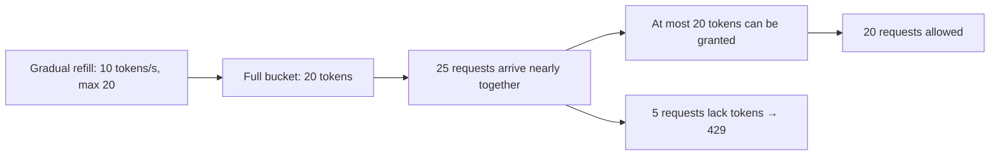
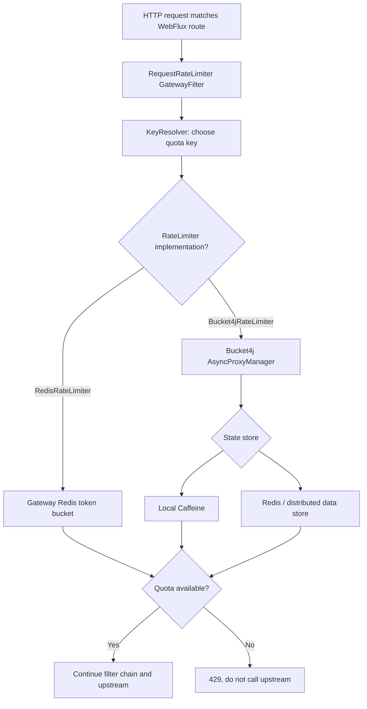
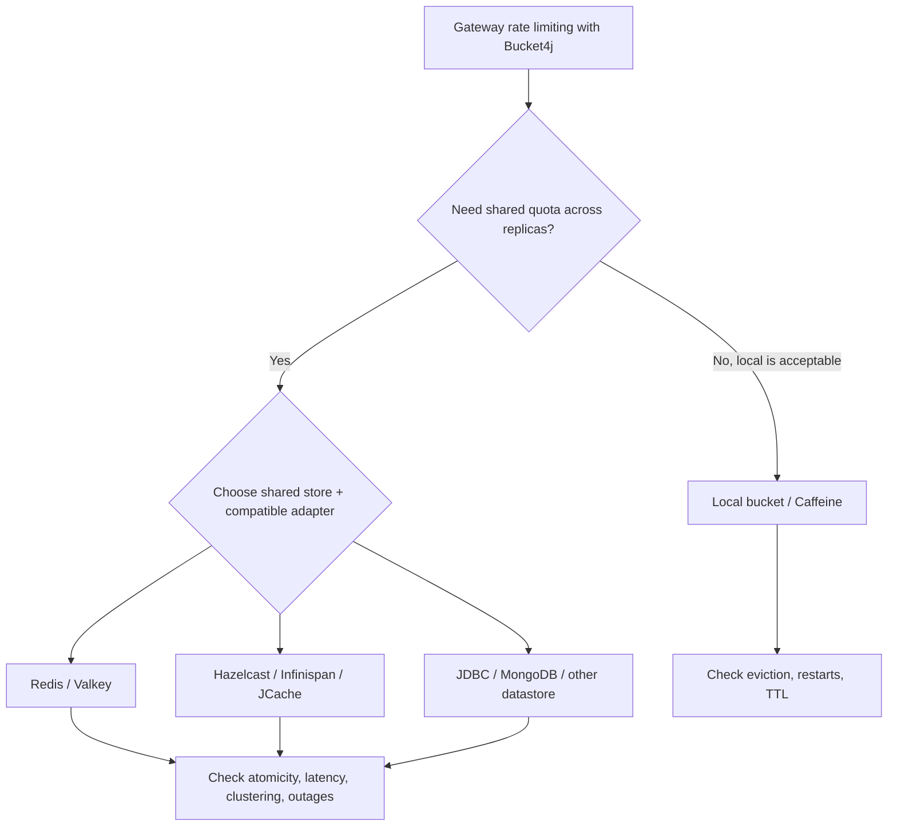
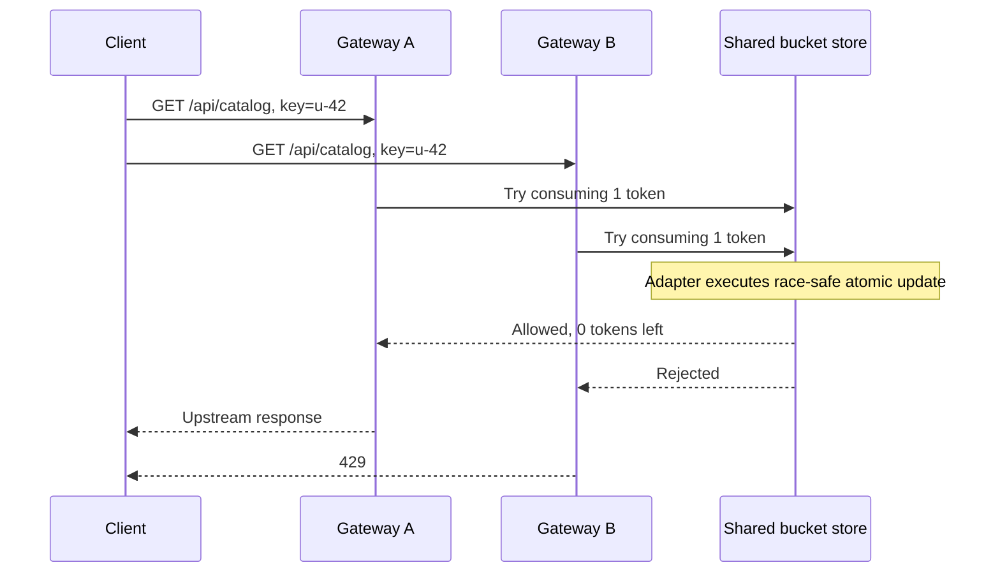

# Bucket4j and Choosing State Stores by Gateway Variant and Supported Version in Spring Cloud Gateway

In an API Gateway for microservices, request rate limiting is only meaningful when the system knows **who owns the request**, **how much budget each request consumes**, and **where quota state is shared**. For instance, a customer is allowed up to 60 requests/minute; if the Gateway runs three replicas and each keeps its own local counter, the customer can accidentally receive far more than the published contract.

**Bucket4j** is a Java library implementing the *token bucket* algorithm to manage per-key quotas. It supports both local in-memory buckets and integrations with distributed state stores. In **Spring Cloud Gateway**, using Bucket4j depends on the **Gateway variant** (**Server WebFlux** vs. **Server MVC**), the **version**, and the **state store** configured. You cannot assume that simply adding a Bucket4j dependency makes the Gateway automatically rate-limit all routes.

This lesson belongs to the **Traffic Limiting** chapter of the `SPRING_CLOUD_GATEWAY` module. It helps select a rate-limiting solution in a system using route predicates, filter chains, path/header transformations, service discovery, and load balancing—while integrating authentication/authorization, retries, circuit breakers, TLS, and request observability to operate the entry point safely.

**Questions to resolve:**

1. How do Bucket4j and the token bucket work?
2. How does configuring Bucket4j via `RequestRateLimiter` in **Server WebFlux** differ from **Server MVC**'s Bucket4j-based `RateLimiter` filter?
3. Why is **in-memory Caffeine** suited for testing, yet fails to enforce a cluster-wide quota across multiple Gateway replicas?
4. How do you choose between **Redis, Hazelcast, JCache, a database, or another store** based on consistency, performance, and API support?
5. How do you test 429s, empty keys, Redis/store outages, rolling updates, and security risks?

> **Scope and versions:** The module focuses on **Spring Cloud Gateway Server WebFlux**. Official docs for the **4.3.5** and **5.1.0** lines describe the Bucket4j `RateLimiter` inside WebFlux's `RequestRateLimiter`; **Server MVC** docs describe the separate `Bucket4jFilterFunctions.rateLimit` API. Never copy MVC Java DSL into a WebFlux application. Older branches or third-party starters may differ, so always verify against the exact documentation for your running version.

## 1. What Problem Does Bucket4j Solve?

Suppose an e-commerce platform exposes:

- `GET /api/catalog/**`: catalog reads, tolerant of high traffic.
- `POST /api/orders`: order creation, hits database transactions.
- `POST /api/payments`: payment processing, requiring strict authentication, idempotency, and tighter limits.
- `GET /api/reports/**`: CPU-heavy queries or report generation.

Not every API needs the same quota. Operations might set 20 requests/second for catalog per user and 2 requests/second for order creation, while allowing brief bursts.

Bucket4j expresses **tokens permitted over time**, while the Gateway decides **which routes enforce quotas, where keys come from, and what HTTP responses are returned**.

### 1.1. Rate Limiting vs. Timeouts, Retries, and Circuit Breakers

| Mechanism | What Does It Decide? | When to Use? |
| --- | --- | --- |
| **Rate limiting** | Does this request still have quota or get rejected? | Resource protection, fair traffic allocation. |
| **Concurrency limiting** | How many requests are executing simultaneously? | Protecting workers/threads, connection pools, slow tasks. |
| **Timeout** | Should we stop waiting on an overly slow operation? | Avoiding unbounded resource holding. |
| **Circuit breaker** | Is the backend failing badly enough to temporarily trip calls? | Reducing impact when an upstream degrades. |
| **Retry** | Can a failed call be retried? | Improving resilience under safe policies. |
| **Request size limit** | Does a request body exceed allowed bytes? | Protecting memory, uploads, and network bandwidth. |

Rate limiting cannot fix an `lb://order-service` lacking instances; raising quotas only sends more requests toward 503 errors. Likewise, an open circuit breaker does not automatically refill a user's quota.

## 2. Token Bucket: Capacity, Refill, and Cost per Request

Picture each user having a bucket holding tokens:

- **Capacity:** maximum number of tokens the bucket can hold.
- **Refill:** rule for adding tokens over time.
- **Requested tokens:** number of tokens deducted per request.
- **Consume decision:** if enough tokens remain, allow the request through; otherwise reject, typically with HTTP 429.

For example, capacity = 20, refill = 10 tokens/second, each request costs 1 token.



If a bucket is full and 25 requests arrive tightly together, roughly the first 20 can pass and the rest are rejected, assuming negligible refill occurs in between. In live systems, concurrency, clocks, state-store latency, and refill style affect exact ordering.

### 2.1. Mental Formula

With steady (*greedy*) refill, the conceptual model can be written as:

```text
tokensAvailable =
    min(capacity, previousTokens + refillRate * elapsedSeconds)

if tokensAvailable >= requestedTokens:
    allow = true
    tokensAfter = tokensAvailable - requestedTokens
else:
    allow = false
    tokensAfter = tokensAvailable
```

This is not Bucket4j's literal internal code. Other refill styles alter how tokens are distributed over time—for instance, refilling in a batch once a full period elapses or aligning to fixed wall-clock boundaries.

### 2.2. Capacity Does Not Equal Per-Second Rate

| Sample Config | Interpretation |
| --- | --- |
| Capacity 20; refill 10 tokens/sec; cost 1 | Initial burst up to 20 requests; long-term sustained ~10 requests/sec. |
| Capacity 4; refill 2 tokens/sec; cost 1 | Burst of 4 requests, then ~2 requests/sec on average. |
| Capacity 60; refill 60 tokens/min; cost 60 | Each request spends all 60 tokens; averages ~1 request/minute. |
| Capacity 10; refill 10 tokens/min in interval batch | Step-wise boundary behavior differs from smooth intra-minute token delivery. |

If the product requires **exact quotas per calendar day/month**, adopt a dedicated quota-accounting system rather than relying solely on a short-term rate token bucket.

## 3. Identify the Right Spring Cloud Gateway Variant

Spring Cloud Gateway offers distinct server variants. Although both can use Bucket4j, their APIs and pipelines are **not equivalent**.

| Aspect | **Server WebFlux** | **Server MVC** |
| --- | --- | --- |
| Foundation | Reactive WebFlux, `ServerWebExchange`, Project Reactor. | Servlet/Spring MVC, `ServerRequest`, `RouterFunction`. |
| Relevant filter | `RequestRateLimiter` GatewayFilter Factory. | `Bucket4jFilterFunctions.rateLimit` in MVC filter DSL. |
| Key resolver | `org.springframework.cloud.gateway.filter.ratelimit.KeyResolver` returning `Mono<String>`. | `Function<ServerRequest, String>` in MVC DSL. |
| Bucket4j | `Bucket4jRateLimiter` and `bucket4j-rate-limiter.*` args in supported versions. | Bucket parameters configured via builder/filter Java DSL. |
| State store | `AsyncProxyManager`/integration suited for reactive Gateway. | MVC docs also describe `AsyncProxyManager`; filter API still differs from WebFlux. |
| URL/route example | `spring.cloud.gateway.server.webflux.routes` in newer branches. | `GatewayRouterFunctions.route(...)` in MVC docs. |
| Do not copy | `request.servletRequest()`, MVC `rateLimit(...)`. | WebFlux `ServerWebExchange` and `Mono` to write an MVC key resolver. |

**Key point:** The Bucket4j library is the **token-limiting engine**. Spring Cloud Gateway provides its own integration so that engine participates in the HTTP pipeline. A third-party Bucket4j starter may use servlet filters, annotations, or custom WebFlux filters; it is **not automatically compatible** with Spring Cloud Gateway's `RequestRateLimiter`.

### 3.1. Verify Version Before Coding

In the referenced Spring Cloud Gateway documentation:

- **Server WebFlux 4.3.5:** `RequestRateLimiter` includes a **Bucket4j RateLimiter** section, configuring routes under `spring.cloud.gateway.routes`.
- **Server WebFlux 5.1.0:** retains the **Bucket4j RateLimiter** section, with route examples under `spring.cloud.gateway.server.webflux.routes`.
- **Server MVC 4.3.5 and 5.1.0:** include a Bucket4j-backed `RateLimiter` filter, e.g. via Java DSL `Bucket4jFilterFunctions.rateLimit`.
- **Other versions:** never infer compatibility from seeing `Bucket4j` online; check the exact documentation branch and actual dependencies.

These are **specific documentation milestones**, not claims that every patch version, starter, or Boot/Cloud combination shares identical API signatures and properties. Never mix `4.3` namespaces with `5.x` namespaces assuming Spring Boot will auto-pick the right one.

## 4. How Does RequestRateLimiter on WebFlux Select Bucket4j?

In Gateway Server WebFlux, `RequestRateLimiter` delegates to an implementation of the `RateLimiter` interface. Supported versions commonly offer at least two paths:

1. **`RedisRateLimiter`:** Spring Cloud Gateway's built-in Redis implementation.
2. **`Bucket4jRateLimiter`:** implementation built on the Bucket4j library and a matching `AsyncProxyManager`.

Both can return `429 Too Many Requests` when quota is exhausted, yet **parameter names and state storage differ**. There is no rule that "merely adding a Bucket4j dependency automatically replaces `RedisRateLimiter`." Declare the proper arg family, bean/integration, and verify the filter uses the intended implementation.



Some errors terminate before rate limiting: Spring Security returning 401/403 or route predicates failing to match. When a `KeyResolver` finds no key, `RequestRateLimiter` also applies its own **empty-key policy**; do not attribute every 403 to "out of tokens."

## 5. Integrating Bucket4j WebFlux: Dependencies and Local Caffeine Store

WebFlux 4.3/5.x documentation describes using Bucket4j with the matching dependency and a storage integration. A local Caffeine example is helpful for learning and testing without Redis.

### 5.1. Illustrative Maven Dependencies

```xml
<!-- Choose versions via compatible dependencyManagement/BOM. -->
<dependency>
    <groupId>com.bucket4j</groupId>
    <artifactId>bucket4j_jdk17-core</artifactId>
    <version>${bucket4j.version}</version>
</dependency>

<dependency>
    <groupId>com.bucket4j</groupId>
    <artifactId>bucket4j_jdk17-caffeine</artifactId>
    <version>${bucket4j.version}</version>
</dependency>

<dependency>
    <groupId>com.github.ben-manes.caffeine</groupId>
    <artifactId>caffeine</artifactId>
</dependency>
```

This is a dependency **fragment**, omitting the Gateway starter, Spring Security, LoadBalancer, or Maven BOM setup. Use **Bucket4j module coordinates matching your version's docs**: older Bucket4j lines use notably different artifact names and APIs. Never drop a newer Bucket4j module into an older Spring Cloud Gateway without checking binary compatibility.

Caffeine stores data **inside the JVM**. It suits demos, unit/integration tests, a single Gateway instance, or intentional node-local caps. It does not share quotas across multiple Gateway pods.

### 5.2. `AsyncProxyManager<String>` Bean

A pattern mirroring official Spring Cloud Gateway docs, using `CaffeineProxyManager` converted to the async API:

```java
import java.time.Duration;

import com.github.benmanes.caffeine.cache.Caffeine;
import io.github.bucket4j.caffeine.CaffeineProxyManager;
import io.github.bucket4j.distributed.proxy.AsyncProxyManager;
import io.github.bucket4j.distributed.remote.RemoteBucketState;

import org.springframework.context.annotation.Bean;
import org.springframework.context.annotation.Configuration;

@Configuration
public class Bucket4jStorageConfig {

    @Bean
    @SuppressWarnings({"unchecked", "rawtypes"})
    AsyncProxyManager<String> bucket4jProxyManager() {
        Caffeine<String, RemoteBucketState> cache =
            (Caffeine) Caffeine.newBuilder()
                .maximumSize(10_000);

        return new CaffeineProxyManager<>(
            cache,
            Duration.ofMinutes(10)
        ).asAsync();
    }
}
```

**How to read this:**

- `Caffeine` holds key → bucket-state entries inside one Gateway JVM.
- `CaffeineProxyManager` provides the Bucket4j proxy manager backed by Caffeine.
- `asAsync()` yields `AsyncProxyManager<String>` for integration with the reactive Gateway pipeline.
- `maximumSize` bounds cached entries; `Duration.ofMinutes(10)` in the constructor is a lifecycle/expiration parameter per the documented module API, **not** a "10 requests/minute" limit.
- The `(Caffeine)` cast reflects the generic signature in doc examples; avoid copying blindly without verifying your Bucket4j and Caffeine versions.

**Important caveat:** Caffeine integration APIs and package/type names can change across Bucket4j releases; **compile and test** this code in your exact target project version. This lesson is a guide, not proof of compatibility with any specific build.

### 5.3. Local State and Quota Loss on Restart/Eviction

When using Caffeine:

- Pod A and Pod B each keep **separate buckets**, even for the same key `user-123`.
- A JVM restart wipes local buckets; the next call can initialize a brand-new full bucket.
- Cache-limit eviction or expiration can cause a key's quota to **reset** earlier than intended.
- Sticky routing sends a client to the same pod most of the time, but does not preserve accuracy across failovers, scale-ups, or region shifts.

**Never use local Caffeine if contracts require accurate cluster-wide quotas across Gateway pods**, unless you partition quotas independently and accept its limitations.

## 6. Configuring Bucket4j RateLimiter in WebFlux via YAML

Example for **Spring Cloud Gateway Server WebFlux on a branch using the `server.webflux` namespace**, with a Catalog route and per-user key:

```yaml
spring:
  cloud:
    gateway:
      server:
        webflux:
          routes:
            - id: catalog-rate-limited
              uri: lb://catalog-service
              predicates:
                - Path=/api/catalog/**
                - Method=GET
              filters:
                - StripPrefix=1
                - name: RequestRateLimiter
                  args:
                    key-resolver: "#{@authenticatedUserKeyResolver}"
                    bucket4j-rate-limiter.capacity: 20
                    bucket4j-rate-limiter.refillTokens: 10
                    bucket4j-rate-limiter.refillPeriod: 1s
                    bucket4j-rate-limiter.requestedTokens: 1
```

On WebFlux branches using the older namespace, routes typically live under `spring.cloud.gateway.routes`. Keep the `RequestRateLimiter` structure while **matching your version's namespace**; never declare both at once.

**Parameter breakdown:**

| Gateway Bucket4j Parameter | Meaning in Example |
| --- | --- |
| `bucket4j-rate-limiter.capacity: 20` | Maximum bucket capacity of 20 tokens. |
| `bucket4j-rate-limiter.refillTokens: 10` | Refills 10 tokens per refill period according to refill style. |
| `bucket4j-rate-limiter.refillPeriod: 1s` | 1-second refill period. |
| `bucket4j-rate-limiter.requestedTokens: 1` | Each request costs 1 token. |
| `key-resolver: "#{@authenticatedUserKeyResolver}"` | References the `KeyResolver` bean from Spring context. |

With the default `GREEDY` refill style in the referenced docs, the bucket allows a **max burst of 20** and replenishes at an effective rate of **10 tokens/second**, not a rigid 1-second fixed window.

### 6.1. Do Not Mix `RedisRateLimiter` Parameters with Bucket4j

The two parameter sets **are not interchangeable just by swapping bean names**:

| `RedisRateLimiter` | `Bucket4jRateLimiter` | Corresponding Idea |
| --- | --- | --- |
| `redis-rate-limiter.burstCapacity` | `bucket4j-rate-limiter.capacity` | Token bucket capacity. |
| `redis-rate-limiter.replenishRate` | `refillTokens` + `refillPeriod` | Refill rate/rule. |
| `redis-rate-limiter.requestedTokens` | `bucket4j-rate-limiter.requestedTokens` | Cost per request. |
| Built-in Redis mechanism | Bucket4j `AsyncProxyManager`/storage adapter | Reading/writing quota state. |

Semantically invalid example when intending to use Bucket4j:

```yaml
filters:
  - name: RequestRateLimiter
    args:
      bucket4j-rate-limiter.capacity: 20
      redis-rate-limiter.replenishRate: 10
```

Mixing the two property families leads to unpredictable behavior or silent binding failures. Pick **one implementation and one valid parameter family**, then verify 429 decisions via live tests.

### 6.2. `RequestRateLimiter` Does Not Support Arbitrary Shortcut Syntax

In WebFlux docs, shortcut forms like `RequestRateLimiter=2,2` are not a general valid syntax for this factory. Use explicit `name: RequestRateLimiter` and `args` to pass the key resolver and implementation arguments.

### 6.3. Trustworthy `KeyResolver` Bean

```java
import java.security.Principal;

import org.springframework.cloud.gateway.filter.ratelimit.KeyResolver;
import org.springframework.context.annotation.Bean;
import org.springframework.context.annotation.Configuration;

@Configuration
public class RateLimitKeys {

    @Bean
    KeyResolver authenticatedUserKeyResolver() {
        return exchange ->
            exchange.getPrincipal().map(Principal::getName);
    }
}
```

`Principal.getName()` comes from the active authentication mechanism; with an OAuth 2.0 Resource Server, it is typically the token subject or a converter-mapped principal name. For per-tenant quotas, extract the tenant key from a **verified claim** and trusted tenant authorization, never a raw client-sent `tenantId`.

## 7. Bucket4j Refill Styles

One strength of Bucket4j is customizable token replenishment. Gateway WebFlux documentation supports these choices:

- **`GREEDY`:** distributes refilled tokens as smoothly/early as possible; the default in referenced docs.
- **`INTERVALLY`:** refills tokens in a lump sum once the entire period completes.
- **`INTERVALLY_ALIGNED`:** refills in batches aligned to a specific timestamp; uses `timeOfFirstRefill`.

Conceptual comparison:

| Style | Capacity 10, refill 10 tokens/minute | Characteristics |
| --- | --- | --- |
| `GREEDY` | Tokens trickle in over the minute per algorithm. | Avoids sharp "quota cliffs" right at the start of every minute. |
| `INTERVALLY` | Waits a full period, then adds a batch of tokens. | Matches "batch-refill" policies. |
| `INTERVALLY_ALIGNED` | Refill batches align to a predefined timestamp. | Suited for scheduled quota resets; requires handling clocks/timezones/alignment. |

Explicit style and period example:

```yaml
filters:
  - name: RequestRateLimiter
    args:
      key-resolver: "#{@authenticatedUserKeyResolver}"
      bucket4j-rate-limiter.capacity: 10
      bucket4j-rate-limiter.refillTokens: 10
      bucket4j-rate-limiter.refillPeriod: 1m
      bucket4j-rate-limiter.refillStyle: INTERVALLY
      bucket4j-rate-limiter.requestedTokens: 1
```

**Do not confuse `INTERVALLY` with a provider's fixed calendar-minute billing quota.** Bucket state tracks its own initialization/period anchor; different keys can have different refill boundaries. To reset strictly at the top of each UTC minute per contract, examine `INTERVALLY_ALIGNED`, its implementation, and clock behavior—do not assume `refillPeriod: 1m` does that automatically.

### 7.1. When Is `timeOfFirstRefill` Used?

When choosing `INTERVALLY_ALIGNED`, `timeOfFirstRefill` specifies an `Instant` as the alignment anchor. Choose the value based on intentional quota schedules, UTC/timezone rules, and version requirements. Do not add it to a `GREEDY` config expecting it to alter refill speed.

### 7.2. Why Document Refill Style in API Docs?

If two systems both advertise "10 requests/minute" while one refills smoothly and the other resets in batches, clients experience very different behavior when sending bursts near time boundaries. API contracts should state clearly whether limits represent an **average rate**, **token-bucket bursts**, or **calendar windows**.

## 8. Server MVC: Bucket4j Integrates Differently

To avoid mixing up versions and code samples, examine an official **Server MVC** example:

```java
import java.time.Duration;

import org.springframework.context.annotation.Bean;
import org.springframework.context.annotation.Configuration;
import org.springframework.web.servlet.function.RouterFunction;
import org.springframework.web.servlet.function.ServerResponse;

import static org.springframework.cloud.gateway.server.mvc.filter.BeforeFilterFunctions.uri;
import static org.springframework.cloud.gateway.server.mvc.filter.Bucket4jFilterFunctions.rateLimit;
import static org.springframework.cloud.gateway.server.mvc.handler.GatewayRouterFunctions.route;
import static org.springframework.cloud.gateway.server.mvc.handler.HandlerFunctions.http;

@Configuration
class MvcGatewayRateLimitRoutes {

    @Bean
    RouterFunction<ServerResponse> mvcRateLimitedRoute() {
        return route("mvc_catalog")
            .GET("/api/catalog/**", http())
            .before(uri("https://catalog.example.org"))
            .filter(rateLimit(c -> c
                .setCapacity(100)
                .setPeriod(Duration.ofMinutes(1))
                .setKeyResolver(request ->
                    request.servletRequest()
                        .getUserPrincipal()
                        .getName())))
            .build();
    }
}
```

**Use this example only when your application is genuinely Gateway Server MVC** and a valid principal is present. For anonymous requests, `getUserPrincipal()` can be null; this sample omits null handling. Never copy `ServerRequest.servletRequest()` or `Bucket4jFilterFunctions` into a Server WebFlux `GatewayFilter`.

Per MVC documentation:

- The `rateLimit(...)` filter uses Bucket4j to evaluate requests.
- Java DSL configures options such as `capacity`, `period`, `tokens`, `statusCode`, `headerName`, and `timeout`.
- The key resolver takes `Function<ServerRequest, String>`, not WebFlux's reactive `KeyResolver`.
- Distributed state requires configuring a matching `AsyncProxyManager`.
- Docs emphasize configuring the key resolver in **Java DSL** rather than assuming external property configuration works.

**Each architecture must stick strictly to its server variant.** When deploying `SPRING_CLOUD_GATEWAY` on WebFlux, this MVC section exists solely for recognition and preventing copy-paste mistakes.

## 9. Choosing a State Store: Local or Distributed?

**Bucket4j does not magically turn every cache into a cluster-wide quota store.** The critical differences are where bucket state lives, whether token-consume operations are atomic, and whether state survives a Gateway replica restart.



### 9.1. Local Cache: Fast, but Quotas Fragment

Local buckets fit when:

- Running **a single Gateway instance** or needing only per-node protection.
- Running demos, unit tests, or mock test environments.
- Partitioning traffic deliberately and accepting quota drift during failover.

Weaknesses:

- Each replica holds independent state.
- Restarts/evictions can reset buckets.
- Sticky sessions do not guarantee accuracy when load balancers shift requests.
- No cross-JVM atomicity.

### 9.2. Distributed Store: Unified Quotas, Higher Network Dependency

A shared store fits when:

- Running two or more Gateway replicas.
- Contracts mandate unified limits per user/tenant/API key.
- Rolling out or scaling without changing total tokens available to customers.

In exchange, you must manage:

- Latency added to every quota check.
- Atomic compare-and-update on the same key.
- Availability, timeouts, retries, and circuit breakers for the storage client itself.
- TTLs and expiration so millions of stale buckets do not accumulate forever.
- Cluster partitions, replication lag, failovers, and consistency.
- Bucket-state serialization/schema compatibility across upgrades.

"Running Redis Cluster" or "using MongoDB" does not automatically prove consistent quotas. Inspect the **specific Bucket4j adapter**, its async support, transaction/CAS/locking semantics, and failure behavior.

## 10. Storage Adapter Families Supported by Bucket4j

Bucket4j is a library comprising many **modules/integrations**. The list below summarizes **backend groups published by the Bucket4j project**, without guaranteeing identical artifacts/features across every major version or automatic Spring Cloud Gateway auto-configuration.

| State Store | Integration Examples | Strengths / Considerations with Gateway |
| --- | --- | --- |
| **Local Caffeine** | `bucket4j-...-caffeine` | Very fast, great for testing; buckets are not shared across replicas. |
| **Redis** | Bucket4j Redis adapters via **Lettuce**, **Redisson**, **Vert.x**, or **Jedis**. | Popular, low latency; pick a client/module with genuine async APIs for WebFlux. |
| **Valkey** | Valkey/Glide adapters in supported releases. | Can leverage Redis-compatible infrastructure per published integrations; verify version. |
| **Hazelcast** | Bucket4j Hazelcast adapter. | Fits when an existing Hazelcast cluster meets consistency needs. |
| **Infinispan / JCache** | Corresponding adapters. | Distinguish synchronous `JCache API` from dedicated async adapters; not non-blocking by default. |
| **MongoDB** | Sync or reactive driver adapters. | Reuses existing infrastructure; evaluate read/write overhead and atomic updates. |
| **JDBC/RDBMS** | PostgreSQL, MySQL, Oracle, SQL Server, and others per module. | Shareable quotas, though contention/transactions/latency can be high. |
| **Cassandra / Couchbase / Memcached** | Matching modules in supported Bucket4j releases. | Check consistency, CAS/transactions, and per-request overhead. |

**Critical warning:** "Bucket4j has adapter X" does not mean "Spring Cloud Gateway WebFlux supports X out of the box with one YAML line." You must declare an **`AsyncProxyManager<K>` bean or compatible adapter**, configure the storage client and dependencies, and verify the Gateway uses that bean. If a backend offers only synchronous APIs, never invoke blocking calls directly on the Netty event loop.

### 10.1. Why Choose an Async Adapter for WebFlux?

Spring Cloud Gateway Server WebFlux targets non-blocking I/O. If a blocking Redis/JDBC client reads tokens on every request inside the reactive chain:

- Event-loop threads can stall.
- Latency rises for unrelated requests even when backends are healthy.
- Throughput collapses unexpectedly under high concurrency.
- Timeouts and cancellations become hard to enforce.

Prefer **`AsyncProxyManager`** backed by a truly asynchronous client; never assume wrapping a blocking call in `Mono.just(...)` makes it non-blocking.

### 10.2. State Compatibility: Bucket4j Redis Is Not `RedisRateLimiter`

With **Bucket4j + Redis adapter**, quota state is managed by the **Bucket4j proxy manager** using its own key scheme and serialization. With **Spring Cloud Gateway `RedisRateLimiter`**, quota state follows Spring Cloud Gateway's own implementation, Lua scripts, and keys.

The two engines **do not share buckets** simply by pointing at the same Redis server. Never migrate configs from `RedisRateLimiter` to Bucket4j expecting existing token balances to carry over.

## 11. Comparing `RedisRateLimiter` and `Bucket4jRateLimiter`

In WebFlux, the common choice is keeping the default `RedisRateLimiter` with Redis or adopting `Bucket4jRateLimiter` when Bucket4j's refill styles or storage backends are needed.

| Criterion | Gateway **`RedisRateLimiter`** | **`Bucket4jRateLimiter`** |
| --- | --- | --- |
| Engine | Spring Cloud Gateway token bucket implementation. | Bucket4j library. |
| Storage | Redis via Gateway integration. | Local or distributed store depending on `AsyncProxyManager` and module. |
| Primary parameters | `replenishRate`, `burstCapacity`, `requestedTokens`. | `capacity`, `refillTokens`, `refillPeriod`, `refillStyle`, `requestedTokens`. |
| Refill flexibility | Focused on refill rate and burst. | Multiple refill strategies, including interval/aligned in supported versions. |
| Storage flexibility | Built-in Redis implementation. | Wide range of Bucket4j adapters, subject to version/API compatibility. |
| Integration complexity | Usually simpler when reactive Redis is already present. | Adds proxy manager/adapter wiring and compatibility checks. |
| State migration between engines | Not automatic. | Does not read legacy `RedisRateLimiter` state. |

**Selection tip:** If you only need per-user rate limiting on WebFlux Gateway and already run reactive Redis, `RedisRateLimiter` is usually simpler. If you need specific refill styles, want to reuse another backend, or already standardize on Bucket4j, consider Bucket4j with a compatible store. Do not pick a technology just because its module name contains "distributed."

### 11.1. Avoiding Accidental "Double Limiting"

If the same route applies two limiter filters, or both the Gateway and backend check separate quotas:

- Clients can be rejected before reaching the backend even while one bucket still has tokens.
- Two sources emitting `X-RateLimit-*` headers conflict easily.
- Retries/fallbacks can distort quota counts across layers.
- 429 dashboards struggle to pinpoint which layer rejected.

Layered quotas can be intentional, provided the contract is explicit: **global traffic cap**, **tenant quota**, **user quota**, or **backend endpoint-specific quota**. Never accidentally stack two limiters while migrating from `RedisRateLimiter` to Bucket4j.

## 12. Checking Distributed Consistency and Atomicity

Suppose two Gateway replicas receive concurrent requests for user `u-42`:



To uphold the contract, the storage adapter must **update buckets atomically or with proper contention control**. Two replicas reading "1 token left" and decrementing independently would both admit requests and overshoot the quota.

When evaluating an adapter, ask:

1. Is token consumption atomic? Does it use Lua, CAS, transactions, locking, or another primitive?
2. Is it genuinely async or blocking?
3. When two requests race on the same key, do quota invariants hold?
4. During a store node failover or network partition, does state stay consistent or is there a lost-update window?
5. If client–storage retries occur, can an operation be double-applied?
6. When Bucket4j upgrades change state serialization, is rolling upgrade compatibility preserved?

### 12.1. TTL and Eviction Can Reset Quotas Prematurely

In both local and distributed stores, if bucket state is deleted before a user finishes "paying off their quota window," the next call can initialize a fresh full bucket. Size expiration to match **refill period, capacity, refill speed, and idle patterns**.

For example, a plan allowing 1 request/minute with a 5-second bucket TTL could let callers reset their quota after every 5-second pause, depending on how the adapter recreates state. **Never pick TTLs by guesswork**; test behavior across idle gaps, evictions, restarts, and failovers.

### 12.2. Memory and Cardinality

If `KeyResolver` emits arbitrary client-supplied keys, an attacker can spawn millions of buckets, exhausting cache, Redis, or database memory. Always:

- Key off verified users, tenants, API keys, or trusted-policy IPs.
- Normalize keys and consider hashing/pseudonymization for sensitive identifiers.
- Cap bucket counts and enforce sensible retention.
- Never use raw JWTs or access tokens as keys.
- Never use per-request IDs as quota keys, which gives every request a brand-new bucket.

## 13. Failure Semantics: Never Pick Storage Based on Speed Alone

Quota stores can also slow down or disconnect. A rate-limit check in the request path can encounter timeouts, Redis authentication failures, pool exhaustion, transaction conflicts, or failovers.

| Policy When Storage Fails to Respond | Benefit | Risk |
| --- | --- | --- |
| **Fail-closed** | Prevents unverified traffic from exceeding quotas. | Can reject all legitimate users during a storage outage. |
| **Fail-open** | Preserves traffic flow when the limiter breaks. | Drops rate enforcement and risks backend overload. |
| **Local fallback** | Keeps node-level limiting active. | Cluster-wide quotas fragment and may overshoot totals. |
| **Controlled rejection** | Fails consistently with alerts and backoff. | Clients remain disrupted until storage recovers. |

**Never assume Bucket4j and all its adapters automatically fail open or fail closed as desired.** Failure behavior depends on Gateway integration, exception mapping, and timeouts—test storage failures in staging.

### 13.1. Timeouts on Distributed Buckets

For MVC, `RateLimiter` docs describe a `timeout` option on distributed bucket calls. In WebFlux, timeout policies must match `AsyncProxyManager` and overall route/request budgets.

Never let a Redis quota check wait 10 seconds when the Gateway's end-to-end HTTP timeout is only 2 seconds. Configure and monitor:

- Connect and quota-command timeouts.
- Internal storage-client retry counts.
- Connection pools and max concurrent operations.
- Backoff/recovery during store failovers.
- Latency and error-type metrics for each quota decision.

When storage degrades, do not simply raise Redis timeouts endlessly—that can drive latency up across the entire platform.

### 13.2. Redis Cluster, Hazelcast Partitions, and Database Locks

Different backends have different failure models:

- **Redis/Valkey Cluster:** inspect hash-slot/key routing, failover, replication, and how the adapter runs consume operations.
- **Hazelcast/Infinispan:** inspect cluster topology, partitioning, split-brain policies, locking, and async behavior.
- **JDBC:** inspect isolation levels, row contention, transaction timeouts, deadlocks, and per-request overhead.
- **Mongo/Cassandra:** assess consistency/atomic guarantees and latency under partitions or replica lag.
- **JCache API:** never assume the generic interface gives non-blocking async execution on WebFlux.

"Distributed" does not automatically mean "strictly consistent across every network partition." Define your **acceptable quota accuracy margin**.

## 14. Aligning Key Resolvers with Security Boundaries

A solid state store cannot rescue a broken key resolver. If clients can alter keys to evade limits, distributed quotas are still bypassed.

### 14.1. Keying by Authenticated Principal

For routes protected by OAuth 2.0 Resource Server, `Principal.getName()` can serve as an initial key if guaranteed stable and aligned with the identity contract.

```java
@Bean
KeyResolver userKeyResolver() {
    return exchange ->
        exchange.getPrincipal()
            .map(java.security.Principal::getName);
}
```

If a backend serves multiple tenants, per-user limits may not reflect tenant-level contracts fairly. Choose **keys matching the quota contract**, not blindly the login identity.

### 14.2. Keying by Tenant or API Key

For tenant claims, verify JWT signature, issuer, audience, and tenant membership before using the claim for quotas. For API keys, authenticate the API key first, then use an internal ID or safe hash; never place raw secrets into Redis keys, logs, or headers.

### 14.3. Keying by IP Address

Throttling unauthenticated public APIs can use IP addresses, provided you:

- Resolve real client IPs via **trusted proxies** and network boundaries.
- Never blindly trust client-sent `X-Forwarded-For`.
- Account for NAT and mobile networks sharing one IP across many users.
- Canonicalize IPv4/IPv6 addresses, prefixes, and IP rotation.
- Pair with WAF/CDN protections when strong anti-abuse is required.

No single key fits every API.

### 14.4. Empty Keys Can Return 403

A reactive `KeyResolver` may return `Mono.empty()` when no principal exists. `RequestRateLimiter` in common versions enforces a **deny empty key** policy, which may return **403 Forbidden**, distinct from 429 when a bucket is empty.

Hence, when tests return 403 before even hitting storage, do not immediately blame the rate limiter's bucket math. Check authentication policies, the key resolver, and `deny-empty-key`/`empty-key-status-code` properties for your Gateway version.

## 15. HTTP 429, `Retry-After`, and Rate-Limit Headers

When Bucket4j rate limiter rejects a request for insufficient tokens, the Gateway typically returns **429 Too Many Requests**. A response may look like:

```http
HTTP/1.1 429 Too Many Requests
X-RateLimit-Remaining: 0
Cache-Control: no-store
```

This example illustrates response semantics; **do not assume every variant/version adds the same headers, JSON body, or `Retry-After` automatically**.

| Header | Note |
| --- | --- |
| `X-RateLimit-Remaining` | Implementation-specific header in certain integrations; check version and actual calculation. |
| `Retry-After` | Seconds or HTTP-date; emit only when backed by a valid calculation. |
| `Cache-Control` | Prevents mis-caching per-user/tenant quota responses. |
| `Access-Control-Allow-Origin` | Needed so browser frontends can read 429 responses under valid CORS. |
| `WWW-Authenticate` | Signals authentication failure, not a quota header. |

### 15.1. Do Not Confuse 429 and 403

- **401:** missing or invalid authentication token.
- **403:** authenticated but lacking permission, or policy rejecting empty keys.
- **429:** valid key exceeding its limit.
- **503:** service temporarily unavailable or no backend instances for `lb://`.
- **500/5xx:** filter/storage errors or backend errors depending on error handling.

A 429 status can originate from **CDN, Gateway, or backend**. Observability must separate sources so teams do not adjust quotas at the wrong layer.

### 15.2. How Should Clients Retry?

Upon receiving 429, clients should slow down, obey `Retry-After` if present, and apply jittered backoff when no explicit wait time is given. Never retry immediately and infinitely; especially avoid resending payment/order-creation POSTs without idempotency and prior-outcome verification.

## 16. CORS, Spring Security, and Filter Ordering

In Server WebFlux, **`Spring Security WebFilterChain`** typically handles authentication before the Gateway filter chain. `RequestRateLimiter` runs only after route matching, while CORS `OPTIONS` preflights may complete before certain `GatewayFilter`s run.

Suppose an SPA at `https://app.example.com` sends `POST /api/orders` with a JWT:

1. Browser may send an `OPTIONS` preflight due to `Authorization` or JSON content type.
2. Valid CORS must handle preflight at the proper layer without requiring a JWT on preflight requests.
3. The actual POST request requires valid JWT/scopes.
4. If quota runs out, the Gateway returns 429.
5. The 429 response must include proper CORS headers so JavaScript can read the status instead of seeing an opaque CORS error.

**Never use `AddResponseHeader=Access-Control-Allow-Origin, *` as a "quick fix" for all 429s** when using credentials; enforce valid origin/method/header rules.

### 16.1. Rate Limiting and Security Do Not Replace Each Other

A user with a valid token can still receive 429 when sending too fast; a request missing a JWT can receive 401 before quotas are ever checked. Document this clearly in API contracts, client SDKs, and metrics.

### 16.2. When the Backend Has No Instances

If quota permits the request yet the load balancer finds zero `ServiceInstance`s for `lb://order-service`, the Gateway may return 503 or 404 per config. Bucket4j cannot conjure backend instances. Never raise `capacity` to "fix" a service-discovery outage.

## 17. Policy Changes Across Versions and Rollouts

Across multiple Gateway pods, changing code, bucket schemas, or quota parameters between versions has real operational impact:

- Pod A enforces capacity 20 while Pod B enforces capacity 10.
- Bucket state serialized by a different Bucket4j version.
- A new adapter changes bucket key names or namespaces.
- Local Caffeine resets per-pod state during rolling restarts.
- Changing refill style alters burst behavior during transition.

### 17.1. Rollout Strategies

1. **Keep quota contracts stable**, rolling out configs alongside code versions or using brief coordinated rollouts.
2. **Verify backward/forward compatibility** of serialization and proxy manager APIs across versions.
3. **Use deliberate namespace/key migrations** when separating old and new state; evaluate "free capacity" reset impact.
4. **Verify how existing state behaves** when capacity/refill rules change; do not assume state auto-migrates cleanly.
5. **Test two Gateway replicas concurrently** sharing the same quota key.
6. **Prepare rollbacks:** can older code read newer state? Will rolling back reset quotas?
7. **Monitor** 429s, store latency, errors, user reports, and backend load throughout rollouts.

**Never wipe all quota keys in production Redis just to "sync versions."** Doing so refills every client's bucket at once, triggering a traffic spike and breaking quota contracts.

### 17.2. State Is Not Long-Term Accounting Data

Token buckets hold **ephemeral state for real-time request admission**, not durable figures for billing or auditing. To bill 1 million API calls/month, build a durable, reconcilable metering/accounting pipeline independent of cache evictions or restarts.

## 18. State Store Selection Matrix

Start with requirements rather than choosing technology out of habit:

| Requirement | Initial Recommendation | What to Test |
| --- | --- | --- |
| Single Gateway instance for demo | Caffeine/local | Buckets reset on restart/eviction. |
| Multiple Gateway replicas needing shared quotas | Redis/Valkey or compatible distributed adapter | Atomicity, latency, failover, TTL. |
| System already operates stable Hazelcast | Bucket4j Hazelcast adapter, if version matches | Cluster partitions/consistency/async. |
| Redis already present, no special refill style needed | Gateway's `RedisRateLimiter` may be simpler | Quotas/headers/behavior/upgrades. |
| Need `INTERVALLY_ALIGNED` + distributed quotas | Bucket4j + compatible async adapter | Clock alignment, migration, state consistency. |
| Only relational database available | JDBC adapter if needed and version-supported | Transaction contention, pools, latency, blocking in WebFlux. |
| Daily/monthly quotas and billing | Dedicated metering/quota system, optionally paired with token buckets | Durability, reconciliation, accuracy. |
| Limiting anonymous clients by IP | Edge/CDN/WAF or Gateway with trusted client IP | NAT, spoofing, cardinality, CORS. |
| Strict global accuracy across regions | Distributed quota design with explicit consistency bounds | Partitions, RTT, regional failover, error budgets. |

### 18.1. Metrics to Measure Before Deciding

- **Peak RPS** and unique-key cardinality distribution.
- **p50/p95/p99 latency** of rate-limiter decisions.
- **Memory/CPU** on Gateway and storage.
- **429 rate** by route and tier.
- **Quota drift across concurrent replicas**.
- **Recovery time** after a storage outage.
- **Active key count and TTL/eviction rate**.
- **Operational cost** (replication, backups, clusters, SLAs).
- **Backend impact** under fail-open vs. fail-closed.

You cannot pick the right state store from a single-request laptop benchmark.

## 19. Repeatable Testing Workflow

Suppose the test Gateway runs at `http://localhost:8080` and route `GET /api/catalog/**` uses Bucket4j with:

```yaml
bucket4j-rate-limiter.capacity: 3
bucket4j-rate-limiter.refillTokens: 1
bucket4j-rate-limiter.refillPeriod: 1s
bucket4j-rate-limiter.requestedTokens: 1
```

And `KeyResolver` returns **the same key** for requests in an isolated test.

### 19.1. Small Burst Test with curl

```bash
for i in 1 2 3 4 5 6; do
  curl -sS -o /dev/null \
    -w "n=$i http=%{http_code}\n" \
    "http://localhost:8080/api/catalog/products/42"
done
```

Starting from a full bucket, tightly spaced requests allow roughly 3 requests and reject the rest. Due to refills, exact outcomes vary with timing, concurrent traffic, Redis/cache state, and call order. **Do not treat HTTP 200 as mandatory for admitted requests**, since backends may return 404 or other business statuses.

### 19.2. Verify Rejected Requests Never Call the Backend

Use a mock backend or test-environment logs/traces to count requests **actually reaching upstream**. When `RequestRateLimiter` denies and skips the downstream filter chain, 429 requests must never reach the backend.

This check matters more than merely inspecting a sequence of 200/429 status codes.

### 19.3. Two Independent Keys

Use two test principals `user-A` and `user-B`; burst past A's quota and then send B's request. Under a per-user policy, B has its own bucket and must not get 429 because of A.

If both A and B are affected, check whether the resolver returns a static key, the key prefix lacks tenant isolation, or NAT IP collapsed traffic together.

### 19.4. Two Gateway Replicas

Send the same key through Gateway A and B. With local Caffeine, total admitted bursts may double in some runs. After switching to a distributed adapter with a shared bucket, verify the global quota invariant holds.

Test under **concurrent** requests as well, not just sequential loops.

### 19.5. Restarts, TTL, and Eviction

Drain tokens and restart one Gateway replica running local state; note that quotas reset early. With a distributed store, confirm buckets persist across Gateway restarts, and verify how state behaves after expiration/eviction.

### 19.6. Storage Outage

In staging, disconnect the quota store or simulate timeouts, and verify:

- Whether the system fails open, fails closed, or throws errors.
- Consistency of HTTP statuses and bodies.
- Which requests actually reach backends.
- Whether the Redis/cache client stalls the event loop.
- Whether operational alerts fire properly.

Never shut down production Redis for testing.

### 19.7. Browsers and CORS

Have a frontend send cross-origin requests exceeding quota. Verify **preflight** succeeds, **429 responses** carry valid CORS headers, and JavaScript can read status 429. `curl` does not enforce the Same-Origin Policy and cannot replace browser tests.

## 20. Common Mistakes

| Symptom | Likely Cause to Inspect | Resolution |
| --- | --- | --- |
| Configured `bucket4j-rate-limiter.*`, never see 429 | Wrong variant/version, missing proxy manager bean, filter not attached to route, or rotating keys | Verify docs for exact version, bean, route, and test with a fixed key |
| Quota exceeded with multiple Gateway pods | Using local Caffeine or pointing to separate distributed stores | Switch to shared adapter and test concurrent consumption |
| Seeing 403 instead of 429 | `KeyResolver` returns empty or Security denies | Check Spring Security, empty-key policy, and principal |
| Added `bucket4j_jdk17-core` expecting automatic quotas | Missing integration/config/route | Register `ProxyManager`, attach `RequestRateLimiter`, verify binding |
| Copied MVC `rateLimit(...)` into WebFlux and won't compile | Wrong API for server variant | Use WebFlux `RequestRateLimiter`/`KeyResolver` |
| Local bucket resets on pod restart | State stored inside JVM | Use distributed state if cluster-wide quota contracts apply |
| Same Redis server yet two limiters don't share quotas | `RedisRateLimiter` and Bucket4j use different keys/state | Pick one engine, plan migration, and align key namespaces |
| 429s spike after deploy | Capacity/refill style changed, stale bucket state, or key mapping changed | Compare configs/versions/state before and after rollout |
| Slow distributed store raises Gateway latency | Slow backend store/blocking adapter, tiny pool, or high timeout | Prefer async, measure p99, and cap timeout budgets |
| Every request spawns a new bucket | Key uses request ID or untrusted header | Use verified user/tenant/API key and cap cardinality |
| Quotas reset after brief idle periods | Misconfigured TTL/eviction | Match expiration to refill/state requirements |
| Client sees CORS error when quota runs out | 429 response lacks CORS headers | Test CORS on the deny branch and handle CORS at the right layer |
| Redis outage lets all traffic through | Fail-open policy or fallback | Align with risk tolerance, add tests/alerts, and shield backends |
| Backend returns 503 and team raises Bucket4j capacity | Missing instances/overload is unrelated to rate limiter | Troubleshoot routes, discovery, and upstreams |
| JDBC adapter stalls the event loop | Blocking API called directly inside WebFlux | Use an async-compatible adapter or different architecture |
| Fourth test request is not always 429 | Refill occurred between calls or cache state was not reset | Isolate test keys, control timing, and assert invariants |
| 429s drop yet backend stays overloaded | Source/status changed, bad key, or quota no longer shared | Measure upstream RPS/latency, instance counts, and rate-limit decisions |

## 21. Practice Exercises with Answers

### Exercise 1 — Caffeine and Multiple Replicas

A Gateway has three pods, each using local Caffeine with capacity 10 tokens/user. A user's requests spread across all three pods. Is total burst guaranteed not to exceed 10 requests?

**Answer:** No. Each pod holds its own bucket, so total bursts can be higher. Cluster-wide quotas require shared state or an explicitly designed partitioning/budgeting scheme.

### Exercise 2 — `RedisRateLimiter` vs. Bucket4j + Redis

Both limiters connect to the same Redis cluster. Do they automatically share token state?

**Answer:** Never assume so. The two engines use different key structures, serialization, and logic. Plan an explicit migration when switching engines rather than assuming a shared Redis IP suffices.

### Exercise 3 — Distinguishing WebFlux and MVC

A code snippet uses `Function<ServerRequest, String>` and `Bucket4jFilterFunctions.rateLimit`. Which variant does it belong to, and can it be used directly inside WebFlux `SecurityWebFilterChain`/`GatewayFilter`?

**Answer:** It belongs to Server MVC. It cannot be used directly in WebFlux. For WebFlux, use a `KeyResolver` returning `Mono<String>` and `RequestRateLimiter` on routes.

### Exercise 4 — `GREEDY` vs. `INTERVALLY`

A bucket has capacity 10 and refills 10 tokens per minute. Why might `GREEDY` and `INTERVALLY` yield different outcomes when a user sends requests at second 30?

**Answer:** `GREEDY` trickles tokens continuously, whereas `INTERVALLY` waits the full period before refilling in one batch. Pick the refill style matching your API contract.

### Exercise 5 — Choosing Storage for a Reactive Gateway

A WebFlux Gateway needs cross-replica quotas, already runs Redis, and the team wants Bucket4j. Should they pick a synchronous Redis client and call it inside a Gateway filter?

**Answer:** No. Prefer an async/non-blocking adapter and `AsyncProxyManager`, and benchmark latency/concurrency. For simple needs, also evaluate built-in `RedisRateLimiter` before adding complexity.

### Exercise 6 — Key Spoofing

Quotas key off a client-modifiable `X-Tenant-Id` header. The Redis store is atomic and fast. Is rate limiting secure?

**Answer:** No. Clients can rotate keys to evade quotas. Derive tenant IDs only from verified identities/claims and check tenant authorization.

### Exercise 7 — Why 403?

An unauthenticated request enters a route where `KeyResolver` reads `Principal.getName()` and emits empty; response is 403 even though the bucket still has quota. Is the token bucket broken?

**Answer:** Not necessarily. This is likely `RequestRateLimiter`'s **empty-key** branch, distinct from 429 quota exhaustion. Check security and empty-key policies.

### Exercise 8 — Quotas After Restart

A local bucket is drained; the Gateway restarts and the client is immediately allowed again. What must change if quota contracts must survive restarts?

**Answer:** Local state is ephemeral. Choose a distributed/persistent store with suitable expiration, test state persistence across restarts, and avoid unplanned quota resets.

### Exercise 9 — Monthly Billing

A customer buys a 1-million API calls/month plan. Can you rely solely on Bucket4j with a 10-minute TTL and remaining tokens for billing?

**Answer:** Inappropriate. Token buckets are real-time rate-control tools subject to eviction/resets. Billing requires durable, reconcilable metering.

### Exercise 10 — Fail-Open or Fail-Closed?

During a Redis outage, the team wants every request allowed through to preserve availability. Is that always right?

**Answer:** No. For sensitive endpoints, fail-open opens doors to abuse and overload. Decide based on threat models, SLOs, risk tolerance, and fallback limits, and test thoroughly before production.

### Exercise 11 — Diagnosing 503

A request has a valid bucket, yet `lb://payment-service` has zero instances and the Gateway returns 503. Will raising `capacity` fix it?

**Answer:** No. The rate limiter admitted the request; the failure is in discovery/load balancing. Inspect service IDs, readiness, instance suppliers, and upstreams.

### Exercise 12 — Flaky Burst Test Results

A test sends 4 consecutive requests with capacity 3 and 1 token/sec refill, yet the fourth request occasionally succeeds. Is Bucket4j non-atomic?

**Answer:** Insufficient evidence. Tokens may refill between sequential requests or bucket state may not be isolated. Control timing/keys, send concurrent bursts, and test invariants rather than brittle sequential counts.

## 22. Pre-Production Checklist

- [ ] Confirmed **Server WebFlux vs. Server MVC** and selected the matching filter/API for that variant.
- [ ] Cross-checked **Spring Cloud Gateway version** against the matching Bucket4j RateLimiter docs.
- [ ] Bucket4j core/integration/Redis client dependencies are compatible with Java and Spring Boot/Cloud versions.
- [ ] In WebFlux, `RequestRateLimiter` uses the `bucket4j-rate-limiter.*` family with a matching `AsyncProxyManager`.
- [ ] Avoided mixing `redis-rate-limiter.*` properties with Bucket4j unintentionally.
- [ ] Configured `capacity`, `refillTokens`, `refillPeriod`, `requestedTokens`, and `refillStyle` to match the API contract.
- [ ] Key resolver uses **verified** user/tenant/API key, or trusted-proxy IP when policy permits.
- [ ] Empty-key policy is explicit, avoiding confusion between 403 and 429.
- [ ] Local Caffeine used only where per-instance limits suffice; cluster-wide quotas use shared state.
- [ ] Distributed adapter guarantees correct token updates under concurrent requests for the same key.
- [ ] WebFlux uses genuinely async clients/adapters without blocking the Netty event loop.
- [ ] TTL, eviction, serialization, restarts, and rolling upgrades do not prematurely reset quotas.
- [ ] Planned for Redis/Valkey/Hazelcast/store outages: timeouts, fail-open/closed, alerts, and fallbacks if needed.
- [ ] Tested quotas across replicas, regions, and tenants under real concurrency.
- [ ] 429 responses have consistent status/headers/body and never leak tokens or sensitive keys.
- [ ] Tested CORS preflights and 429 responses in a real browser.
- [ ] Bounded retries/backoff; POSTs enforce idempotency and never blindly retry 429s.
- [ ] Monitored circuit breakers, load balancing, TLS, and discovery separately from rate limiting.
- [ ] Metrics include route ID, status, limiter decision, and store latency/errors—without raw user IDs as high-cardinality labels.
- [ ] Quota/engine/storage changes have clear migration, rollout, and rollback plans.
- [ ] Ephemeral bucket state is never used as a substitute for long-term metering/billing ledgers.

## 23. Official Version-Reference Documentation

When implementing for real, open the **exact docs for your running branch**, not just "latest":

1. **Spring Cloud Gateway Server WebFlux 5.1.0 — RequestRateLimiter, Redis, and Bucket4j:**  
   https://docs.spring.io/spring-cloud-gateway/reference/spring-cloud-gateway-server-webflux/gatewayfilter-factories/requestratelimiter-factory.html
2. **Spring Cloud Gateway Server WebFlux 4.3.5 — RequestRateLimiter:**  
   https://docs.spring.io/spring-cloud-gateway/reference/4.3/spring-cloud-gateway-server-webflux/gatewayfilter-factories/requestratelimiter-factory.html
3. **Spring Cloud Gateway Server MVC — RateLimiter Filter:**  
   https://docs.spring.io/spring-cloud-gateway/reference/spring-cloud-gateway-server-webmvc/filters/ratelimiter.html
4. **Bucket4j Project — Local and Distributed Integrations:**  
   https://github.com/bucket4j/bucket4j

These URLs are **starting points for verifying** APIs, dependencies, and properties. In a live project, confirm with dependency trees, auto-configuration inspection, and Spring context tests—never treat an artifact name or valid-looking YAML snippet as proof the filter is active.

## 24. Summary

**Bucket4j** provides a **token bucket** engine with flexible refill strategies and diverse state-storage options. In **Spring Cloud Gateway Server WebFlux**, supported releases integrate Bucket4j via **`RequestRateLimiter`**, `KeyResolver`, the `bucket4j-rate-limiter.*` parameter family, and a compatible `AsyncProxyManager`. In **Server MVC**, the rate-limit API uses **`Bucket4jFilterFunctions.rateLimit`** and `ServerRequest`, which must never be copied blindly into WebFlux.

**Choosing the state store determines quota accuracy:** local Caffeine is fast and convenient for tests yet cannot share buckets across Gateway replicas; distributed adapters like Redis, Hazelcast, or databases coordinate multiple instances but require checking atomicity, async I/O, TTLs, partitions, failovers, and serialization. Nor does Bucket4j on Redis **automatically share state** with Spring Cloud Gateway's `RedisRateLimiter`.

Good design combines **trustworthy keys**, **contract-accurate quotas/refills**, **clean 401/403/429/503 separation**, **bounded retries**, **TLS transport protection**, and **observability across both Gateway and storage**. Once server variants, versions, and failure semantics are clear, `SPRING_CLOUD_GATEWAY` can enforce fair limits across microservices without turning rate limiting into a bottleneck or a diagnostic blind spot.
