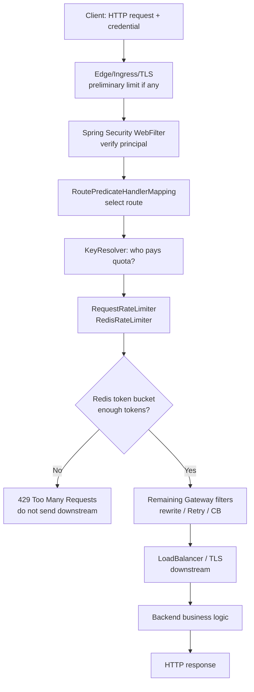
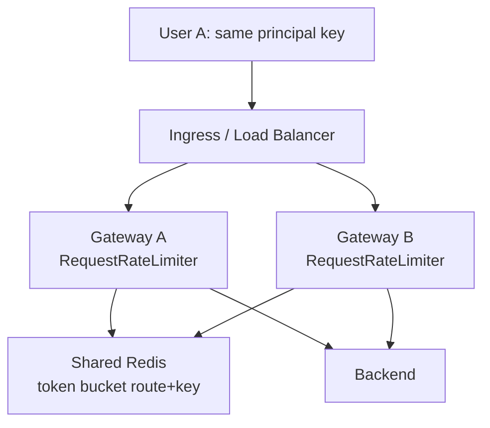

# Testing Burst Load, Key Distribution, and Rate-Limit Consistency

An API Gateway can stably handle 200 requests/second when traffic arrives evenly, yet fail when 2,000 requests hit within a few hundred milliseconds. Things grow even trickier when all requests share **the same identity key**, when every request carries a **different key**, or when multiple Gateway replicas share Redis for rate limiting. If an operator runs a single load command and stares only at `429` counts, it is easy to draw the wrong conclusion that the rate limiter is working well or broken.

In **Spring Cloud Gateway Server WebFlux**, the **`RequestRateLimiter` GatewayFilter Factory** pairs with **`RedisRateLimiter`**, an implementation built on **token buckets** and Redis. The filter evaluates route-matched requests, calls **`KeyResolver`** to identify the limited subject, and asks the rate limiter whether to **admit** or reject each request. Three practical questions follow:

1. **Burst load:** How many requests are admitted instantaneously, how many are limited, and when does the bucket refill?
2. **Key distribution:** How do single users, multiple users, multiple devices, multiple tenants, and skewed keys affect fairness and Redis resources?
3. **Consistency:** Do two or more Gateway replicas enforce **one logical limit**, or do they accidentally multiply it? What holds true when Redis errors, fails over, or routes change?

This lesson belongs to the **Traffic Limiting** chapter of the **SPRING_CLOUD_GATEWAY** module. It links route predicates and filter chains with authentication, header/path transformations, service discovery, circuit breakers, retries, TLS, and observability to run a microservices entry point safely under uneven load.

> **Version scope:** Primary examples use Spring Cloud Gateway **Server WebFlux** with Spring Security Resource Server JWT and Reactive Redis. Newer version docs use `spring.cloud.gateway.server.webflux.routes`; many earlier 4.x versions use `spring.cloud.gateway.routes`. Configuration, defaults, metric names, and error behaviors must be verified on your actual Gateway/Redis/Reactor Netty versions. This lesson focuses on **testing and interpreting results**, not treating illustrative numbers as absolute framework guarantees.

## 1. Define Exactly Which "Limit" You Want to Protect

Before generating load, answer **who shares a bucket** and **which requests that bucket governs**.

| Model | Example Limit Key | Suitable Scenario | Risk If Misapplied |
| --- | --- | --- | --- |
| Per **user** | `issuer + subject` of valid JWT | Each user gets an independent quota | One user with multiple identities may get multiple buckets |
| Per **OAuth2 client** | Trusted `issuer + client_id` | Machine-to-machine APIs, partner integrations | Groups multiple users under one client if separate quotas were needed |
| Per **tenant** | Server-verified Tenant ID | Capping total organization traffic | One noisy user in a large tenant can exhaust the whole org's quota |
| Per **API key** | Verified key identifier | Partner integrations using API keys | Double-counting or quota evasion if reading arbitrary headers |
| Per **verified IP** | Trusted Remote IP | Preliminary limiting for public/anonymous endpoints | NAT puts many users in one bucket; proxies can hide real IPs |
| Per **route + identity** | Route ID + `KeyResolver` key | One quota for orders API, another for catalog | Does not create a system-wide shared quota even with the same `KeyResolver` |

**Limiting one route does not equal limiting the entire Gateway.** In standard `RedisRateLimiter`, state keys are partitioned by **route ID** and **the key from `KeyResolver`**. Consequently, the same user gets separate buckets on `orders-read` and `orders-write` even when both share one `KeyResolver`. To enforce one combined quota across **multiple routes**, design a shared quota key/limiter at the proper layer; **reusing the same `KeyResolver` bean name is not enough**.

**A rate limiter cannot replace authorization.** A request carrying a valid JWT and remaining quota can still be rejected by a backend for lacking resource ownership. Conversely, a client receiving `429` is not necessarily an attacker; it may be a legitimate user whose app sent synchronized bursts.

### 1.1. Difference Between the Three Limit Scopes

- **Per-key quota:** every request with the same identity key competes for one bucket, regardless of which Gateway replica it hits if Redis/state is genuinely shared.
- **Per-route quota:** each route can have its own bucket, refill rate, and burst capacity.
- **System-wide limit:** protects total QPS, concurrent requests, connections, and backend cost across all keys/routes. Requires separate controls such as edge rate limiting, concurrency limits, queue budgets, circuit breakers, and backend admission control.

For example, 10,000 users each allowed 5 req/s can still generate **50,000 req/s** in steady state if all users are active. A fair per-user policy alone **is not enough** to protect a backend capped at 5,000 req/s.

## 2. Position of RequestRateLimiter in the Request Path



This diagram illustrates **a typical setup**, not a claim that every security filter or `GatewayFilter` always runs in this exact order across all configurations:

1. **Spring Security `WebFilter`** can return `401`/`403` before a Gateway route is matched.
2. **Route predicates** decide which route wins; `RequestRateLimiter` runs only on routes where it is attached (or via default filters).
3. **`KeyResolver`** extracts the key from exchange/security context; if no key resolves, the "empty key" policy may reject differently from quota exhaustion.
4. **`RedisRateLimiter`** executes the admit/reject decision against token-bucket state.
5. Only when admitted does the request proceed downstream through load balancing, timeouts, retries, and circuit breakers.

**`RequestRateLimiter` has no built-in wait queue for tokens.** When the bucket lacks tokens, the typical response is **`429 Too Many Requests`** rather than holding the request until tokens refill. If throttled requests hang for a long time, check Redis latency, networking, other filters, or HTTP connection pools rather than assuming the limiter is queuing them.

### 2.1. How 429 Differs from Other Errors

| Result | Common Meaning | Guaranteed From RequestRateLimiter? |
| --- | --- | --- |
| `429 Too Many Requests` | Exceeded quota/rate limit | **Not certain**: ingress, WAF, or backend can also return 429 |
| `401 Unauthorized` | Missing/invalid access token | Usually from security chain, not an empty token bucket |
| `403 Forbidden` | Insufficient permissions or empty-key policy from limiter | Must identify originating layer |
| `404 Not Found` | No matching route/handler or backend resource missing | Does not prove whether quota remains or ran out |
| `5xx` | Downstream failure, Redis connectivity, or other layers | Never blame the limiter without checking root logs/metrics |
| `200 OK` | Backend succeeded | Insufficient to infer all requests were admitted, especially with caching or other routes |

To measure accurately, record **limiter decision**, **route ID**, **anonymized key group**, and **whether the request actually reached the backend**.

## 3. Token Bucket Model for Predicting Burst Load

Spring Cloud Gateway's `RedisRateLimiter` implements the **token bucket** concept:

- **`replenishRate = r`:** tokens added per second.
- **`burstCapacity = B`:** maximum tokens the bucket can accumulate.
- **`requestedTokens = q`:** tokens each request must spend.
- Each **route + key** holds separate token state per the limiter's implementation.

Assuming the bucket starts full before the first call:

\[
T_{\text{available}}(t+\Delta t)
= \min\left(B,\;T_{\text{after previous admission}}+r\Delta t\right)
\]

If `T_available >= q`, the request is admitted and remaining tokens drop by `q`; if lower than `q`, the request is rejected. This formula is a **continuous expectation model**. The specific version's Lua script/timestamps may handle time units, rounding, and granularity differently; always test boundary cases.

Starting from a full bucket over a duration of `D` seconds, an **ideal upper bound** on admitted requests is:

\[
N_{\max}(D) \lesssim
\left\lfloor\frac{B+rD}{q}\right\rfloor
\]

This is an **estimated upper bound** absent discrete-time effects, cancellations, or failovers—not a promise the Gateway will admit *exactly* `N_max` requests. If the load generator sends too slowly, keys split across buckets, different routes match, or Redis drops commands, actual numbers will differ.

### 3.1. Baseline Example: 5 Tokens/Sec, Burst 10, Cost 1 Token

```text
replenishRate = 5
burstCapacity = 10
requestedTokens = 1
```

Starting with a full bucket and many concurrent requests:

- **Immediately at start:** up to roughly **10 requests** can be admitted from preexisting tokens.
- **Over the next 1 second:** the bucket refills roughly **5 tokens**; incoming requests compete for them.
- **Over 10 seconds of sustained load:** ideal admitted count does not exceed roughly `10 + 5 × 10 = 60`, though real measurements depend on time boundaries, latency, and script mechanics.
- **After a long enough idle pause:** the bucket refills up to `10` tokens—it **does not accumulate infinitely** at 5 tokens per idle second.

Firing 100 requests in a tiny burst and seeing ~10 admitted and most rejected is **working as designed**. Spreading 100 requests evenly over many seconds yields a much higher admission rate. Therefore, **identical total request counts tell you nothing about traffic shape**.

### 3.2. Effect of `requestedTokens`

| Configuration | Ideal Instant Burst When Full | Ideal Long-Term Admit Rate |
| --- | --- | --- |
| `r=5, B=10, q=1` | ~10 requests | ~5 requests/second |
| `r=5, B=10, q=2` | ~5 requests | ~2.5 requests/second |
| `r=1, B=60, q=60` | ~1 request | ~1 request/minute |
| `r=20, B=20, q=1` | ~20 requests | ~20 requests/second |

These values express **token capacity**, not "`burstCapacity=10` allows 10 RPS in every 1-second window." Token bucket allows **short bursts** when tokens have accumulated; it behaves differently from a fixed-window counter.

### 3.3. Token Bucket vs. Fixed/Sliding Windows

| Algorithm | General Behavior | Caution During Testing |
| --- | --- | --- |
| **Token bucket** | Refills tokens over time, capped at capacity | Requests can burst upfront then hit rejections; no rigid calendar window edges |
| **Fixed window** | Counts inside fixed intervals | Can observe a double burst straddling a window boundary |
| **Sliding window** | Counts/estimates over a rolling interval | Outcomes depend on time resolution and implementation technique |
| **Concurrency limiter** | Caps tasks executing simultaneously | Not requests/s; slow backends hold slots longer |

**Never apply fixed-window expectations to `RedisRateLimiter` token buckets**, such as "every second must return strictly five 200 responses." Inspect total tokens consumed over time and the burst allowed by policy.

## 4. Configuring `RedisRateLimiter` for a Test Route

Consider an orders API using `RedisRateLimiter` with two goals: each user can send short bursts while long-term rate stays around 5 requests/second, and the Gateway locates downstream instances via service discovery.

### 4.1. Server WebFlux YAML (Newer Namespace)

```yaml
spring:
  cloud:
    gateway:
      server:
        webflux:
          routes:
            - id: orders-api
              uri: lb://order-service
              predicates:
                - Path=/api/orders/**
              filters:
                - name: RequestRateLimiter
                  args:
                    key-resolver: "#{@principalKeyResolver}"
                    redis-rate-limiter.replenishRate: 5
                    redis-rate-limiter.burstCapacity: 10
                    redis-rate-limiter.requestedTokens: 1
                - StripPrefix=1
```

Key points to understand:

1. **`RequestRateLimiter` is a filter factory name**, not a route predicate. Using **name/args** avoids mistakes; this factory does not support arbitrary shorthand like `RequestRateLimiter=5,10`.
2. **`key-resolver`** references a bean via SpEL `#{@principalKeyResolver}`. The bean must exist in the Spring context with type `KeyResolver`.
3. The three `redis-rate-limiter.*` parameters define the token bucket for **this route**; if another route matches first, this filter never runs.
4. **`StripPrefix=1`** only rewrites the backend request path; it does not determine the quota key.
5. `lb://order-service` requires Spring Cloud LoadBalancer and discovery/instance suppliers. To isolate limiter testing, temporarily point to a stable static HTTP backend stub URI.

In many Spring Cloud Gateway 4.x releases, route properties sit under:

```yaml
spring:
  cloud:
    gateway:
      routes:
        - id: orders-api
          uri: http://localhost:9090
          predicates:
            - Path=/api/orders/**
          filters:
            - name: RequestRateLimiter
              args:
                key-resolver: "#{@principalKeyResolver}"
                redis-rate-limiter.replenishRate: 5
                redis-rate-limiter.burstCapacity: 10
                redis-rate-limiter.requestedTokens: 1
```

**Never declare both namespaces simultaneously** just "to be safe." Pick the exact Spring Cloud Gateway BOM/starter and confirm runtime routes and filters are loaded.

### 4.2. Redis and Dependencies

`RedisRateLimiter` requires Redis connectivity and **Spring Data Redis Reactive**, typically via `spring-boot-starter-data-redis-reactive` matching your Spring Boot version.

Example Redis configuration for a test environment:

```yaml
spring:
  data:
    redis:
      host: redis.internal.example.test
      port: 6379
      # Add TLS, auth, and timeouts per your infrastructure.
```

The hostname is illustrative only. Production must protect Redis with ACLs/credentials, TLS or trusted private networking, restricted access, and health monitoring. Never use a public/unauthenticated Redis to store quota state.

**A Redis connection error must never be silently mistaken for "429 rate limited."** It can trigger timeouts or application errors, and how the system responds when Redis is unavailable must be an explicit decision on fail-closed, fail-open, or controlled fallback.

### 4.3. `KeyResolver` Based on Authenticated Principal

In APIs using Spring Security, a simple approach uses the authenticated principal name:

```java
package com.example.gateway.ratelimit;

import java.security.Principal;
import org.springframework.cloud.gateway.filter.ratelimit.KeyResolver;
import org.springframework.context.annotation.Bean;
import org.springframework.context.annotation.Configuration;

@Configuration
public class RateLimitKeyConfiguration {

    @Bean("principalKeyResolver")
    KeyResolver principalKeyResolver() {
        return exchange -> exchange.getPrincipal()
            .map(Principal::getName)
            .filter(name -> !name.isBlank());
    }
}
```

This only works when WebFlux/Spring Security or a trusted auth component populates the principal. With a JWT Resource Server, `Authentication.getName()` typically maps to `sub` under the default converter, though you should verify against your real IdP and config.

**Important identity caveat:** `sub` may only be unique **within an issuer**. If the Gateway accepts tokens from multiple issuers/tenants, raw `sub` can cause two users from different issuers to share a quota accidentally. A safer key combines verified `issuer|subject` or `tenant|subject`, normalized and encoded to prevent delimiter collisions.

Example `KeyResolver` accepting only verified JWTs:

```java
import org.springframework.cloud.gateway.filter.ratelimit.KeyResolver;
import org.springframework.context.annotation.Bean;
import org.springframework.security.oauth2.server.resource.authentication.JwtAuthenticationToken;
import reactor.core.publisher.Mono;

@Bean("issuerSubjectKeyResolver")
KeyResolver issuerSubjectKeyResolver() {
    return exchange -> exchange.getPrincipal()
        .ofType(JwtAuthenticationToken.class)
        .flatMap(authentication -> {
            var jwt = authentication.getToken();
            if (jwt.getIssuer() == null || jwt.getSubject() == null) {
                return Mono.empty();
            }
            return Mono.just(
                jwt.getIssuer().toString() + "|" + jwt.getSubject());
        });
}
```

This is an **illustrative snippet**, not a complete key canonicalizer: if inputs can include delimiter characters, encode or length-prefix them so two distinct pairs can never produce the same key. Never log sensitive raw subjects/tenants in metric labels or logs. Generate keyed fingerprints/HMACs for observability when appropriate.

### 4.4. When `KeyResolver` Returns No Key

Per Gateway documentation, when `KeyResolver` emits no key, `RequestRateLimiter` **rejects requests by default**; properties like `deny-empty-key` and `empty-key-status-code` customize behavior in supported versions.

Requests **without a principal** may be rejected by Spring Security with `401` **before** reaching `GatewayFilter`s. If a request reaches the limiter and the resolver returns `Mono.empty()`, the status follows the empty-key policy—**do not assume it is 429**. Test which layer produces the response.

**Never fall back to a static `"anonymous"` key for all requests** without assessing the impact: all unauthenticated callers will share one bucket and starve one another. To protect public/anonymous APIs, consider a shared cap paired with edge limits, verified IPs, or another risk-appropriate identifier.

## 5. Designing Repeatable Load Tests

Rate-limit testing is more than "blasting requests as fast as possible." Every test needs **a goal, controlled variables, accurate counters, and evaluation criteria**.

### 5.1. Preparing the Environment

A test environment might look like:

```text
                   ┌── Gateway A ──┐
Test clients  ─ LB ┤               ├── Shared Redis
                   └── Gateway B ──┘
                         │
                Backend HTTP stub
                (returns JSON 200, counts calls)
```

Recommended components:

- **Gateway A/B** with identical versions, route IDs, `KeyResolver`s, Redis endpoints, and limiter parameters.
- **Shared Redis** monitored for memory, latency, command errors, and failovers.
- **Backend stub** returning deterministic `200 OK` without depending on a real DB or IdP. Optionally supports controlled artificial latency for other tests.
- **Load generator** isolated on separate machines from Gateway/Redis so generator CPU never skews results.
- **Test tokens A/B** validly signed with **two distinct identities and equivalent permissions**, or a reliable test auth setup. Never hardcode production tokens in scripts.
- **Observability**: HTTP statuses, request latencies, route IDs, Gateway instances, Redis metrics, and backend call counts.

**Run only in authorized test environments.** Burst testing on public/production endpoints can degrade real users or trigger DDoS defenses. Coordinate runs, bound intensity, and ensure requests have no side effects.

### 5.2. Variables to Hold Constant

| Variable | Why Keep It Constant During a Test Run? |
| --- | --- |
| Route ID and path/method | Switching routes hits a different bucket or bypasses the limiter |
| JWT identity/tenant/issuer | Changing keys mid-run turns the test into multi-bucket traffic |
| Redis endpoint/state | Separate Redis stores yield separate quotas; stale buckets may not be full |
| Gateway replica count | Changing replica counts alters topology, latency, and load balancing |
| Backend response/latency | Backend errors or rising latency obscure admitted vs. successful counts |
| Generator arrival rate | VU count does not equal requests/second, especially as latency climbs |
| Time window and starting state | Full vs. partially drained buckets produce different burst results |

A solid test includes **warm-up**, steady state, burst phase, cooldown, and repeated runs with recorded initial conditions. Confirm whether the bucket starts full; reusing the same key right after a prior test leaves unknown remaining tokens.

### 5.3. Counting Four Independent Outcomes

For each test run, record:

1. **Requests attempted:** how many requests did the load generator intend/attempt to send?
2. **Requests rejected by limiter:** how many requests did the limiter actively reject?
3. **Requests admitted by limiter:** how many requests continued past the limiter **regardless of whether the backend returned 200 or 5xx**?
4. **Backend calls observed:** how many actual requests reached the backend, including retries or calls from other routes?

Never assume `200 = admitted` and `429 = limiter rejected` everywhere. A backend may emit 429, Gateway Security may emit 401 before the limiter, or an admitted request may time out downstream. With a static backend stub and no extra filters, 200/429 counts are useful proxies, **yet status origins must still be verified**.

## 6. Test 1: Burst Load on a Single Key

Setup:

```text
Route: orders-api
Key: user-A (one fixed JWT identity)
replenishRate: 5
burstCapacity: 10
requestedTokens: 1
Bucket pre-test: idle long enough to refill completely
Backend: immediate 200, no retries
```

### 6.1. Expected Results

Send a burst of **50 near-simultaneous requests**:

- Immediately admitted requests can reach up to **10** from the initial full bucket.
- Remaining requests mostly get `429` if insufficient time passes to refill.
- If the load generator stretches the burst across several seconds, extra tokens refill; admitting more than 10 **is not necessarily a bug**.
- Exact ordering of which requests succeed **is not guaranteed**; client/request #1 is not guaranteed to beat #2 across different Gateway replicas and network paths.

**Never assert "exactly 10/50" in a test subject to uncontrolled scheduler/network jitter.** Assert tolerance ranges against actual elapsed duration and confirm admissions do not exceed the single-bucket model under test load.

### 6.2. Testing After the Bucket Drains

Immediately after the initial burst:

1. Send 20 more requests in a very short window.
2. Expect most to be rejected, since the bucket has not had time to refill.
3. Let the bucket sit idle longer than full-refill time—e.g., roughly `B/r = 10/5 = 2 seconds` **in the ideal model**—then send a fresh burst.
4. Expect burst admission to recover.

The **2-second** figure is the ideal empty-to-full refill duration, not a guarantee that at 2,000 ms exact every implementation admits all 10 requests. Account for script time granularity, Redis latency, and background requests.

### 6.3. Distinguishing Bursts from Sustained Overload

Two workloads totaling 500 requests behave very differently:

| Workload | Traffic Shape | What It Tests |
| --- | --- | --- |
| **Spike** | 500 requests packed into a tiny interval | Bucket cap and immediate rejection rate |
| **Ramp-up** | Gradual climb from 1 → 100 RPS | Where 429s begin and Redis/Gateway latency shifts |
| **Sustained overload** | Hold 100 RPS for 30 seconds | Long-term admission matching replenish rate |
| **Cooldown + second spike** | Pause long enough to recover, then burst again | Refill and post-idle bucket state |
| **Periodic bursty** | Send a batch every second instead of smooth pacing | Effect of `burstCapacity`, scheduling, and boundary timing |

**If the backend is already overloaded**, fix the test environment before judging the limiter. Limiter tests should begin with a fast, isolated backend stub; add artificial backend latency/errors afterward to evaluate end-to-end resilience.

## 7. Test 2: Key Distribution and Fairness

**Key distribution** describes how requests map onto quota keys. It can outweigh `replenishRate` itself when estimating total Gateway throughput.

### 7.1. One Hot Key and Many Cold Keys

Suppose:

- User A sends 100 requests/second.
- User B sends 1 request/second.
- User C sends 1 request/second.
- Each user has an **independent bucket** with `r=5, B=10, q=1` on the same route.

Expected behavior per design:

- A receives many `429`s after spending its burst and refill.
- B and C still have nearly all valid requests admitted because **A does not consume tokens from their buckets**.
- If B or C also gets throttled unexpectedly, check whether `KeyResolver` emitted the **same key** for A/B/C, or whether Redis/backend/Gateway hit a shared bottleneck.

**Do not equate "high 429 rate across the Gateway" with "all users are being limited equally."** One hot key can account for nearly all rejections while normal users remain unaffected.

### 7.2. Many Keys Creating Huge Aggregate Load

Suppose 100 users each send 5 requests/second on the same route:

\[
\text{Ideal sustainable admitted load} \approx
100\ \text{keys} \times 5\ \text{req/s per key}
= 500\ \text{req/s}
\]

That is the **ideal load when buckets are independent** and no global cap exists. If the backend only handles 300 req/s, a per-user quota still lets the backend overload. Add:

- Per-tenant or per-API-client quotas per contract.
- Aggregate caps at the edge/ingress or a centralized quota service.
- Backend concurrency/connection-pool limits and circuit breakers.
- Monitoring of total admitted RPS, not just 429 percentages.

### 7.3. NAT Scenario: Many Users Behind One IP

A school or enterprise may send hundreds of users onto the internet through **one public IP**. If `KeyResolver` uses IP address, everyone shares one bucket, letting one heavy user trigger `429`s for everyone else.

Conversely, a user roaming across cellular, VPN, and Wi-Fi gets multiple IPs and accidentally receives extra buckets.

**Never trust client-supplied `X-Forwarded-For`.** Whenever IP limiting is required, rely on addresses extracted at a trusted proxy boundary with properly configured `Forwarded`/`X-Forwarded-*` handling so clients cannot pick keys via spoofed headers.

### 7.4. Multi-Tenant and Multi-Dimensional Keys

When multiple users belong to one tenant, at least two policies exist:

- **Per-user quota:** user-A and user-B get separate buckets.
- **Per-tenant quota:** both draw from tenant-X's shared bucket.

Never assume prepending `tenantId` to the user key enforces **two hierarchical quota tiers**. Keys `tenantX|userA` and `tenantX|userB` are still **two independent buckets**, with no combined tenant cap. If you need both a user **and** a tenant limit, build **two independent quota checks** or an atomic multi-tier quota mechanism.

Example:

```text
Tenant X: max 100 req/s total
  User A: max 20 req/s
  User B: max 20 req/s

User A's request is admitted only if:
  tenant X has remaining quota
  AND user A has remaining quota
```

Evaluating two buckets **does not automatically become one atomic transaction** merely by chaining two default filters; tokens can be deducted from the first bucket even if the second rejects. When strict zero-waste quota accuracy is required, design a dedicated multi-tier mechanism.

### 7.5. High-Cardinality Keys

If a per-request header like `X-Request-Id` or a fresh timestamp is used as the key, every request spawns **a brand-new full bucket**. Then:

- The limiter fails to throttle a repeating client.
- Redis must store massive numbers of keys and TTLs, causing memory pressure.
- Per-key metrics explode in label cardinality (*high cardinality*), overloading observability systems.

**Keys must remain stable per limited entity**, never per request ID. Never use unvalidated query parameters, User-Agent strings, or arbitrary headers directly as production keys.

## 8. Test 3: Consistency Across Multiple Gateway Replicas

Suppose requests bearing user A's token pass through a load balancer splitting traffic across **Gateway A** and **Gateway B**:



**When both Gateways share the same Redis, route ID, key derivation, and limiter settings**, bucket math coordinates via Redis; adding Gateway replicas **does not automatically double a user's quota**.

Spring Cloud Gateway's `RedisRateLimiter` runs a **Redis Lua script** to compute and update token-bucket state atomically on the Redis server, avoiding non-atomic read–modify–write races across Gateway replicas under normal operating conditions.

### 8.1. Conditions for "One Shared Quota"

| Condition | What Breaks If Misconfigured? |
| --- | --- |
| **Same Redis state** | A and B pointing to separate Redis stores create independent buckets, multiplying quotas |
| **Same logical route ID** | Different route IDs create separate buckets for the same user |
| **Same `KeyResolver`/normalization** | A emits `issuer|sub`, B emits `sub`: state splits |
| **Same r/B/q values** | Replicas evaluate against different thresholds, giving erratic results |
| **Same trust/auth identity** | Differing mappers/issuers produce mismatched keys |
| **Compatible versions/deployments** | Differing script/key formats or configs cause drift |
| **Healthy Redis without unexpected partitions/failovers** | Cannot assume strict consistency during split-brain or storage errors |

**An easy-to-misread experiment:** each Gateway runs its own local Redis. Sending 50 requests straight to A lets ~10 pass, and sending 50 straight to B also lets ~10 pass—leading an operator to think "great, both Gateways block properly!" Yet behind a load balancer, user A actually consumes **two quotas**. Always test **the same identity across both replicas**, not only each replica in isolation.

### 8.2. Testing Single vs. Multiple Replicas

Illustrative procedure:

1. Ensure one consistent route ID `orders-api` and identical key resolvers.
2. Reset test Redis state **without deleting production keys**; ideally use a dedicated test Redis and wait for buckets to fill before each run.
3. Send a burst through **Gateway A only**; record admitted/rejected counts and Redis metrics.
4. Repeat through **Gateway B only** after safely resetting test state.
5. Send **the same burst through the load balancer** hitting both A and B.
6. Compare combined admissions across **A+B**, not just per-replica numbers.
7. Inspect logs and key normalization if combined admissions exceed expectations.

With shared Redis, short-window combined admissions must match the **single-bucket model** (within timing/test tolerances), rather than summing two independent burst capacities.

### 8.3. Why "Atomic Lua" Does Not Mean Absolute Perfection in Every Failure

A Redis script updates state atomically on the active server for keys in the same slot. Across the full system, edge cases still exist:

- **Redis failover:** replication to replicas can be asynchronous; after failover, very recent writes right before the outage may be lost.
- **Network partitions/timeouts:** a Gateway cannot know whether a command executed on Redis if the connection drops mid-flight; blind retries can alter state again.
- **Multiple independent Redis clusters:** share no state, so quotas are not cluster-wide.
- **Clock skew:** if a limiter version uses Gateway host clocks for refill calculations, clock drift across replicas causes inconsistencies; enforce NTP sync and verify version mechanics.
- **Route/config refreshes:** changing route IDs or key formats spawns fresh buckets, "resetting" quotas from the user's perspective.

State realistic guarantees: **Redis-coordinated quotas in steady state**, paired with an explicit error/failover policy. Never advertise "strict global exactly-once quotas" without engineering the underlying synchronization and failure guarantees.

### 8.4. Redis Cluster and Key Placement

`RedisRateLimiter` stores bucket state across multiple fields/keys in Redis, such as token counts and timestamps. In Redis Cluster, keys touched **inside a single Lua script** must hash to the **same hash slot**. Spring Cloud Gateway's implementation names keys to satisfy this rule, whereas custom rate limiters/scripts must explicitly follow hash-tag rules and cluster compatibility.

**Never alter `RedisRateLimiter`'s internal key format** just for "readability" without understanding script, TTL, hash-slot, and migration constraints. Redis ACLs, TLS, latency, failover time, and load capacity are all integral to quota consistency.

## 9. Load Generators: Test Arrival Rate, Not Just Concurrency

Many load tools focus on **virtual users/concurrency**. However, **20 concurrent users** do not guarantee **20 requests/second**; actual throughput depends on response latency and retry behavior.

To test req/s quotas accurately, use a generator supporting **constant arrival rate** or **open models**: target a fixed request dispatch rate over time so throughput does not silently drop when the Gateway slows down.

### 9.1. k6 Example: One Key vs. Two Keys

The `k6` script below assumes two valid **test** Bearer JWTs with distinct `sub` claims and identical endpoint permissions. Inject tokens via environment variables at runtime—**never hardcode them into files**.

```javascript
import http from 'k6/http';
import exec from 'k6/execution';
import { check } from 'k6';
import { Counter } from 'k6/metrics';

export const options = {
  scenarios: {
    spike: {
      executor: 'constant-arrival-rate',
      rate: 100,
      timeUnit: '1s',
      duration: '10s',
      preAllocatedVUs: 100,
      maxVUs: 200,
    },
  },
};

const acceptedA = new Counter('backend_200_a');
const acceptedB = new Counter('backend_200_b');
const rejectedA = new Counter('rejected_429_a');
const rejectedB = new Counter('rejected_429_b');
const unexpected = new Counter('unexpected_status');

export default function () {
  // KEY_MODE=one -> all requests use TOKEN_A.
  // KEY_MODE=two -> alternate TOKEN_A / TOKEN_B.
  const useB = __ENV.KEY_MODE === 'two' &&
    (exec.scenario.iterationInTest % 2 === 1);
  const token = useB ? __ENV.TOKEN_B : __ENV.TOKEN_A;
  if (!token) {
    throw new Error('Missing test token in environment');
  }

  const response = http.get(
    'http://localhost:8080/api/orders/42',
    {
      headers: { Authorization: 'Bearer ' + token },
      redirects: 0,
      tags: { key_group: useB ? 'B' : 'A' },
    }
  );

  if (response.status === 200) {
    (useB ? acceptedB : acceptedA).add(1);
  } else if (response.status === 429) {
    (useB ? rejectedB : rejectedA).add(1);
  } else {
    unexpected.add(1);
  }

  check(response, {
    'expected status 200 or 429': r =>
      r.status === 200 || r.status === 429,
  });
}
```

**Limitation of this example:** `backend_200_*` counters assume the downstream stub **always returns 200 when called** with no caching or fallback. If the backend returns 5xx or another route returns 200, those counters no longer match limiter admissions accurately. Cross-check against backend logs/counters.

**Usage:** save the script in a file **outside the lesson repo** inside an authorized test environment, load `TOKEN_A` and `TOKEN_B` from test-runner secrets/env vars, and run `k6 run`. Never place real JWTs into shell history, VCS, or shared outputs.

Two test runs:

- **KEY_MODE=one:** 100 req/s all using A's key; expect mostly 429s when quota is only 5 tokens/s after the burst.
- **KEY_MODE=two:** same 100 req/s total split evenly between A and B; two independent buckets admit roughly **double long-term** compared to one key, assuming proper routing, Redis state, and no other system bottlenecks.

A **10-second run at 100 RPS** dispatches roughly 1,000 requests. Starting full with `B=10, r=5, q=1`, one key ideally admits up to ~60 over 10 seconds; two such keys total close to ~120. **This is an order-of-magnitude sanity check**, not a rigid assertion: timing varies across runs and generators may drop iterations under load.

**Important:** k6 emits a `dropped_iterations` metric when VUs are insufficient to hit the target rate. Whenever dropped iterations occur, check **actual dispatched requests** before interpreting 429 ratios. Scale up VUs as needed without changing multiple variables in the same run.

### 9.2. Using curl to Verify Configuration Before Load Testing

```bash
curl -i "http://localhost:8080/api/orders/42" \
  -H "Authorization: Bearer <TEST_ACCESS_TOKEN>"
```

Verify:

- Path matches and the expected route with its filter was actually selected.
- Test JWT is valid with proper permissions (no auth `401`/`403`).
- Backend stub returns `200` when admitted.
- Rapidly repeating requests triggers observable `429`s.
- If `X-RateLimit-*` headers are emitted by your Gateway version, use them as debugging aids—**never rely solely on these headers** to prove cluster-wide quota distribution.

For instance, some `RedisRateLimiter` versions emit headers like `X-RateLimit-Remaining`, `X-RateLimit-Burst-Capacity`, `X-RateLimit-Replenish-Rate`, or `X-RateLimit-Requested-Tokens`. Check names and toggle flags for your version; values are **point-in-time snapshots**, not a synchronized view across concurrent in-flight requests.

## 10. Minimum Testing Matrix

| ID | Scenario | What to Verify |
| --- | --- | --- |
| T1 | Single key, full bucket, 50 near-concurrent requests | Burst capped near capacity; rejects once tokens drain |
| T2 | Single key, sustained load above replenish rate | Admissions converge toward long-term refill rate; 429s rise |
| T3 | Single key, pause long enough, then burst again | Tokens recover without exceeding `burstCapacity` |
| T4 | Two users with different keys, same route | Independent buckets; combined admissions scale accordingly |
| T5 | Hot key A + cold keys B/C | Hot key throttled while cold keys keep their quotas |
| T6 | 100 distinct keys, each low rate | Aggregate admitted traffic can be high despite each key staying under limit |
| T7 | Many users behind one public IP/NAT | IP-based keys cause unintended contention |
| T8 | Key read from unauthenticated header | Confirms spoofing/key-explosion risk; never ship to production |
| T9 | One user, two Gateway replicas, shared Redis and route ID | Combined admissions match **one shared bucket** |
| T10 | Two Gateway replicas using two separate Redis stores | Confirms quotas multiply by Redis store count |
| T11 | Same user across two route IDs | Confirms two separate buckets per design |
| T12 | `KeyResolver` returns `Mono.empty()` | Verifies empty-key policy; distinguishes 401/403/429 |
| T13 | Slow or unavailable Redis | Observes timeouts/errors and configured fail-open/fail-closed behavior |
| T14 | Redis failover / route refresh | Tracks state drift/resets without assuming perfection |
| T15 | Backend returns 500 or 429 | Does not misattribute downstream responses to the limiter |
| T16 | `Retry` enabled | Compares backend attempts vs. inbound requests; verifies idempotency |
| T17 | Public and admin APIs on separate routes | Proper isolated quotas/auth with no route shadowing |
| T18 | Scaling Gateway replicas mid-run | Does not inflate quotas with shared Redis/state; monitors latency/Redis load |

### 10.1. Valuable Counterexample Tests

**Counterexample 1:** 500 requests from 500 distinct JWTs all succeed despite a 5 req/s quota. This **does not prove the limiter is broken**; if each key sends one request, every bucket has plenty of tokens.

**Counterexample 2:** 50 requests with the same JWT across two Gateway replicas let 20 pass quickly despite `burstCapacity=10`. Possible causes include two separate Redis instances, different route IDs, `KeyResolver` returning distinct keys, or a load window long enough to refill. Never blame "non-atomic Redis Lua" before ruling those out.

**Counterexample 3:** User A hits 429 while user B hits timeouts. Even with isolated buckets, B can still suffer from shared-resource contention: overloaded Redis, saturated Gateway event loops/connection pools, or congested ingress/backends. "Isolated quotas" does not mean "complete isolation of all infrastructure."

## 11. Testing Consistency Under Concurrent Requests

A classic bug in hand-rolled limiters is:

```text
Gateway A reads tokens = 1
Gateway B reads tokens = 1
Gateway A writes tokens = 0, admits request A
Gateway B writes tokens = 0, admits request B
=> Two requests admitted despite only 1 token remaining
```

This is a non-atomic read–modify–write **race condition**. `RedisRateLimiter` uses a Lua script to evaluate and update tokens in one step to prevent this race on shared Redis state under normal conditions.

### 11.1. What Should a Concurrent Test Examine?

1. Generate concurrent requests with the **same principal key** and same route.
2. Spread requests across multiple Gateway replicas.
3. Keep the burst window tight when verifying **`burstCapacity`**.
4. Record **when requests actually hit the Gateway** and Redis processing time, not just when the load generator queued them.
5. Compare total admissions in the interval against the token-bucket model allowing for refill.
6. Confirm rejected requests **never reach the backend**.
7. Repeat while scaling replicas and adding background load on Redis.

**Consistency cannot be proven by a single short run.** For strong assurances, run repeated tests across multiple key distributions, Redis HA/failovers, and inspect logs/traces/metrics at every tier.

### 11.2. When Redis Errors or Partitions

Maintain an operational decision table:

| Strategy When Quota Cannot Be Verified | Pros | Risks |
| --- | --- | --- |
| **Fail closed**: reject or return appropriate error | Protects backends and stops unbounded overages | Can reduce availability for legitimate clients |
| **Conditional fail open** | Keeps serving some traffic during Redis outages | Backends face higher load; quotas temporarily bypassed |
| **Local fallback limiter** | Provides coarse node-level protection without Redis | Limits fragment across replicas |
| **Circuit breaker / upper-tier load shedding** | Protects Redis/Gateway/backends per risk profile | Requires careful error classification and clear client signaling |

**Do not assume Spring Cloud Gateway automatically applies any row above for every Redis error.** To customize exception behavior, configure or extend it and **verify actual outcomes**. Never swallow Redis errors and silently permit everything, as that turns a Redis attack/failure into a quota bypass.

### 11.3. Changing Configuration Under Live Traffic

Changes that break quota continuity:

- Renaming route ID `orders-api` to `orders-v2`, shifting bucket Redis keys.
- Switching `KeyResolver` from `sub` to `issuer|sub`.
- Changing case normalization on tenant/client IDs.
- Using different Redis key prefixes across Gateway replicas.
- Migrating from Redis A to Redis B without migrating or draining state.
- Adding a canary or fallback route targeting the same endpoint under a different route ID.

**Treat quota rollouts like schema/state migrations**, not merely tweaking three `r/B/q` numbers. When key formats change, plan migration, testing, and notifications if customer quota commitments are affected.

## 12. Observability for Root-Cause Analysis

A useful dashboard combines **traffic**, **rate-limit decisions**, **key distribution**, and **Redis/Backend health**.

| Metric | Question Answered | Notes |
| --- | --- | --- |
| Inbound RPS by route/status | Did total traffic spike? | Separate `429`s from gateway, ingress, and backend |
| Limiter allowed/rejected counts | What is the true admit/reject ratio? | May require custom instrumentation if defaults lack detail |
| `401`/`403` rate | Are auth or key resolvers failing? | Requests blocked by security may never reach the limiter |
| Aggregated unique key count | Is key explosion occurring? | Avoid per-raw-key metric labels |
| Hot-key concentration (sanitized top buckets) | Is one identity dominating traffic? | Never log raw JWTs or PII |
| Redis command latency/errors | Is the limiter stalling on Redis? | Slow Redis inflates p99 even for admitted requests |
| Redis CPU/memory/expired keys | Are bucket counts and TTLs straining memory? | Key cardinality is a resource problem |
| Gateway replica / version | Is there drift across nodes? | Shared Redis with mismatched configs still misbehaves |
| Backend RPS/errors/latency | Is the limiter protecting downstream? | Admitted requests can still multiply via retries |
| Load-generator dropped iterations | Was target load actually generated? | Under-generation creates artificially low 429 rates |

### 12.1. Never Create Per-Subject or Per-IP Metric Labels

Putting raw `userId`, JWT `sub`, or API keys into Prometheus labels per request causes time-series cardinality to explode and overloads monitoring systems—and may leak personal data.

Instead:

- Aggregate by **route ID**, environment, status, and Gateway instance.
- Use bounded test cohorts like `single-key`, `two-keys`, and `hot-key`.
- To identify hot keys, use dedicated cardinality-bounded analytics with proper fingerprinting and access control.
- Log safe correlation IDs for debugging; never log full `Authorization` headers.

### 12.2. Never Trust One Response Header as a Cluster Snapshot

If the Gateway emits `X-RateLimit-Remaining`, it reflects state at the instant of one limiter evaluation. Under concurrent load, another request can spend tokens immediately afterward. Never treat a single response's remaining header as proof of tokens available when the client reads it.

## 13. Interactions with Route Order, Filter Order, Retries, and Circuit Breakers

### 13.1. Catch-All Routes Can Shadow Dedicated Limiters

Suppose:

```yaml
# Illustrates a bug: broad catch-all route matches first.
routes:
  - id: api-fallback
    order: -100
    uri: lb://legacy-service
    predicates:
      - Path=/api/**
  - id: orders-api
    order: 0
    uri: lb://order-service
    predicates:
      - Path=/api/orders/**
    filters:
      - name: RequestRateLimiter
        args:
          key-resolver: "#{@principalKeyResolver}"
          redis-rate-limiter.replenishRate: 5
          redis-rate-limiter.burstCapacity: 10
```

Requests to `/api/orders/42` match `api-fallback` first, so **`orders-api`'s filter never runs**. Fix route ordering and predicate specificity, and verify the actual matched route ID. Never take 200 responses with zero 429s as proof the limiter failed if requests never entered the intended route.

### 13.2. Retries Amplify Backend Calls

One request **admitted once** by the Gateway can generate multiple backend calls when the `Retry` filter is active:

```text
Inbound requests: 100
Limiter admitted: 10
Backend attempts: may exceed 10 if retries trigger
Successful backend responses: may be < 10 if backend errors
```

**Never use backend call counts as admitted counts** without accounting for `Retry`. Depending on filter order and failure types, retries can re-run parts of the chain; verify via instrumentation on the real application.

Be extra cautious with payment/write POSTs. Running out of quota is no reason to retry immediately; if retrying a side-effecting request, enforce idempotency and retry budgets.

### 13.3. Circuit Breakers Do Not Replace Rate Limiters

Circuit breakers react to **downstream failures**, whereas rate limiters bound **admitted request volume**. A healthy backend can still overload if request rate exceeds capacity; a failing backend still needs caps on retried requests.

A layered design might combine:

1. Ingress/WAF dropping abusive traffic early.
2. Spring Security authenticating and authorizing callers.
3. Gateway rate limiters by key/tenant/route.
4. Bounded timeouts, circuit breakers, and retries.
5. Backend concurrency/DB limits and idempotency.

Never configure one layer and assume the remaining layers are unnecessary.

## 14. Common Data-Interpretation Mistakes

### Mistake 1 — Expecting Exactly the First 10 Requests to Succeed in Every Burst

Token buckets refill continuously; request concurrency and Redis round-trip times vary. Very tight bursts approach burst capacity, yet there is no strict "requests 1–10 always win" ordering guarantee.

### Mistake 2 — Concluding Limits Are Too Loose Because Total 429s Are Low

Check whether traffic spans 100 distinct keys. Each bucket has its own allowance; aggregate traffic can be high while every individual key stays within quota.

### Mistake 3 — Assuming 403 Means Quota Exhaustion

403 can come from Spring Security or the `KeyResolver` empty-key policy. Quota exhaustion normally returns 429 in standard `RequestRateLimiter`; confirm which layer emitted the status.

### Mistake 4 — Seeing Quota Double When the Same User Calls Two Routes

Different route IDs create separate buckets. Shared cross-route quotas require an explicitly shared bucket design, not merely the same JWT subject.

### Mistake 5 — Two Gateways Pointing to Separate Redis Instances

Each Gateway keeps independent state, multiplying effective quotas by replica count. Verify Redis endpoints/DBs/credentials and live traffic paths.

### Mistake 6 — Using Raw `X-Forwarded-For` as the Key

Clients can spoof forwarded IPs if proxies fail to sanitize/normalize headers; attackers mint a new bucket per forged IP. Use trusted proxy boundaries or authenticated identities.

### Mistake 7 — Measuring 429 Ratios While Ignoring Dropped Iterations

The load generator failed to dispatch target traffic due to insufficient VUs/CPU/network. Looking only at delivered requests creates the illusion that the Gateway handled higher load than it actually received.

### Mistake 8 — Mistaking Redis Timeouts for Backend 5xx

Redis errors can fire before the Gateway ever calls the backend. Check Redis latency, Gateway logs, and backend call counts. Never enlarge backend connection pools when limiter storage is the bottleneck.

### Mistake 9 — Editing YAML Without Refreshing All Gateway Replicas

Some replicas may still hold old routes, filters, or configs in memory. Verify effective runtime configs and route IDs across every instance after deploys.

### Mistake 10 — Treating Per-User Rate Limiting as Complete DDoS Protection

Attackers can flood pre-auth endpoints, rotate accounts/keys, or exhaust TLS/JWT CPU before the limiter runs. Layer ingress/edge limits, global caps, security, WAFs, and network defenses.

## 15. Quota Rollout and Rollback Process

Every quota change needs **before/after measurements**, a defined test scope, and explicit rollback steps:

1. **Define the quota contract:** per-user, per-client, per-tenant, or global? Which routes and methods? Do failed requests count?
2. **Verify key sources:** are issuer, subject, tenant, and client ID authenticated? Can keys be empty, collide, or vary across replicas?
3. **Calculate ideal load:** use `r`, `B`, and `q` to estimate burst and sustained admissions per key.
4. **Test in staging:** backend stub, test Redis, one then two Gateway replicas; verify the load generator is not bottlenecked.
5. **Measure key distribution:** single-key, two-keys, hot-key, and high-cardinality runs; compare aggregate admissions against backend capacity.
6. **Verify failure policies:** Redis timeouts, failovers, route refreshes, expired tokens, missing keys, and backend 5xx.
7. **Controlled release:** adjust one dimension at a time; never rename route IDs and key schemas simultaneously without a migration plan.
8. **Post-deploy monitoring:** 429/401/403/5xx rates, p95/p99 latency, Redis latency, backend saturation, and client error reports.
9. **Rollback:** revert to the previously verified config if legitimate users face false blocks or Redis/backends overload; confirm all replicas sync.
10. **Document results:** actual dispatch rate, key distribution, timestamps, versions, limits, and tolerances—not just a single screenshot.

### 15.1. Example Repeatable Test Report

| Field | Illustrative Value |
| --- | --- |
| Environment | Staging, 2 Gateway replicas, shared Redis |
| Route | `orders-api` |
| Limiter | `r=5, B=10, q=1` |
| Key mode | Single JWT principal / single bucket |
| Target load | 100 req/s for 10 s |
| Actual dispatched | 995 requests, 5 dropped iterations |
| Observed admissions | 58 passed limiter |
| Quota rejections | 937 rejected by limiter |
| Backend calls | 58, Retry disabled |
| Redis errors | 0 |
| Conclusion | Matches baseline single-bucket expectation (illustrative sample, not live measured output) |

**Never use an illustrative template as a real production report.** Real reports must record run timestamps, tooling, effective configs, variance bounds, and log/metric evidence for status origins.

## 16. Self-Check Exercises

### Scenario A — 100-Request Burst

A key has `replenishRate=10`, `burstCapacity=20`, `requestedTokens=1`. 100 near-instantaneous requests arrive when the bucket is full.

**Answer:** The token bucket model admits up to roughly 20 requests from initially accumulated tokens; the rest mostly get 429 if insufficient time passes to refill. If the burst stretches longer, more requests can be admitted over time.

### Scenario B — Each Request Costs Two Tokens

`r=10, B=20, q=2`. What are the ideal long-term rate and instantaneous burst?

**Answer:** Roughly `10/2 = 5 requests/second` long-term and up to roughly `20/2 = 10 requests` when the bucket is full.

### Scenario C — One User Across Three Gateway Replicas

Three Gateway replicas share Redis, route ID, and key resolver. Does the user's quota automatically triple?

**Answer:** Not in standard designs: shared Redis coordinates one logical bucket. Still verify via multi-replica testing and check failover/partition and config drift.

### Scenario D — Three Users Behind One NAT IP

IP-based limiting is active; three users share one public IP, each sending 3 req/s while the IP quota is 5 req/s.

**Answer:** Combined traffic competes for 5 req/s; users get throttled even though each individual stays low. To enforce fair per-user quotas, key off authenticated identities.

### Scenario E — Two Routes Sharing `principalKeyResolver`

`orders-read` and `orders-write` both configure `RedisRateLimiter` with the same `KeyResolver` bean. Does that guarantee their combined rate for user A never exceeds 5 req/s?

**Answer:** No. Standard `RedisRateLimiter` partitions state by route ID; the two routes maintain separate buckets. Enforcing a combined quota requires a shared-bucket design.

### Scenario F — Every Request Uses a New UUID as the Key

The client sends `X-Request-Id` and the Gateway uses it directly as the rate-limit key. Why do 429s never appear?

**Answer:** Every request creates a brand-new bucket with full capacity; the limiter becomes ineffective per client and triggers key explosion in Redis. Use stable verified identities.

### Scenario G — One Key Gets 429 While Another Gets 5xx

User A hits quota; user B is well under quota yet receives 5xx.

**Answer:** You cannot conclude they share a bucket. Shared-infrastructure faults may have occurred in Redis, Gateway, routing, backends, or shared resources. Cross-check 429/5xx sources, Redis latency, backend metrics, and key resolution.

### Scenario H — Changing Route ID During Canary Deployment

A new release renames the route ID from `orders-api` to `orders-canary` while keeping the same `KeyResolver`.

**Answer:** That risks spawning a fresh state bucket, giving users extra burst allowance. Review how `RedisRateLimiter` constructs keys, keep route IDs stable when quota continuity matters, or implement a migration plan.

### Scenario I — Redis Failover

Under concurrent load across two Gateway replicas, the Redis primary fails over.

**Answer:** You cannot guarantee zero token drift because asynchronous replication/failover can drop updates near the transition. Define quota SLOs under failure, test them, and implement controlled fail-open/fail-closed behavior.

## 17. Key Takeaways

1. **`RequestRateLimiter` enforces per-key quotas inside the route filter chain**, while `RedisRateLimiter` implements token buckets via `replenishRate`, `burstCapacity`, and `requestedTokens`.
2. **Burst capacity is not RPS**, and a full bucket can admit a burst upfront and then reject until tokens refill.
3. **Key distribution dictates total traffic:** one hot key behaves very differently from 100 cold keys; per-user quotas alone do not cap aggregate Gateway or backend load.
4. **`KeyResolver` must be stable and trustworthy:** prefer authenticated principal/tenant/client identities, avoiding request IDs or spoofable headers.
5. **Multiple Gateway replicas share quotas only when sharing Redis, route IDs, keys, and parameters.** Redis Lua provides atomicity on healthy state, not absolute consistency across failovers or partitions.
6. **Measure with attribution:** attempted, admitted, limiter-rejected, backend calls, dropped load iterations, and Redis errors—never just 200/429 counts.
7. **Protect the whole system:** ingress limits, auth/authz, per-key/tenant quotas, connection/concurrency limits, circuit breakers, retry budgets, TLS, and observability.
8. **Re-test after route/config changes:** key formats, route IDs, canary rollouts, and replica drift can alter effective quotas even when the three limiter numbers stay unchanged.

**Practical conclusion:** Reliable traffic limiting takes more than putting `5 req/s` in YAML. You must verify **bounded bursts, accurate per-entity bucketing, and shared-state coordination across Gateway replicas**. Only by measuring every layer from the load generator through Redis to the backend can you confirm Spring Cloud Gateway truly shields microservices as designed—even under traffic spikes or infrastructure shifts.

### References

- [Spring Cloud Gateway Server WebFlux — RequestRateLimiter GatewayFilter Factory](https://docs.spring.io/spring-cloud-gateway/reference/spring-cloud-gateway-server-webflux/gatewayfilter-factories/requestratelimiter-factory.html): `KeyResolver`, `RedisRateLimiter`, token bucket parameters, 429 status, and empty-key behavior.
- [Spring Cloud Gateway 4.2 — RequestRateLimiter GatewayFilter Factory](https://docs.spring.io/spring-cloud-gateway/reference/4.2/spring-cloud-gateway/gatewayfilter-factories/requestratelimiter-factory.html): legacy configuration under `spring.cloud.gateway.routes`.
- [Spring Security Reactive — OAuth2 Resource Server JWT](https://docs.spring.io/spring-security/reference/reactive/oauth2/resource-server/jwt.html): validating Bearer JWTs, issuer/audience, and principals for `KeyResolver`.
- [Redis — Scripting with Lua](https://redis.io/docs/latest/develop/programmability/eval-intro/): script atomicity and constraints with Redis/Cluster.
- [Grafana k6 — Constant Arrival Rate](https://grafana.com/docs/k6/latest/using-k6/scenarios/executors/constant-arrival-rate/): arrival-rate load testing and interpreting dropped iterations.
