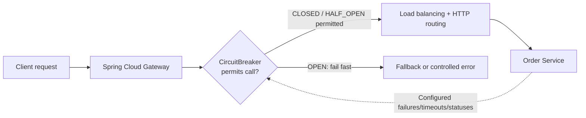
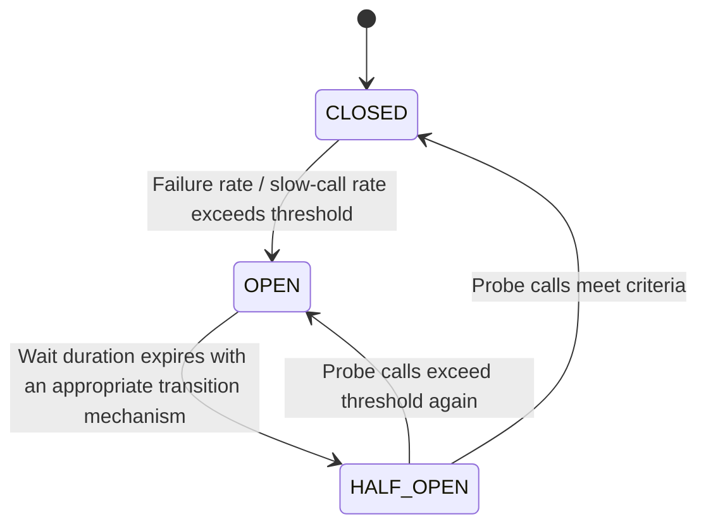
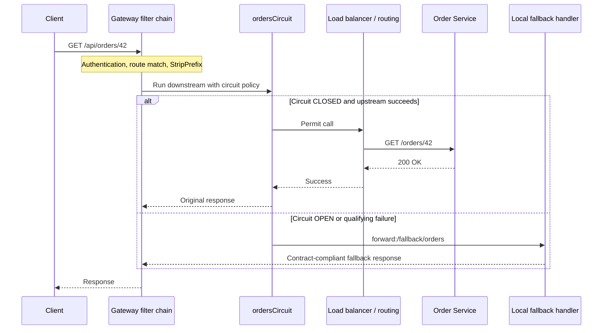

# Integrating the CircuitBreaker Filter with Spring Cloud CircuitBreaker

## Lesson Objectives

In the **Circuit Breakers and Fallbacks** chapter of **Spring Cloud Gateway**, this lesson guides you through integrating the **`CircuitBreaker` GatewayFilter Factory** with **Spring Cloud CircuitBreaker** and its common implementation based on **Resilience4j**. The goal is to help the API Gateway detect a failing upstream, limit repeated calls to that upstream, return an appropriate fallback response, and automatically probe for recovery according to policy.

After this lesson, you will be able to:

- Describe the three states **CLOSED, OPEN, HALF_OPEN** and how a circuit breaker transitions between them based on error or latency statistics.
- Distinguish the roles of the **Gateway `CircuitBreaker` filter**, the **Spring Cloud CircuitBreaker** abstraction, and the **Resilience4j** implementation.
- Add dependencies and configure a route's `CircuitBreaker`, circuit name, and `fallbackUri: forward:/...`.
- Configure `resilience4j.circuitbreaker.instances` and `resilience4j.timelimiter.instances` using the same circuit name.
- Understand which conditions are **exceptions**, which are **HTTP statuses**, and when `statusCodes` must be configured to trigger fallbacks.
- Design fallbacks that preserve HTTP semantics, authorization, and data integrity, without "faking success" for critical transactions.
- Analyze interactions between the breaker and `Retry`, `RequestRateLimiter`, `RewritePath`, load balancing, timeouts, and Spring Security WebFlux.
- Write integration tests verifying circuit state transitions, fallbacks, recovery, and metrics in a multi-replica Gateway environment.

> The technical scope is **Spring Cloud Gateway Server WebFlux**, not Gateway Server MVC. Property names and APIs may differ across Spring Cloud Gateway/Spring Boot/Resilience4j release lines. The YAML examples below use the `spring.cloud.gateway.routes` namespace common in many Server WebFlux 4.x releases; newer lines may use `spring.cloud.gateway.server.webflux.routes`. Check your project's exact dependencies before implementing.

## 1. The Problem: A Failing Upstream Bottlenecks the Gateway

Suppose a client sends:

```http
GET /api/orders/42 HTTP/1.1
Host: api.example.com
Authorization: Bearer <access-token>
```

The Gateway has authenticated the user, matched the route to `order-service`, and called an instance via `lb://order-service`. One day, the Order Service's database slows down or the service becomes unavailable. If the Gateway keeps forwarding **every request** to the upstream:

- Requests can wait until timeout, increasing **latency** and active connection counts.
- Clients may retry on their own; the Gateway may also retry and cause **request amplification**.
- The already failing upstream receives even more load, prolonging recovery time.
- Other backends can be impacted when they share threads, connection pools, CPU, network, or infrastructure resources.

A **circuit breaker** acts like an electrical breaker: it observes upstream call outcomes, and once a failure threshold is exceeded, it **temporarily stops letting additional normal calls pass through**. After a wait duration, a few probe calls are permitted through to decide whether the circuit can close again.



A circuit breaker **does not predict** that a service will fail in advance; it relies on observed data and policy to decide whether to continue sending requests. The first requests during an outage can still experience timeouts or errors before the breaker opens.

### 1.1. The Three Basic States

| State | Behavior | Operational Meaning |
| --- | --- | --- |
| **CLOSED** | Allows calls through, records outcomes, and evaluates thresholds | System operates normally or is collecting samples |
| **OPEN** | Most normal calls are rejected immediately, typically raising `CallNotPermittedException` in the Resilience4j implementation | Upstream load is reduced; callers receive an early fallback/error |
| **HALF_OPEN** | Lets a limited number of probe calls through to evaluate recovery | If probes meet criteria, returns to CLOSED; if failures continue, returns to OPEN |



Resilience4j also has special states/modes such as **DISABLED**, **FORCED_OPEN**, and **METRICS_ONLY** for dedicated control scenarios. These are not the three standard states of the self-healing cycle.

### 1.2. Why Not Open the Circuit After a Single Error?

If a service experiences one transient error while thousands of other requests succeed, opening the circuit after a single failure would be overly sensitive. A circuit breaker usually computes failure rates over a **sliding window** with a minimum sample count.

For example:

```text
slidingWindowSize   = 20 calls
minimumNumberOfCalls = 10
failureRateThreshold = 50 (%)
```

Once enough samples are collected in the window, a failure rate reaching the configured threshold can open the breaker. Before reaching **minimumNumberOfCalls**, the breaker does not open based on the failure rate of just the first few requests under the standard mechanism.

This statistic tracks **calls observed by the circuit breaker**. If an external request is rejected by Spring Security before the Gateway filter chain or blocked by a rate limiter before the breaker, it may **not enter the circuit's sample set**.

## 2. Three Components Working Together

A typical integration consists of:

```text
Spring Cloud Gateway route
  └─ CircuitBreaker GatewayFilter Factory
       └─ Spring Cloud CircuitBreaker abstraction
            └─ Resilience4j reactive CircuitBreaker + TimeLimiter
```

| Component | Role | What It Does Not Do on Its Own |
| --- | --- | --- |
| **Gateway `CircuitBreaker` filter** | Inserts circuit-breaking logic into a route's pipeline, configuring circuit name and fallback | Does not define the full statistical algorithm or perform authorization |
| **Spring Cloud CircuitBreaker** | Unified abstraction/factory for creating and using circuit breakers | Not an HTTP backend or service discovery |
| **Resilience4j** | Implements state management, sliding windows, failure/slow-call thresholds, half-open, and related metrics/mechanisms | Does not rewrite paths or select service instances |
| **`ReactiveLoadBalancerClientFilter`** | Resolves `lb://` URIs to instances if the route uses load balancing | Does not decide when the breaker should open |
| **HTTP routing** | Executes the request to the target URI | Does not replace circuit breakers, timeouts, and policies |

Gateway uses WebFlux **reactive publishers**. Filters have ordering and multiple pre/post layers; the circuit breaker wraps a downstream segment to observe completion/error signals and trigger fallbacks. Therefore, **relative ordering with Retry, rewrites, and custom filters** can change what constitutes a counted "call."

### 2.1. Required Dependencies

For Spring Cloud Gateway Server WebFlux and Resilience4j, a commonly used starter is:

```xml
<dependency>
    <groupId>org.springframework.cloud</groupId>
    <artifactId>spring-cloud-starter-circuitbreaker-reactor-resilience4j</artifactId>
</dependency>
```

Additionally, the application needs Spring Cloud Gateway Server WebFlux and a compatible Spring Boot version; if routes use `lb://`, Spring Cloud LoadBalancer and an appropriate instance list source are required. **Do not guess** starter versions or arbitrarily pick a Resilience4j version incompatible with the project's Spring Cloud BOM.

If the proper implementation/factory is missing, the `CircuitBreaker` configuration may not be created or routes may not function correctly. When encountering startup errors, check dependencies and the Spring Cloud release train before changing filter names.

### 2.2. Distinguishing CircuitBreaker and TimeLimiter

- **CircuitBreaker** decides whether to let a call proceed based on error/slow-call statistics and current state.
- **TimeLimiter** can limit **how long to wait for a call's result**; when exceeded, the call is treated as timed out according to the specific integration.
- **HTTP client connect/response timeouts** are connection or response limits at the Reactor Netty/Gateway layer.

No single property automatically replaces all HTTP client timeouts and the entire end-to-end request budget. When designing a latency budget, account for network, pools, timeouts, retry backoff, and fallback generation time.

## 3. Minimal Example: Route-Level CircuitBreaker Filter

Suppose `order-service` accepts paths under `/orders/**`, while public clients call `/api/orders/**`. We configure the Gateway to match the route, strip the `/api` prefix, wrap the upstream segment in a circuit breaker, and forward to an internal fallback if needed.

```yaml
spring:
  cloud:
    gateway:
      routes:
        - id: orders-read
          uri: lb://order-service
          predicates:
            - Path=/api/orders/**
            - Method=GET
          filters:
            - StripPrefix=1
            - name: CircuitBreaker
              args:
                name: ordersCircuit
                fallbackUri: forward:/fallback/orders
```

Key points to read accurately:

1. `Path` and `Method` determine which requests **match** the `orders-read` route.
2. `StripPrefix=1` turns `/api/orders/42` into `/orders/42` to match the backend path.
3. `CircuitBreaker` uses the name **`ordersCircuit`** to look up or create a circuit according to Spring Cloud CircuitBreaker/Resilience4j configuration.
4. `fallbackUri: forward:/fallback/orders` points to an **internal handler inside the Gateway application** dispatched via `forward`, not an HTTP call to `http://fallback-service`.
5. `lb://order-service` uses load balancing to locate a backend; it is a separate concern from breaker state.



In the diagram, a qualifying failure can be an **exception, a timeout, or an HTTP status included in the breaker configuration**. **Do not assume every HTTP 5xx causes the circuit to record a failure or invoke the fallback**: status handling must be verified and may require configuring `statusCodes`.

### 3.1. Minimal Fallback Handler

A Gateway application can declare an internal WebFlux handler:

```java
import java.util.Map;
import org.springframework.http.HttpStatus;
import org.springframework.http.MediaType;
import org.springframework.http.ResponseEntity;
import org.springframework.web.bind.annotation.GetMapping;
import org.springframework.web.bind.annotation.RestController;
import reactor.core.publisher.Mono;

@RestController
class OrdersFallbackController {

    @GetMapping(path = "/fallback/orders",
                produces = MediaType.APPLICATION_JSON_VALUE)
    Mono<ResponseEntity<Map<String, String>>> unavailable() {
        return Mono.just(
            ResponseEntity.status(HttpStatus.SERVICE_UNAVAILABLE)
                .body(Map.of(
                    "code", "ORDERS_TEMPORARILY_UNAVAILABLE",
                    "message", "Please try again later"
                ))
        );
    }
}
```

Here the fallback returns **503 Service Unavailable**, not a fake `200 OK` just to make dashboards look green. The handler intentionally avoids printing exceptions, backend URLs, internal IPs, tokens, or personal data in the response.

**Security point to review:** `/fallback/orders` is a URL handler inside the WebFlux application. Depending on routing/security setup, external clients **could call it directly** if exposed. Design Spring Security/network policies and handle direct access carefully; do not assume `forward:` automatically makes a fallback endpoint secret or internal-only.

### 3.2. Expected Outcomes

| Scenario | Expected Behavior |
| --- | --- |
| Backend healthy, circuit CLOSED | Normal backend response is returned |
| Connect timeout/exception recognized as failure by breaker | Routes to fallback if `fallbackUri` is valid |
| Circuit OPEN | Calls can be rejected early, returning fallback instead of calling backend |
| Backend returns HTTP 503 without status handling configured | **Not guaranteed** to trigger fallback; depends on contract/filter |
| Backend returns HTTP 503 configured in `statusCodes` | Can be routed into the failure/fallback branch |
| Fallback handler fails | Client may receive fallback error; no guarantee fallback always succeeds |
| Request does not match route | Route filters do not run; other routes/404 handle it |

A fallback does not prove the microservice has recovered. Only real calls permitted in CLOSED/HALF_OPEN provide upstream evaluation signals; fallback successes must be measured **separately**, avoiding counting them as backend successes.

## 4. Turning HTTP Statuses into Circuit Breaker Conditions

A common scenario is when the backend **does not throw an exception** but returns:

```http
HTTP/1.1 503 Service Unavailable
Content-Type: application/json

{"error":"upstream overloaded"}
```

To the HTTP client, this can still be a **protocol-valid HTTP response**, even though it represents a business/operational error. To make the `CircuitBreaker` GatewayFilter treat specific statuses as conditions to run the fallback, Spring Cloud Gateway supports the **`statusCodes`** parameter in compatible versions.

For example:

```yaml
spring:
  cloud:
    gateway:
      routes:
        - id: orders-read
          uri: lb://order-service
          predicates:
            - Path=/api/orders/**
            - Method=GET
          filters:
            - StripPrefix=1
            - name: CircuitBreaker
              args:
                name: ordersCircuit
                fallbackUri: forward:/fallback/orders
                statusCodes:
                  - 500
                  - 502
                  - 503
                  - 504
```

**Meaning:** the listed specific response statuses will be treated as failure conditions for the circuit/fallback according to the Gateway filter mechanism in supporting versions. There is no need to add `404 Not Found` to the list if 404 represents an order that genuinely does not exist.

| HTTP Status | Should It Trigger Fallback for Order Service? | Why |
| --- | --- | --- |
| 200 | No | Upstream is operating according to contract |
| 404 | Usually **no** | May indicate a nonexistent resource, not unavailability |
| 400 | No | Invalid request; client must fix input |
| 401/403 | **No** | Authentication/authorization failure, not an availability error |
| 429 | Policy-dependent, usually not grouped with connection errors | Upstream actively rate-limiting; handle retry/backoff separately |
| 500 | Possibly | Server error; consider whether data-bug 500s should open the circuit |
| 502/503/504 | Usually strong candidates | Upstream/network/timeout unavailability |

Do not treat the table above as mandatory HTTP law: APIs have differing semantics. What matters is **not letting errors from bad user input or missing permissions open the circuit for all customers**.

### 4.1. Numeric Statuses and Names

Depending on the factory version, `statusCodes` may accept **numeric codes** and **HTTP status enum names** such as `NOT_FOUND`. Numeric codes are used in the example to avoid enum name confusion, and you should test that the configuration binds properly. An unsupported value or wrong YAML indentation can prevent the filter from initializing.

### 4.2. Exceptions vs. HTTP Statuses

Examples of different cases:

```text
ConnectException       → Could not establish TCP connection
TimeoutException       → Exceeded allowed duration
CallNotPermittedException → Circuit OPEN so call is rejected
HTTP 503 response      → Server actually returned status 503
HTTP 404 response      → Server returned status 404, possibly a normal business outcome
```

Gateway/Resilience4j can apply **`recordExceptions`**, **`ignoreExceptions`**, or custom predicates at the implementation level. Do not assume every `Exception` means the backend is unhealthy: client cancellation, validation, serialization, or fallback errors may need separate classification.

## 5. Configuring Resilience4j by Circuit Name

When using the **Spring Cloud CircuitBreaker Reactor Resilience4j** starter, you can configure an instance using the **same name** used by the Gateway:

```yaml
resilience4j:
  circuitbreaker:
    instances:
      ordersCircuit:
        slidingWindowType: COUNT_BASED
        slidingWindowSize: 20
        minimumNumberOfCalls: 10
        failureRateThreshold: 50
        slowCallRateThreshold: 70
        slowCallDurationThreshold: 2s
        permittedNumberOfCallsInHalfOpenState: 3
        waitDurationInOpenState: 15s

  timelimiter:
    instances:
      ordersCircuit:
        timeoutDuration: 3s
```

The values above are **solely for illustrating how to read a policy**, not fixed optimal choices:

| Property | Role | How to Reason About It |
| --- | --- | --- |
| `slidingWindowType` | Window by call count (`COUNT_BASED`) or time (`TIME_BASED`) | Pick the statistical model meaningful for your traffic |
| `slidingWindowSize` | Window size | Too small causes flapping; too large slows reaction |
| `minimumNumberOfCalls` | Minimum calls before evaluating rate to open circuit | Avoid deciding on just a few samples |
| `failureRateThreshold` | Percentage of failed calls to open circuit | Align with SLO/backend characteristics |
| `slowCallRateThreshold` | Percentage of slow calls to open circuit | Protects when backend is not outright failing but latency degrades |
| `slowCallDurationThreshold` | Duration threshold to consider a call slow | Distinct from timeout |
| `permittedNumberOfCallsInHalfOpenState` | Number of probe calls allowed in HALF_OPEN | Avoid sudden load spikes when testing recovery |
| `waitDurationInOpenState` | Wait duration before eligibility to transition to HALF_OPEN | Not a promise the backend will be healthy after exactly this period |
| `timelimiter.instances.*.timeoutDuration` | Timeout threshold at the TimeLimiter layer | Must align with HTTP connect/response timeouts and overall deadline |

**Subtle point:** some Resilience4j configurations have an `automaticTransitionFromOpenToHalfOpenEnabled` option. When automatic transition is not enabled, the circuit may only transition when a new call arrives after the wait duration. Therefore, do not assume "after 15 seconds three probes will definitely have run" if no requests arrived.

### 5.1. Example Threshold Calculation

Suppose:

```text
slidingWindowSize = 20
minimumNumberOfCalls = 10
failureRateThreshold = 50%
```

After ten recorded calls, if at least five calls are classified as failures in the active window, the error rate can hit the threshold to open the circuit. Once 20 samples are present, Resilience4j's sliding window evicts or updates statistics as new samples arrive.

Do not substitute **client-sent requests** for **calls received and evaluated by the circuit** if requests were blocked earlier by Security/RateLimiter, failed fast by an OPEN circuit, or amplified into multiple attempts by Retry elsewhere.

### 5.2. Failure Rate and Slow-Call Rate Are Two Separate Signals

An upstream might return `200 OK` while taking 10 seconds. In that case:

- It can count as a **success by status**.
- It can still count as a **slow call** if it exceeds `slowCallDurationThreshold`.
- If it exceeds the TimeLimiter timeout, it can become a **timeout failure** instead of a success.

Hence, you must consider **latency** as well, not only HTTP 5xx rates. However, do not set `slowCallDurationThreshold` below normal latency or TimeLimiter too short, which would constantly trip the circuit under moderate load increases.

### 5.3. Do Not Confuse Resilience4j Config with the Gateway Filter

For example, having:

```yaml
name: ordersCircuit
```

in Gateway and:

```yaml
resilience4j:
  circuitbreaker:
    instances:
      ordersCircuit:
```

in Resilience4j. **The names must match** according to how the factory creates instances. Otherwise, the application may fall back to default settings instead of the dedicated policy you think you are applying.

When `configs.default`, group configs, programmatic customizers, or property overrides exist, precedence can affect effective values. Inspect the **runtime circuit instance** and metrics, not just valid-looking YAML.

## 6. What Should a Fallback Return?

`fallbackUri` specifies **where to route processing** when the circuit stops a call from proceeding or when downstream fails appropriately. It does not decide the best **content or HTTP status** for the business case.

### 6.1. Fallback for Read APIs

For:

```http
GET /api/catalog/top-products
```

A fallback may return short-lived cached public data if:

- Stale data remains safe and acceptable from a product standpoint.
- There is a clear way to indicate non-fresh data, such as a header metadata or a `stale` field.
- The cache does not mix user/tenant data and has a valid age limit.
- It does not pretend to be accurate real-time data such as a bank balance.

Illustrative response:

```http
HTTP/1.1 200 OK
Content-Type: application/json
Cache-Control: max-age=30

{"items":[],"stale":true}
```

**Only return 200 when the contract permits** treating this as an acceptable success. An empty list `[]` can be interpreted by a frontend as "there really are no products," which is very different from "the service is failing." When a trustworthy backup value cannot be provided, **returning an honest 503** is usually better.

### 6.2. Fallback for Write or Sensitive APIs

Do not create fallbacks like:

```http
POST /api/payments/charge

HTTP/1.1 200 OK
{"status":"paid"}
```

when the payment backend has not confirmed charging the customer. That is **fake success**, which can cause financial loss or ledger discrepancies.

For write actions, you need to:

- Determine whether the request was executed by the backend or only the response was lost.
- Use idempotency keys and backend deduplication per contract.
- If accepting an async task, only return `202 Accepted` when the system has **durably persisted** the task into an appropriate queue/ledger.
- If there is no guarantee, return an appropriate error and guide the client to check transaction status.
- Never repeat non-idempotent POSTs simply because `Retry` or a circuit fallback is active.

### 6.3. Fallbacks and Personal Data

A fallback handler must not bypass authentication/authorization:

- Do not trust client-supplied `X-User-Id` or `X-Tenant-Id` as identity.
- Do not return a shared cache if it holds another user's personal orders/profiles.
- Do not include raw exceptions, backend URIs, tokens, cookies, or stack traces in the response.
- Do not access confidential internal services from the fallback without a clear trust boundary.

If `/fallback/orders` is a directly reachable handler, protect it with the Security WebFilterChain or an appropriate routing/handler design; **do not assume the `/fallback` prefix automatically makes an endpoint private**.

### 6.4. Local Fallback vs. Remote Fallback Service

| Model | Advantages | Risks |
| --- | --- | --- |
| **Local forward handler** | No extra network call needed to produce an error/static response | Must manage endpoint, code, and security inside the Gateway |
| **Dedicated fallback service** | Can provide specialized cache/reconciliation | Can become a new dependency needing its own timeouts/circuit and security |
| **No fallbackUri** | Lets circuit/timeout errors go through standard error handling | Client receives an error; needs stable status and body mapping |

In the Gateway `CircuitBreaker` filter, **`fallbackUri` is designed for `forward:` URIs**. Do not directly change it to `fallbackUri: lb://other-service` assuming the Gateway will make an HTTP call to that service. To forward to a remote fallback service, configure **an appropriate route/handler for the forward path** and test the routing behavior.

## 7. Inspecting the Fallback Cause via Exchange Attribute

When using `CircuitBreaker` and an internal fallback, the Gateway can store exception details in an exchange attribute, typically accessed via the constant:

```java
import static org.springframework.cloud.gateway.support.ServerWebExchangeUtils
    .GATEWAY_CIRCUITBREAKER_EXECUTION_EXCEPTION_ATTR;
```

A handler can inspect the error type **for internal telemetry**, for example:

```java
import java.util.Map;
import org.slf4j.Logger;
import org.slf4j.LoggerFactory;
import org.springframework.http.HttpStatus;
import org.springframework.http.ResponseEntity;
import org.springframework.web.bind.annotation.GetMapping;
import org.springframework.web.bind.annotation.RestController;
import org.springframework.web.server.ServerWebExchange;
import reactor.core.publisher.Mono;

import static org.springframework.cloud.gateway.support.ServerWebExchangeUtils
    .GATEWAY_CIRCUITBREAKER_EXECUTION_EXCEPTION_ATTR;

@RestController
class OrdersFallbackWithTelemetry {
    private static final Logger log =
        LoggerFactory.getLogger(OrdersFallbackWithTelemetry.class);

    @GetMapping("/fallback/orders")
    Mono<ResponseEntity<Map<String, String>>> fallback(
            ServerWebExchange exchange) {

        Throwable cause = exchange.getAttribute(
            GATEWAY_CIRCUITBREAKER_EXECUTION_EXCEPTION_ATTR
        );

        log.warn("orders fallback causeType={}",
            cause == null ? "unknown" : cause.getClass().getSimpleName());

        return Mono.just(
            ResponseEntity.status(HttpStatus.SERVICE_UNAVAILABLE)
                .body(Map.of("code", "ORDERS_UNAVAILABLE"))
        );
    }
}
```

This is an **alternative variant** to the controller in Section 3.1; **do not declare both `GET /fallback/orders` handlers at the same time** in a real application as it will cause a mapping conflict.

**Do not blindly log** `cause.getMessage()`: error messages can contain full URLs, query parameters, tokens, personal data, or infrastructure addresses. For observability, prefer the normalized exception **type**, route ID, circuit name, circuit state, and trace ID.

### 7.1. Forwarding the Cause to Another Fallback Service

Spring Cloud Gateway also provides the **`FallbackHeaders` GatewayFilter Factory** for certain forward/fallback service architectures. It can add exception metadata into **request headers** sent to a fallback service.

Use it only when there is a contract between services and a sufficiently trusted connection. Exception types/messages can reveal internal details; review header propagation or stripping from a security perspective to avoid reflecting raw exceptions to the Internet. Do not enable `FallbackHeaders` on all routes by default or copy raw exception messages into responses.

## 8. Circuit Names and Isolation Boundaries

Resilience4j circuit breakers are identified by **instance name**, such as `ordersCircuit`. A circuit's boundary must be intentionally designed:

```text
ordersCircuit
  route GET /api/orders/** → lb://order-service
```

If multiple routes **share the name** `ordersCircuit`, they can share the state and statistics of that circuit instance. An error on one route can affect the other if they use the same name under the same factory. If the goal is to isolate read-heavy APIs from write APIs, use separate names:

```text
ordersReadCircuit
ordersWriteCircuit
```

At the same time, you should not create a separate circuit for **every request/user/UUID**, because that explodes the number of states and metrics and prevents collecting enough samples for the circuit to be meaningful.

### 8.1. A Logical-Service Circuit Is Not Necessarily Per Backend Instance

When a route has:

```yaml
uri: lb://order-service
```

LoadBalancer can pick one of several instances. A `CircuitBreaker` placed at the route/circuit-name level **typically observes call outcomes to the logical service**, rather than automatically creating a separate circuit for each resolved `host:port`.

This has two sides:

- **Advantage:** when the whole service is failing, a shared circuit reduces traffic to the service.
- **Disadvantage:** one bad instance in the group can drive up the failure rate and affect decisions for healthy instances too if there is no mechanism to eject the bad instance.

Load balancing, health checks, instance eviction, retry strategy, and circuit isolation are **separate mechanisms**. Do not assume a per-route circuit breaker automatically knows which specific instance just failed.

### 8.2. Multiple Gateway Replicas Sharing the Same Circuit Name

Suppose you have:

```text
Gateway A → ordersCircuit
Gateway B → ordersCircuit
Gateway C → ordersCircuit
```

With **standard in-memory Resilience4j configuration**, each JVM/replica has its **own** circuit state and sliding window. Sharing a name does not automatically create a distributed circuit sharing state across three pods.

Consequences:

- Pod A may be OPEN while pod B is still CLOSED.
- A low-traffic replica may not have reached `minimumNumberOfCalls` to open its circuit.
- Dashboards must observe state per instance/replica and aggregate carefully.

This is not necessarily a flaw: a local circuit breaker avoids a shared-state dependency on the request path. Operationally, however, **do not conclude the whole cluster is OPEN just because one pod is OPEN**; apply traffic management or additional policies if needed.

## 9. Interaction with Retry, Rate Limiting, and Timeouts

### 9.1. CircuitBreaker and Retry: Which Filter Wraps Which?

Consider two logical structures:

```text
Option A:
  CircuitBreaker
    └─ Retry
         └─ LoadBalancer + HTTP routing
```

```text
Option B:
  Retry
    └─ CircuitBreaker
         └─ LoadBalancer + HTTP routing
```

**A — CircuitBreaker outside Retry:** one call observed by the breaker can represent **the entire group of attempts**, depending on how Retry emits final results and errors. If Retry recovers and returns success, the outer breaker may only see the final success; it does not necessarily count each failure of internal attempts.

**B — Retry outside CircuitBreaker:** each re-execution of the downstream segment can invoke the circuit breaker separately, so multiple failures of the same client request contribute to statistics. Once the breaker is OPEN, subsequent retries may hit `CallNotPermittedException`; continuing pointless retries only adds load to the Gateway.

This is a **conceptual model explaining publisher composition**, not a guarantee that every version runs the exact number of attempts shown. With GatewayFilter ordering, global filters, `Ordered`, and how Retry resubscribes, you must inspect the **effective filter chain and actual outbound attempt counts**.

**Design recommendation:** choose a small retry budget with backoff and a deadline; decide whether the breaker measures **logical requests** or **upstream attempts**. Avoid infinite retries or fallbacks that send unnecessary load to a failing upstream.

### 9.2. Where Does Rate Limiting Sit?

A typical target structure is:

```text
TLS/Ingress
  ↓
Spring Security: authentication/authorization
  ↓
RequestRateLimiter per user/tenant
  ↓
CircuitBreaker
  ↓
HTTP routing
```

When the rate limiter sits outside the retry/circuit region, it usually counts **one inbound request** per client rather than multiplying by Retry attempts. If placed inside the retried section, quota risks being deducted multiple times. At the same time, even with proper rate limiting, you must still control **outbound attempts** to prevent request amplification.

Requests blocked by Spring Security **before** the Gateway filter chain may not be observed by the route's rate limiter/circuit. Therefore, ingress/WAF needs separate protection against excessive unauthenticated traffic.

### 9.3. Timeouts and the Circuit Breaker

A timeout stack typically includes:

```text
Client deadline
  └─ Gateway end-to-end deadline
       └─ Retry budget / backoff
            └─ CircuitBreaker TimeLimiter
                 └─ HTTP connect/response timeout
```

This is not every application's default structure; it is a mental model for designing a **time budget**. For example, if the client waits at most 2 seconds while the Gateway has a 10-second TimeLimiter and three 5-second attempts, the client may drop the connection before the Gateway finishes.

When TimeLimiter raises a timeout:

- Determine whether downstream was cancelled and HTTP resources were released.
- Do not assume the backend **did not** execute the work if the request timed out.
- Fallbacks must not fabricate results for write transactions whose true state is unknown.
- Metrics must distinguish timeouts, connection errors, backend 5xx, and circuit OPEN rejections.

### 9.4. CircuitBreaker Is Not a Bulkhead

A circuit breaker **does not by default limit concurrent requests**. If a service still has a low error rate but responds very slowly, in-flight calls can pile up. `slowCallRateThreshold` helps detect slow calls, but it is not a hard semaphore concurrency limit.

When resource protection is needed:

- Use a bulkhead/concurrency limit appropriate for Reactor/WebFlux and your infrastructure.
- Set clear timeouts and connection pool/budgets.
- Never block the Netty event loop with `Thread.sleep()` or blocking `Semaphore.acquire()`.
- Use separate policies for SSE, streaming, and WebSocket due to long connection lifetimes.

## 10. Fallbacks and Spring Security, CORS, and Headers

### 10.1. Authentication Must Remain Enforced

A request like:

```http
GET /api/orders/42
Authorization: Bearer <invalid-token>
```

must not receive personal fallback data just because the upstream is OPEN. The **Security WebFilterChain** usually runs before Gateway route filters, while the backend also checks resource-level permissions.

In designs where an internal fallback handler can access cached data, ensure it **cannot leak another user/tenant's data** and never treats client-provided headers as proof of identity. Fallbacks for sensitive data should return a safe error if equivalent authorization cannot be enforced.

### 10.2. CORS When Fallback Returns 503

If a frontend at `https://portal.example.com` calls the Gateway cross-origin, a 503 fallback response still needs CORS headers consistent with route/edge policy so the frontend can read allowed error codes.

If the fallback forwards to a handler taking a different execution path, test that:

- Preflight OPTIONS requests are handled at the proper CORS layer.
- Actual requests with an allowed `Origin` receive proper headers, even when the circuit is OPEN.
- `Access-Control-Allow-Origin` is not duplicated across Gateway, fallback handler, and ingress.
- Wildcard origin/credentials are never opened up to "fix" a 503 fallback error.

### 10.3. Response Status and Body Must Not Contradict Each Other

A fallback can change both the response status and body compared to upstream. When producing a new response:

- `Content-Type` reflects the actual body, such as JSON.
- `Content-Length`, `Transfer-Encoding`, and `Content-Encoding` are handled properly by the HTTP writer.
- Do not keep upstream `ETag`, `Content-Range`, or cache validators if the representation has changed.
- Do not return a body for statuses/methods that forbid bodies, such as 204 or HEAD.
- Never log sensitive bodies/tokens/exception messages.

When using `ModifyResponseBody` or custom decorators alongside CircuitBreaker, examine **filter order and response commit**. Once part of the response has been written to the client, the Gateway cannot arbitrarily retract it to send a new fallback body.

### 10.4. A Fallback Is Not a Default Cache

Some systems want the Gateway to fall back to stale data when a service fails. However, a circuit breaker itself **does not store a cache** and does not guarantee backup data. You need an intentionally designed cache source with TTL, tenant/user keys, and appropriate access control policies.

Do not take "fallback configured" as proof that an API is always available or always returns accurate data.

## 11. Monitoring Circuit Breakers in Production

With Micrometer/Actuator and proper Resilience4j metrics integration, monitor:

| Signal | Meaning | How to Use |
| --- | --- | --- |
| Circuit state by name/replica | CLOSED, OPEN, HALF_OPEN | Detect prolonged open circuits |
| Number of failed/successful/not-permitted calls | Outcomes seen by the circuit | Distinguish backend failures from early-rejected calls |
| Slow call count/rate | Slow upstream before outright errors | Tune slow-call threshold |
| Circuit open rate | Frequency of transitions to OPEN | Detect overly sensitive thresholds or unstable upstreams |
| TimeLimiter timeout count | Requests exceeding timeout | Check latency budget/network |
| Fallback response count and status | How many requests degraded | Prevent fallback successes from masking real failures |
| HTTP 5xx/timeouts per route | API SLO | Track client impact |
| Outbound attempts/retries | Number of HTTP calls to backend | Detect retry amplification |
| In-flight/connection pool | Resource pressure | Add bulkheads and timeouts |

Exact metric names/labels depend on the Resilience4j, Spring Boot Actuator, Micrometer, and export configuration versions. For instance, some setups expose metrics like `resilience4j.circuitbreaker.calls` and `resilience4j.circuitbreaker.state`; do not treat those names as immutable—verify the actual metrics exposed at runtime.

### 11.1. Reasonable Logging Without Secrets

For example:

```text
route=orders-read circuit=ordersCircuit state=OPEN
outcome=fallback causeType=CallNotPermittedException status=503
traceId=<trace-id>
```

Do not log:

```text
Authorization: Bearer ...
Cookie: SESSION=...
backendUrl=https://backend.internal/orders?token=...
exceptionMessage=<raw-error>
```

Route ID, circuit name, normalized error type, and a controlled trace ID are usually enough for investigation without creating new sensitive-data leak vectors.

### 11.2. Questions to Answer When a Circuit Is OPEN

1. Did it open due to **exceptions**, **statusCodes**, or **slow calls**?
2. Was the sample count sufficient per `minimumNumberOfCalls`?
3. Are client/authorization errors being miscounted as upstream failures?
4. Are TimeLimiter/HTTP timeouts too short compared to normal latency?
5. Is Retry multiplying attempts and opening the circuit sooner than expected?
6. Is the circuit name shared by routes that should not affect each other?
7. Do other Gateway instances share the same state?
8. Does CORS/fallback let the frontend see the real error?
9. Has the backend recovered while HALF_OPEN probe traffic is insufficient?

Do not "fix" it by setting `failureRateThreshold: 100` or removing all timeouts without identifying the root cause; that can mask failures without restoring SLOs.

## 12. Integration Testing with a Mock Backend

A unit test that only reads YAML and sees the name `CircuitBreaker` **is not enough**. You must run the real Gateway in an integration test with a backend stub where you control statuses, response times, received request counts, and instance IDs.

### 12.1. Test Matrix

| Scenario | Upstream / State | What to Verify |
| --- | --- | --- |
| Healthy backend | GET → fast 200 | Original response returned, no fallback |
| Connection exception | Backend unreachable | Fallback/error matches contract |
| Listed HTTP status | Backend → 503 | Circuit records/triggers fallback per config |
| Business HTTP 404 | Backend → 404 | Does not turn into fallback when 404 is not configured |
| Auth failure | Bad token, Security 401/403 | Does not reach upstream, no fallback exposing private data |
| Below open threshold | A few errors in window | Does not open before reaching sample/threshold criteria |
| Error threshold reached | Enough samples and failure rate | Circuit transitions to OPEN as designed |
| OPEN fail fast | Keep sending requests while OPEN | Backend receives no normal new calls; fast fallback/error |
| HALF_OPEN probe | After wait duration | Probe count matches config, state transitions based on outcome |
| Slow calls | Backend returns 200 very slowly | Recorded as slow calls when exceeding threshold |
| TimeLimiter | Backend slower than timeoutDuration | Proper error/timeout/fallback and resource cleanup |
| Retry before/after breaker | Backend returns 503 once then 200 | Count backend requests and circuit decisions separately |
| Multi-instance backend | One failing instance, one healthy instance | Understand per-route/logical-service breaker, not assuming per-instance |
| Multi-replica Gateway | Two Gateway pods | Independent circuit state under in-memory implementation |
| Fallback handler error | Forward path missing handler/throws | Client gets controlled error; no infinite recursion |
| CORS | Allowed browser Origin | Reads 503/fallback contract, no duplicate CORS headers |
| Concurrency/streaming | Many requests and long streams | No resource leaks; safe timeout/cancellation |

### 12.2. Example Using curl

Suppose the test Gateway runs on `localhost:8080`, route `/api/orders/**`, and the backend stub can switch to 503:

```bash
# Normal case:
curl -i "http://localhost:8080/api/orders/42"

# Repeat requests after configuring the backend stub to return 503:
for i in 1 2 3 4 5 6 7 8 9 10 11 12; do
  curl -s -o /dev/null -w "%{http_code}\n" \
    "http://localhost:8080/api/orders/42"
done
```

Twelve calls are illustrative only. Running twelve calls does not guarantee the circuit will OPEN; it also depends on:

- `minimumNumberOfCalls`, sliding window size, and pre-test state.
- Whether failures are **recorded**; HTTP 503 requires appropriate `statusCodes`/configuration.
- Routing/load balancer, backend stub, and timeout outcomes.
- Whether circuit state is shared from a previous test or another replica.
- Retry, fallback, rate limiting, and other filter chain conditions.

Reset or isolate test circuit state between cases, use a backend stub with a counter, and check **actual outbound requests received**, rather than relying solely on client HTTP status codes.

### 12.3. `WebTestClient` to Test Fallback

Example in an integration test where the Gateway and backend stub are already started:

```java
import org.junit.jupiter.api.Test;
import org.springframework.beans.factory.annotation.Autowired;
import org.springframework.test.web.reactive.server.WebTestClient;

class OrdersCircuitBreakerIntegrationTest {

    @Autowired
    WebTestClient webTestClient;

    @Test
    void returnsSafeFallbackWhenUpstreamIsUnavailable() {
        // Test setup: backend stub produces an error triggering the fallback condition.
        webTestClient.get()
            .uri("/api/orders/42")
            .exchange()
            .expectStatus().isEqualTo(503)
            .expectBody()
            .jsonPath("$.code")
            .isEqualTo("ORDERS_TEMPORARILY_UNAVAILABLE");
    }
}
```

This is an **illustrative assertion snippet**, not a standalone runnable test class. It requires configuring the route, test server, circuit breaker implementation, backend stub, policies/counters, and appropriate security tests. If you use the controller variant from Section 7, the response code may be `ORDERS_UNAVAILABLE` instead of the string above; **choose one consistent fallback contract for tests**.

### 12.4. Testing OPEN/HALF_OPEN Should Not Rely on Blind Sleeps

A test like:

```text
send several failing requests
Thread.sleep(15000)
hope the breaker is now HALF_OPEN
```

can be flaky due to exact open timestamp, auto-transition policy, scheduler timing, and lack of probe requests. For integration tests, it is better to:

- Isolate circuit state per test or use distinct circuit names.
- Check state via framework-supported APIs/registries/metrics in the test environment.
- Script the backend stub to return errors/healthy responses by count or non-blocking latches.
- Wait on a **condition** within a finite test timeout, rather than arbitrary sleeps.
- Verify backend call counts while OPEN to prove **fail fast**.

When testing recovery, send probes once the policy permits and verify the state returns to CLOSED after sufficient successes.

## 13. Common Configuration Errors

### 13.1. Gateway Reports No CircuitBreaker Factory

**Possible causes:** missing the appropriate reactive circuit breaker starter, dependency conflict, or using a version-mismatched namespace/filter.

**Resolution:** check the Spring Cloud BOM/dependencies and runtime route configuration. Do not arbitrarily add another Resilience4j implementation version without checking compatibility.

### 13.2. Backend Returns 503, but No Fallback Runs

**Possible causes:** HTTP 503 is a valid response at the HTTP client layer; `CircuitBreaker` is not configured to handle that status via `statusCodes`, or other route/filters did not execute as expected.

**Resolution:** verify route matching, circuit name, `statusCodes`, actual backend status, and Gateway response output.

### 13.3. Fallback Returns 404

**Possible causes:** `forward:/fallback/orders` has no matching internal handler, mismatched HTTP method/path mapping, or the security layer blocks the handler.

**Resolution:** verify `@GetMapping`/WebFlux handler, the request's HTTP method, and Security/CORS. Do not confuse a fallback 404 with a 404 from Order Service.

### 13.4. Breaker Stays CLOSED Even Though Upstream Fails

**Possible causes:** `minimumNumberOfCalls` not reached, exceptions ignored, HTTP statuses not mapped to failures, circuit name mismatch with instance config, or attempts running through a different circuit.

**Resolution:** inspect circuit metrics, exception types, thresholds/windows, and filter order; write a test with a controlled call count.

### 13.5. Breaker Keeps Opening Even Though Backend Is Healthy

**Possible causes:** timeouts too short, slow-call threshold too low, backend just recovered and lacks enough HALF_OPEN probes, other errors are being recorded, or client requests are amplified by Retry.

**Resolution:** check state transitions, TimeLimiter/HTTP timeouts, p95/p99 data, and probe counts; avoid mass manual circuit resets before ensuring the upstream can handle the load.

### 13.6. One Failing Route Causes Another Route to Fall Back

**Possible causes:** routes share the **same circuit name** or unintentionally share custom configuration/factory state.

**Resolution:** redesign circuit isolation by logical dependency/criticality, inspect runtime names, and do not create per-request circuits as a quick "fix."

### 13.7. Circuit OPEN on Pod A, CLOSED on Pod B

**This may be expected behavior** of Resilience4j local state. Do not assume shared circuit state like RedisRateLimiter. Observe per pod and evaluate traffic volume/sliding window lifecycle on each replica.

### 13.8. 200 Fallback Makes SLOs Look Artificially Good

**Cause:** the fallback returns status 200 and monitoring only measures 5xx rates.

**Resolution:** separate **backend success**, **fallback/degraded response**, and **client-visible success** per contract. You can use an `X-Degraded: true` header or a `stale` field, but control the data and only use it when semantically valid.

## 14. Production Checklist

| Item | Verification Question |
| --- | --- |
| **Dependency** | Is the Spring Cloud CircuitBreaker **reactor-resilience4j** starter compatible with Gateway/Boot installed? |
| **Route** | Have route predicates, `StripPrefix`/rewrites, `lb://`, and target URIs been tested accurately? |
| **Circuit name** | Does the circuit name match Resilience4j config, with proper isolation between routes? |
| **Failure classification** | Do HTTP `statusCodes`, exceptions, and slow calls classify upstream failures accurately? |
| **Thresholds** | Are sliding window, minimum calls, failure/slow thresholds, and half-open probes suited to traffic? |
| **Time budget** | Are TimeLimiter, HTTP connect/response timeouts, Retry, and client deadlines consistent? |
| **Fallback** | Does `forward:` target a real handler without recursion or fake successes for write actions? |
| **Security** | Is the fallback path protected without leaking personal data or bypassing authz? |
| **CORS** | Can browsers read error/fallback responses for allowed origins without duplicate headers? |
| **Concurrency** | Is a bulkhead/rate limit needed in addition to the breaker? |
| **Multi-pod** | Is per-replica state understood, with per-instance health/metrics tested? |
| **Observability** | Are metrics collected for circuit transitions, not-permitted calls, fallbacks, timeouts, backend errors, and retry attempts? |
| **Testing** | Are there tests for 200, 404, 503, exceptions, OPEN, HALF_OPEN, recovery, security, and load? |
| **Rollback** | Is there a safe way to tune/roll back thresholds or temporarily disable fallback if a deployment misbehaves? |

## 15. Practice Exercise with Answers

Given the route:

```yaml
spring:
  cloud:
    gateway:
      routes:
        - id: reports-read
          uri: lb://report-service
          predicates:
            - Path=/api/reports/**
            - Method=GET
          filters:
            - StripPrefix=1
            - name: CircuitBreaker
              args:
                name: reportsCircuit
                fallbackUri: forward:/fallback/reports
                statusCodes:
                  - 502
                  - 503
                  - 504
```

Resilience4j:

```text
slidingWindowSize = 10
minimumNumberOfCalls = 5
failureRateThreshold = 60%
waitDurationInOpenState = 10s
permittedNumberOfCallsInHalfOpenState = 2
```

**Questions:**

1. What path does `GET /api/reports/42` get rewritten to at the backend?
2. If the backend returns HTTP 404 and 404 is not in `statusCodes`, should it automatically fall back?
3. After five observed calls, can three failed calls be enough to trigger OPEN?
4. While the circuit is OPEN, will sending ten more requests necessarily generate ten HTTP calls to `report-service`?
5. After 10 seconds, is the circuit guaranteed to execute two HALF_OPEN probes even if no new requests arrive?
6. If two Gateway pods both use `reportsCircuit`, is circuit state automatically shared between pods?
7. If `Retry` is used inside the breaker scope, can there be multiple outbound attempts for one inbound request?
8. Is it acceptable to return `200 OK` with "fake" report content when no safe backup data source exists?
9. Does CircuitBreaker replace a rate limiter, bulkhead, or Spring Security?
10. If the fallback handler is `/fallback/reports`, can outsiders call that path directly?
11. Are CORS preflight OPTIONS failures solved merely by adding a `CircuitBreaker` filter?
12. Which metrics tell you how many calls were rejected by an OPEN circuit before reaching the backend?

**Suggested Answers:**

1. `StripPrefix=1` removes `/api`, so the upstream normally receives **`/reports/42`**.
2. **Not automatically.** 404 is usually a business outcome; only fall back if intended by contract/policy.
3. **Possibly**: 3/5 = 60% if enough samples are collected, failures are recorded, and active config applies properly.
4. **No.** An OPEN circuit typically rejects most calls early without routing to the backend.
5. **No.** Transitioning to HALF_OPEN and executing probes depend on transition configuration and actual incoming requests.
6. **No.** In-memory Resilience4j is local to each JVM/replica by default.
7. **Yes.** You must measure attempts at the backend; one client request does not automatically equal one outbound call.
8. **No.** Without a contract-compliant fallback, returning an honest 503 is usually safer than faking a successful result.
9. **No.** They control different concerns.
10. **Possibly.** If the handler is exposed, you need a policy preventing inappropriate access or ensuring the response is always safe.
11. **No.** CORS preflight and route matching/security are separate concerns.
12. Track **not-permitted calls / circuit state** (and fallback rate), and compare inbound vs. outbound request counts.

## Summary

Integrating the **`CircuitBreaker` GatewayFilter Factory** with **Spring Cloud CircuitBreaker and Resilience4j** helps Spring Cloud Gateway reduce calls to a failing upstream, probe for recovery automatically, and return appropriate fallbacks. Core configuration includes the circuit name in the route, `fallbackUri: forward:/...`, `statusCodes` treated as failures, and Resilience4j policies for sliding windows, error/slow-call thresholds, HALF_OPEN, and TimeLimiter.

A solid design does not merely make the circuit OPEN when a backend fails; it also **preserves the API contract and security boundaries**: never turning business 401/403/404 responses into availability failures, never faking success for payments, never letting fallbacks leak data, and never confusing a circuit breaker with a bulkhead, rate limiter, or service discovery. Test OPEN/HALF_OPEN states, fallback responses, and recovery against a mock backend, monitor circuits per route/replica, and balance Retry, timeouts, TLS, authorization, and operational telemetry so your microservices gateway is genuinely resilient.
