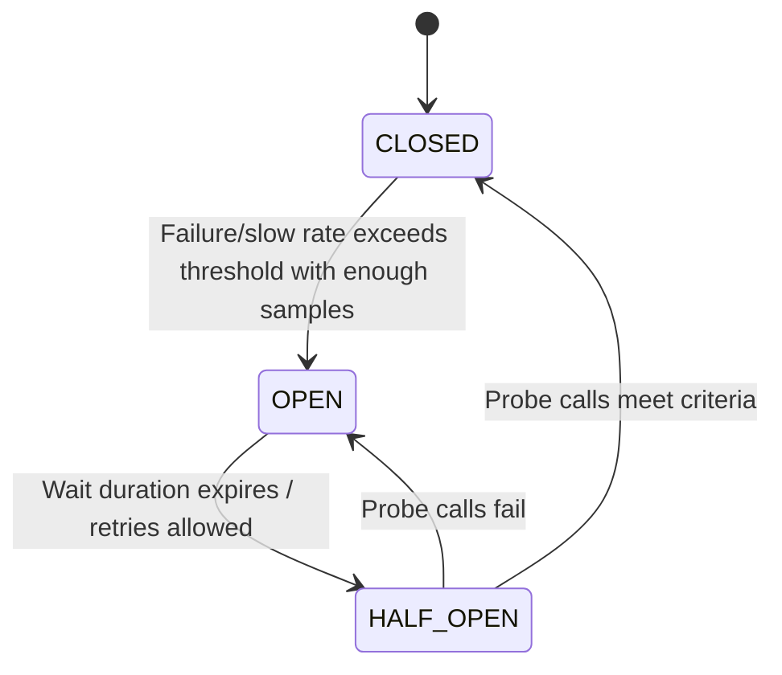
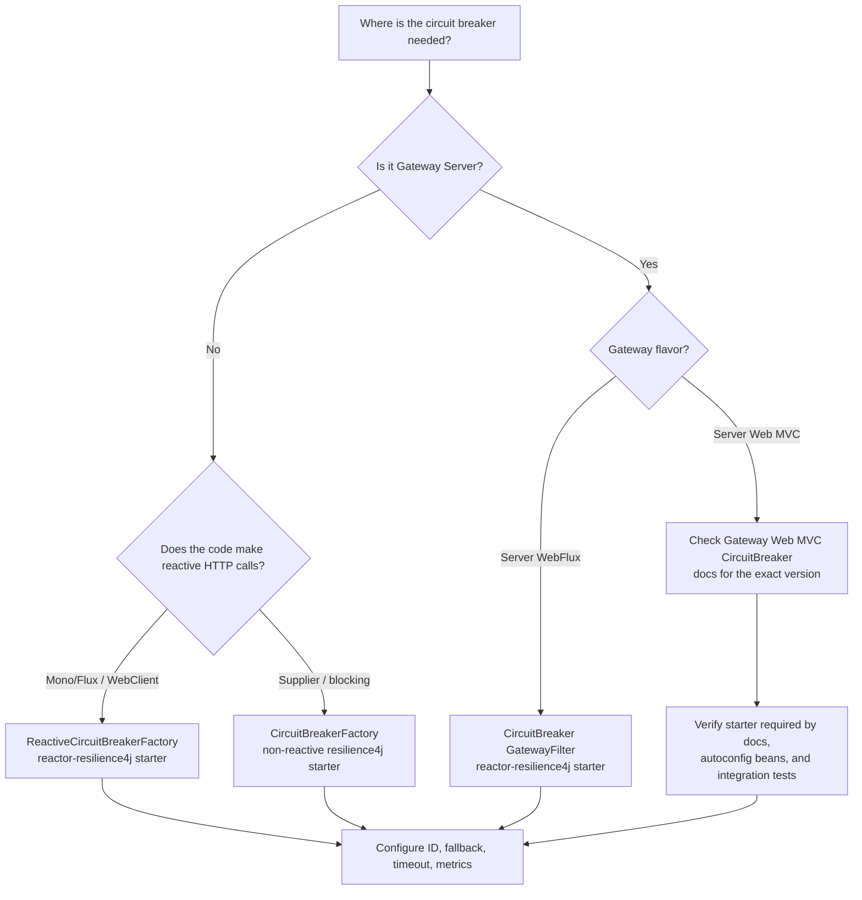

# Choosing the Right Resilience4j Implementation for Your Web Stack

**Chapter:** Circuit Breakers and Fallbacks  
**Module:** `SPRING_CLOUD_GATEWAY` — Spring Cloud Gateway

An API Gateway typically sits between clients and multiple microservices. When a backend fails or responds too slowly, having the Gateway keep pushing every request to that backend can exhaust connections, increase latency, and cause cascading failures across other services. A **circuit breaker** temporarily halts calls to a destination showing signs of ill health, and then probes recovery before reopening traffic.

Spring Cloud Gateway provides a `CircuitBreaker` filter integrated with **Spring Cloud CircuitBreaker**; Resilience4j is a common implementation beneath that abstraction. However, a seemingly minor dependency choice can easily cause issues: **Gateway Server WebFlux uses a reactive pipeline**, whereas a traditional Spring MVC application has a non-reactive API. Adding the wrong starter can prevent the filter from being created, leave Spring without the right factory type, or introduce behavioral bugs with `Mono`/`Flux` and threads.

This lesson focuses on **choosing the Resilience4j implementation that matches your web stack and integration point**, not just explaining circuit breaker theory. We will compare Spring Cloud Gateway Server WebFlux, Gateway Server Web MVC, WebFlux/MVC services using CircuitBreaker directly, `fallbackUri` configuration, TimeLimiter, HTTP status codes, common errors, and HTTP hands-on labs. At the same time, you need to combine route predicates, filter chains, path/header transformations, service discovery, authentication, rate limiting, retries, TLS, and request observability to safely protect your microservices entry point.

> **Scope:** The main lab example runs **Spring Cloud Gateway Server WebFlux**, where selecting `spring-cloud-starter-circuitbreaker-reactor-resilience4j` is clearest. Server Web MVC is covered separately with a **version-documentation caveat**: the Gateway Web MVC CircuitBreaker Filter page in the 4.2/4.3/5.x lines currently also instructs using the Reactor starter, even though the Spring Cloud CircuitBreaker page classifies the non-reactive starter for non-reactive apps. Do not conflate the two docs or infer the Gateway MVC starter solely from the name "MVC."

## 1. Learning Objectives

After this lesson, you will be able to:

1. Identify whether an application is running **Gateway Server WebFlux**, **Gateway Server Web MVC**, or simply a Spring MVC/WebFlux backend.
2. Select the Resilience4j starter according to **the API type required by the integration point** and a compatible BOM/version.
3. Distinguish `ReactiveCircuitBreakerFactory`, `CircuitBreakerFactory`, `ReactiveResilience4JCircuitBreakerFactory`, `Resilience4JCircuitBreakerFactory`, and Resilience4j core.
4. Configure the `CircuitBreaker` filter for Gateway WebFlux with `name`, `fallbackUri`, and `statusCodes`.
5. Build a backend that simulates success, HTTP 500, and slow responses; use cURL to verify fallbacks and circuit-breaking states.
6. Explain the relationships and differences between **circuit breaker, TimeLimiter, retry, rate limiter, and bulkhead**.
7. Diagnose errors caused by using the wrong starter, wrong stack, wrong filter order, missing HTTP 5xx capture, wrong fallback path, or interruptions at the TLS/security layer.
8. Choose safe observability and configuration patterns for production.

## 2. Why Identify the Web Stack First?

In Spring Cloud, not every API that "returns HTTP" uses the same execution model:

| Context | Dominant Runtime/Processing Model | Typical Operation Types |
|---|---|---|
| **Gateway Server WebFlux** | Spring WebFlux + Reactor, event loop / non-blocking HTTP client | `Mono<Void>`, `Flux<DataBuffer>`, `GatewayFilter` |
| **Gateway Server Web MVC** | Spring MVC/WebMvc.fn on a Servlet runtime | `RouterFunction<ServerResponse>` and `HandlerFilterFunction` |
| **Spring WebFlux application** calling APIs | Reactive programming | `Mono<Response>`/`Flux<Response>` with `WebClient` |
| **Spring MVC application** calling blocking APIs | Servlet threads + synchronous operations | `Supplier<T>`, `RestClient`/`RestTemplate` |
| **Proxy Exchange** | Annotated-handler proxy component, flavor-dependent | Not equivalent to the Gateway Server CircuitBreaker filter |

Two key classes in Spring Cloud CircuitBreaker:

- **`CircuitBreakerFactory`** creates circuit breakers for imperative processing, typically running a `Supplier` and a fallback function.
- **`ReactiveCircuitBreakerFactory`** creates circuit breakers that wrap a reactive `Publisher` (e.g., `Mono`/`Flux`), keeping errors/cancellation/timeouts inside the reactive chain.

Resilience4j provides the corresponding concrete implementations; Spring Cloud CircuitBreaker is the **abstraction layer** so the Gateway/application does not couple tightly to Resilience4j core APIs.

### 2.1. Same Name "CircuitBreaker" Does Not Mean the Same Layer

```text
Spring Cloud Gateway Server WebFlux
  CircuitBreaker GatewayFilter
       |
       v
Spring Cloud CircuitBreaker (reactive API)
  ReactiveCircuitBreakerFactory
       |
       v
ReactiveResilience4JCircuitBreakerFactory
       |
       v
Resilience4j CircuitBreaker + Reactor integration
```

In a standard MVC service application:

```text
Spring MVC controller/service
  synchronous business call
       |
       v
Spring Cloud CircuitBreaker (imperative API)
  CircuitBreakerFactory
       |
       v
Resilience4JCircuitBreakerFactory
       |
       v
Resilience4j CircuitBreaker
```

**Do not** work around this by arbitrarily importing `io.github.resilience4j.circuitbreaker.CircuitBreaker` into a GatewayFilter and calling `subscribe()` or `block()`: doing so can bypass the abstraction/filter chain, create two separate configuration paths, and block Reactor threads.

## 3. Dependency Selection Matrix: General Rules and Gateway MVC Docs Exception

Spring Cloud CircuitBreaker publishes **two starters**:

| Integration Point | Recommended Starter/Framework | Required Factory/API |
|---|---|---|
| Gateway **Server WebFlux CircuitBreaker GatewayFilter** | `spring-cloud-starter-circuitbreaker-reactor-resilience4j` | Reactive |
| Spring **WebFlux service** protecting `WebClient`/`Mono` | `spring-cloud-starter-circuitbreaker-reactor-resilience4j` | `ReactiveCircuitBreakerFactory` |
| Spring **MVC service** using `CircuitBreakerFactory.run(Supplier)` | `spring-cloud-starter-circuitbreaker-resilience4j` | `CircuitBreakerFactory` (non-reactive) |
| **Gateway Server Web MVC CircuitBreaker Filter** | **Check the exact Gateway MVC filter/version page**; 4.2/4.3/5.x docs currently instruct `spring-cloud-starter-circuitbreaker-reactor-resilience4j` | Filter in Gateway Web MVC; verify autoconfiguration/beans in the running version |
| Adding only `resilience4j-circuitbreaker` core | Insufficient to activate the Gateway `CircuitBreaker` filter by default | Missing Spring Cloud CircuitBreaker integration/filter wiring |

> **Most common mistake:** The general rule "WebMVC → non-reactive starter" **holds for an MVC service using synchronous APIs**, but **must not be blindly applied to the Gateway Server Web MVC filter** if the filter's version-specific documentation specifies otherwise. The [Gateway Server Web MVC — CircuitBreaker Filter](https://docs.spring.io/spring-cloud-gateway/reference/spring-cloud-gateway-server-webmvc/filters/circuitbreaker-filter.html) page currently states to use the Reactor starter; treat this as a **documentation requirement of the Gateway integration**, check your dependency graph, and run integration tests on the exact release train rather than guessing from starter names.

### 3.1. A 5-Step Process for Choosing the Implementation

1. Determine whether the project is **Gateway Server WebFlux**, **Gateway Server Web MVC**, or just a Spring Boot backend (WebFlux/MVC).
2. Identify whether the **circuit breaker usage point** is a GatewayFilter/HandlerFilter or an HTTP call inside a service.
3. Open the reference page for the **exact Gateway flavor and release train**, and check which starter the filter requires.
4. Ensure the Spring Cloud BOM matches Spring Boot so the BOM manages `spring-cloud-*` versions; avoid pinning unverified Resilience4j versions manually.
5. Verify at runtime: routes/filters are created, the right factory bean exists, and test success/failure/fallback requests and Actuator/metrics.

**Do not choose by a single criterion** such as "the project has `spring-webmvc`" or "dependencies include `reactor-core`." Some frameworks pull Reactor onto the classpath transitively while the app primarily runs on Servlets. Check the **web application type** and the API/filter in use.

### 3.2. Easily Confused Names

| Name | Do Not Confuse With |
|---|---|
| `spring-cloud-starter-gateway-server-webflux` | Gateway Server Web MVC starter |
| `spring-cloud-starter-gateway-server-webmvc` | Gateway Server WebFlux starter |
| `spring-cloud-starter-circuitbreaker-reactor-resilience4j` | Standalone `resilience4j-reactor` core |
| `spring-cloud-starter-circuitbreaker-resilience4j` | Resilience4j annotation starter or Spring Retry |
| `ReactiveResilience4JCircuitBreakerFactory` | `Resilience4JCircuitBreakerFactory` |
| Spring Cloud `CircuitBreaker` filter | Resilience4j `@CircuitBreaker` AOP annotation |
| `fallbackUri=forward:/...` | Normal backend URIs `http://...` or `lb://...` |

Additionally, older documentation versions still use `spring-cloud-starter-gateway` and `spring.cloud.gateway.routes` configuration. In modern Gateway Server WebFlux lines, the starter name and new prefix must stay consistent.

## 4. How Does a Circuit Breaker Work?

A circuit breaker monitors the outcomes of wrapped calls and has three main states:



- **CLOSED:** Permits requests to the backend and records successes/failures/slow calls over the configured window.
- **OPEN:** Most calls are **rejected fast** instead of continuing to load a failing backend; with a configured fallback, the Gateway can return a backup response.
- **HALF_OPEN:** Allows a limited number of test calls through to check whether the backend has recovered.

Do not assume **a single HTTP 500** immediately opens the breaker. The error rate, window size, `minimumNumberOfCalls`, `failureRateThreshold`, and error-recording configuration determine the state.

### 4.1. Are HTTP 5xx Automatically Counted as Failures?

A reactive HTTP client can receive `500 Internal Server Error` as a **transport-valid HTTP response** rather than an exception. The Gateway `CircuitBreaker` does not necessarily mark every 5xx response as a failure if you **do not configure `statusCodes`** accordingly.

Example Gateway filter:

```yaml
- name: CircuitBreaker
  args:
    name: catalogBreaker
    fallbackUri: forward:/fallback/catalog
    statusCodes:
      - 500
      - 502
      - 503
      - 504
```

Then the listed codes can cause the circuit breaker to record a failure and trigger the fallback as supported by the Gateway filter. For connection errors, timeouts, or downstream exceptions, the breaker can record failures even without a response status.

**Do not put 404/401/403 into `statusCodes` just because they are HTTP errors:** they usually indicate an invalid request/path/authorization rather than an overloaded backend. If the business genuinely treats a status as a failure requiring circuit breaking, design the policy explicitly and test it.

### 4.2. Circuit Breaker, TimeLimiter, Retry, RateLimiter, and Bulkhead

| Mechanism | Primary Problem Solved | What It Does Not Do on Its Own |
|---|---|---|
| **CircuitBreaker** | Reduces requests to a failing target, controlled recovery | Does not fix auth, path, or DNS errors |
| **TimeLimiter** | Limits how long to wait for an operation | Not guaranteed to stop running blocking work |
| **Retry** | Retries certain transient failures | Does not guarantee safety for non-idempotent POSTs |
| **RateLimiter** | Limits request rate per client | Does not replace concurrency counters and body size limits |
| **Bulkhead** | Limits concurrent operations / queue capacity | Does not replace timeouts or token validation |
| **LoadBalancer** | Selects a service instance | Does not automatically circuit-break individual instances |

These mechanisms are **coordinating layers**, not a single switch you turn on and expect total safety. Calculating filter order and per-request semantics is mandatory.

## 5. Lab: MVC Backend Simulating Failures and Slow Responses

We deploy two independent applications:

| Application | Web Stack | Port | Responsibility |
|---|---|---:|---|
| `catalog-backend` | Spring MVC/Servlet | `8081` | Returns success, HTTP 500, or controlled slow responses |
| `catalog-gateway` | **Gateway Server WebFlux** | `8080` | Routing, CircuitBreaker filter, and internal fallback |

An MVC backend can serve as the target of a WebFlux Gateway because the two applications communicate over HTTP. **The backend's web stack does not dictate the Gateway's CircuitBreaker starter**: the Gateway application itself and its filters determine it.

### 5.1. Creating the Backend with Spring Initializr

Create a Maven project, Java 17+ (e.g., Spring Boot 3.x), with the **Spring Web** dependency; package `com.example.catalog`. With newer Spring Boot versions, use the appropriate starter provided by Initializr.

Backend `application.yml`:

```yaml
server:
  port: 8081
spring:
  application:
    name: catalog-backend
```

Startup class `CatalogApplication.java`:

```java
package com.example.catalog;

import org.springframework.boot.SpringApplication;
import org.springframework.boot.autoconfigure.SpringBootApplication;

@SpringBootApplication
public class CatalogApplication {
    public static void main(String[] args) {
        SpringApplication.run(CatalogApplication.class, args);
    }
}
```

Create `CatalogController.java`:

```java
package com.example.catalog;

import java.util.Map;
import org.springframework.http.HttpStatus;
import org.springframework.web.bind.annotation.GetMapping;
import org.springframework.web.bind.annotation.PathVariable;
import org.springframework.web.bind.annotation.RequestMapping;
import org.springframework.web.bind.annotation.RequestParam;
import org.springframework.web.bind.annotation.RestController;
import org.springframework.web.server.ResponseStatusException;

@RestController
@RequestMapping("/items")
public class CatalogController {

    @GetMapping("/{sku}")
    public Map<String, Object> item(
            @PathVariable String sku,
            @RequestParam(defaultValue = "ok") String mode)
            throws InterruptedException {

        if ("fail".equals(mode)) {
            throw new ResponseStatusException(
                HttpStatus.INTERNAL_SERVER_ERROR, "simulated failure");
        }

        if ("slow".equals(mode)) {
            // Only to simulate latency in the lab's MVC BACKEND.
            Thread.sleep(3500L);
        }

        return Map.of(
            "service", "catalog-backend",
            "sku", sku,
            "mode", mode,
            "available", true);
    }
}
```

`Thread.sleep(3500L)` here runs only in the **test MVC backend** to create slow requests; **never copy it into Gateway Server WebFlux**. In a WebFlux filter/reactive service, blocking the event loop causes latency and lowers throughput; if you must call a blocking library, use a controlled thread-offloading model or change the integration approach.

### 5.2. Testing the Backend Directly

Start the backend:

```bash
./mvnw spring-boot:run
```

In Windows PowerShell:

```powershell
.\mvnw.cmd spring-boot:run
```

Test the three modes:

```bash
# Fast, HTTP 200.
curl -i "http://localhost:8081/items/SKU-42?mode=ok"

# Returns simulated business error, HTTP 500.
curl -i "http://localhost:8081/items/SKU-42?mode=fail"

# Waits about 3.5 seconds then returns HTTP 200.
curl -i "http://localhost:8081/items/SKU-42?mode=slow"
```

If calling the backend directly does not work yet, **do not touch the Gateway yet**. Verify `/items/SKU-42` is the real path and port `8081` is not occupied by another application.

## 6. Gateway Server WebFlux: Exact Dependencies and Filter

Create a separate Spring Boot application with **Gateway Server WebFlux**. Use a Spring Cloud BOM compatible with your chosen Spring Boot/Cloud Gateway; example Maven dependencies in the modern starter line:

```xml
<dependencies>
    <dependency>
        <groupId>org.springframework.cloud</groupId>
        <artifactId>spring-cloud-starter-gateway-server-webflux</artifactId>
    </dependency>
    <dependency>
        <groupId>org.springframework.cloud</groupId>
        <artifactId>spring-cloud-starter-circuitbreaker-reactor-resilience4j</artifactId>
    </dependency>
</dependencies>
```

**This is the core combination:** Gateway Server WebFlux requires the **reactive** CircuitBreaker integration. Adding only `spring-cloud-starter-circuitbreaker-resilience4j` (non-reactive) is not how Gateway Server WebFlux documentation instructs activating the `CircuitBreaker` GatewayFilter.

Do not add `spring-boot-starter-web`/Servlet to the WebFlux Gateway project just to "have an MVC fallback controller": Gateway WebFlux has its own reactive `@RestController` and WebFlux handlers. The MVC backend is a **separate project**.

### 6.1. WebFlux Gateway `application.yml`

```yaml
server:
  port: 8080

spring:
  application:
    name: catalog-gateway-lab
  cloud:
    gateway:
      server:
        webflux:
          routes:
            - id: catalog-protected
              uri: http://localhost:8081
              predicates:
                - Path=/api/catalog/**
                - Method=GET
              filters:
                - name: CircuitBreaker
                  args:
                    name: catalogBreaker
                    fallbackUri: forward:/fallback/catalog
                    statusCodes:
                      - 500
                      - 502
                      - 503
                      - 504
                - StripPrefix=2

resilience4j:
  circuitbreaker:
    instances:
      catalogBreaker:
        slidingWindowType: COUNT_BASED
        slidingWindowSize: 8
        minimumNumberOfCalls: 4
        failureRateThreshold: 50
        permittedNumberOfCallsInHalfOpenState: 2
        waitDurationInOpenState: 10s
        automaticTransitionFromOpenToHalfOpenEnabled: true
  timelimiter:
    instances:
      catalogBreaker:
        timeoutDuration: 2s
```

**Detailed explanation:**

1. `Path=/api/catalog/**` and `Method=GET` only match routes for qualifying GET requests.
2. `uri: http://localhost:8081` is a fixed target for the lab; later this can be switched to `lb://catalog-service` when Spring Cloud LoadBalancer and service instances are available.
3. `CircuitBreaker` is named `catalogBreaker`. This name must match the keys `resilience4j.circuitbreaker.instances.catalogBreaker` and `resilience4j.timelimiter.instances.catalogBreaker`.
4. `statusCodes` puts 500/502/503/504 responses into the failure group evaluated by the breaker. **Not every 4xx necessarily needs a breaker**.
5. `fallbackUri: forward:/fallback/catalog` dispatches to an internal Gateway handler when an error occurs or the breaker rejects the call; the `forward:` prefix is the scheme supported by the filter for fallbacks.
6. `StripPrefix=2` removes the two segments `api` and `catalog`, so the backend receives `/items/SKU-42`.
7. `minimumNumberOfCalls=4` requires enough calls before using the failure rate to decide on opening the circuit. `failureRateThreshold=50` means 50%, not "fail exactly 50 calls."
8. `waitDurationInOpenState=10s` and `permittedNumberOfCallsInHalfOpenState=2` enable testing reopening in a short cycle; real-world values must be chosen based on traffic and backend recovery characteristics.
9. TimeLimiter's `timeoutDuration=2s` is lower than the `3.5s` in slow mode so we can observe timeout/fallback behavior.

Only one breaker instance is configured in the lab for clarity. Production setups may separate breakers by backend/operation type, while weighing cardinality and shared state.

### 6.2. Fallback Handler Running **Inside Gateway WebFlux**

Create `CatalogFallbackController.java` under a package scanned by the Gateway's `@SpringBootApplication`:

```java
package com.example.gateway;

import java.util.Map;
import org.springframework.http.HttpStatus;
import org.springframework.http.ResponseEntity;
import org.springframework.web.bind.annotation.GetMapping;
import org.springframework.web.bind.annotation.RestController;
import reactor.core.publisher.Mono;

@RestController
public class CatalogFallbackController {

    @GetMapping("/fallback/catalog")
    public Mono<ResponseEntity<Map<String, String>>> fallback() {
        Map<String, String> body = Map.of(
            "service", "gateway",
            "type", "degraded",
            "message", "Catalog temporarily unavailable");

        return Mono.just(ResponseEntity
            .status(HttpStatus.SERVICE_UNAVAILABLE)
            .header("X-Gateway-Fallback", "catalog")
            .body(body));
    }
}
```

The lab's fallback **intentionally returns HTTP 503**, so callers and monitoring systems know the backend is degraded instead of "hiding" the failure behind an HTTP 200. The `X-Gateway-Fallback: catalog` header helps distinguish a **503 generated by the fallback** from a 503 returned by another component.

Do not return raw exceptions, internal URIs, access tokens, cookies, or host information in the fallback response. Those details may contain sensitive data and do not help the client handle the error better.

**Why not use `fallbackUri: http://localhost:9000`?** With this CircuitBreaker filter, Spring Cloud Gateway only supports **`forward:`** as the `fallbackUri`. If you want the fallback to live in another application, you can forward to a second route/handler inside the Gateway and use that route to call the fallback backend; you must evaluate route ordering, headers, and loop prevention.

### 6.3. The Backend Does Not Need CircuitBreaker Dependencies in the Lab

The MVC backend on port `8081` only simulates failures. **You do not need** to add Resilience4j or Spring Cloud CircuitBreaker to the backend for the WebFlux Gateway to circuit-break requests directed to it.

Similarly, if the backend is later a WebFlux application rather than MVC, the **Gateway's** CircuitBreaker starter is still chosen based on **Gateway Server WebFlux**, rather than changing with the backend's stack.

## 7. Running the Lab and Observing Failures Through the Gateway

Start the **backend on `8081` first**, then the WebFlux Gateway on `8080`. With Maven Wrapper:

```bash
./mvnw spring-boot:run
```

Run the command above **in each respective project**, in two terminals. Open a third terminal for testing.

### 7.1. Successful Request

```bash
curl -i "http://localhost:8080/api/catalog/items/SKU-42?mode=ok"
```

Expected response is HTTP `200` from the backend:

```json
{
  "service": "catalog-backend",
  "sku": "SKU-42",
  "mode": "ok",
  "available": true
}
```

What to verify:

- Gateway route `catalog-protected` is matched via `Path` and `Method`;
- `StripPrefix=2` makes the request reach the backend at `/items/SKU-42`;
- `CircuitBreaker` does not block the request while the breaker is CLOSED;
- There is no `X-Gateway-Fallback` header added by the fallback controller.

### 7.2. HTTP 500 and `statusCodes`

```bash
curl -i "http://localhost:8080/api/catalog/items/SKU-42?mode=fail"
```

The backend returns HTTP 500 from `ResponseStatusException`; on the Gateway route, `statusCodes` includes 500, so the error can trigger the fallback:

```http
HTTP/1.1 503 Service Unavailable
X-Gateway-Fallback: catalog
Content-Type: application/json
```

Condensed JSON body:

```json
{
  "service": "gateway",
  "type": "degraded",
  "message": "Catalog temporarily unavailable"
}
```

This is an illustrative result showing the fallback path triggered; response headers, order, and log details may differ by HTTP runtime. If you remove `statusCodes: [500,...]`, do not assume a 500 response is treated as a breaker failure; an HTTP status is an application outcome, whereas exceptions/call results are signals the circuit breaker must be configured to interpret.

### 7.3. Opening the Circuit After Several Failing Requests

Send repeated failing requests in the lab environment:

```bash
curl -s -o /dev/null -w "%{http_code}\n" "http://localhost:8080/api/catalog/items/SKU-42?mode=fail"
curl -s -o /dev/null -w "%{http_code}\n" "http://localhost:8080/api/catalog/items/SKU-42?mode=fail"
curl -s -o /dev/null -w "%{http_code}\n" "http://localhost:8080/api/catalog/items/SKU-42?mode=fail"
curl -s -o /dev/null -w "%{http_code}\n" "http://localhost:8080/api/catalog/items/SKU-42?mode=fail"
```

With `minimumNumberOfCalls=4`, `failureRateThreshold=50`, and all four recorded as failures by the breaker, the breaker can transition to **OPEN** once enough samples are collected. However, do not claim the exact request number at which blocking starts across every system: inspect logs/metrics because prior state, concurrent requests, TimeLimiter, and how the filter records outcomes can affect it.

When the breaker is **OPEN**, even a `mode=ok` request can receive the fallback **without being sent to the backend**. That is the protective goal: shedding load from a failing backend. After `waitDurationInOpenState=10s`, the breaker can transition to HALF_OPEN and allow the configured number of test requests through; if they succeed, the circuit can close.

To observe this state reliably, use Resilience4j metrics/health or event logs rather than guessing solely from HTTP 503 counts at the client. Even if the backend is still returning errors, the Gateway's fallback also returns 503, so the status code alone **does not distinguish the cause**.

### 7.4. Slow Responses and TimeLimiter

```bash
curl -i "http://localhost:8080/api/catalog/items/SKU-42?mode=slow"
```

The backend waits about `3.5 seconds`; in the lab `resilience4j.timelimiter.instances.catalogBreaker.timeoutDuration=2s`. If the request passes through the breaker and TimeLimiter works as configured, the Gateway can stop waiting and switch to the fallback around the timeout threshold. Note that client-measured duration also depends on scheduling, network, TLS, and overhead, so do not demand an exact `2,000 ms`.

**Timeouts do not always stop backend work immediately:** the MVC backend may continue `Thread.sleep` and finish work after the Gateway stops waiting; cancelling a reactive subscription is not guaranteed to interrupt a blocking thread in another service. Therefore, TimeLimiter reduces waiting at the Gateway, **but does not replace backend timeouts, cancellation logic, bulkheads, and idempotency**.

### 7.5. Backend Down

In the lab only, stop the process on `8081`, then test:

```bash
curl -i "http://localhost:8080/api/catalog/items/SKU-42?mode=ok"
```

The downstream connection error can be treated by the breaker as a failure, causing the fallback to return HTTP 503. If you do not see the fallback, check:

1. Was the `CircuitBreaker` filter created (starter and autoconfiguration)?
2. Did the `catalog-protected` route actually match?
3. Was the `/fallback/catalog` handler scanned and invoked by Gateway WebFlux?
4. Did an error occur **before** the request entered the filter?
5. Was the fallback blocked by Spring Security or another routing configuration?

Do not intentionally take down backends or generate high error load in production to test opening a circuit.

### 7.6. Windows PowerShell Equivalent

If you want to inspect statuses and JSON on Windows:

```powershell
curl.exe -i "http://localhost:8080/api/catalog/items/SKU-42?mode=ok"
curl.exe -i "http://localhost:8080/api/catalog/items/SKU-42?mode=fail"
curl.exe -i "http://localhost:8080/api/catalog/items/SKU-42?mode=slow"
```

In Windows PowerShell, use `curl.exe` instead of the `curl` alias if you want standard cURL syntax. To measure timing with specific tools, inspect `time_total` or latency in metrics/traces; HTTP status codes alone are insufficient.

## 8. Gateway Server WebFlux Java DSL

Instead of declaring routes via YAML, `RouteLocatorBuilder` lets you configure CircuitBreaker and its fallback in Java:

```java
package com.example.gateway;

import org.springframework.cloud.gateway.route.RouteLocator;
import org.springframework.cloud.gateway.route.builder.RouteLocatorBuilder;
import org.springframework.context.annotation.Bean;
import org.springframework.context.annotation.Configuration;
import org.springframework.http.HttpMethod;

@Configuration
public class CatalogRouteConfiguration {

    @Bean
    RouteLocator catalogRoutes(RouteLocatorBuilder builder) {
        return builder.routes()
            .route("catalog-protected", r -> r
                .path("/api/catalog/**")
                .and()
                .method(HttpMethod.GET)
                .filters(f -> f
                    .circuitBreaker(config -> config
                        .name("catalogBreaker")
                        .fallbackUri("forward:/fallback/catalog")
                        .addStatusCode("INTERNAL_SERVER_ERROR"))
                    .stripPrefix(2))
                .uri("http://localhost:8081"))
            .build();
    }
}
```

This Java DSL demonstrates placing a breaker on a **WebFlux** route. The example adds only status 500 (`INTERNAL_SERVER_ERROR`) to illustrate `addStatusCode`; if you want to capture 502/503/504 as in YAML, add those codes according to your version's API.

**Do not enable both** this Java route bean and the YAML `catalog-protected` configuration with the same ID/path in the same lab, unless you actively manage ordering and duplicate route behavior. Use **one** route declaration style, keeping the fallback controller and Resilience4j configuration unchanged.

### 8.1. Using the Reactive Factory in Custom Code

When a reactive component **other than a route filter** needs a circuit breaker for `WebClient`:

```java
package com.example.gateway;

import org.springframework.cloud.client.circuitbreaker.ReactiveCircuitBreakerFactory;
import org.springframework.stereotype.Service;
import org.springframework.web.reactive.function.client.WebClient;
import reactor.core.publisher.Mono;

@Service
public class CatalogLookupService {
    private final WebClient webClient;
    private final ReactiveCircuitBreakerFactory<?, ?> breakers;

    public CatalogLookupService(
            WebClient.Builder builder,
            ReactiveCircuitBreakerFactory<?, ?> breakers) {
        this.webClient = builder.baseUrl("http://localhost:8081").build();
        this.breakers = breakers;
    }

    public Mono<String> load(String sku) {
        Mono<String> call = webClient.get()
            .uri("/items/{sku}", sku)
            .retrieve()
            .bodyToMono(String.class);

        return breakers.create("catalogBreaker").run(
            call,
            error -> Mono.just("Catalog temporarily unavailable"));
    }
}
```

In this example, `WebClient.retrieve()` converts certain HTTP error statuses into reactive error signals; that is service-level usage, distinct from a GatewayFilter handling HTTP responses and `statusCodes`. Sharing the same `catalogBreaker` name can make those call paths share state if the same registry/factory is configured that way; define breaker units clearly by **target/operation type** rather than accidentally mixing unrelated failure sources into one breaker.

**Do not call `.block()`** on `call` inside the WebFlux event loop just to pass it into `CircuitBreakerFactory.run(Supplier)`. Doing so turns a non-blocking flow into a blocking one, which can stall the event loop and negate the benefits of Reactive Streams.

### 8.2. Why Not Use Resilience4j `@CircuitBreaker` Instead of GatewayFilter?

Resilience4j provides annotations/aspects for method-level protection, whereas the Gateway `CircuitBreaker` filter is integrated into Spring Cloud Gateway's route/filter chain. When protecting an **entire HTTP proxy route**, use the filter/factory supported by Gateway; annotations in Java services are a **different integration pattern** requiring separate dependencies/AOP and configuration.

Do not stack both breaker layers on the same call without a clear purpose: two nested breakers can both record failures, both time out, and produce hard-to-diagnose fallbacks.

## 9. Gateway Server Web MVC: A Case Requiring Its Own Integration Docs

Gateway Server Web MVC is built on **Spring WebMvc.fn** and a Servlet runtime; it does not use reactive `GatewayFilter`/`RouteLocatorBuilder` like Gateway Server WebFlux. For example, the corresponding filter is `CircuitBreaker` in the namespace:

```java
org.springframework.cloud.gateway.server.mvc.filter.CircuitBreakerFilterFunctions
```

Here lies the **difference between the Gateway Web MVC filter and an MVC service making API calls**. According to the official **Gateway Server Web MVC CircuitBreaker Filter** documentation (including 4.3 and 5.x), the dependency section explicitly specifies:

```text
org.springframework.cloud:spring-cloud-starter-circuitbreaker-reactor-resilience4j
```

Meanwhile, the **Spring Cloud CircuitBreaker Starters** documentation classifies:

```text
spring-cloud-starter-circuitbreaker-resilience4j          -> non-reactive
spring-cloud-starter-circuitbreaker-reactor-resilience4j  -> reactive
```

**How to read both docs properly:** the general guide selects the non-reactive API for an MVC application; the **Gateway Web MVC filter** guide is a specific integration requirement that must be verified per version. Do not silently "correct" the Gateway MVC instructions to non-reactive because of the name Web MVC, nor infer that **all** MVC apps must pick Reactor. If a release train changes the contract, prioritize the reference docs and tests for that exact release.

### 9.1. Configuring Gateway Server Web MVC via YAML

Create a **separate Gateway Web MVC project**, not running on the same port as the WebFlux Gateway. Gateway Web MVC starter:

```xml
<dependency>
    <groupId>org.springframework.cloud</groupId>
    <artifactId>spring-cloud-starter-gateway-server-webmvc</artifactId>
</dependency>
```

And to use the **CircuitBreaker Filter**, per the current Gateway Web MVC page, add the integration specified by that page:

```xml
<dependency>
    <groupId>org.springframework.cloud</groupId>
    <artifactId>spring-cloud-starter-circuitbreaker-reactor-resilience4j</artifactId>
</dependency>
```

**Practical note:** because this starter has Reactor in its name inside a Servlet web stack, verify the dependency graph and autoconfiguration on the **exact release train**. If you are using an imperative `CircuitBreakerFactory` inside an MVC service rather than the Gateway Web MVC filter, follow Section 10 instead of copying this dependency. Do not mix `spring-boot-starter-webflux`, `spring-boot-starter-web`, and both Gateway starters in one project just to hunt for a factory bean.

Example `application.yml` for Gateway Server Web MVC:

```yaml
server:
  port: 8080

spring:
  cloud:
    gateway:
      server:
        webmvc:
          routes:
            - id: catalog-mvc
              uri: http://localhost:8081
              predicates:
                - Path=/api/catalog/**
              filters:
                - name: CircuitBreaker
                  args:
                    name: catalogBreaker
                    fallbackUri: forward:/fallback/catalog
                    statusCodes:
                      - 500
                      - 503
                - StripPrefix=2

resilience4j:
  circuitbreaker:
    instances:
      catalogBreaker:
        slidingWindowSize: 8
        minimumNumberOfCalls: 4
        failureRateThreshold: 50
        waitDurationInOpenState: 10s
  timelimiter:
    instances:
      catalogBreaker:
        timeoutDuration: 2s
```

This is an **alternative project** to the WebFlux Gateway in Section 6; do not configure both `server.webflux.routes` and `server.webmvc.routes` in the same project expecting both web runtimes to be selected cleanly. Reuse the `8081` backend from Section 5.

In older Gateway Web MVC lines, the configuration prefix used to be `spring.cloud.gateway.mvc.routes` instead of `spring.cloud.gateway.server.webmvc.routes`. Check the exact configuration properties table for your version; the application may start without registering any routes if the wrong prefix is used.

### 9.2. Fallback Controller in Gateway Web MVC

In a Gateway Web MVC project, the fallback controller uses Spring MVC:

```java
package com.example.gatewaymvc;

import java.util.Map;
import org.springframework.http.HttpStatus;
import org.springframework.http.ResponseEntity;
import org.springframework.web.bind.annotation.GetMapping;
import org.springframework.web.bind.annotation.RestController;

@RestController
public class CatalogMvcFallbackController {

    @GetMapping("/fallback/catalog")
    public ResponseEntity<Map<String, String>> fallback() {
        return ResponseEntity
            .status(HttpStatus.SERVICE_UNAVAILABLE)
            .header("X-Gateway-Fallback", "catalog-mvc")
            .body(Map.of(
                "service", "mvc-gateway",
                "message", "Catalog temporarily unavailable"));
    }
}
```

**Key difference:** the MVC controller returns `ResponseEntity` directly; the earlier WebFlux controller example returned `Mono<ResponseEntity<...>>`. Do not import `Mono` simply because the Reactor dependency is present; the reactive nature of the **HTTP handler application** is still determined by the Gateway flavor.

### 9.3. WebMvc.fn Java RouterFunction Is a Different DSL

Instead of YAML, Gateway Server Web MVC documentation illustrates static functions from `GatewayRouterFunctions` and `CircuitBreakerFilterFunctions`:

```java
package com.example.gatewaymvc;

import java.net.URI;
import org.springframework.context.annotation.Bean;
import org.springframework.context.annotation.Configuration;
import org.springframework.web.servlet.function.RouterFunction;
import org.springframework.web.servlet.function.ServerResponse;

import static org.springframework.cloud.gateway.server.mvc.filter.BeforeFilterFunctions.uri;
import static org.springframework.cloud.gateway.server.mvc.filter.CircuitBreakerFilterFunctions.circuitBreaker;
import static org.springframework.cloud.gateway.server.mvc.handler.GatewayRouterFunctions.route;
import static org.springframework.cloud.gateway.server.mvc.handler.HandlerFunctions.http;
import static org.springframework.web.servlet.function.RequestPredicates.path;

@Configuration
public class MvcRouteConfiguration {

    @Bean
    RouterFunction<ServerResponse> catalogMvcRoute() {
        return route("catalog-mvc")
            .route(path("/api/catalog/**"), http())
            .before(uri("http://localhost:8081"))
            .filter(circuitBreaker(
                "catalogBreaker",
                URI.create("forward:/fallback/catalog")))
            .build();
    }
}
```

The example above **only** demonstrates building a route/filter and fallback with WebMvc.fn; it **does not yet rewrite `/api/catalog/items/SKU-42` to `/items/SKU-42`**. If using it with the backend in Section 5, add the corresponding path filter for your Gateway Server Web MVC version or use the YAML example with `StripPrefix=2`. This difference is noted intentionally to avoid a Java example that looks right but causes downstream to return HTTP 404.

**Do not** use Gateway Server WebFlux's `RouteLocatorBuilder` in a WebMvc.fn route; the two DSLs and their imports belong to two different API families.

### 9.4. Checklist When Gateway Web MVC Fails to Create the CircuitBreaker Filter

1. The Gateway starter is `spring-cloud-starter-gateway-server-webmvc`, not WebFlux.
2. Properties prefix is `server.webmvc` (or the prefix of the running release train).
3. You checked the **version-matched Gateway Web MVC CircuitBreaker Filter page** for the dependency.
4. Resilience4j/TimeLimiter resources have an ID matching `name: catalogBreaker`.
5. Beans/filters are autoconfigured and the route exists in the Gateway runtime.
6. The fallback handler resides inside the **Gateway MVC application** with the right path/method mapping.
7. Gateway MVC YAML config is not confused with the backend's `application.yml`.
8. Test successful requests, selected HTTP `statusCodes`, and connection errors; do not stop at checking "application started successfully."

## 10. Standard Spring MVC Service: Non-Reactive Resilience4j

If you are **not using the Gateway Server Web MVC CircuitBreaker Filter**, and only need to protect a blocking call inside a Spring MVC application, Spring Cloud CircuitBreaker's general rule is clear:

```xml
<dependency>
    <groupId>org.springframework.cloud</groupId>
    <artifactId>spring-cloud-starter-circuitbreaker-resilience4j</artifactId>
</dependency>
```

Use the imperative `CircuitBreakerFactory` to wrap a `Supplier<T>` call:

```java
package com.example.catalogclient;

import org.springframework.cloud.client.circuitbreaker.CircuitBreakerFactory;
import org.springframework.stereotype.Service;
import org.springframework.web.client.RestClient;

@Service
public class BlockingCatalogClient {

    private final RestClient restClient;
    private final CircuitBreakerFactory<?, ?> breakerFactory;

    public BlockingCatalogClient(
            RestClient.Builder builder,
            CircuitBreakerFactory<?, ?> breakerFactory) {
        this.restClient = builder
            .baseUrl("http://localhost:8081")
            .build();
        this.breakerFactory = breakerFactory;
    }

    public String getItem(String sku) {
        return breakerFactory.create("catalogSync").run(
            () -> restClient.get()
                .uri("/items/{sku}", sku)
                .retrieve()
                .body(String.class),
            error -> "{\"status\":\"temporarily_unavailable\"}");
    }
}
```

`RestClient` is a synchronous client (Spring Framework 6.1+); the example fits a Spring MVC app running on managed request threads. If you are on an older Framework version without `RestClient`, choose a compatible HTTP client; choosing the imperative CircuitBreaker still relies on the `Supplier`/`CircuitBreakerFactory` API.

**HTTP status note:** the fallback code here returns a JSON string **at the service layer**, without setting HTTP status 503; the controller calling the service must decide response/status mapping. Do not equate a method-level fallback with Gateway's `fallbackUri`.

### 10.1. TimeLimiter with Blocking Calls

Setting `timeoutDuration=2s` does not mean `Thread.sleep(3500)` or a blocking JDBC call will definitely be aborted at 2 seconds. TimeLimiter can complete the client-side Future with a timeout, while the background work may keep running if it does not support interruption/cancellation. Therefore, in an MVC service, you need **HTTP socket/connect/read timeouts**, thread pools/bulkheads, and proper work cancellation—do not treat TimeLimiter as magic that stops all blocking I/O.

### 10.2. What If a Service Has Both MVC and WebClient?

A Servlet controller can call `WebClient` and return `Mono`/`CompletableFuture`, or an MVC service may have some auxiliary reactive flows. In that case, **pick the abstraction by the API that the specific code path actually uses**, not solely by the Web starter artifact:

- Synchronous `Supplier<T>` → `CircuitBreakerFactory`.
- Non-blocking `Mono<T>`/`Flux<T>` → `ReactiveCircuitBreakerFactory`.
- Gateway Server WebFlux route filter → reactive integration specified by the Gateway page.
- Gateway Server Web MVC filter → check the specific integration docs as in Section 9.

If an application needs both types, there must be a clear reason, and you must control the dependency graph, bean collisions, threads/cancellation, and how both breakers emit metrics. Do not add both starters "just in case" and skip testing.

## 11. Configuring Resilience4j: Properties and Java Customizers

Spring Cloud CircuitBreaker supports configuring Resilience4j via `resilience4j.circuitbreaker.*` and `resilience4j.timelimiter.*` or via a Java `Customizer`. You must understand **IDs, groups, and precedence** before using them.

### 11.1. The Breaker Name in the Filter Is the Config Key

If the route declares:

```yaml
filters:
  - name: CircuitBreaker
    args:
      name: catalogBreaker
      fallbackUri: forward:/fallback/catalog
```

then configure the instance with the exact same name:

```yaml
resilience4j:
  circuitbreaker:
    instances:
      catalogBreaker:
        slidingWindowSize: 10
        minimumNumberOfCalls: 5
        failureRateThreshold: 50
  timelimiter:
    instances:
      catalogBreaker:
        timeoutDuration: 3s
```

Do not confuse:

- **Route ID**: `catalog-protected`;
- **Service ID**: `catalog-service`;
- **Resilience4j breaker ID**: `catalogBreaker`.

You may intentionally name them similarly for easy lookup, but Spring does not automatically infer the breaker name from the service ID or route ID when you explicitly declare `name`.

### 11.2. Shared Defaults, Groups, and Instances

Example with multiple backends:

```yaml
resilience4j:
  circuitbreaker:
    configs:
      default:
        slidingWindowSize: 20
        minimumNumberOfCalls: 10
        failureRateThreshold: 50
      criticalApi:
        slidingWindowSize: 30
        minimumNumberOfCalls: 15
        failureRateThreshold: 30
    instances:
      catalogBreaker:
        baseConfig: default
        waitDurationInOpenState: 15s
      checkoutBreaker:
        baseConfig: criticalApi
        waitDurationInOpenState: 30s
  timelimiter:
    configs:
      default:
        timeoutDuration: 3s
    instances:
      catalogBreaker:
        baseConfig: default
        timeoutDuration: 2s
      checkoutBreaker:
        baseConfig: default
        timeoutDuration: 4s
```

`configs` defines reusable templates; `instances` allows overriding per specific ID. Resilience4j's `baseConfig` supports config inheritance when the version supports that property. For the Spring Cloud CircuitBreaker Factory API, the concept of **groupName** is also used when creating breakers; verify how groups are invoked by the integration point rather than assuming GatewayFilter passes a `groupName` equal to the route ID.

### 11.3. Java Customizer for the **Reactive** Implementation

If you want to declare defaults in code on an application using the reactive factory:

```java
package com.example.gateway;

import java.time.Duration;
import io.github.resilience4j.circuitbreaker.CircuitBreakerConfig;
import io.github.resilience4j.timelimiter.TimeLimiterConfig;
import org.springframework.cloud.client.circuitbreaker.Customizer;
import org.springframework.cloud.circuitbreaker.resilience4j.ReactiveResilience4JCircuitBreakerFactory;
import org.springframework.cloud.circuitbreaker.resilience4j.Resilience4JConfigBuilder;
import org.springframework.context.annotation.Bean;
import org.springframework.context.annotation.Configuration;

@Configuration
public class ReactiveBreakerDefaults {

    @Bean
    Customizer<ReactiveResilience4JCircuitBreakerFactory> defaults() {
        return factory -> factory.configureDefault(id ->
            new Resilience4JConfigBuilder(id)
                .circuitBreakerConfig(
                    CircuitBreakerConfig.custom()
                        .slidingWindowSize(20)
                        .minimumNumberOfCalls(10)
                        .failureRateThreshold(50)
                        .build())
                .timeLimiterConfig(
                    TimeLimiterConfig.custom()
                        .timeoutDuration(Duration.ofSeconds(3))
                        .build())
                .build());
    }
}
```

This uses **`ReactiveResilience4JCircuitBreakerFactory`**, fitting the reactive integration. If `catalogBreaker` is already configured under `resilience4j.circuitbreaker.instances` or `resilience4j.timelimiter.instances`, **properties take precedence over the Java Customizer** according to Spring Cloud CircuitBreaker documentation. Do not conclude the customizer isn't running just because an instance property overrode it.

### 11.4. Customizer for the Non-Reactive Factory

In a synchronous application/service using `CircuitBreakerFactory`, the class must be:

```java
org.springframework.cloud.circuitbreaker.resilience4j.Resilience4JCircuitBreakerFactory
```

and the corresponding bean type:

```java
@Bean
Customizer<Resilience4JCircuitBreakerFactory> syncDefaults() {
    return factory -> factory.configureDefault(id ->
        new Resilience4JConfigBuilder(id)
            .circuitBreakerConfig(CircuitBreakerConfig.ofDefaults())
            .timeLimiterConfig(TimeLimiterConfig.custom()
                .timeoutDuration(Duration.ofSeconds(3))
                .build())
            .build());
}
```

This short snippet **assumes the corresponding imports** for `Customizer`, `Resilience4JCircuitBreakerFactory`, `Resilience4JConfigBuilder`, `CircuitBreakerConfig`, `TimeLimiterConfig`, and `Duration`, just like the reactive section. Only place this bean in a project using the non-reactive factory; do not copy both customizers into Gateway WebFlux for all routes.

### 11.5. Enabling/Disabling TimeLimiter Is a Separate Decision

Per Spring Cloud CircuitBreaker documentation, TimeLimiter is enabled by default when using the Resilience4j integration (unless disabled by policy). It can be disabled globally via:

```yaml
spring:
  cloud:
    circuitbreaker:
      resilience4j:
        disable-time-limiter: true
```

Newer lines also support `disable-time-limiter-map` for per-group/instance control. **Do not disable TimeLimiter simply because one request is slow** without analyzing SLOs, read/connect timeouts, thread budgets, payload sizes, and downstream behavior. For long-lived streaming requests or WebSockets, design operation lifetimes separately; a fixed timeout tuned for short JSON APIs does not fit every stream type.

### 11.6. Set Timeouts Based on SLOs, Not Intuition

For instance, if an overall API targets p99 under 1 second, a 15-second TimeLimiter is usually too long to protect user experience; yet a 100 ms threshold can generate waves of false positives when the backend must query a database. Account for:

- HTTP client connect and response-read times;
- Breaker TimeLimiter (scope of the wrapped operation);
- Load balancer/proxy/ingress timeouts;
- Time budget for retries;
- Overall API SLO and sustainable concurrency.

If a request times out after 2 seconds and retries twice more, total latency can exceed the SLO several times over. Set consistent thresholds rather than letting each layer pick a number in isolation.

## 12. Filter Ordering: CircuitBreaker, Retry, Path, and Headers

In Gateway, route predicates run to match a route, and then Gateway filters are ordered and executed as a pipeline. For an HTTP route:

```text
Client request
   -> Path/Method/Host/Header predicates
   -> GatewayFilter chain (ordered)
        CircuitBreaker?
        Retry?
        StripPrefix / RewritePath?
        Auth/header/body transforms?
   -> HTTP client / LoadBalancer / backend
   -> response -> client
```

### 12.1. There Is No Single Order Right for Every Service

When both CircuitBreaker and Retry are present, you must decide whether **the breaker observes each attempt** or **the whole retried operation**. The two models have different implications:

| Conceptual Model | What Does the Breaker Count? | Impact |
|---|---|---|
| Breaker **outside** Retry | Can count the final outcome after Retry handles attempts | One client request makes multiple backend attempts but produces only one breaker outcome |
| Retry **outside** Breaker | Can evaluate the breaker on each retried attempt | Multiple failures of a single client request can increase failure counts in the breaker |

**Note:** this is an illustrative model. Actual filter order also depends on `Ordered` GlobalFilters, route filters, pre/post phases, and per-version implementation. **Do not simply swap two YAML lines and assume the state machine changes identically to the diagram**; observe actual filter ordering and metrics/traces for each downstream call.

### 12.2. Retrying POSTs Can Cause Duplicate Side Effects

For `POST /orders` or payments, Retry can cause the backend to process the operation twice when a response is lost after the server commits. CircuitBreaker does not create idempotency. If you must retry requests with a body:

1. Design an idempotency key and backend deduplication;
2. Define which error codes/exceptions are truly retryable;
3. Verify whether the body is cached/replayed accurately across attempts;
4. Cap retry attempts and total timeout;
5. Never use a fallback returning HTTP 200 to disguise an operation that may or may not have committed.

In Gateway Server WebFlux, retrying a request with a body may require buffering the payload, creating memory pressure; combine it with body size and concurrency limits.

### 12.3. Fallback Paths Must Avoid Loops

`fallbackUri: forward:/fallback/catalog` should point to an **internal handler with a clear mapping**. If you create another route matching `Path=/fallback/**` and that route also uses a CircuitBreaker pointing back to `forward:/fallback/catalog`, a recursive fallback loop can occur. Define the fallback path and an explicit termination point.

If you want the fallback in an external service, you can use a secondary route accepting `/fallback/catalog` and forwarding via HTTP. In that case, you must:

- Avoid letting the fallback service depend on the very backend that is failing;
- Consider a dedicated breaker or load limit for the fallback service;
- Avoid sending raw exception details/tokens/cookies to a system that does not need them;
- Control `Path`, `RewritePath`, `StripPrefix`, retries, and route ordering to avoid calling the wrong URL.

### 12.4. Headers and Auth Context When Forwarding Fallbacks

Requests reaching a fallback may carry client headers or Gateway-generated metadata. **Do not blindly strip or keep all headers**: define what data the fallback contract needs. If using `FallbackHeaders` to pass failure details to an external fallback handler, evaluate internal-information leakage risks and never expose sensitive exception messages to clients.

An internal fallback returning minimal JSON `{"type":"degraded"}` is generally easier to secure than a fallback forwarding full stack traces or raw request bodies elsewhere.

## 13. Bulkhead, TimeLimiter, and the Reactive Event Loop

CircuitBreaker reduces calls to an unhealthy backend, but if the backend **has not yet reached the open threshold** while thousands of requests are waiting, the Gateway can still become overloaded. You need to understand Resilience4j's complementary components:

- **SemaphoreBulkhead:** limits how many operations can run concurrently; when slots are full, rejects or waits per configuration.
- **FixedThreadPoolBulkhead:** uses a bounded thread pool/queue for operations, suited for some blocking work provided you understand thread/context/cancellation behavior.
- **TimeLimiter:** limits how long to wait for an operation's result.
- **CircuitBreaker:** records failures/slow calls and manages OPEN/HALF_OPEN/CLOSED via its state machine.

Spring Cloud CircuitBreaker integrates Bulkhead when the corresponding libraries are on the classpath; default behavior and enabling/disabling depend on the version. If you only want a standalone breaker, inspect the dependency tree to see if Bulkhead/TimeLimiter are pulled in unintentionally.

### 13.1. Why Not Create a Thread Pool for Every WebFlux Request?

WebFlux optimizes around non-blocking I/O, coordinating backpressure and a bounded number of event-loop threads. If a custom filter does:

```java
// DO NOT DO THIS IN A REACTIVE FILTER.
String payload = webClient.get()
    .uri("/items/SKU-42")
    .retrieve()
    .bodyToMono(String.class)
    .block();
```

it can block the event loop, degrading capacity even for unrelated requests. Wrapping that `block()` call in a Resilience4j breaker does not make it non-blocking.

If you must call a blocking library, evaluate replacing it with an asynchronous client; if unavoidable, offloading to a bounded scheduler/thread pool still requires concurrency limits, security/tracing context propagation, and proper cancellation policies. Do not hide blocking code inside Reactor and just bump thread counts to dodge errors.

### 13.2. Bulkhead vs. Rate Limiter

`RequestRateLimiter` typically governs **requests per unit of time** by a key (verified user/IP or route), whereas Bulkhead controls **concurrently executing operations**. A slow endpoint can drive concurrency up even at low RPS; conversely, a very fast endpoint can exceed an RPS limit while using very little concurrency. Control both according to system goals.

### 13.3. Recording Slow Calls

Resilience4j has `slowCallDurationThreshold` and `slowCallRateThreshold` properties to trip the circuit based on the **slow-call rate**, not just exceptions. If many requests take 4–5 seconds and eventually return 200, a breaker watching only HTTP 5xx may miss the degraded user experience.

Example additional configuration:

```yaml
resilience4j:
  circuitbreaker:
    instances:
      catalogBreaker:
        slidingWindowSize: 20
        minimumNumberOfCalls: 10
        failureRateThreshold: 50
        slowCallDurationThreshold: 1500ms
        slowCallRateThreshold: 50
```

Do not copy `1500ms` verbatim to every API: for an endpoint that streams long responses or runs heavy reports, business-defined "slowness" differs completely from a SKU lookup API.

## 14. Observability: How Do You Know the Breaker Is Actually Protecting the Gateway?

A successful fallback response **is not enough to prove the breaker's state is OPEN**. A fallback can run due to a single timeout while the circuit is still CLOSED; conversely, an OPEN breaker can reject calls immediately without making downstream requests.

### 14.1. Signals to Monitor

| Signal | Question It Answers |
|---|---|
| Breaker name and state (`CLOSED`/`OPEN`/`HALF_OPEN`) | Is the circuit currently permitting calls to the backend? |
| Succeeded/failed/not-permitted call counts | What errors are recorded and how many requests are being rejected? |
| Failure rate and slow-call rate | Why did the breaker open? |
| TimeLimiter timeout count and latency | Is the backend frequently exceeding thresholds? |
| HTTP 5xx/4xx statuses by route | Is the client response an app error, Gateway error, or fallback? |
| `X-Gateway-Fallback` on lab responses | Did it pass through the fallback handler? |
| Actual requests reaching the backend | Is the OPEN circuit shedding load? |
| Route ID and service ID | Which path is the failure tied to? |
| Retry attempts and end-to-end duration | Is Retry rescuing failures or amplifying load? |
| Heap/direct memory/threads/concurrency | System health when fallback/retry activity increases |

### 14.2. Metrics/Actuator

Depending on Spring Boot, Resilience4j, Micrometer, and the starter in use, metrics such as the following may be available:

```text
resilience4j.circuitbreaker.calls
resilience4j.circuitbreaker.state
resilience4j.circuitbreaker.failure.rate
resilience4j.timelimiter.calls
spring.cloud.gateway.requests
```

Metric names and tags can vary by version/binder; do not treat the list above as a guarantee that every metric appears just by adding a dependency. Add the appropriate Actuator/metrics registry, enable Resilience4j binders if needed, and inspect the actual endpoint. Some metrics are exported to Prometheus with dots replaced, suffixes, and different labels.

To observe safely in a lab, you can add Spring Boot Actuator and restrict endpoint exposure:

```yaml
management:
  endpoints:
    web:
      exposure:
        include: health,info,metrics
  endpoint:
    health:
      show-details: when_authorized
```

**Do not expose** all actuator endpoints to the Internet just to test a breaker. Health checks/metrics can reveal route names, services, and infrastructure state. In production, require authentication/authorization and dedicated network policies for monitoring endpoints.

### 14.3. Using Events Safely

Resilience4j has a circuit breaker event publisher, allowing you to log state transition events per breaker ID. For example, operators observe:

```text
catalogBreaker: CLOSED -> OPEN
catalogBreaker: OPEN -> HALF_OPEN
catalogBreaker: HALF_OPEN -> CLOSED
```

States are **not user identities** and can be recorded in internal logs. Never put request bodies, bearer tokens, cookies, or URL queries containing sensitive data into event logs. When deploying multiple Gateway replicas, a standard breaker manages state **per process**; do not assume replicas share a global state machine.

### 14.4. Avoiding High Cardinality

Do not create a new breaker for each user ID, raw URL, SKU, unnormalized IP, or request ID. Each breaker allocates state, metrics, and potentially config/registry resources. Choose stable names such as `catalogBreaker`, `checkoutBreaker`, or well-defined endpoint groups small enough to observe cleanly.

## 15. Integration with Security and Other Gateway Features

### 15.1. Spring Security and Authorization

The Gateway may verify JWTs, OAuth2/OIDC sessions, scopes, roles, or tenants before routing. **A circuit breaker is not an authentication filter**, and fallbacks must never be used to bypass permissions. If a user lacks read permissions, the application must return `401/403` per policy, not fall back to returning fake "successful" data.

Fallbacks must be especially careful with sensitive data like order history, payments, personal identifiers, or internal details. Cached data used as a fallback must have a defined source, TTL, access control, and staleness communicated to the user.

### 15.2. Header and Token Forwarding

Filters like `RemoveRequestHeader`, `AddRequestHeader`, and `TokenRelay` can modify requests sent to the backend. When forwarding to a fallback:

- Determine whether the fallback handler needs identity/tokens/cookies;
- Do not relay a user's access token to a third-party fallback service outside its intended audience;
- Do not trust client-supplied `X-User`/`X-Role` headers;
- Do not print exception messages or sensitive request headers into fallback JSON.

### 15.3. HTTPS/TLS and Service Discovery

CircuitBreaker can record connection resets, SSL handshake failures, or timeouts as backend call failures. However, if **every** request fails due to an invalid TLS certificate or a nonexistent `lb://...` service ID, opening the breaker only cuts traffic without **fixing the root cause**. Check:

1. Target URI `http://`/`https://`/`lb://` has the right scheme;
2. Certificate/truststore/hostname/SNI and mTLS where required;
3. DiscoveryClient has healthy instances with valid hosts/ports;
4. Outbound network policies, proxies/firewalls, and DNS;
5. Path/RewritePath matches backend handlers.

Never disable certificate verification just to "stop the breaker from opening."

### 15.4. Request Body, Retries, and Fallbacks

In WebFlux, an HTTP request body is a data stream **typically consumed once**. If a route needs to retry bodies or let a fallback reprocess bodies, proper caching/replay and size limits are required. Fallbacks for large file uploads or unbounded streams should not buffer the entire body in memory by default to produce a fallback reply.

When a client sends a payment POST and the Gateway times out, the backend may have completed the transaction even though the client receives a 503 fallback. The fallback response must **not assert with certainty that the transaction failed** if actual state is unverified; idempotency, status lookup, and reconciliation are business responsibilities.

### 15.5. CORS Preflight

A browser's `OPTIONS` preflight may not match a route restricted to `Method=GET,POST`. When no route matches, that route's `CircuitBreaker` GatewayFilter does not execute. If browsers hit CORS errors before the actual request, fix CORS/Spring Security/handler mapping at the proper layer rather than tweaking Resilience4j for a request that never reached a backend.

### 15.6. Fallbacks Should Not Always Return 200

Returning HTTP 200 with fake "okay" data prevents the UI from showing errors right away, but can corrupt caches, SLOs, audits, and client decision logic. For critical APIs, prefer an explicit code like **503 Service Unavailable** with a consistent response body and an optional `Retry-After` if there is a sound basis for estimating retry timing.

Only return HTTP 200 when the fallback genuinely provides a **contract-valid result** (such as public cached data marked `stale` with a TTL), not to hide outages from monitoring.

## 16. Troubleshooting Table When Choosing a Resilience4j Implementation

| Symptom | Common Cause | How to Check / Fix |
|---|---|---|
| No `CircuitBreaker` filter even though route declares it | Missing Spring Cloud CircuitBreaker integration starter | For WebFlux Gateway, verify `spring-cloud-starter-circuitbreaker-reactor-resilience4j` is present |
| Spring cannot find `ReactiveCircuitBreakerFactory` | Only non-reactive starter present or autoconfiguration disabled | Check dependency tree and `spring.cloud.circuitbreaker.resilience4j.enabled` |
| Spring cannot find imperative `CircuitBreakerFactory` | Only reactive factory setup or mismatched starter | In MVC services use the non-reactive starter; check the bean actually needed |
| Gateway Web MVC filter fails to initialize | Inferred starter from "MVC" name without reading Gateway MVC filter docs | Check exact version docs and note the filter page's Reactor starter instruction |
| Gateway WebFlux runs unexpectedly as Servlet/MVC | Both `spring-boot-starter-web` and Gateway WebFlux starter confuse web application type | Separate projects or pick a single web stack explicitly; avoid "mixing just in case" |
| App starts but routes are missing | Wrong YAML prefix for the Gateway release train | WebFlux `server.webflux.routes`, Web MVC `server.webmvc.routes` per version |
| HTTP 500 passes through untouched, breaker never opens | HTTP status not configured as a failure | Add appropriate `statusCodes` and check minimum calls |
| 404 triggers fallback even for nonexistent endpoints | `NOT_FOUND` accidentally included in `statusCodes` | Review policy: 404 is usually not a backend outage |
| Fallback returns 404 | `fallbackUri` does not match handler or fallback path rewritten incorrectly | Check `/fallback/catalog` mapping and filter order |
| Setting `fallbackUri: http://...` does nothing | Unsupported fallback scheme | Use `forward:/...`; for external fallbacks, create an intermediate route/handler |
| Fallback blocked with `401/403` | Security policy denies forward handler or request lacks context | Review Spring Security rules without disabling auth globally |
| Requests succeed yet still go to fallback | Breaker is OPEN or TimeLimiter is too low | Inspect state, slow calls, timeouts, backend logs |
| Backend keeps processing after client timeout | Blocking thread/operation was not cancelled | Set backend I/O timeouts, idempotency, and concurrency guards |
| Breaker opens very quickly | `minimumNumberOfCalls` too low, unexpected outcomes counted, or retries | Check sliding window, events/metrics, filter ordering |
| Breaker never opens | Not enough samples, failures unrecorded, mismatched breaker ID | Check `name` vs. `instances`, `statusCodes`, event logs |
| Java Customizer thresholds have no effect | Instance properties override them | Check config precedence, remove duplication |
| Runtime `CallNotPermittedException` | Breaker is OPEN and call was rejected | Check state and fallback policy |
| Backend load increases after adding Retry | Retry runs multiple downstream attempts or sits outside breaker | Check order, max attempts, backoff, idempotency |
| Metrics missing breaker state | Missing Actuator/Micrometer/binder or breaker not yet created | Check dependencies, endpoint exposure, registry |
| HTTP 200 fallback keeps monitoring falsely green | Handler chose wrong status | Use status and payload reflecting true state |
| Token/cookie missing in fallback | Header/auth filters modified request | Check contract; never relay tokens outside audience |
| `lb://catalog` has no instance | Discovery/LoadBalancer issue, not breaker | Check registered service ID, host/port, health |
| TLS error causes all calls to fail | Wrong certificate/truststore/SNI | Fix TLS; never disable verification |
| Calling `/api/catalog/items` returns 404 while backend sees nothing | Path/Method predicate did not match | Check route matching before debugging Resilience4j |
| Repeated fallback calls cause overload | Fallback is resource-heavy or depends on failing target | Simplify fallback, bound load, avoid circular dependencies |

### 16.1. Ordered Debugging Workflow

1. **Identify the stack:** Gateway Server WebFlux, Gateway Server Web MVC, or MVC/WebFlux application service?
2. **Identify the integration API:** Gateway filter or `CircuitBreakerFactory`/`ReactiveCircuitBreakerFactory`?
3. **Verify the starter against version-matched docs:** especially for Gateway Server Web MVC filter.
4. **Test the service directly:** `curl` to `8081` in all three modes `ok/fail/slow`.
5. **Verify route matching and path:** `/api/catalog/items/SKU-42` → `/items/SKU-42`.
6. **Verify fallback controller:** does `/fallback/catalog` have a Gateway mapping with the right status/headers?
7. **Verify breaker ID/config:** `name: catalogBreaker`, `resilience4j.circuitbreaker.instances.catalogBreaker`, `timelimiter.instances.catalogBreaker`.
8. **Verify error semantics:** exceptions, HTTP 500 response, TimeLimiter timeout, `statusCodes`.
9. **Inspect state/metrics:** CLOSED/OPEN/HALF_OPEN, permitted/failed/slow calls.
10. **Inspect filter composition:** Retry, RateLimiter, security, body caching, and fallback route.
11. **Inspect infrastructure:** DNS, discovery, LoadBalancer, TLS, connect/read timeouts, proxies.
12. **Check multiple replicas:** each Gateway can hold a different breaker state; do not extrapolate from one instance to the whole cluster.

If the **direct backend is broken**, fix the backend/infrastructure first; if the **route does not match**, fix predicates first; if the **filter is not created**, fix dependencies/autoconfig first. Starting by raising `failureRateThreshold` or disabling TimeLimiter is not a sustainable debugging method.

## 17. Decision Flowchart for Choosing Resilience4j



### 17.1. Three Questions Before Adding a Dependency

**Question A: "Which layer needs autoconfiguration?"** If the route runs on Gateway WebFlux and you need the `CircuitBreaker` GatewayFilter, the integration layer is reactive, not just standalone `io.github.resilience4j.circuitbreaker.CircuitBreaker` core.

**Question B: "What does the API actually return?"** If `Mono<T>`/`Flux<T>`, keep the operation inside the Publisher and use the reactive factory. If synchronous `Supplier<T>`, use the imperative factory; for the Gateway Web MVC filter, check the filter docs instead of inferring from `Supplier` in other code.

**Question C: "Have I tested the behavior?"** An application starting successfully with a Resilience4j dependency **does not prove** the route filter works. You must test at least success, recorded 500, timeout, OPEN breaker, and fallback URI.

## 18. Practice Exercises

Perform each exercise in an isolated environment. Never generate excessive traffic that overloads a production backend.

### Exercise 1 — Identify the Right Implementation

Given four projects:

- A. Gateway Server WebFlux with a YAML `CircuitBreaker` route.
- B. MVC service calling synchronous `RestClient`.
- C. WebFlux service calling `WebClient` returning `Mono<String>`.
- D. Gateway Server Web MVC using `CircuitBreakerFilterFunctions`.

Choose the starter, factory, or integration documentation to consult for each project. Explain why D cannot be solved solely with the rule "MVC means non-reactive starter."

### Exercise 2 — Without `statusCodes`

In the WebFlux Gateway lab, temporarily remove `statusCodes` from the filter while keeping `minimumNumberOfCalls=4`. Send `mode=fail` requests and compare with `statusCodes: [500]`. Why can HTTP 500 be a complete response without being treated by the breaker as an exception?

### Exercise 3 — TimeLimiter

Set `timeoutDuration: 2s` and backend `mode=slow` waiting 3.5 seconds. Record client timings and backend logs. Set `timeoutDuration: 5s` and test again. Discuss why a request may still be capped by a timeout at another layer or why the backend continues running after the Gateway times out.

### Exercise 4 — State Transition

Using the lab config, drive the breaker from CLOSED to OPEN with bounded failing requests and watch state metrics/events. Wait past `waitDurationInOpenState` and send `mode=ok` requests to verify HALF_OPEN/closed transitions. Do not expect exact single-request determinism if concurrency or metrics latency is present.

### Exercise 5 — Fallback Status

Temporarily change `CatalogFallbackController`'s status from 503 to 200 and rerun. Compare what this means for clients and error-rate metrics. Why can status 200 be inappropriate if the catalog is genuinely unavailable?

### Exercise 6 — Path Filter

Temporarily change `StripPrefix=2` to `StripPrefix=1`. Send `GET /api/catalog/items/SKU-42` and observe whether the backend has a handler for the new URL. Distinguish an HTTP 404 caused by a wrong path from a Resilience4j failure; restore `StripPrefix=2` after the experiment.

### Exercise 7 — MVC Route and Non-Reactive Service

Write two independent examples:

1. Gateway Server Web MVC `RouterFunction<ServerResponse>` with a `circuitBreaker(...)` filter and `fallbackUri=forward:/fallback/catalog`.
2. Spring MVC service wrapping `RestClient` with `CircuitBreakerFactory.create("catalogSync").run(supplier, fallback)`.

Explicitly state the starter/stack and handler/filter for each example. For Gateway MVC, consult the version-matched filter page because the starter listed in docs can be surprising.

### Exercise 8 — Retries and Backend Protection

Suppose a client creates an order via POST, and the backend times out after already writing the data. Design a plan using idempotency keys, bounded retries, per-service breakers, and a fallback that does not falsely assert the transaction definitely failed. State the conditions permitting `202`/`503` instead of a fake `200`.

### Exercise 9 — Multiple Instances and Metrics

Switch the target URI to `lb://catalog-service` in an environment with Spring Cloud LoadBalancer and service instances. How do you distinguish whether the breaker protects **the whole service** vs. wanting a policy per **specific instance**? Relate this to breaker ID naming, cardinality, and differences across Gateway replicas.

### Exercise 10 — Security

With `/api/catalog/**` requiring a specific JWT/role, issue one request missing a token and one request when the backend genuinely fails. Why must an unauthorized request never receive a fallback containing restricted data? Check security/filter ordering and response statuses.

### Self-Assessment Rubric

| Criterion | Met When |
|---|---|
| Distinguish Gateway flavors | Understands WebFlux and Web MVC have different runtimes/filter APIs |
| Choose the right starter | Justifies choice by API and version docs, not by guessing from framework names |
| Understand factories | Distinguishes reactive `Publisher` from imperative `Supplier` |
| WebFlux route works | Backend receives the right path and requests succeed |
| HTTP failures recorded | `statusCodes` handles 500 responses appropriately |
| Timeouts effective | Observes TimeLimiter/fallback on a slow backend |
| Breaker OPEN | Knows how to observe state via events/metrics |
| Safe fallback | HTTP status, body, and headers neither mask failures nor leak secrets |
| Understand Retry/RateLimit/Bulkhead | Does not treat them as the same capability |
| Grasp infrastructure | Distinguishes TLS/discovery/path failures from circuit-breaking logic |
| Production readiness | Tracks metrics, memory, concurrency, and avoids uncontrolled load tests |

## 19. Review Questions and Guiding Answers

**1. Which starter must Gateway Server WebFlux add to use the CircuitBreaker GatewayFilter?**  
`spring-cloud-starter-circuitbreaker-reactor-resilience4j` alongside the Gateway Server WebFlux starter and a compatible Spring Cloud BOM.

**2. Which API does a Spring MVC service using synchronous `RestClient` need?**  
Typically the non-reactive `CircuitBreakerFactory` with `spring-cloud-starter-circuitbreaker-resilience4j`; its `run` method accepts a `Supplier` and a fallback function.

**3. Why shouldn't you simply see "Gateway Server Web MVC" and choose the non-reactive starter?**  
Because the **Gateway Server Web MVC CircuitBreaker Filter page** in currently documented lines instructs using the Reactor starter. You must follow the specific integration contract and verify on the exact version; the non-reactive rule in Spring Cloud CircuitBreaker docs clearly applies to imperative APIs and does not automatically prove the Gateway MVC filter uses the same dependency.

**4. What data types is `ReactiveCircuitBreakerFactory` used for?**  
Reactive `Publisher` types like `Mono` and `Flux`; the circuit breaker integrates with errors/cancellation inside the reactive chain. You must not force it into `String` via `.block()`.

**5. Does every HTTP 500 open the breaker by default?**  
Never assume so. An HTTP 500 response is not necessarily an exception; with the Gateway CircuitBreaker filter, use `statusCodes` to record HTTP statuses treated as failures. The breaker also needs enough samples per `minimumNumberOfCalls` and an appropriate threshold.

**6. Why does setting `minimumNumberOfCalls=4` not open the circuit after a single failure?**  
Because there are not yet enough calls to evaluate the failure rate; the state machine and sliding window enforce a minimum sample count.

**7. What does `fallbackUri: forward:/fallback/catalog` do?**  
Dispatches the request to an internal handler/route inside the Gateway via `forward:`. It is not an HTTPS URI of another service; external fallbacks require a Gateway-supported forwarding path.

**8. Does a 2-second TimeLimiter guarantee cancelling `Thread.sleep(3500)` in the MVC backend?**  
No. The Gateway may stop waiting, while the backend blocking operation can continue running. Appropriate timeouts/cancellation and resource limits are needed on the backend.

**9. How does CircuitBreaker differ from Retry?**  
The breaker decides **whether calls should be permitted** when a backend is failing and manages controlled recovery; Retry decides **to re-attempt** qualifying failures. Wrong ordering or excessive retries can amplify load.

**10. Why can a fallback returning 200 be dangerous?**  
If the data is invalid or the backend did not complete processing, 200 can mislead clients, caches, and monitoring. Fallbacks must accurately reflect the contract and degradation level.

**11. Do we need to add Resilience4j to the MVC backend if we only want the Gateway to circuit-break?**  
No. The Gateway's dependencies are chosen based on the Gateway's filters/stack. The backend can run independently, needing only its HTTP API and error/timing policies.

**12. When Spring Security rejects a request with 403 before routing, is CircuitBreaker invoked?**  
Not necessarily. Security and route selection happen at separate layers; route filters only run once the request passes preceding checks and the route is selected.

**13. Does a route using `lb://catalog-service` mean each instance has its own breaker?**  
No. If the filter uses a single `name: catalogBreaker`, the breaker typically tracks statistics under that ID. Per-instance state must be designed explicitly while weighing cardinality.

**14. Why might a Java Customizer not override YAML instance thresholds?**  
According to Spring Cloud CircuitBreaker, configuration via properties takes higher precedence than a Java `Customizer` in the corresponding cases.

**15. If one Gateway replica is OPEN while another is CLOSED, is that a bug?**  
Not necessarily. Breaker state normally lives in each process; you must observe per replica/instance rather than assuming cluster-wide shared state.

**16. Should you set a very low TimeLimiter timeout to reduce all 5xx errors?**  
No. An overly low threshold can cause many false timeouts/fallbacks, hurting throughput and increasing errors. Choose it based on SLOs, other timeouts, and latency histograms.

**17. Can `RequestRateLimiter` replace a `Bulkhead`?**  
No. Rate limiting controls request counts over a time window, while a bulkhead typically limits concurrent running operations or queue resources.

**18. Why should a 404 response be analyzed before adding it to `statusCodes`?**  
A 404 may be caused by a wrong client path, misconfigured route predicate/StripPrefix, or an absent resource at the backend—not necessarily an unhealthy backend.

## 20. Pre-Production Checklist

- [ ] Identified the **exact web stack** of the application running CircuitBreaker: Gateway WebFlux/Web MVC or MVC/WebFlux service.
- [ ] Checked **documentation for the exact Gateway flavor and release train**, especially Gateway Web MVC CircuitBreaker Filter.
- [ ] Maven/Gradle uses a Spring Cloud BOM compatible with Spring Boot; no conflicting Resilience4j versions forced manually.
- [ ] Verified required integration starter and beans/factories; not just Resilience4j core or an annotation module.
- [ ] `CircuitBreaker` filter is on the right route, `name` matches instance properties, and the fallback has a corresponding handler.
- [ ] `Path`/`Method`/`StripPrefix`/`RewritePath` match backend mappings, including URLs with queries or encoded paths.
- [ ] HTTP `statusCodes` include only failures the breaker should evaluate; 401/403/404 are not lumped in by default outside policy.
- [ ] `minimumNumberOfCalls`, window size, failure/slow thresholds, and OPEN/HALF_OPEN settings are tuned to real traffic.
- [ ] TimeLimiter, connect/read timeouts, retry/backoff, and overall request SLO do not conflict.
- [ ] Fallback does not loop back to the failing backend, does not create recursion, and does not hide uncertain write transactions.
- [ ] Fallback responses have proper HTTP status/body/headers and never leak exceptions/tokens/internal URIs.
- [ ] For POST/retry, an idempotency strategy and buffer/body-size/concurrency limits are in place.
- [ ] Spring Security and authorization protect both business routes and fallback data; fallbacks cannot bypass permissions.
- [ ] TLS hostname/certificate/trust/mTLS and `lb://` service discovery have been verified separately.
- [ ] Metrics exist for breaker state, failed/not-permitted/slow calls, timeouts, and HTTP route outcomes.
- [ ] Actuator/monitoring endpoints have restricted access, never exposing raw topology or secrets publicly.
- [ ] Each Gateway replica's state can be observed individually, without assuming distributed circuit breakers.
- [ ] Tested **success, HTTP 500, timeout, connection refused, OPEN/HALF_OPEN, 503 fallback, and breaker recovery** in a lab.
- [ ] Alerting and runbooks distinguish dependency/autoconfig errors, path issues, DNS, TLS, quotas, and backend outages.

## 21. Summary

To use **Resilience4j in Spring Cloud Gateway** accurately, the first decision is not "which library do I prefer" but **which stack and integration API is running**.

**Gateway Server WebFlux** needs the reactive integration per official guidance—typically `spring-cloud-starter-circuitbreaker-reactor-resilience4j` to use the `CircuitBreaker` GatewayFilter with `Mono`/`Flux`. A **synchronous Spring MVC service** typically uses `spring-cloud-starter-circuitbreaker-resilience4j` and `CircuitBreakerFactory.run(Supplier, fallback)`. For the **Gateway Server Web MVC CircuitBreaker Filter**, check the guidance for that exact flavor/version: 4.2/4.3/5.x documentation still specifies the Reactor starter, so **do not mechanically deduce Gateway MVC's dependency from the web stack name**.

After choosing the right implementation, configure **breaker ID, `statusCodes`, TimeLimiter, `forward:` `fallbackUri`, sliding window, and state transition thresholds**, then test against a genuinely failing/slow backend in a lab. CircuitBreaker sheds load and improves resilience, but it does not replace retry policies, rate limiting, bulkheads, HTTP-level timeouts, service discovery, TLS, authentication, or observability. A good fallback must be **safe, HTTP-semantically accurate, and never hide business failures**.

## Official References

1. [Spring Cloud CircuitBreaker — Resilience4j Starters](https://docs.spring.io/spring-cloud-circuitbreaker/reference/spring-cloud-circuitbreaker-resilience4j/starters.html): distinguishes reactive/non-reactive starters.
2. [Spring Cloud CircuitBreaker — Default Configuration](https://docs.spring.io/spring-cloud-circuitbreaker/reference/spring-cloud-circuitbreaker-resilience4j/default-configuration.html): `ReactiveResilience4JCircuitBreakerFactory` and `Resilience4JCircuitBreakerFactory`.
3. [Spring Cloud CircuitBreaker — Circuit Breaker Properties Configuration](https://docs.spring.io/spring-cloud-circuitbreaker/reference/spring-cloud-circuitbreaker-resilience4j/circuit-breaker-properties-configuration.html): `instances`, `configs`, TimeLimiter, property precedence.
4. [Spring Cloud Gateway Server WebFlux — CircuitBreaker GatewayFilter Factory](https://docs.spring.io/spring-cloud-gateway/reference/spring-cloud-gateway-server-webflux/gatewayfilter-factories/circuitbreaker-filter-factory.html): Reactor starter, `fallbackUri`, `statusCodes`, Java DSL.
5. [Spring Cloud Gateway Server Web MVC — CircuitBreaker Filter](https://docs.spring.io/spring-cloud-gateway/reference/spring-cloud-gateway-server-webmvc/filters/circuitbreaker-filter.html): WebMvc.fn and current-version filter starter requirement.
6. [Spring Cloud Gateway Server Web MVC 4.3 — CircuitBreaker Filter](https://docs.spring.io/spring-cloud-gateway/reference/4.3/spring-cloud-gateway-server-webmvc/filters/circuitbreaker-filter.html): 4.3 reference when not on the 5.x line.
7. [Spring Cloud Gateway Server Web MVC — How It Works](https://docs.spring.io/spring-cloud-gateway/reference/spring-cloud-gateway-server-webmvc/how-it-works.html): Servlet/WebMvc.fn model.
8. [Spring Cloud Commons — Spring Cloud CircuitBreaker](https://docs.spring.io/spring-cloud-commons/reference/spring-cloud-circuitbreaker.html): abstraction and running synchronous/reactive circuit breakers.
9. [Spring Cloud Gateway Server WebFlux — FallbackHeaders GatewayFilter](https://docs.spring.io/spring-cloud-gateway/reference/spring-cloud-gateway-server-webflux/gatewayfilter-factories/fallback-headers.html): failure metadata in external fallback paths.
10. [Spring Cloud Gateway Server WebFlux — Retry GatewayFilter](https://docs.spring.io/spring-cloud-gateway/reference/spring-cloud-gateway-server-webflux/gatewayfilter-factories/retry-factory.html): retry and body caching interactions.
11. [Resilience4j — CircuitBreaker](https://resilience4j.readme.io/docs/circuitbreaker): state machine, failure rate, sliding window, half-open.
12. [Resilience4j — TimeLimiter](https://resilience4j.readme.io/docs/timeout): operation duration limits.

> **Version note:** Gateway starter names, `spring.cloud.gateway.server.webflux.*`/`server.webmvc.*` configuration prefixes, and filter/bean behaviors can change across Spring Cloud release trains. This lesson follows the integration described in the official reference pages and deliberately highlights where not to extrapolate when Gateway MVC and general CircuitBreaker docs differ in dependency presentation. Before deploying to production, verify on your exact version, inspect the dependency tree, and run integration, security, and metrics checks. This is STEP 4 content; it does not replace the STEP 6 academic QA pass.
