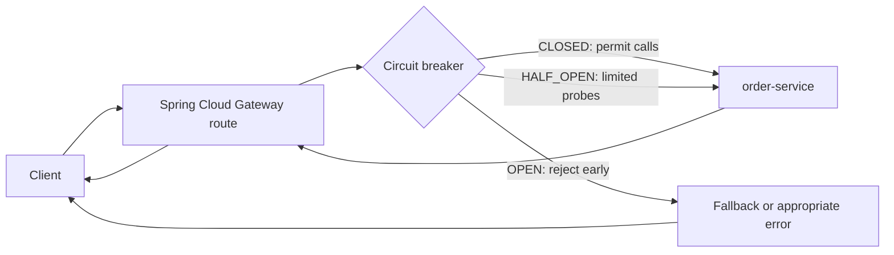
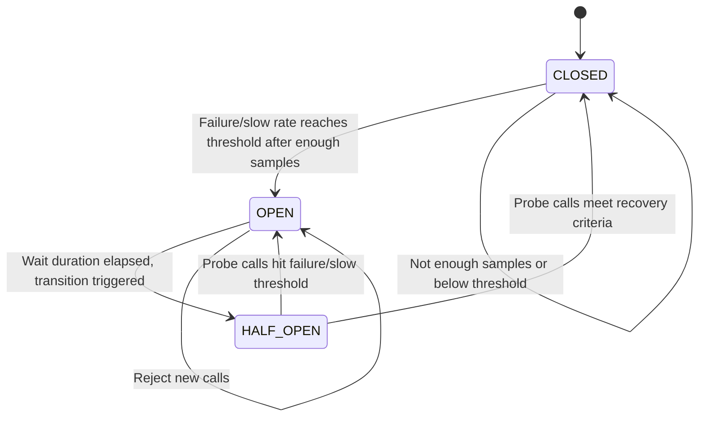

# CLOSED, OPEN, and HALF_OPEN States and How Failure Rates Are Measured

In a microservices architecture, an API Gateway can receive thousands of requests for the same service. When `order-service` starts running slowly or failing, continuing to send every request downstream can pile up waiting connections, trigger cascading timeouts, and impact other APIs. A **circuit breaker** helps Spring Cloud Gateway limit the blast radius of failures by **observing upstream calls**, temporarily rejecting further calls when failure levels cross a threshold, and then allowing a controlled number of test calls to evaluate recovery.

This lesson belongs to the **Circuit Breakers and Fallbacks** chapter of **Spring Cloud Gateway**. The core topics are the three states—**`CLOSED`, `OPEN`, and `HALF_OPEN`**—and how **failure rate** and **slow-call rate** are calculated to trigger state transitions. Examples use Spring Cloud CircuitBreaker integrated with **Resilience4j**, alongside route predicates, the Gateway filter chain, retries, timeouts, fallbacks, service discovery, TLS, and request observability.

> **Scope:** Examples target **Spring Cloud Gateway Server WebFlux**. Configuration syntax, starters, APIs, and metric names may vary by version. Do not copy WebFlux/DSL snippets verbatim to Gateway Server MVC. Thresholds in this lesson are **practical lab values**, not optimal defaults for every service.

## 1. Why Does an API Gateway Need a Circuit Breaker?

Imagine 100 requests/second calling `GET /api/orders/42`. Normally the backend responds in 50 ms. When `order-service`'s database experiences an outage, each request may wait 3–10 seconds before failing. If the Gateway lacks appropriate limits:

- Many requests remain stuck waiting, increasing connection, memory, and processing resource usage.
- Clients may retry simultaneously, overloading the already failing backend further.
- Other routes sharing Gateway infrastructure risk indirect degradation.
- Users wait until timeout even though failures have already occurred on many prior calls.

A circuit breaker protects the system by **pausing upstream call attempts for a period** once there is enough evidence it is failing, and then **probing a few requests** to decide whether to reopen normal traffic.



**A circuit breaker is not retry.** Retry attempts to re-execute a failed operation; a circuit breaker decides **whether an operation is permitted to reach a dependency**. They can work together, but they do not replace each other.

**A circuit breaker is also not a rate limiter.** A rate limiter controls requests by quota/key; a circuit breaker controls dependency calls based on observed failure/slow-call outcomes.

## 2. The Three Core States: CLOSED, OPEN, HALF_OPEN

The state names can feel counterintuitive because they are borrowed from electrical switches:

| State | Are Requests Allowed to Call Upstream? | How Are Outcomes Collected? | Purpose |
| --- | --- | --- | --- |
| **`CLOSED`** | Yes | Records outcomes of protected calls in a sliding window | Lets the service operate normally while detecting error levels |
| **`OPEN`** | No for protected calls | Rejected calls are recorded as **not permitted**, not as new upstream HTTP failures | Sheds load from a struggling dependency |
| **`HALF_OPEN`** | Yes, but **limited number of probe calls** | Evaluates probe outcomes to decide whether to recover or reopen | Tests whether the dependency has stabilized |



The diagram shows the **standard flow**. Resilience4j also provides specialized states such as `METRICS_ONLY`, `DISABLED`, and `FORCED_OPEN` for operations; those are distinguished in a later section.

### CLOSED — Normal State

In `CLOSED`:

1. Requests are allowed into the upstream call logic.
2. The circuit breaker observes outcomes **of calls inside its protection boundary**.
3. Outcomes are recorded into a **sliding window** by call count or time duration.
4. Once enough calls have been recorded to evaluate, the breaker computes the failure rate and, if configured, the slow-call rate.
5. If either rate meets or exceeds its threshold, the breaker transitions to `OPEN`.

CLOSED **does not mean "zero errors."** A small error rate below the threshold may still occur while the breaker lets traffic pass through.

### OPEN — Early Rejection

In `OPEN`:

- New requests passing through the circuit breaker are rejected before the upstream call executes.
- Resilience4j typically signals `CallNotPermittedException` for an unpermitted call.
- If the route configures a fallback, the Gateway can route to the fallback; otherwise, the request must be mapped to an appropriate error response via error handling.
- **Rejected** requests do not prove the backend just failed; the backend **never received** those calls.
- The breaker waits for `waitDurationInOpenState` before permitting recovery checks.

**OPEN does not mean "the Gateway stopped working."** Other routes or other circuit breakers can continue functioning normally.

### HALF_OPEN — Limited Probing

Once eligible to leave `OPEN`, the breaker transitions to `HALF_OPEN` and lets **a small number of real calls** through to the backend. The count is typically controlled by `permittedNumberOfCallsInHalfOpenState`.

Example allowing 3 probes:

```text
CLOSED -> enough failures -> OPEN
                               |
                        wait duration ends
                               |
                           HALF_OPEN
                               |
                         allow 3 calls
                               |
                 +-------------+--------------+
                 |                            |
            outcomes healthy        failures/slow above threshold
                 |                            |
               CLOSED                        OPEN
```

Requests exceeding the permitted probe count may be rejected. If permitted probes take a long time, evaluation may have to wait for them to finish unless the version/configuration has a separate HALF_OPEN deadline.

**Probes are not necessarily health-check requests.** In typical Gateway setups, probes are **real requests** allowed through by the circuit breaker. Therefore, do not assume HALF_OPEN automatically sends only `GET /health`: the first request after the wait duration could be a business write operation. Weigh the risks for write APIs and idempotency mechanisms.

## 3. Specialized Resilience4j States

Beyond the primary trio, Resilience4j offers states for diagnostics and administrative control:

| State | High-Level Behavior | Operational Caveat |
| --- | --- | --- |
| `METRICS_ONLY` | Permits calls and collects metrics without automatically transitioning to OPEN on thresholds | Useful for observing a policy before blocking traffic |
| `DISABLED` | Permits calls; breaker enforcement is disabled per library semantics | Upstream is no longer protected by the breaker |
| `FORCED_OPEN` | Rejects calls immediately without waiting for metrics | Special operational mode; recovery must be managed manually |

Do not use `FORCED_OPEN` as an unmanaged "returning HTTP 503" flag. When forced open, new upstream outcomes are not measured via blocked calls because the upstream is never called. You need a runbook defining **who sets the state, when it is cleared, and what proves recovery**.

Manual state transitions from code or actuator/admin tools must be access-controlled. Breaker configurations across Gateway replicas can be independent, so changing state manually on one replica does not automatically change all replicas.

## 4. What Counts as a Failed Call?

This question matters more than picking a `failureRateThreshold` number.

**The circuit breaker counts outcomes of the calls it protects**, rather than automatically interpreting every business error across the whole system. With Resilience4j integration, a call is usually recorded as a failure when the protected segment **terminates with an exception configured to be recorded as a failure**. Exception handling can be configured via `recordExceptions`, `ignoreExceptions`, or corresponding predicates.

Examples that may need to be recorded as failures:

- Upstream call timeouts, if represented as exceptions passing through the breaker.
- Failed TCP connections or connection errors.
- Errors from Reactor Netty or filters converted into exceptions.
- HTTP `503`/`502`/`504` **if the Gateway CircuitBreaker filter is configured to treat those statuses as recorded failures**, rather than valid HTTP responses.

Things that **should not automatically be blamed on upstream health**:

- `401`/`403` from Spring Security at the Gateway before a route is matched.
- `404` when a client requests a nonexistent resource according to API contract.
- `400`/`422` due to invalid client input.
- `429` when a rate limiter actively rejects over-quota requests.
- Requests rejected because the breaker is already `OPEN`: **not permitted** is not a new upstream failure.

### HTTP 5xx Is Not Equivalent to an Exception by Default

A backend can return an HTTP response:

```http
HTTP/1.1 503 Service Unavailable
Content-Type: application/json

{"code":"BACKEND_UNAVAILABLE"}
```

This can still be a **transport-level successfully received HTTP response**. If the Gateway filter only watches exceptions and is not configured to translate specific statuses into errors, a `503` response may **not be counted as a failure** in the circuit breaker.

The Spring Cloud Gateway CircuitBreaker filter can accept a **`statusCodes`** list in supporting versions, so selected HTTP statuses are treated as failures during breaker/fallback processing. Check the **exact filter configuration** before asking "we got ten 503s, why didn't the breaker open?"

**Defining failure is a technical/business policy**, not merely checking `status >= 500`. A `404` can be normal API behavior, whereas `503` from an unavailable service is typically appropriate for protecting the upstream.

## 5. How Is the Failure Rate Calculated?

If the breaker has recorded `N` eligible calls in the window and `F` calls are classified as failures:

\[
\text{failureRate} = \frac{F}{N} \times 100\%
\]

For example, 10 completed calls, of which 5 fail:

```text
Outcomes: S F S F F S F S F S
S = success; F = failure

Total calls recorded in window: N = 10
Failures:                       F = 5
Failure rate:                5/10 = 50%
```

If `failureRateThreshold: 50` is configured and minimum calls are met, Resilience4j can transition `CLOSED → OPEN` when the failure rate **meets or exceeds** 50%.

### `minimumNumberOfCalls` Determines When the Sample Size Is Sufficient

For example:

```yaml
minimumNumberOfCalls: 10
failureRateThreshold: 50
```

When only 2 calls have occurred and both failed, the raw rate is `100%`, yet **10 calls have not been reached** to evaluate under this config. The breaker does not open based solely on those two results.

Once 10 recorded calls exist in the window, rate evaluation becomes eligible. This prevents opening the circuit on tiny sample sizes, though it also makes the breaker react slower under low traffic.

| Recorded Calls | Failures | Raw Failure Rate | With minCalls = 10, threshold = 50% |
| ---: | ---: | ---: | --- |
| 2 | 2 | 100% | **Not yet evaluated for opening** due to insufficient samples |
| 8 | 6 | 75% | **Not yet evaluated for opening** due to insufficient samples |
| 10 | 4 | 40% | Enough samples; stays `CLOSED` if no other condition trips |
| 10 | 5 | 50% | Enough samples; eligible to transition to `OPEN` |
| 10 | 7 | 70% | Enough samples; eligible to transition to `OPEN` |

**Note:** `minimumNumberOfCalls` primarily governs rate evaluation in the `CLOSED` window. In `HALF_OPEN`, the library uses permitted probe counts and probe completion policy to decide; do not mechanically assume "10 probes are required" just because the CLOSED example uses 10.

### What Is Excluded from the Denominator

Do not blindly add every HTTP request arriving at the Gateway to `N`. For example:

- Requests not matching the route never run that circuit breaker.
- `401` from Security before routing is not a breaker-protected call.
- Requests blocked while `OPEN` are normally classified as `not_permitted`, not new upstream calls counted in CLOSED failure rate.
- Exceptions configured as **ignored** may not participate in success/failure statistics.
- Unfinished or cancelled calls must be understood per the library/operator's measurement behavior; do not assume every cancellation counts as failed.

A Gateway HTTP `5xx` metric and Resilience4j's `failureRate` **do not share the same denominator** and are not equal by default.

## 6. Slow-Call Rate: Non-Errors Can Still Be Dangerous

A service can still return `200` while taking 8 seconds per request. When many requests hold connections open for too long, the system still risks resource exhaustion. Resilience4j can transition a circuit breaker to OPEN based on the **slow-call rate**.

Formula:

\[
\text{slowCallRate} = \frac{\text{completed calls with duration >= slow threshold}}{\text{recorded calls in window}} \times 100\%
\]

Example configuration:

```yaml
slowCallDurationThreshold: 2s
slowCallRateThreshold: 80
minimumNumberOfCalls: 10
```

If 8 out of 10 calls take at least roughly 2 seconds, **slow-call rate = 80%**. The breaker can open even if all 8 calls returned `200`.

### A Single Call Can Be Both "Failed" and "Slow"

The two rates are calculated separately over the call data:

| Call | Outcome | Duration | Failed? | Slow? |
| --- | --- | ---: | --- | --- |
| A | `200` success | 80 ms | No | No |
| B | `503` configured as recorded failure | 300 ms | Yes | No |
| C | `200` | 3.2 s | No | Yes |
| D | Timeout exception | 4.0 s | Yes | Yes |

A call that is both failed and slow **contributes to both statistics**, though it is still one request. Opening the circuit can be triggered when failure rate **or** slow-call rate reaches its threshold; the two percentages are not summed together.

**Distinguish threshold from timeout:** `slowCallDurationThreshold=2s` **only classifies a call as slow**; it does not forcibly cancel the call after 2 seconds. To cap wait duration, configure timeouts/TimeLimiter or HTTP client deadlines separately.

## 7. Count-Based vs. Time-Based Sliding Windows

Resilience4j offers two common sliding window types:

### `COUNT_BASED`

```yaml
slidingWindowType: COUNT_BASED
slidingWindowSize: 10
minimumNumberOfCalls: 10
```

The breaker inspects data from **up to the 10 most recent recorded calls**. As new calls arrive, old entries roll out of the window. This does not mean "the 10 most recent HTTP requests across the whole Gateway."

Example with 10 `S/F` outcomes:

```text
Initial:       [S S S F F S S F S F]  -> 4 failures / 10 = 40%
Add 1 new F:   [S S F F S S F S F F]  -> 5 failures / 10 = 50%
                                                    ^
                                      reaches threshold 50%
```

If the breaker is CLOSED, has enough samples, and no other exclusions apply, the new rate can trigger OPEN.

### `TIME_BASED`

```yaml
slidingWindowType: TIME_BASED
slidingWindowSize: 20
minimumNumberOfCalls: 10
```

With a time-based window, `slidingWindowSize: 20` represents a **20-second** window in Resilience4j's corresponding configuration semantics. The breaker aggregates outcomes within that timeframe rather than keeping a fixed 20 most recent requests.

Implications:

- High traffic: the window can hold many calls; failure rate is computed over all results in that period.
- Low traffic: `minimumNumberOfCalls` might not be met, so the breaker lacks enough samples to open.
- When traffic stops, no new measurements arrive; `OPEN` still follows wait-duration and transition rules rather than turning `CLOSED` simply because time passes.

### Choosing a Window by Operational Goal

| Property | `COUNT_BASED` | `TIME_BASED` |
| --- | --- | --- |
| How bounded | Number of recorded calls | Time interval |
| Easy to reason about in sequential tests | Very easy | Requires controlling time |
| Sensitivity to traffic shifts | 10 requests can pass very quickly or very slowly depending on load | Fixed interval, but sample count fluctuates |
| Risk to evaluate | Old data can linger during low traffic | May not reach minCalls during low traffic |
| Best suited for | Labs and services with relatively steady sample volumes | Observing error trends over a time interval |

Do not pick a tiny window just to make the breaker "react fast": a few random errors can make the breaker oscillate between OPEN and CLOSED, causing instability. Test across multiple load levels including off-peak periods.

## 8. Full Cycle Example: CLOSED → OPEN → HALF_OPEN

Suppose a practice configuration:

```yaml
failureRateThreshold: 50
minimumNumberOfCalls: 10
slidingWindowType: COUNT_BASED
slidingWindowSize: 10
waitDurationInOpenState: 15s
permittedNumberOfCallsInHalfOpenState: 3
automaticTransitionFromOpenToHalfOpenEnabled: false
```

Illustrative sequence:

| Point | Behavior | State After Processing |
| --- | --- | --- |
| T0 | Breaker starts and allows calls to backend | `CLOSED` |
| T1 | 10 calls complete, 5 failures | `OPEN` because 50% is reached |
| T2 | Client sends 11th request immediately afterward | Upstream rejected, stays `OPEN` |
| T3 | 15 seconds elapse per OPEN rules | Ready to probe; with auto=false, the next call can trigger `HALF_OPEN` |
| T4 | Up to 3 probes permitted per policy | `HALF_OPEN` |
| T5 | All 3 probes succeed and are fast enough | Can transition back to `CLOSED` |
| Alt T5 | 2 of 3 probes fail (66.7%) | Can return to `OPEN` |

In Resilience4j, with `automaticTransitionFromOpenToHalfOpenEnabled: false`, expiration of `waitDurationInOpenState` does not necessarily trigger a transition in a background timer thread; **the next arriving call can trigger** the transition when eligible. If auto transition is enabled, the mechanism can proactively transition after the wait duration as supported by the library.

**Three probes does not mean three seconds.** If many requests arrive concurrently as the breaker enters HALF_OPEN, only the configured permit count is allowed through; others may be rejected. Evaluation must consider **completed** probes and failure/slow thresholds. For hanging slow calls, appropriate timeouts are needed to keep HALF_OPEN from dragging out indefinitely.

## 9. Configuring the CircuitBreaker Filter in Spring Cloud Gateway

For hands-on practice, the Gateway needs the appropriate starter for **Spring Cloud CircuitBreaker + reactive Resilience4j** and Spring Cloud Gateway Server WebFlux, along with compatible Spring Boot/Spring Cloud BOM dependencies. Commonly used is `spring-cloud-starter-circuitbreaker-reactor-resilience4j`.

Suppose public API `GET /api/orders/**` proxies to `order-service`:

```yaml
spring:
  cloud:
    gateway:
      routes:
        - id: orders-read
          uri: lb://order-service
          predicates:
            - Path=/api/orders/**
            - Method=GET
          filters:
            - StripPrefix=1
            - name: CircuitBreaker
              args:
                name: ordersReadBreaker
                fallbackUri: forward:/fallback/orders
                statusCodes:
                  - INTERNAL_SERVER_ERROR
                  - BAD_GATEWAY
                  - SERVICE_UNAVAILABLE
                  - GATEWAY_TIMEOUT

resilience4j:
  circuitbreaker:
    instances:
      ordersReadBreaker:
        slidingWindowType: COUNT_BASED
        slidingWindowSize: 10
        minimumNumberOfCalls: 10
        failureRateThreshold: 50
        slowCallRateThreshold: 80
        slowCallDurationThreshold: 2s
        waitDurationInOpenState: 15s
        permittedNumberOfCallsInHalfOpenState: 3
        automaticTransitionFromOpenToHalfOpenEnabled: false
```

**Explanation of each part:**

- `Path` and `Method=GET` select **public requests**; the Gateway route filter only runs after matching.
- `StripPrefix=1` turns `/api/orders/42` into `/orders/42` before calling the upstream.
- `uri: lb://order-service` requires Spring Cloud LoadBalancer/discovery to supply matching instances.
- `name: ordersReadBreaker` is the breaker name, which must match the Resilience4j instance config.
- `fallbackUri: forward:/fallback/orders` dispatches to an **internal handler** in the Gateway when the protected call fails or is rejected, as supported by the filter.
- `statusCodes` causes listed HTTP statuses to be treated as failures in the circuit breaker mechanism on Gateway versions supporting this property.
- `resilience4j.circuitbreaker.instances.ordersReadBreaker` settings define how metrics are collected and evaluated.

**Version note:** Route configuration in older Gateway Server WebFlux versions typically lives under `spring.cloud.gateway.routes`. Newer versions use `spring.cloud.gateway.server.webflux.routes`. Verify your starter, version, and which routes are actually loaded. Do not conclude the breaker "does not work" when the route prefix does not match your version.

### Do Not Use the Same Example Unchecked for Write Operations

The illustrative route is limited to `Method=GET` because a simple fallback returns a temporarily unavailable notice. For order/payment creation `POST`s, a failure/timeout does not prove the operation did not execute. Idempotency keys, transaction status lookup, and dedicated retry/fallback policies are required before applying similar protection.

## 10. Contract-Compliant Fallbacks That Do Not Mask Incidents

A fallback may return valid cached data, indicate a "maintenance" status, or return a stable error response. However, it is **not a way to automatically turn every request into a success**.

Example local fallback controller in Gateway WebFlux for the read route:

```java
@RestController
class OrdersFallbackController {

    @GetMapping(
        path = "/fallback/orders",
        produces = MediaType.APPLICATION_JSON_VALUE)
    ResponseEntity<Map<String, String>> ordersUnavailable() {
        return ResponseEntity
            .status(HttpStatus.SERVICE_UNAVAILABLE)
            .header(HttpHeaders.CACHE_CONTROL, "no-store")
            .body(Map.of(
                "code", "ORDERS_TEMPORARILY_UNAVAILABLE",
                "message", "Orders service is temporarily unavailable"));
    }
}
```

The handler returns `503` per contract because no trustworthy order data is available. If cached data exists and the API contract supports **stale responses**, the fallback may return it with explicit metadata. Do not arbitrarily return `200` with `{"orders":[]}` when the system does not know the real order list; clients could misinterpret it as "the user has no orders."

**`fallbackUri: forward:/fallback/orders` is an internal forward**, not a `302` browser redirect. With this approach, a matching local handler and proper CORS/Security/error responses are required.

### Is the Fallback Called When the Breaker Is CLOSED?

Yes. A **single failing call** while CLOSED can trigger the fallback per configuration, even if the failure rate is not yet high enough to open the breaker. A fallback running does not mean the breaker is OPEN.

| Scenario | Possible Breaker State | Can the Fallback Be Called? |
| --- | --- | --- |
| Backend returns `503` included in `statusCodes` | `CLOSED` or `HALF_OPEN` | Yes |
| TCP connect exception | `CLOSED` or `HALF_OPEN` | Yes |
| Request blocked because breaker is `OPEN` | `OPEN` | Yes, if a fallback is configured |
| Security returns `401` before route matching | Never enters route breaker | No, because route filters do not run |
| No route matches | Never enters breaker | No |
| Backend returns `404` not configured as failure | Typically stays `CLOSED` | Not necessarily |

**Do not use the fallback response rate to infer the exact failure rate.** The fallback can be invoked during both CLOSED and OPEN, and the Gateway returns `503` from the fallback even when the upstream **received no** new requests. Separate upstream failures, fallback invocations, and calls-not-permitted cleanly.

### Avoid Information Leakage from Exceptions

Never return stack traces, internal hostnames, tokens, TLS details, or registry data directly in fallback bodies. Use a correlation ID and stable error codes so clients can contact support.

If using another filter such as `FallbackHeaders` to pass exception metadata to a fallback endpoint, ensure that data travels only over a trusted channel, cannot be spoofed by clients, and is never leaked unintentionally in responses or logs.

## 11. Configuring Resilience4j: Choosing Meaningful Thresholds

A common practical parameter set:

| Property | Example Value | What It Controls |
| --- | --- | --- |
| `slidingWindowType` | `COUNT_BASED` | Call-count-based window |
| `slidingWindowSize` | `10` | Window size |
| `minimumNumberOfCalls` | `10` | Minimum calls before evaluating rates in CLOSED |
| `failureRateThreshold` | `50` | Failure percentage that opens the breaker when met/exceeded |
| `slowCallRateThreshold` | `80` | Slow-call percentage that opens the breaker |
| `slowCallDurationThreshold` | `2s` | Duration threshold classifying a call as slow |
| `waitDurationInOpenState` | `15s` | Minimum wait duration before HALF_OPEN opportunity |
| `permittedNumberOfCallsInHalfOpenState` | `3` | Number of permitted probe calls |
| `automaticTransitionFromOpenToHalfOpenEnabled` | `false` | Controls whether OPEN → HALF_OPEN is automatic or triggered by the next call |

These parameters must be chosen according to the service's **SLO, traffic, capacity, failure modes, and recovery time**. For example, `slowCallDurationThreshold=2s` is unsuitable if an API's normal contract allows 5 seconds of processing.

### Intentional Exception Classification

Resilience4j can configure which exception classes are recorded or ignored. At the application level, you may need to:

- Record connect timeouts, read timeouts, and connection errors from the upstream.
- Record certain 5xx errors caused by dependency unavailability.
- Ignore client bad-input errors, access-denied errors, or cases that do not reflect dependency health.
- Avoid accidentally ignoring timeouts used to detect a slow upstream.

**Do not copy exception classes from an example without knowing where they are thrown.** The Spring Cloud Gateway CircuitBreaker filter, Reactor Netty, WebFlux, and Resilience4j may wrap exceptions into different types. Use tests and metrics to confirm an actual error is counted as `failed`.

## 12. Timeouts, Slow Calls, and the Difference Between Measuring and Cancelling

A request may involve multiple timeout bounds:

| Mechanism | Meaning | Does It Open the Breaker on Its Own? |
| --- | --- | --- |
| `slowCallDurationThreshold` | Threshold classifying a call as **slow** after it finishes | Only affects slow-call rate once enough samples exist |
| HTTP client **connect timeout** | Limits time to open a TCP connection | If the error passes through the breaker and is recorded |
| HTTP client **response timeout** | Limits waiting for a response per Reactor Netty policy | If the error is recorded |
| Resilience4j **TimeLimiter** | Limits duration of the protected async operation, depending on integration | If timeout creates a failure observed by the circuit breaker |
| Client request deadline | Limits total end-to-end request time | Must coordinate with retry/fallback; not a breaker threshold itself |

**A slow call is not necessarily cancelled.** If `slowCallDurationThreshold` is 2 seconds while response timeout is 10 seconds, a call taking 4 seconds and returning 200 can count as a **slow success**.

If TimeLimiter cancels a call after 2 seconds, the meter may record a timeout exception while the backend continues processing the received request. Cancellation in Reactor does not prove the upstream transaction rolled back.

Example TimeLimiter configuration under the same breaker name:

```yaml
resilience4j:
  timelimiter:
    instances:
      ordersReadBreaker:
        timeoutDuration: 3s
```

Verify how reactive Spring Cloud CircuitBreaker integrates TimeLimiter in your **exact version**. Do not simply set `timelimiter` and assume it covers every network/streaming call. For streaming/SSE, full-publisher lifetimes must be designed separately.

## 13. Combining CircuitBreaker and Retry: Ordering Changes What Gets Measured

Circuit breaker and retry are two distinct tools:

- **Circuit breaker:** inspects outcomes of the protected segment and decides **whether to permit calling**.
- **Retry:** re-attempts after a recoverable error with a bounded count/backoff.

Suppose a client request is retried up to three times against the backend: `A1` fails, `A2` fails, `A3` succeeds.

```text
Client request
   |
   +-- Attempt A1 -> error
   +-- Attempt A2 -> error
   +-- Attempt A3 -> success
   |
   +-- Client sees 200
```

The breaker may observe:

- **One final outcome** if retry is completely inside the protected call boundary and the breaker only records the post-retry result.
- **Multiple attempts** if each attempt passes through the breaker as its own protected call.

Thus, a single request can contribute **one** or **multiple** events to metrics depending on placement and filter/Resilience4j integration. Never claim a YAML ordering always yields a fixed outcome without checking Gateway filter ordering and reactive subscribe/retry mechanics.

### How to Avoid a Retry Storm

- Cap attempts and use backoff with jitter per appropriate policy.
- Set a **total timeout budget**, rather than letting every retry wait a full independent timeout and blow past the client deadline.
- Only retry recoverable errors; avoid retrying `400`, `401`, `403`, `404`, or permanent business errors.
- For `POST`/`PATCH` with side effects, use idempotency keys or business mechanisms proving retries are safe.
- Know the circuit breaker's position in the chain to control **how calls are counted**.
- Track **client request count**, **backend attempt count**, **failed calls**, and **not-permitted calls** separately.

**Note:** Retry does not guarantee the next attempt goes to a different instance in `lb://order-service`. That depends on LoadBalancer, routing, and how the filter chain re-executes the call; if only one instance is failing, retries can make things worse.

## 14. Circuit Breaker and Load Balancing: At What Scope Do We Break?

Suppose `order-service` has three instances:

```text
order-service:
  instance A: healthy
  instance B: healthy
  instance C: failing
```

If all requests pass through **one breaker named `ordersReadBreaker` on each Gateway replica**, failures from instance C can drive the decision to open the circuit for the **entire route**. When OPEN, the Gateway stops calling A and B through that breaker too, even though those two instances are healthy.

This is a **critical granularity trade-off**:

| Breaker Scope | Benefits | Risks |
| --- | --- | --- |
| Per route/service ID | Simple, easy to observe and configure | One failing instance can block the entire route |
| Per physical instance | Can isolate an individual failing backend | Many breakers, instance lifecycle churn, complex metadata/caching |
| Per dependency/operation | Protects the right operation/functional group | Requires designing breaker names, policies, and metrics |
| Per user | Usually unsuitable for downstream health | Explodes breaker count, loses load-control meaning |

The Spring Cloud Gateway CircuitBreaker filter is declared per route and breaker name; it does **not by default** create a separate breaker for each LoadBalancer-selected IP/port instance. If per-instance granularity is needed, design it explicitly together with health-aware load balancing/service discovery.

Gateway replicas can also hold **independent breaker states**. While Gateway-1 is OPEN, Gateway-2 may still be CLOSED because its sample outcomes differ. Do not mistake that for a bug when no synchronized state mechanism exists—Resilience4j normally keeps state in-process.

## 15. Security, Rate Limiting, and Fallbacks in HTTP Context

### Security Runs Before Gateway Route Filters

Spring Security WebFlux typically operates in the WebFilter chain before route selection. If a request lacks a JWT, Security can return `401` or `403`. The route `CircuitBreaker` is never invoked, so it **does not** record an "upstream failure."

Do not count client `401/403` errors toward `order-service` health failure rates; those are separate authentication/authorization concerns.

### Rate Limiter Returns 429

`RequestRateLimiter` can block requests exceeding quota; a `429 Too Many Requests` response does not mean the upstream is broken. Filter order and scope determine which requests proceed. A request rejected by the rate limiter before the breaker should not be treated as a backend failure.

When designing dashboards, separate `429`, backend `5xx`, fallback `5xx`, `CallNotPermittedException`, and connection timeouts.

### CORS on Fallback Responses

A browser frontend can report "CORS blocked" if a `503` fallback or error handler lacks appropriate `Access-Control-Allow-Origin` headers, even though the root cause is an overloaded backend. Configure CORS consistently for **both successful and error responses**; never fix CORS by returning a fake `200`.

### TLS and Discovery

If `lb://order-service` finds no instances, or TLS connections to an instance fail hostname/SNI/certificate checks, requests can fail at the infrastructure layer. The breaker may record the exception if it occurs within the protected call boundary. However, **a circuit breaker does not fix DNS, TLS truststores, or registries**; it only mitigates impact while the underlying fault persists.

## 16. Reading Circuit Breaker Metrics Semantically

For operations, measure at least:

| Metric/Event Group | Explanation | Do Not Infer |
| --- | --- | --- |
| **State** `CLOSED/OPEN/HALF_OPEN` | Breaker state at a point in time | That all Gateway replicas have the same state |
| **Successful calls** | Protected calls succeeding per policy | That backend latency is necessarily low |
| **Failed calls** | Protected calls classified as failures | All HTTP 5xx seen by clients |
| **Slow successful calls** | Successful responses exceeding slow threshold | That these are failures |
| **Slow failed calls** | Calls both slow and failed | That these are two separate requests |
| **Not permitted calls** | Rejected by breaker when OPEN / out of permits | That the backend received and failed the request |
| **Failure rate** | Percentage of failures among recorded calls | Gateway-wide 5xx percentage |
| **Slow-call rate** | Percentage of slow calls | Timeout count |
| **State transitions** | State-change events | That the root cause automatically resolved |
| **Fallback invocations** | Number of times fallback ran | That it only occurs when breaker is OPEN |

In the Spring ecosystem, Resilience4j integrates with **Micrometer/Actuator**. Exact metric names vary by library/registry/version—for example `resilience4j.circuitbreaker.calls`, `resilience4j.circuitbreaker.state`, and tags like `name` and `kind`. When exported to Prometheus, naming, suffixes, and counters can differ. Inspect the actual metrics endpoint; **never hard-code metric names from an article** without confirming they are emitted.

### Incident Classification Observation Table

Suppose a 5-minute dashboard for the orders route shows:

| Signal | Observation | Possible Interpretation |
| --- | --- | --- |
| Gateway client requests | 1,000 | Total requests at the edge, including those never reaching the breaker |
| Circuit breaker successful | 180 | Protected calls recorded as success |
| Circuit breaker failed | 60 | Protected calls recorded as failure |
| Circuit breaker not permitted | 700 | Most requests rejected early while breaker is OPEN |
| Security/rate limit/route mismatch | 60 | Requests that may not have entered the breaker |

These numbers are an **independent example** illustrating classification, not a default reconciliation formula for every system (retries and filter order can make attempt counts differ from request counts). The failure rate of the 240 completed protected calls is:

\[
\frac{60}{180+60}\times100\% = 25\%
\]

This 25% figure can be lower than the client-visible 503 rate because 700 requests were rejected by OPEN and the fallback returned 503. Conversely, the 180 successful calls may include slow calls; inspect slow-call metrics separately.

**Do not count not-permitted calls as upstream failures** during root-cause analysis. No upstream request was made, so blame cannot be assigned to a new backend HTTP response.

### Where Should Tags Be Attached?

Useful tags: breaker name, Gateway replica ID, route ID, outcome type, deployment environment, service ID. Be cautious with instance IPs, tenant/user IDs, or full URLs because they can explode **cardinality** or leak personal information.

A `traceId` in logs helps correlate per-request events, but should not be placed as a metric tag. Never log Bearer tokens, cookies, request bodies, or sensitive fallback exception details.

## 17. Testing with curl, WireMock, and WebTestClient

### Lab Setup

- Gateway at `http://localhost:8080`, route `GET /api/orders/**` as in Section 9.
- Mock upstream at `http://localhost:8081` (or a matching test `ServiceInstance` if using `lb://`).
- Local fallback `/fallback/orders` returning `503` with JSON code `ORDERS_TEMPORARILY_UNAVAILABLE`.
- **Test-only** breaker config: window 10, min calls 10, threshold 50%, OPEN wait 15 seconds, HALF_OPEN 3 calls.
- Test fixture able to instruct the upstream to return `200`, `503`, slow responses, or connection drops.

Without service discovery in the lab, you can replace `lb://order-service` with `http://localhost:8081` to isolate circuit breaker behavior; this does not change the semantics of the states.

### Test 1 — Below Threshold with Enough Samples

Send 10 sequential requests, simulating 4 failures configured to be recorded and 6 successes. Expect the breaker to stay CLOSED (assuming slow-call threshold is not breached). As new calls arrive, measure the failure rate **within the active window**, not cumulative failures since server startup.

### Test 2 — Reaching Threshold and Opening

Send 10 requests, including 5 `503` failures listed in `statusCodes`:

```bash
for i in 1 2 3 4 5 6 7 8 9 10; do
  curl -sS -o /dev/null -w "%{http_code}\n" \
    http://localhost:8080/api/orders/42
done
```

The command only sends requests; to guarantee **5 failures and 5 successes**, use an upstream stub scripted to return statuses in a deterministic order. With a `503` fallback, clients may see many `503`s, so **check state/metrics** to confirm the breaker opened.

Once open conditions are met, the next request must be rejected at the circuit breaker and **never reach the upstream**:

```text
Upstream received so far: 10 requests (example)
Client sends: 1 more request
Circuit breaker state: OPEN
Upstream count afterward: still 10
not_permitted metric: increments
Response to client: fallback per policy
```

This verifies **actual circuit breaking**, rather than just checking for HTTP `503` at the client.

### Test 3 — HALF_OPEN

Once `waitDurationInOpenState` has elapsed, send controlled test calls. With 3 probes allowed:

- Three fast, successful probes → breaker can return to CLOSED.
- Two failed probes → probe failure rate is `2/3 ≈ 66.7%`; with a 50% threshold, the breaker can return to OPEN.
- If only two probes have completed and the third is still hanging, do not assume the breaker has made its final decision yet.

Do not write `Thread.sleep(15000)` and expect it to be stable across all CIs. Use a short wait duration in test environments, control the scheduler/clock when supported by the framework, and assert transitions via events/metrics with a timeout deadline. Under concurrency, use barriers/test harnesses to verify maximum permits and backend request counts.

### WebTestClient and Mock Upstream Example

```java
@Test
void upstream503CanTriggerFallback() {
    wireMockServer.stubFor(
        get(urlPathEqualTo("/orders/42"))
            .willReturn(aResponse()
                .withStatus(503)));

    webTestClient.get()
        .uri("/api/orders/42")
        .exchange()
        .expectStatus().isEqualTo(HttpStatus.SERVICE_UNAVAILABLE)
        .expectBody()
        .jsonPath("$.code")
        .isEqualTo("ORDERS_TEMPORARILY_UNAVAILABLE");

    wireMockServer.verify(
        1, getRequestedFor(urlPathEqualTo("/orders/42")));
}
```

This snippet is an **illustrative test fragment**, requiring dependencies, static imports, `wireMockServer`/`webTestClient` fixtures, and configured routes/fallbacks. It verifies fallback on a single upstream `503` configured as a failure, **without proving the breaker is OPEN**. To test OPEN, issue enough calls to hit the threshold and assert that the backend **receives no new calls** once open.

### Comprehensive Test Matrix

| Scenario | Key Assertion |
| --- | --- |
| Below `minimumNumberOfCalls` despite many errors | Does not open solely due to insufficient samples |
| Enough samples, failure rate below threshold | Stays CLOSED if slow rate does not reach threshold |
| Enough samples, failure rate reaches threshold | Transitions to OPEN and rejects new calls |
| OPEN, subsequent request | Fallback/not-permitted; upstream receives no new calls |
| After waitDuration, HALF_OPEN | Allows only the configured probe count |
| Probes succeed | Can transition back to CLOSED |
| Probes fail/slow above threshold | Returns to OPEN |
| HTTP 503 **without** `statusCodes` and no exception thrown | Verify it is not automatically counted as failure |
| HTTP 503 **with** matching `statusCodes` | Handled as failure per filter integration |
| Backend returns 400 validation error | Does not open breaker if policy is correct |
| Spring Security blocks 401 before routing | Breaker records no upstream failure |
| Request rate-limited 429 | Distinguished from upstream failures |
| Timeout/connection reset | Confirm exception class is recorded |
| Retry before/after protected call | Count attempts and CB calls accurately |
| LoadBalancer with multiple instances | Know whether breaker protects route or instance |
| Multiple Gateway replicas | State may differ across replicas |
| Client cancels mid-streaming response | Do not assume failure is always counted and fallback can still be sent |
| CORS error response/fallback | Browser receives proper CORS headers without data leaks |

## 18. Runbook When a Breaker Opens Unexpectedly or Refuses to Open

### Case A: "Backend Returns Many 503s, Yet the Breaker Stays CLOSED"

Check in order:

1. Does the route match `Path`/`Method` and is the breaker name actually applied?
2. Do backend 503s truly pass through the Gateway CircuitBreaker filter, or do responses come from Security/rate limiter/fallback?
3. Does `statusCodes` list 503, or is there an exception configured to be recorded?
4. Has `minimumNumberOfCalls` been reached? Does the COUNT/TIME window hold enough outcomes?
5. Are exceptions being `ignore`d, changing the denominator and failure count from expectations?
6. Are Retry or other filters turning errors into successes before the breaker measures them?
7. Are you looking at the wrong breaker name or a different Gateway replica?

### Case B: "Breaker Stays Open Even Though the Backend Recovered"

Check:

1. Has `waitDurationInOpenState` elapsed?
2. Is `automaticTransitionFromOpenToHalfOpenEnabled` on or off? Are new requests arriving to trigger HALF_OPEN?
3. Are probes receiving permits and completing, or always timing out?
4. Is fallback/error policy causing probes to still be counted as failures?
5. Is there an underlying issue like DNS/TLS, certificates, service discovery, or stale connection pools?
6. Was the state forced to `FORCED_OPEN` by an operator or code?
7. Are you inspecting the right breaker and right replica?

### Case C: "Clients See 503, Yet the Backend Has No Error Logs"

Possibilities:

- Breaker is OPEN and the fallback returns 503 itself; **no new calls** reach the backend.
- No `lb://` service instance is available; requests never reach the backend.
- HTTP client hits DNS/TLS/connect errors before the upstream logs anything.
- A Gateway error handler produces 503 under another policy.
- Rate limiter or Security rejects the request with another status, and error mapping causes misinterpretation.

**Minimum evidence:** route ID, breaker name/state, protected call outcome, not-permitted count, fallback invocation, selected service instance, final HTTP status, trace ID, and exception class.

## 19. Common Misconceptions

| Misconception | Accurate Explanation |
| --- | --- |
| "CLOSED means the backend never fails" | CLOSED still lets requests through and can have errors below threshold |
| "OPEN means every backend request just failed" | New requests are rejected; no new upstream calls occur |
| "Once waitDuration ends, it automatically becomes CLOSED" | Usually tests via HALF_OPEN rather than jumping straight to CLOSED |
| "HALF_OPEN runs GET /health" | Typically permits real calls, depending on mechanism |
| "2 errors out of 2 requests is 100%, so the breaker must open" | `minimumNumberOfCalls` may not be met yet |
| "Every HTTP 5xx is an exception by default" | HTTP 5xx responses may require `statusCodes` or mapping |
| "Looking at client 503 rate tells you the failureRate" | Clients also see fallbacks/not-permitted rejections and other routes |
| "A not-permitted call is an upstream failure" | The backend never received the call blocked by the breaker |
| "Slow-call threshold is a timeout" | It classifies slowness; it does not cancel calls itself |
| "Retry and circuit breaker are the same feature" | Retry repeats attempts; breaker decides permission to call |
| "Returning 200 from fallback fixes the outage" | Can mask unreliable data with wrong status/contract |
| "If one instance fails, the route breaker only blocks that instance" | Route breakers usually scope to the whole logical service |
| "Breaker state auto-syncs across Gateway replicas" | State lives in-process by default |
| "Security returning 401 opens the breaker" | Requests blocked before routing usually never enter the breaker |
| "Tweaking CB thresholds fixes TLS/DNS" | A circuit breaker only reduces impact; it does not fix root causes |

## 20. Practice Exercise: Degraded Order Service

A system has two Gateway replicas and `order-service` with three instances A/B/C. Circuit breaker `ordersReadBreaker` is configured with:

```yaml
slidingWindowType: COUNT_BASED
slidingWindowSize: 10
minimumNumberOfCalls: 10
failureRateThreshold: 50
slowCallRateThreshold: 80
slowCallDurationThreshold: 2s
waitDurationInOpenState: 15s
permittedNumberOfCallsInHalfOpenState: 3
```

The following dataset describes 10 calls **completed and recorded** at Gateway replica-1:

| Call | Outcome | Duration |
| ---: | --- | ---: |
| 1 | Success | 100 ms |
| 2 | Failure | 150 ms |
| 3 | Success | 2.5 s |
| 4 | Failure | 3.1 s |
| 5 | Failure | 700 ms |
| 6 | Success | 200 ms |
| 7 | Failure | 2.8 s |
| 8 | Success | 180 ms |
| 9 | Failure | 90 ms |
| 10 | Success | 2.3 s |

Calculations:

- Failed calls: **5/10 → failure rate = 50%**.
- Slow calls (at least ~2 s): **4/10 → slow-call rate = 40%**.
- `minimumNumberOfCalls=10` is met.
- With a 50% failure threshold, **the breaker can transition to OPEN**, even though the slow-call rate has not reached 80%.

If all failing calls came from instance C, evaluate **breaker scope**: one breaker for the entire route can reject requests that could have succeeded on healthy A/B. Beyond the breaker, the system should have readiness/health-aware instance selection, bounded retries, and remove C from the candidate list once discovery converges.

### Self-Check Questions

1. Why does CLOSED not imply that every call succeeds?
2. How does `OPEN` reject new calls, and which exception does it typically raise?
3. How does HALF_OPEN differ from CLOSED in the number of permitted requests?
4. How does `minimumNumberOfCalls` prevent statistical distortion?
5. With 4 failures in 10 recorded calls and a 50% threshold, does the state need to transition to OPEN?
6. If 8 out of 10 calls return `200` but take 4 seconds, with a 2-second slow-call threshold and 80% slow rate, what can happen?
7. Does a request that is both failed and slow count toward both rates?
8. How does `COUNT_BASED` differ from `TIME_BASED` in denominator and convergence speed?
9. Why might an HTTP `503` not cause the breaker to record a failure if `statusCodes` is not configured?
10. Why are not-permitted calls not counted as new backend HTTP 503s?
11. Does `fallbackUri: forward:/fallback/orders` perform a browser redirect?
12. What contract risk does returning `200` with empty data from a fallback carry?
13. Which business errors can retrying after a POST timeout cause?
14. Why can one Gateway replica be OPEN while another remains CLOSED?
15. When the breaker opens after repeated errors on instance C, are A and B guaranteed to still receive requests via the same route?
16. What distinguishes `slowCallDurationThreshold` from a response timeout?
17. Which metrics should you check to distinguish backend failures, fallbacks, and breaker rejections?
18. If the backend recovers yet the breaker has not probed again, which properties and state transitions should you inspect?

**Key Takeaways:** **`CLOSED`** lets requests pass and measures outcomes; **`OPEN`** rejects early to shed load from a failing dependency; **`HALF_OPEN`** limits probe calls to evaluate recovery. Resilience4j opens the circuit based on **failure rate or slow-call rate in a sliding window once enough samples are collected**, not simply on client-visible HTTP 5xx counts. Defining failures accurately, keeping fallbacks contract-compliant, controlling retries/timeouts, and monitoring by breaker name and Gateway replica form the foundation of protecting microservices with Spring Cloud Gateway.
