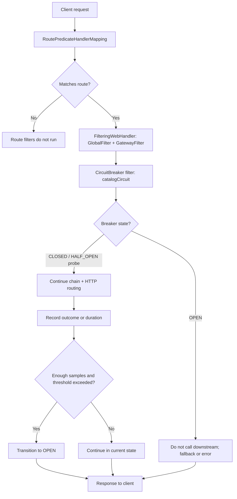
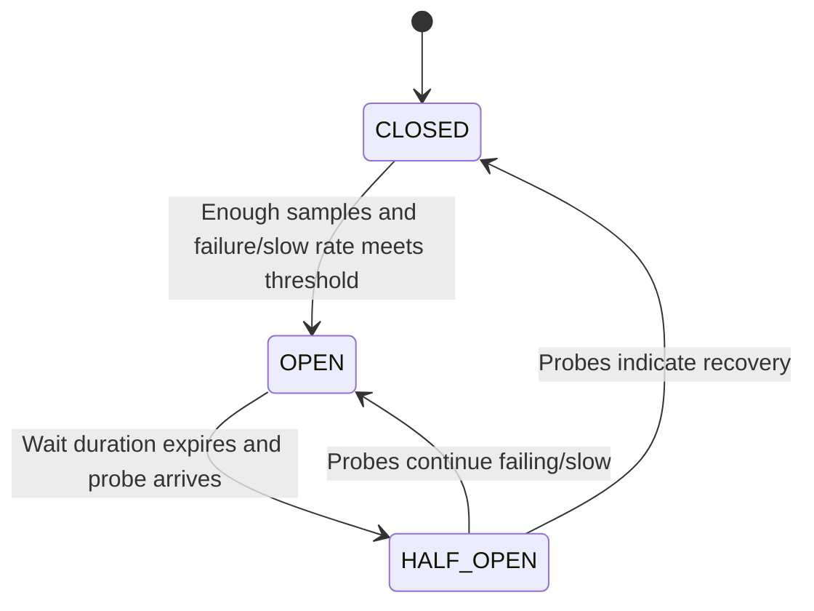

# Configuring Circuit Breaker Names, Measurement Windows, and Thresholds

## 1. Why Must a Circuit Breaker Be Configured Accurately?

In **SPRING_CLOUD_GATEWAY**, the API Gateway receives requests, matches **route predicates**, executes the **filter chain**, transforms paths/headers, may discover services via `lb://`, authenticates, rate-limits, retries, and routes HTTP(S) traffic to microservices. When a backend becomes slow or fails continuously, the Gateway should not keep calling it indefinitely: doing so increases latency, ties up connections, and propagates failures.

A **circuit breaker** observes downstream call outcomes, estimates the failure/slow-call rate over a **measurement window**, and temporarily **rejects new calls** when thresholds are exceeded. A **fallback** branch can return a controlled alternative response.

```text
Client ---> Gateway ---> Catalog Service

When Catalog is healthy:
  Gateway calls Catalog -> HTTP 200

When Catalog fails consecutively:
  Gateway records enough samples -> transitions to OPEN
  Subsequent requests -> do not call Catalog -> fallback 503

After wait duration:
  Allows a few probes into HALF_OPEN
  Backend recovers -> CLOSED
  Backend still failing/slow -> OPEN
```

This lesson belongs to the **Circuit Breakers and Fallbacks** chapter. Its focus is linking the **breaker name** between Gateway and Resilience4j, understanding `COUNT_BASED`/`TIME_BASED` windows, `minimumNumberOfCalls`, failure/slow-call rates, and state transition conditions.

### Objectives

After this lesson, you will be able to:

1. Configure the `CircuitBreaker` `GatewayFilter` for a **Gateway Server WebFlux** route.
2. Match `args.name` accurately with `resilience4j.circuitbreaker.instances.<name>`.
3. Explain `slidingWindowType`, `slidingWindowSize`, `minimumNumberOfCalls`, `failureRateThreshold`, `slowCallRateThreshold`, and `slowCallDurationThreshold`.
4. Distinguish **CLOSED**, **OPEN**, and **HALF_OPEN** and recovery probe limits.
5. Understand the differences between HTTP statuses, exceptions, timeouts, and fallbacks in failure statistics.
6. Run a backend returning 200/500/slow responses to observe when the breaker transitions to OPEN and back to CLOSED.
7. Design safe breakers alongside authentication, rate limiting, retries, TLS, discovery, and observability.

> **Illustrative versions:** Spring Boot 3.5.x with Spring Cloud 2025.0.x / **Spring Cloud Gateway Server WebFlux 4.3.x**, using Resilience4j via Spring Cloud CircuitBreaker. Gateway starter: `spring-cloud-starter-gateway-server-webflux`; reactive circuit breaker starter: `spring-cloud-starter-circuitbreaker-reactor-resilience4j`. Choose actively supported patch releases for production. Gateway Server MVC has a different API/stack.

## 2. Where Does the CircuitBreaker GatewayFilter Sit?

Spring Cloud Gateway provides `CircuitBreaker` as a **GatewayFilterFactory**. It wraps downstream work through the Spring Cloud CircuitBreaker API and uses Resilience4j when the appropriate dependency is present.



When the breaker is **OPEN**, Resilience4j typically rejects calls with `CallNotPermittedException`. If the route has `fallbackUri`, the Gateway can forward internally to a fallback handler.

**Distinction from rate limiting:** `RequestRateLimiter` controls request counts by **quota/key**, whereas a circuit breaker reacts to **downstream** reliability/latency. A circuit breaker also does not replace JWT authentication, resource-level authorization, or `lb://` instance selection.

## 3. CLOSED, OPEN, and HALF_OPEN



| State | New Requests | Purpose | What to Observe |
| --- | --- | --- | --- |
| **CLOSED** | Permitted to call backend; outcomes recorded in window. | System trusts downstream is healthy enough. | Buffered calls, failure rate, slow-call rate. |
| **OPEN** | Mostly rejected **before outbound HTTP**. | Gives the backend time to recover. | `not_permitted` calls, fallback count. |
| **HALF_OPEN** | Only a limited number of **probe calls** are permitted. | Evaluates recovery readiness. | Probe results and transition to CLOSED/OPEN. |

Special states such as `DISABLED`, `FORCED_OPEN`, and `METRICS_ONLY` also exist in Resilience4j, though they are not the three primary operational states in the lab.

### OPEN Does Not Automatically Let Every Request Through After N Seconds

`waitDurationInOpenState` is the wait period **before becoming eligible to probe**. If `automaticTransitionFromOpenToHalfOpenEnabled=false` (default), **a new arriving request after the wait period** is normally needed to transition to HALF_OPEN; there is not necessarily a background scheduler flipping the state right on time. If enabling automatic transitions, review the overhead and runtime behavior of your version.

## 4. Breaker Name Must Match Instance Configuration

Route filter:

```yaml
filters:
  - name: CircuitBreaker
    args:
      name: catalogCircuit
      fallbackUri: forward:/internal/fallback/catalog
```

Resilience4j configuration:

```yaml
resilience4j:
  circuitbreaker:
    instances:
      catalogCircuit:
        slidingWindowType: COUNT_BASED
        slidingWindowSize: 10
        minimumNumberOfCalls: 5
        failureRateThreshold: 50
```

**`catalogCircuit` must match exactly in both places.** If the filter has a typo like `catalogCircut` while YAML defines `catalogCircuit`, the Gateway may create a differently named breaker with **default settings**, silently bypassing your custom thresholds while the app still starts fine.

| Identifier | Example | Role |
| --- | --- | --- |
| Gateway route ID | `catalog-route` | Gateway route predicates/filters/metrics. |
| Breaker name | `catalogCircuit` | Resilience4j state machine and stats/thresholds. |
| `resilience4j.timelimiter.instances` key | `catalogCircuit` | Timeout limit for the same breaker ID. |
| Service ID `lb://` | `catalog-service` | Logical name for LoadBalancer instance selection. |
| Backend hostname | `catalog.internal.example` | Actual network address and TLS identity. |

Do not assume a route ID automatically becomes the breaker name. When **two routes share the same breaker name inside one Gateway process**, they can share state, statistical windows, and affect each other: errors on route A cause calls on route B to be rejected. This is intentional if both routes share a failure domain, but dangerous if they call two independent upstreams.

**Naming rules:**

- Choose stable names by dependency or operation group sharing the same failure policy.
- Separate breakers if two backends have different SLAs/latencies/failure domains.
- Never build breaker names from `userId`, request ID, dynamic paths, or queries, which explodes instance counts and metric labels.
- With `lb://catalog-service`, a named route breaker typically spans across replicas; it does not create one breaker per IP automatically.
- **Each Gateway replica keeps its own Resilience4j state in its JVM.** Sharing a name does not mean pods share a sliding window over Redis.

## 5. Sliding Window: N Calls or N Seconds?

| `slidingWindowType` | Meaning of `slidingWindowSize` | Example | Suitable When |
| --- | --- | --- | --- |
| `COUNT_BASED` | **Most recent N recorded calls**. | `10` = last 10 call outcomes. | Traffic is fairly steady and you want call-count sampling. |
| `TIME_BASED` | **Most recent N seconds**. | `30` = rolling 30 seconds. | You want time-based measurement under fluctuating traffic. |

### 5.1. COUNT_BASED

```yaml
resilience4j:
  circuitbreaker:
    instances:
      catalogCircuit:
        slidingWindowType: COUNT_BASED
        slidingWindowSize: 10
        minimumNumberOfCalls: 5
```

Suppose the first five outcomes are:

```text
Call    1    2    3    4    5
Result  F    S    F    S    F
        \___________________/
          5 recorded samples
```

- `F` = failed; `S` = successful.
- There are **5 samples**, meeting `minimumNumberOfCalls=5`.
- There are **3 failures / 5 calls = 60%**.
- With `failureRateThreshold=50`, `60% >= 50%`, so the breaker is eligible to **OPEN** after the fifth outcome is recorded.

With only **4 samples**, the minimum is not yet met, even if all four failed. Once sample count exceeds `slidingWindowSize=10`, the oldest sample is evicted per rolling window mechanics. Do not use cumulative percentages since app startup to infer the active window's state.

### 5.2. TIME_BASED

```yaml
resilience4j:
  circuitbreaker:
    instances:
      catalogCircuit:
        slidingWindowType: TIME_BASED
        slidingWindowSize: 30
        minimumNumberOfCalls: 10
```

Here `30` means **30 seconds**, not 30 requests. If only 4 requests arrive within 30 seconds, the breaker **lacks 10 samples** to evaluate failure/slow rates. If 100 calls arrive in that span, all calls in that time window are aggregated.

**Low-traffic pitfall:** a short `TIME_BASED` window paired with a high `minimumNumberOfCalls` may rarely collect enough samples, preventing the breaker from opening even when the backend has issues. Conversely, setting the minimum too low makes it overly sensitive to a few random errors.

### 5.3. Minimum Is Not "Minimum Failures"

- `minimumNumberOfCalls`: **minimum recorded calls**, not failure count.
- `failureRateThreshold`: percentage of failures among recorded calls.
- `slowCallRateThreshold`: percentage of slow calls among recorded calls.

With minimum 5 and threshold 50%, **3 failures in 5 calls** can open the circuit. While OPEN, requests rejected before outbound calls **do not become new downstream calls** in CLOSED statistics. Never use client fallback responses as the denominator for backend failure rates.

## 6. Failure Thresholds, Slow-Call Thresholds, and TimeLimiter

| Property under `resilience4j.circuitbreaker.instances.<name>` | Lab Value | Effect |
| --- | --- | --- |
| `failureRateThreshold` | `50` | Opens when failure rate **meets or exceeds 50%** once enough samples exist. |
| `slowCallRateThreshold` | `60` | Opens when slow-call rate **meets or exceeds 60%** once enough samples exist. |
| `slowCallDurationThreshold` | `800ms` | Calls lasting longer than threshold are classified as slow. |
| `minimumNumberOfCalls` | `5` | Requires at least 5 calls before computing rates. |
| `slidingWindowSize` | `10` | Window of 10 calls or 10 seconds, depending on type. |
| `permittedNumberOfCallsInHalfOpenState` | `3` | Number of test calls allowed in HALF_OPEN. |
| `waitDurationInOpenState` | `10s` | Wait duration before becoming eligible for HALF_OPEN. |
| `automaticTransitionFromOpenToHalfOpenEnabled` | `false` | Requires a new request after wait duration to probe. |
| `recordExceptions` / `ignoreExceptions` | Unset in lab | Tunes which exceptions count/ignore; must be tested carefully. |

### 6.1. Failure Rate

\[
\text{Failure rate (\%)} = \frac{\text{calls recorded as failures}}{\text{total calls recorded in window}} \times 100
\]

For example, 10 calls with 4 failures and 6 successes → 40%. With a 50% failure threshold, that is **not enough** to open on failures; however, slow-call rate can independently trigger OPEN.

### 6.2. Slow Calls Can Return HTTP 200

```text
5 calls: 200 after 1.2s, 200 after 1.3s,
         200 after 1.0s, 200 after 0.1s, 200 after 0.2s

Failure rate:   0/5 = 0%
Slow-call rate: 3/5 = 60%
```

With `slowCallDurationThreshold=800ms`, `slowCallRateThreshold=60`, and minimum 5, the breaker can still **OPEN due to slowness**, even with zero HTTP 5xx responses.

### 6.3. Slow Threshold Differs from Timeout

- `slowCallDurationThreshold` **classifies** a call as slow.
- `resilience4j.timelimiter.instances.<name>.timeoutDuration` limits **execution wait time**; exceeding it can raise a timeout exception.
- `spring.cloud.gateway.server.webflux.httpclient.connect-timeout` governs the TCP connect phase.
- `spring.cloud.gateway.server.webflux.httpclient.response-timeout` relates to waiting for the HTTP response.

For example, with slow threshold `800ms` and TimeLimiter `3s`: a call taking `1.2s` can succeed yet count as a **slow call**. If TimeLimiter were `500ms`, the call could be interrupted by timeout before returning 200. Test actual interactions with Reactor/Netty.

## 7. HTTP Statuses vs. Exceptions

An HTTP proxy can receive a **valid HTTP 500 response** from a backend. Without configuring that status to become a failure in the pipeline, Resilience4j **does not necessarily** count it as an error in rate calculations.

The Gateway `CircuitBreaker` filter supports `statusCodes`:

```yaml
- name: CircuitBreaker
  args:
    name: catalogCircuit
    fallbackUri: forward:/internal/fallback/catalog
    statusCodes:
      - 500
      - 503
```

In this case, `500` and `503` on the wrapped route will be treated as failures per the filter mechanism and trigger the fallback if configured. Other HTTP codes are not automatically included in this set.

**Do not blindly add `400`, `401`, `403`, `404`, or `429` to circuit-breaking status codes.** They typically indicate bad requests, missing permissions, absent resources, or exceeded client quotas—not a broken backend. Counting them as backend errors can trip the breaker wrongly and deny service to valid requests.

DNS errors, connection refused, timeouts, and TLS handshakes can become **exceptions**. Whether Resilience4j records them as failures still depends on `recordExceptions`, `ignoreExceptions`, and active custom predicates. If you customize recording rules, verify you do not ignore infrastructure errors or count business errors as dependency failures.

## 8. Complete YAML Configuration: Names and Thresholds

A local Gateway:

- Route ID: `catalog-route`.
- Breaker name: `catalogCircuit`.
- Demo backend: `http://127.0.0.1:9001`.
- Local fallback: `forward:/internal/fallback/catalog`.

```yaml
server:
  port: 8080

spring:
  application:
    name: gateway-circuit-lab
  cloud:
    gateway:
      server:
        webflux:
          routes:
            - id: catalog-route
              uri: http://127.0.0.1:9001
              predicates:
                - Path=/api/catalog/**
              filters:
                - name: CircuitBreaker
                  args:
                    name: catalogCircuit
                    fallbackUri: forward:/internal/fallback/catalog
                    statusCodes:
                      - 500
                      - 503
                - StripPrefix=2

resilience4j:
  circuitbreaker:
    instances:
      catalogCircuit:
        slidingWindowType: COUNT_BASED
        slidingWindowSize: 10
        minimumNumberOfCalls: 5
        failureRateThreshold: 50
        slowCallRateThreshold: 60
        slowCallDurationThreshold: 800ms
        permittedNumberOfCallsInHalfOpenState: 3
        waitDurationInOpenState: 10s
        automaticTransitionFromOpenToHalfOpenEnabled: false
  timelimiter:
    instances:
      catalogCircuit:
        timeoutDuration: 3s
```

**Essential points:**

1. `Path=/api/catalog/**` must match before route filters run.
2. `name: catalogCircuit` **matches** both `resilience4j.circuitbreaker.instances.catalogCircuit` and `resilience4j.timelimiter.instances.catalogCircuit`.
3. `StripPrefix=2` turns `/api/catalog/42` into `/42` when proxying.
4. `statusCodes` specifies upstream HTTP errors to record.
5. `COUNT_BASED` size 10 / minimum 5 governs statistics; it is **not** a 10 requests/second limit.
6. Failure threshold 50% and slow threshold 60% are **two independent conditions** that can trigger OPEN.
7. Open wait 10s and half-open 3 probes control recovery; TimeLimiter 3s is separate from slow threshold.

**Distinguish namespaces:** `resilience4j.circuitbreaker` and `resilience4j.timelimiter` are **Resilience4j** configuration, not nested under `spring.cloud.gateway.server.webflux`. Only routes/filters belong under this WebFlux namespace. Do not mix with `spring.cloud.gateway.routes` from older Gateway examples.

### 8.1. Inheriting `configs` via `baseConfig`

```yaml
resilience4j:
  circuitbreaker:
    configs:
      default:
        slidingWindowType: COUNT_BASED
        slidingWindowSize: 100
        minimumNumberOfCalls: 30
        failureRateThreshold: 50
      serviceDefault:
        slidingWindowType: TIME_BASED
        slidingWindowSize: 30
        minimumNumberOfCalls: 10
        failureRateThreshold: 60
        slowCallRateThreshold: 70
        slowCallDurationThreshold: 2s
    instances:
      catalogCircuit:
        baseConfig: serviceDefault
        waitDurationInOpenState: 15s
      inventoryCircuit:
        baseConfig: serviceDefault
        waitDurationInOpenState: 20s
```

Two instances share common templates while having different OPEN wait times; they **do not share state** simply by sharing `baseConfig`. Conversely, two routes both using `catalogCircuit` in one process can share state.

### 8.2. Properties Take Precedence Over Java Customizers

Spring Cloud CircuitBreaker supports `Customizer<ReactiveResilience4JCircuitBreakerFactory>` for Java-based defaults. Official documentation confirms that **property configuration takes precedence over Java Customizers**. If instance YAML specifies thresholds, do not assume a customizer will override them as desired.

```text
Instance config: resilience4j.circuitbreaker.instances.catalogCircuit
Group config:    resilience4j.circuitbreaker.configs.serviceDefault
Global default:  resilience4j.circuitbreaker.configs.default
```

Keep naming conventions consistent and test instances that lack dedicated config: they may inherit group/default settings unexpectedly.

## 9. Hands-On Lab: Opening, Falling Back, and Probing Recovery

We create **one Gateway** and **one Echo backend** running on loopback. The mock backend can return HTTP 200, 500, or slow responses based on the `mode` query parameter. This lets learners observe HTTP errors, slow-call rates, and HALF_OPEN without breaking a real microservice.

```text
GET /api/catalog/42?mode=ok
    -> Gateway -> Backend /42 -> HTTP 200

GET /api/catalog/42?mode=fail
    -> Gateway -> Backend /42 -> HTTP 500
    -> CircuitBreaker records failure -> Fallback HTTP 503

GET /api/catalog/42?mode=slow
    -> Gateway -> Backend /42 -> HTTP 200 after ~1.2s
    -> CircuitBreaker records slow call if over 800ms
```

**Note:** the `mode` parameter is strictly for the lab. Production backends must never expose public endpoints allowing clients to arbitrarily trigger errors, slowdowns, or operational state changes.

### 9.1. Initializing the Maven Project

Requires **JDK 17+**, Maven, and `curl`. The example `pom.xml` uses Spring Boot `3.5.0` and Spring Cloud `2025.0.0` as an **illustrative compatible pair**; pinning `*.0` patch releases is not recommended for production deployments.

```xml
<?xml version="1.0" encoding="UTF-8"?>
<project xmlns="http://maven.apache.org/POM/4.0.0"
         xmlns:xsi="http://www.w3.org/2001/XMLSchema-instance"
         xsi:schemaLocation="http://maven.apache.org/POM/4.0.0
                             https://maven.apache.org/xsd/maven-4.0.0.xsd">
    <modelVersion>4.0.0</modelVersion>

    <parent>
        <groupId>org.springframework.boot</groupId>
        <artifactId>spring-boot-starter-parent</artifactId>
        <version>3.5.0</version>
        <relativePath/>
    </parent>

    <groupId>com.example</groupId>
    <artifactId>gateway-circuit-lab</artifactId>
    <version>0.0.1-SNAPSHOT</version>

    <properties>
        <java.version>17</java.version>
    </properties>

    <dependencyManagement>
        <dependencies>
            <dependency>
                <groupId>org.springframework.cloud</groupId>
                <artifactId>spring-cloud-dependencies</artifactId>
                <version>2025.0.0</version>
                <type>pom</type>
                <scope>import</scope>
            </dependency>
        </dependencies>
    </dependencyManagement>

    <dependencies>
        <dependency>
            <groupId>org.springframework.cloud</groupId>
            <artifactId>spring-cloud-starter-gateway-server-webflux</artifactId>
        </dependency>
        <dependency>
            <groupId>org.springframework.cloud</groupId>
            <artifactId>spring-cloud-starter-circuitbreaker-reactor-resilience4j</artifactId>
        </dependency>
        <dependency>
            <groupId>org.springframework.boot</groupId>
            <artifactId>spring-boot-starter-actuator</artifactId>
        </dependency>
    </dependencies>

    <build>
        <plugins>
            <plugin>
                <groupId>org.springframework.boot</groupId>
                <artifactId>spring-boot-maven-plugin</artifactId>
            </plugin>
        </plugins>
    </build>
</project>
```

The **Reactor Resilience4j** starter is essential because Gateway WebFlux uses reactive publishers; do not mistakenly use the **non-reactive** `spring-cloud-starter-circuitbreaker-resilience4j`. Do not add `spring-boot-starter-web` (Servlet MVC) to this Gateway project. Starter versions are managed by Boot/Cloud dependency management.

Create `src/main/java/com/example/gateway/GatewayApplication.java`:

```java
package com.example.gateway;

import org.springframework.boot.SpringApplication;
import org.springframework.boot.autoconfigure.SpringBootApplication;

@SpringBootApplication
public class GatewayApplication {
    public static void main(String[] args) {
        SpringApplication.run(GatewayApplication.class, args);
    }
}
```

### 9.2. Configuring the Gateway

Create `src/main/resources/application.yml` from **all the YAML in Section 8**, including the `catalog-route` route and `resilience4j.circuitbreaker.instances.catalogCircuit`.

To observe Actuator in a **local lab environment**, append to the same file:

```yaml
management:
  endpoints:
    web:
      exposure:
        include: health,info,metrics
```

To collect Resilience4j metrics, Spring Cloud CircuitBreaker documentation instructs adding `spring-boot-starter-actuator` and `io.github.resilience4j:resilience4j-micrometer`. When compatible dependency management is present, add:

```xml
<dependency>
    <groupId>io.github.resilience4j</groupId>
    <artifactId>resilience4j-micrometer</artifactId>
</dependency>
```

Do not assume the Actuator starter **alone** always exposes every breaker metric. In production, never expose `/actuator/metrics` or administrative endpoints to the Internet: restrict them via network controls and authentication policies.

### 9.3. Writing the Fallback Controller in the Gateway

Create `src/main/java/com/example/gateway/CatalogFallbackController.java`:

```java
package com.example.gateway;

import java.util.Map;

import org.springframework.cloud.gateway.support.ServerWebExchangeUtils;
import org.springframework.http.HttpStatus;
import org.springframework.http.ResponseEntity;
import org.springframework.web.bind.annotation.GetMapping;
import org.springframework.web.bind.annotation.RestController;
import org.springframework.web.server.ServerWebExchange;

import reactor.core.publisher.Mono;

@RestController
public class CatalogFallbackController {

    @GetMapping("/internal/fallback/catalog")
    public Mono<ResponseEntity<Map<String, String>>> fallback(
            ServerWebExchange exchange) {

        Throwable cause = exchange.getAttribute(
                ServerWebExchangeUtils.CIRCUITBREAKER_EXECUTION_EXCEPTION_ATTR);

        // Do not expose exception messages or stack traces in the client response.
        String marker = cause == null ? "unspecified" : "circuit";

        return Mono.just(ResponseEntity
                .status(HttpStatus.SERVICE_UNAVAILABLE)
                .header("Cache-Control", "no-store")
                .header("X-Gateway-Fallback", marker)
                .body(Map.of(
                        "code", "CATALOG_TEMPORARILY_UNAVAILABLE",
                        "message", "Please try again later")));
    }
}
```

`fallbackUri: forward:/internal/fallback/catalog` forwards **internally** to a WebFlux handler; it does **not** issue an HTTP 302 redirect. The fallback branch intentionally returns **503 Service Unavailable**. Returning `200` with a body like `{"error":"failed"}` can trick clients and dashboards into treating it as success.

`CIRCUITBREAKER_EXECUTION_EXCEPTION_ATTR` holds the cause for the fallback handler. **Never return exception details, tokens, backend IPs, or stack traces to the client.** You can classify and record a normalized reason label in secured operational logs. The `X-Gateway-Fallback` header is a lesson marker and does not prove whether a specific backend call occurred.

If serving a fallback from cache, verify **principal/tenant permissions**, consistency, and data freshness; never return another user's data or fake write successes.

### 9.4. JDK Echo Backend

Create `EchoBackend.java` in a **separate practice directory**, not inside the Gateway's source tree:

```java
import com.sun.net.httpserver.HttpServer;
import java.net.InetSocketAddress;
import java.nio.charset.StandardCharsets;
import java.util.concurrent.atomic.AtomicInteger;

public class EchoBackend {

    public static void main(String[] args) throws Exception {
        AtomicInteger counter = new AtomicInteger();

        HttpServer server = HttpServer.create(
                new InetSocketAddress("127.0.0.1", 9001), 0);

        server.createContext("/", exchange -> {
            int number = counter.incrementAndGet();
            String path = exchange.getRequestURI().getPath();
            String query = exchange.getRequestURI().getRawQuery();

            String mode = "ok";
            if (query != null && query.contains("mode=fail")) {
                mode = "fail";
            } else if (query != null && query.contains("mode=slow")) {
                mode = "slow";
            }

            // Delay only in the test backend, NOT in reactive Gateway.
            if ("slow".equals(mode)) {
                try {
                    Thread.sleep(1200);
                } catch (InterruptedException ex) {
                    Thread.currentThread().interrupt();
                    exchange.close();
                    return;
                }
            }

            int status = "fail".equals(mode) ? 500 : 200;
            System.out.printf(
                    "UPSTREAM #%d path=%s mode=%s status=%d%n",
                    number, path, mode, status);

            byte[] bytes = ("backend-path=" + path + "\n"
                    + "mode=" + mode + "\n")
                    .getBytes(StandardCharsets.UTF_8);

            exchange.getResponseHeaders().set(
                    "Content-Type", "text/plain; charset=UTF-8");
            exchange.sendResponseHeaders(status, bytes.length);

            try (var output = exchange.getResponseBody()) {
                output.write(bytes);
            }
        });

        server.start();
        System.out.println("Echo backend ready on 127.0.0.1:9001");
    }
}
```

`Thread.sleep` exists solely in the JDK backend to simulate latency. Inside a reactive `GlobalFilter`/`GatewayFilter`, never call `block()`, `Thread.sleep`, or synchronous I/O on the Netty event loop.

Run in **terminal A**:

```bash
java EchoBackend.java
```

Run the Gateway in **terminal B**, inside the project containing `pom.xml`:

```bash
mvn spring-boot:run
```

With Maven Wrapper: `./mvnw spring-boot:run` on Linux/macOS or `mvnw.cmd spring-boot:run` on Windows. Ensure ports `8080` and `9001` are free.

### 9.5. Successful Request While CLOSED

In **terminal C**:

```bash
curl -i "http://127.0.0.1:8080/api/catalog/42?mode=ok"
```

Expected response:

```http
HTTP/1.1 200 OK
Content-Type: text/plain; charset=UTF-8

backend-path=/42
mode=ok
```

The backend log `UPSTREAM #1 path=/42 mode=ok status=200` shows the route, `StripPrefix`, and HTTP proxy work. This successful call can be recorded into the CLOSED window.

### 9.6. Generating Enough Failures to Transition to OPEN

To avoid mixing in the `mode=ok` sample just tested, **restart the Gateway before an independent test**, resetting the breaker in a fresh process.

Send five quick failing requests (Bash):

```bash
for i in 1 2 3 4 5; do
  curl -s -o /dev/null -w "call=$i status=%{http_code}\n" \
    "http://127.0.0.1:8080/api/catalog/42?mode=fail"
done
```

With `statusCodes: [500,503]`, backend HTTP 500s are processed as failed calls. Once five samples are reached with a failure rate exceeding the 50% threshold, the breaker can transition to OPEN.

**Clients can receive a 503 fallback starting from the very first failing call.** Do not treat "seeing 503" as proof the circuit is already OPEN: while CLOSED, the backend is still called and returns 500, after which the Gateway falls back.

Immediately after the failure burst finishes, test:

```bash
for i in 1 2 3; do
  curl -i "http://127.0.0.1:8080/api/catalog/42?mode=ok"
done
```

While the breaker remains OPEN within `waitDurationInOpenState=10s`, the Gateway rejects before proxying: the fallback still returns 503 despite `mode=ok`, and **the backend counter does not increment**. Command execution timing could let it transition to HALF_OPEN if 10 seconds have passed; automated tests should check state/metrics rather than inferring solely from HTTP responses.

### 9.7. After waitDuration: Testing HALF_OPEN

Once OPEN, wait past roughly `10s`, then call:

```bash
curl -i "http://127.0.0.1:8080/api/catalog/42?mode=ok"
curl -i "http://127.0.0.1:8080/api/catalog/42?mode=ok"
curl -i "http://127.0.0.1:8080/api/catalog/42?mode=ok"
```

With `permittedNumberOfCallsInHalfOpenState=3`, the breaker can allow up to three test calls. Once the probes are recorded as successful, the breaker can transition back to CLOSED.

**Do not hardcode "the third request always transitions to CLOSED"** when concurrent requests or pending outcomes/timeouts exist. Observe actual state and accepted probe counts.

### 9.8. Testing Opening via Slow-Call Rate

Restart the Gateway to isolate from the failure test. Backend `mode=slow` waits about 1.2 seconds, exceeding `slowCallDurationThreshold=800ms` while staying below TimeLimiter `3s`.

```bash
for i in 1 2 3 4 5; do
  curl -s -o /dev/null -w "slow-call=$i status=%{http_code}\n" \
    "http://127.0.0.1:8080/api/catalog/42?mode=slow"
done
```

The first requests can return **200** yet still be recorded as slow. Once `minimumNumberOfCalls=5` is met and slow rate exceeds 60%, the breaker can OPEN. Sending a `mode=ok` request right afterward can receive the fallback without reaching the backend.

This mechanism differs from HTTP error rates: **many slow but successful responses can also open the circuit**.

### 9.9. Backend Down and Connection Errors

Stop the backend process on `9001` while the Gateway stays running; new proxied requests can hit connection refused/timeouts, recorded according to the breaker's exception rules. A 503 fallback does not by itself tell you whether the underlying failure came from network, TimeLimiter, TLS, upstream HTTP, or an OPEN breaker.

## 10. Equivalent Java DSL

If declaring routes in Java instead of YAML, you can use the fluent API:

```java
@Bean
RouteLocator catalogRoute(RouteLocatorBuilder builder) {
    return builder.routes()
            .route("catalog-route", r -> r
                    .path("/api/catalog/**")
                    .filters(f -> f
                            .circuitBreaker(c -> c
                                    .name("catalogCircuit")
                                    .fallbackUri(
                                        "forward:/internal/fallback/catalog")
                                    .addStatusCode("INTERNAL_SERVER_ERROR"))
                            .stripPrefix(2))
                    .uri("http://127.0.0.1:9001"))
            .build();
}
```

This is a method inside a `@Configuration` class with the appropriate Spring imports. The Java DSL is an **alternative** to the YAML route; do not register duplicate routes with overlapping predicates in parallel and guess which will match. `addStatusCode("INTERNAL_SERVER_ERROR")` illustrates status 500; if 503 is also needed, add status codes via the supported API.

**Filter order matters:** CircuitBreaker wraps the downstream chain; placing Retry before/after the breaker can cause one client request to make multiple HTTP attempts inside **one breaker observation** or be recorded per attempt, depending on order. When adding `RequestRateLimiter`, decide whether quota applies per **client request** or per **backend attempt** and test it.

If Spring Security or a rate limiter short-circuits a request before entering the breaker, the breaker may not record it. That makes sense: `401`/`403` for insufficient permissions or `429` for quota does not prove the backend is weak.

## 11. Metrics and Observing State

A 503 fallback response is not enough to diagnose an incident. Measure:

- **Breaker name**: `catalogCircuit`.
- **State**: CLOSED, OPEN, HALF_OPEN.
- Buffered calls, failed calls, slow calls, and **not-permitted calls**.
- Failure rate, slow-call rate, fallback rate.
- Actual upstream HTTP status, exception/TimeLimiter cause, latency.
- Actual HTTP requests reaching the backend (request counter) and attempts generated by Retry.

When Actuator and the Resilience4j Micrometer binder are present, you can inspect on localhost:

```bash
curl -s "http://127.0.0.1:8080/actuator/metrics"
curl -s "http://127.0.0.1:8080/actuator/metrics/resilience4j.circuitbreaker.calls"
curl -s "http://127.0.0.1:8080/actuator/metrics/resilience4j.circuitbreaker.state"
```

Exact metric names and `availableTags` must be verified at runtime because they depend on the binder version. If a breaker-name tag exists, filter by `catalogCircuit` when inspecting data instead of aggregating all services into one chart line.

**Never use request ID, user ID, order ID, full URL, token, or backend IP as a breaker name or metric label.** They cause high cardinality, consume memory, and can leak sensitive information.

### Health Indicator Is Not Equal to Liveness

Resilience4j has a `registerHealthIndicator` option. An OPEN breaker can be mapped to health `DOWN`. If the application reuses that health check as a **liveness probe**, the orchestrator may restart or evict the Gateway pod just because an auxiliary backend failed. Distinguish clearly:

- **Liveness:** Gateway process is alive/capable of running.
- **Readiness:** Ready to receive traffic per deployment requirements.
- **Dependency health / circuit state:** Health of individual upstreams/operations.

Do not mechanically tie a non-critical breaker into liveness.

## 12. Integrating with Discovery, TLS, Retries, and Security

### 12.1. `lb://` and Multiple Backend Replicas

With `lb://catalog-service`, LoadBalancer selects an instance. A single breaker named `catalogCircuit` typically measures outcomes of the **entire dependency group behind that route**, rather than automatically creating a separate breaker per IP. If one replica fails while others are healthy, overly sensitive thresholds can open the breaker for the whole service. Combine health/discovery, retry policies, and failure-domain scoping.

### 12.2. TLS and Timeouts

TLS handshake errors, certificate chain issues, or hostname/SAN mismatches can raise exceptions and affect the failure rate. **Never disable hostname verification** or enable trust-all to "reduce breaker errors": fix the trust store, SNI/SAN, and backend URI properly.

Reactor Netty timeouts, TimeLimiter, and slow-call thresholds must align with SLOs: a `2s` TimeLimiter and `10s` slow threshold can cause timeouts before many "slow successes" are ever measured.

### 12.3. Retries Must Not Amplify Cascading Failures

```text
One client request
   |
   +-- Attempt 1 -> timeout
   +-- Attempt 2 -> timeout
   +-- Attempt 3 -> timeout
   |
   +-- Circuit breaker records per filter position
```

Explicitly define:

- How many retries and for which methods, statuses, and exceptions.
- Whether idempotency exists for POST/PATCH.
- Whether the breaker sees one **logical call** or multiple **attempts** per filter order.
- Backoff/jitter; avoid letting both client and Gateway retry endlessly.
- While OPEN, avoid creating a retry storm; fallbacks must never return unauthorized data.

### 12.4. Authentication, Authorization, Rate Limits

A circuit breaker does not validate OAuth2/JWT tokens and does not enforce owner/tenant permissions on data. If a fallback serves cached data, authorize against the **current principal/tenant**. Never let a fallback bypass auth or return fake write successes.

A rate limiter protects request counts by identity/quota; a breaker protects against failing/slow dependencies. Combine them deliberately in the filter chain; never count client `401/403/429` errors as backend failures without a specific business reason.

### 12.5. Fallbacks Can Also Cause Overload

`forward:` can target a local handler or another fallback routing configuration. If the fallback calls service B, an outage in A can **shift load onto B**. Set appropriate timeouts/circuit breakers/quotas for the fallback branch and avoid route/fallback recursion.

## 13. Symptoms and How to Fix Them

| Symptom | Possible Cause | How to Check |
| --- | --- | --- |
| Backend returns 500, breaker stays CLOSED | `statusCodes` does not include 500; insufficient samples; error-ignore rules. | Inspect `statusCodes`, minimum calls, and failure metrics. |
| YAML thresholds appear to have no effect | `args.name` does not match instance key. | Compare exact names and config binding. |
| Opens too early | Minimum too small, threshold too low, multiple routes sharing breaker. | Check sample counts, failure domain, and traffic profile. |
| Never opens | Short `TIME_BASED` window, low traffic, minimum too high. | Compare sliding window and recorded call counts. |
| All 200 responses yet breaker opens | Slow-call rate hit threshold. | Inspect `slowCallDurationThreshold`/slow metrics. |
| OPEN yet backend still receives a few requests | HALF_OPEN probes after waitDuration, another route, or retries. | Check state, route/attempts, and backend counter. |
| Fallback always returns 200 | Fallback handler returns 200 itself. | Adjust HTTP status to match true semantics. |
| Fallback is never called | Wrong path/URI scheme, missing starter, no error or status trigger. | Check `forward:`, handler mapping, and filters. |
| Timeout with unclear source | TimeLimiter, Netty connect/response timeout, or proxy. | Read root exception and compare per-layer timeouts. |
| Metrics missing | Missing Micrometer binder, Actuator, or breaker not yet created. | Check runtime dependencies and `/actuator/metrics`. |
| Pods show different OPEN/CLOSED states | Local state per Gateway process. | View metrics per replica; do not expect Redis sharing. |
| Client errors falsely open breaker | Counting 401/403/429 as infra errors or wrong filter order. | Review status codes and auth/rate-limit pipeline. |
| HALF_OPEN permits very few requests | Limit of `permittedNumberOfCallsInHalfOpenState`. | Check probe count and not-permitted calls. |

## 14. Recommended Test Matrix

| Test | Condition | Criterion |
| --- | --- | --- |
| Breaker name | Route name = instance name | Dedicated config applied, not unintended defaults. |
| Normal CLOSED | Backend `mode=ok` | 200, upstream receives request, no fallback. |
| Insufficient samples | Four errors, minimum=5 | Does not OPEN merely due to high failure ratio. |
| Threshold met | Three failures out of five recorded calls | 60% ≥ 50%, eligible to OPEN. |
| HTTP status counted | Backend 500, `statusCodes` contains 500 | Failure recorded, fallback per policy. |
| HTTP 404 | Not listed in `statusCodes` | Not automatically counted as backend failure. |
| Slow rate | Five calls ~1.2s | Slow rate exceeds threshold and can OPEN. |
| OPEN short-circuit | Call immediately while OPEN | Backend counter stays flat, fallback returns response. |
| HALF_OPEN recovery | After waitDuration, probes return 200 | Calling resumes, can return to CLOSED. |
| HALF_OPEN still failing | Backend probes keep returning 500 | Reopens per threshold. |
| Wrong name | Rename `catalogCircuit` to another name | Test detects config is not applied. |
| Backend disconnected | Stop port 9001 | Exception observed, distinct from status errors. |
| TimeLimiter | Backend slower than timeout | Distinguishes timeout from slow-call measurement. |
| Retry | Enable controlled retry | Count backend attempts and breaker recorded calls. |
| Two Gateway pods | Same breaker name | State is local per pod, metrics separated. |
| Security | Missing token/role, cached fallback | No data leak or permission bypass. |

In automated tests, use an HTTP mock server **with a request counter** and Resilience4j state/metrics. Asserting HTTP 503 alone is **not enough**: 503 can come from upstream, fallback during CLOSED, OPEN, LoadBalancer having no instance, or another proxy layer.

## 15. Self-Check Questions

**1. How does `name: catalogCircuit` relate to Resilience4j YAML?**

It must match `resilience4j.circuitbreaker.instances.catalogCircuit`. If misspelled, the breaker may fall back to default configuration while the app still runs.

**2. Is `slidingWindowSize=30` 30 requests or 30 seconds?**

`COUNT_BASED`: 30 recorded calls. `TIME_BASED`: most recent 30 seconds.

**3. With `minimumNumberOfCalls=5` and `failureRateThreshold=50`, are three failures out of five calls enough?**

Yes: `3/5 = 60%` meets the minimum and exceeds the threshold. Four failures out of four calls still has not reached the minimum.

**4. Is an HTTP 500 returned by the backend automatically counted as a failure?**

Do not assume so. In the Gateway `CircuitBreaker` filter, use `statusCodes` to specify statuses that should trip the breaker; exceptions are handled per implementation rules.

**5. Why can all-HTTP-200 responses still open the circuit?**

Because the slow-call rate can exceed its threshold independently of the failure rate.

**6. Does `waitDurationInOpenState=10s` mean all requests are let through right after 10 seconds?**

No. The breaker becomes eligible to probe HALF_OPEN; probe count is capped, and automatic transition may be disabled.

**7. Does the same breaker name across three pods guarantee they OPEN simultaneously?**

No. Resilience4j keeps state locally in each process by default.

**8. Does a 503 fallback prove the backend was never called?**

No. A fallback can run after a real backend returned 500 while CLOSED, or because the breaker rejected before outbound while OPEN.

**9. Why should 401/403/429 not be added to `statusCodes` by default?**

They are usually client authentication, authorization, or quota errors—not downstream health signals. Recording them wrongly trips the breaker unfairly.

**10. To reduce timeouts, is lowering `slowCallDurationThreshold` alone enough?**

No. The slow threshold classifies calls; actual execution timeouts are enforced by TimeLimiter, HTTP client, and network configs.

## Conclusion

Circuit breaker configuration in **Spring Cloud Gateway Server WebFlux** must be consistent across three layers: **breaker name**, **statistical window**, and **decision thresholds**. The `CircuitBreaker` filter uses `args.name` to pick the Resilience4j instance; `slidingWindowType`, `slidingWindowSize`, and `minimumNumberOfCalls` define when enough samples exist; `failureRateThreshold` and `slowCallRateThreshold` define when to OPEN. `waitDurationInOpenState` and `permittedNumberOfCallsInHalfOpenState` govern recovery probing; `fallbackUri` supplies an alternative response **according to policy**.

To operate safely, define clearly which HTTP statuses and exceptions represent **dependency failures**, never counting client auth/rate-limit errors as backend failures. Monitor state and backend request counters, align TimeLimiter with HTTP timeouts, and coordinate with retries, TLS, service discovery, authentication, and authorization. **A circuit breaker limits cascading failures; it does not replace rate limiting or API security.**

### Official References

- [Spring Cloud Gateway Server WebFlux 4.3 — CircuitBreaker GatewayFilter Factory](https://docs.spring.io/spring-cloud-gateway/reference/4.3/spring-cloud-gateway-server-webflux/gatewayfilter-factories/circuitbreaker-filter-factory.html)
- [Spring Cloud CircuitBreaker — Resilience4j Property Configuration](https://docs.spring.io/spring-cloud-circuitbreaker/reference/spring-cloud-circuitbreaker-resilience4j/circuit-breaker-properties-configuration.html)
- [Spring Cloud CircuitBreaker — Resilience4j Metrics](https://docs.spring.io/spring-cloud-circuitbreaker/reference/spring-cloud-circuitbreaker-resilience4j/collecting-metrics.html)
- [Resilience4j — CircuitBreaker and sliding windows](https://resilience4j.readme.io/docs/circuitbreaker)
- [Resilience4j — CircuitBreakerConfig API](https://javadoc.io/doc/io.github.resilience4j/resilience4j-circuitbreaker/latest/index.html)
- [Spring Cloud Gateway Server WebFlux 4.3 — How It Works](https://docs.spring.io/spring-cloud-gateway/reference/4.3/spring-cloud-gateway-server-webflux/how-it-works.html)
- [Spring Cloud — release trains compatible with Spring Boot](https://spring.io/projects/spring-cloud/)
