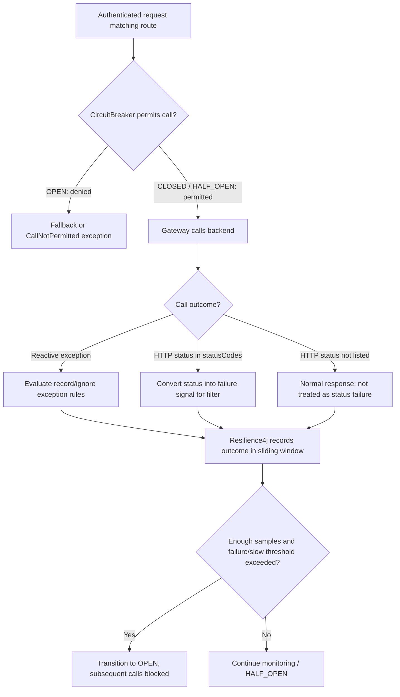
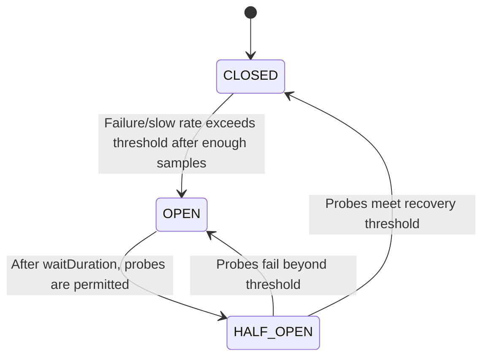

# Triggering CircuitBreaker on Exceptions or Specified HTTP Status Codes in Spring Cloud Gateway

## 1. The Problem: What Counts as a Failed Downstream Call?

**Spring Cloud Gateway** is an API Gateway for microservices systems: matching routes via predicates, executing the filter chain, transforming paths/headers, using service discovery/load balancing, authentication, rate limiting, retries, TLS, and request observability. When a downstream service fails or becomes slow, the Gateway should not keep pushing unbounded requests into that service.

A **circuit breaker** observes call outcomes and, when failure levels exceed policy, can temporarily **stop attempting backend calls** to shed load. In Spring Cloud Gateway Server WebFlux, the `CircuitBreaker` GatewayFilter uses **Spring Cloud CircuitBreaker**, commonly with the **Resilience4j** implementation.

The most important point of this lesson is distinguishing **two ways a call can be considered a failure**:

1. **An exception occurs (reactive error signal):** for example, the Gateway cannot connect to the backend, loses the connection, or hits a timeout. Error signals can be recorded per Resilience4j policy.
2. **The backend returns an HTTP response:** for example, `500 Internal Server Error`. An HTTP status code is not inherently a Java exception transmitted over the network. To make the Gateway CircuitBreaker **treat certain HTTP statuses as failures**, declare `statusCodes` on the `CircuitBreaker` filter.

When a single failure is recorded, it does not mean the breaker immediately transitions to `OPEN`. It also evaluates the **sliding window, `minimumNumberOfCalls`, `failureRateThreshold`, slow-call policy**, and current state.

**Lesson objectives:** configure the right dependencies, choose which exceptions/status codes to record, understand breaker states, build safe fallbacks, test real errors with `curl`, coordinate timeouts/retries, and observe incidents.

> **Scope:** focuses on **Spring Cloud Gateway Server WebFlux 4.3+/5.x**; YAML examples use `spring.cloud.gateway.server.webflux.routes`. WebFlux 4.2 and earlier typically used `spring.cloud.gateway.routes`. Gateway Server Web MVC has its own API/configuration—do not mix the Java DSLs of the two stacks.

## 2. Two Decision Layers: Recording Failures and Opening the Circuit



The diagram above is a **logical model** and does not depict every internal callback or whether a response body has already committed. Distinguish:

| Layer | Where Configured | Question |
|---|---|---|
**Detecting HTTP errors** | `GatewayFilter CircuitBreaker.args.statusCodes` | Which HTTP responses must trigger the failure path? |
**Exception classification** | `resilience4j.circuitbreaker.instances.*`, `recordExceptions`, `ignoreExceptions`, or predicates | Which exceptions count as failures, are ignored, or count as successes? |
**Opening thresholds** | `failureRateThreshold`, `minimumNumberOfCalls`, `slidingWindowSize`, `slowCallRateThreshold` | Is there enough evidence to OPEN yet? |
**Blocking backend calls** | Resilience4j `OPEN`/`HALF_OPEN` state | Is this call allowed to reach the backend? |
**Failure handling** | `fallbackUri` or error handling | What does the client receive when the call fails or the breaker is OPEN? |

### 2.1. How Does an HTTP 500 Differ from an Exception in the Backend?

For example, a Java backend throws:

```java
throw new IllegalStateException("database unavailable");
```

The **backend's** HTTP framework typically converts that exception into an **HTTP 500** response. The Gateway is an **HTTP client**, so it normally sees status 500 and **does not receive the raw `IllegalStateException` object from the backend's JVM**.

When `statusCodes` does not include `500`, that HTTP response may still be proxied back to the client along the normal flow; it is **not automatically counted as a CircuitBreaker exception**. With `statusCodes: [500]`, the Gateway routes that status into the filter's failure handling branch, enabling failure recording and fallback execution.

Conversely, if the Gateway **cannot open a TCP socket** to the backend, it has no HTTP 500 from the backend to match. A `ConnectException`/I/O error arises in the HTTP client pipeline and is evaluated under the exception policy.

## 3. The Three Core States of Resilience4j CircuitBreaker



| State | Behavior | Key Takeaway |
|---|---|---|
**CLOSED** | Permits requests, measures outcomes in the sliding window | One error does not necessarily open the circuit |
**OPEN** | Stops routing new requests to the backend through that breaker | Typically raises `CallNotPermittedException` and runs fallback if configured |
**HALF_OPEN** | Permits a small number of test requests | Uses probe outcomes to decide whether to close or reopen |

Resilience4j also has special states like `DISABLED` and `FORCED_OPEN`. Do not use them routinely to replace health checks or bypass policies outside an audited operational process.

### 3.1. A Calculable Threshold Example

Suppose:

```yaml
resilience4j:
  circuitbreaker:
    instances:
      ordersBreaker:
        slidingWindowType: COUNT_BASED
        slidingWindowSize: 10
        minimumNumberOfCalls: 5
        failureRateThreshold: 50
        waitDurationInOpenState: 15s
        permittedNumberOfCallsInHalfOpenState: 2
```

Once **at least 5 calls** have been recorded in the window, the breaker can compute the failure rate. If **3 of 5 calls** are counted as failures, the failure rate is **60%**, exceeding the 50% threshold, and the breaker can transition to `OPEN`. With only 4 calls, even if all 4 failed, `minimumNumberOfCalls: 5` typically keeps the breaker **from opening yet**.

After roughly `15s` in OPEN, subsequent requests can be selected as HALF_OPEN **probes**. `permittedNumberOfCallsInHalfOpenState: 2` allows at most two evaluation calls in that phase; other requests may continue to be blocked. Once enough results are available to evaluate, the breaker decides whether to close or reopen.

**Timing note:** if you test continuously over several seconds, the samples and wait periods will differ from an "instant 5 requests" table. With `TIME_BASED`, `slidingWindowSize` represents seconds instead of call count.

## 4. Dependencies: Gateway WebFlux + Reactive CircuitBreaker

Spring Cloud Gateway uses the Spring Cloud CircuitBreaker API; with Resilience4j, the **reactive starter** is required.

### 4.1. Maven

```xml
<!-- Use Spring Boot dependency management and a compatible Spring Cloud BOM -->
<dependency>
    <groupId>org.springframework.cloud</groupId>
    <artifactId>spring-cloud-starter-gateway-server-webflux</artifactId>
</dependency>
<dependency>
    <groupId>org.springframework.cloud</groupId>
    <artifactId>spring-cloud-starter-circuitbreaker-reactor-resilience4j</artifactId>
</dependency>
<dependency>
    <groupId>org.springframework.boot</groupId>
    <artifactId>spring-boot-starter-actuator</artifactId>
</dependency>
```

`spring-boot-starter-actuator` is **optional** for health/metrics, not a mandatory dependency for the CircuitBreaker filter to work. If using service discovery with `lb://`, add Spring Cloud LoadBalancer and the corresponding DiscoveryClient.

### 4.2. Gradle

```groovy
dependencies {
    implementation 'org.springframework.cloud:spring-cloud-starter-gateway-server-webflux'
    implementation 'org.springframework.cloud:spring-cloud-starter-circuitbreaker-reactor-resilience4j'
    implementation 'org.springframework.boot:spring-boot-starter-actuator'
}
```

| Library | Where to Use | Note |
|---|---|---|
`spring-cloud-starter-circuitbreaker-reactor-resilience4j` | **Gateway Server WebFlux** | Reactive CircuitBreaker integration |
`spring-cloud-starter-circuitbreaker-resilience4j` | **Non-reactive** applications | Do not arbitrarily substitute for the reactive starter in WebFlux Gateway |
`spring-boot-starter-web` | Spring MVC backend if needed | Do not add to WebFlux Gateway just for a fallback controller |
`spring-boot-starter-webflux` | WebFlux backend when needed | Gateway WebFlux starter provides the Gateway stack; backend is a separate app |

Do not pin Resilience4j/Gateway versions that diverge from the Spring Cloud release train in use. After upgrading, re-verify `spring.cloud.gateway.server.webflux.*` prefixes and Spring Boot compatibility.

## 5. Complete Configuration: Failing on Exceptions **and** HTTP Statuses

Suppose:

- Gateway listens on `http://localhost:8080`.
- Orders backend exposes `GET /orders/{id}` at `http://localhost:8081`.
- Clients call `GET /api/orders/{id}`.
- Connection/timeout errors or HTTP **500/503** from the backend should be treated as failures and return a controlled fallback.
- HTTP **404** for "order not found" is **not** a backend outage and is passed through untouched.

### 5.1. `application.yml` for Gateway Server WebFlux

```yaml
server:
  port: 8080

spring:
  application:
    name: edge-gateway
  cloud:
    gateway:
      server:
        webflux:
          httpclient:
            connect-timeout: 2000
            response-timeout: 4s
          routes:
            - id: orders-protected
              uri: http://localhost:8081
              predicates:
                - Path=/api/orders/**
                - Method=GET
              filters:
                - StripPrefix=1
                - name: CircuitBreaker
                  args:
                    name: ordersBreaker
                    fallbackUri: forward:/fallback/orders
                    statusCodes:
                      - 500
                      - "SERVICE_UNAVAILABLE"

resilience4j:
  circuitbreaker:
    instances:
      ordersBreaker:
        slidingWindowType: COUNT_BASED
        slidingWindowSize: 10
        minimumNumberOfCalls: 5
        failureRateThreshold: 50
        waitDurationInOpenState: 15s
        permittedNumberOfCallsInHalfOpenState: 2
        slowCallRateThreshold: 100
        slowCallDurationThreshold: 3s
  timelimiter:
    instances:
      ordersBreaker:
        timeoutDuration: 3s
```

**Configuration breakdown:**

1. `Path=/api/orders/**` with `Method=GET` matches only GET requests on the Orders prefix.
2. `StripPrefix=1` turns `/api/orders/42` into `/orders/42` before the backend receives it.
3. `CircuitBreaker.args.name=ordersBreaker` is the name of the CircuitBreaker used.
4. `statusCodes` lists the **exact HTTP codes to treat as failures**: numeric `500` and enum name `"SERVICE_UNAVAILABLE"` (503). `"INTERNAL_SERVER_ERROR"` can be used instead of `500`.
5. `fallbackUri` is an **internal Gateway `forward:`**. It is not an HTTP 302 redirect, and currently only the `forward:` URI scheme is supported in this filter configuration.
6. `resilience4j.circuitbreaker.instances.ordersBreaker` defines failure thresholds, minimum samples, and state transitions.
7. `resilience4j.timelimiter.instances.ordersBreaker` sets the execution time limit on the reactive operation. Spring Cloud CircuitBreaker docs state **TimeLimiter is enabled by default** unless configured off.

In this file, `timeoutDuration=3s` is shorter than `httpclient.response-timeout=4s` so the exercise illustrates **TimeLimiter raising an error first** before the HTTP client waits longer. In production, coordinate connect/response timeouts, TimeLimiter, retries, and end-to-end deadlines by SLA rather than copying demo numbers.

### 5.2. What Happens Without `statusCodes`?

```yaml
filters:
  - name: CircuitBreaker
    args:
      name: ordersBreaker
      fallbackUri: forward:/fallback/orders
```

The filter can still catch **reactive exceptions** in the pipeline segment it wraps, such as connect failures/timeouts. However, for a normal HTTP **500** proxied as an HTTP response, **do not assume the 500 response itself is counted as a breaker failure**. To treat these codes as errors, declare `statusCodes` explicitly.

### 5.3. Only Count Statuses That the Business Genuinely Treats as Incidents

| Status from Backend | Should It Be Added to `statusCodes`? | Why |
|---|---|---|
`500 INTERNAL_SERVER_ERROR` | **Usually yes** | Server-side technical error |
`502 BAD_GATEWAY` | **Depends on topology** | Can reflect upstream/proxy failure |
`503 SERVICE_UNAVAILABLE` | **Usually yes** | Service unavailable/overloaded |
`504 GATEWAY_TIMEOUT` | **Usually yes**, when actually received as an HTTP status | Downstream infrastructure reports timeout |
`404 NOT_FOUND` | **Usually no** | Can be a valid business outcome (order does not exist) |
`400 BAD_REQUEST` | **Should not by default** | Client sent invalid data; opening the circuit will not fix it |
`401 UNAUTHORIZED`/`403 FORBIDDEN` | **Should not** | Authentication/authorization, not a broken backend |
`429 TOO_MANY_REQUESTS` | **Must decide per contract** | May be client quota; sometimes signals downstream overload |

The `statusCodes` list **does not mean "all 5xx"** if you only list `500` and `503`. For other statuses, Gateway behaves according to configuration and actual received error signals. Never use a fallback returning `200 OK` for all `404`s if it tricks clients into believing nonexistent data is valid.

## 6. Internal Fallback Handler: Safe Responses Without Masking Failures

For `forward:/fallback/orders`, the Gateway needs a handler actually serving `/fallback/orders`. You can write a `@RestController` **inside the Gateway WebFlux application**:

```java
package com.example.gateway.fallback;

import java.util.Map;

import org.springframework.cloud.gateway.support.ServerWebExchangeUtils;
import org.springframework.http.HttpHeaders;
import org.springframework.http.HttpStatus;
import org.springframework.http.ResponseEntity;
import org.springframework.web.bind.annotation.GetMapping;
import org.springframework.web.bind.annotation.RestController;
import org.springframework.web.server.ServerWebExchange;

@RestController
public class OrdersFallbackController {

    @GetMapping("/fallback/orders")
    public ResponseEntity<Map<String, String>> fallback(
            ServerWebExchange exchange) {

        Throwable cause = exchange.getAttribute(
            ServerWebExchangeUtils.CIRCUITBREAKER_EXECUTION_EXCEPTION_ATTR);

        // Classify only for internal metrics/logs; do not return stack traces
        // or exception messages to the client.
        String category = cause == null
            ? "unavailable"
            : "circuit-breaker";

        return ResponseEntity.status(HttpStatus.SERVICE_UNAVAILABLE)
            .header(HttpHeaders.CACHE_CONTROL, "no-store")
            .header("X-Gateway-Fallback", "true")
            .body(Map.of(
                "code", "ORDERS_TEMPORARILY_UNAVAILABLE",
                "message", "Orders service is temporarily unavailable",
                "category", category));
    }
}
```

**Important notes:**

- `CIRCUITBREAKER_EXECUTION_EXCEPTION_ATTR` provides the associated `Throwable` on **ServerWebExchange** when the fallback is invoked. This data is for internal classification/observability; never send exception classes/messages, stack traces, backend URIs, tokens, session IDs, or sensitive data back to clients.
- The example returns `503`, `Cache-Control: no-store`, and `X-Gateway-Fallback: true` so clients and monitoring distinguish backup responses from genuine Orders results. Do not "fake success" with `200` if clients need to know data is unavailable.
- Direct requests to `/fallback/orders` can reach the handler if there is no corresponding Security/network policy. Thus the fallback must **not leak sensitive data**, must be secured architecturally, and must never act as an authorization bypass.
- `forward:` does not pick another backend by itself. To fall back to an **external service**, documentation describes creating a separate `/fallback` route/handler; protect the fallback service itself from cascading failures and recursion.
- Because the example route only accepts `GET`, there is no risk of the fallback accidentally faking success for an order-creation or payment `POST`. For write operations, evaluate idempotency and API contracts before designing fallbacks.

### 6.1. When `fallbackUri` Is Not Configured

`CircuitBreaker` can still track errors and **open the circuit**, but there is no filter-defined backup path. Errors pass into the Gateway's error handling mechanism; the actual HTTP status depends on the exception type and exception handler. Do not assume "OPEN always returns exact 503" if the application lacks clear error-handling configuration.

### 6.2. When the Fallback Itself Fails

If the fallback handler throws an exception, accesses an unavailable resource, or the response is already committed, the client may receive a different error. **Never recursively fall back** to the same failing route and never retry infinitely inside the handler. Fallbacks should be minimal, have their own deadline, only return truly permitted backup data, and expose metrics on invocation rate.

## 7. Java DSL: `addStatusCode` and `fallbackUri`

In **Gateway Server WebFlux**, routes can be configured in Java instead of YAML:

```java
package com.example.gateway.routes;

import org.springframework.cloud.gateway.route.RouteLocator;
import org.springframework.cloud.gateway.route.builder.RouteLocatorBuilder;
import org.springframework.context.annotation.Bean;
import org.springframework.context.annotation.Configuration;

@Configuration(proxyBeanMethods = false)
public class OrdersCircuitRoutes {

    @Bean
    RouteLocator ordersProtected(RouteLocatorBuilder builder) {
        return builder.routes()
            .route("orders-protected", r -> r
                .path("/api/orders/**")
                .and()
                .method("GET")
                .filters(f -> f
                    .stripPrefix(1)
                    .circuitBreaker(c -> c
                        .name("ordersBreaker")
                        .fallbackUri("forward:/fallback/orders")
                        .addStatusCode("INTERNAL_SERVER_ERROR")
                        .addStatusCode("SERVICE_UNAVAILABLE")))
                .uri("http://localhost:8081"))
            .build();
    }
}
```

`addStatusCode("INTERNAL_SERVER_ERROR")` corresponds to `500`; `addStatusCode("SERVICE_UNAVAILABLE")` corresponds to `503`. Gateway documentation also shows `addStatusCode(...)` using `HttpStatus` enum names.

This is an **alternative** to the YAML route in Section 5—do not register **two routes with the same ID** simultaneously in the same test. The `resilience4j.circuitbreaker.instances.ordersBreaker` and `resilience4j.timelimiter.instances.ordersBreaker` beans can still be configured via `application.yml` when using Java routes.

### 7.1. Testing Triggering on 404

To study status matching, in a **test profile** you could replace:

```java
.addStatusCode("SERVICE_UNAVAILABLE")
```

with:

```java
.addStatusCode("NOT_FOUND")
```

and observe how `HTTP 404` is treated as a failure by the filter. However, **never put 404 into the breaker by default for business APIs**. If "order ID does not exist" is a valid outcome, recording 404 as a system error can open the circuit and send fallbacks to masses of valid users.

### 7.2. A Note on Filter Order

In the YAML/Java in this lesson, `StripPrefix` is declared before `CircuitBreaker` so the downstream request receives the rewritten path. **GatewayFilter order matters**, especially when adding `Retry`, custom filters, caching, or response header processing. Do not assume two filters share identical "before/after" semantics just because they appear next to each other in YAML; verify actual behavior and chain ordering for your exact version.

## 8. Which Exceptions Increase the Failure Rate?

### 8.1. Exceptions Originating in Gateway vs. Backend HTTP Statuses

| Scenario | What Gateway Typically Observes | Decision Layer |
|---|---|---|
Backend process stopped, port closed | I/O/connection exception, no HTTP status from backend | Resilience4j exception policy |
DNS/backend resolution fails | Reactive error signal from HTTP client/discovery | Exception policy, depending on where failure occurs in chain |
Backend sends TCP reset | I/O exception in pipeline | Exception policy |
Spring Cloud CircuitBreaker `TimeLimiter` expires | Timeout exception on reactive execution | Exception policy, TimeLimiter |
Reactor Netty HTTP client times out | Reactive error from HTTP client | Exception policy |
Backend Java throws `IllegalStateException` with an error handler | Usually **HTTP 500**, not a Java exception over the wire | `statusCodes` must include `500` to count by status |
Backend returns JSON error with HTTP `200` | HTTP 200; CircuitBreaker does not inspect business errors in body by default | Requires API contract fix or controlled custom handling |
Spring Security blocks `401` before Gateway route | Request never enters route-specific breaker | Spring Security, not route `statusCodes` |
Backend returns valid `404` | Normal HTTP 404 | No error recorded if `404` is not in `statusCodes` |

**Key point:** simply "having an exception somewhere in the system" is not enough. It must be an **error signal inside the pipeline wrapped by CircuitBreaker** and classified as a failure by Resilience4j. If another filter catches the exception and converts it into a normal response **before it reaches CircuitBreaker**, the breaker may never see it.

### 8.2. Resilience4j `recordExceptions`, `ignoreExceptions`, and Predicates

Resilience4j can be customized to:

- **Record** exceptions in `recordExceptions` as failures.
- **Ignore** exceptions in `ignoreExceptions`: counted as neither success nor failure.
- Use `recordFailurePredicate` / Java predicates for advanced classification.

Configuration outline:

```yaml
# Purely a FORMAL EXAMPLE for an application-specific exception class.
# Do not copy into an application that does not have this class.
resilience4j:
  circuitbreaker:
    instances:
      ordersBreaker:
        ignoreExceptions:
          - com.example.gateway.errors.BusinessRuleException
```

This snippet is valid only if the application actually defines `com.example.gateway.errors.BusinessRuleException`; **it does not automatically turn HTTP 400/404 from the backend into BusinessRuleException**.

**Critical warning:** if you configure `recordExceptions` as a **closed list** containing only a few exceptions, other exceptions may be **treated as successes** by Resilience4j unless configured as ignored. Statuses routed into the failure branch via `statusCodes` may pass through a Gateway-internal exception type; you must check **whether it gets recorded under the record policy**. If you want both 500/503 and connection/timeout failures counted, verify metric outcomes with tests rather than just staring at `statusCodes`.

In basic practice, **leave `recordExceptions`/`ignoreExceptions` unset** to use the default failure-recording policy while explicitly declaring `statusCodes` for HTTP response statuses you want counted.

### 8.3. Ignored Exceptions Do Not Mean Fallbacks Will Not Run

Whether an exception is **ignored** in breaker statistics and whether a request **triggers a fallback** are two separate pipeline decisions. Resilience4j may omit the exception from the failure rate while the request still has an error to handle. Therefore, never claim "since we ignored the exception, the request will succeed" or "the fallback will never run." Measure both **breaker metrics** and **actual HTTP responses**.

## 9. Timeouts and Slow-Call Policies Are Not the Same Condition

Spring Cloud Gateway can use multiple timing controls:

| Mechanism | Example Config | Meaning |
|---|---|---|
TCP connect timeout | `spring.cloud.gateway.server.webflux.httpclient.connect-timeout: 2000` | Waiting to establish connection to backend |
HTTP response read timeout | `...httpclient.response-timeout: 4s` | Duration waiting to read network response |
Resilience4j TimeLimiter | `resilience4j.timelimiter.instances.ordersBreaker.timeoutDuration: 3s` | Limits reactive execution time for the breaker |
Slow-call tracking | `slowCallDurationThreshold: 2s` and `slowCallRateThreshold: 60` | Records ratio of **slow** calls; can open circuit even without exceptions |
Retry backoff | Separate `Retry` filter | Delays between attempts; can increase total latency |
End-to-end deadline | Client/API policy | Total journey cap; does not arise from one timeout alone |

**A slow call is not necessarily an exception.** Resilience4j can count a slow call toward the **slow-call rate** even when it returns HTTP 200. When the slow-call rate exceeds its threshold after enough samples, the breaker can open too.

Conversely, `TimeLimiter` can emit a **timeout error**, causing the call to count as a failure. In Section 5's example, `slowCallRateThreshold: 100` was set to avoid tripping too easily on a few slightly slow calls during the experiment; `timeoutDuration: 3s` illustrates failing when the backend is substantially slower.

For **SSE** and long streaming responses, a short TimeLimiter/response timeout can disconnect valid sessions because streams do not finish quickly. Separate streaming routes, configure heartbeats/flushing, and define dedicated timeouts; do not apply the same policy to short JSON APIs and continuous SSE.

### 9.1. Resilience4j TimeLimiter May Be Enabled by Default

Spring Cloud CircuitBreaker 5.x documentation notes TimeLimiter **is enabled by default**. It can be disabled globally or per group/instance via `spring.cloud.circuitbreaker.resilience4j.disable-time-limiter` and `disable-time-limiter-map`. Disabling TimeLimiter does not remove other Netty or ingress timeouts.

**Do not disable timeouts just to avoid fallbacks.** When a backend fails, requests can hold resources for a long time and push overload into the Gateway. Choose deadlines based on contracts and downstream recovery capability.

## 10. Coordinating `CircuitBreaker` with `Retry`

**CircuitBreaker** protects backends from sustained error volume; **Retry** re-attempts a call conditionally. The two mechanisms can complement each other or create traffic storms if misdesigned.

| Scenario | Risk |
|---|---|
Retry sits before the breaker records outcome | One "logical request" can generate **multiple backend attempts**; breaker may see only the final outcome depending on chain |
Breaker sits inside Retry | Each attempt hits the breaker policy separately; OPEN can fail subsequent attempts fast |
Retrying HTTP 500 with backoff=0 | Immediately amplifies load on a failing backend |
Retrying order/payment creation POSTs | Can create duplicate side effects; requires idempotency keys |
Fallback returns HTTP 200 and client retries based on body | Distorts metrics and client expectations |
Rate limiting only on client requests | Does not cap total downstream retries from an accepted request |

There is no single "standard" filter order suitable for every API. When combining `Retry` and `CircuitBreaker`, test the **actual GatewayFilter order**, measure how many requests the backend receives, how many calls Resilience4j records, and latency. Only retry **transient** errors under clear policy with bounded attempts, exponential backoff/jitter, and a total deadline.

**Do not enable `Retry` by default on every route** carrying mutations or large bodies. When retrying requests with bodies, the Gateway may have to buffer payloads in memory; enforce size, concurrency, and idempotency limits.

## 11. Fallbacks to External Services and Exception Data

Although `fallbackUri` only supports `forward:`, the Gateway can forward to a path that **a separate route** proxies to a fallback backend:

```yaml
spring:
  cloud:
    gateway:
      server:
        webflux:
          routes:
            - id: live-inventory
              uri: http://inventory.internal.example:8081
              predicates:
                - Path=/api/inventory/**
              filters:
                - name: CircuitBreaker
                  args:
                    name: inventoryBreaker
                    fallbackUri: forward:/internal/inventory-fallback

            - id: inventory-fallback
              uri: http://fallback.internal.example:8082
              predicates:
                - Path=/internal/inventory-fallback
```

This is a **two-hop routing pattern** per the docs, not the internal fallback controller from Section 6. Verify routing behavior to `/internal/inventory-fallback` and shield it from direct client calls to avoid accidentally exposing the fallback service as a public API. If the fallback service also fails, enforce timeout bounds and prevent call loops.

### 11.1. `FallbackHeaders`: For Internal Use Only

When forwarding to an **external fallback service**, the Gateway provides the `FallbackHeaders` filter to pass execution exception details as HTTP request headers:

```yaml
# This filter belongs to the inventory-fallback route, not the live-inventory route.
filters:
  - name: FallbackHeaders
    args:
      executionExceptionTypeHeaderName: X-Internal-Execution-Exception-Type
```

Fields can include exception type/message and root cause. **Never forward full exception details over untrusted networks**, especially exception messages containing host addresses, queries, tokens, or customer data. Fallback backends should use only normalized fields protected via mTLS/ACLs; never trust matching headers forged by clients.

**Client headers can be spoofed.** If the fallback route is publicly reachable, clients can send a fake `X-Internal-Execution-Exception-Type`. Strip sensitive incoming headers before writing internal metadata and authenticate workloads reaching the backend; never use exception headers as authorization credentials.

## 12. Gateway Server Web MVC Has Different Configuration

In Gateway Server **Web MVC**, documentation also supports numeric or enum-name `statusCodes` lists, yet:

- YAML routes live under `spring.cloud.gateway.server.webmvc.routes` in newer lines.
- Java DSL uses `RouterFunction` and `CircuitBreakerFilterFunctions`, **different** from WebFlux's `RouteLocatorBuilder`.
- HTTP client handling, exceptions, Servlet request/response, and lifecycle differ from reactive Netty.

Conceptual YAML example for MVC (requires the MVC starter and matching stack setup):

```yaml
spring:
  cloud:
    gateway:
      server:
        webmvc:
          routes:
            - id: mvc-orders
              uri: http://localhost:8081
              predicates:
                - Path=/orders/**
              filters:
                - name: CircuitBreaker
                  args:
                    name: mvcOrdersBreaker
                    fallbackUri: forward:/fallback/orders
                    statusCodes:
                      - 500
                      - "SERVICE_UNAVAILABLE"
```

**Do not mix** WebFlux and MVC examples in one application to experiment, because starters, server stacks, route APIs, and filter execution differ. The hands-on lab below uses **WebFlux**.

## 13. End-to-End Lab: HTTP 500, 503, 404, Timeouts, and Connection Failures

### 13.1. Preparing Two Applications

You need:

1. **Gateway** Server WebFlux on `localhost:8080`, with `application.yml` from Section 5 and `OrdersFallbackController` from Section 6.
2. **Backend** Spring Boot WebFlux on `localhost:8081` exposing `GET /orders/{id}` returning different scenarios.

Place the following controller in a **separate backend application** (with `spring-boot-starter-webflux` and a Spring Boot main class), **not inside the Gateway application**:

```java
package com.example.orders.demo;

import java.time.Duration;
import java.util.Map;

import org.springframework.http.HttpStatus;
import org.springframework.http.ResponseEntity;
import org.springframework.web.bind.annotation.GetMapping;
import org.springframework.web.bind.annotation.PathVariable;
import org.springframework.web.bind.annotation.RestController;
import reactor.core.publisher.Mono;

@RestController
public class DemoOrdersController {

    @GetMapping("/orders/{id}")
    Mono<ResponseEntity<Map<String, String>>> get(
            @PathVariable String id) {

        if ("500".equals(id)) {
            return Mono.just(ResponseEntity
                .status(HttpStatus.INTERNAL_SERVER_ERROR)
                .body(Map.of("error", "backend server error")));
        }
        if ("503".equals(id)) {
            return Mono.just(ResponseEntity
                .status(HttpStatus.SERVICE_UNAVAILABLE)
                .body(Map.of("error", "backend unavailable")));
        }
        if ("missing".equals(id)) {
            return Mono.just(ResponseEntity
                .status(HttpStatus.NOT_FOUND)
                .body(Map.of("error", "order not found")));
        }
        if ("slow".equals(id)) {
            return Mono.delay(Duration.ofSeconds(5))
                .map(tick -> ResponseEntity.ok(Map.of("id", id)));
        }
        if ("throw".equals(id)) {
            return Mono.error(
                new IllegalStateException("backend internal failure"));
        }
        return Mono.just(ResponseEntity.ok(Map.of("id", id)));
    }
}
```

The backend app must run on port 8081 with an appropriate `@SpringBootApplication`/`main` class. The `"throw"` branch intentionally throws an exception **on the backend**: without a custom error handler, Spring WebFlux typically converts it to an HTTP 500 response. The Gateway **does not receive that raw `IllegalStateException` Java exception**; it receives an HTTP response, and `statusCodes` decides whether to treat that status as a failure.

### 13.2. Verify the Backend Before Going Through the Gateway

```bash
curl -i http://localhost:8081/orders/ok
curl -i http://localhost:8081/orders/missing
curl -i http://localhost:8081/orders/500
curl -i http://localhost:8081/orders/503
```

Expected directly from the backend:

| Backend Path | HTTP Status | Illustrative Body |
|---|---|---|
`/orders/ok` | 200 | `{"id":"ok"}` |
`/orders/missing` | 404 | `{"error":"order not found"}` |
`/orders/500` | 500 | `{"error":"backend server error"}` |
`/orders/503` | 503 | `{"error":"backend unavailable"}` |

If you do not see the expected statuses at this step, fix the demo backend first rather than blaming the CircuitBreaker filter.

### 13.3. Calling Through the Gateway While Breaker Is CLOSED

```bash
# Normal success, no fallback.
curl -i http://localhost:8080/api/orders/ok

# Business-valid 404, NOT included in this lesson's statusCodes.
curl -i http://localhost:8080/api/orders/missing

# Listed 500 -> triggers failure handling and fallback.
curl -i http://localhost:8080/api/orders/500

# Also listed 503 -> fallback.
curl -i http://localhost:8080/api/orders/503

# Backend responds after ~5s; 3s TimeLimiter can expire first.
curl --max-time 10 -i http://localhost:8080/api/orders/slow
```

| Request Through Gateway | When Breaker Is CLOSED and Demo Backend Is Up | Distinguishing Sign |
|---|---|---|
`GET /api/orders/ok` | Backend 200 | No `X-Gateway-Fallback: true` |
`GET /api/orders/missing` | Backend 404 | No fallback header, since 404 is excluded |
`GET /api/orders/500` | Fallback 503 | Has `X-Gateway-Fallback: true` |
`GET /api/orders/503` | Fallback 503 | Has fallback header |
`GET /api/orders/slow` | Likely 503 from fallback when 3s TimeLimiter expires | Inspect timeout type/logs and metrics |

**Test ordering matters:** if you send many `500`/`503` calls in a row, the breaker can transition to `OPEN`. At that point, **even `/ok` or `/missing` can fall back**, because the breaker stops permitting calls to the backend. To test individual HTTP statuses cleanly, use a freshly started instance or wait through HALF_OPEN/CLOSED per config; never force-reset breakers in production just to run tests.

### 13.4. Repeating Failures to Observe OPEN State

```bash
# Run in test environment only:
for i in $(seq 1 12); do
  curl -sS -o /dev/null \
    -w "attempt=$i status=%{http_code}\n" \
    http://localhost:8080/api/orders/500
done

# Once breaker is OPEN, /ok also routes to fallback.
curl -i http://localhost:8080/api/orders/ok
```

Assuming a fresh breaker, `minimumNumberOfCalls=5`, `failureRateThreshold=50`, and the first 5 requests recorded as failures, the breaker can transition to OPEN after 5 samples. Subsequent requests are rejected fast, **no longer hitting the backend**. `CallNotPermittedException` may appear in the exchange attribute/internal logs while the fallback still returns 503 per our controller.

Do not claim all 12 calls reached the backend: **the whole point of OPEN is cutting off calls while the backend is failing**. Do not expect every response to look different either, because this lesson's fallback intentionally returns the same 503 for backend errors and an open breaker.

### 13.5. Testing an Exception **Without an HTTP Response**

In the test environment, stop the backend on `8081` and call:

```bash
curl --max-time 10 -i http://localhost:8080/api/orders/ok
```

When the breaker permits a probe, the Gateway can receive **connection refused** or another network error, entering the exception/fallback path without ever getting a 500/503 status from the backend. If the breaker is currently OPEN, the request may **not even attempt a new connection**, so this test would not yet prove a connect exception was observed. Use a CLOSED breaker or a separate test route/breaker to isolate them.

**Clear distinction:**

- Connection/timeout error before HTTP response: triggers by **exception**.
- Backend returns normal HTTP 500/503: triggers by **`statusCodes`**.
- Backend returns HTTP 404: **does not trigger by status** in this lesson's config.
- Breaker OPEN: emits **CallNotPermitted** before reaching the backend.

### 13.6. Testing Adding 404 to Config

To see explicitly how selected HTTP statuses differ from defaults, in a **test profile** replace:

```yaml
filters:
  - name: CircuitBreaker
    args:
      name: ordersBreaker
      fallbackUri: forward:/fallback/orders
      statusCodes:
        - 500
        - "SERVICE_UNAVAILABLE"
        - "NOT_FOUND"
```

After restarting or refreshing routes per your configuration management workflow, while the breaker is CLOSED, `GET /api/orders/missing` can trigger the fallback instead of returning the original 404. That **proves `statusCodes` is taking effect**, while also showing the danger of treating business "not found" as a technical error. Only trigger on 404 when **the contract genuinely defines** it as an abnormal backend failure.

## 14. Observing State, Failure Rate, and Fallbacks

To distinguish **a fallback from HTTP 500**, **a fallback from timeout**, and **a fallback from OPEN**, measure across multiple layers:

| Data | Question to Answer |
|---|---|
Gateway route ID / URI | Did the request match the `orders-protected` route? |
Original backend response status | Did the backend return 500/503/404 or no response? |
Exception class/cause in internal exchange | I/O, timeout, CallNotPermitted, or status-induced error? |
Resilience4j state | CLOSED, OPEN, or HALF_OPEN? |
Failure rate and minimum samples | Does the breaker have enough data to compute failure rates? |
Number of permitted/blocked calls | Is the backend still receiving requests or protected? |
Fallback invocation count | How many requests were served by the fallback? |
Gateway latency, backend latency, timeouts | Are errors primarily server errors, network issues, or slowness? |
Retry attempts | How many downstream attempts did one client request generate? |

### 14.1. Actuator and Micrometer

Once Spring Boot Actuator and a version-compatible Resilience4j metrics binder are installed—and administrative endpoints are exposed only to authorized operators—you can inspect metrics like `resilience4j.circuitbreaker.calls`, `resilience4j.circuitbreaker.state`, and Gateway request metrics. Exact names, tags, and availability depend on the starter/binder/registry in use.

Example for a private management environment:

```yaml
management:
  endpoints:
    web:
      exposure:
        include: health,info,metrics
```

```bash
# Call only from an authenticated/authorized management network.
curl -i http://localhost:8080/actuator/metrics
curl -i http://localhost:8080/actuator/metrics/resilience4j.circuitbreaker.calls
```

`/actuator/metrics/resilience4j.circuitbreaker.calls` **is not guaranteed to exist** if the app lacks the binder/metrics registry or no breaker events have occurred yet. Never expose all Actuator endpoints to the Internet and never put tokens, cookies, request bodies, or sensitive exception messages into metric labels/logs.

You can enable `registerHealthIndicator: true` for a breaker via Resilience4j and Spring Boot Actuator config. However, **an OPEN breaker does not prove the entire Gateway is "dead"**: the Gateway can remain healthy serving other routes or returning expected fallbacks. Design health indicators and readiness probes to fit operational scenarios.

### 14.2. Breaker State Usually Lives in **Each Gateway Instance**

Resilience4j CircuitBreaker normally resides inside **each Gateway replica's JVM**. It **does not use Redis or distributed state by default**. With Gateway A and B, A may open after observing failures while B stays CLOSED; that is not necessarily a bug.

Do not confuse this with `RedisRateLimiter`, which uses a shared Redis datastore. For multi-pod Gateways, monitor and alert by **breaker name + instance/pod + route**, avoiding using a single aggregated state to assume every pod behaves identically.

## 15. Security and API Contracts When Using Fallbacks

1. **Never mask unavailable data as `200`** if clients might mistake it for a loaded order or successful transaction. For the Orders example, `503` and a machine-readable error code are more transparent.
2. **Never turn `401`/`403` into a public fallback:** unauthenticated/unauthorized users must never use a fallback to access data protected by the real endpoint.
3. **Never return internal exception messages:** a `Throwable` can contain backend hostnames, URIs, headers, SQL errors, tokens, or personal data.
4. **Never trigger side effects in fallbacks:** avoid creating orders, changing payment states, or sending emails inside a fallback when you do not know whether downstream already executed the request.
5. **Define data freshness:** if a fallback uses cached/stale responses, the API contract must explicitly indicate potential staleness, TTL, and appropriate access levels.
6. **Protect `/fallback/**` handlers:** never let an internal forward path become a backdoor to a fallback service or administrative endpoint.
7. **Encrypt and verify connections:** use HTTPS/mTLS to backends where required; a circuit breaker does not replace TLS or JWTs.
8. **Review rate limiters and retries:** an OPEN breaker cuts downstream calls, but does not stop edge DDoS; rate limiting and connection limits are still essential.
9. **Avoid sharing breaker names arbitrarily:** two routes for unrelated backends sharing the same `name` can contaminate each other's failure rates.
10. **Test OPEN expiration:** a breaker always returning fallbacks without ever probing successfully can hide prolonged outages; alert on state, fallback rate, and investigate promptly.

## 16. Common Configuration Mistakes

| Symptom | Possible Cause | Resolution |
|---|---|---|
Cannot create `CircuitBreaker` filter | Missing reactive Resilience4j starter or wrong web stack | Add `spring-cloud-starter-circuitbreaker-reactor-resilience4j` for WebFlux |
Backend returns 500, breaker records no failure | `statusCodes` lacks 500, or filter does not wrap that response | Configure `statusCodes` and check route/filter chain |
`statusCodes` set, yet failure rate stays flat | `recordExceptions` too narrow, mismatched breaker name, or error handled earlier | Check Resilience4j exception classification and metrics |
Breaker stays CLOSED despite 4/4 failures | `minimumNumberOfCalls` is higher than 4 | Check minimum samples/window |
Breaker opens too aggressively on 404s | Added `NOT_FOUND` as a system error | Remove 404 if it is a normal business outcome |
HTTP 401/403 does not trigger fallback | Spring Security rejects before Gateway route | Usually expected behavior; do not bypass authorization |
No fallback even on backend connection refused | Route didn't match, wrong fallback path, or error handled in another filter | Check route, URI, filter order, and `/fallback/orders` handler |
Fallback returns 404 | No controller/route for `forward:` path | Create matching handler and check Security rules |
Fallback unexpectedly returns 200 | Fallback controller uses `ResponseEntity.ok(...)` | Pick status per API contract, e.g., 503 |
SSE disconnects and triggers fallback | TimeLimiter/response timeout too short | Separate streaming route policies, heartbeats, and deadlines |
Gateway A OPEN while B CLOSED | Breaker state is per JVM/pod | Monitor per instance; do not assume shared state |
Errors after upgrading Gateway | Wrong YAML prefix, incompatible starter, WebFlux/MVC API changes | Review release train, configprops, and dependencies |
Metrics error rate disagrees with backend 500s | Some 500s missing from `statusCodes`, retries mask failures, or requests never reached backend | Cross-check HTTP statuses, breaker calls, retry attempts, and routes |
Fallback service becomes overloaded | OPEN requests funnel into one shared fallback backend | Cap fallback load, use minimal/cached responses wisely, dedicated breaker/timeout |

## 17. Exercises and Answers

**Exercise 1 — Exception or HTTP status?** A Java backend throws `IllegalStateException`, which Spring turns into HTTP 500. The Gateway's CircuitBreaker config has no `statusCodes`. Can we assume the breaker records that Java exception?

**Answer:** no. The Gateway is an HTTP client and typically sees only **HTTP 500**, not the backend's raw exception. To count 500 as a failure, configure `statusCodes` with `500` or `"INTERNAL_SERVER_ERROR"`.

**Exercise 2 — Specified statuses.** Does `statusCodes: [500, "SERVICE_UNAVAILABLE"]` record every 5xx response as a failure?

**Answer:** no. It lists 500 and 503. Do not assume 502 or 504 will also be counted just because they are in the 5xx family; however, network/timeout exceptions can still be handled under another policy.

**Exercise 3 — Minimum samples.** `minimumNumberOfCalls=5`, `failureRateThreshold=50`. After 4 consecutive failures, must the breaker OPEN?

**Answer:** no. At least 5 calls must be recorded before evaluating the failure threshold; 4/4 is not enough under this configuration.

**Exercise 4 — Failure rate threshold.** The first five calls have three recorded failures. What is the failure rate, and what can happen?

**Answer:** `3/5 = 60%`, greater than the 50% threshold. Once samples are sufficient and no special override applies, the breaker can transition to OPEN.

**Exercise 5 — Valid 404.** `GET /api/orders/missing` returns HTTP 404 because the order does not exist. Should `"NOT_FOUND"` be added to `statusCodes`?

**Answer:** usually no. Business 404 is a normal response; treating it as a backend failure can needlessly trip the breaker and block other valid requests.

**Exercise 6 — Connection refused.** The backend is completely stopped, so the Gateway receives a connection exception. Do we need to list status 500 to catch this failure?

**Answer:** no. There is no HTTP 500 response to match. The exception can be recorded by Resilience4j under default or configured exception policies, as long as it occurs inside the pipeline wrapped by CircuitBreaker.

**Exercise 7 — Fallback URI.** Is `fallbackUri: http://backup.internal/fallback` directly supported syntax?

**Answer:** no. The Gateway CircuitBreaker filter only supports the `forward:` scheme for `fallbackUri`. To reach an external fallback backend, forward to a path with its own handler/route and proxy onward with security and timeout policies.

**Exercise 8 — OPEN.** The breaker is OPEN; why does `GET /api/orders/ok` return the fallback even though the backend could return HTTP 200?

**Answer:** an OPEN breaker refuses to attempt backend calls and emits `CallNotPermittedException`; the route's fallback handles the response. Recovery is tested only after the wait duration passes and HALF_OPEN probes are permitted.

**Exercise 9 — Retry.** A GET triggers 3 downstream attempts due to Retry, yet the breaker records one outcome. Is that a contradiction?

**Answer:** not necessarily. Filter order determines whether the breaker wraps the whole retry block or each individual attempt. Measure actual downstream calls, breaker metrics, and filter order before choosing a design.

**Exercise 10 — Security.** A JWT lacking permissions is blocked by Spring Security with `403` before route matching. Is it a bug that CircuitBreaker's failure rate does not rise?

**Answer:** usually no. A `403` from Security does not mean the backend is broken, and the route-specific breaker may not even have executed.

**Exercise 11 — Fallback status.** A fallback returns `200` with `{"items":[]}` when the Orders API is unreachable. What is the risk?

**Answer:** clients can mistake "unable to fetch data" for "no orders exist," corrupting business logic, caches, and metrics. Return a status and error code reflecting unavailability, such as `503`, or only use cached/stale responses if the API contract allows it with clear indicators.

**Exercise 12 — Two Gateway replicas.** Gateway A is OPEN while B is CLOSED for the same `ordersBreaker`. Is this a Redis or distributed-consistency bug?

**Answer:** no. Resilience4j CircuitBreaker normally stores state in **each JVM**, without synchronizing over Redis by default. Monitor each replica individually and inspect actual window/traffic counts.

## 18. Official References

- [Spring Cloud Gateway Server WebFlux 5.1 – CircuitBreaker GatewayFilter Factory](https://docs.spring.io/spring-cloud-gateway/reference/5.1/spring-cloud-gateway-server-webflux/gatewayfilter-factories/circuitbreaker-filter-factory.html): reactive Resilience4j dependency, `fallbackUri`, `statusCodes`, Java `addStatusCode`, and exchange exception attribute.
- [Spring Cloud Gateway Server WebFlux 4.3 – CircuitBreaker Factory](https://docs.spring.io/spring-cloud-gateway/reference/4.3/spring-cloud-gateway-server-webflux/gatewayfilter-factories/circuitbreaker-filter-factory.html): configuration on the 4.3 line.
- [Spring Cloud CircuitBreaker 5.1 – Resilience4j Properties](https://docs.spring.io/spring-cloud-circuitbreaker/reference/spring-cloud-circuitbreaker-resilience4j/circuit-breaker-properties-configuration.html): `instances`, `configs`, TimeLimiter, and precedence.
- [Spring Cloud Gateway – FallbackHeaders GatewayFilter](https://docs.spring.io/spring-cloud-gateway/reference/spring-cloud-gateway-server-webflux/gatewayfilter-factories/fallback-headers.html): passing exception metadata to external fallback routes.
- [Spring Cloud Gateway – Global Filters and Ordering](https://docs.spring.io/spring-cloud-gateway/reference/spring-cloud-gateway-server-webflux/global-filters.html): ordering and lifecycle of GatewayFilter/GlobalFilter.
- [Spring Cloud Gateway Server Web MVC – CircuitBreaker](https://docs.spring.io/spring-cloud-gateway/reference/spring-cloud-gateway-server-webmvc/filters/circuitbreaker-filter.html): statusCodes/fallback on the MVC stack.
- [Resilience4j – CircuitBreaker](https://resilience4j.readme.io/docs/circuitbreaker): CLOSED/OPEN/HALF_OPEN, failure/slow-call thresholds, and exception classification.
- [Spring Boot – Actuator Metrics](https://docs.spring.io/spring-boot/reference/actuator/metrics.html): inspecting metrics in a controlled manner.

**Key takeaway:** **pipeline exceptions** and **backend HTTP statuses** are two distinct failure sources. To make Gateway's CircuitBreaker treat `500`, `503`, or another specific status as an error, declare `statusCodes`; to change how exceptions are counted, configure Resilience4j's `record/ignore` policies. Only then do failure/slow-call thresholds decide **when to OPEN**. Design clear `forward:` fallbacks, never disguise real errors as fake successes, and always test HTTP errors, connection failures, timeouts, OPEN/HALF_OPEN transitions, and access controls before deploying to production.
