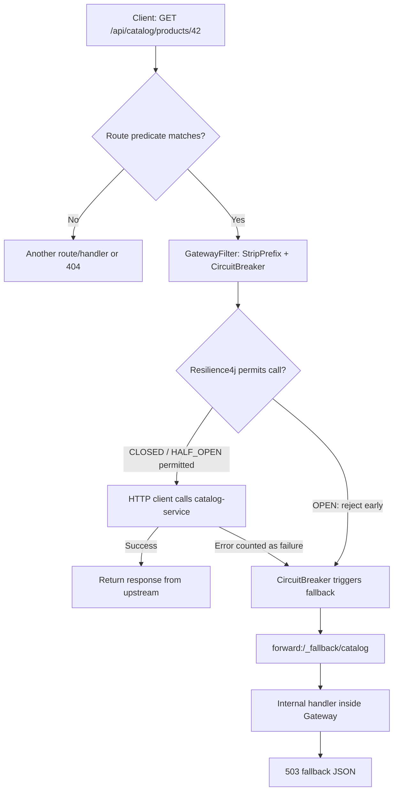
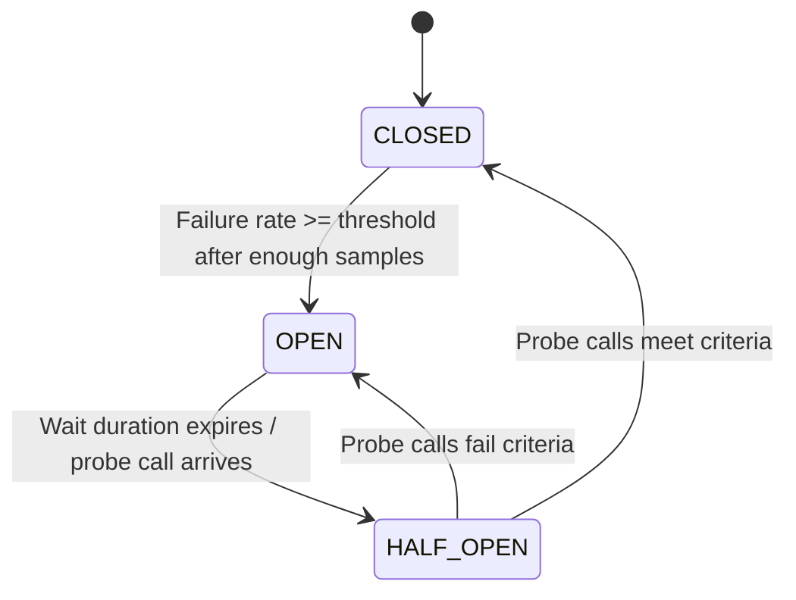

# fallbackUri and Internal Fallback Endpoints

## 1. The Problem: A Service Fails, Yet the Gateway Still Must Respond Safely

**Spring Cloud Gateway** is the entry point for microservices: matching routes via **predicates**, running the **filter chain** to transform paths/headers, locating service instances via **service discovery**, applying authentication, rate limiting, retries, circuit breakers, TLS, and request observability. A practical scenario is `catalog-service` becoming overloaded, slow, or going down. If every request continues waiting on the upstream, users hit cascading timeouts while Gateway resources risk exhaustion.

A **circuit breaker** monitors failures and rejects some calls early when the upstream shows signs of ill health. A **fallback** decides **how the Gateway responds** when a call fails or the circuit opens. In this lesson, fallbacks are handled by an **endpoint inside the Gateway application itself**, using `fallbackUri: forward:/...`.

For example:

```text
GET /api/catalog/products/42
      │
      ▼
Gateway route catalog → catalog-service :8081
      │
      ├─ upstream healthy  → 200 product JSON
      │
      └─ upstream fails / breaker OPEN
                 → forward:/_fallback/catalog
                 → controlled 503 JSON
```

After this lesson in the **Circuit Breakers and Fallbacks** chapter, you will:

1. Understand `fallbackUri` as an **internal forward target**, not an arbitrary HTTP URL.
2. Configure the `CircuitBreaker` GatewayFilter with Resilience4j using YAML and Java DSL.
3. Create a **WebFlux controller** inside the Gateway itself to return `503 Service Unavailable` without calling the backend.
4. Distinguish **connection/timeout errors**, **HTTP 5xx**, `statusCodes`, and CLOSED/OPEN/HALF_OPEN states.
5. Test healthy backends, failures, open circuits, missing fallback endpoints, 404/401 statuses, and unmatched routes.
6. Avoid design pitfalls such as returning fake 200s for sensitive operations, leaking stack traces, route loops, or infinite retries.

> **Scope:** Main examples use **Spring Cloud Gateway Server WebFlux 5.0.x** with the `spring.cloud.gateway.server.webflux` namespace, Java 17+, and a compatible Spring Boot/Spring Cloud BOM. **Server Web MVC** has a filter with the same name but a different Java DSL/Servlet API (Section 12). Do not use legacy Hystrix/Ribbon examples for new projects.

## 2. CircuitBreaker, fallbackUri, and forward: Are Three Distinct Concepts

### 2.1. Which Components Does a Request Pass Through?



**Simplified** diagram: specific configuration determines which errors count as failures. Not every HTTP 4xx/5xx automatically triggers a fallback. In addition, Spring Security, a rate limiter, or another filter may **return a response early**, before downstream/circuit breaker execution.

### 2.2. Role of Each Part

| Component | Question It Answers | Example |
|---|---|---|
| **Route URI** | When healthy, which service does the Gateway call? | `http://localhost:8081` or `lb://catalog-service` |
| **CircuitBreaker GatewayFilter** | When are calls permitted/rejected? | `name: catalogBreaker` |
| **Resilience4j configuration** | How many failures trigger OPEN, and when to probe again? | `failureRateThreshold`, `minimumNumberOfCalls` |
| **`fallbackUri`** | When falling back, which handler do we forward to? | `forward:/_fallback/catalog` |
| **Fallback handler** | Which HTTP status, headers, and body does the client get? | `503` with temporary unavailability JSON |

**Keep them separate:** the circuit breaker governs **the decision to call upstream**, while the fallback governs **the response when a failure occurs**. A breaker can exist with or without a fallback; a fallback may return cached data, a degraded-mode notice, or an explicit error status depending on the API contract.

### 2.3. Why Use Only URIs with the `forward:` Scheme?

Per Spring Cloud Gateway documentation, the `fallbackUri` parameter of `CircuitBreaker` currently supports only the **`forward:` scheme**. With:

```yaml
fallbackUri: forward:/_fallback/catalog
```

the Gateway **does not open a new TCP connection** to `_fallback` as an external server. It dispatches handling to a **controller/handler registered inside the Gateway application itself** matching path `/_fallback/catalog`.

The following options are **not equivalent**:

| Value | Usable Directly as `fallbackUri`? | Reason |
|---|---|---|
| `forward:/_fallback/catalog` | **Yes** | Forwards to a local handler or continues internal routing |
| `http://localhost:9999/fallback` | **Not a supported scheme** | External fallbacks require a separate intermediate route |
| `lb://fallback-service` | **Not a supported scheme** | `lb://` is for **route** upstream selection, not direct `fallbackUri` |
| `redirect:/fallback` | **No** | Client redirect is not CircuitBreaker internal forwarding |
| `/_fallback/catalog` | **Should not omit scheme** | Always declare `forward:` explicitly |

**Forward is not a redirect:** the browser is still calling `/api/catalog/products/42`, does not receive an HTTP 302/307, and does not issue a new request to `/_fallback/catalog`. Therefore, the fallback endpoint must be properly mapped inside the Gateway.

## 3. Preparing the Applications and Dependencies

Use two independent Spring Boot applications:

| Application | Port | Stack | Role |
|---|---:|---|---|
| `gateway-demo` | 8080 | Spring Cloud Gateway Server WebFlux | Routes, circuit breaker, and internal fallback controller |
| `catalog-demo` | 8081 | Spring Boot Web MVC | Backend returning success or simulated errors |

In **gateway-demo**'s `pom.xml`, in addition to a compatible Spring Cloud BOM, include:

```xml
<dependencies>
    <dependency>
        <groupId>org.springframework.cloud</groupId>
        <artifactId>spring-cloud-starter-gateway-server-webflux</artifactId>
    </dependency>
    <dependency>
        <groupId>org.springframework.cloud</groupId>
        <artifactId>spring-cloud-starter-circuitbreaker-reactor-resilience4j</artifactId>
    </dependency>
</dependencies>
```

The second dependency is crucial: it provides **reactive Spring Cloud CircuitBreaker** backed by Resilience4j. Writing `- name: CircuitBreaker` in YAML without this starter can prevent the Gateway from finding the required factory/implementation at startup.

For **catalog-demo** using Spring Boot 4.x, you can use:

```xml
<dependency>
    <groupId>org.springframework.boot</groupId>
    <artifactId>spring-boot-starter-webmvc</artifactId>
</dependency>
```

If using Spring Boot 3.x, the common Servlet starter is `spring-boot-starter-web`. In this lab, the backend runs on Servlet while the Gateway runs on **WebFlux**; do not add the Servlet starter to the **WebFlux Gateway application** to avoid mixing runtimes.

## 4. Configuring Gateway WebFlux with an Internal `fallbackUri`

### 4.1. Complete `application.yml`

In **gateway-demo**, create `src/main/resources/application.yml`:

```yaml
server:
  port: 8080

spring:
  application:
    name: gateway-demo
  cloud:
    gateway:
      server:
        webflux:
          routes:
            - id: catalog-protected
              uri: http://localhost:8081
              predicates:
                - Path=/api/catalog/**
                - Method=GET
              filters:
                - StripPrefix=2
                - name: CircuitBreaker
                  args:
                    name: catalogBreaker
                    fallbackUri: forward:/_fallback/catalog
                    statusCodes:
                      - 500
                      - 502
                      - 503
                      - 504

# Configure the Resilience4j instance matching the breaker name in the route.
resilience4j:
  circuitbreaker:
    instances:
      catalogBreaker:
        slidingWindowType: COUNT_BASED
        slidingWindowSize: 4
        minimumNumberOfCalls: 4
        failureRateThreshold: 50
        waitDurationInOpenState: 10s
        permittedNumberOfCallsInHalfOpenState: 2
```

**Reading the config layer by layer:**

1. `Path=/api/catalog/**` and `Method=GET` select requests to proxy.
2. `StripPrefix=2` transforms `/api/catalog/products/42` into `/products/42` before calling the backend.
3. `CircuitBreaker` uses instance name `catalogBreaker`; the exact same name must appear under `resilience4j.circuitbreaker.instances`.
4. `fallbackUri: forward:/_fallback/catalog` dispatches to the local controller when a fallback is needed; **no new HTTP call is made to the Gateway itself**.
5. `statusCodes` instructs upstream HTTP statuses 500/502/503/504 to be treated as failures for CircuitBreaker processing; it **does not** list 404/401/403 as default infrastructure failures.
6. Resilience4j evaluates the failure rate over a four-call window; **at least four** recorded outcomes are required before checking the 50% threshold. Once OPEN, the breaker rejects new calls before probing the backend.

Thresholds `4 calls`, `50%`, and `10s` are for **quick observation in a lab**. In production, size them according to QPS, SLAs, failure rates, latency, load, and retry policies; do not treat this configuration as a universal standard.

### 4.2. What Happens If `statusCodes` Is Omitted?

**Connection errors** such as connection refused, DNS failure, or timeouts typically travel through the pipeline as **exceptions** and can trigger fallbacks when the breaker wraps the call. By contrast, many HTTP 5xx responses are **responses returned by the upstream** rather than automatic exceptions. To ensure a backend 503 makes the breaker record a failure and invoke the fallback, this lab declares `statusCodes` explicitly.

An HTTP **404 Not Found** can be valid business data: the product does not exist. Do not mark every 404 as a failure without a special requirement, as doing so can open the breaker even while the backend is healthy.

## 5. Internal Fallback Endpoint: A Controller Inside the Gateway

### 5.1. Creating the REST Controller Inside `gateway-demo`

In the **Gateway Server WebFlux application**, create `CatalogFallbackController.java`:

```java
package com.example.gateway;

import java.util.Map;
import org.slf4j.Logger;
import org.slf4j.LoggerFactory;
import org.springframework.cloud.gateway.support.ServerWebExchangeUtils;
import org.springframework.http.CacheControl;
import org.springframework.http.HttpStatus;
import org.springframework.http.ResponseEntity;
import org.springframework.web.bind.annotation.GetMapping;
import org.springframework.web.bind.annotation.RestController;
import org.springframework.web.server.ServerWebExchange;

@RestController
public class CatalogFallbackController {

    private static final Logger log =
        LoggerFactory.getLogger(CatalogFallbackController.class);

    @GetMapping("/_fallback/catalog")
    public ResponseEntity<Map<String, String>> catalogUnavailable(
            ServerWebExchange exchange) {

        Throwable failure = exchange.getAttribute(
            ServerWebExchangeUtils.CIRCUITBREAKER_EXECUTION_EXCEPTION_ATTR);

        // Log minimal error type only; DO NOT expose messages/stack traces to clients.
        if (failure != null) {
            log.warn("Catalog fallback triggered, causeType={}",
                failure.getClass().getSimpleName());
        } else {
            log.warn("Catalog fallback endpoint was called without breaker error");
        }

        return ResponseEntity
            .status(HttpStatus.SERVICE_UNAVAILABLE)
            .header("X-Gateway-Fallback", "catalog")
            .cacheControl(CacheControl.noStore())
            .body(Map.of(
                "code", "CATALOG_TEMPORARILY_UNAVAILABLE",
                "message", "Product service is temporarily unavailable",
                "service", "catalog"));
    }
}
```

Place this class **in a package scanned by Spring Boot component-scan**. With a main class:

```java
package com.example.gateway;

import org.springframework.boot.SpringApplication;
import org.springframework.boot.autoconfigure.SpringBootApplication;

@SpringBootApplication
public class GatewayApplication {
    public static void main(String[] args) {
        SpringApplication.run(GatewayApplication.class, args);
    }
}
```

Both classes in package `com.example.gateway` are scanned and handler mappings are registered. There is no need (and you should not) add a route `uri: http://localhost:8080` just to proxy to this endpoint. When `fallbackUri: forward:/_fallback/catalog` triggers, **the forward goes directly to the local handler** without opening another TCP connection back to the Gateway.

### 5.2. Why Choose Status 503 Instead of Always Returning 200?

A fallback means an **alternative outcome**, not automatically that **business processing succeeded**:

| Scenario | Suggested Response | Reason |
|---|---|---|
| Cannot read catalog and no accurate data exists | **503** with notice JSON | Honest about service availability |
| Valid, sufficiently fresh public cache exists and contract accepts degraded mode | Possibly **200** with metadata like `degraded: true` | Client knows this is bounded fallback data |
| Payment/order operation where execution is uncertain | **Never return fake 200** | Avoids reporting success when outcome is unconfirmed |
| Resource does not exist while upstream is healthy | Normal **404** | Do not turn it into an infrastructure failure |
| User lacks permissions | **401/403** from Security | Do not mask auth errors with fallback data |

In this lab, **503** is the simplest, most verifiable choice. The `Cache-Control: no-store` header reduces the risk of caching a temporary error message as valid data. `X-Gateway-Fallback` is a diagnostic marker; if a cross-origin frontend wants to read that header in JavaScript, configure **CORS `exposedHeaders`** accordingly.

### 5.3. How to Read the Cause from `ServerWebExchange`

When the Gateway routes to a fallback due to a circuit breaker, it can store the `Throwable` in an exchange attribute:

```java
Throwable failure = exchange.getAttribute(
    ServerWebExchangeUtils.CIRCUITBREAKER_EXECUTION_EXCEPTION_ATTR);
```

Important points:

- This is an **internal Gateway attribute**, not an `Exception` sent by the client in headers.
- The attribute may be absent if someone **calls `/_fallback/catalog` directly** or if the forward did not originate from a breaker.
- Depending on state, the cause may be a connection error, timeout, HTTP-status-related exception, or `CallNotPermittedException` when OPEN; **do not write business logic tightly coupled to exact exception class names**.
- Only use the cause for **redacted internal logs/metrics**; never send `failure.getMessage()` or stack traces to clients, as messages sometimes contain URLs, hostnames, or sensitive data.

A fallback endpoint should have **minimal dependencies**: never call the failing `catalog-service` back, never block the WebFlux event loop, never perform heavy I/O, and never create retry/forward loops.

### 5.4. Do Not Turn the Fallback Path into a Security Backdoor

`/_fallback/catalog` is still an HTTP endpoint if clients can invoke it directly. Spring Security/WebFilter policies at the Gateway must control it appropriately; do not broadly open `permitAll("/_fallback/**")` just because "it's a fallback." The demo handler returns no confidential data, yet real systems may return per-tenant/per-user responses.

**Never trust** a self-asserted header like `X-Is-Fallback: true` to skip authentication. Rely strictly on SecurityContext and verified internal breaker attributes. If data is user-scoped, authentication/authorization must be consistent across both normal and fallback paths.

## 6. Backend Simulating Success, 503 Errors, and 404

In the **catalog-demo** application running Spring Boot Web MVC, create a controller with simulated modes:

```java
package com.example.catalog;

import java.util.Map;
import java.util.concurrent.atomic.AtomicLong;
import org.springframework.boot.SpringApplication;
import org.springframework.boot.autoconfigure.SpringBootApplication;
import org.springframework.http.HttpStatus;
import org.springframework.http.ResponseEntity;
import org.springframework.web.bind.annotation.GetMapping;
import org.springframework.web.bind.annotation.PathVariable;
import org.springframework.web.bind.annotation.RequestParam;
import org.springframework.web.bind.annotation.RestController;

@SpringBootApplication
@RestController
public class CatalogApplication {

    private final AtomicLong requests = new AtomicLong();

    public static void main(String[] args) {
        SpringApplication.run(CatalogApplication.class, args);
    }

    @GetMapping("/products/{id}")
    public ResponseEntity<Map<String, String>> getProduct(
            @PathVariable String id,
            @RequestParam(name = "mode", defaultValue = "ok") String mode) {

        long callNumber = requests.incrementAndGet();

        if ("fail".equals(mode)) {
            return ResponseEntity.status(HttpStatus.SERVICE_UNAVAILABLE)
                .body(Map.of(
                    "error", "UPSTREAM_UNAVAILABLE",
                    "backendCall", Long.toString(callNumber)));
        }

        if (!"42".equals(id)) {
            return ResponseEntity.notFound().build();
        }

        return ResponseEntity.ok(Map.of(
            "id", id,
            "name", "Wireless headphones",
            "backendCall", Long.toString(callNumber)));
    }
}
```

Set the **backend** config file:

```yaml
server:
  port: 8081
spring:
  application:
    name: catalog-demo
```

Testing the backend directly:

```bash
# Healthy: 200
curl -i 'http://localhost:8081/products/42'

# Simulate infrastructure failure with HTTP 503
curl -i 'http://localhost:8081/products/42?mode=fail'

# Product not found: 404
curl -i 'http://localhost:8081/products/99'
```

The `backendCall` value increments whenever a request **actually reaches the backend**. This is a convenient marker to distinguish requests rejected early by CircuitBreaker while OPEN. In production systems, use backend metrics/access logs rather than an in-memory demo counter.

**Test scope:** no database, no writes, and no login required. We intentionally use only **GET** to make failure simulation easy without risking replaying state-mutating operations.

## 7. Testing the Normal Path and Fallback Path

### 7.1. When the Backend Is Healthy

Start the backend on `8081`, then the Gateway on `8080`. Call:

```bash
curl -i 'http://localhost:8080/api/catalog/products/42'
```

When the route matches and the breaker permits the call, expected output:

```http
HTTP/1.1 200 OK
Content-Type: application/json

{"id":"42","name":"Wireless headphones","backendCall":"1"}
```

**Explanation:** route `catalog-protected` matches, `StripPrefix=2` delivers `/products/42` to the backend, and upstream succeeds so there is **no forward** to `/_fallback/catalog`. There is no `X-Gateway-Fallback` header.

### 7.2. When the Backend Returns HTTP 503

```bash
curl -i 'http://localhost:8080/api/catalog/products/42?mode=fail'
```

With `statusCodes` configured to include 503, the **expected** response from the fallback controller:

```http
HTTP/1.1 503 Service Unavailable
Content-Type: application/json
X-Gateway-Fallback: catalog
Cache-Control: no-store

{"code":"CATALOG_TEMPORARILY_UNAVAILABLE",
 "message":"Product service is temporarily unavailable",
 "service":"catalog"}
```

This is **controlled data from the Gateway**, not the `UPSTREAM_UNAVAILABLE` JSON produced by the backend. The client-side 503 status is **actively returned by the fallback controller**, rather than being forced to mirror the original 503 status. In each product, decide whether to preserve the original status, return cached content, or use a unified error format.

### 7.3. Observing OPEN Circuit After Repeated Failing Calls

In the lab configuration, Resilience4j requires at least **four** recorded calls before evaluating the failure rate. For clear observation, **restart the Gateway or reset breaker state through a controlled admin mechanism** before starting the test, then:

```bash
# Quickly send failing requests before the OPEN wait duration expires.
for i in 1 2 3 4 5 6; do
  echo "request $i"
  curl -sS -o /dev/null -w 'HTTP %{http_code}\n' \
    'http://localhost:8080/api/catalog/products/42?mode=fail'
done
```

**General expectations**:

1. Initial eligible requests are allowed to call the backend, which returns 503, and the fallback also returns 503.
2. Once sample count is met and error rate ≥ 50%, the breaker can transition **CLOSED → OPEN**.
3. While OPEN, new requests are rejected **before reaching the backend** and handled by the fallback; clients still see 503, yet **`backendCall` does not increment** for blocked requests.
4. After `waitDurationInOpenState: 10s`, test calls in **HALF_OPEN** can be permitted; probe results determine whether to return to CLOSED or OPEN.

**Do not look solely at HTTP 503 to conclude the breaker is OPEN**: both upstream failures and fallbacks during OPEN can produce the same HTTP status. Combine **Resilience4j metrics/state** or backend access logs to know whether requests reached upstream. Exact call counts needed depend on recorded outcomes, version/configuration, and initial state.

### 7.4. When a Product Does Not Exist

```bash
curl -i 'http://localhost:8080/api/catalog/products/99'
```

If the breaker is not OPEN and the backend returns **404 with no body**, the route in Section 4 does **not** include 404 in `statusCodes`, so the upstream 404 response is sent to the client **without triggering the fallback**. This is the desired behavior for "product not found." If the breaker was already OPEN beforehand, this request can be blocked early without reaching the backend—distinguish the two states.

### 7.5. When the Backend Stops Running

Stop **catalog-demo**, then call the route once:

```bash
curl -i 'http://localhost:8080/api/catalog/products/42'
```

The Gateway HTTP client hits a connection error (such as connection refused), and CircuitBreaker can invoke the fallback controller and return `503`. If the response is not as expected, check routes, Resilience4j dependencies, filters/timeouts, and handler mappings. If the **Gateway itself has also stopped**, clients will not receive the fallback: **an internal fallback depends on the Gateway itself staying up**.

> The `curl` commands, JSON payloads, and states are **expected outputs for hands-on practice**, not a claim that the project was built/executed while authoring this lesson.

## 8. Declaring CircuitBreaker and Fallback with Java `RouteLocatorBuilder`

If your application uses the Java DSL, you can replace the **YAML route** in Section 4 with a `RouteLocator` bean:

```java
package com.example.gateway;

import org.springframework.cloud.gateway.route.RouteLocator;
import org.springframework.cloud.gateway.route.builder.RouteLocatorBuilder;
import org.springframework.context.annotation.Bean;
import org.springframework.context.annotation.Configuration;
import org.springframework.http.HttpMethod;

@Configuration
public class CatalogRouteConfig {

    @Bean
    public RouteLocator catalogRoutes(RouteLocatorBuilder builder) {
        return builder.routes()
            .route("catalog-protected", r -> r
                .path("/api/catalog/**")
                .and()
                .method(HttpMethod.GET)
                .filters(f -> f
                    .stripPrefix(2)
                    .circuitBreaker(config -> config
                        .name("catalogBreaker")
                        .fallbackUri("forward:/_fallback/catalog")
                        .addStatusCode("INTERNAL_SERVER_ERROR")
                        .addStatusCode("BAD_GATEWAY")
                        .addStatusCode("SERVICE_UNAVAILABLE")
                        .addStatusCode("GATEWAY_TIMEOUT")))
                .uri("http://localhost:8081"))
            .build();
    }
}
```

**This is an alternative declaration**: do not define `catalog-protected` simultaneously in both Java and YAML in the same lab. `catalogBreaker` still reads Resilience4j settings from `resilience4j.circuitbreaker.instances.catalogBreaker`. The `/_fallback/catalog` controller from Section 5 **stays the same**.

| YAML | Java DSL | Meaning |
|---|---|---|
| `name: CircuitBreaker` | `.circuitBreaker(...)` | Attaches GatewayFilter |
| `args.name: catalogBreaker` | `.name("catalogBreaker")` | Selects breaker instance |
| `fallbackUri: forward:/_fallback/catalog` | `.fallbackUri("forward:/_fallback/catalog")` | Dispatches to local handler |
| `statusCodes: [500,502,503,504]` | Four `.addStatusCode(...)` calls | Treats these statuses as circuit-breaking failures |
| `StripPrefix=2` | `.stripPrefix(2)` | Removes the first two segments of the request path |

The Java DSL is convenient when defining routes programmatically, but **it does not turn the fallback into a Java callback catching arbitrary exceptions**. `fallbackUri` still requires a `forward:` URI to a registered handler. In large applications, align route definitions with your chosen source of truth (YAML, Java, discovery) to avoid overlapping routes.

## 9. Can `fallbackUri` Use Path Variables?

### 9.1. Passing the Product ID to the Fallback Controller

In the lab, the fallback intentionally returns the same notice for every product. Sometimes, however, the fallback API needs the **resource ID** to return a safe summary. `CircuitBreaker` supports URL variables in `fallbackUri` extracted from the `Path` predicate.

**Standalone** example for a route matching paths with an `id`:

```yaml
spring:
  cloud:
    gateway:
      server:
        webflux:
          routes:
            - id: product-with-path-variable
              uri: http://localhost:8081
              predicates:
                - Path=/api/catalog/products/{id}
                - Method=GET
              filters:
                - StripPrefix=2
                - name: CircuitBreaker
                  args:
                    name: catalogByIdBreaker
                    fallbackUri: forward:/_fallback/products/{id}
                    statusCodes:
                      - 503
```

Create the matching fallback controller method **inside the Gateway**:

```java
@GetMapping("/_fallback/products/{id}")
public ResponseEntity<Map<String, String>> productFallback(
        @PathVariable String id) {
    return ResponseEntity.status(HttpStatus.SERVICE_UNAVAILABLE)
        .cacheControl(CacheControl.noStore())
        .body(Map.of(
            "code", "PRODUCT_TEMPORARILY_UNAVAILABLE",
            "productId", id));
}
```

Place this method **inside `CatalogFallbackController`** (adding the `PathVariable` import) alongside `ResponseEntity`, `CacheControl`, and `Map` already used in Section 5. Do not paste it as a standalone Java class.

When a client calls `/api/catalog/products/42`, the fallback can reach `/_fallback/products/42` if the route matches and the circuit triggers. **Only place permitted path variables into the response**, after authentication/authorization and format validation. Never put arbitrary client-controlled paths, filenames, or upstream URLs into `forward:`; dynamic data must be constrained to prevent forwarding into unintended internal endpoints.

### 9.2. A Fallback Handler Must Match the HTTP Method

Forwarding does not automatically turn a `POST` request into `GET`. In this lesson, the route only accepts **GET**, so `@GetMapping` fits. If using other methods, the fallback controller/handler must have matching mappings and handle request body/method semantics carefully.

In particular, a payment or order-creation `POST` request may already **have been processed by the backend before the connection timed out**. If the Gateway forwards to a fallback and returns a fake success or automatically retries, clients can misunderstand payment state. Prefer **idempotency keys**, business status verification, and explicit errors when the outcome is uncertain.

## 10. Internal Fallbacks vs. Fallbacks to Another Service Are Not the Same

### 10.1. Preferred Design: Internal Controller

```text
CircuitBreaker → forward:/_fallback/catalog
                           └─ @GetMapping("/_fallback/catalog")
                              inside the same Gateway JVM
```

Pros: minimal dependencies, no extra network connections, easy control over format and status. Cons: should not hold heavy business logic or large caches inside the Gateway process; the fallback **also stops working** if the Gateway dies or the local handler fails.

### 10.2. When the Fallback Must Reach an External Application

Spring Gateway documentation describes a **two-route** pattern: `CircuitBreaker` first forwards to an internal path, and a **separate Gateway route** matches that path to call the fallback upstream.

Illustrative example:

```yaml
# Replaces the local route in Section 4; external app runs on :9994.
spring:
  cloud:
    gateway:
      server:
        webflux:
          routes:
            - id: catalog-main
              uri: http://localhost:8081
              predicates:
                - Path=/api/catalog/**
              filters:
                - StripPrefix=2
                - name: CircuitBreaker
                  args:
                    name: catalogBreaker
                    fallbackUri: forward:/_fallback/external/catalog
                    statusCodes:
                      - 503

            - id: catalog-fallback-service
              uri: http://localhost:9994
              predicates:
                - Path=/_fallback/external/catalog
              filters:
                - SetPath=/fallback/catalog
                # FallbackHeaders should only be used when genuinely needed
                # to pass exception metadata to the fallback service.
```

In this pattern, **do not create `@GetMapping("/_fallback/external/catalog")`** inside the Gateway so the local handler does not intercept the request before the fallback route. `forward:` dispatches to internal route matching, while **the second route** opens the connection to `http://localhost:9994`.

If the fallback service needs to know the initial failure, you can attach `FallbackHeaders` to the **second fallback route**:

```yaml
# Add to the filters of route catalog-fallback-service, not the main route.
- name: FallbackHeaders
  args:
    executionExceptionTypeHeaderName: X-Fallback-Error-Type
```

`FallbackHeaders` can pass error type/message/root cause into **request headers** sent to the fallback service. This information can leak hostnames or internal data; **use only between trusted services**, restrict network access, and omit/strip messages when unnecessary. **Never reflect raw exception headers back to browsers**.

### 10.3. Comparing the Two Approaches

| Criterion | Internal Fallback Controller | External Fallback Service |
|---|---|---|
| `fallbackUri` | `forward:/_fallback/catalog` | Still `forward:/_fallback/external/catalog` |
| Who receives the forward? | `@GetMapping` inside Gateway | Another Gateway route |
| New network connection to fallback? | **No** | **Yes**, the second route proxies externally |
| Complexity | Low | Higher: routes, DNS, TLS, timeouts, security |
| Risk | Local handler bug / overly heavy logic | Fallback service can also fail, loop, or slow down |
| Use when | Simple messages, static/lightweight fallbacks | A dedicated, reliable backup data source exists |

In both models, keep fallbacks **simple, non-recursive**, bounded by finite timeouts, and never send bearer tokens or cookies to a backup service outside the trust boundary.

## 11. Breaker States and Combining Timeouts and Retries

### 11.1. CLOSED, OPEN, and HALF_OPEN



| State | Does Gateway Call Backend? | What Happens? |
|---|---|---|
| **CLOSED** | Yes | Tracks outcomes; enough errors can transition to OPEN |
| **OPEN** | Disallows protected calls | Rejects fast, can run fallback |
| **HALF_OPEN** | Permits only a few test calls | Checks whether the service has recovered |

Resilience4j has other special states like DISABLED/FORCED_OPEN in its management API; they are **not** needed for the basic lab. After `waitDurationInOpenState`, when HALF_OPEN triggers depends on `automaticTransitionFromOpenToHalfOpenEnabled` and incoming test traffic per configuration; do not assume a timer always transitions automatically in every setup.

### 11.2. Timeouts Are a Failure Source, Not `fallbackUri`

`fallbackUri` **does not set a deadline** on the backend. You can configure the Gateway HTTP client separately:

```yaml
# Outbound HTTP client properties for Gateway Server WebFlux 5.0.x.
spring:
  cloud:
    gateway:
      server:
        webflux:
          httpclient:
            connect-timeout: 2000
            response-timeout: 4s
```

`connect-timeout` caps the **TCP connection establishment time** (milliseconds), while `response-timeout` is a `Duration` waiting for a response per HTTP client semantics. Alongside this, Spring Cloud CircuitBreaker + Resilience4j can integrate **TimeLimiter** with its own configuration:

```yaml
# Optional example: use only after verifying TimeLimiter in your running version.
resilience4j:
  timelimiter:
    instances:
      catalogBreaker:
        timeoutDuration: 3s
```

**Do not confuse** the three: connect timeout, response timeout, and TimeLimiter. Whichever expires first can determine the failure cause received by the fallback. Clients and ingresses also have their own timeouts; if the client already disconnected, a late fallback may never be received.

### 11.3. Retry Before or After CircuitBreaker?

When adding a `Retry` filter, `Ordered` priority and filter placement can alter **how many times the backend is called before a failure is recorded**. Two conceptual examples:

- Retry **inside** the CircuitBreaker-protected scope: one logical request can make multiple HTTP attempts before recording a single final outcome.
- Retry **outside** CircuitBreaker: each retry attempt can encounter an OPEN breaker and fail fast or trigger a fallback.

Actual behavior depends on your Gateway version's filter chain and configuration; verify with backend request counts, logs/traces, and metrics. **Never combine unbounded retries with a circuit breaker**: a failing downstream can be flooded when many clients retry simultaneously. Prefer bounded retries, backoff/jitter, timeout budgets, and retrying only idempotent operations.

## 12. Gateway Server Web MVC: Same Principles, Different API

**Gateway Server Web MVC 5.0.x** also supports `CircuitBreaker` and `forward:` `fallbackUri`, but its runtime is based on **Servlet/WebMvc.fn**. Do not use WebFlux's `GlobalFilter`, `ServerWebExchange`, or `RouteLocatorBuilder` for MVC.

**Standalone** example for a Gateway Server Web MVC application:

```yaml
spring:
  cloud:
    gateway:
      server:
        webmvc:
          routes:
            - id: catalog-mvc
              uri: http://localhost:8081
              predicates:
                - Path=/products/**
              filters:
                - name: CircuitBreaker
                  args:
                    name: catalogMvcBreaker
                    fallbackUri: forward:/_fallback/catalog
```

In **MVC**'s Java `RouterFunction` DSL, you can use:

```java
import java.net.URI;
import org.springframework.context.annotation.Bean;
import org.springframework.context.annotation.Configuration;
import org.springframework.web.servlet.function.RouterFunction;
import org.springframework.web.servlet.function.ServerResponse;

import static org.springframework.cloud.gateway.server.mvc.filter.BeforeFilterFunctions.uri;
import static org.springframework.cloud.gateway.server.mvc.filter.CircuitBreakerFilterFunctions.circuitBreaker;
import static org.springframework.cloud.gateway.server.mvc.handler.GatewayRouterFunctions.route;
import static org.springframework.cloud.gateway.server.mvc.handler.HandlerFunctions.http;

@Configuration
public class MvcGatewayRoutes {

    @Bean
    RouterFunction<ServerResponse> catalogMvc() {
        return route("catalog-mvc")
            .GET("/products/{id}", http())
            .before(uri("http://localhost:8081"))
            .filter(circuitBreaker(
                "catalogMvcBreaker",
                URI.create("forward:/_fallback/catalog")))
            .build();
    }
}
```

**This replaces the MVC YAML route**; do not register both simultaneously under the same ID. A local fallback for MVC can be a Servlet `@RestController` handling `GET /_fallback/catalog`. To inspect the cause, MVC provides `MvcUtils.CIRCUITBREAKER_EXECUTION_EXCEPTION_ATTR` in the `ServerRequest`/Servlet context; **do not** use WebFlux's `ServerWebExchangeUtils`.

Both MVC and WebFlux require an appropriate circuit breaker dependency, but the reactive starter `spring-cloud-starter-circuitbreaker-reactor-resilience4j` **is not the default choice for a Servlet stack**. Verify the starter and Spring Cloud BOM for your exact flavor instead of copying dependencies blindly between apps.

## 13. Security and Correctness of Fallbacks

### 13.1. Fallbacks Are Not an Authorization Bypass

A request can be rejected by Spring Security **before the Gateway matches a route**. CircuitBreaker does not turn 401/403 into a fallback response. Distinguish:

- **401 Unauthorized:** missing/invalid authentication credentials.
- **403 Forbidden:** authenticated, but lacks permission.
- **404 Not Found:** no matching route/resource.
- **429 Too Many Requests:** rejected by rate limiter.
- **503 Service Unavailable:** fallback in the example reporting the catalog is temporarily unavailable.

**Do not use fallbacks to mask 401/403 with 200**, and never accidentally put `statusCodes: [401,403]`. For multi-tenant APIs, fallback cached data must still be scoped to the right user/tenant and permissions; "stale" data does not mean permissible to leak.

### 13.2. Risk of Leaking Exception Details

Headers or JSON like:

```json
{
  "error": "java.net.ConnectException",
  "target": "http://payments-private.internal:8443",
  "stackTrace": "..."
}
```

**are unsuitable to send to clients**. They reveal topology, internal service names, and execution traces. Return a stable error code like `CATALOG_TEMPORARILY_UNAVAILABLE`, a controlled request/trace ID, HTTP 503, and a user-facing message.

Raw exceptions should only be observed in access-controlled internal logs, and even logs must redact tokens, sensitive query strings, and user data. With `FallbackHeaders`, limit which headers are sent to the fallback service and never reflect them straight back to browsers.

### 13.3. Do Not Break Business Consistency

| API | Safer Fallback | What to Avoid |
|---|---|---|
| Public `GET /catalog/products` | Return 503 or valid public cache marked `stale` | Returning old prices/inventory as definitively current |
| `GET /account/balance` | Return 503 if accurate, authorized balance is unavailable | Using a shared cache across multiple users |
| `POST /orders` | Return uncertain status with lookup code/idempotency key when appropriate | Returning 200 "order placed" after a timeout |
| `POST /payments` | Query transaction status via a safe mechanism; require confirmation | Unlimited retries or duplicate charges |
| `GET /feature-flags` | Can use approved default values | Returning defaults that weaken security access control |

An internal fallback must work **even when the upstream is unavailable**, yet that never justifies bypassing data accuracy, auditing, authorization, or consistency rules.

### 13.4. Interaction with Headers, TLS, and Service Discovery

- **Headers:** the fallback controller builds a new response; `X-Gateway-Fallback` is purely diagnostic. When CORS is enabled, ensure error responses also carry valid CORS headers so frontends can read errors.
- **TLS:** a route with `uri: https://catalog.internal.test` requires the Gateway to verify backend certificates. Internal `forward:` is not a TLS connection; never cite that to claim the whole system does not need TLS.
- **Service discovery:** `uri: lb://catalog-service` can be used when LoadBalancer/DiscoveryClient are configured. Fallback stays `forward:/_fallback/catalog`, independent of service discovery when the handler lives in the Gateway.
- **Rate limiting:** requests rejected early by a rate limiter may never reach the breaker/fallback, depending on filter order. Do not treat 429 as an infrastructure failure.
- **TokenRelay:** routes carrying bearer tokens must ensure fallbacks never send tokens to untrusted third parties; internal controllers do not need to print tokens.

## 14. Observability and Incident Troubleshooting

### 14.1. What Should You Monitor?

A 503 fallback response can have many causes: DNS, TCP, TLS, response timeout, upstream 503, or an OPEN breaker. Looking at a single HTTP status is not enough.

| Signal | Role |
|---|---|
| **Route ID** and method/path | Confirms the request matched the CircuitBreaker route |
| **Circuit breaker name/state** | Shows whether `catalogBreaker` is CLOSED, OPEN, or HALF_OPEN |
| **Failure/slow-call rate** | Explains why the breaker opened per Resilience4j |
| **Backend request count/access log** | Confirms whether requests reached upstream or were rejected early |
| **Fallback counter** | Shows what fraction of requests hit the fallback |
| **Redacted exception category** | Distinguishes connect, timeout, status-based, and call-not-permitted |
| **Client and upstream response status/time** | Reveals user experience and extra fallback overhead |
| **Trace/request ID** | Correlates Gateway and backend logs under concurrency |

Add `spring-boot-starter-actuator` and appropriate Micrometer/Resilience4j metrics dependencies (matching your project version) when metrics are needed. For Gateway Server WebFlux, configure **read-only** access:

```yaml
management:
  endpoint:
    gateway:
      access: read-only
  endpoints:
    web:
      exposure:
        include: health,info,metrics,gateway
```

Once Actuator is protected by Spring Security/network policies, you can read:

```bash
# Routes/factories held by the Gateway.
curl -sS 'http://localhost:8080/actuator/gateway/routes'
curl -sS 'http://localhost:8080/actuator/gateway/routes/catalog-protected'

# Available metrics list; only when corresponding metric binders are enabled.
curl -sS 'http://localhost:8080/actuator/metrics'
```

Resilience4j exposes its own metrics and event/state endpoints when properly integrated/enabled; **do not assume they appear automatically just from route YAML**. Check exact metric names/tags of your running version and build dashboards for failure rate, OPEN state, fallback rate, timeouts, 5xx, and p95/p99 latency.

Never expose Actuator to the Internet and never write full `Authorization`, cookies, sensitive request bodies, or stack traces into trace attributes.

### 14.2. Symptom-Based Diagnostic Table

| Symptom | Likely Cause | How to Check |
|---|---|---|
| Startup reports missing `CircuitBreaker` filter | Missing reactive Resilience4j starter or version/BOM mismatch | Check dependencies, Gateway stack, filter factory |
| Backend errors, yet client still sees upstream error body | `statusCodes` missing actual status or request hit another route | Check route ID, `statusCodes`, backend status |
| `forward:/_fallback/catalog` returns 404 | Controller not component-scanned, wrong `@GetMapping` path/method | Check Gateway handler mappings and request method |
| Fallback returns 500 | Controller bug (null dereference, blocking/exception) | Check redacted internal logs and handler code |
| Gateway returns 503 even when backend is healthy | Breaker still OPEN from prior errors or backend path differs from expected | Check breaker state and backend request count |
| Breaker stays CLOSED despite many 503s | `minimumNumberOfCalls` not met, wrong instance name, or 503 not counted as failure | Check Resilience4j instance + `statusCodes` + metrics |
| Breaker OPEN yet backend still sees traffic | Multiple Gateway instances/route names, other clients, HALF_OPEN probes | Inspect per instance/route/trace ID |
| 404 requests get turned into fallbacks | 404 added to `statusCodes` or fallback from another error | Review business vs. infrastructure error policy |
| Client gets 401/403 instead of fallback | Spring Security blocks request before Gateway routing | Check authentication/authorization; do not bypass Security |
| Request times out longer than expected | Client/ingress/HTTP client/TimeLimiter budgets differ | Compare connect, response, TimeLimiter, and retries |
| Request loop in Gateway | Fallback route points back to itself or default filters loop | Check forward path, route matching, and filter chain |
| Fallback returns 200 despite downstream failure | Controller uses wrong status or stale cache lacks metadata | Review degraded-mode contract; use 503 if uncertain |
| Exception headers reach client | Raw `FallbackHeaders`/logging reflected externally | Strip, redact, tighten trust boundary |
| Most traffic hits fallback after deploy | DNS/cert/route URI change, registry error, overly sensitive threshold | Check upstream readiness, TLS, Resilience4j config, and rollout |

### 14.3. Repeatable Investigation Workflow

1. Record the **specific Gateway instance** receiving the request, version/config profile, and route ID.
2. Send a control `/products/42` request **directly from the Gateway environment** to the backend, checking TCP/DNS/TLS and status.
3. Send a request through the Gateway, checking for `X-Gateway-Fallback` and whether the fallback controller ran.
4. Compare **`statusCodes`**, Resilience4j breaker name, `minimumNumberOfCalls`/`failureRateThreshold`, and current circuit state.
5. Distinguish backend 503 from **early OPEN rejection** via counters/logs/metrics; never conclude from HTTP 503 alone.
6. Check whether Security, Retry, rate limiter, CORS, or other filters returned a response before the breaker.
7. Check the impact of any new config across all Gateway instances, not just one pod.
8. Finish with **regression verification**: healthy upstream → real body; failing upstream → proper fallback; recovery → circuit returns to CLOSED.

## 15. Pre-Deployment Integration Test Matrix

A test proving only "when backend fails, Gateway returns 503" **is not enough**. Test **success**, **failure**, **OPEN**, **recovery**, **authorization**, and **route-matching** paths against a backend whose state you can control:

| ID | State / Request | What Must Be Verified |
|---|---|---|
| T1 | Healthy backend, `GET /api/catalog/products/42` | 200 upstream JSON, no `X-Gateway-Fallback` |
| T2 | Backend returns 503, `statusCodes` includes 503 | Local fallback returns 503 and safe error JSON |
| T3 | Backend returns 500/502/504 per policy | CircuitBreaker records failure/forwards per config |
| T4 | Backend returns 404 nonexistent product | Normal 404 returned while circuit CLOSED, not masked by fallback |
| T5 | Send failures past threshold, breaker OPEN | Subsequent requests blocked early; upstream request count stays flat |
| T6 | OPEN duration expires, upstream recovers | HALF_OPEN probes succeed and circuit returns to CLOSED |
| T7 | Backend stops TCP listener | Connection error handled without leaking exception body |
| T8 | Very slow backend | Client/ingress/Gateway/TimeLimiter timeouts align with budget |
| T9 | `POST` request to a GET-only route | Does not match route/trigger fallback or execute write |
| T10 | Unauthorized client calls API | Spring Security still returns 401/403, never invokes fallback to bypass auth |
| T11 | Local fallback handler missing | Mapping error detected; do not mistake 503 for "working" |
| T12 | Direct call to `GET /_fallback/catalog` | Endpoint leaks no sensitive data and is protected per policy |
| T13 | Two Gateway pods with independent breaker state | Per-instance behavior observed, not assuming distributed state |
| T14 | Add Retry before/after breaker | Backend calls stay within retry budget and latency |
| T15 | Cross-origin frontend receives fallback | Valid CORS headers on error response; JS reads allowed body/diagnostic header |

**Automated testing tip:** use integration tests with a backend stub capable of returning **200/404/503**, dropping connections, or injecting delays; assert both **client responses** and **actual request counts received by the stub**. When testing OPEN, isolate breaker instances between tests so they do not interfere; avoid relying on uncontrolled timing/clocks that cause flaky tests. No build or test execution is needed while writing this lesson.

## 16. Practice Exercises

**Exercise 1 — Forward or HTTP?** Gateway has `fallbackUri: forward:/_fallback/catalog`. When the backend disconnects, does the Gateway open a new TCP connection to `/_fallback/catalog`? Where should that endpoint be implemented?

**Exercise 2 — HTTP status.** The backend returns 503, yet the route declares no `statusCodes`. Can we guarantee CircuitBreaker will always run the fallback? Write the extra configuration so 503 is definitely treated as a failure on the demo route.

**Exercise 3 — Choosing fallback status.** A `GET /account/balance` API fails and no trustworthy balance is available. Should you return 200 with balance `0` or 503? Explain the impact on users.

**Exercise 4 — Path rewrite.** Route `Path=/api/catalog/**` has `StripPrefix=2` and `uri: http://localhost:8081`. Determine the backend path when a client calls `/api/catalog/products/42`. On failure, which fallback endpoint path is invoked?

**Exercise 5 — Open circuit.** Resilience4j has `minimumNumberOfCalls=4`, `failureRateThreshold=50`. After four consecutive requests with two errors and two successes, can the circuit OPEN? Must a new request while OPEN be sent to the backend?

**Exercise 6 — Missing fallback handler.** Configured forward to `/_fallback/catalog`, but the controller class is placed outside the package scanned by Spring Boot. What symptom might clients see, and where should you check?

**Exercise 7 — Business errors.** Should 401, 403, and 404 be added to `statusCodes` on the default catalog route? Explain why.

**Exercise 8 — External fallback.** You want to use a separate service at `http://localhost:9994`. Can you write `fallbackUri: http://localhost:9994/fallback` directly? Sketch the two proper routes.

**Exercise 9 — Data security.** A fallback controller puts `failure.getMessage()` into JSON so customers understand the failure. What is the risk? Propose an appropriate response and logging approach.

**Exercise 10 — Recovery.** Circuit is OPEN and the backend becomes healthy after 10 seconds. Is the very next request guaranteed to succeed immediately? Explain `HALF_OPEN` and probe call limits.

**Exercise 11 — Retries and payments.** A payment-creation route combines `Retry` with `CircuitBreaker`. If the upstream succeeds but the response times out, what consequence can retrying cause? Propose a safe strategy.

**Exercise 12 — Metrics.** Clients always receive 503 both when upstream fails and when the circuit is OPEN. How do you distinguish the two scenarios using concrete evidence?

### Suggested Answers

1. **No** for a local handler: `forward:` dispatches internally inside the Gateway. A controller/handler with matching path/method mapping is needed right inside the Gateway app.
2. No; HTTP 503 is a response, not automatically treated as an exception across all mechanisms. Add `args.statusCodes: [503]` inside the `CircuitBreaker` filter.
3. Return **503** with a controlled error, never 200 with balance `0`, because false data can affect financial decisions.
4. Backend receives `/products/42`. If CircuitBreaker triggers the example fallback, the internal handler receives `/_fallback/catalog`; the fallback does not re-apply `StripPrefix=2` as a new upstream call.
5. **Can OPEN** once four outcomes are recorded and failure rate ≥ 50%, per breaker evaluation/config rules. While OPEN, protected calls are normally rejected early without reaching the backend.
6. Local forward may result in 404 / handler not found or an error response depending on dispatch; inspect component scan, handler mapping, exact URI/path/method, and Gateway logs.
7. Not by default; 401/403 relate to auth/permissions, 404 usually means resource not found. Putting them in the failure policy can open the circuit due to bad requests or unauthorized users.
8. Direct HTTP URIs are not supported as `fallbackUri`. Use `forward:/_fallback/external/catalog` on the main route, and add another route matching that path with `uri: http://localhost:9994`.
9. It can expose internal URLs, hostnames, exception details, or sensitive data. Return a stable code/message, and log redacted details with a trace ID per policy.
10. Not guaranteed. Resilience4j may transition to **HALF_OPEN** and allow only a limited number of probes; probe outcomes determine whether it transitions to CLOSED or OPEN.
11. It can create **duplicate** transactions if a retry resends the request after upstream already persisted data. Use idempotency keys, avoid/limit retrying non-idempotent calls, and provide status lookup mechanisms.
12. Inspect backend access logs/counters, Resilience4j breaker state/metrics, Gateway route/trace IDs, and filtered exception categories; never guess from HTTP 503 alone.

## Official References

- [Spring Cloud Gateway Server WebFlux — CircuitBreaker GatewayFilter Factory](https://docs.spring.io/spring-cloud-gateway/reference/spring-cloud-gateway-server-webflux/gatewayfilter-factories/circuitbreaker-filter-factory.html) — reactive Resilience4j dependency, `fallbackUri`, `forward:`, status codes, path variables, and external fallback routes.
- [Spring Cloud Gateway Server WebFlux — FallbackHeaders GatewayFilter Factory](https://docs.spring.io/spring-cloud-gateway/reference/spring-cloud-gateway-server-webflux/gatewayfilter-factories/fallback-headers.html) — passing exception metadata when forwarding to a fallback service outside the Gateway.
- [Spring Cloud Gateway Server Web MVC — CircuitBreaker Filter](https://docs.spring.io/spring-cloud-gateway/reference/spring-cloud-gateway-server-webmvc/filters/circuitbreaker-filter.html) — `CircuitBreaker` and MVC's Java RouterFunction DSL.
- [Spring Cloud Gateway 5.0 — Configuration Properties](https://docs.spring.io/spring-cloud-gateway/reference/5.0/configprops.html) — WebFlux namespaces, filters, timeouts, and properties.
- [Spring Cloud Gateway Server WebFlux — How It Works](https://docs.spring.io/spring-cloud-gateway/reference/spring-cloud-gateway-server-webflux/how-it-works.html) — route matching and pre/post filter chain.
- [Spring Cloud Gateway Server WebFlux — Actuator API](https://docs.spring.io/spring-cloud-gateway/reference/spring-cloud-gateway-server-webflux/actuator-api.html) — inspecting registered routes and filters.
- [Spring Cloud CircuitBreaker — Resilience4j](https://docs.spring.io/spring-cloud-circuitbreaker/reference/spring-cloud-circuitbreaker-resilience4j.html) — reactive Resilience4j CircuitBreaker and implementation configuration.
- [Resilience4j — CircuitBreaker](https://resilience4j.readme.io/docs/circuitbreaker) — sliding windows, failure rate, CLOSED/OPEN/HALF_OPEN.
