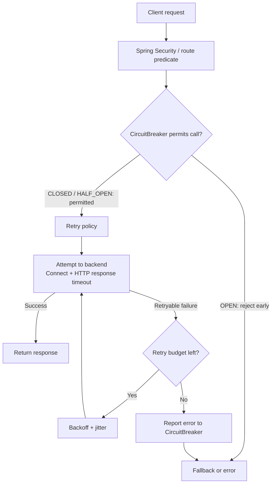
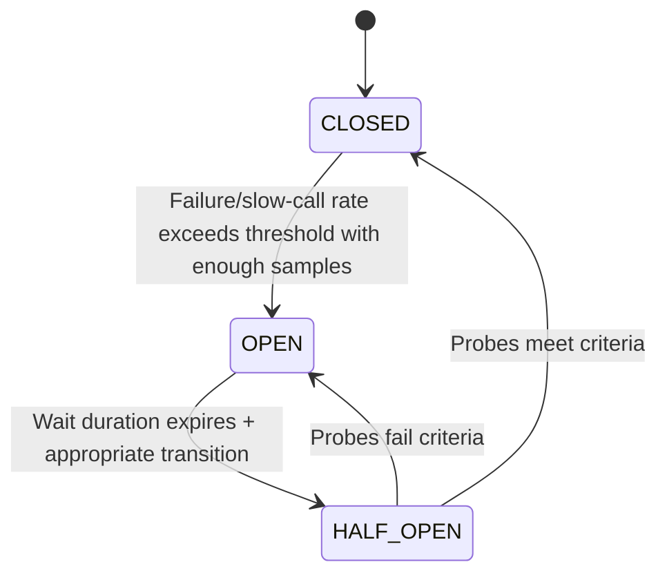
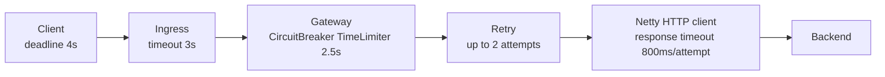
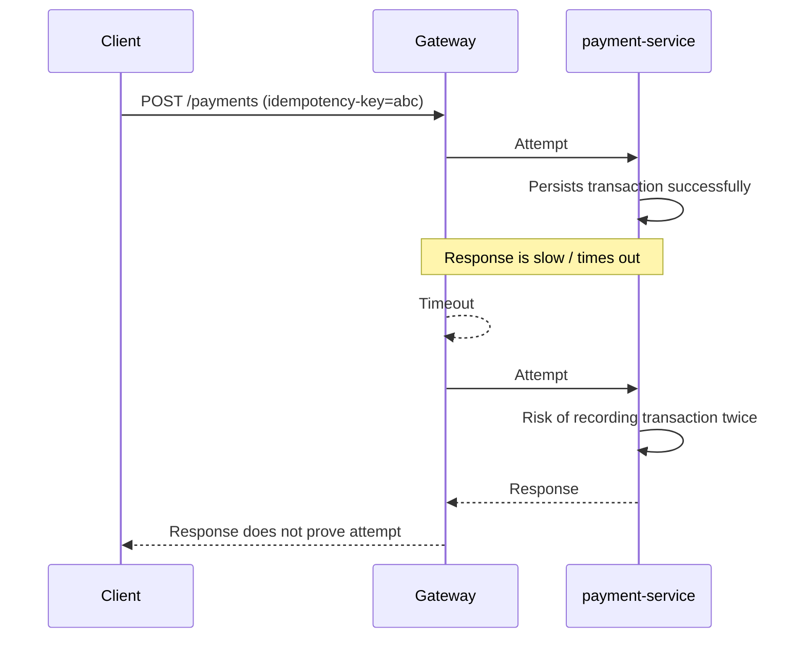
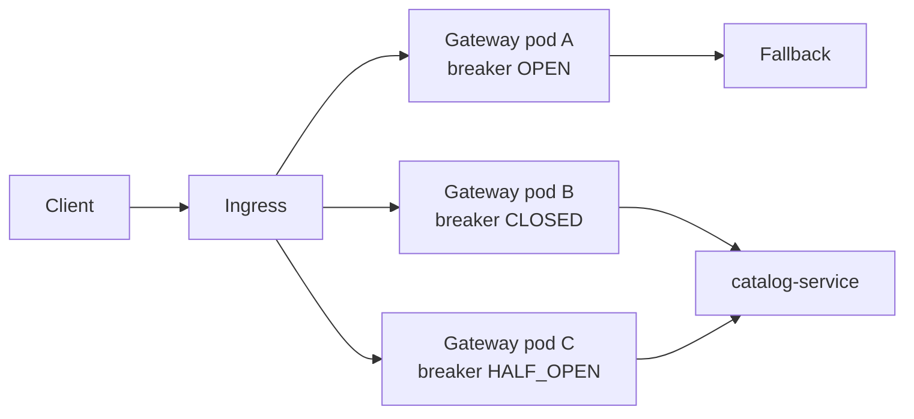

# Coordinating Circuit Breakers with Timeouts and Retries

In a microservices system, a request passing through **Spring Cloud Gateway** can encounter several types of failures: a connection to the backend cannot be established, the upstream responds too slowly, the backend returns `503 Service Unavailable`, or a network glitch lasts only a few hundred milliseconds. If the gateway always retries, a minor blip can turn into a **retry storm**. If the gateway waits indefinitely, connection pools and resources are tied up too long. If the circuit breaker opens too aggressively, valid requests are rejected even after the backend recovers.

Three mechanisms—**timeouts**, **Retry**, and **CircuitBreaker**—solve three distinct parts of the problem:

- **Timeout:** caps waiting time at a processing layer, such as TCP connect or HTTP response.
- **Retry:** re-attempts a *potentially transient* failure, with bounded count and wait interval.
- **Circuit breaker:** monitors failure/slowness rates, **stops sending new requests** when an upstream shows signs of unavailability, and probes during recovery.

This lesson belongs to the **Circuit Breakers and Fallbacks** chapter in the **SPRING_CLOUD_GATEWAY** module. When building an API Gateway with route predicates, filter chains, path/header transformations, and service discovery, these three mechanisms must work alongside authentication, rate limiting, TLS, and observability. The goal is not "retry plenty and hope for the best," but to **contain failure impact**, protect upstreams, and return honest responses to clients.

After this lesson, you will be able to:

1. Distinguish **HTTP client** timeouts, **Resilience4j TimeLimiter**, and full-request deadlines.
2. Understand **CLOSED / OPEN / HALF_OPEN** states along with failure rate, slow-call rate, and minimum sample counts of a circuit breaker.
3. Configure `CircuitBreaker`, `Retry`, route metadata timeouts, and `fallbackUri` in Gateway Server WebFlux.
4. Predict the impact of **filter ordering**: circuit breaker wrapping retry vs. retry wrapping circuit breaker.
5. Plan an end-to-end time budget, calculate maximum upstream calls, and avoid retrying non-idempotent operations.
6. Design controlled fault-injection tests and observe breaker state, attempt counts, fallbacks, TLS errors, and missing service instances.

> **Scope:** Examples use **Spring Cloud Gateway Server WebFlux** with Reactor Netty, Spring Cloud CircuitBreaker, and Resilience4j Reactor. Gateway 5.x uses the `spring.cloud.gateway.server.webflux.routes` / `spring.cloud.gateway.server.webflux.httpclient` namespaces; Gateway WebFlux 4.3.x typically uses `spring.cloud.gateway.routes` / `spring.cloud.gateway.httpclient`. Server MVC APIs and Servlet filter chains differ from WebFlux. Detailed retry, TimeLimiter, transport error, and status mapping behavior should be verified against your running dependency versions.

## 1. Three Mechanisms Solving Three Different Questions

Suppose a client calls `GET /api/catalog/products/42`. The upstream can take 2 seconds to respond under stress, whereas normally it takes only 100 ms.

| Mechanism | Question Solved | Example |
| --- | --- | --- |
| **TCP connect timeout** | How long at most to wait to open a new TCP connection to the backend? | 300 ms |
| **HTTP response timeout** | How long does Gateway's HTTP client wait for an upstream response? | 800 ms |
| **Retry** | For an eligible error, should one more upstream attempt be made? | 1 extra attempt, 100 ms backoff |
| **Circuit breaker** | Should requests keep going to an upstream that is failing continuously? | OPEN when failure rate hits 50% with enough samples |
| **TimeLimiter** | How long is the reactive task wrapped by the circuit breaker allowed to take? | 2.5 seconds |
| **Fallback** | When the request ultimately cannot complete, what is returned to the client? | 503 JSON or cached data labeled `stale` |

One mechanism **does not automatically replace** another. `Retry` does not bound total duration unless configured with reasonable caps. `CircuitBreaker` does not force an already running request to terminate early. `Timeout` does not know after how many failures to stop trying. `Fallback` does not make the backend healthy again.



The diagram shows **one arrangement** with the breaker outside retry. If you flip the filter order, the answer to "how many attempts does one circuit breaker call represent?" also changes.

## 2. CircuitBreaker Lifecycle: CLOSED, OPEN, and HALF_OPEN

In the Resilience4j model:

- **CLOSED:** permits calls and records outcomes.
- **OPEN:** does not call the upstream for new calls, typically throwing `CallNotPermittedException` for the fallback/handler to process.
- **HALF_OPEN:** after a wait period, permits **a limited number of probe calls**. If healthy enough, the breaker returns to CLOSED; if failures/slowness continue per policy, it returns to OPEN.



Common parameters:

| Resilience4j Parameter | Role | Warning |
| --- | --- | --- |
| `slidingWindowType` | Counts by **COUNT_BASED** or **TIME_BASED** | Not the number of concurrent running requests |
| `slidingWindowSize` | Measurement window size | Must fit realistic traffic volume |
| `minimumNumberOfCalls` | Minimum outcomes before evaluating rates | Prevents opening too early on the first few requests |
| `failureRateThreshold` | Percentage of failed calls to open | Depends on which exceptions/statuses count as failures |
| `slowCallRateThreshold` | Percentage of slow calls to open | Meaningful only alongside `slowCallDurationThreshold` |
| `slowCallDurationThreshold` | Duration after which a call is marked slow | Distinct from HTTP response timeout |
| `waitDurationInOpenState` | Wait time before probing is allowed | Not a client-facing wait time |
| `permittedNumberOfCallsInHalfOpenState` | Number of probe calls allowed in HALF_OPEN | Avoids dumping excessive load during recovery |

For example, `minimumNumberOfCalls=10` and `failureRateThreshold=50`: only after at least 10 calls are recorded does the breaker evaluate rates. If 6 of 10 calls fail, 60% can open the breaker; **it does not open on a single error**.

**Important:** A circuit breaker **is not a bulkhead**. While CLOSED, many requests can still execute concurrently. If the backend can only handle 20 in-flight requests, add concurrency/bulkhead/connection-pool limits and rate limiting.

## 3. When Are HTTP 500/503 Counted as CircuitBreaker Failures?

You must distinguish an **exception** from an **HTTP response carrying an error status**.

- Connection errors, timeouts, or exceptions in the publisher can typically be recorded by the breaker under its exception policy.
- If the backend **returns a valid HTTP 503 response**, the HTTP stream can still complete normally at the transport level. Do not assume the breaker treats every `5xx` as an exception automatically.
- The Gateway `CircuitBreaker` filter has a **`statusCodes`** option to turn specified HTTP statuses into failure signals for the circuit breaker.

For example:

```yaml
- name: CircuitBreaker
  args:
    name: catalogBreaker
    statusCodes:
      - 500
      - BAD_GATEWAY
      - SERVICE_UNAVAILABLE
      - GATEWAY_TIMEOUT
    fallbackUri: forward:/fallback/catalog
```

This is a **filter snippet inside `routes[].filters`**, not top-level application YAML. Specify only statuses reflecting upstream outages that the system genuinely wants counted as failures. If you omit `statusCodes`, a stream of backend `503`s may not be counted as expected.

**Do not** count `400 Bad Request`, `401 Unauthorized`, or `403 Forbidden` as backend health failures merely because clients dislike them. Those responses normally reflect request payloads or security policies. `404` is also usually "resource not found," not a downed backend, unless the API contract defines otherwise.

A breaker name can be shared across multiple routes; when sharing a name, call outcomes can **pool into one circuit breaker instance** in the same process. Only share names when routes truly share a failure domain and policy; otherwise, one slow API can trip another API into OPEN.

## 4. HTTP Client Timeouts: Connect and Response

Spring Cloud Gateway WebFlux supports global timeouts:

```yaml
spring:
  cloud:
    gateway:
      server:
        webflux:
          httpclient:
            connect-timeout: 1000  # milliseconds
            response-timeout: 5s    # java.time.Duration
```

And per-route overrides via metadata:

```yaml
metadata:
  connect-timeout: 300     # milliseconds
  response-timeout: 800    # milliseconds
```

**Units to remember:**

| Where Set | `connect-timeout` | `response-timeout` |
| --- | --- | --- |
| Global HTTP client | **ms** — e.g., `1000` | **Duration** — e.g., `5s` |
| Route `metadata` | **ms** — e.g., `300` | **ms** — e.g., `800` |

Setting `metadata.response-timeout: 5` intending 5 seconds is a serious mistake: it means **5 ms**. For 5 seconds on a route, use `5000`.

### Timeouts Do Not Mean the Same Thing

**Connect timeout** applies to opening a new TCP connection to an instance. It is not a "mandatory wait": `Connection refused` can fail immediately before the timeout expires. DNS, load balancing, connection pool acquisition, and TLS handshakes have their own limits.

**Response timeout** sits in the HTTP client waiting for the upstream to return data. Do not treat it as an absolute deadline covering route matching, custom filters, retry backoff, and time until the client receives the final byte. For streaming/SSE, timeout/idle behavior must be tested separately.

A **negative route response timeout**, such as `response-timeout: -1`, is documented by Gateway as **disabling the global response timeout for that route**. That does not disable Resilience4j TimeLimiter, ingress timeouts, TLS limits, or client limits.

## 5. Resilience4j TimeLimiter Is a Separate Clock

When integrating **`spring-cloud-starter-circuitbreaker-reactor-resilience4j`**, Spring Cloud CircuitBreaker can use both **Resilience4j CircuitBreaker** and **TimeLimiter** for a reactive execution.

```yaml
resilience4j:
  timelimiter:
    instances:
      catalogBreaker:
        timeoutDuration: 2500ms
        cancelRunningFuture: true
```

`timeoutDuration` is a **Duration**, not Gateway's `metadata.response-timeout`. Per Spring Cloud CircuitBreaker documentation, TimeLimiter **is enabled by default** unless disabled via the corresponding properties; if left unconfigured, a default TimeLimiter value can still affect requests.

### Two Limits Can Coexist

Suppose:

- Per-attempt HTTP response timeout is `800ms`.
- Retry allows **1 retry**, meaning up to **2 attempts**.
- Backoff between the two attempts is roughly `100ms`.
- CircuitBreaker TimeLimiter caps the wrapped execution at `2500ms`.

If the breaker sits **outside** retry, one breaker execution can span **both attempts and the backoff period**. TimeLimiter can then cut off that execution even if neither individual attempt exceeded the HTTP response limit.

If the breaker sits **inside** retry, each retry attempt can invoke the breaker anew and get a **fresh TimeLimiter budget for that attempt**; total time observed by the client can still exceed a single TimeLimiter duration.

**Do not deduce wrapping order solely from filter names.** Check the order of route `GatewayFilter`s, ordered `GlobalFilter`s, and verify with real tests. Versions and custom filters can affect the lifecycle.

### Be Careful with `cancelRunningFuture`

In reactive flows, cancellation usually cancels the subscription or monitored signal. It **does not guarantee that a transaction already started on the backend will roll back**. If the Gateway times out after the backend received `POST /payments`, the backend may still complete the payment.

## 6. Retry: Choosing Error Types, Methods, and Retry Budgets

The `Retry` GatewayFilter Factory supports options such as:

| Parameter | Effect |
| --- | --- |
| `retries` | Number of **additional retries**, not total attempts |
| `statuses` | List of HTTP statuses eligible for retry |
| `series` | Status series such as 5xx |
| `methods` | HTTP methods eligible for retry |
| `exceptions` | Exception classes eligible for retry |
| `backoff` | Progressive delay between attempts |
| `jitter` | Random variance to prevent synchronized client retries |
| `timeout` | Limit related to retry mechanism per version; not synonymous with HTTP client response timeout |

Example filtering retries strictly to `GET` when the backend returns selected transient errors:

```yaml
- name: Retry
  args:
    retries: 1
    statuses:
      - BAD_GATEWAY
      - SERVICE_UNAVAILABLE
      - GATEWAY_TIMEOUT
    methods:
      - GET
    backoff:
      firstBackoff: 100ms
      maxBackoff: 100ms
      factor: 1
      basedOnPreviousValue: false
    jitter:
      randomFactor: 0.2
```

With `retries: 1`, there can be at most **2 outbound attempts** for one request when retry conditions match. With `retries: 3`, there can be up to **4 attempts**. If conditions do not match or the response has already committed, retries do not necessarily occur.

Gateway documentation describes familiar Retry defaults such as **3 retries**, **GET** method, **5XX** series, and I/O/timeout exception groups, with backoff off by default; however, production configs should **explicitly state the desired policy** rather than relying on defaults across versions.

**Only retry errors likely to be transient** and on requests safe to repeat. Do not retry arbitrary `4xx` responses, bad data, missing permissions, invalid JWTs, or requests the server already answered successfully.

## 7. Filter Order: CircuitBreaker → Retry or Retry → CircuitBreaker?

This is the central design decision of this lesson.

Spring Cloud Gateway arranges `GatewayFilter` and `GlobalFilter` instances into an ordered chain; **pre** filters run first and wrap invoking `chain.filter(exchange)` on downstream filters. Specifically, the `Retry` docs state: **Retry re-executes filters positioned after it**. How the two filters nest determines how many times the breaker observes a call and how fallbacks behave.

### Option A: CircuitBreaker Outside, Retry Inside

```yaml
filters:
  - name: CircuitBreaker
    args:
      name: catalogBreaker
      statusCodes:
        - BAD_GATEWAY
        - SERVICE_UNAVAILABLE
        - GATEWAY_TIMEOUT
      fallbackUri: forward:/fallback/catalog
  - name: Retry
    args:
      retries: 1
      statuses:
        - BAD_GATEWAY
        - SERVICE_UNAVAILABLE
        - GATEWAY_TIMEOUT
      methods: GET
```

Conceptual flow:

```text
CircuitBreaker
  └── Retry
        ├── HTTP attempt #1
        └── HTTP attempt #2 (if eligible)

CircuitBreaker records the outcome of the entire Retry operation
after Retry succeeds or exhausts attempts.
```

**Implications:**

- One **logical request** can generate multiple outbound attempts.
- The outer breaker typically observes the final outcome of the retry operation, rather than treating each attempt as an independent breaker call.
- If the second attempt succeeds, the outer breaker can record a **successful logical call**, even though the first attempt failed. To know the backend is failing on initial attempts, monitor retry/upstream metrics separately.
- TimeLimiter on the outer breaker can cap the **entire retry sequence**.
- Fallback applies after Retry fails to recover, or when the circuit is OPEN.

This is usually the easiest pattern to reason about when you want "a brief conditional retry, then fallback," though it is **not automatically right for every system**.

### Option B: Retry Outside, CircuitBreaker Inside

```yaml
filters:
  - name: Retry
    args:
      retries: 1
      statuses:
        - BAD_GATEWAY
        - SERVICE_UNAVAILABLE
      methods: GET
  - name: CircuitBreaker
    args:
      name: catalogBreaker
      statusCodes:
        - BAD_GATEWAY
        - SERVICE_UNAVAILABLE
```

Conceptual flow:

```text
Retry
  ├── CircuitBreaker → HTTP attempt #1
  └── CircuitBreaker → HTTP attempt #2
```

**Implications:**

- The breaker can see **each attempt** as a separate call; failure/slow rates are recorded differently from Option A.
- The breaker can OPEN sooner if consecutive attempts keep failing.
- Once the breaker is OPEN, the outer Retry may hit `CallNotPermittedException`; whether it keeps retrying depends on `exceptions` and error handling.
- If you add `fallbackUri` to the inner CircuitBreaker and the fallback returns `200` or a non-retryable status, the outer Retry may treat the attempt as complete and **not retry the upstream**.
- The inner TimeLimiter can reset per attempt, causing total request latency to exceed a single TimeLimiter duration.

**Practical recommendation:** For a simple `GET` route, start with **CircuitBreaker outside + Retry inside**, keep retry counts small with a total time budget, and verify with integration tests what the breaker actually counts. When you need to evaluate **per-attempt** quality, consider Option B, taking care to avoid retrying fallbacks or an already OPEN breaker.

### Quick Comparison Table

| Aspect | Breaker → Retry | Retry → Breaker |
| --- | --- | --- |
| Scope of one breaker call | Typically covers all attempts | Typically one attempt per breaker invocation |
| First attempt fails, second succeeds | Breaker can record final success | Breaker can record failure followed by success |
| Breaker TimeLimiter | Can cap the whole retry sequence | Can apply per attempt |
| Fallback | Usually after retries exhaust | Can be seen by Retry as an intermediate response |
| Risk | Hides per-attempt error rate if looking only at breaker metrics | Counts errors fast / opens early; may retry fallback or open breaker |
| What to verify | Route filter order, statuses, retry count | Exceptions, fallback status, and resubscribe behavior |

> **Do not** rely on intuition about YAML declaration order to predict custom filters. Gateway has a combined ordering mechanism across `GlobalFilter` and `GatewayFilter`; verify that specific filters execute in the expected order/phase via traces and backend tests.

## 8. Time Budgets: Avoid Blindly Summing Timeouts

A request can cross multiple layers:



Example **set of values to practice calculating**:

| Layer | Illustrative Value |
| --- | --- |
| Client total wait time | 4 s |
| Ingress response timeout | 3 s |
| Resilience4j TimeLimiter on logical call | 2.5 s |
| Per-route HTTP connect timeout | 300 ms for new TCP connection |
| Per-route HTTP response timeout | 800 ms for upstream response |
| Retry | 1 retry, ~100 ms backoff |
| Breaker | Outside Retry |

An approximate sum for the case where **every attempt must open a new connection and waits nearly the full timeout**:

```text
2 attempts × (300ms connect + 800ms response)
+ 100ms backoff
≈ 2300ms

Excluding:
- route matching / auth / custom filters
- DNS, connection pool acquisition, TLS handshake
- load-balancing, scheduling, network overhead
- final response processing
```

**2300 ms is only a component estimate**, not a guaranteed deadline. If the connection pool reuses connections, connect timeout may not be spent; if TLS handshakes or pool acquisition are slow, total latency can be higher. A 2.5-second TimeLimiter can act as an "outer fence" for the logical call if wrapping order is right, yet does not guarantee the backend stops side effects on cancellation.

### Choose Timeouts by Budget, Not Gut Feel

1. Start from client-perceived latency SLOs and ingress/mobile timeouts.
2. Subtract network overhead, authentication, routing, header transformations, and response handling.
3. Determine the upstream **attempt budget**, covering connect/HTTP response/TLS/pool.
4. Allocate **1–2 retries** only when genuinely beneficial, with backoff and jitter.
5. Set TimeLimiter for the sequence within the remaining total budget.
6. Test under slow upstreams, missing instances, connection refused, and client disconnects.

If the client times out after 2 seconds while the Gateway keeps retrying for 10 seconds, the extra work only overloads the backend without helping the caller. Conversely, a 500 ms TimeLimiter when backend p99 is 800 ms turns many healthy requests into errors.

## 9. Complete YAML Example: GET with Retry, CircuitBreaker, Timeouts, and Fallback

Suppose:

- Gateway Server WebFlux 5.x runs at `localhost:8080`.
- Test Catalog backend runs at `localhost:8081`.
- Public URL `GET /api/catalog/products/42`.
- Backend receives `GET /catalog/products/42` after `StripPrefix=1`.
- Fallback is handled by an internal Gateway controller at `/fallback/catalog`.

```yaml
spring:
  cloud:
    gateway:
      server:
        webflux:
          httpclient:
            connect-timeout: 1000  # ms
            response-timeout: 5s    # Duration, global

          routes:
            - id: catalog-read
              uri: http://localhost:8081
              predicates:
                - Path=/api/catalog/**
                - Method=GET
              metadata:
                connect-timeout: 300     # ms
                response-timeout: 800    # ms
              filters:
                - StripPrefix=1

                # CircuitBreaker sits outside Retry
                - name: CircuitBreaker
                  args:
                    name: catalogBreaker
                    fallbackUri: forward:/fallback/catalog
                    statusCodes:
                      - INTERNAL_SERVER_ERROR
                      - BAD_GATEWAY
                      - SERVICE_UNAVAILABLE
                      - GATEWAY_TIMEOUT

                - name: Retry
                  args:
                    retries: 1
                    statuses:
                      - BAD_GATEWAY
                      - SERVICE_UNAVAILABLE
                      - GATEWAY_TIMEOUT
                    methods: GET
                    backoff:
                      firstBackoff: 100ms
                      maxBackoff: 100ms
                      factor: 1
                      basedOnPreviousValue: false
                    jitter:
                      randomFactor: 0.2

resilience4j:
  circuitbreaker:
    instances:
      catalogBreaker:
        slidingWindowType: COUNT_BASED
        slidingWindowSize: 20
        minimumNumberOfCalls: 10
        failureRateThreshold: 50
        slowCallRateThreshold: 50
        slowCallDurationThreshold: 2s
        waitDurationInOpenState: 10s
        permittedNumberOfCallsInHalfOpenState: 3

  timelimiter:
    instances:
      catalogBreaker:
        timeoutDuration: 2500ms
        cancelRunningFuture: true
```

**Explanation of layers:**

- `metadata.response-timeout: 800` is **800 ms**, not 800 seconds.
- `CircuitBreaker` named `catalogBreaker` links to the same name under `resilience4j.circuitbreaker.instances` and `resilience4j.timelimiter.instances`.
- `Retry` applies only to `GET` and the listed statuses; exception retries remain governed by factory policies and relevant defaults/configuration.
- `retries: 1` adds at most **one retry attempt** after the initial attempt when conditions qualify.
- CircuitBreaker's `statusCodes` includes `500` so HTTP error responses can be recorded by the breaker; this list **does not have to match** Retry's list.
- `slowCallDurationThreshold` is the threshold to **record slow calls**, not an auto-abort timeout. If the breaker wraps Retry, a logical call taking 2 seconds can be flagged slow even if each individual attempt was faster.
- The 2.5-second `TimeLimiter` is a Resilience4j-specific limit, **not the same** as Netty's `response-timeout`.

**Required dependency:** Alongside Gateway Server WebFlux, add **`spring-cloud-starter-circuitbreaker-reactor-resilience4j`** compatible with your Spring Cloud BOM. If switching the URI to `lb://catalog-service`, add Spring Cloud LoadBalancer and a service-instance source. Do not assume circuit breaking works automatically just because the Gateway starter is present.

### Illustrative Maven Dependencies

```xml
<dependency>
  <groupId>org.springframework.cloud</groupId>
  <artifactId>spring-cloud-starter-gateway-server-webflux</artifactId>
</dependency>

<dependency>
  <groupId>org.springframework.cloud</groupId>
  <artifactId>spring-cloud-starter-circuitbreaker-reactor-resilience4j</artifactId>
</dependency>
```

Do not pick individual starter versions manually when the project already uses the Spring Cloud BOM; ensure a compatible Spring Boot/Spring Cloud/Resilience4j combination.

### Gateway WebFlux 4.3.x

In the Gateway WebFlux 4.3.x branch, adjust the HTTP client/routes namespaces accordingly:

```yaml
spring:
  cloud:
    gateway:
      httpclient:
        connect-timeout: 1000
        response-timeout: 5s
      routes:
        - id: catalog-read
          uri: http://localhost:8081
          predicates:
            - Path=/api/catalog/**
            - Method=GET
          metadata:
            connect-timeout: 300
            response-timeout: 800
          filters:
            - StripPrefix=1
            - name: CircuitBreaker
              args:
                name: catalogBreaker
                fallbackUri: forward:/fallback/catalog
            - name: Retry
              args:
                retries: 1
                statuses: BAD_GATEWAY
                methods: GET
```

This is a condensed version illustrating the **namespace difference**; `resilience4j.*` properties remain aligned with your Resilience4j/Spring Cloud CircuitBreaker version. When upgrading from 4.3 to 5.x, re-verify effective config, custom global filters, and actual `statusCodes`.

## 10. Fallbacks Must Return Honest and Bounded Data

In Spring Cloud Gateway WebFlux, `CircuitBreaker` can use `fallbackUri` with the documented supported scheme **`forward:`**. It typically forwards to a handler/controller **inside the Gateway**, such as `forward:/fallback/catalog`.

A minimal WebFlux controller:

```java
import java.util.Map;

import org.springframework.cloud.gateway.support.ServerWebExchangeUtils;
import org.springframework.http.HttpHeaders;
import org.springframework.http.HttpStatus;
import org.springframework.http.MediaType;
import org.springframework.http.ResponseEntity;
import org.springframework.web.bind.annotation.GetMapping;
import org.springframework.web.bind.annotation.RestController;
import org.springframework.web.server.ServerWebExchange;

import reactor.core.publisher.Mono;

@RestController
class CatalogFallbackController {

    @GetMapping(
        path = "/fallback/catalog",
        produces = MediaType.APPLICATION_JSON_VALUE)
    Mono<ResponseEntity<Map<String, String>>> fallback(
            ServerWebExchange exchange) {

        Throwable cause = exchange.getAttribute(
            ServerWebExchangeUtils
                .CIRCUITBREAKER_EXECUTION_EXCEPTION_ATTR);

        // Use cause only for redacted metrics/logs.
        // Never return stack traces, internal URLs, or raw messages to clients.
        return Mono.just(ResponseEntity
            .status(HttpStatus.SERVICE_UNAVAILABLE)
            .header(HttpHeaders.CACHE_CONTROL, "no-store")
            .body(Map.of(
                "code", "CATALOG_TEMPORARILY_UNAVAILABLE",
                "message", "Service is temporarily unavailable")));
    }
}
```

**Why return `503` instead of `200 OK`?** This catalog has no trustworthy substitute data; returning "success" would mislead clients into assuming real data is present. A fallback reading from a verified cache may return `200` if the contract permits, provided it clearly indicates staleness via metadata/headers and never leaks another tenant's data.

**Never return a fake-success fallback for write operations** such as payments, transfers, or order creation when the true state is unverified. If the backend processed the request but the response timed out, the fallback must never claim "definitely failed" or "definitely succeeded."

### Avoiding Fallback Loops

- The fallback path must never route back into the **same failing upstream/circuit breaker**.
- If a fallback calls another service over HTTP, it introduces a new dependency that can also fail; bound its timeouts and protect it separately.
- Check security/route matching for `/fallback/catalog` to prevent direct abuse. Any publicly reachable fallback must return only non-sensitive information.
- Never let a fallback accidentally trigger side effects or attempt to alter an already committed response.

### `FallbackHeaders` When the Fallback Lives in Another Application

Gateway provides the `FallbackHeaders` filter to forward exception details when forwarding to a fallback service by design. Avoid exposing class names, stack traces, or raw exception messages to clients/Internet; if analysis is needed, send them only over trusted internal channels and log safely.

## 11. Not Every Error Should Retry or Open the CircuitBreaker

Choosing retryable statuses and breaker failure statuses is a **business/technical policy**, not just code.

| Event | Retry? | Record in Breaker? | Reason |
| --- | --- | --- | --- |
| Transient TCP connect timeout | Possibly, if request is idempotent | Usually yes, if reflecting upstream failure | May be a brief network issue |
| HTTP response timeout | Conditionally; consider side effects | Usually yes | Backend may still be processing |
| `502 Bad Gateway` from upstream/proxy | Possibly for GET within budget | Usually yes | May be a transient failure |
| `503 Service Unavailable` | Possibly, with backoff/jitter | Usually yes | Service overloaded or under maintenance |
| `504 Gateway Timeout` | Conditionally | Usually yes | Timeout at an intermediary |
| `500 Internal Server Error` | Only when error is understood and request is safe | Possibly | Blind retries can amplify bugs |
| `429 Too Many Requests` | Client should honor `Retry-After`; do not retry immediately at Gateway | Usually **not** counted as backend failure | Rate-limiting signal |
| `400 Bad Request` | No | No | Client sent invalid payload |
| `401 Unauthorized` | No | No | Missing/expired/invalid token |
| `403 Forbidden` | No | No | Missing permission, not a weak backend |
| `404 Not Found` | Usually no | Usually no | Resource does not exist |
| TLS/certificate validation error | Do not retry repeatedly | Alert separately; do not merely raise breaker threshold | Trust/hostname mismatch requires config fix |
| RedisRateLimiter returns `429` before routing | Not an upstream retry | Not a backend call | Gateway never called upstream |

**Do not enable retries for all `5xx` just because it is a convenient default.** For overload `503`s, immediate retries can worsen the overload. Sometimes failing fast and letting the client back off is right; sometimes LoadBalancer picking another instance helps. Always verify whether the failure is truly transient and the request is idempotent.

## 12. Idempotency and Request Bodies: The Highest Risk of Retry

For side-effect-free `GET`s, retries are usually easier to justify. For `POST /orders`, `POST /payments`, `PATCH`, or uploads, the consequences are very different.

### Timeout After the Backend Already Finished



A timeout at the gateway **only means the gateway did not receive the response in time**; it does not prove the backend failed to finish processing.

If retrying write requests is unavoidable:

1. Design a scoped **idempotency key** with TTL and state persisted on the backend.
2. The backend must **atomically** guarantee the same key cannot execute side effects twice.
3. Verify request body replayability, size, and Retry's body buffering.
4. Cap retries, backoff, and total deadline while preserving the idempotency key across attempts.
5. When status is uncertain, use a transaction-status lookup endpoint rather than falsely returning "failed."

Gateway documentation notes that **Retry on HTTP methods with a body caches the body**, increasing memory usage; payload data is stored via `ServerWebExchangeUtils.CACHED_REQUEST_BODY_ATTR` with corresponding `DataBuffer`s. Therefore, **never broadly enable retries for large uploads or streaming**. Limit request size, concurrency, and verify safe `DataBuffer` retention/release.

### What If the Response Is Already Committed?

If the Gateway has already sent status/headers/partial body to the client, it cannot simply "change its mind," retry, and send a second response. Documentation specifically warns regarding `forward:` handlers: if a controller already committed an error response, Retry may not behave as intended. When retries are needed, propagate failures as **exceptions/reactive error signals** before committing the response and test the real flow.

## 13. When CircuitBreaker Opens Across Multiple Gateway Replicas

Resilience4j CircuitBreaker normally maintains **in-memory state per process**. If the Gateway has three pods, those three pods can observe different error patterns.



Consequences:

- One pod may return fallbacks immediately while OPEN, while another still forwards requests upstream.
- This is not a bug when Resilience4j breaker state is **not shared**; per-pod divergence should be expected.
- Reusing the same `name` does not turn it into a distributed circuit breaker across JVMs.
- Rolling deployments leave new pods with fresh breaker states and sparse metrics.
- Under low traffic, `minimumNumberOfCalls` may not be reached on individual pods, keeping breakers closed despite noticeable cluster-wide errors.

When cluster-wide load control is needed, combine **Redis rate limiters, autoscaling, global ingress policies, or a service mesh**; do not rely on in-memory breakers as an absolute global kill switch.

### HALF_OPEN Requires Controlled Probing

After `waitDurationInOpenState`, the breaker can move from OPEN to HALF_OPEN on the next call (depending on config). Only a limited number of probe calls are allowed, such as 3; others are rejected until enough results return.

If each HALF_OPEN call triggers multiple retries, total **outbound attempts** from those few probe calls can exceed the logical permit count. That is why retries must be controlled while a backend is recovering and tested under realistic traffic.

## 14. CircuitBreaker Does Not Replace RateLimiter and Security

In a public API Gateway, the pipeline includes additional layers:

| Layer | When Should It Run? | Purpose |
| --- | --- | --- |
| Spring Security WebFlux | Before granting access to protected APIs | Validates JWT/session, checks route permissions |
| RequestRateLimiter | Before proxying upstream, by trusted key | Throttles clients/tenants sending too fast |
| CircuitBreaker | Wrapping calls to the target upstream | Temporarily blocks calls when backend fails heavily |
| Retry | Intentionally inside or outside breaker | Recovers from brief transient errors |
| HTTP timeouts | At Netty HTTP client and dedicated layers | Caps waiting for connections/responses |
| LoadBalancer | Before `lb://` HTTP routing | Selects a service instance |
| Backend authorization | When service handles resources | Enforces ownership/tenant/resource access |
| Metrics & tracing | Across the pipeline | Separates security, quota, and upstream failures |

**Never retry authentication failures**: a token with an invalid signature will not become valid after three attempts. **Never fall back to sensitive data** when a user lacks permissions. If a circuit breaker wraps too broad a filter chain, verify it never counts `401/403` or RateLimiter errors as upstream health failures.

Protect **TLS** both inbound and outbound, especially when using `lb://` with service-instance metadata. Certificate verification failures must be fixed as configuration/trust errors—never via infinite retries or disabling hostname verification.

## 15. Fault Testing and Observing CircuitBreaker in Staging

### 15.1. Test Backend Capable of Delays or Errors

Example Spring WebFlux controller running at `localhost:8081`:

```java
import java.time.Duration;
import java.util.Map;
import java.util.concurrent.atomic.AtomicInteger;

import org.springframework.http.HttpStatus;
import org.springframework.http.ResponseEntity;
import org.springframework.web.bind.annotation.GetMapping;
import org.springframework.web.bind.annotation.PathVariable;
import org.springframework.web.bind.annotation.RequestMapping;
import org.springframework.web.bind.annotation.RestController;

import reactor.core.publisher.Mono;

@RestController
@RequestMapping("/catalog")
class CatalogTestController {

    private final AtomicInteger counter = new AtomicInteger();

    @GetMapping("/products/42")
    Mono<ResponseEntity<Map<String, Object>>> flaky() {
        int call = counter.incrementAndGet();
        if (call % 3 != 0) {
            return Mono.just(ResponseEntity
                .status(HttpStatus.SERVICE_UNAVAILABLE)
                .body(Map.of("attempt", call, "status", "temporary-failure")));
        }
        return Mono.just(ResponseEntity
            .ok(Map.of("attempt", call, "status", "ok")));
    }

    @GetMapping("/delay/{millis}")
    Mono<ResponseEntity<Map<String, Object>>> delay(
            @PathVariable long millis) {
        if (millis < 0 || millis > 20000) {
            return Mono.just(ResponseEntity
                .badRequest()
                .body(Map.of("error", "invalid delay")));
        }
        return Mono.delay(Duration.ofMillis(millis))
            .map(tick -> ResponseEntity
                .ok(Map.<String, Object>of("delayedMs", millis)));
    }
}
```

This is an **intentionally faulty** test controller—run it only in test environments. Never publish endpoints allowing arbitrary delays/errors to the Internet. `Mono.delay` simulates slow upstreams without calling `Thread.sleep` on the event loop.

### 15.2. Observing Retry Before the Breaker Opens

```bash
curl -i http://localhost:8080/api/catalog/products/42
```

With the backend returning `503` on the first two calls, `Retry` adding one attempt can overcome the failure **if the retry lands when the backend responds healthy**. In the controller above, every third call succeeds, so attempt counts and backend counters verify real behavior, though outcomes also depend on breaker state, other test traffic, and filter order.

Use trace IDs or backend markers in staging to measure **how many upstream requests each client request produced**. Never judge solely from a `200` response that retry worked as intended.

### 15.3. Testing Response Timeouts

```bash
# Backend waits 300 ms: below metadata.response-timeout=800 ms
curl -i --max-time 5 \
  http://localhost:8080/api/catalog/delay/300

# Backend waits 1500 ms: longer than per-attempt 800 ms
curl -i --max-time 5 \
  http://localhost:8080/api/catalog/delay/1500
```

With the route configured as in Section 9, the second request can time out, Retry may re-attempt per enabled exception types, and the breaker can record failure/run fallback. **Do not assume the final HTTP status is always 504**: the example fallback controller returns `503`, while other error handlers and proxies may map differently.

### 15.4. Testing OPEN and HALF_OPEN

1. Send enough failing requests to reach `minimumNumberOfCalls=10` and the failure rate threshold.
2. Verify the breaker transitions `CLOSED → OPEN` via metrics/events; **do not** infer state solely from `503`.
3. While OPEN, send more calls and confirm the backend receives **no** new requests and fallback runs fast.
4. Wait past `waitDurationInOpenState=10s` in the test environment.
5. Switch the backend to healthy responses, send probe requests, and observe `HALF_OPEN → CLOSED`.
6. Also test a scenario where the backend keeps failing to observe `HALF_OPEN → OPEN`.

Note that `minimumNumberOfCalls` and `slidingWindowSize` count samples/windows, not attempts within a single request. When the breaker wraps retry, you must generate enough recorded **logical calls**.

### 15.5. Testing Counters for Both Filter Orders

Repeat tests after swapping `Retry` and `CircuitBreaker` in staging:

| Measured Metric | Breaker → Retry | Retry → Breaker |
| --- | --- | --- |
| Backend attempt count | Can be >1 per client request | Can be >1 per client request |
| CircuitBreaker recorded calls | Usually 1 per logical request | Can be multiple per client request |
| When fallback runs | After retries exhaust / breaker OPEN | Can occur within each attempt |
| Time until fallback | Can include retries + backoff | Depends on fallback/exception status and retries |
| Where OPEN blocks attempts | At start of logical call | On each call attempt |

These are **conceptual expectations**; verify via events/metrics on your exact version.

### 15.6. Observing on Actuator and Micrometer

When Resilience4j/Micrometer/Actuator are properly integrated, monitor:

- Breaker state: OPEN/CLOSED/HALF_OPEN.
- Failure rate, slow-call rate, buffered call count.
- `CallNotPermittedException`/rejected calls.
- Retry attempts, retry success/failure, backoff.
- Gateway route ID, HTTP status, request latency `p95/p99`.
- Netty connection errors/timeouts, active/pending connections.
- Fallback count and upstream recovery time.

Exact metric names depend on Resilience4j/Micrometer/Gateway versions; never hardcode metric names without verifying. Actuator endpoints must be **secured by authorization and management networks**, never exposing breaker controls or route details publicly.

## 16. Diagnosing Common Configuration Mistakes

| Symptom | Likely Cause | How to Check |
| --- | --- | --- |
| `CircuitBreaker` filter unrecognized | Missing `spring-cloud-starter-circuitbreaker-reactor-resilience4j` | Check dependencies and auto-configuration |
| Backend always returns 503 yet breaker never opens | 503 not counted as failure; below minimum calls | Add `statusCodes` and inspect recorded outcomes |
| Breaker opens too fast | `Retry → Breaker` counts multiple attempts; minimum calls too low | Check order/metrics and thresholds |
| Breaker stays closed despite slow backend | `slowCallRateThreshold` unconfigured or slow responses below threshold | Distinguish slow-call duration from timeout |
| Request times out before Retry finishes | TimeLimiter too short or ingress/client timeout | Build a timeline and measure each layer |
| Gateway retries endlessly, overloading backend | Wrong retry count/backoff/timeout, plus client retries | Lower attempts, add jitter, enforce retry budget |
| POST creates duplicate orders | Retried non-idempotent write request | Add idempotency keys and status lookup endpoint |
| Retry does not trigger after HTTP error | Response already committed, or status missing from Retry policy | Check statuses, methods, error signals |
| Backend 404 causes breaker to record failure | `statusCodes` improperly includes 404 | Count only statuses reflecting upstream health |
| Fallback always returns fake 200 | Fallback controller chose wrong status/contract | Return 503 or explicitly labeled `stale` data |
| Fallback never executes | Wrong `fallbackUri` scheme/path, unmatched handler, or response committed | Use `forward:` and test handler/route |
| Shared CircuitBreaker opens multiple routes | Routes share the same breaker name inside the JVM | Separate names by failure domain |
| Gateway A OPEN, B CLOSED | Per-JVM in-memory breaker state differs across pods | Monitor per pod; do not assume distributed state |
| `metadata.response-timeout: 5` fails immediately | Confused 5 ms with 5 s | Use `5000` for 5 seconds per route |
| Raising response-timeout does not fix TLS errors | Separate TLS trust/SNI/handshake failure | Check certificate chain and TLS config |
| 503 from `lb://` with no instance | LoadBalancer found no backend | Check registry/instances; do not blame every 503 on breaker |
| 401/403 turns into fallback | Wrong security/filter scope or error caught mistakenly | Never fall back authentication/authorization failures |
| SSE/streaming disconnected | TimeLimiter/response timeout unsuitable for streams | Test streaming semantics, heartbeats, and cancellation |

### Quick Investigation Workflow

1. Confirm **the request matched the right route ID**; did security block it earlier?
2. Check **CircuitBreaker state** and recorded call count, especially minimum calls.
3. Check **Retry and CircuitBreaker ordering** alongside `statuses`/`exceptions` policies.
4. Break down **connect, HTTP response, TimeLimiter, backoff, and ingress/client** timings.
5. Count **backend attempts** per client request and verify the retry budget.
6. On error responses, distinguish **backend HTTP status**, transport exceptions, service discovery errors, and TLS errors.
7. Verify the final fallback/status matches the contract without masking real outages.
8. Monitor recovery through HALF_OPEN and confirm there is no retry storm.

## 17. Design Exercises and Reinforcement Questions

### Exercise 1: Calculating Outbound Attempts

Route `GET /api/catalog/**` has `retries: 2`, retries only `503`, and the backend continuously returns 503. Circuit is not OPEN and responses do not commit early.

**Answer:** There can be up to **3 attempts** (one initial + two retries). If the breaker opens early, the client cancels, TimeLimiter fires, or retries are constrained, actual attempts are fewer.

### Exercise 2: Does HTTP 503 Open the Breaker Automatically?

A route has CircuitBreaker named `catalogBreaker` without declaring `statusCodes`. The backend returns valid HTTP `503` on every request.

**Answer:** Do not assume the breaker records all 503 responses as failures. Configure `statusCodes` appropriately and verify recorded outcomes.

### Exercise 3: Timeout Unit Mistake

A developer wants a **2-second** route response timeout and writes:

```yaml
metadata:
  response-timeout: 2
```

**Answer:** That value is **2 ms**; it must be `2000`. Globally, `response-timeout: 2s` is valid Duration syntax.

### Exercise 4: Fallback for Payments

`POST /payments` times out after the backend already debited funds, yet the gateway fallback returns `200 {"paid": false}`.

**Issue:** The gateway does not know whether the transaction rolled back. The client may resubmit and cause duplicate payment. An idempotency key, status lookup API, and a response reflecting **unknown/pending** prior to reconciliation are required—never return fake success.

### Exercise 5: Uneven Breaker Opening Across Pods

Pod A saw 15/20 calls fail and is OPEN; pod B just restarted and has seen only 2 calls.

**Answer:** Resilience4j CircuitBreaker normally keeps state and rolling metrics **per JVM**. Pod B may not yet have reached `minimumNumberOfCalls` and thus stays CLOSED. Monitor per pod and apply rate limiting/load shedding at another layer when cluster-wide traffic control is needed.

### Quick Questions

**1. Does an OPEN CircuitBreaker keep sending new requests to the backend?**

> Usually no. It rejects early via `CallNotPermittedException`/fallback. Previously started requests may still have work running upstream.

**2. Does a 2-second TimeLimiter guarantee the backend rolls back its transaction after 2 seconds?**

> No. Cancellation on the Gateway side does not prove rollback on the backend.

**3. Can placing Retry before CircuitBreaker make the breaker record multiple calls for one client request?**

> Yes. Depending on filter ordering/resubscription, each retry attempt can be a separate circuit breaker call.

**4. Will Retry help a `401 Unauthorized` request succeed?**

> Usually no. `401` is an authentication problem, not a transient backend glitch; do not include it in retry policies.

**5. Why does `fallbackUri` use `forward:` instead of arbitrary `http://...`?**

> Gateway's CircuitBreaker filter supports `forward:` fallbacks; if the fallback lives in another service, design a separate forward route/handler and appropriate security.

**6. Does enabling CircuitBreaker replace a bulkhead/concurrency limit?**

> No. While CLOSED, many calls can execute concurrently; concurrency controls are needed if the backend is sensitive to in-flight requests.

**7. Do two Gateway pods sharing the same breaker name share state?**

> Not by default. Resilience4j breaker state is normally local to each JVM.

**8. When a fallback returns 200, does that mean the upstream is healthy?**

> No. The fallback may just be masking an upstream failure. Monitor metrics and state backup-data contracts explicitly.

## 18. Pre-Production Configuration Checklist

- [ ] Using the right **Spring Cloud Gateway Server WebFlux** and version-matched Reactor Resilience4j starter.
- [ ] Scoped breaker names by **failure domain**; avoided lumping independent upstreams into one unintended breaker.
- [ ] Configured `statusCodes` for HTTP statuses genuinely reflecting upstream outages.
- [ ] Distinguished `minimumNumberOfCalls`, `slidingWindowSize`, failure rate, and slow-call rate.
- [ ] Aligned connect timeout, HTTP response timeout, TimeLimiter, and client/ingress timeouts into one consistent **latency budget**.
- [ ] Verified units: global connect ms / global response Duration; route metadata connect/response both ms.
- [ ] Verified `CircuitBreaker → Retry` vs. `Retry → CircuitBreaker` ordering via integration tests.
- [ ] Capped retries and added backoff/jitter; avoided retry storms when backends are overloaded.
- [ ] Avoided retrying HTTP 400/401/403/404 by default and avoided immediate retries on `429`.
- [ ] For write requests, enforced idempotency/reconciliation before enabling retries.
- [ ] If requests carry bodies, evaluated `DataBuffer` caching, memory overhead, and request size limits.
- [ ] Fallbacks return **honest** statuses/contracts, never leaking internal exceptions or faking financial outcomes.
- [ ] Fallback routes/handlers cannot loop and are protected against unauthorized access.
- [ ] CircuitBreaker never turns security/rate-limit errors into backend health failures.
- [ ] Distinguished TLS, DNS, connection pool, LoadBalancer no-instance, and backend 5xx errors.
- [ ] Monitored breaker state, allowed/rejected calls, retries, `p95/p99`, upstream attempts, and fallback counts.
- [ ] Tested HALF_OPEN recovery, especially if multiple retries can run per probe.
- [ ] For multi-replica Gateways, accounted for local breaker state or added appropriate global load shedding.
- [ ] Tested slow upstreams, timeouts, 5xx, cancellations, client disconnects, and rolling restarts.
- [ ] Did not use circuit breakers to replace rate limiters, authentication, authorization, TLS, bulkheads, or service-level validation.

## Conclusion

In **Spring Cloud Gateway Server WebFlux**, **timeouts**, **Retry**, and **CircuitBreaker** form three complementary protection layers. Timeouts bound waiting, Retry should handle only transient errors within a finite budget, and CircuitBreaker halts further traffic to failing upstreams. Combining them carelessly can slow the system down, multiply attempts, or mask real outages behind fake-success fallbacks.

The key factor is **filter ordering**: a breaker outside retry typically observes the **final outcome of the logical request**, whereas retry outside the breaker can make the breaker record **each attempt**. HTTP client response timeouts, Resilience4j TimeLimiter, and ingress/client timeouts must be budgeted separately; fallbacks must reflect true business state, especially for non-idempotent writes.

Test under controlled fault injection, measure upstream attempts and breaker states, enforce security contracts at both gateway and backend, apply rate limiting, and observe thoroughly. Coordinated this way, your API Gateway protects microservices reliably instead of amplifying incidents.

## References

- [Spring Cloud Gateway Server WebFlux — CircuitBreaker GatewayFilter Factory](https://docs.spring.io/spring-cloud-gateway/reference/spring-cloud-gateway-server-webflux/gatewayfilter-factories/circuitbreaker-filter-factory.html)
- [Spring Cloud Gateway Server WebFlux — Retry GatewayFilter Factory](https://docs.spring.io/spring-cloud-gateway/reference/spring-cloud-gateway-server-webflux/gatewayfilter-factories/retry-factory.html)
- [Spring Cloud Gateway Server WebFlux — HTTP Timeouts Configuration](https://docs.spring.io/spring-cloud-gateway/reference/spring-cloud-gateway-server-webflux/http-timeouts-configuration.html)
- [Spring Cloud Gateway Server WebFlux — Combined Global Filter and GatewayFilter Ordering](https://docs.spring.io/spring-cloud-gateway/reference/spring-cloud-gateway-server-webflux/global-filters.html)
- [Spring Cloud CircuitBreaker — Resilience4j Properties and TimeLimiter](https://docs.spring.io/spring-cloud-circuitbreaker/reference/spring-cloud-circuitbreaker-resilience4j/circuit-breaker-properties-configuration.html)
- [Resilience4j — CircuitBreaker Concepts](https://resilience4j.readme.io/docs/circuitbreaker)
