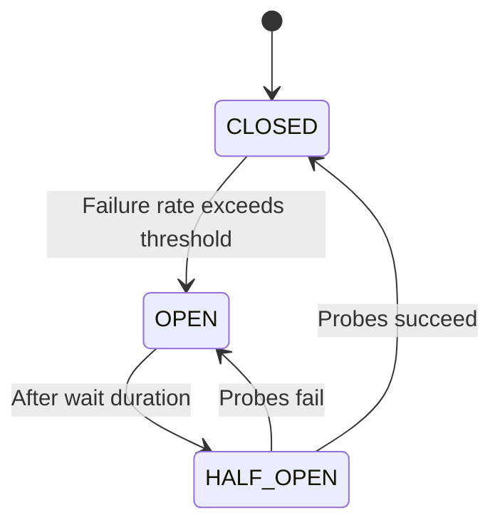
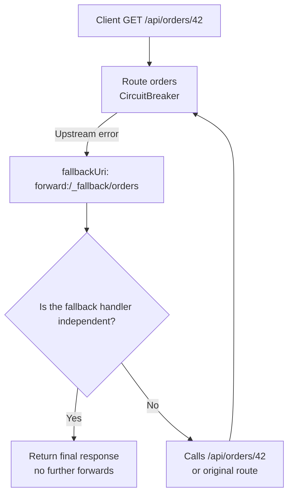
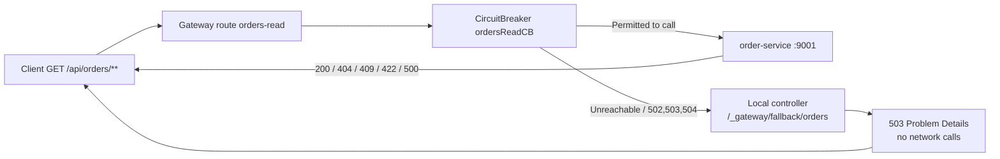

# Avoiding Recursive Fallbacks and Masking Business Errors in Spring Cloud Gateway

In a microservices system, **Spring Cloud Gateway** can combine route predicates, filter chains, `lb://` routing, path/header transformations, and resilience policies to protect applications against upstream outages. A **circuit breaker** stops calling a continuously failing service; a **fallback** defines what happens when the primary call cannot succeed under defined conditions.

Fallbacks are very useful for substitutable data, such as serving temporary catalog data from a cache. However, when misdesigned, they can turn a small outage into a much larger incident:

1. The fallback **calls back into the same failing route**, triggering the circuit breaker and fallback again—creating a loop, wasting resources, and causing timeouts or stack errors.
2. The fallback **catches all errors** and returns `200 OK` with fake data, tricking clients into thinking payments or orders succeeded.
3. The fallback **turns business errors** like `404 Not Found`, `409 Conflict`, `422 Unprocessable Content`, or `403 Forbidden` into `503`, hiding the true nature of the issue.
4. The fallback acts as a secondary service that has **its own circuit breaker, retries, or circular dependency**, causing retry storms and cascading failures.
5. The fallback accidentally exposes **exception messages, tokens, or internal service details** in a response or client-visible header.

This lesson belongs to the **Circuit Breakers and Fallbacks** chapter, focusing on the principles of **terminating, non-recursive fallbacks that never fabricate business outcomes**. Examples use **Spring Cloud Gateway Server WebFlux 5.0.x**, Spring Cloud 2025.1.x, and Spring Boot 4.x, with the `spring.cloud.gateway.server.webflux.routes` YAML prefix. Server Web MVC and Gateway 4.x versions have different APIs/prefixes; do not copy them mechanically.

## 1. Learning Objectives

After this lesson, you will be able to:

1. Explain the differences between **circuit breakers**, **retries**, **timeouts**, and **fallbacks**.
2. Spot route/filter chains that cause loops: `forward:` pointing back to the original route, fallbacks depending on the failing upstream itself, or default filters re-applying a circuit breaker.
3. Use the `CircuitBreaker` GatewayFilter, `fallbackUri`, and `statusCodes` selectively.
4. Design a **dedicated, terminating fallback endpoint that makes no unnecessary network calls** and returns transparent statuses/bodies.
5. Distinguish **infrastructure** errors from **business** errors, preserving `400`/`401`/`403`/`404`/`409`/`422` and `429` per contract.
6. Test upstream scenarios for 200, 404, 422, 500, 503, timeouts, OPEN circuits, and direct calls to the fallback.
7. Design logs/metrics to observe both the **primary error** and the **fallback outcome** instead of seeing only the final status.

## 2. Which Problems Do Circuit Breakers and Fallbacks Solve?

### 2.1. Circuit Breaker States

A circuit breaker typically has three basic states:

| State | Meaning | Behavior |
|---|---|---|
| **CLOSED** | Permits calls to upstream and records outcomes | If errors exceed policy, can transition to OPEN |
| **OPEN** | Rejects new calls to upstream to shed load | Can run a fallback or return a transparent error |
| **HALF_OPEN** | Permits a limited number of probes after a wait duration | Qualifying successes → CLOSED; failures → OPEN |

Resilience4j settings such as `failureRateThreshold`, `minimumNumberOfCalls`, `slidingWindowSize`, and `waitDurationInOpenState` govern when transitions occur. Do not interpret OPEN as "the backend is definitely dead"; OPEN means **the circuit breaker refuses to attempt calls per policy**.



### 2.2. Retry Is Not a Fallback

- **Retry**: re-attempts an operation, potentially hitting the same upstream multiple times. Must have bounded attempts, a total timeout, and finite backoff.
- **Circuit breaker**: decides whether a new call should reach an upstream based on observed state.
- **Timeout/TimeLimiter**: bounds processing duration and raises a failure signal when exceeded.
- **Fallback**: selects an alternative path when the primary call is rejected/fails per policy.

**A fallback does not mean "immediately retry calling the same endpoint again."** Calling the exact same upstream back turns the fallback into an uncontrolled retry and risks self-recursion.

### 2.3. Does Gateway Automatically Fall Back on Every HTTP 5xx?

Never assume so. With the `CircuitBreaker` GatewayFilter, **exceptions** in the chain can trigger the circuit breaker. To make **specific upstream HTTP status codes** count as breaker failures too, Gateway supports `statusCodes` in the filter configuration. An upstream returning a valid HTTP `503` does not mean the reactive pipeline emits `onError`.

Spring Cloud Gateway documentation allows placing numeric codes like `500` or `HttpStatus` names like `"NOT_FOUND"` into `statusCodes`. However, **configuration support does not mean you should add every error code**. A standard `404` is a business outcome, not a signal that needs a fallback.

## 3. How Do Fallback Loops Form?

### 3.1. Loops via Routes/Forwards

Consider this logical chain:



If the fallback calls `/api/orders/42` back through the Gateway itself, the breaker can reject it and bounce right back to `/_fallback/orders`. Loops can arise through HTTP calls, internal forwards, or mutually dependent services. Whether the framework halts at a given step depends on filter/handler ordering and runtime configuration, yet **a design containing a dependency cycle is still broken**.

**A suspicious configuration (DO NOT use):**

```yaml
# ANTI-PATTERN: fallback points back to the protected path itself.
filters:
  - name: CircuitBreaker
    args:
      name: ordersCB
      fallbackUri: forward:/api/orders/42
```

When `/api/orders/42` still enters the `orders` route and runs CircuitBreaker again, the fallback path can invoke itself. Even if the framework stops it at some step, that does not make the configuration a safe design.

### 3.2. Loops via a Fallback Service

Even when `fallbackUri` uses a different route name, danger remains:

```text
Client -> Gateway orders-route -> order-service (failing)
                         |
                         +-> fallback-service -> calls Gateway orders-route
                                                 |
                                                 +-> fallback-service -> ...
```

For example, a fallback service returns "most recent order," yet fetches that data by calling the **public Gateway URL pointing to the same `order-service`**. The endpoint names differ; the **dependency graph** still contains a cycle.

Audit **HTTP clients inside fallback code**, ingress rewrites, `lb://` service discovery, mesh virtual services, and routes carrying `default-filters`. A fallback with an independent name is not automatically independent in resources or data.

### 3.3. Loops via Default Filters and Secondary Routes

If CircuitBreaker is configured as a `default-filter` applying to all routes, including `/_fallback/**`, a request forwarded to a fallback route can hit **the same or another circuit breaker**. Not every default setup re-triggers depending on handler/route selection, yet it creates **hard-to-observe detours**.

Safe rule: **do not apply fallback-to-fallback by default**. Prefer circuit breakers on primary routes, and have local fallback endpoints served by dedicated handlers without that route's CircuitBreaker.

### 3.4. Signs of a Loop in Production

- A single `requestId` generates multiple `/_fallback/...` hops or an abnormal burst of calls to the same upstream.
- Request volume between the Gateway and the fallback service grows faster than client request volume.
- Logs repeat the same `CircuitBreaker` name, `CallNotPermittedException`, or timeouts.
- p99 latency spikes and threads/event loops/connection pools saturate even though the original backend is already behind an open circuit breaker.
- A fallback request triggers **retries**, multiplying expected call counts.

**Never "fix" this by raising timeouts or retry counts** before eliminating the dependency cycle.

## 4. Masking Business Errors: Just as Dangerous as Recursion

Not every non-2xx is an infrastructure outage. Suppose `order-service` returns:

| Upstream | Meaning | Should It Be Replaced by a Fallback? |
|---|---|---|
| `200 OK` | Valid data | No |
| `400 Bad Request` | Client sent invalid data | **No**, preserve validation error |
| `401 Unauthorized` | Missing/invalid credentials | **No**, preserve auth semantics |
| `403 Forbidden` | Authenticated, lacks permission | **No**, never bypass authorization |
| `404 Not Found` | Order does not exist or policy hides existence | Usually **no** |
| `409 Conflict` | State, version, or idempotency conflict | **No**, client must handle conflict |
| `422 Unprocessable Content` | Business rule violation | **No** |
| `429 Too Many Requests` | Rate limit quota | Usually no; do not bypass quotas via fallback |
| `500 Internal Server Error` | Internal error, could be bug or outage | Classify carefully; never return fake success by default |
| `502`/`503`/`504` | Gateway/upstream unavailable or timeout | Fallback candidate **if safe alternative data exists** |

**Principle:** a fallback should only represent an **approved alternative handling path**. It must never turn "user lacks permission," "order does not exist," or "payment declined" into "success."

### 4.1. Anti-Pattern: Returning `200` with a Fake Status

```java
// Business ERROR: order has not been created yet, but returning success.
return ResponseEntity.ok(Map.of(
    "orderId", "generated-later",
    "status", "CONFIRMED"));
```

If the upstream has not confirmed persisting the order, never return `CONFIRMED`. Clients may resubmit, causing duplicate writes, or display a transaction that does not exist.

A `200` with cached data is **only reasonable** when the API is a read operation, the contract allows stale data, the source is verified, and clients are explicitly informed about data freshness. For critical write/mutation APIs, `503` with a stable error code and no claim that the operation executed is usually far safer.

### 4.2. Fallbacks Using Proper Status Codes

A `503 Service Unavailable` response can use Problem Details:

```http
HTTP/1.1 503 Service Unavailable
Content-Type: application/problem+json
Cache-Control: no-store

{
  "type": "about:blank",
  "title": "Service Unavailable",
  "status": 503,
  "code": "UPSTREAM_UNAVAILABLE",
  "requestId": "9a53e7fa-e57b-4a0c-9d2e-042cedb7b389"
}
```

`code` and `requestId` are extension fields defined by the API; `status` must match the HTTP status. Avoid returning stack traces, internal hostnames, private DNS names, access tokens, sensitive queries, or raw `Exception.getMessage()` to clients.

If recovery timing is genuinely known, you can return an appropriate `Retry-After`; **do not arbitrarily claim 3 seconds** when the upstream has no estimate. A simple fallback should be a terminal response **that does not keep calling the failing upstream**.

### 4.3. Do Not Equate Fallback Success with Upstream Success

Two distinct events occur:

- **Primary outcome**: upstream failed, circuit OPEN, or timed out.
- **Alternative outcome**: fallback handler ran successfully and emitted a response.

A fallback returning HTTP `200` from a cached read can make dashboards tracking only status codes show 200s and hide upstream error rates. Logs/metrics must separate `primaryOutcome` from `fallbackOutcome`. In particular, never use HTTP 200 fallback counts to measure "backend uptime."

## 5. Safe Pattern: Internal Fallback Independent of the Primary Route

An easily verifiable structure:



**Three design invariants:**

1. **No edge returning to the original route.** The fallback controller generates its response directly inside the Gateway, makes no further `forward`, and makes no HTTP calls to `/api/orders/**`.
2. **No swallowing business errors.** `statusCodes` includes only statuses treated as infrastructure outages per contract—for example `502`, `503`, `504`. `404`/`409`/`422` must reach the client intact.
3. **The fallback has a terminal point.** If the fallback handler errors, that error is handled via explicit error handling without chaining indefinitely into another fallback.

In the example, an HTTP `500` from `order-service` is **preserved** to distinguish bugs or errors outside the outage list eligible for fallback. Depending on service contracts, you may add `500` to `statusCodes` if confirmed to be a transient failure suited for fallback. Never put `NOT_FOUND` into `statusCodes` just because the documentation permits it.

### 5.1. Starters for Gateway + Reactive Resilience4j

For Server WebFlux, add Maven dependencies:

```xml
<dependencies>
    <dependency>
        <groupId>org.springframework.cloud</groupId>
        <artifactId>spring-cloud-starter-gateway-server-webflux</artifactId>
    </dependency>
    <dependency>
        <groupId>org.springframework.cloud</groupId>
        <artifactId>spring-cloud-starter-circuitbreaker-reactor-resilience4j</artifactId>
    </dependency>
</dependencies>
```

This is a **partial** `pom.xml`; the project still needs the Spring Boot parent/plugin and a **compatible Spring Cloud BOM**. Starters containing `reactor` are for the reactive stack; the non-reactive Resilience4j starter and Gateway Server Web MVC have different APIs.

Startup class:

```java
import org.springframework.boot.SpringApplication;
import org.springframework.boot.autoconfigure.SpringBootApplication;

@SpringBootApplication
public class OrdersGatewayApplication {
    public static void main(String[] args) {
        SpringApplication.run(OrdersGatewayApplication.class, args);
    }
}
```

### 5.2. Safe Route YAML Scoped by Path and Method

Place in `src/main/resources/application.yml`:

```yaml
server:
  port: 8080

spring:
  application:
    name: orders-gateway

  cloud:
    gateway:
      server:
        webflux:
          routes:
            - id: orders-read
              uri: http://localhost:9001
              predicates:
                - Path=/api/orders/**
                - Method=GET
              filters:
                - name: CircuitBreaker
                  args:
                    name: ordersReadCB
                    fallbackUri: forward:/_gateway/fallback/orders
                    statusCodes:
                      - 502
                      - 503
                      - 504
                - StripPrefix=2

resilience4j:
  circuitbreaker:
    instances:
      ordersReadCB:
        slidingWindowType: COUNT_BASED
        slidingWindowSize: 10
        minimumNumberOfCalls: 5
        failureRateThreshold: 50
        waitDurationInOpenState: 10s
        permittedNumberOfCallsInHalfOpenState: 2
  timelimiter:
    instances:
      ordersReadCB:
        timeoutDuration: 2s
```

Configuration breakdown:

| Component | Meaning |
|---|---|
| `Path=/api/orders/**` and `Method=GET` | Applies the breaker only to the order-reading API |
| `uri: http://localhost:9001` | Lab backend receiving requests after rewrite |
| `name: CircuitBreaker` | GatewayFilter using Spring Cloud CircuitBreaker |
| `args.name: ordersReadCB` | Breaker instance name and Resilience4j config key |
| `fallbackUri: forward:/_gateway/fallback/orders` | Dispatches to the **internal handler** on breaker fallback |
| `statusCodes: 502,503,504` | Selects HTTP statuses to treat as failures for fallback |
| `StripPrefix=2` | `/api/orders/42` → `/42` before backend |
| `timeoutDuration: 2s` | TimeLimiter caps reactive pipeline duration per configuration |

`statusCodes` applies only when Gateway observes statuses inside the **processing scope wrapped by CircuitBreaker**. Do not assume every 5xx across the entire system—including security/ingress errors occurring before the filter—will route to the fallback.

### 5.3. Fallback Controller Making No Upstream Calls

Create `OrdersFallbackController.java` inside a package scanned by `OrdersGatewayApplication`:

```java
import java.util.LinkedHashMap;
import java.util.Map;

import org.springframework.cloud.gateway.support.ServerWebExchangeUtils;
import org.springframework.http.CacheControl;
import org.springframework.http.HttpStatus;
import org.springframework.http.MediaType;
import org.springframework.http.ResponseEntity;
import org.springframework.web.bind.annotation.GetMapping;
import org.springframework.web.bind.annotation.RestController;
import org.springframework.web.server.ServerWebExchange;

@RestController
public class OrdersFallbackController {

    @GetMapping(
        path = "/_gateway/fallback/orders",
        produces = "application/problem+json")
    public ResponseEntity<Map<String, Object>> unavailable(
            ServerWebExchange exchange) {

        Throwable cause = exchange.getAttribute(
            ServerWebExchangeUtils.CIRCUITBREAKER_EXECUTION_EXCEPTION_ATTR);

        // An HTTP request calling the fallback endpoint directly
        // must not be treated as a valid fallback.
        if (cause == null) {
            return ResponseEntity.status(HttpStatus.NOT_FOUND).build();
        }

        // Never send cause.getMessage(), stacktrace, or internal addresses to clients.
        String requestId = exchange.getRequest().getId();
        Map<String, Object> problem = new LinkedHashMap<>();
        problem.put("type", "about:blank");
        problem.put("title", "Service Unavailable");
        problem.put("status", 503);
        problem.put("code", "UPSTREAM_UNAVAILABLE");
        problem.put("requestId", requestId);

        return ResponseEntity
            .status(HttpStatus.SERVICE_UNAVAILABLE)
            .contentType(MediaType.parseMediaType(
                "application/problem+json"))
            .cacheControl(CacheControl.noStore())
            .header("X-Request-Id", requestId)
            .body(problem);
    }
}
```

**Why is this an anti-loop pattern?**

- The fallback controller lives at `/_gateway/fallback/orders`, which **does not match** `Path=/api/orders/**` on route `orders-read`.
- The controller **never calls `WebClient`**, performs no further `forward:`, and makes no HTTP calls to `localhost:8080` or `localhost:9001`.
- There is only one terminal result: `503` and Problem Details honest about the outage.
- The handler checks a **server-side exchange attribute set by Gateway**, never trusting a client-supplied `X-Fallback: true` header. In Gateway docs, `ServerWebExchangeUtils.CIRCUITBREAKER_EXECUTION_EXCEPTION_ATTR` provides the cause recorded by CB for fallback handling.
- Direct `GET /_gateway/fallback/orders` requests lack this attribute and therefore get `404` in the lab. This is an **illustrative defense layer**; production also needs routing/security policies blocking unwanted direct access.

**Version note:** verify actual fallback behavior on your running release: when triggered via HTTP `statusCodes` or an OPEN circuit, confirm whether the attribute is populated as expected. If not, tests will catch it and you must adapt the handler/contract for that exact version. Never delete the guard check merely to generate 503s on an arbitrary public URL.

### 5.4. Do Not Arbitrarily Invent Correlation IDs

In the example, `exchange.getRequest().getId()` serves as the Gateway's technical WebFlux request ID. In production applications, generate/normalize `X-Request-Id` at the **ingress or an early `WebFilter`** so primary requests, fallbacks, `401`/`403`s, and logs all share the same identifier, and pass the validated ID to backends.

Never accept an unbounded or sensitive client-supplied `X-Request-Id` verbatim without normalization. Never embed exception messages into `requestId` or any response field.

### 5.5. Points to Watch with `forward:`

- Gateway Server WebFlux documentation currently describes `fallbackUri` with the **`forward:` scheme**; do not write `fallbackUri: http://other-service/fallback` directly expecting equivalent support.
- `forward:/_gateway/fallback/orders` **is not an HTTP 302 redirect**: clients receive the response for their original request; Gateway dispatches internally to the handler.
- To route a fallback to an external service, documentation illustrates a **second route** matching `/fallback` and proxying to the external backend. That introduces extra dependency/loop points; use it only after auditing the graph and bounding its retries/breakers separately.
- When safe backup behavior is needed, a **local handler returning a fixed response** generally carries far less recursion risk than an external fallback.

## 6. End-to-End Lab: Preserve Business Errors, Fall Back on Infrastructure Failures

To verify the policy, we build a simple HTTP backend returning each status type. This lab proves **Gateway does not turn every error into a fallback**, while letting you count real upstream calls.

### 6.1. Java Backend Simulating `order-service`

Create `OrderLabBackend.java` in **your own** practice folder:

```java
import com.sun.net.httpserver.HttpServer;
import java.net.InetSocketAddress;
import java.nio.charset.StandardCharsets;
import java.util.concurrent.Executors;
import java.util.concurrent.atomic.AtomicLong;

public class OrderLabBackend {
    public static void main(String[] args) throws Exception {
        HttpServer server = HttpServer.create(
                new InetSocketAddress("127.0.0.1", 9001), 0);
        AtomicLong requests = new AtomicLong();

        server.createContext("/", exchange -> {
            long count = requests.incrementAndGet();
            String path = exchange.getRequestURI().getRawPath();

            if ("/slow".equals(path)) {
                try {
                    Thread.sleep(3500);
                } catch (InterruptedException e) {
                    Thread.currentThread().interrupt();
                }
            }

            int status = switch (path) {
                case "/missing"  -> 404;
                case "/conflict" -> 409;
                case "/invalid"  -> 422;
                case "/broken"   -> 500;
                case "/down"     -> 503;
                default          -> 200;
            };

            String bodyText = switch (status) {
                case 404 -> "{\"code\":\"ORDER_NOT_FOUND\"}";
                case 409 -> "{\"code\":\"ORDER_STATE_CONFLICT\"}";
                case 422 -> "{\"code\":\"INVALID_ORDER_DATA\"}";
                case 500 -> "{\"code\":\"UPSTREAM_INTERNAL_FAILURE\"}";
                case 503 -> "{\"code\":\"UPSTREAM_UNAVAILABLE\"}";
                default -> "{\"orderId\":\"42\",\"status\":\"READY\"}";
            };

            byte[] bytes = bodyText.getBytes(StandardCharsets.UTF_8);
            exchange.getResponseHeaders().set(
                    "Content-Type", "application/json");
            exchange.getResponseHeaders().set(
                    "X-Lab-Upstream", "order-service");
            exchange.sendResponseHeaders(status, bytes.length);

            try (var out = exchange.getResponseBody()) {
                out.write(bytes);
            }
            System.out.println("upstream#" + count
                    + " path=" + path + " status=" + status);
        });

        server.setExecutor(Executors.newFixedThreadPool(4));
        server.start();
        System.out.println("Backend http://localhost:9001");
    }
}
```

Run the backend with JDK 17+:

```bash
java --add-modules jdk.httpserver OrderLabBackend.java
```

Call the backend directly to confirm baseline responses:

```bash
curl -i http://localhost:9001/missing
curl -i http://localhost:9001/conflict
curl -i http://localhost:9001/down
```

Expected results: `/missing` returns `404 ORDER_NOT_FOUND`, `/conflict` returns `409 ORDER_STATE_CONFLICT`, `/invalid` returns `422 INVALID_ORDER_DATA`, `/broken` returns `500`, `/down` returns `503`, and `/slow` waits about 3.5 seconds before returning `200`.

### 6.2. Starting the Gateway and Testing in Order

Open a separate terminal in the Gateway directory containing the dependencies, route, and controller from Section 5:

```bash
# Linux/macOS
./mvnw spring-boot:run

# Windows PowerShell
.\mvnw.cmd spring-boot:run
```

**Success test:**

```bash
curl -i http://localhost:8080/api/orders/ok
```

Expect `200 OK`, header `X-Lab-Upstream: order-service`, and body:

```json
{"orderId":"42","status":"READY"}
```

**Business error tests:**

```bash
curl -i http://localhost:8080/api/orders/missing
curl -i http://localhost:8080/api/orders/conflict
curl -i http://localhost:8080/api/orders/invalid
```

While the circuit is CLOSED and no other filter interferes, all three responses preserve `404`, `409`, and `422` along with the backend's `code`. This is the most important criterion of this lesson: **never mask business errors**.

**Unlisted 500 error test:**

```bash
curl -i http://localhost:8080/api/orders/broken
```

With Section 5's `statusCodes` containing `502, 503, 504`, HTTP `500` **does not automatically fall back** in the demo; the `UPSTREAM_INTERNAL_FAILURE` response reaches the client per the original contract. Whether to add `500` to the breaker depends on the true nature of backend 500s.

**Upstream unavailable test:**

```bash
curl -i http://localhost:8080/api/orders/down
```

Because `503` is in `statusCodes`, CircuitBreaker can route to the fallback handler. Final response produced by the handler:

```http
HTTP/1.1 503 Service Unavailable
Content-Type: application/problem+json
Cache-Control: no-store

{
  "type": "about:blank",
  "title": "Service Unavailable",
  "status": 503,
  "code": "UPSTREAM_UNAVAILABLE",
  "requestId": "..."
}
```

This is a **transparent 503**, not a fake 200. The backend returned a different body, yet the Gateway does not fabricate a successful order. When investigating, record both upstream status `503` and the fallback outcome.

**Timeout test:**

```bash
curl -i --max-time 8 http://localhost:8080/api/orders/slow
```

`/slow` waits 3.5 seconds, longer than the 2-second TimeLimiter. When the circuit is CLOSED and the timeout applies as expected, a typical result is the `503` fallback. Different Netty/HTTP response timeout or client timeout settings can alter the result. `504` fits better when an API wants to distinguish timeouts; in the demo, the fallback intentionally unifies transient errors as 503, while logs must record the **timeout cause**.

### 6.3. When the Circuit Breaker Is OPEN

Once enough calls fail per `minimumNumberOfCalls`, `failureRateThreshold`, and the sliding window, the breaker transitions to OPEN. Subsequent requests—even to `/api/orders/ok`—can be **rejected before reaching the backend** and receive the fallback response.

To observe:

1. Test business errors `404`/`409` first while the breaker is not yet OPEN.
2. Send several `/api/orders/down` requests and watch CB state logs/metrics.
3. Observe whether the backend stops printing `upstream#...` lines once the circuit is OPEN.
4. Try `/api/orders/ok` while OPEN; you can receive the fallback even though the endpoint itself is healthy.
5. Wait past `waitDurationInOpenState` and observe HALF_OPEN allowing a finite number of probe calls.

Do not predict an exact request count to trigger OPEN across every machine: prior state, concurrent requests, minimum calls, and timing all play a role. To retest from clean initial state, use a fresh CB instance/test environment.

### 6.4. Blocking Direct Fallback Calls with Fake Headers

```bash
curl -i http://localhost:8080/_gateway/fallback/orders
curl -i http://localhost:8080/_gateway/fallback/orders \
  -H "X-Internal-Fallback: true"
```

Neither should be treated as a valid fallback in the lab. Both lack the server-side `CIRCUITBREAKER_EXECUTION_EXCEPTION_ATTR`, so the controller returns `404`. Client-supplied headers **cannot forge a Gateway exchange attribute**.

In production, add security/routing policies protecting internal endpoints and verify Spring Security/filter order rather than relying solely on an underscore-prefixed path name.

### 6.5. Verifying Zero Recursion via Upstream Attempt Counts

The demo config enables no `Retry`. With a CLOSED circuit, one client request to `/api/orders/down` calls the backend at most once before falling back; with an OPEN circuit, it can make **0 calls**.

If a single client request causes the backend to print multiple `upstream#...` lines, check:

- Is there a `Retry` filter or automatic client retry?
- Is the fallback handler making an HTTP call to `localhost:8080/api/orders/**`?
- Does a `/_gateway/fallback/**` route point back to the main route?
- Are default filters or ingress/service mesh routing looping the request?
- Is a downstream HTTP client calling the public Gateway host instead of an independent backup backend?

Never create a real loop in production to test. If you need to test the anti-pattern, use an isolated environment with bounded attempts, short timeouts, and resource monitoring.

## 7. Choosing Fallback Patterns Based on Business Semantics

### 7.1. Fallback Reporting Temporary Unavailability

Appropriate when:

- The service has no sufficiently reliable substitute data.
- The request has side effects such as order creation, payments, or permission updates.
- It is unknown whether the upstream finished processing before timing out.
- Transparency to clients and monitoring systems must be preserved.

The response is usually `503` or `504` with a code like `UPSTREAM_UNAVAILABLE`/`UPSTREAM_TIMEOUT` following the API contract. For non-idempotent `POST`s, **never claim the operation failed completely merely because the client timed out**: the upstream may have committed before the connection dropped. Idempotency keys, status-query APIs, or reconciliation workflows are essential.

### 7.2. Fallback Returning Controlled Cached Data

Usable for **non-sensitive read GETs** if the business accepts stale data. For example, displaying a recent product list from cache:

```http
HTTP/1.1 200 OK
Content-Type: application/json
Cache-Control: private, max-age=0
X-Response-Source: stale-cache

{"products":[...],"degraded":true}
```

This is a **contract example**, not runnable lab code. If a public API forbids stale data, return an error instead of enabling cached fallbacks at will.

Conditions for a safe cached fallback:

1. The cache has an **age limit** (TTL/staleness budget) and proper invalidation rules.
2. Cache keys include **tenant/user identity** when data is access-controlled; never derive keys from unverified client-supplied headers.
3. Responses include source indicators (`degraded`, `X-Response-Source`) understood by clients/monitoring, without hiding upstream failures.
4. Never return stale data for payment transactions, access permissions, real-time inventory, or states where staleness causes harm.
5. The cache backend has its own timeouts and **never loops back to the failing `order-service`**; if the cache also fails, terminate with an explicit error response.
6. When returning 200 from cache, metrics must record `primary=failed` and `fallback=cache` so upstream availability is never inflated.

`X-Response-Source` is an illustrative application header, **not a mandatory HTTP standard header**. For sensitive data, strictly control cache partitioning and which headers are exposed.

### 7.3. Fallback Returning Policy-Approved Default Data

A default value such as `{"recommendations": []}` can be acceptable for **non-critical auxiliary features**, such as a "related products" widget. Still, it should be presented as "no recommendations available" rather than masquerading as "there truly are no products" if the UI must distinguish the two.

**Never use defaults** to fill in decisions such as:

- `isAdmin = false` if policy requires rejecting when permissions cannot be verified.
- `paymentStatus = SUCCESS` when `payment-service` did not confirm.
- `availableStock = 100` when `inventory-service` fails.
- `riskScore = 0` when `fraud-service` is down.
- `identityVerified = true` when `identity-service` times out.

Rule: a "successful fallback" is allowed only when the result is **genuinely safe to act upon**, not merely because valid JSON can be constructed.

## 8. Choosing Errors That Open the Breaker: Never Infer from Surface HTTP Codes

### 8.1. `statusCodes` Should Have a Narrow, Explicit Scope

In Gateway WebFlux, the following config **expands** the HTTP statuses treated as failures within CircuitBreaker's protected scope:

```yaml
filters:
  - name: CircuitBreaker
    args:
      name: catalogCB
      fallbackUri: forward:/_gateway/fallback/catalog
      statusCodes:
        - 502
        - 503
        - 504
```

Do not put `404` in the list just because a backend might lose an instance. **404 from `order-service`** usually means "order does not exist," whereas **503 from LoadBalancer** can mean "no available instance found." Those two situations are fundamentally different.

If a backend actually uses `404` for "service temporarily unreachable," that is a **misleading HTTP contract**. Fix the backend/discovery and classify errors at the right layer instead of turning every 404 into a fallback.

### 8.2. Java Exceptions and Business Errors Thrown by Custom Filters

Beyond `statusCodes`, a **custom `GatewayFilter`** can throw an exception before the upstream is called. If a custom filter throws `IllegalArgumentException` on invalid input and that exception falls inside the CircuitBreaker boundary, the breaker may interpret it as a failure needing a fallback.

How to reduce this risk:

- Validate requests and enforce authn/authz at the **appropriate layer before wrapping the upstream call**.
- Return contract-compliant HTTP `400`/`422` responses rather than letting arbitrary domain exceptions escape inside a CircuitBreaker-wrapped filter.
- With Resilience4j, consider `recordExceptions`/`ignoreExceptions` or error-recording predicates when the app uses typed exceptions; **verify against the actual thrown exception classes**.
- **Java exception** classification properties do not automatically turn Gateway's `statusCodes` into a rule inspecting `error.code` inside backend JSON. When a backend returns HTTP `200` carrying an error body, fix the backend contract instead of expecting CircuitBreaker to parse JSON semantics automatically.

Example of a business error from upstream:

```http
HTTP/1.1 409 Conflict
Content-Type: application/problem+json

{"status":409,"code":"ORDER_ALREADY_CONFIRMED"}
```

This is a **meaningful business outcome**, not a signal to serve a fallback cache or retry placing the order.

### 8.3. `resumeWithoutError` Can Make Errors Look Like Successes

Gateway 5.0 docs describe CircuitBreaker's `resumeWithoutError: true` option, which lets processing continue without propagating certain errors to clients. Docs also note that timeout exceptions and OPEN-circuit errors still return their corresponding statuses (such as `504`/`503`), whereas other unhandled errors can produce responses that look successful.

Configuration example (**must be weighed carefully; DO NOT use by default**):

```yaml
filters:
  - name: CircuitBreaker
    args:
      name: optionalServiceCB
      resumeWithoutError: true
```

For critical APIs, **avoid enabling it just to "make 5xx disappear,"** as it risks masking errors and returning incomplete data to clients. Consider it only when the contract genuinely permits an optional auxiliary task to fail while keeping the main response valid. When used, inspect final body/status carefully and never treat `resumeWithoutError` as a substitute for a responsible fallback.

### 8.4. Never Override the Error Contract with an Arbitrary Post-Processing Filter

Placing `SetStatus=200` on a route to "normalize" every response can hide 404/409/503. Likewise, a `ModifyResponseBody` filter catching all `4xx` responses and swapping in a success payload is not resilience.

When a uniform contract is needed, use **Problem Details** (RFC 9457) or an organization-standard schema while keeping the classified **HTTP status and business code** intact. For already committed/streaming responses, changing body/status after bytes hit the wire may no longer be possible.

## 9. External Fallbacks, `FallbackHeaders`, and Security Risks

Spring Cloud Gateway lets you use `fallbackUri: forward:/fallback` to forward to **another route** and proxy from there to a **backup service**. This is an advanced option carrying more risks than a local handler:

```text
Client → orders-route → CircuitBreaker
                         └── forward:/_fallback/orders
                             → fallback-proxy-route
                             → fallback-service
```

Ensure `fallback-service` **never calls `orders-route` back** or depends circularly on any service calling `order-service`. Also cap timeouts, connections, and latency, because fallbacks can receive heavy traffic while the primary upstream is down.

### 9.1. `FallbackHeaders` Is an Internal Tool, Not a Public Header

The `FallbackHeaders` GatewayFilter can copy circuit breaker exception details into the **request forwarded to an external fallback service**, including exception type, message, and root cause. Default header names in the docs include:

- `Execution-Exception-Type`
- `Execution-Exception-Message`
- `Root-Cause-Exception-Type`
- `Root-Cause-Exception-Message`

**Warning:** Exception messages can contain internal hostnames, paths, queries, tokens, or sensitive data. Never add `FallbackHeaders` for untrusted external services, and never reflect these headers back into client responses. If signals must pass between services, prefer **normalized error codes/trace IDs** over raw exception messages.

These headers also carry **no authentication guarantee**. Clients can forge matching header names if ingress/Gateway fails to sanitize them. The backup service must never treat `Execution-Exception-Type` as trusted proof or an authorization basis.

### 9.2. Avoid Sharing the Same Breaker Name Across Main and Fallback Routes

If both the main route and fallback route configure:

```yaml
name: sharedCircuitBreaker
```

then calls targeting different backends can share **the state of the same circuit breaker instance** depending on config structure, muddying state analysis and potentially cutting off the backup path itself. Even with distinct names, a fallback that has its own breaker must still have a **final termination point**, never looping back into the main route's fallback.

If multiple fallback tiers are truly needed, model a **directed acyclic dependency graph**, enforce a fixed depth cap, and test failures of **every node in the graph**. Never build an "A → B → A fallback" chain even when each node has short timeouts.

### 9.3. Hop Limits and Detecting Recursion

Prefer **eliminating loops by design**, while adding defense-in-depth guards:

- For internal forwards, track fallback entry in a **server-set `ServerWebExchange` attribute**; never rely on a client-supplied header as a trusted counter.
- For HTTP hops across services, each service must verify origin, cap hop/attempt counts, and prevent spoofing. A plain `X-Fallback-Hop: 1` header from the Internet is not secure.
- Cap total timeout, retry count, forwarded route hops, and fallback calls; return a controlled error when exceeded.
- Add structured tracing per hop to spot edges creating cycles.
- Deny direct access to internal fallback URLs or require matching auth/policies; never leave `/_gateway/fallback/**` open as an uncontrolled public API.

**Guards are only a second line of defense.** Designing fallbacks that never call the upstream back and have zero dependency cycles remains the primary safeguard.

## 10. Retries, Timeouts, Filter Order, and Response Commits

### 10.1. Retries Can Multiply Calls Before Fallback

Conceptual example:

```text
Client sends 1 request
  -> Gateway Retry (max 2 retries)
      -> upstream call attempt 1: timeout
      -> upstream call attempt 2: 503
      -> upstream call attempt 3: 503
  -> CircuitBreaker/fallback returns temporary error
```

This is **one illustrative scenario**, not a description of default behavior for arbitrary filter orderings. In Gateway, `Retry`, `CircuitBreaker`, and other filters nest in the filter chain, so **relative positioning** determines what gets retried, what counts as one breaker call, and how many times the backend is actually invoked.

To prevent load explosions:

1. Set **small, finite retry limits** (often 0 for APIs with side effects).
2. Use **backoff + jitter** when retrying is required and keep a total timeout.
3. Never retry `401`, `403`, `404`, `409`, `422`, or `429` unconditionally.
4. Check CLOSED/OPEN state and upstream attempt counts; never use Retry to override an OPEN circuit decision.
5. For requests with bodies, evaluate **body replayability**, buffering/caching, idempotency, and memory cost.
6. Bound retries across **client, Gateway, and backend clients**, avoiding multiplicative layers.

If three layers each allow three attempts, total attempts can multiply across nested loops. Before enabling retries, map the call path and test against a backend with a request counter.

### 10.2. Total Timeout vs. Per-Hop Timeouts

Multiple clocks usually exist:

- Client timeout waiting on the Gateway.
- Gateway HTTP client connect and response timeouts to upstream.
- CircuitBreaker/Resilience4j `TimeLimiter`.
- External fallback timeout (if used).
- Backend deadlines calling downstream services.

Never tune each step's timeout in isolation without an **overall deadline**. If the client waits 2 seconds while Gateway waits 5 seconds for upstream and 5 more seconds for fallback, the fallback improves nothing: the client already disconnected.

**Timeouts do not prove a transaction did not commit.** If a backend receives `POST /payments`, writes data, and responds slowly, Gateway timeout can occur **after the business side effect**. Returning a fabricated `200 PAYMENT_SUCCESS` or performing non-idempotent retries are both dangerous. Use idempotency keys, status queries, reconciliation, and uncertain-outcome contracts.

### 10.3. Committed Responses Cannot Be "Undone"

For SSE, chunked HTTP responses, or file streaming, the upstream can send headers/status and part of the body before the connection fails. Once the response is committed, the Gateway cannot simply swap the whole response for a valid JSON fallback without breaking the protocol.

Options to consider:

- If the app requires **all-or-nothing**, design bounded response buffering/protocols, accepting the memory/latency cost.
- For streaming, the protocol may require emitting an error event, closing the stream, and having clients reconnect per policy; never assume `fallbackUri` can fix a partially sent response.
- Track both **response commit state** and `cancel`/`onError` signals in tracing; an already sent HTTP 200 status does not prove the stream finished.
- Do not buffer huge bodies blindly just to turn late stream errors into 503s; that can trigger `DataBufferLimitException` and memory pressure.

### 10.4. Fallbacks Must Never Bypass Authentication or Rate Limits

- **Spring Security** normally checks credentials and policies before requests enter Gateway routes/filters; `401`/`403` errors are not candidates for infrastructure fallbacks.
- **`RequestRateLimiter`** can return `429` to enforce quotas. Never route covertly to a fallback that calls the same backend to bypass rate limits.
- **TLS/mTLS** errors on client → Gateway can occur before HTTP, leaving no response for GatewayFilters to handle.
- **Gateway → backend TLS** trust/hostname errors are infrastructure security issues; never "fix" them by disabling certificate validation or falling back to an unprotected public route.
- **Service discovery** having no available instance can be reported by Gateway as `5xx`; distinguish it from business "404 resource" in logs.

## 11. Regression Testing for Anti-Recursion and Domain Errors

A minimal test suite for the `orders-read` route:

| Test Case | Condition | Expected HTTP / Result | What Must Be Proven |
|---|---|---|---|
| S1 | Healthy upstream, `/ok` | `200` with original body | No false fallback |
| S2 | `/missing` | `404`, `ORDER_NOT_FOUND` | Resource errors not masked |
| S3 | `/conflict` | `409`, `ORDER_STATE_CONFLICT` | Conflicts not turned into success |
| S4 | `/invalid` | `422`, `INVALID_ORDER_DATA` | Validation errors preserved |
| S5 | `/broken` | `500`, original body in lab config | Unselected statuses do not fall back |
| S6 | `/down`, breaker CLOSED | `503` Problem Details from fallback | Transparent fallback |
| S7 | `/slow`, TimeLimiter triggers | Fallback response per lab contract | Timeouts distinguished from business errors |
| S8 | Breaker OPEN | `503`, potentially zero upstream calls | Circuit breaking actually sheds load |
| S9 | Direct call to `/_gateway/fallback/orders` | `404` in lab | Backup endpoint not exposed as public API |
| S10 | Single request triggering fallback | At most 1 upstream attempt without Retry | No recursion |
| S11 | Fallback handler throws intentionally | Bounded error, never calls main route | Terminating behavior |
| S12 | Backend returns 401/403 | Auth semantics preserved or handled at Security layer | No permission bypass |
| S13 | Backend returns 429 | No blind retry or quota bypass | Rate limit preserved |
| S14 | Stream response commits then fails | Client sees proper stream/error behavior | No conflicting double status/body |

### 11.1. What to Assert Beyond Status Codes

Do not check only `expectStatus().is5xxServerError()`. Assert:

- Body still has `code=ORDER_NOT_FOUND` after 404, not `UPSTREAM_UNAVAILABLE`.
- Fallback runs only under matching conditions or OPEN breaker.
- Metrics/logs indicate `fallbackInvoked=true` when the fallback actually executed.
- Backend attempt counts in tests never exceed allowed bounds.
- Direct fallback URL does not behave like a public API.
- No exception messages, stack traces, or internal hostnames are returned.
- No cached data leaks between two users/tenants.
- Request ID from ingress/client response stays consistent in logs per contract.
- Once backend recovers and breaker returns to CLOSED, requests resume the primary path.

### 11.2. Do Not Test by Breaking Production

Tests that intentionally create loops, shut down backends, or trip circuits OPEN must run in **isolated environments** with traffic caps, timeouts, and cleanup. Production chaos testing is acceptable only with an approved process, bounded blast radius, and ready dashboards/rollbacks.

You can automate tests with `WebTestClient` and a mock HTTP server returning specific statuses, or test end-to-end against the lab backend. Verify **both status and payload**, **upstream request counts**, **breaker state**, and **security**—not merely whether a response came back.

## 12. Observability: Measure Primary Failures and Fallback Outcomes Separately

### 12.1. Structured Logs

Example log event:

```json
{
  "requestId": "9a53e7fa-e57b-4a0c-9d2e-042cedb7b389",
  "routeId": "orders-read",
  "breaker": "ordersReadCB",
  "breakerState": "OPEN",
  "primaryOutcome": "CALL_NOT_PERMITTED",
  "upstreamAttemptCount": 0,
  "fallbackInvoked": true,
  "fallbackOutcome": "HTTP_503",
  "durationMs": 12
}
```

This is an **illustrative log schema**, not a claim that Gateway emits this JSON automatically. You must add structured logging/metrics with appropriate instrumentation. For a real HTTP 503 that reached the upstream, `primaryOutcome` might be `HTTP_503` with `upstreamAttemptCount=1`. When the breaker is OPEN, upstream call count can be 0.

**Never log** `Authorization`, raw `Cookie`s, raw `Throwable` messages containing private endpoints, or customer payload bodies. Log normalized exception classes/error categories, and never expand metric labels per user ID or request ID.

### 12.2. Metrics and Actuator

With Spring Boot Actuator, Gateway's management endpoints help inspect loaded routes and filters:

```yaml
management:
  endpoint:
    gateway:
      access: read-only
  endpoints:
    web:
      exposure:
        include: health,info,gateway,metrics
```

With Spring Cloud Gateway 5.0.x, inspect:

```bash
curl -i http://localhost:8080/actuator/gateway/routes
curl -i http://localhost:8080/actuator/gateway/routes/orders-read
curl -i http://localhost:8080/actuator/metrics
```

When Micrometer/Resilience4j metrics are enabled with compatible dependencies, monitor circuit breaker states, succeeded/failed/not-permitted calls, timeouts, and fallback frequency. **Metric names and availability vary by version and registry configuration**, so list actual metrics via Actuator/Prometheus before hardcoding dashboards.

Signals to inspect together:

| Signal | Question |
|---|---|
| `primary_5xx_rate` / connection errors | How often is the upstream actually failing? |
| `fallback_invocation_rate` | How many requests are taking the backup path? |
| `fallback_outcome` | Does the fallback return 200 from cache, 503, or fail itself? |
| `breaker_state` and not-permitted calls | Are many requests being cut off before calling upstream? |
| `upstream_attempts_per_request` | Are retries or recursion multiplying requests? |
| p95/p99 latency, timeouts/cancellations | Does the fallback reduce overall wait times? |
| `domain_4xx_rate` | Are `404`/`409`/`422` accidentally being masked? |
| External requests to `/_gateway/fallback/**` | Is there abnormal direct access or probing? |

Reports measuring only the final HTTP status will count a 200 cache fallback as "success." Separate **upstream availability**, **degraded product availability**, and **data quality**.

Never expose Actuator endpoints to the public Internet; route URIs, filter names, and configs can reveal internal architecture.

## 13. Pre-Deployment Fallback Review Rules

Use the following questions during code review:

1. **Does the fallback call back into the same route or failing upstream?** If yes, halt and redraw the dependency graph.
2. **Is there a path from the fallback back to itself via ingress, mesh, service discovery, or HTTP clients?**
3. **Does the fallback have a finite termination point if it fails itself?**
4. **Which HTTP statuses trigger fallback?** Are `400`/`401`/`403`/`404`/`409`/`422`/`429` accidentally swallowed?
5. **Is returned data real and authorized for use?** Could it be valid yet stale? Is the client notified of degradation?
6. **Do `POST`/`PUT`/`PATCH`/`DELETE` routes** have idempotency, uncertain-transaction handling, and dedicated policies?
7. **Do timeouts and retries** across client → Gateway → upstream → fallback fit a clear total budget?
8. **Response commit**: are there SSE/streaming requests where fallback cannot change status/body once bytes have been sent?
9. **Security**: can the fallback endpoint be called directly or leak data across users/tenants?
10. **Observability**: are upstream outcomes and fallback outcomes distinguished, or is there just one HTTP 200 log line?
11. **Rollback**: if fallback rates spike, can fallbacks be disabled via feature flag or route/policy changes safely?
12. **Version match**: do `CircuitBreaker`/`statusCodes`/`resumeWithoutError`/`fallbackUri` configs match the deployed Gateway version?

If any question lacks a clear answer, **do not default to returning 200**. For critical business flows, returning an honest error is almost always safer than a "successful" fallback with wrong data.

## 14. Common Errors and Diagnostic Table

| Symptom | Common Cause | How to Check and Fix |
|---|---|---|
| Fallback loops endlessly | `fallbackUri` / fallback service points back to primary route | Draw dependency graph; use a local handler making no upstream calls |
| `StackOverflowError` or connection surge on fallback | Internal forward or HTTP client creates a cycle | Stop failing route; check path rewrites, service discovery, hop caps |
| Order `404` turned into `503` | `statusCodes` contains `404` or `NOT_FOUND` | Remove business statuses from outage list |
| `409` from `order-service` becomes `200` | Fallback/controller returns fake success | Preserve conflict or real business response |
| `422` counted as breaker failure | Custom filter throws domain exception inside CB scope | Validate at the right layer; classify exceptions/statuses before breaker |
| `403` turned into "no data" fallback | Authorization placed after fallback or reckless response mapping | Keep Spring Security and ownership checks; never fall back auth |
| Backend returns `503`, fallback does not run | Status missing from `statusCodes` or route/filter did not match | Verify YAML, route ID, `statusCodes`, and logs |
| HTTP `500` does not fall back in lab | Only 502/503/504 listed; intentional | Classify 500s and add selectively if policy requires |
| Direct call to `/_gateway/fallback/orders` returns 503 | Fallback handler skips context checks or is left public | Enforce server-side exchange attribute; block direct access |
| Gateway returns `404` when fallback actually runs | Handler didn't match or attribute missing as expected | Check `@RestController`, path, Spring Security, attribute on real version |
| Fallback returns `200`, dashboard says backend is healthy | Metrics only inspect final HTTP status | Record `primaryOutcome` and `fallbackOutcome` separately |
| Both upstream and fallback fail together | Fallback depends on upstream or lacks isolated resources | Simplify fallback, fail fast, enforce terminal stop |
| Fallback called when circuit is OPEN even though backend recovered | Breaker still inside OPEN wait duration | Watch state/half-open; tune config from SLO data |
| Upstream calls exceed client requests | Multi-layer retries or recursion | Count attempts, cap retries, map filter chain |
| Fallback is slower than failing upstream | Fallback depends on external network with long timeout | Use local fallback or short time budget; watch latency |
| 503 due to mTLS/PKIX | HTTP client rejects backend cert or lacks client cert | Fix trust/identity; never install an insecure trust manager |
| Stream response partially sent then breaks | Response committed before error | Design streaming/error protocol; never fake status changes post-commit |
| Fallback body leaks hostname/stacktrace | Uncontrolled `Throwable.getMessage()` or `FallbackHeaders` | Return only public error code/trace ID; keep details in secured logs |
| Cached fallback returns another tenant's data | Wrong cache key or missing identity check | Partition cache by authenticated principal/tenant |
| Fallback replies to client while other requests stall | Event loop blocked inside controller/WebClient | Use non-blocking I/O, timeouts, and bounded connection pools |

### 14.1. Six-Step Investigation Workflow

1. **Identify the route:** did the request match `orders-read`? Did Spring Security reject it before routing?
2. **Identify the status source:** did `503` come from upstream, OPEN circuit, timeout, or fallback itself?
3. **Inspect breaker config:** `statusCodes`, `name`, Resilience4j instance, `TimeLimiter`, attempt counts.
4. **Trace the fallback path:** local controller or proxy service? Does it call back into Gateway, upstream, or another fallback?
5. **Verify domain codes:** are `ORDER_NOT_FOUND`, `ORDER_STATE_CONFLICT`, and `INVALID_ORDER_DATA` preserved?
6. **Check metrics:** primary failure rate, fallback invocations, fallback outcomes, attempts, latency, breaker state, response commit state.

A final `503` response is the **starting point of an investigation**, not enough to pinpoint root cause. Correlate structured logs using correlation IDs and backend logs without logging raw tokens/cookies.

## 15. Self-Check Questions

**Q1.** Does a circuit breaker in the OPEN state mean the backend is definitely down?

**Answer:** No. It means the breaker is rejecting new calls per policy to shed load; the backend may have recovered, awaiting HALF_OPEN probing and re-evaluation.

**Q2.** Why can `fallbackUri: forward:/api/orders/42` be dangerous if the primary route matches `/api/orders/**`?

**Answer:** The internal forward can route the request right back into the route holding CircuitBreaker, triggering the same fallback repeatedly. Dispatch to a dedicated handler that never calls the primary upstream back.

**Q3.** If the backend returns `404 ORDER_NOT_FOUND`, should it route to fallback and return `200` with a placeholder order?

**Answer:** No. `404` is a meaningful business state; fallbacks must never turn nonexistent data into success.

**Q4.** On Gateway Server WebFlux, does `fallbackUri` directly support `http://fallback-service` just like `forward:`?

**Answer:** Per CircuitBreaker GatewayFilter documentation, `fallbackUri` uses the `forward:` scheme. For external fallbacks, forward to a route/handler that proxies onward, while controlling routes and dependency cycles.

**Q5.** Are all 5xx codes automatically included in `statusCodes`?

**Answer:** No. You explicitly declare which codes should count as failures to trigger the breaker; for example, the demo selects only 502, 503, 504.

**Q6.** If `fallbackUri` points to a differently named path, are loops guaranteed impossible?

**Answer:** Not yet. The target handler or service can still call back to the Gateway/primary route via HTTP, service discovery, or ingress rewrites; inspect the entire dependency graph.

**Q7.** Is a GET fallback returning cached data with 200 always wrong?

**Answer:** No, if the business accepts stale data, authorization is enforced, cache TTL is clear, clients know the response is degraded, and metrics record the upstream failure. Never apply it blindly to critical transactions.

**Q8.** When `POST /payments` times out, can a fallback return `PAYMENT_SUCCESS`?

**Answer:** No, because it is unknown whether the upstream committed the transaction. Use idempotency keys and status query/reconciliation mechanisms.

**Q9.** Why should `401`, `403`, `409`, and `422` not be added to fallback-triggering statuses?

**Answer:** They normally indicate authentication, authorization, conflicts, or validation errors. Falling back masks the root cause, misleads clients into retrying wrongly, or creates security/business bugs.

**Q10.** Is `FallbackHeaders` suitable for sending raw exception messages back to clients?

**Answer:** No. Those headers can contain sensitive technical details; they are meant for controlled internal hops, not public response payloads.

**Q11.** One client request produces three upstream requests despite the route having a circuit breaker. What are possible causes?

**Answer:** A Retry filter, HTTP client retries, the client sending multiple requests, or a looping fallback. Check traces, attempt counts, filter order, and the dependency graph.

**Q12.** If an SSE response has sent 10 events and then the upstream fails, can the response be replaced with HTTP 503 JSON?

**Answer:** Usually no, because status/headers have likely already committed. Handle the failure according to streaming protocol semantics and client reconnect behavior.

**Q13.** Why does the example handler check `CIRCUITBREAKER_EXECUTION_EXCEPTION_ATTR` instead of `X-Internal-Fallback: true`?

**Answer:** Exchange attributes are set server-side; HTTP headers can be forged by clients. Checking the attribute rejects direct client calls to the fallback URL in the lab.

**Q14.** Why must `resumeWithoutError: true` be evaluated very carefully?

**Answer:** It can suppress propagating certain failures as normal errors, making responses look successful even though the upstream failed—dangerous for APIs requiring strict data correctness.

### Advanced Exercises

Building on the `ordersReadCB` lab:

1. Test `/missing`, `/conflict`, and `/invalid`, recording bodies/statuses to verify none turn into fallbacks.
2. Add `404` to `statusCodes` **in the lab only**, observe what happens to `ORDER_NOT_FOUND`, then revert the change and explain why it is an anti-pattern.
3. Send enough `/down` calls to open the breaker, then call `/ok`. Observe upstream attempt counts and fallback behavior.
4. Add structured logging/metrics for `primaryOutcome`, `fallbackOutcome`, and `upstreamAttemptCount`; verify a single client request creates no dependency cycle.
5. Simulate a valid cached GET with a short TTL returning `degraded=true` and an explicit source; test with tenant A's data to confirm tenant B cannot read it.
6. Draw the dependency graph when a fallback controller calls a secondary service. Highlight any edge that could reach the primary upstream and redesign the graph to be **acyclic**.
7. If you want to use Resilience4j `ignoreExceptions`, identify which exception classes are actually thrown at the Gateway and verify a backend `409` is not mistaken for a Java exception in CB.

## 16. Official References

- [Spring Cloud Gateway Server WebFlux 5.0 — CircuitBreaker GatewayFilter Factory](https://docs.spring.io/spring-cloud-gateway/reference/5.0/spring-cloud-gateway-server-webflux/gatewayfilter-factories/circuitbreaker-filter-factory.html). Configuring `fallbackUri`, `statusCodes`, `resumeWithoutError`, and exchange exception attributes.
- [Spring Cloud Gateway Server WebFlux 5.0 — FallbackHeaders GatewayFilter Factory](https://docs.spring.io/spring-cloud-gateway/reference/5.0/spring-cloud-gateway-server-webflux/gatewayfilter-factories/fallback-headers.html). Use exception headers only across controlled trust boundaries.
- [Spring Cloud CircuitBreaker — Resilience4j Reactive Starter](https://docs.spring.io/spring-cloud-circuitbreaker/reference/5.0/spring-cloud-circuitbreaker-resilience4j/starters.html).
- [Spring Cloud CircuitBreaker — Configuring Resilience4J Circuit Breakers](https://docs.spring.io/spring-cloud-circuitbreaker/reference/spring-cloud-circuitbreaker-resilience4j/configuring-resilience4j-circuit-breakers.html).
- [Spring Cloud Gateway Server WebFlux — How It Works](https://docs.spring.io/spring-cloud-gateway/reference/5.0/spring-cloud-gateway-server-webflux/how-it-works.html). Route matching and filter chain.
- [Spring Cloud Gateway Server WebFlux — Retry GatewayFilter Factory](https://docs.spring.io/spring-cloud-gateway/reference/5.0/spring-cloud-gateway-server-webflux/gatewayfilter-factories/retry-factory.html).
- [Spring Cloud Gateway Server WebFlux — Actuator API](https://docs.spring.io/spring-cloud-gateway/reference/5.0/spring-cloud-gateway-server-webflux/actuator-api.html).
- [Resilience4j — CircuitBreaker](https://resilience4j.readme.io/docs/circuitbreaker). Breaker states and configuration.
- [RFC 9110 — HTTP Semantics](https://www.rfc-editor.org/rfc/rfc9110). Meanings of HTTP status codes.
- [RFC 9457 — Problem Details for HTTP APIs](https://www.rfc-editor.org/rfc/rfc9457). Consistent JSON error structure.

**Key takeaway:** A sound fallback must **terminate**, **never call back into the failing path**, **never distort business decisions**, and **never hide the true root cause from monitoring**. In Spring Cloud Gateway Server WebFlux, constrain `CircuitBreaker.statusCodes` to appropriate infrastructure errors, use `forward:` to an independent fallback handler, preserve `401/403/404/409/422/429`, never return fake `200`s for operations with side effects, and verify via status, body, upstream attempt counts, and circuit breaker state.
