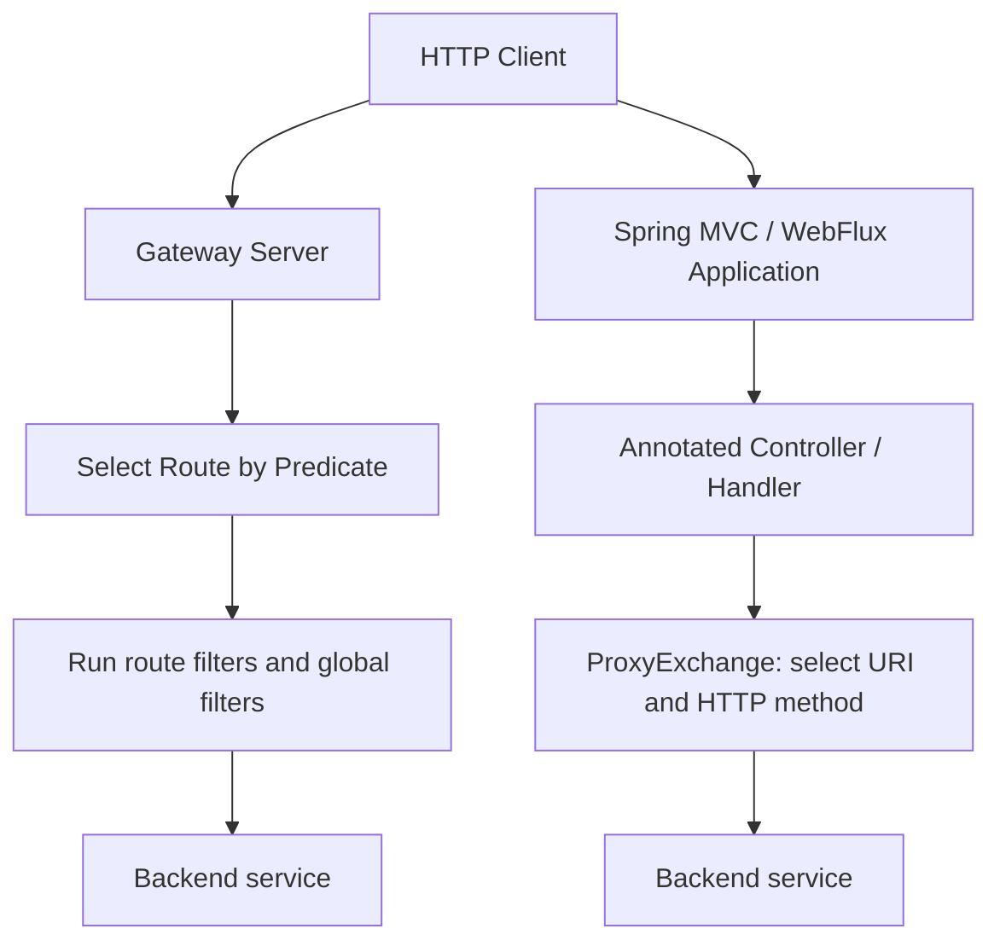

# Distinguishing Gateway Server and Proxy Exchange in Spring Cloud Gateway

**Chapter:** Versions and Variants  
**Scope:** Spring Cloud Gateway — building an entry point for microservices with routing, predicates, filters, request/response transformation, service discovery, authentication and protection mechanisms, and traffic observability.

## 1. Why Distinguish the Two Variants?

When encountering the term *Spring Cloud Gateway*, learners often immediately think of a gateway service that receives every HTTP request, finds a matching route, and forwards it to a microservice. That is how **Gateway Server** works. However, Spring Cloud Gateway also provides **Proxy Exchange**: a utility that lets **a Spring MVC or Spring WebFlux controller method** actively invoke and forward an HTTP request to another server.

Both can act as an intermediary between client and backend, but **where the forwarding logic lives, how configuration works, and what built-in features are available differ significantly**:

- **Gateway Server:** declares and manages routes centrally; the framework matches a route using predicates, executes the associated filters, and then forwards the request.
- **Proxy Exchange:** an annotated handler such as `@GetMapping` accepts a `ProxyExchange` parameter; the developer writes Java code to choose the URI, call `get()`/`post()`, etc., and return the response.

The official Spring documentation distinguishes two *flavors*: **Server** and **Proxy Exchange**. **Each flavor also has a WebFlux or Web MVC option**. Therefore, you should not equate "Server = WebFlux" or "Proxy Exchange = MVC".

### Learning Objectives

1. Correctly classify the four combinations: Server WebFlux, Server Web MVC, Proxy Exchange WebFlux, and Proxy Exchange Web MVC.
2. Explain the request flow, route definition style, and header/path handling in each flavor.
3. Read the corresponding dependencies, configuration, and illustrative Java snippets; avoid mistakenly applying Server APIs to Proxy Exchange.
4. Choose the appropriate solution when needing authentication, rate limiting, circuit breaker, retry, TLS, service discovery, and observability.

## 2. Architectural Model and Processing Flow



### 2.1. Gateway Server: Route Is the Central Unit

A **route** typically consists of:

| Component | Meaning | Example |
|---|---|---|
| `id` | Route identifier for management and observability | `catalog-route` |
| `uri` | Target destination for forwarding | `http://localhost:8081` or `lb://catalog-service` |
| `predicates` | Conditions for selecting the route | `Path=/api/catalog/**`, `Method=GET` |
| `filters` | Modify the request/response or apply policy on the route | `StripPrefix=2`, `AddRequestHeader=...` |

With **Server WebFlux**, a matched route is processed by the WebFlux-based gateway engine; `GlobalFilter`s and the route's `GatewayFilter`s form an ordered chain. Filters can process before sending downstream and after receiving the response. With **Server Web MVC**, the framework uses the `WebMvc.fn` model and the MVC variant's filters; although serving the same purpose, the programming API is not completely identical to WebFlux.

A central API Gateway can be responsible for applying common policies across many routes: normalizing paths/headers, edge authentication, request rate limits, routing via service discovery, and monitoring backend health.

### 2.2. Proxy Exchange: Handler Is the Central Unit

Proxy Exchange uses an **annotated** controller or handler (`@GetMapping`, `@PostMapping`, `@RequestMapping`, etc.). In that method, Spring supplies a `ProxyExchange<T>` object as a parameter. Application code selects the target URI and performs the HTTP exchange.

Mental model example:

```text
GET /api/catalog/products/42
    -> Spring MVC @GetMapping("/products/{id}")
    -> ProxyExchange.uri("http://localhost:8081/products/42").get()
    -> ResponseEntity<?> returned to client
```

Proxy Exchange **does not automatically turn this controller method into a Server route**; Gateway Server's `RouteLocator`, route predicate factories, and `GatewayFilter`/`GlobalFilter` settings **do not automatically apply**. The handler can take full advantage of annotation-based routing, parameters, validation, interceptors/filters, and Spring Security belonging to the MVC/WebFlux application.

## 3. Direct Comparison Table

| Criterion | Gateway Server | Proxy Exchange |
|---|---|---|
| Primary role | HTTP gateway orchestrating many routes and cross-cutting policies | Intentional HTTP forwarding from an application handler |
| Where forwarding is defined | Route declarations in YAML/properties or Java DSL | Code inside an annotated controller/handler |
| Request matching mechanism | Route predicates such as `Path`, `Method`, `Header`, `Host` | `@RequestMapping`, `@GetMapping`, `@RequestParam`... |
| Processing structure | Route → filter chain → downstream | Handler → `ProxyExchange` → downstream |
| Request/response transformation | Filter factories and custom filters per flavor | Java code in the handler; `ProxyExchange` methods; Spring's own filters/interceptors |
| Service discovery | `lb://service-id` routes and integration with Spring Cloud LoadBalancer/DiscoveryClient | No built-in Server `lb://` route mechanism by default; requires custom client/service resolution integration |
| Resilience | Dedicated filters such as circuit breaker, retry, and rate limiter depending on module and configuration | Uses corresponding solutions at the application/client layer; does not inherit Server filters |
| Security | Can apply common policies at the gateway and secure individual backends | Secures controller/handler like a standard web app; controls forwarding of sensitive data |
| Operations | Convenient for managing routes, shared policies, and route-tagged metrics | Convenient for a few specialized endpoints; requires designing proxy metrics and monitoring yourself |
| Deployment model | Standalone Boot app **or embedded** inside a Boot app | Runs inside a Spring MVC or WebFlux application using annotated handlers |
| Best fit | Many services, many paths, centralized governance needs | A few endpoints bridging legacy systems, bespoke forwarding logic |

**Important distinction:** a Gateway Server can be deployed as a separate service, but it does not have to be. A Proxy Exchange can be placed in an edge application, but placing it at the edge does not give it all the features of Gateway Server.

## 4. The Four Library Combinations and Versioning

Two independent axes:

| Flavor | WebFlux (reactive) | Web MVC (servlet) |
|---|---|---|
| **Gateway Server** | `spring-cloud-starter-gateway-server-webflux` | `spring-cloud-starter-gateway-server-webmvc` |
| **Proxy Exchange** | `spring-cloud-gateway-proxyexchange-webflux` | `spring-cloud-gateway-proxyexchange-webmvc` |

All share the group ID `org.springframework.cloud`. For Server, use the corresponding **starter**; for Proxy Exchange, add the **Proxy Exchange module** to an existing WebFlux/MVC application. Choose dependencies based on both flavor and application web stack; do not swap names just because they all contain the word "gateway".

In the Spring Cloud Gateway 5.x line, Spring documentation describes an ecosystem of Spring Framework 7, Spring Boot 4, and Project Reactor. Manage compatible versions through the **Spring Cloud Release Train/BOM** instead of manually mixing Boot, Gateway, and Cloud versions.

### 4.1. Why Do Older Examples Use Different Names?

Starting with Spring Cloud 2025.0, artifact names were clarified. Some commonly seen older names:

| Old name in examples/references | New name for clear flavor identification |
|---|---|
| `spring-cloud-starter-gateway` | `spring-cloud-starter-gateway-server-webflux` |
| `spring-cloud-starter-gateway-mvc` | `spring-cloud-starter-gateway-server-webmvc` |
| `spring-cloud-gateway-mvc` | `spring-cloud-gateway-proxyexchange-webmvc` |
| `spring-cloud-gateway-webflux` | `spring-cloud-gateway-proxyexchange-webflux` |

The old names may appear in earlier projects or be marked deprecated in transitional release lines. Always check the exact **version you are using**, because names in this project can change across release trains.

Similarly, Server configuration prefixes have also changed:

```text
Before transition (Server WebFlux): spring.cloud.gateway.routes
After transition (Server WebFlux):  spring.cloud.gateway.server.webflux.routes

Before transition (Server MVC):     spring.cloud.gateway.mvc.routes
After transition (Server Web MVC):  spring.cloud.gateway.server.webmvc.routes
```

Examples in the following sections use the naming from **2025.0+/Gateway 4.3+ and 5.x**. Do not copy this prefix verbatim into a Gateway 4.2 or older application without checking the corresponding documentation.

## 5. Hands-On Gateway Server WebFlux

Suppose we have:

- Client calls `GET http://localhost:8080/api/catalog/products/42`.
- The catalog service is at `http://localhost:8081`, exposing `GET /products/42`.
- The gateway is responsible for selecting the route and stripping the two prefix segments `api/catalog`.

Add the Gateway Server WebFlux starter to an application already configured with Spring Boot and the Spring Cloud BOM:

```xml
<dependency>
    <groupId>org.springframework.cloud</groupId>
    <artifactId>spring-cloud-starter-gateway-server-webflux</artifactId>
</dependency>
```

Declare in `application.yml`:

```yaml
server:
  port: 8080

spring:
  cloud:
    gateway:
      server:
        webflux:
          routes:
            - id: catalog-route
              uri: http://localhost:8081
              predicates:
                - Path=/api/catalog/**
                - Method=GET
              filters:
                - StripPrefix=2
                - AddRequestHeader=X-Gateway-Source, server
```

**Exact path explanation:**

1. The `Path` predicate only matches requests with path `/api/catalog/**`; `Method` further restricts to HTTP GET.
2. `StripPrefix=2` removes the two segments `api` and `catalog`: `/api/catalog/products/42` becomes `/products/42`.
3. The `AddRequestHeader` filter attaches `X-Gateway-Source: server` to the downstream request.
4. The gateway calls `http://localhost:8081/products/42` and returns the downstream response to the client.

When the backend is a service registered with a service discovery system, you can replace `uri` with `lb://catalog-service` **after** adding and configuring Spring Cloud LoadBalancer along with a `DiscoveryClient` or appropriate service instance provider. `lb://` does not mean the client can discover services on its own without the supporting infrastructure.

### 5.1. How Does the Filter Chain Help?

With Gateway Server WebFlux, rules can be organized at several levels:

- **Route filter:** e.g., `StripPrefix`, `RewritePath`, `AddRequestHeader`, `CircuitBreaker`, `Retry`, or `RequestRateLimiter` on the relevant route (depending on included modules).
- **Default filters:** applied to routes that share common filters.
- **GlobalFilter:** logic integrated into the Gateway WebFlux filter chain that can process requests/responses around forwarding; ordering determines "before" and "after" logic.

Do not assume every WebFlux filter has the exact same API and configuration as Server Web MVC: each variant has its own filter reference section.

### 5.2. Changing Paths with RewritePath

If you need more flexible mapping than `StripPrefix`, such as `/api/orders/123` to `/orders/123`, you can use `RewritePath` with a named regex group `remaining`. In `application.yml`, the `$` in the replacement `${remaining}` needs to be escaped as `$\{remaining}` per the Gateway guide:

```yaml
filters:
  - RewritePath=/api/(?<remaining>.*), /$\{remaining}
```

This is Server filter syntax; do not put these two YAML lines into a Proxy Exchange application and expect them to run.

## 6. Hands-On Proxy Exchange Web MVC

Same scenario where the client calls `GET /api/catalog/products/42`, but this time the gateway application is **Spring MVC with controllers**. Add `spring-boot-starter-web` and the Proxy Exchange Web MVC module; ensure versions are managed by the BOM.

```xml
<dependency>
    <groupId>org.springframework.boot</groupId>
    <artifactId>spring-boot-starter-web</artifactId>
</dependency>
<dependency>
    <groupId>org.springframework.cloud</groupId>
    <artifactId>spring-cloud-gateway-proxyexchange-webmvc</artifactId>
</dependency>
```

`application.yml`:

```yaml
server:
  port: 8080

catalog:
  base-url: http://localhost:8081
```

Controller:

```java
import org.springframework.beans.factory.annotation.Value;
import org.springframework.cloud.gateway.mvc.ProxyExchange;
import org.springframework.http.ResponseEntity;
import org.springframework.web.bind.annotation.GetMapping;
import org.springframework.web.bind.annotation.PathVariable;
import org.springframework.web.bind.annotation.RequestMapping;
import org.springframework.web.bind.annotation.RestController;

@RestController
@RequestMapping("/api/catalog")
public class CatalogProxyController {
    @Value("${catalog.base-url}")
    private String catalogBaseUrl;

    @GetMapping("/products/{id:[0-9]+}")
    public ResponseEntity<?> getProduct(
            @PathVariable long id,
            ProxyExchange<byte[]> proxy) {
        String target = catalogBaseUrl + "/products/" + id;
        return proxy.uri(target).get();
    }
}
```

**What happens?** Spring MVC resolves the method via `@GetMapping`, extracts `id` from the path, injects `ProxyExchange<byte[]>`, and then the method constructs the target URI and executes `get()`. The downstream response is wrapped in a `ResponseEntity<?>` returned to the client.

In this example:

- `{id:[0-9]+}` only allows numeric path segments; mapped to `long`.
- The backend is fixed from trusted configuration; it does not accept an arbitrary URL from the request to proxy.
- There is no Gateway Server route `id` in YAML, no `StripPrefix`, and no route filter chain.
- The application can add logic such as product access checks, parameter validation, body modification, or error handling using familiar MVC mechanisms.

**Note on request data:** the example only demonstrates forwarding a `GET` with a single path parameter. When proxying POST/PUT, query strings, binary bodies, multipart, or large streaming payloads, you must explicitly design and test how the body, content type, and response are forwarded. Do not assume an illustrative GET handler implements a full "transparent reverse proxy".

### 6.1. What If the Application Uses WebFlux?

Choose the `spring-cloud-gateway-proxyexchange-webflux` module (and the appropriate reactive web stack). The handler method uses WebFlux's `ProxyExchange` with a reactive return type:

```java
@GetMapping("/proxy/product/{id}")
public Mono<ResponseEntity<?>> getProduct(
        @PathVariable long id,
        ProxyExchange<byte[]> proxy) {
    return proxy.uri("http://localhost:8081/products/" + id).get();
}
```

This example is **Proxy Exchange WebFlux**, still using an annotated handler and returning `Mono<ResponseEntity<?>>`; it is **not** Gateway Server WebFlux even though both use Reactor. Import `ProxyExchange` from the right module and follow the documentation for the corresponding flavor.

### 6.2. ProxyExchange Utilities

Beyond `uri(...).get()`, Proxy Exchange supports operations corresponding to HTTP methods, URI/path utilities, header additions, and result transformation via callbacks/mapping functions. The MVC variant also supports `forward()` to local handlers. These operations are **APIs called inside a handler**, not names of GatewayFilter factories to declare under `routes`.

## 7. Differences in Authentication, Headers, and Reliability

### 7.1. Headers Are Not Copied Verbatim

Proxy Exchange has dedicated handling for specific header groups:

| Group | Examples | Proxy Exchange default behavior |
|---|---|---|
| **Sensitive** | `Cookie`, `Authorization` | Not automatically forwarded downstream by default |
| **Skipped** | `Content-Length`, `Host` | Not copied verbatim as they can become invalid after the proxy alters body/destination |
| **Proxy-related** | `X-Forwarded-*` | Supports handling headers carrying proxy information; requires understanding the trusted proxy model |

Do not assume that "if the client sends `Authorization`, the backend will definitely receive it" in a `ProxyExchange` example. If business logic requires propagating identity, authenticate the request first, explicitly decide which headers/tokens are sent to the backend, and establish a trust policy between services.

With Gateway Server, header forwarding depends on the specific configuration/filters/security of the Server flavor and version; likewise, do not assume all headers are kept or stripped identically to Proxy Exchange.

### 7.2. Protection Against SSRF and Header Spoofing

A handler like the one below is a **dangerous pattern**:

```java
// Avoid writing this: the caller chooses the URL the server will access.
@GetMapping("/fetch")
public ResponseEntity<?> unsafe(
        @RequestParam String url,
        ProxyExchange<byte[]> proxy) {
    return proxy.uri(url).get();
}
```

Without validating/restricting the destination, a client can turn the application into a tool for calling internal IPs or metadata services. Use fixed hosts/services or an allowlist, control scheme/port/redirects, validate path inputs, and enforce server-side network access restrictions.

In Gateway Server as well, you must restrict who can modify routes, administrative actuator endpoints, target URIs, and headers tied to request origin. For `Forwarded`/`X-Forwarded-*`, only trust upstream proxies that have been explicitly identified and configured; modern Gateway versions require declaring trusted proxies to enable certain forward-header behaviors.

### 7.3. Spring Security Across Both Web Stacks

- **WebFlux:** typically integrates Spring Security via `SecurityWebFilterChain`.
- **Web MVC:** typically integrates Spring Security via servlet `SecurityFilterChain`.

This distinction belongs to the **web stack**, independent of whether you choose Gateway Server or Proxy Exchange. Do not copy reactive security configuration directly into servlet MVC and vice versa.

## 8. Rate Limiting, Circuit Breaker, Retry, Discovery, and TLS

The operational needs listed in the Spring Cloud Gateway scope are often strong reasons to choose Server:

| Need | Gateway Server | Proxy Exchange |
|---|---|---|
| **Rate limiting** | Has built-in route filter mechanisms (e.g., `RequestRateLimiter` in Server WebFlux, when configured with a limiter and appropriate dependencies) | Must proactively apply a rate limiter in the app/handler or an upstream layer |
| **Circuit breaker** | Gateway filter integrated with Spring Cloud CircuitBreaker on supported flavors/versions | Wrap HTTP calls with a circuit breaker at the application layer; does not inherit Server's circuit breaker filter |
| **Retry** | Has per-route retry filter; must consider method, error codes, and body | Configure retry on the HTTP client or within service logic |
| **Service discovery** | `lb://service-id`, Spring Cloud LoadBalancer, and DiscoveryClient | Resolve destination manually via client, registry, or a dedicated resolution layer |
| **TLS** | Configure TLS for inbound gateway and outbound connection TLS policy according to the stack | Configure HTTPS for the MVC/WebFlux app and the HTTP client used by `ProxyExchange` |
| **Request observability** | Easy to attach route ID, gateway metrics, actuator, tracing, and shared policies | Must attach handler/destination info to application logs, metrics, and traces |

**Retry is not always safe.** GET is usually easier to consider retrying than a POST that creates an order or payment. Regardless of flavor, evaluate *idempotency*, timeouts, retry counts, retryable error statuses, and extra load added to the backend.

**TLS is not guaranteed by the flavor name.** Both can serve HTTPS if configured with the appropriate server certificate/keystore; to call a backend over HTTPS, verify truststore, hostname verification, and certificate policies on that stack's HTTP client.

**Neither choice replaces backend security:** the gateway is an edge defense layer, while downstream services should still enforce authentication/authorization and protections appropriate to the runtime environment.

## 9. When to Choose Which?

### Scenario A — Central Gateway for 30 Microservices

The system has `catalog-service`, `order-service`, `payment-service`, etc., dozens of API routes, requiring service discovery integration, unified path/header rules, and per-route error tracking. **Choose Gateway Server**. If deploying reactive with Netty, choose Server WebFlux; if the project requires a servlet/Tomcat/Jetty runtime and MVC integrations, consider Server Web MVC.

Reason: policies tend to repeat across many routes. Using Gateway Server reduces the number of controllers/proxy methods to maintain manually and enables managing routing rules through a consistent model.

### Scenario B — MVC Application Needing to Proxy Two Legacy Endpoints

An existing Spring MVC application with controllers needs `GET /legacy/users/{id}` and `POST /legacy/orders` to forward to a legacy service with some custom data/business mapping. **Proxy Exchange Web MVC** is a simple choice when the number of endpoints is small and forwarding control is tightly coupled to code.

Reason: easy to reuse existing validation, security, handler exception handling, and specialized logic without setting up a separate route server layer for just a couple of integration points.

### Scenario C — Wanting a Full Gateway on a Servlet Runtime

Requirements call for centralized routes, filters, and full gateway operations while being constrained to deploy on a servlet runtime. **Gateway Server Web MVC** is the right candidate to evaluate first; do not pick Proxy Exchange merely because you see the word "MVC".

### Scenario D — Handler Needs to Determine Destination by Business Logic

If the target URI is chosen from an **approved** set of backends based on tenant, resource type, or checked permissions, Proxy Exchange lets you write forwarding logic directly in the handler. You must take responsibility for validation, SSRF protection, headers, timeouts, tracing, and resilience policies. If that logic grows into hundreds of routes and numerous shared policies, evaluate migrating to Gateway Server.

## 10. Comparing Both Approaches on the Same Request

```text
Client request: GET http://localhost:8080/api/catalog/products/42
Backend URL:    GET http://localhost:8081/products/42

Gateway Server:
  Path=/api/catalog/** + Method=GET
  -> StripPrefix=2
  -> http://localhost:8081/products/42

Proxy Exchange MVC:
  @RequestMapping("/api/catalog") + @GetMapping("/products/{id}")
  -> id = 42
  -> proxy.uri(baseUrl + "/products/" + id).get()
  -> http://localhost:8081/products/42
```

To verify yourself, run a backend on port `8081` exposing `GET /products/42`, then run each approach **one at a time** on port `8080`. Both samples cannot bind to the same port on the same host simultaneously.

```bash
curl -i http://localhost:8080/api/catalog/products/42
curl -i http://localhost:8080/api/catalog/products/not-a-number
```

Expected results when the backend is running:

- With `42`, both can return the product payload supplied by the backend; on Server, the backend can also observe `X-Gateway-Source: server`.
- With `not-a-number`, the example Proxy Exchange handler does not match the numeric regex; on Server, the `Path=/api/catalog/**` predicate can still match and forward the request to the backend. This is a **difference in request-matching configuration**, not an inherent strength or weakness of either flavor.
- When the backend is down, both can fail, though the status code and error payload depend on the stack, configuration, and error handler; do not promise the exact same HTTP status without verifying.

### Criteria for Evaluating a Complete Exercise

1. Does a request with a valid path reach the backend with the expected URL?
2. Is a request with the wrong method or invalid parameters rejected at the right layer?
3. Which headers are kept, dropped, or added to the downstream request?
4. When the backend is slow, do timeouts and retries cause hanging requests or duplicate sends?
5. When the backend errors, what does the client receive and do operators have sufficient logs/metrics/traces to pinpoint the failing route or handler?

## 11. Common Misconceptions to Avoid

| Common Misconception | Correct Understanding |
|---|---|
| "Server is always WebFlux, Proxy Exchange is always MVC." | Both **Server** and **Proxy Exchange** have WebFlux and Web MVC variants. |
| "Having `ProxyExchange` means you can use `GatewayFilter` in YAML." | The two flavors have different pipelines; Server GatewayFilters do not automatically run on annotated Proxy Exchange handlers. |
| "Gateway Server must be split into a separate microservice." | Server can run standalone or be embedded inside a Spring Boot application. |
| "Proxy Exchange forwards all headers by default." | It has sensitive/skipped header rules; `Authorization` and `Cookie` are not forwarded by default. |
| "`lb://service` works automatically once you add the Gateway dependency." | It requires a load balancing mechanism and an appropriate source of service instances. |
| "`spring-cloud-starter-gateway-mvc` is Proxy Exchange MVC." | Under the new naming, this starter corresponds to **Gateway Server Web MVC**; Proxy Exchange MVC is `spring-cloud-gateway-proxyexchange-webmvc`. |
| "If you need servlet, you must use Proxy Exchange." | **Gateway Server Web MVC** also runs on a servlet runtime. |
| "Having a circuit breaker in the gateway means requests will never fail." | A circuit breaker limits cascading failures; you still need fallbacks, timeouts, and error observability. |

## 12. Key Takeaways and Selection Rule

Ask **"who decides the route?"** before asking "WebFlux or MVC?":

- If **the framework selects the route from configuration/DSL and applies a filter chain**, you are talking about **Gateway Server**.
- If **code inside a handler decides the URI and invokes `ProxyExchange`**, you are talking about **Proxy Exchange**.

Only then choose **WebFlux** when it fits a reactive architecture, or **Web MVC** when it fits a servlet foundation. Four valid options do not mean four interchangeable APIs.

In practice, Gateway Server fits a microservices entry point that requires route predicates, filter chains, security, rate limiting, circuit breakers, retries, TLS, service discovery, and **systematic** traffic observability. Proxy Exchange fits **programmatic** forwarding points tied to specific controllers with a narrower scope. The final decision should still be based on actual load, functional requirements, operational capability, and the Spring Cloud version in use.

## Official Documentation References

1. [Spring Cloud Gateway — Overview of Server and Proxy Exchange](https://docs.spring.io/spring-cloud-gateway/reference/intro.html).
2. [Proxy Exchange Gateway with Spring Web MVC or WebFlux](https://docs.spring.io/spring-cloud-gateway/reference/spring-cloud-gateway-proxy-exchange.html).
3. [Gateway Server WebFlux — Starter installation](https://docs.spring.io/spring-cloud-gateway/reference/spring-cloud-gateway-server-webflux/starter.html).
4. [Gateway Server Web MVC — Starter installation](https://docs.spring.io/spring-cloud-gateway/reference/spring-cloud-gateway-server-webmvc/starter.html).
5. [Gateway Server WebFlux — Route Predicate Factories](https://docs.spring.io/spring-cloud-gateway/reference/spring-cloud-gateway-server-webflux/request-predicates-factories.html).
6. [Gateway Server WebFlux — Global Filters](https://docs.spring.io/spring-cloud-gateway/reference/spring-cloud-gateway-server-webflux/global-filters.html).
7. [Spring Cloud 2025.0 Release Notes — new artifact names and configuration prefixes](https://github.com/spring-cloud/spring-cloud-release/wiki/Spring-Cloud-2025.0-Release-Notes).

> **Version note:** When applying this to a real project, select the documentation matching the exact Spring Cloud/Gateway release train in use. Very old examples with `spring.cloud.gateway.routes` or short artifact names may belong to older branches; verify before modifying `pom.xml` and `application.yml`.
