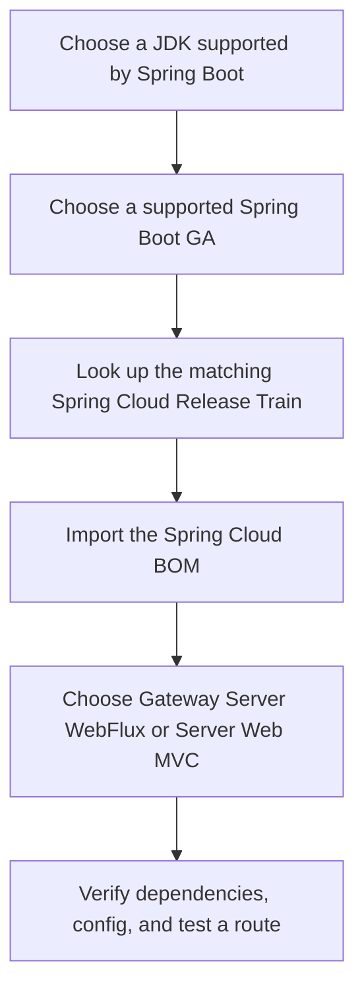

# Choosing Compatible Java, Spring Boot, and Spring Cloud Release Train Versions

> **Scope:** Spring Cloud Gateway — building an API Gateway that routes requests with route predicates, filter chains, path/header transformations, service discovery, authentication, rate limiting, circuit breakers, retries, TLS, and system observability. This lesson addresses the foundational step: choosing the right version set before configuring those features.
>
> **Reference date:** 2026-11-24. Versions and support lifecycles change over time; when creating a new project or upgrading a running one, cross-check the official sources at the end of this lesson.

## 1. Why Must Versions Be Chosen as a Coordinated Set?

An API Gateway does not depend on Java alone. The Gateway application also runs on Spring Boot, uses libraries inside the **Spring Cloud Release Train**, and picks a specific **Spring Cloud Gateway** variant. For example, a `Path=/api/orders/**` route may have valid YAML yet still fail at startup because Spring Boot was paired with an incompatible Release Train, or routes may fail to load because configuration keys came from older documentation.

In this ecosystem, distinguish four layers:

| Component | Role | Example choice for a new project |
| --- | --- | --- |
| **JDK** | Compiles and runs Java bytecode; subject to Boot and library min/max requirements | Java 21 LTS |
| **Spring Boot** | Application foundation, manages Spring Framework, runtime, and many dependency versions | `4.2.0` |
| **Spring Cloud Release Train** | BOM (`spring-cloud-dependencies`) coordinating versions of Spring Cloud projects | `2026.0.0` — Paddington |
| **Spring Cloud Gateway** | Actual Gateway component and starter chosen by WebFlux or Web MVC model | Gateway `5.1.0`, Server WebFlux |



**The Release Train is not the Spring Boot or Gateway version.** For instance, `2026.0.0` is the Spring Cloud Release Train version, whereas the Spring Cloud Gateway version managed by that train is `5.1.0`. Never force matching numbers or manually pin `5.1.0` onto every Spring Cloud dependency.

## 2. Compatibility Matrix to Know

The following table uses GA branches published as of the reference date; older rows help when reading and maintaining existing applications. Version `x` means picking the **latest compatible patch release** within the same branch after reviewing release notes.

| Spring Boot | Spring Cloud Release Train | Gateway in Train | Java | Notes |
| --- | --- | --- | --- | --- |
| **`4.2.x`** | **`2026.0.x` — Paddington** | **`5.1.x`** | Minimum 17; Boot 4.2.0 supports up to Java 27 | New GA pairing: Boot `4.2.0` + Cloud `2026.0.0` + Gateway `5.1.0` |
| `4.1.x` or `4.0.x` | `2025.1.x` — Oakwood | `5.0.x` | Minimum 17 | Boot 4.1 support starts from Cloud `2025.1.2`; pick a recent service release, e.g., `2025.1.5` as of reference date |
| `3.5.x` | `2025.0.x` — Northfields | `4.3.x` | Minimum 17 | Older branch; check support status before continuing operations |
| `3.4.x` | `2024.0.x` — Moorgate | `4.2.x` | Minimum 17 | Older branch, should not be chosen for new projects |
| `3.2.x` or `3.3.x` | `2023.0.x` — Leyton | `4.1.x` | Minimum 17 | Boot 3.3 supported from Cloud `2023.0.2`; older branch |

According to the Spring Cloud project page at the time of writing, trains marked `*` (including `2025.0.x` and older) have reached end of open-source support. **Being able to resolve dependencies from Maven Central does not mean you are receiving security patches.** To decide on a deployment baseline, check the support policies of both Spring Boot and Spring Cloud, not merely whether artifacts can still be downloaded.

Some combinations to recognize immediately:

- **Valid:** Java 21 + Spring Boot `4.2.0` + Spring Cloud `2026.0.0` + Gateway Server WebFlux from the `5.1.x` line.
- **Valid:** Java 21 + Spring Boot `4.1.3` + Spring Cloud `2025.1.5` + Gateway Server Web MVC from the `5.0.x` line.
- **Wrong branch:** Spring Boot `4.2.0` + Spring Cloud `2025.1.x` — the `2025.1` train targets Boot 4.0/4.1; move to `2026.0.x`.
- **Wrong branch:** Spring Boot `3.5.x` + Spring Cloud `2026.0.x` — the new train targets Boot 4.2; do not patch around this by forcing individual Gateway library versions.
- **Insufficient information:** knowing only "Java 21 + Spring Cloud Gateway 5" — missing Spring Boot, Release Train, starter, and exact patch versions.

### How to Read Version Numbers

- Spring Boot `4.2.0` is **major.minor.patch**. Patch `4.2.1`, once released, remains in the `4.2.x` line but should still be checked against the matching train and release notes.
- Spring Cloud `2026.0.0` uses **calendar versioning** for the Release Train; there is no rule pairing Boot's major number with Cloud's year.
- Spring Cloud Gateway `5.1.0` is a **sub-project version** coordinated by the Spring Cloud BOM.
- Suffixes `-M1`, `-RC1`, `-SNAPSHOT` denote milestone, release candidate, and snapshot builds; for production, prefer supported **GA/stable** releases unless intentionally testing previews.

## 3. Process for Selecting a Version Set for an API Gateway

1. **Lock down actual Java requirements.** Check Java across developer machines, CI, containers, and production. Spring Boot 4.2.0 requires at least Java 17; we choose Java 21 LTS in examples for a consistent toolchain. The runtime JVM must support the compiled bytecode, and the build tool must also support the chosen JDK.
2. **Choose a supported Spring Boot GA.** For new apps, prefer a supported GA branch already validated in your team's infrastructure. Do not choose an RC just because its version number is higher.
3. **Check the official Spring Cloud compatibility matrix.** If Boot `4.2.x` is locked, use Cloud `2026.0.x`; if Boot `4.1.x`, use Cloud `2025.1.x` starting from `2025.1.2` onward. Check the train's latest **service release** before pinning versions.
4. **Import the Spring Cloud BOM.** Maven uses `dependencyManagement`; Gradle uses dependency management/BOM. Let the BOM select versions for Gateway, Spring Cloud LoadBalancer, CircuitBreaker, etc., rather than hardcoding versions on individual dependencies.
5. **Choose the Gateway variant by execution model.** Server WebFlux uses Reactor Netty and suits reactive pipelines; Server Web MVC runs on a Servlet stack like Tomcat/Jetty. Starters, filter APIs, and configuration keys are not identical.
6. **Verify the build and a real request.** Check resolved dependencies, app startup, a sample route, HTTP status/headers, and logs; only then add OAuth2/JWT, rate limiting, retry, circuit breaker, TLS, and observability.

### How Does WebFlux vs. Web MVC Relate to Versions?

In current Gateway documentation, **Server WebFlux** uses artifact `org.springframework.cloud:spring-cloud-starter-gateway-server-webflux`, while **Server Web MVC** uses `org.springframework.cloud:spring-cloud-starter-gateway-server-webmvc`.

| Criterion | Gateway Server WebFlux | Gateway Server Web MVC |
| --- | --- | --- |
| Runtime | Reactor Netty, WebFlux, Project Reactor | Servlet runtime, Spring MVC/WebMvc.fn |
| Starter | `spring-cloud-starter-gateway-server-webflux` | `spring-cloud-starter-gateway-server-webmvc` |
| Current route config prefix | `spring.cloud.gateway.server.webflux.routes` | `spring.cloud.gateway.server.webmvc.routes` |
| Typical security integration | `SecurityWebFilterChain` for reactive security | `SecurityFilterChain` for servlet security |
| Caveat | Does not run as a traditional WAR inside a Servlet container | Does not automatically accept WebFlux reactive filter APIs |

This is an architectural choice, not a workaround around the version matrix. Within the same release train, you still must pick the right starter and read the docs for your active variant. The hands-on section below uses **Gateway Server WebFlux**.

## 4. Maven Example: Java 21 + Boot 4.2.0 + Cloud 2026.0.0

A minimal, clear `pom.xml` for a new Gateway application:

```xml
<?xml version="1.0" encoding="UTF-8"?>
<project xmlns="http://maven.apache.org/POM/4.0.0"
         xmlns:xsi="http://www.w3.org/2001/XMLSchema-instance"
         xsi:schemaLocation="http://maven.apache.org/POM/4.0.0 https://maven.apache.org/xsd/maven-4.0.0.xsd">
    <modelVersion>4.0.0</modelVersion>

    <parent>
        <groupId>org.springframework.boot</groupId>
        <artifactId>spring-boot-starter-parent</artifactId>
        <version>4.2.0</version>
        <relativePath/>
    </parent>

    <groupId>com.example</groupId>
    <artifactId>edge-gateway</artifactId>
    <version>0.0.1-SNAPSHOT</version>

    <properties>
        <java.version>21</java.version>
        <spring-cloud.version>2026.0.0</spring-cloud.version>
    </properties>

    <dependencyManagement>
        <dependencies>
            <dependency>
                <groupId>org.springframework.cloud</groupId>
                <artifactId>spring-cloud-dependencies</artifactId>
                <version>${spring-cloud.version}</version>
                <type>pom</type>
                <scope>import</scope>
            </dependency>
        </dependencies>
    </dependencyManagement>

    <dependencies>
        <dependency>
            <groupId>org.springframework.cloud</groupId>
            <artifactId>spring-cloud-starter-gateway-server-webflux</artifactId>
        </dependency>
        <dependency>
            <groupId>org.springframework.boot</groupId>
            <artifactId>spring-boot-starter-actuator</artifactId>
        </dependency>
    </dependencies>

    <build>
        <plugins>
            <plugin>
                <groupId>org.springframework.boot</groupId>
                <artifactId>spring-boot-maven-plugin</artifactId>
            </plugin>
        </plugins>
    </build>
</project>
```

Key point: do **not** attach `<version>5.1.0</version>` directly to the Gateway starter. The `2026.0.0` BOM already manages the matching versions of Spring Cloud modules. The Spring Boot parent manages Boot's dependencies; the Cloud BOM adds Spring Cloud dependency management. Importing the BOM **does not automatically add Gateway to the app**: you still need the starter dependency under `<dependencies>`.

Application class example:

```java
package com.example.gateway;

import org.springframework.boot.SpringApplication;
import org.springframework.boot.autoconfigure.SpringBootApplication;

@SpringBootApplication
public class EdgeGatewayApplication {
    public static void main(String[] args) {
        SpringApplication.run(EdgeGatewayApplication.class, args);
    }
}
```

And `src/main/resources/application.yml`:

```yaml
server:
  port: 8080

spring:
  application:
    name: edge-gateway
  cloud:
    gateway:
      server:
        webflux:
          routes:
            - id: inventory-service
              uri: http://localhost:8081
              predicates:
                - Path=/api/inventory/**
              filters:
                - StripPrefix=1
                - AddRequestHeader=X-Gateway-Route, inventory-service

management:
  endpoints:
    web:
      exposure:
        include: health,info
```

When the backend at `localhost:8081` exposes `GET /inventory/items/42`, running `curl -i http://localhost:8080/api/inventory/items/42` hits the `inventory-service` route; `StripPrefix=1` strips the `api` segment, so the backend receives `GET /inventory/items/42` with header `X-Gateway-Route: inventory-service`. Start the backend first: if it is not running, a downstream connection error is **not evidence** that the Spring version set is incompatible.

## 5. Equivalent Gradle Example

With Gradle Groovy DSL (`build.gradle`), keeping the exact same version set:

```groovy
plugins {
    id 'java'
    id 'org.springframework.boot' version '4.2.0'
    id 'io.spring.dependency-management' version '1.1.7'
}

group = 'com.example'
version = '0.0.1-SNAPSHOT'

java {
    toolchain {
        languageVersion = JavaLanguageVersion.of(21)
    }
}

repositories {
    mavenCentral()
}

dependencyManagement {
    imports {
        mavenBom 'org.springframework.cloud:spring-cloud-dependencies:2026.0.0'
    }
}

dependencies {
    implementation 'org.springframework.cloud:spring-cloud-starter-gateway-server-webflux'
    implementation 'org.springframework.boot:spring-boot-starter-actuator'
}
```

Gradle requires a version compatible with the chosen Spring Boot; per Boot 4.2.0's system requirements, Gradle 8.x from **8.14** and 9.x are supported, or Maven from **3.6.3**. Check the project's Gradle Wrapper/Maven Wrapper rather than only checking `java` on PATH.

### Commands to Verify Versions

Run inside an example project with Maven Wrapper:

```bash
java -version
./mvnw -version
./mvnw dependency:tree -Dincludes=org.springframework.cloud
./mvnw spring-boot:run
```

On Windows you can use `mvnw.cmd` instead of `./mvnw`; with Gradle use `./gradlew dependencies --configuration runtimeClasspath` (or `gradlew.bat` on Windows). When inspecting the dependency tree, match Gateway against its **sub-project version** from the BOM, not expecting it to carry `2026.0.0`.

After starting the Gateway and test backend:

```bash
curl -i http://localhost:8080/actuator/health
curl -i http://localhost:8080/api/inventory/items/42
```

`/actuator/health` confirms the application started; `curl` through the route further verifies predicates, path filtering, and downstream connectivity. The exact route call output depends on the test backend's response.

## 6. Troubleshooting Version Mismatches

| Symptom | Cause to Check | Resolution |
| --- | --- | --- |
| Startup reports Spring Boot is incompatible with Spring Cloud Release Train | Boot/Cloud branch mismatch, or compatibility verifier triggered | Re-check the matrix, fix Boot or train, align BOM and rebuild |
| `UnsupportedClassVersionError` | Java runtime is older than required by compiled bytecode/libraries | Compare `java -version`, IDE/CI/container JDK, and configured toolchain |
| `NoSuchMethodError`, `ClassNotFoundException` at startup | Dependency version overridden outside BOM or conflicting versions present | Inspect dependency tree, remove unnecessary version overrides, resolve conflicts |
| App runs but routes are not active as expected | Wrong config namespace for the Gateway variant | For current Server WebFlux check `spring.cloud.gateway.server.webflux.routes`; for Web MVC use `spring.cloud.gateway.server.webmvc.routes` |
| Route returns connection error/5xx | Downstream is not running, wrong URI, DNS/service discovery or TLS failure | Check backend, logs, and network before blaming dependency versions |
| Java filters fail to compile after upgrade | API differences between WebFlux/Web MVC or across major releases | Pick the right starter, read migration notes, and update custom code |

Spring Cloud Commons includes a **compatibility verifier** that checks the Spring Boot version. When enabled, its error message may list the supported Boot branches. Related properties include `spring.cloud.compatibility-verifier.enabled` and `spring.cloud.compatibility-verifier.compatible-boot-versions`. Default property behavior can vary by version, so do not assume the verifier is enabled in every app. **Never disable the verifier or override the compatible versions list just to silence the error** without proof that the combination is supported.

### Scenario: Upgrading from Boot 3.5 to Boot 4.2

Suppose an older Gateway uses Boot `3.5.x`, Cloud `2025.0.x`, Gateway `4.3.x`. You should not merely change Spring Boot's `<version>` to `4.2.0` while leaving the Cloud BOM unchanged.

Controlled upgrade sequence:

1. Inventory current starters, dependencies with version overrides, JDK, build plugins, and configuration.
2. Consult release notes, select Boot `4.2.0` + Cloud `2026.0.0` + Gateway `5.1.x`, and update the BOM, runtime, and Gradle/Maven if needed.
3. Verify the WebFlux/Web MVC starter; check route/filter namespaces. A common pattern in old docs is `spring.cloud.gateway.routes`, whereas **Server WebFlux 5.1** uses `spring.cloud.gateway.server.webflux.routes`.
4. Build, run smoke tests for route predicates and path/header transformations; separately test authentication, rate limiter, circuit breaker, retry, TLS, and WebSocket if used.
5. Inspect logs, metrics, traces, and 4xx/5xx responses before rollout; prepare a rollback plan using a tested image or artifact.

This example is an **upgrade plan**, not a guarantee that every old API/property is source-compatible. Changes in Spring Framework, Spring Security, Reactor Netty, and custom Gateway filters must be verified against official upgrade guides, especially across a Boot `3` to `4` major jump.

## 7. Decision-Making Exercise

A team operates an API Gateway requiring: `Path` route predicates, prefix stripping, adding a forwarded header; and later JWT authentication, rate limiting, retries, circuit breakers, and TLS. CI and production currently both run JDK 21; the team is creating a new Spring Boot application.

**Recommended decision:** use Java 21, Spring Boot `4.2.0`, Spring Cloud `2026.0.0`, Spring Cloud Gateway Server WebFlux `5.1.x`, import the Cloud BOM in the build, and use `spring-cloud-starter-gateway-server-webflux`. This set aligns per the GA announcement on 2026-11-20. When adding Spring Cloud CircuitBreaker/LoadBalancer or related dependencies, continue letting the BOM manage their versions. Choose Web MVC only if the project clearly requires a Servlet stack and you test against its corresponding APIs.

If the team must stay on Spring Boot `4.1.x` because the platform has not yet certified Boot 4.2, choose Spring Cloud `2025.1.x` from `2025.1.2` onward, preferring a supported service release (`2025.1.5` at the time of writing), and Gateway `5.0.x`. **Deferring the upgrade together** is much sounder than pairing Boot 4.1 with the 2026.0 train merely because 2026.0 is newer.

**Self-check:**

1. Can a Java 17 + Boot `3.5.x` project import Cloud `2026.0.0`? **No**: Java meets the minimum, but the Boot/Cloud pairing is still on the wrong train.
2. If you swap `spring-cloud-starter-gateway-server-webflux` for `spring-cloud-starter-gateway-server-webmvc`, can you keep all reactive filters unchanged? **No**: different programming model and filter APIs; code and configuration must be reviewed.
3. Why not specify individual Gateway versions on each dependency? **Because** the BOM locks Spring Cloud versions released and tested together, reducing dependency skew risk.
4. Is a successful build enough to prove version compatibility? **Not yet**: you must start the app, exercise routes, verify request transformations, and test key operational features.

## 8. Pre-Lockdown Version Checklist

- [ ] Identified JDK across local, CI, containers, and production; build tool supports that JDK.
- [ ] Selected a supported Spring Boot GA; checked the official Spring Cloud Release Train table.
- [ ] Selected the latest matching service release in the train, checked advisories/security patches.
- [ ] Imported the BOM and avoided pinning Gateway/Cloud starter versions without a specific reason.
- [ ] Chosen Server WebFlux or Server Web MVC appropriately; matching starter and config namespace.
- [ ] Verified dependency tree, application startup, `/actuator/health`, sample route predicates, and filters.
- [ ] Added smoke tests for authentication, rate limiting, circuit breaker, retry, TLS, and observability if in deployment scope.
- [ ] Documented the version set, release notes links, and rollback procedure for future maintainers.

## Official Documentation for Lookup and Updates

1. [Spring Cloud — Release Train compatibility, BOM, and support policy](https://spring.io/projects/spring-cloud/).
2. [Spring Cloud 2026.0.0 (Paddington) GA — confirming Boot 4.2.0, Gateway 5.1.0](https://spring.io/blog/2026/11/20/spring-cloud-2026-0-0-has-been-released/).
3. [Spring Cloud Release Train Reference](https://docs.spring.io/spring-cloud-release/reference/index.html).
4. [Spring Cloud Gateway Reference — releases and variants](https://docs.spring.io/spring-cloud-gateway/reference/index.html).
5. [Gateway Server WebFlux — starter](https://docs.spring.io/spring-cloud-gateway/reference/spring-cloud-gateway-server-webflux/starter.html) and [route configuration](https://docs.spring.io/spring-cloud-gateway/reference/spring-cloud-gateway-server-webflux/configuration.html).
6. [Gateway Server Web MVC — starter](https://docs.spring.io/spring-cloud-gateway/reference/spring-cloud-gateway-server-webmvc/starter.html).
7. [Spring Boot — System Requirements](https://docs.spring.io/spring-boot/system-requirements.html) and [Spring Cloud Commons — Compatibility Verification](https://docs.spring.io/spring-cloud-commons/reference/spring-cloud-commons/common-abstractions.html).

> **Remember:** Choose **Java → Spring Boot → Spring Cloud Release Train → Gateway variant**, put the Release Train into the BOM, and verify with a real request. A valid version set is the prerequisite for routes, filters, service discovery, and API Gateway security to operate reliably.
