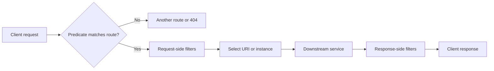

# Predicate, Filter, and Protocol Support Scope Across Variants

## 1. Why Distinguish Spring Cloud Gateway Variants?

**Spring Cloud Gateway** is the entry-point layer for a microservices system: it receives requests from clients, selects target services based on conditions, transforms requests/responses, and enforces policies such as authentication, rate limiting, retries, circuit breakers, and system observability. However, **not every variant uses the exact same set of predicates, filters, or supports protocols in the same way**.

For example, a Redis-based `RequestRateLimiter` configuration written for Gateway Server WebFlux cannot be copied verbatim to Gateway Server Web MVC. Similarly, `ProxyExchange` lets you forward HTTP requests from a controller, but does not automatically turn that controller into a gateway with a YAML-configured route catalog and filter chain.

After this lesson, you can:

- Distinguish **Server WebFlux**, **Server Web MVC**, and the two **Proxy Exchange** forms.
- Choose the right predicates/filters, extension APIs, and configuration namespaces for each runtime.
- Assess proxying scope for HTTP(S), WebSocket, SSE, HTTP/2, and specialized requirements such as gRPC.
- Decide the right variant for an API Gateway problem and verify compatibility when upgrading versions.

> **Version scope:** HTTP/predicate/filter examples use naming from the **Spring Cloud Gateway Server 5.0.x** documentation (`spring.cloud.gateway.server.webflux` and `spring.cloud.gateway.server.webmvc`). **The WebSocket example for Server Web MVC requires the 5.1.x line**, where this feature was added. Documentation for 4.x and other releases may change starters, property names, factories, or capabilities. When implementing, always open the documentation for the **exact version** of the dependency locked in your project.

## 2. Four Deployment Options Across Two Product Groups

Spring Cloud Gateway is divided into **Server** (full gateway) and **Proxy Exchange** (proxy utility inside web application handlers). Each group offers WebFlux and Web MVC choices.

| Variant | Execution foundation | Declaration style | Key characteristics |
|---|---|---|---|
| **Gateway Server WebFlux** | Spring WebFlux, Reactor, Reactor Netty; non-blocking model | `RouteDefinition` via YAML/properties or Java `RouteLocatorBuilder` | Full gateway; `RoutePredicateFactory`, `GatewayFilter`, `GlobalFilter`; suited for high-concurrency I/O loads |
| **Gateway Server Web MVC** | Spring MVC, Servlet container such as Tomcat/Jetty, WebMvc.fn | YAML/properties or `RouterFunction<ServerResponse>` | Full gateway; `RequestPredicate`, `HandlerFilterFunction`, `BeforeFilterFunctions`, `AfterFilterFunctions` |
| **Proxy Exchange WebFlux** | Existing WebFlux application | `ProxyExchange<T>` inside an annotated controller | Per-handler HTTP proxy; custom processing logic written directly in code |
| **Proxy Exchange Web MVC** | Existing Spring MVC application | `ProxyExchange<T>` inside an annotated controller | Per-handler HTTP proxy; additionally supports `forward()` to internal handlers |

Commonly used artifacts (group `org.springframework.cloud`):

```text
Gateway Server WebFlux : spring-cloud-starter-gateway-server-webflux
Gateway Server Web MVC: spring-cloud-starter-gateway-server-webmvc
Proxy Exchange WebFlux: spring-cloud-gateway-proxyexchange-webflux
Proxy Exchange Web MVC: spring-cloud-gateway-proxyexchange-webmvc
```

Do not mix WebFlux `GlobalFilter` examples into Web MVC: the two stacks have different request/response types, lifecycles, and filter APIs. Specifically, **Server WebFlux requires Netty** and does not run as a WAR in a Servlet container; **Server Web MVC runs on a Servlet stack** and does not automatically inherit all reactive behaviors. Both can satisfy many common gateway requirements, but they are not API-for-API identical implementations.

### 2.1. How Do Routes, Predicates, and Filters Work?

- **Route** includes an ID, target URI, matching conditions, and filters applied to that route.
- **Predicate** decides whether a request belongs to a route, based on path, method, host, header, time, etc. Predicates listed within the same YAML route are normally combined with **AND** logic.
- **Filter** performs work before and/or after sending the request to the target service. Examples: stripping the `/api` prefix, adding trace headers, setting timeouts, rate limiting, or modifying response headers.
- **Protocol** describes how the gateway communicates over network connections; `lb://service-name` is a service instance selection mechanism, **not** a new network protocol.



With filters wrapping a downstream call, the logical order is usually **inbound in sorted filter order, outbound in reverse order**. Exact ordering depends on each stack's `order`/chain mechanism, so authentication, body-transformation, or retry filters must be placed and tested in the appropriate position.

## 3. Comparing Route Predicate Scope

### 3.1. Common Conditions

| Predicate / Purpose | Server WebFlux | Server Web MVC | Proxy Exchange |
|---|---|---|---|
| `Path`, `Method` — path and HTTP method | Gateway factory | WebMvc.fn / Gateway MVC predicate | Uses `@GetMapping`, `@RequestMapping`, controller code |
| `Host`, `Header`, `Cookie`, `Query` — request attributes | Built-in factory | Built-in predicate | Uses mapping annotations or manual checks |
| `After`, `Before`, `Between` — request timestamp | Available | Available | Write custom logic if needed |
| `Weight` — weighted traffic splitting across routes | Available | Available | No automatic RouteDefinition/weight |
| `Version` — route selection by API version | Available in corresponding 5.x doc versions | Available in corresponding 5.x doc versions | Relies on framework/controller versioning features |
| `RemoteAddr`, `XForwardedRemoteAddr` — source IP checks | Factory documented for WebFlux | Do not assume identical factory names; check version docs or use custom predicate/Servlet filter | Application logic; must handle trusted proxies properly |
| `ReadBody` with content-inspecting lambda | Supported by WebFlux via Java DSL in versions providing this factory | No default equivalent YAML factory; conditions can be built in code | Actively read/process body inside the handler |

**Note on `Version`:** This is a **predicate using the request's API version**, distinct from the **Spring Cloud Gateway library version**. In Gateway 5.0.x docs, the API version is extracted from an `ApiVersionStrategy` configured by Spring Framework; WebFlux uses `spring.webflux.apiversion.*`, Web MVC uses `spring.mvc.apiversion.*`. Without configuring version resolution, merely naming the predicate is not enough for accurate routing.

**Note on IP:** `RemoteAddr` usually reflects the connection address entering the gateway. Behind a load balancer/reverse proxy, the `X-Forwarded-For` header can be spoofed by clients if trusted proxies are not configured. Never rely on an unvalidated header value for access control.

### 3.2. Example of the Same Routing Logic on Both Server Variants

Requirement: proxy only `GET /api/catalog/**` to `catalog-service`, strip the first two segments (`api`, `catalog`), and add a header so the backend knows the request came through the gateway.

**Gateway Server WebFlux — `application.yml`:**

```yaml
spring:
  cloud:
    gateway:
      server:
        webflux:
          routes:
            - id: catalog-webflux
              uri: http://localhost:8081
              predicates:
                - Path=/api/catalog/**
                - Method=GET
              filters:
                - StripPrefix=2
                - AddRequestHeader=X-Edge-Variant, webflux
                - AddResponseHeader=X-Edge, spring-cloud-gateway
```

**Gateway Server Web MVC — `application.yml`:**

```yaml
spring:
  cloud:
    gateway:
      server:
        webmvc:
          routes:
            - id: catalog-webmvc
              uri: http://localhost:8081
              predicates:
                - Path=/api/catalog/**
                - Method=GET
              filters:
                - StripPrefix=2
                - AddRequestHeader=X-Edge-Variant, webmvc
                - AddResponseHeader=X-Edge, spring-cloud-gateway
```

**Run each variant separately** with an assumed HTTP backend listening on `localhost:8081` and the gateway on `localhost:8080`. The two YAML blocks are independent alternatives—do not combine both into a single demo.

```bash
curl -i 'http://localhost:8080/api/catalog/products?page=1'
```

Expected **routing** behavior (without asserting what status/body the backend returns): downstream receives `GET /products?page=1` with the corresponding `X-Edge-Variant`, and the response to the client includes `X-Edge`. A `POST` to the same URL will not match the route above; if no other route/handler matches, the gateway returns `404`.

To route via service discovery, you can change the URI to `lb://catalog-service` **after** integrating Spring Cloud LoadBalancer and an appropriate `DiscoveryClient`/service instance source. Writing `lb://...` alone does not make the gateway find services automatically.

### 3.3. When to Use the Java DSL?

YAML works well for routes with simple predicates and filter parameters. Use the Java DSL when you need lambda-based predicates, custom filters, or complex composition:

- **WebFlux:** build a `RouteLocator` with `RouteLocatorBuilder`, write `GatewayFilter`/`GlobalFilter` operating on `ServerWebExchange` and `Mono<Void>`.
- **Web MVC:** build a `RouterFunction<ServerResponse>` with `HandlerFunctions.http()`; use `RequestPredicate`, `.before(...)`, `.after(...)`, `.filter(...)`, or `HandlerFilterFunction`.
- **Proxy Exchange:** write handlers taking `ProxyExchange<T>`. There is no YAML route factory list like the two Server variants.

Both stacks allow expressing equivalent **business** rules, but classes or API signatures cannot be copied verbatim across them.

## 4. Comparing Filters and Compatibility Limits

### 4.1. Filter Groups

| Task Group | Server WebFlux | Server Web MVC | Proxy Exchange |
|---|---|---|---|
| Paths: `StripPrefix`, `PrefixPath`, `RewritePath` | GatewayFilter factories | Corresponding filter functions | Construct URI manually in handler |
| Headers/queries: `AddRequestHeader`, `SetRequestHeader`, `RemoveRequestHeader`, `AddResponseHeader` | GatewayFilter factories | Corresponding filter functions | `ProxyExchange.header(...)` and HTTP response manipulation in code |
| Rewriting request/response bodies | Filters like `ModifyRequestBody`, `ModifyResponseBody`; some require Java DSL | Body filter functions, with their own configuration and API | Controller code handles/transforms body directly |
| Retry, timeout, circuit breaker | Per-route filters, depending on dependencies and features | Corresponding filters like `Retry`, `CircuitBreaker` in MVC docs; semantics and dependencies may differ | Wrap proxy calls with policies in code |
| Rate limiting | `RequestRateLimiter` and implementations such as Redis/Bucket4j depending on dependencies | Bucket4j-based `RateLimiter` in MVC docs; custom key resolver via Java DSL | Integrate a rate limiter or another filter layer manually |
| Forwarding OAuth2 tokens | `TokenRelay` when integrated with OAuth2 client | `TokenRelay` with MVC-appropriate mechanism and dependencies | Extract/set headers manually via application security |
| JSON ↔ single gRPC call conversion | `JsonToGrpc` GatewayFilter for request/response via protobuf descriptor; **no streaming support** | Do not infer an equivalent filter exists from WebFlux's `JsonToGrpc` name | No built-in JSON-to-gRPC converter |
| Gateway-wide filters | `GlobalFilter` and `default-filters` under WebFlux mechanism | Servlet filters and MVC filter configs; not WebFlux `GlobalFilter` | Controller scope or web application filters |

Saying **"available"** in the table means *provided in the referenced doc versions*, not that every feature works out of the box just by adding the starter. Dependencies for Redis, Bucket4j, Spring Cloud CircuitBreaker/Resilience4j, OAuth2, and LoadBalancer typically must be added and configured properly. Some filters are only available via **Java DSL** because they accept functions/lambdas that cannot be represented in YAML.

**Rate limit example that cannot be ported mechanically:**

```yaml
# Illustrates the idea for Server WebFlux, not for Server Web MVC.
# Must select and configure a RateLimiter (Redis or Bucket4j) and an appropriate key resolver.
spring:
  cloud:
    gateway:
      server:
        webflux:
          routes:
            - id: public-api
              uri: http://localhost:8081
              predicates:
                - Path=/public/**
              filters:
                - name: RequestRateLimiter
                  args:
                    redis-rate-limiter.replenishRate: 10
                    redis-rate-limiter.burstCapacity: 20
                    redis-rate-limiter.requestedTokens: 1
```

This YAML snippet **only illustrates structure**; running it requires reactive Redis dependencies, a Redis server, and a meaningful key resolver for the app. `RequestRateLimiter` can return `429 Too Many Requests` when quota is exceeded; keying by IP/user/API key must account for trusted proxies and spoofing risks. On **Server Web MVC**, consult `RateLimiter`/`Bucket4jFilterFunctions` and configure `keyResolver` in Java DSL per the MVC version's docs instead of pasting the `redis-rate-limiter.*` block above.

### 4.2. Key Operational Rules for Filters

1. **Retry only when re-execution is safe.** `GET` is usually safer to retry than a payment `POST`; for operations with side effects, require an idempotency key and cap retry attempts. Retrying requests with bodies may require body caching, increasing memory usage.
2. **Circuit breakers and retries have order and scope.** Choose sensible timeouts, failure thresholds, and fallbacks; avoid hammering a degraded backend with retries. A fallback is only useful if it returns a valid business response.
3. **Body filters differ from header filters.** Transforming JSON may require reading/buffering the body; test with large payloads and streaming before rolling out broadly. For WebSocket after handshake, do not treat regular HTTP filters as per-frame processors.
4. **Authentication and authorization are security functions.** A `Header=X-Api-Key,...` predicate only matches a string value; it **does not validate JWTs, signatures, expiration, or permissions**. Use Spring Security tailored to your stack or a controlled authentication system.
5. **Observe filters using real telemetry.** Log route ID, request ID, latency, upstream status, retry count, and rejected requests; avoid logging tokens, cookies, personal data, and sensitive bodies.

## 5. Protocol Support Scope Across Variants

Gateway generally operates at the **HTTP** layer and does not replace a multi-protocol TCP/UDP proxy. Distinguish documented capabilities from capabilities that must be proven via integration tests.

| Protocol / Transport Mode | Server WebFlux | Server Web MVC | Proxy Exchange WebFlux/MVC |
|---|---|---|---|
| **HTTP/1.1 and HTTPS** | Standard HTTP(S) proxy | Standard HTTP(S) proxy | Proxies HTTP requests/responses from handlers |
| **WebSocket (`ws`, `wss`)** | Has WebSocket routing filter; supports `ws(s)://` URIs and load-balanced `lb:ws://...` | **Added in Gateway Server MVC 5.1.x**, requires `spring-boot-starter-websocket`; supports `ws(s)://` URIs or upgraded HTTP routes. Does not apply to MVC 5.0.x | No built-in Server-equivalent WebSocket route chain; requires a dedicated WebSocket mechanism |
| **SSE (`text/event-stream`)** | HTTP streaming; reactive architecture fits long-lived connections, but must be tested end-to-end | Can use Servlet streaming/async capabilities; must test buffering, timeouts, and flushing when proxying | No default guarantee of continuous streaming; verify handler implementation/client |
| **HTTP/2** | Depends on HTTP server/client config, TLS/ALPN, stack version, and intermediate proxies | Depends on Servlet container, HTTP client, and configuration | Depends on web runtime and HTTP client used |
| **gRPC over HTTP/2** | Has `JsonToGrpc` filter for **JSON ↔ non-streaming gRPC call**; do not infer from HTTP/2 that all gRPC calls are fully proxied | No default equivalent gRPC conversion filter; verify separately | No comprehensive gRPC proxy guarantee simply because HTTP is supported |
| **Raw TCP/UDP, MQTT, AMQP, raw database protocols** | Not a general HTTP gateway feature | Not a general HTTP gateway feature | Not a built-in feature of `ProxyExchange` |

### 5.1. HTTP(S), TLS, and `lb://`

- Clients can call `https://gateway.example.com`; the gateway **terminates TLS** at ingress (or receives HTTP from an upstream ingress that already terminated TLS).
- The gateway can initiate a **new TLS connection** to an `https://...` or `wss://...` upstream. TLS between client and gateway **does not automatically secure** TLS between gateway and backend; configure trust stores/certificates and server identity verification.
- When using `lb://inventory-service`, the gateway asks Spring Cloud LoadBalancer to pick an instance supplied by discovery, then establishes an actual HTTP(S) connection to that instance.
- `forward:/some-path` only forwards requests to an internal handler where supported; it is not an HTTP transport hop to another microservice.

### 5.2. WebSocket Is Not a Normal HTTP Request After Upgrade

WebSocket begins with an **HTTP handshake**, after which the connection upgrades and exchanges bidirectional frames. In WebFlux, `WebSocketRoutingFilter` routes to `ws://`/`wss://`; for example:

```yaml
spring:
  cloud:
    gateway:
      server:
        webflux:
          routes:
            - id: notification-ws
              uri: ws://localhost:8090
              predicates:
                - Path=/socket/**
```

With **Server Web MVC 5.1.x**, add `spring-boot-starter-websocket` and declare the route as follows (this WebSocket proxy feature **was not available in MVC 5.0.x**):

```yaml
spring:
  cloud:
    gateway:
      server:
        webmvc:
          routes:
            - id: notification-ws
              uri: ws://localhost:8090
              predicates:
                - Path=/socket/**
```

These are two **separate** configurations. On MVC, filters that alter headers/paths can participate in the **handshake**; they do not become WebSocket message processors once the connection is open. HTTP retries, circuit breakers, and body filters do not handle individual WebSocket messages with the same semantics. Because WebSockets hold resources for the duration of the session, test connection limits, ping/pong, frame sizes, timeouts, memory usage, and teardown when upstream fails.

**WebSocket security:** restrict allowed `Origin` values and authenticate the session; fetch/XHR CORS rules do not automatically protect WebSocket handshakes. Also check **security advisories for your exact Gateway branch**, especially in older branches with differing Origin checks. When using SockJS, HTTP fallbacks may need separate HTTP routes.

### 5.3. HTTP/2, SSE, and gRPC: What Must Be Tested?

HTTP/2 is a capability of **two connection legs** (client → gateway and gateway → downstream). One leg using HTTP/2 does not mean the other leg uses HTTP/2; a proxy may translate between HTTP versions. Meanwhile, gRPC relies on HTTP/2, metadata, trailers, and streaming, requiring more than just an HTTP/2 flag.

For SSE/gRPC streaming or large responses, verify directly:

1. **Are chunks forwarded incrementally** or buffered until completion? Test sending events a few seconds apart and observe when the client receives them.
2. **Do timeouts** at the gateway, ingress, service mesh, and backend permit long-lived connections?
3. **Are headers/trailers, error codes, connection cancellations, and backpressure** preserved accurately when upstream disconnects mid-stream?
4. **Do body-modifying filters, retries, caching, or compression** inadvertently break streaming?
5. For gRPC, are **`content-type: application/grpc`, `grpc-status`, trailers**, and unary/server-streaming/client-streaming/bidirectional-streaming preserved as actually required?

Never label a variant "production gRPC-ready" solely because an HTTP/2 handshake succeeded; if gRPC requirements are complex, run compatibility tests and consider a gateway/proxy purpose-built for gRPC.

**Exception to distinguish:** Gateway Server WebFlux offers the `JsonToGrpc` GatewayFilter Factory, which translates HTTP JSON to a gRPC method using a protobuf descriptor and converts the response back to JSON. Its documentation explicitly states **streaming is not supported**. This is a **JSON ↔ gRPC adapter for suitable unary calls**, not a promise of transparent proxying for all gRPC modes, especially client/bidirectional streaming.

## 6. Proxy Exchange: Flexible in Controllers, Different from Gateway Server

With Proxy Exchange, a controller can pick a URI and call downstream HTTP via `ProxyExchange<byte[]>`:

```java
@RestController
class CatalogProxyController {

    @GetMapping("/proxy/catalog")
    ResponseEntity<?> catalog(ProxyExchange<byte[]> proxy) throws Exception {
        return proxy.uri("http://localhost:8081/products").get();
    }
}
```

The snippet above belongs to **Proxy Exchange Web MVC**. With **Proxy Exchange WebFlux**, the handler can return `Mono<ResponseEntity<?>>`:

```java
@RestController
class CatalogReactiveProxyController {

    @GetMapping("/proxy/catalog")
    Mono<ResponseEntity<?>> catalog(ProxyExchange<byte[]> proxy) throws Exception {
        return proxy.uri("http://localhost:8081/products").get();
    }
}
```

These are illustrative snippets (omitting imports, application annotations, and dependencies). When using Proxy Exchange:

- Application `@GetMapping`, `@RequestMapping`, or `RequestPredicate` decides which handler receives a request; there is no `spring.cloud.gateway.server.*.routes` list dedicated to these controllers.
- URI changes, headers, response transformations, and error handling are written in handlers/application helper classes. You can apply Spring Security, Servlet filters, or WebFlux filters of the host app, but you do not automatically get all Gateway Server route filters.
- Proxy Exchange has concepts of **sensitive** headers and **skipped** headers when forwarding; verify forwarding policies for `Authorization`, `Cookie`, `Host`, `Content-Length`, and `X-Forwarded-*` against your version's docs.
- When a few endpoints need proxying inside an existing application, Proxy Exchange is often concise enough. When you need many dynamic routes, discovery, shared filter chains, and cross-cutting microservice policies, **Gateway Server** is a better fit.

## 7. Choosing a Variant for Real-World Scenarios

| Scenario | Primary Candidate | Rationale / Conditions |
|---|---|---|
| Dedicated gateway for many REST microservices, load balancing, rate limiting, resiliency | **Server WebFlux** | Reactive model and rich GatewayFilter set; ensure filters do not block the event loop |
| Team already uses a Spring MVC/Servlet ecosystem and needs the gateway integrated into that runtime | **Server Web MVC** | Uses WebMvc.fn, Servlet filters, and familiar extension patterns; measure long-lived connection capacity |
| Only a few endpoints need proxying inside an existing Spring MVC controller | **Proxy Exchange Web MVC** | HTTP proxy logic lives directly in the controller with minimal gateway configuration |
| Existing WebFlux controller needs to forward a few HTTP endpoints | **Proxy Exchange WebFlux** | HTTP proxy API aligns with the application's reactive return types |
| Many concurrent WebSockets | **Evaluate Server WebFlux and Server Web MVC 5.1.x** | Server WebFlux has long-standing support; Server MVC added support in 5.1; resource profiles, Origin checks, and handshake filters differ |
| gRPC streaming or proxying non-HTTP protocols | **Run a PoC and consider specialized products if needed** | Cannot extrapolate support merely from HTTP/2 or `lb://` routes |

### Sample Scenario: Entry Point for an E-Commerce System

Suppose the gateway receives:

- `GET /api/products/**` → catalog-service, needs `/api/products` stripped and a correlation ID added.
- `POST /api/orders/**` → order-service, needs a valid JWT, per-account rate limit, **and no blind retries**.
- `GET /socket/notifications` → notification-service over WebSocket, needs Origin control and connection limits.
- `GET /api/reports/stream` → report-service over SSE, needs appropriate timeouts and unbuffered streaming.

For each flow, choose the **predicate to match the right route**, the **filter/security chain to enforce policies**, and then test the **protocol end-to-end**. Never treat a `Header` predicate as authentication, and never enable retries on order-creation operations without idempotency guarantees.

## 8. How to Verify Support Before Deploying or Upgrading

1. **Lock compatible Spring Boot and Spring Cloud BOM versions**, and identify the exact artifact for Server WebFlux, Server Web MVC, or Proxy Exchange.
2. **Open documentation for your exact version branch** rather than copying from old blog posts. Verify predicate/filter names and namespaces: `spring.cloud.gateway.server.webflux...`, `spring.cloud.gateway.server.webmvc...`, or legacy namespaces belonging to your running version.
3. **Verify additional dependencies:** LoadBalancer/DiscoveryClient, CircuitBreaker, Redis/Bucket4j, OAuth2 client, WebSocket starter, and TLS material per feature.
4. **Create route tests:** valid/invalid paths, hosts, methods, headers, API versions; confirm downstream receives the expected path, query, headers, and status.
5. **Test failure and load cases:** bounded retries, circuit breaker open/close, distributed rate limiting across multiple instances, untrusted upstream TLS, invalid WebSocket handshake Origin, mid-stream disconnects.
6. **Measure operations:** metrics, distributed tracing, logs with route ID/request ID, status, and latency; evaluate HTTP client timeouts, connection pools, body limits, and concurrent load.

### Minimal Manual Test Set

```bash
# Matching route: sends /products?page=1 downstream after StripPrefix=2.
curl -i 'http://localhost:8080/api/catalog/products?page=1'

# Does not match Method=GET in the example route; returns 404 if no other route matches.
curl -i -X POST 'http://localhost:8080/api/catalog/products'

# Inspect response headers added by the gateway, if the backend is available.
curl -sD - -o /dev/null 'http://localhost:8080/api/catalog/products'
```

These commands require the gateway and sample backend to actually be running; this guide **does not assume** they are already started. For `lb://...` routes, test with at least two service instances and verify behavior when one instance goes down.

## 9. Self-Check Questions

1. Why are `Path=/api/**` and `Header=X-Role, admin` insufficient for implementing access control?
2. If you copy a WebFlux `GlobalFilter` into Server Web MVC, what are the fundamental differences in data types and lifecycle?
3. Why can't WebFlux's Redis-based `RequestRateLimiter` filter be used with the exact same configuration on MVC?
4. Once a WebSocket route has upgraded successfully, which HTTP filters still matter for the handshake, and why should you not assume they process individual frames?
5. When running behind a reverse proxy, what must you control before using `X-Forwarded-For` for IP allowlisting?
6. For a system requiring gRPC bidirectional streaming, is having HTTP/2 enabled enough to prove gateway compatibility? Which scenarios would you test?

## Official References

- [Spring Cloud Gateway — introduction and Server/Proxy Exchange classification](https://docs.spring.io/spring-cloud-gateway/reference/5.0/index.html).
- [Server WebFlux — Route Predicate Factories](https://docs.spring.io/spring-cloud-gateway/reference/5.0/spring-cloud-gateway-server-webflux/request-predicates-factories.html) and [GatewayFilter Factories](https://docs.spring.io/spring-cloud-gateway/reference/5.0/spring-cloud-gateway-server-webflux/gatewayfilter-factories.html).
- [Server Web MVC — Gateway Request Predicates](https://docs.spring.io/spring-cloud-gateway/reference/5.0/spring-cloud-gateway-server-webmvc/gateway-request-predicates.html) and [Handler Filter Functions](https://docs.spring.io/spring-cloud-gateway/reference/5.0/spring-cloud-gateway-server-webmvc/gateway-handler-filter-functions.html).
- [Server Web MVC 5.1 — WebSockets](https://docs.spring.io/spring-cloud-gateway/reference/5.1/spring-cloud-gateway-server-webmvc/websockets.html) and [Server Web MVC 5.0 — RateLimiter](https://docs.spring.io/spring-cloud-gateway/reference/5.0/spring-cloud-gateway-server-webmvc/filters/ratelimiter.html).
- [Server WebFlux — JsonToGrpc GatewayFilter Factory](https://docs.spring.io/spring-cloud-gateway/reference/5.0/spring-cloud-gateway-server-webflux/gatewayfilter-factories/jsontogrpc-factory.html).
- [Proxy Exchange with Web MVC or WebFlux](https://docs.spring.io/spring-cloud-gateway/reference/5.0/spring-cloud-gateway-proxy-exchange.html) (docs may redirect to the current page name).
- [Spring Cloud Gateway Documentation by Version Branch](https://docs.spring.io/spring-cloud-gateway/reference/).
